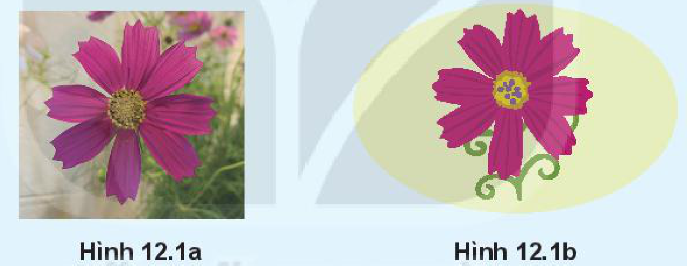
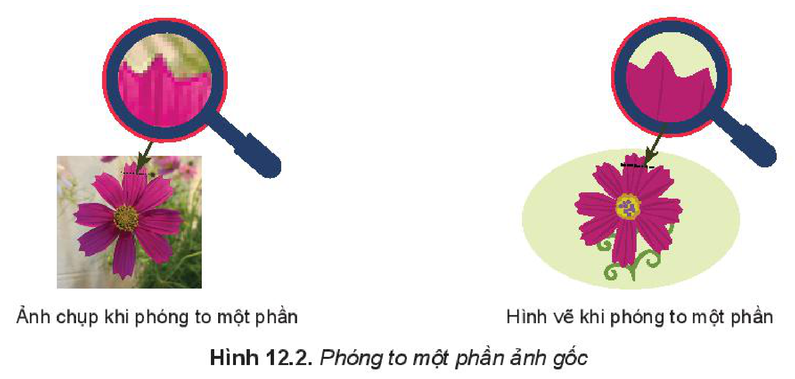
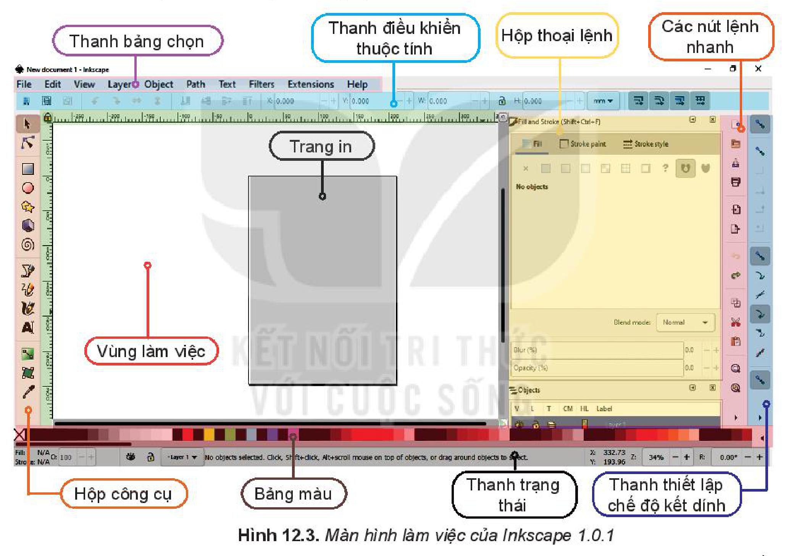
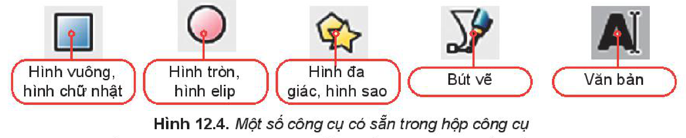
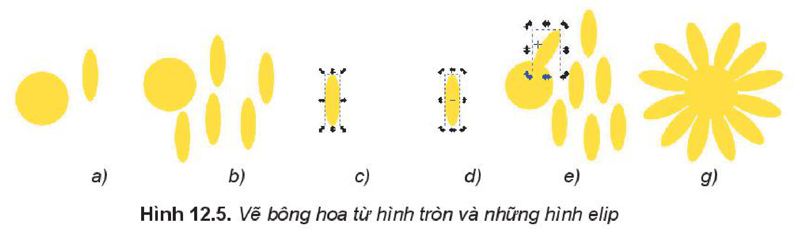
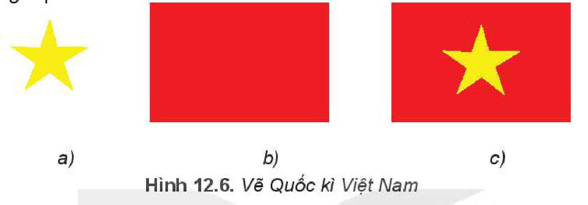
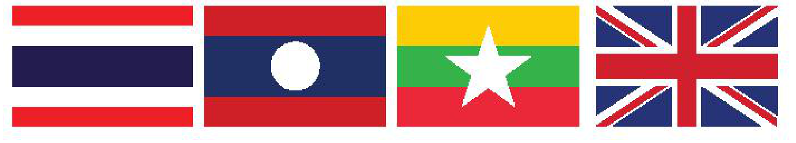
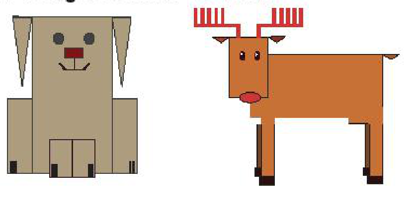

<!-- pdf:64 -->
# BÀI 12: PHẦN MỀM THIẾT KẾ ĐỒ HOẠ

## 🎯 Sau bài học này em sẽ:

- Biết được khái niệm về thiết kế đồ hoạ, phân biệt được đồ hoạ vectơ và đồ hoạ điểm ảnh.
- Sử dụng được các chức năng cơ bản của phần mềm thiết kế đồ hoạ Inkscape để vẽ hình đơn giản.

## 🔴 Khởi động

Em hãy quan sát hai hình sau và đưa ra nhận xét về màu sắc, độ nét và sự đa dạng các chi tiết của mỗi hình.

*Hình 12.1a — Hình 12.1b*

## 1. THIẾT KẾ ĐỒ HOẠ

> **Hoạt động 1: So sánh giữa ảnh chụp và hình vẽ**
>
> Thảo luận về sự khác nhau giữa ảnh chụp và hình vẽ bằng phần mềm.

**Thiết kế đồ hoạ** (graphic design) là quá trình thiết kế các thông điệp truyền thông bằng hình ảnh; giải quyết vấn đề thông qua sự kết hợp giữa hình ảnh, kiểu chữ với ý tưởng để truyền tải thông tin đến người xem.

Có hai loại đồ hoạ cơ bản: **đồ hoạ điểm ảnh** (bitmap) và **đồ hoạ vectơ** (vector). Trong đồ hoạ điểm ảnh, hình ảnh được tạo thành từ các **điểm ảnh** (pixel), mỗi điểm ảnh có màu riêng. Trong đồ hoạ vectơ, hình ảnh được xác định theo đường nét, mỗi một đường có điểm đầu và điểm cuối, được tính bằng một phương trình toán học. Sự khác biệt trong hai loại đồ hoạ này thể hiện rõ khi phóng to hình ảnh. Trong ví dụ ở phần khởi động, Hình 12.1a là ảnh chụp có độ chi tiết cao, đa dạng về màu sắc nhưng có thể bị nhoè, vỡ hình khi phóng to – hình bitmap, còn Hình 12.1b là hình vẽ bằng phần mềm thường là tổ hợp từ các hình khối đơn giản, số màu ít và giữ nguyên độ nét khi phóng to hay thu nhỏ – hình vectơ.

<!-- pdf:65 -->

*Hình 12.2. Phóng to một phần ảnh gốc (Ảnh chụp khi phóng to một phần — Hình vẽ khi phóng to một phần)*

So sánh giữa đồ hoạ điểm ảnh và đồ hoạ vectơ:

| Đồ hoạ điểm ảnh | Đồ hoạ vectơ |
| --- | --- |
| Định nghĩa bằng tập điểm. | Định nghĩa bằng phương trình toán học. |
| Phù hợp chỉnh sửa ảnh, nhiều chi tiết, màu sắc liền mạch và chân thực. | Phù hợp tạo logo, minh hoạ và bản vẽ kĩ thuật,... |
| Phóng to có ảnh hưởng chất lượng hình. | Có thể co dãn mà không bị vỡ hình. |
| Ảnh lớn, độ chi tiết cao tương ứng tệp có kích thước lớn. | Tạo bản in với kích thước tuỳ ý, độ lớn của tệp không thay đổi. |
| Không thể chuyển sang đồ hoạ vectơ mà giữ nguyên chất lượng. | Dễ dàng chuyển sang đồ hoạ điểm ảnh. |

> 💡 **Kiến thức trọng tâm**
>
> - Thiết kế đồ hoạ là tạo ra sản phẩm bằng hình ảnh, chữ để truyền tải thông tin đến người xem.
> - Hai loại đồ hoạ là đồ hoạ điểm ảnh (bitmap) và đồ hoạ vectơ.

> ❓ **Câu hỏi**
>
> 1. Ảnh chụp là loại đồ hoạ nào?
> 2. Tại sao dùng đồ hoạ vectơ phù hợp hơn dùng đồ hoạ điểm ảnh khi thiết kế logo?

## 2. PHẦN MỀM ĐỒ HOẠ

> **Hoạt động 2: Phần mềm đồ hoạ**
>
> Minh muốn thiết kế logo cho câu lạc bộ bóng đá của trường nhưng bạn ấy không biết bắt đầu từ đâu. Theo em, Minh cần những gì?

Để tạo ra một logo, trước tiên bạn Minh cần có phần mềm thiết kế đồ hoạ cài trên máy tính. Có hai loại phần mềm đồ hoạ:

- Phần mềm tạo, chỉnh sửa hình vectơ: Adobe Illustrator, CorelDRAW, **Inkscape**,...
- Phần mềm xử lí ảnh bitmap: Adobe Photoshop, **GIMP**,...

<!-- pdf:66 -->
**Inkscape**, **GIMP** là các phần mềm được sử dụng miễn phí. Tuỳ vào tính chất của công việc cần chọn loại phần mềm phù hợp. Ví dụ để thiết kế các sản phẩm cần in với kích thước đa dạng như logo, biển quảng cáo,... thì chọn phần mềm Inkscape, để xử lí ảnh dùng phần mềm GIMP.

### a) Tải và cài đặt phần mềm

Tải phần mềm tại địa chỉ: https://inkscape.org/release/inkscape-1.0/. Chọn phiên bản tương ứng với hệ điều hành đang sử dụng (Windows (32/64 bits), MacOS, ...) để tải về máy. Sau khi tải xong, cài đặt theo hướng dẫn.

### b) Giao diện của Inkscape

Nháy đúp chuột vào biểu tượng Inkscape để khởi động phần mềm Inskcape. Màn hình làm việc của Inkscape tương tự như sau:

*Hình 12.3. Màn hình làm việc của Inkscape 1.0.1*

- **Thanh bảng chọn** (Menu bar): Chứa các lệnh thường dùng liên quan đến tệp tin, các lệnh tạo và biến đổi đối tượng.
- **Hộp công cụ** (Tool box): chứa các công cụ để khởi tạo, vẽ, điều chỉnh các **đối tượng đồ hoạ**. Đây là các công cụ làm việc chính, cơ bản của phần mềm.
- **Thanh điều khiển thuộc tính** (Tool control bar): chứa thuộc tính của đối tượng đang được lựa chọn, các thuộc tính thay đổi tuỳ theo đối tượng đang chọn.
- **Vùng làm việc** (Canvas): là toàn bộ phần nền trắng, ta sẽ thực hiện việc thêm các đối tượng vào để thu được hình vẽ. Phần **trang in** ứng với kích thước khi in của sản phẩm.
- **Bảng màu** (Color Palette): chứa các màu có sẵn để thiết lập màu tô và màu vẽ của đối tượng.
- **Thanh trạng thái** (Status bar): chứa chỉ báo kiểu, lớp vẽ hiện tại, vị trí con trỏ, mức thu phóng hiện tại, thay đổi kích thước cửa sổ,...

<!-- pdf:67 -->
> 💡 **Kiến thức trọng tâm**
>
> - Có hai loại phần mềm đồ hoạ: Phần mềm tạo, chỉnh sửa hình vectơ và phần mềm xử lí ảnh bitmap.
> - Inkscape là phần mềm miễn phí để tạo, chỉnh sửa sản phẩm đồ hoạ vectơ.

> ❓ **Câu hỏi**
>
> 1. Cần thiết kế một bộ các sản phẩm bút, sổ, danh thiếp, bì thư, túi giấy. Theo em nên dùng phần mềm nào?
>    - A. Photoshop.
>    - B. Inkscape.
> 2. Em hãy cho biết có thể vẽ hình vào đâu trên màn hình làm việc của Inkscape.
>    - A. Toàn bộ vùng làm việc.
>    - B. Trong khu vực trang in.

## 3. CÁC ĐỐI TƯỢNG ĐỒ HOẠ CỦA HÌNH VẼ

> **Hoạt động 3: Sắp xếp các đối tượng**
>
> Nếu chúng ta có một quả dưa hấu và một quả cam ở trên bàn. Xác định xem cần xếp hai quả này như thế nào để:
>
> a) Nhìn thấy đủ cả hai quả, không quả nào bị che khuất.
>
> b) Chỉ nhìn thấy quả dưa hấu.
>
> c) Nhìn thấy đủ quả cam, quả dưa hấu bị che một phần.
>
> d) Nhìn thấy đủ quả dưa hấu, quả cam bị che một phần.

Khi em khởi động Inkscape, phần mềm sẽ mở một tệp trống và sẵn sàng để cho em vẽ hình. Em cũng có thể tạo tệp mới bằng lệnh `File/New...` hoặc nhấn tổ hợp phím `Ctrl + N`.

Các đối tượng được thêm vào hình bằng cách tạo ra các bản sao của các đối tượng đã có trong vùng làm việc hoặc chọn đối tượng từ hộp công cụ và vẽ vào vùng làm việc. Các đối tượng sẽ xuất hiện theo thứ tự **lớp**, đối tượng vẽ trước sẽ ở lớp dưới, đối tượng này có thể bị che khuất toàn bộ hay một phần bởi các đối tượng vẽ sau ở lớp trên.

Để thêm các đối tượng có sẵn trên hộp công cụ như hình chữ nhật, hình vuông, hình tròn, hình elip, cung tròn, ngôi sao, đa giác, hình xoắn ốc hoặc vẽ đối tượng tự do hay chèn chữ,... ta thực hiện theo ba bước:

*Bước 1:* Chọn công cụ tương ứng trên hộp công cụ.

*Hình 12.4. Một số công cụ có sẵn trong hộp công cụ (Hình vuông, hình chữ nhật; Hình tròn, hình elip; Hình đa giác, hình sao; Bút vẽ; Văn bản)*

*Bước 2:* Chỉnh tuỳ chọn trong thanh điều khiển thuộc tính nếu cần.

*Bước 3:* Xác định vị trí hình vẽ trong vùng làm việc, kéo thả chuột để vẽ hình.

Ta có thể chọn đối tượng trên hình vẽ bằng cách chọn công cụ **Select** (biểu tượng mũi tên chọn) trong hộp công cụ rồi nháy chuột vào đối tượng. Đối tượng được chọn có thể được di chuyển, phóng to, thu nhỏ, xoay, thay đổi thứ tự lớp hay tô màu,...

<!-- pdf:68 -->
Để chọn màu cho một đối tượng, ta cần xác định **màu tô** (Fill Color) và **màu vẽ** (Stroke Color). Ta chọn màu tô và màu vẽ trên bảng màu (lưu ý để chọn màu vẽ cần nhấn giữ phím `Shift` khi chọn màu).

Sau khi hoàn thành việc vẽ hình, em lưu tệp bằng lệnh `File/Save` hoặc nhấn tổ hợp phím `Ctrl + S`. Phần mềm Inkscape lưu lại sản phẩm đã tạo dưới dạng tệp hình vectơ có phần mở rộng là **svg**.

> 💡 **Kiến thức trọng tâm**
>
> Mỗi hình vẽ bao gồm các đối tượng đồ hoạ. Các đối tượng này sẽ xuất hiện theo thứ tự lớp, các đối tượng vẽ trước sẽ ở lớp dưới, đối tượng vẽ sau sẽ ở lớp trên. Ta có thể thay đổi thứ tự lớp của đối tượng.

> ❓ **Câu hỏi**
>
> Theo em, thanh công cụ nào được sử dụng nhiều nhất trong Inkscape?
>
> - A. Bảng màu.
> - B. Thanh thiết lập chế độ kết dính.
> - C. Thanh điều khiển thuộc tính.
> - D. Hộp công cụ.

## THỰC HÀNH

### Nhiệm vụ 1. Vẽ một bông hoa (Hình 12.5).

*Hướng dẫn.*

*Bước 1:* Chọn công cụ vẽ hình tròn, elip trên hộp công cụ, vẽ hình tròn và hình elip là đài hoa và cánh hoa, chọn màu bông hoa ở bảng màu (Hình 12.5a).

*Bước 2:* Chọn hình elip rồi nháy nút phải chuột, chọn `Duplicate` để có các bản sao của cánh hoa (Hình 12.5b).

*Bước 3:* Quay cánh hoa và di chuyển đến vị trí phù hợp.

- Chọn công cụ `Select` trên hộp công cụ. Nháy chuột lên một cánh hoa, nháy lần một để hiển thị chế độ phóng to thu nhỏ (Hình 12.5c), nháy lần hai để hiển thị chế độ quay (Hình 12.5d).
- Nháy chuột vào các mũi tên, kéo thả chuột để điều chỉnh cánh hoa quay hướng phù hợp (Hình 12.5e).
- Nháy chuột vào cánh hoa và di chuyển đến vị trí phù hợp (Hình 12.5g).

*Hình 12.5. Vẽ bông hoa từ hình tròn và những hình elip*

### Nhiệm vụ 2. Vẽ Quốc kì Việt Nam (Hình 12.6).

*Hướng dẫn.*

*Bước 1:* Vẽ ngôi sao 5 cánh.

- Chọn công cụ vẽ hình đa giác, hình sao trên hộp công cụ.
<!-- ocr-ok: đã đối chiếu ảnh trang 68 (trang in 67), SGK in biểu tượng công cụ đa giác/ngôi sao -->

<!-- pdf:69 -->
- Trên thanh điều khiển thuộc tính, chọn nút lệnh hình ngôi sao, đặt giá trị `Corners` là 5 và `Spoke ratio` là 0.4.
- Vẽ hình và tô màu vàng cho ngôi sao (quay cho thẳng nếu cần) (Hình 12.6a).

*Bước 2:* Vẽ hình chữ nhật tỉ lệ rộng và dài là 2 : 3, tô nền màu đỏ (Hình 12.6b). Vì hình chữ nhật vẽ sau nên khi di chuyển ngôi sao vào giữa hình chữ nhật thì ngôi sao sẽ bị che khuất.

*Bước 3:* Đưa hình chữ nhật xuống lớp dưới (Hình 12.6c). Chọn công cụ `Select` rồi chọn hình chữ nhật, nháy vào nút hạ xuống lớp dưới trên thanh điều khiển thuộc tính để đưa hình chữ nhật xuống lớp dưới.

*Hình 12.6. Vẽ Quốc kì Việt Nam*

## ✏️ Luyện tập

1. Sau khi vẽ một hình tròn trong Inkscape. Ta thực hiện liên tục các thao tác sau:
   Nháy vào công cụ `Select` trên hộp công cụ, nháy chuột lên hình tròn, nháy chuột chọn lần lượt các màu đỏ, nâu đỏ, cam trên bảng màu, giữ phím `Shift` và nháy chuột vào màu đỏ trên bảng màu.
   Em hãy xác định xem kết quả hình tròn sẽ có màu sắc như thế nào.
2. Để thay một ngôi sao thành một khối lập phương. Em sẽ tìm công cụ ở thanh công cụ nào?
   - A. Bảng màu.
   - B. Thanh điều khiển thuộc tính.
   - C. Hộp công cụ.
   - D. Hộp thoại lệnh.

## 🚀 Vận dụng

1. Hãy vẽ quốc kì các nước: Thái Lan, Lào, Myanmar và Anh.

2. Hãy vẽ các hình sau bằng các hình cơ bản.

## 📷 Danh sách hình trong bài

| Mã hình | Trang PDF | Chú thích trong SGK |
| --- | --- | --- |
| H10-tin_hoc-b12-01 | 64 | Hình 12.1a — Hình 12.1b |
| H10-tin_hoc-b12-02 | 65 | Hình 12.2. Phóng to một phần ảnh gốc |
| H10-tin_hoc-b12-03 | 66 | Hình 12.3. Màn hình làm việc của Inkscape 1.0.1 |
| H10-tin_hoc-b12-04 | 67 | Hình 12.4. Một số công cụ có sẵn trong hộp công cụ |
| H10-tin_hoc-b12-05 | 68 | Hình 12.5. Vẽ bông hoa từ hình tròn và những hình elip |
| H10-tin_hoc-b12-06 | 69 | Hình 12.6. Vẽ Quốc kì Việt Nam |
| H10-tin_hoc-b12-07 | 69 | Quốc kì các nước Thái Lan, Lào, Myanmar và Anh (Vận dụng 1) |
| H10-tin_hoc-b12-08 | 69 | Các hình ghép từ hình cơ bản (Vận dụng 2) |
