<!-- pdf:70 -->
# BÀI 13: BỔ SUNG CÁC ĐỐI TƯỢNG ĐỒ HOẠ

## 🎯 Sau bài học này em sẽ:

- Biết và sử dụng được một số chức năng của các lệnh tạo, điều chỉnh các đối tượng đồ hoạ đơn giản.
- Biết và thực hiện được các phép ghép đối tượng đồ hoạ.

## 🔴 Khởi động

Quan sát hình vẽ miếng dưa hấu ở Hình 13.1 và kể các đối tượng có trong hình vẽ. Xác định thứ tự các lớp của các đối tượng trong hình vẽ.

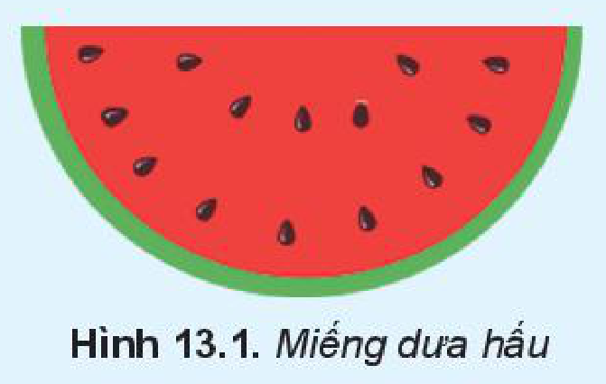
*Hình 13.1. Miếng dưa hấu*

## 1. CÁC ĐỐI TƯỢNG HÌNH KHỐI

> **Hoạt động 1: Các đối tượng hình khối**
>
> Các hình sau được vẽ từ một công cụ có sẵn của Inkscape. Theo em đó là công cụ nào? Thảo luận để tìm cách vẽ được các hình đó.
>
> 
> *Hình 13.2*

Inkscape cung cấp một số đối tượng đã được định nghĩa sẵn trong hộp công cụ như hình chữ nhật, hình vuông, hình tròn, hình elip, vòng cung, ngôi sao, đa giác,... Mỗi **hình khối** được đặc trưng bởi các thuộc tính khác nhau. Ta có thể thay đổi giá trị các thuộc tính trên thanh điều khiển thuộc tính để chỉnh hình theo ý muốn. Bảng sau đây là các thuộc tính của một số đối tượng:

*Bảng các thuộc tính cơ bản của một số hình có sẵn*

| Đối tượng | Thuộc tính | Ý nghĩa |
| --- | --- | --- |
| Hình vuông, hình chữ nhật | `W`, `H`, | Chiều rộng, chiều dài. |
| Hình vuông, hình chữ nhật | `Rx`, `Ry` | Bán kính của góc bo (bằng 0 nếu góc của hình là góc vuông). |
| Hình tròn, hình elip | `Rx`, `Ry` | Bán kính theo phương ngang và thẳng đứng. |
| Hình tròn, hình elip | `Start`, `End` | Góc của điểm đầu và điểm cuối khi sử dụng chế độ vẽ cung/hình quạt (đơn vị: độ). |

<!-- pdf:71 -->
| Đối tượng | Thuộc tính | Ý nghĩa |
| --- | --- | --- |
| Hình đa giác, hình sao | `Corners` | Số đỉnh của đa giác hoặc số cánh của hình sao. |
| Hình đa giác, hình sao | `Rounded` | Độ cong tại các đỉnh của hình. |
| Hình đa giác, hình sao | `Spoke ratio` | Tỉ lệ bán kính từ tâm đến góc trong và từ tâm tới đỉnh đầu hình sao. |
| Hình đa giác, hình sao | `Randomized` | Tham số làm méo hình ngẫu nhiên. |

> 💡 **Kiến thức trọng tâm**
>
> Ta có thể thay đổi thuộc tính của mỗi đối tượng được tạo từ công cụ có sẵn trên hình vẽ.

> ❓ **Câu hỏi**
>
> Nếu trên hình vẽ có sẵn một hình sao 5 cánh nhọn, em cần thay đổi tham số nào để các đỉnh ngôi sao trở nên cong?

## 2. THIẾT LẬP MÀU TÔ, MÀU VẼ VÀ TÔ MÀU CHO ĐỐI TƯỢNG

> **Hoạt động 2: So sánh điểm khác nhau**
>
> Quan sát các hình sau và nhận xét các hình có điểm gì khác nhau:
>
> 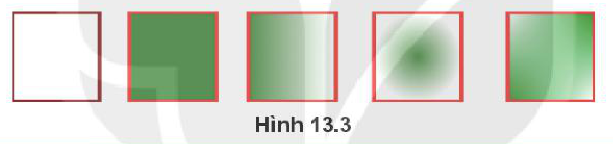
> *Hình 13.3*

Trong Inskpape có một số tuỳ chọn khác nhau cho màu tô và màu vẽ của một đối tượng. Có thể thiết lập màu tô và màu vẽ độc lập với nhau. Để tuỳ chỉnh màu tô và màu vẽ ta sử dụng hộp thoại **Fill and Stroke** sau:

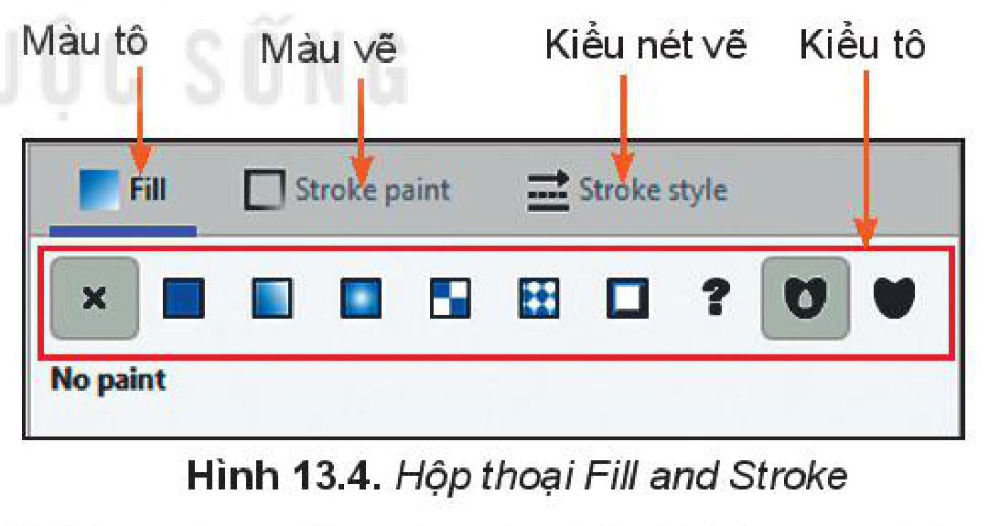
*Hình 13.4. Hộp thoại Fill and Stroke*

- Biểu tượng `X`: Không màu (trong suốt).
- Biểu tượng ô màu đồng nhất: Màu đồng nhất.
- Biểu tượng ô màu chuyển tuyến tính: Màu chuyển giữa hai hoặc nhiều màu.
- Biểu tượng ô màu chuyển từ tâm: Màu chuyển giữa hai hoặc nhiều màu từ tâm của đối tượng.
- Biểu tượng ô hoa văn: Hoa văn (đối tượng được lấp đầy bởi một mẫu hoa văn).
- Biểu tượng `?`: Huỷ đặt (đối tượng trở về trạng thái ban đầu, điều này cần thiết khi ta sao chép đối tượng và thay đổi thuộc tính cho đối tượng).
<!-- ocr-ok: đã đối chiếu ảnh trang 71 (trang in 70), SGK in các biểu tượng kiểu tô ở đầu mỗi dòng -->

*Các bước thực hiện việc chỉnh sửa nền và đường nét:*

*Bước 1:* Chọn đối tượng cần chỉnh, chọn lệnh `Objects/Fill and Stroke` (hoặc nháy nút phải chuột chọn `Fill and Stroke`) xuất hiện hộp thoại `Fill and Stroke`.

*Bước 2:* Chọn `Fill` để chọn kiểu tô cho màu tô, chọn `Stroke paint` để chọn kiểu tô cho màu vẽ, chọn `Stroke style` để thay đổi thiết lập kiểu nét vẽ và độ dày mỏng của nét.

<!-- pdf:72 -->
*Bước 3:* Tuỳ chỉnh màu sắc bằng cách chọn kiểu tô và thiết lập màu.

*Lưu ý:* Khi tô **màu chuyển** thì màu của đối tượng được tô sẽ chuyển dần từ màu này sang màu khác. Để tô màu chuyển ta sử dụng hai kiểu tô là chuyển màu tuyến tính và chuyển màu toả tròn. Nháy vào biểu tượng cây bút phía dưới của hộp thoại `Fill and Stroke` để thay đổi thông số của **gradient**. Ta có thể thay đổi thông số của gradient bằng bảng điều khiển hoặc kéo thả chuột tại các vị trí điều khiển.

Khi sử dụng kiểu tô màu đồng nhất ta có thể sao chép màu tại một vị trí nào đó trong vùng làm việc bằng cách sử dụng công cụ ống nhỏ giọt (bút chấm màu) phía dưới của hộp thoại `Fill and Stroke`.

Giá trị **Opacity** thể hiện độ trong suốt của màu khi tô lên đối tượng, độ trong suốt của màu cũng được xác định bởi giá trị **A** (alpha) khi sử dụng bảng màu.

> 💡 **Kiến thức trọng tâm**
>
> Có thể thiết lập màu tô, màu vẽ và các thuộc tính về màu tô và màu vẽ cho đối tượng.

> ❓ **Câu hỏi**
>
> 1. Để xác định đường viền của đối tượng dạng nét đứt, em cần chọn trang nào trong hộp thoại `Fill and Stroke`?
>    - A. Fill.
>    - B. Stroke paint.
>    - C. Stroke style.
>    - D. Cả A và B.
> 2. Để chỉnh thông số của gradient, em cần chọn biểu tượng nào?
>    - A. Biểu tượng dấu cộng (`+`).
>    - B. Biểu tượng cây bút.
>    - C. Biểu tượng ống nhỏ giọt.
>    - D. Biểu tượng dấu trừ (`-`).

## 3. CÁC PHÉP GHÉP ĐỐI TƯỢNG ĐỒ HOẠ

> **Hoạt động 3: Ghép các đối tượng hình khối**
>
> Tìm cách xếp ba mẩu giấy như Hình 13.5 thành một hình trái tim.
>
> *Gợi ý.* Em có thể xoay hình và xếp các hình lên nhau.
>
> 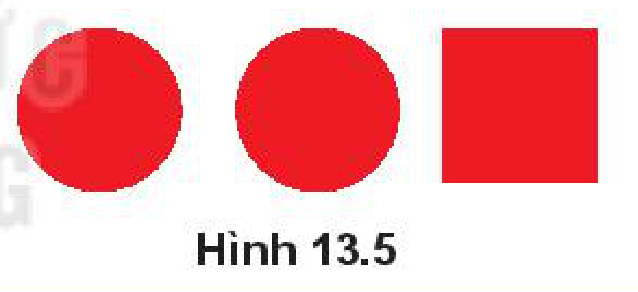
> *Hình 13.5*

Các hình phức tạp có thể thu được bằng cách ghép từ các hình đơn giản. Các **phép ghép** được sử dụng để ghép và cắt hình trong Inskcape gồm: hợp, hiệu, giao, hiệu đối xứng, chia, cắt của hai hay nhiều đối tượng đơn. Các phép ghép này được thực hiện bằng cách chọn lệnh trong bảng chọn `Path`.

- **Phép hợp** (Union, nhấn tổ hợp phím `Ctrl + +`): là tất cả các phần thuộc một trong các hình đơn.
- **Phép hiệu** (Difference, nhấn tổ hợp phím `Ctrl + -`): là phần thuộc hình lớp dưới nhưng không thuộc hình lớp trên.
- **Phép giao** (Intersection, nhấn tổ hợp phím `Ctrl + *`): là phần thuộc cả hai hình được chọn.
- **Phép hiệu đối xứng** (Exclusion, nhấn tổ hợp phím `Ctrl + ^`): là phần hình thuộc các hình trừ phần giao nhau.
- **Phép chia** (Division, nhấn tổ hợp phím `Ctrl + /`): Hình lớp dưới được chia thành các phần bởi đường nét của hình lớp trên.

<!-- pdf:73 -->
- **Phép cắt** (Cut Path, nhấn tổ hợp phím `Ctrl + Alt + /`): Cắt hình lớp dưới thành các phần bởi hai điểm giao ở viền với hình lớp trên. Kết quả là các hình mới không có màu.

Hình 13.6 thể hiện kết quả của các phép ghép trên hai đối tượng:

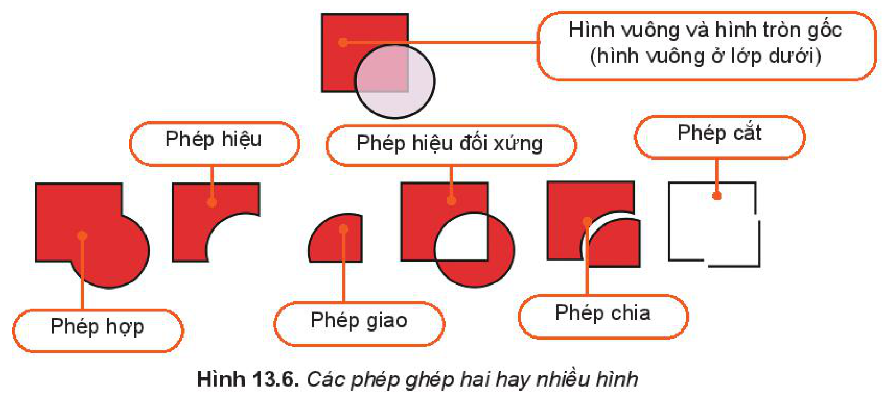
*Hình 13.6. Các phép ghép hai hay nhiều hình*

> 💡 **Kiến thức trọng tâm**
>
> Trong Inskcape, ta có thể làm các phép ghép với các hình để thu được hình mới.

> ❓ **Câu hỏi**
>
> Em hãy nêu phép ghép hình và các bước thực hiện để vẽ đám mây như Hình 13.7.
>
> 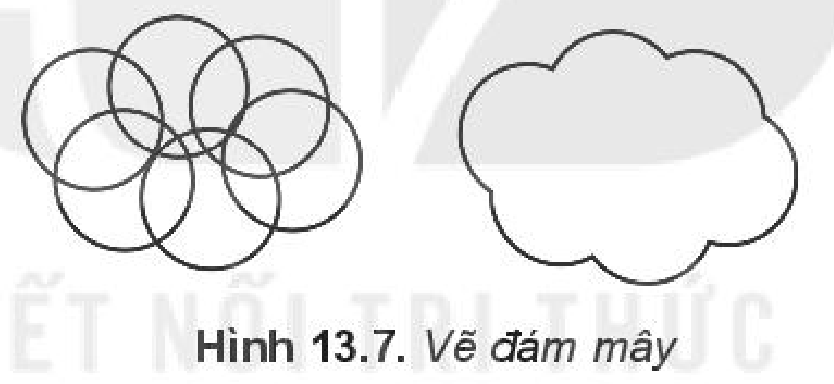
> *Hình 13.7. Vẽ đám mây*

## THỰC HÀNH

### Nhiệm vụ 1. Vẽ logo tương tự Hình 13.8.

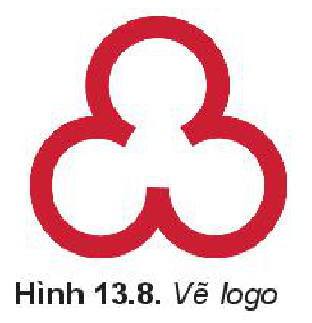
*Hình 13.8. Vẽ logo*

*Hướng dẫn.*

*Bước 1:* Chọn công cụ vẽ hình tròn, elip trên hộp công cụ, vẽ hình tròn (H.13.9a).

*Bước 2:* Chọn công cụ sửa điểm (`Edit paths by nodes`) trên hộp công cụ, kéo thả chuột ở nút tròn trên hình để thay đổi độ mở (H.13.9b).

*Bước 3:* Trên thanh điều khiển thuộc tính, chọn dạng của hình là cung tròn hở (H.13.9c).

*Bước 4:* Nháy nút phải chuột vào hình chọn `Fill and Stroke`, trong hộp thoại `Fill and Stroke` chọn `Stroke style` và thay đổi giá trị trong ô `Width` để có độ dày phù hợp (H.13.9d).

*Bước 5:* Tạo bản sao của hình (nhấn tổ hợp phím `Ctrl + D`), quay hình và di chuyển vào vị trí phù hợp (H.13.9e).

*Bước 6:* Thiết lập màu vẽ như Hình 13.8.

<!-- pdf:74 -->
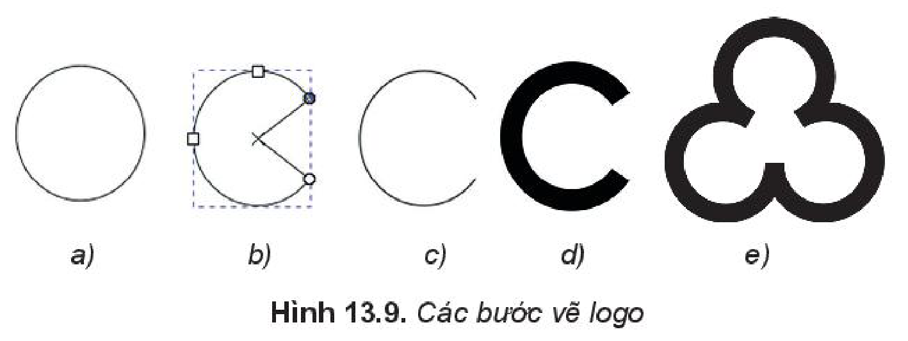
*Hình 13.9. Các bước vẽ logo*

### Nhiệm vụ 2. Vẽ hình cây như Hình 13.10.

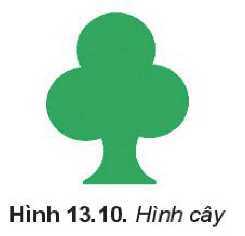
*Hình 13.10. Hình cây*

*Hướng dẫn.*

*Bước 1:* Vẽ một vòng tròn và sao chép thành ba hình, di chuyển về vị trí thích hợp (Hình 13.11a).

*Bước 2:* Vẽ hình chữ nhật và hai hình tròn như (Hình 13.11b). Chú ý: hình chữ nhật vẽ trước hoặc chuyển xuống lớp dưới hai hình tròn.

*Bước 3:* Chọn hình chữ nhật và một hình tròn, rồi chọn lệnh `Path/Difference`. Tiếp tục chọn hình vừa được tạo với hình tròn còn lại, rồi chọn lệnh `Path/Difference` (Hình 13.11c).

*Bước 4:* Di chuyển kết quả của bước 3 vào vị trí của hình trong bước 1 (Hình 13.11d).

*Bước 5:* Chọn cả bốn phần trong Hình 13.11d và chọn lệnh `Path/Union` (Hình 13.11e), tô màu xanh cho hình (Hình 13.11f).

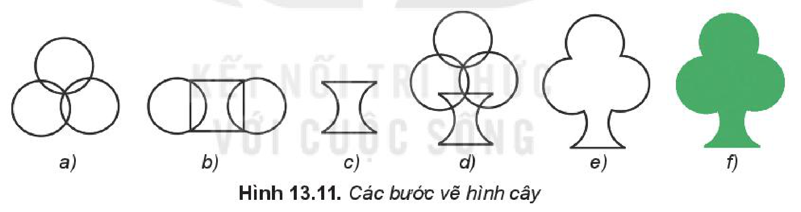
*Hình 13.11. Các bước vẽ hình cây*

### Nhiệm vụ 3. Vẽ hình cầu như Hình 13.12.

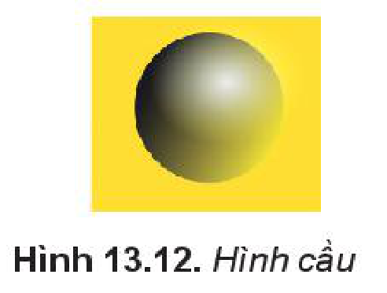
*Hình 13.12. Hình cầu*

*Hướng dẫn.*

*Bước 1:* Vẽ các hình có màu vẽ trong suốt, màu tô của hình chữ nhật là màu vàng, màu tô của hình tròn to là màu đen và màu tô của hình tròn nhỏ là màu trắng (Hình 13.13a).

*Bước 2:* Chọn hình tròn màu đen. Chọn biểu tượng tô màu chuyển tuyến tính, sau đó chọn biểu tượng cây bút trong hộp thoại `Fill and Stroke`, di chuyển các điểm điều khiển để hình tròn đen chuyển màu từ trái qua phải, từ trên xuống dưới (Hình 13.13b).

*Bước 3:* Chọn hình tròn màu trắng, chọn biểu tượng tô màu chuyển toả tròn (Hình 13.13c).

<!-- pdf:75 -->
*Bước 4:* Tăng cỡ hình của hình tròn trắng và di chuyển các hình cho phù hợp (Hình 13.13.d). Ta được sản phẩm hình cầu.

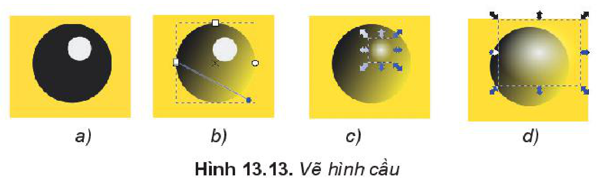
*Hình 13.13. Vẽ hình cầu*

## ✏️ Luyện tập

1. Hãy vẽ một hình sao rồi thay đổi giá trị `Rounded` và quan sát tác động của thuộc tính này. Vẽ bông hoa Hình 13.14 bằng hình sao và hình tròn.
   *Gợi ý:* Tuỳ chỉnh thuộc tính `Corners`, `Rounded`, `Spoke ratio` của ngôi sao.
2. Hãy vẽ hình như Hình 13.15.
3. Hãy vẽ chùm bóng (Hình 13.16).
   *Gợi ý:* Sử dụng hình tròn, cắt hình để tạo hiệu ứng ánh sáng, sử dụng công cụ bút vẽ tự do để vẽ dây.

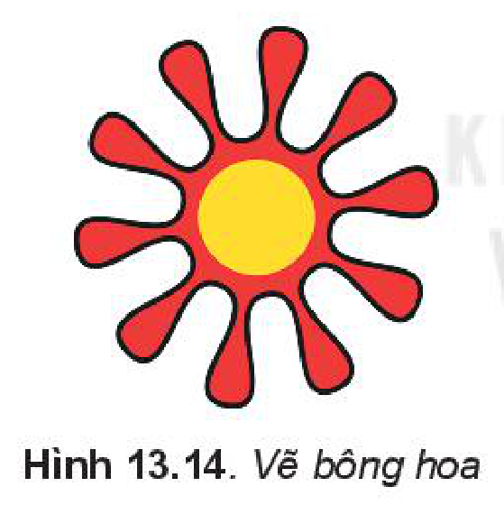
*Hình 13.14. Vẽ bông hoa*

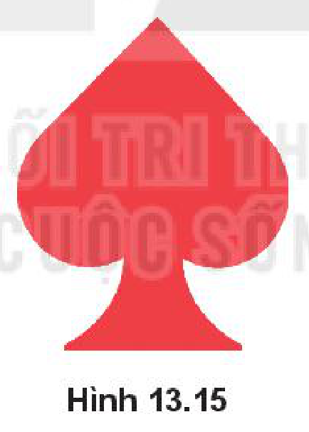
*Hình 13.15*

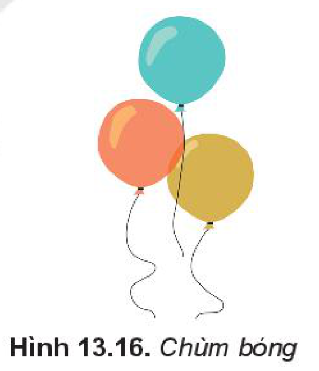
*Hình 13.16. Chùm bóng*

## 🚀 Vận dụng

1. Hãy vẽ miếng dưa hấu Hình 13.1.
2. Sử dụng kiến thức học trong bài, hãy vẽ hình trong không gian.

## 📷 Danh sách hình trong bài

| Mã hình | Trang PDF | Chú thích trong SGK |
| --- | --- | --- |
| H10-tin_hoc-b13-01 | 70 | Hình 13.1. Miếng dưa hấu |
| H10-tin_hoc-b13-02 | 70 | Hình 13.2 |
| H10-tin_hoc-b13-03 | 71 | Hình 13.3 |
| H10-tin_hoc-b13-04 | 71 | Hình 13.4. Hộp thoại Fill and Stroke |
| H10-tin_hoc-b13-05 | 72 | Hình 13.5 |
| H10-tin_hoc-b13-06 | 73 | Hình 13.6. Các phép ghép hai hay nhiều hình |
| H10-tin_hoc-b13-07 | 73 | Hình 13.7. Vẽ đám mây |
| H10-tin_hoc-b13-08 | 73 | Hình 13.8. Vẽ logo |
| H10-tin_hoc-b13-09 | 74 | Hình 13.9. Các bước vẽ logo |
| H10-tin_hoc-b13-10 | 74 | Hình 13.10. Hình cây |
| H10-tin_hoc-b13-11 | 74 | Hình 13.11. Các bước vẽ hình cây |
| H10-tin_hoc-b13-12 | 74 | Hình 13.12. Hình cầu |
| H10-tin_hoc-b13-13 | 75 | Hình 13.13. Vẽ hình cầu |
| H10-tin_hoc-b13-14 | 75 | Hình 13.14. Vẽ bông hoa |
| H10-tin_hoc-b13-15 | 75 | Hình 13.15 |
| H10-tin_hoc-b13-16 | 75 | Hình 13.16. Chùm bóng |
