<!-- pdf:76 -->
# BÀI 14: LÀM VIỆC VỚI ĐỐI TƯỢNG ĐƯỜNG VÀ VĂN BẢN

## 🎯 Sau bài học này em sẽ:

- Biết các thao tác chỉnh sửa hình.
- Thực hiện được việc vẽ, chỉnh sửa hình để được đường cong mong muốn.
- Biết tạo và định dạng văn bản.

## 🔴 Khởi động

Cần ít nhất bao nhiêu điểm để xác định một đường thẳng? Đường parabol? Đường elip?

## 1. LÀM QUEN VỚI ĐỐI TƯỢNG DẠNG ĐƯỜNG
<!-- ocr-ok: đã đối chiếu ảnh trang 76 (trang in 75), OCR nhầm chữ LÀM thành LÂM và ĐỐI thành ĐÔI -->

> **Hoạt động 1: So sánh hai hình chữ nhật**
>
> Quan sát hai hình chữ nhật ở Hình 14.1 và tìm ra điểm khác nhau giữa hai hình.
>
> 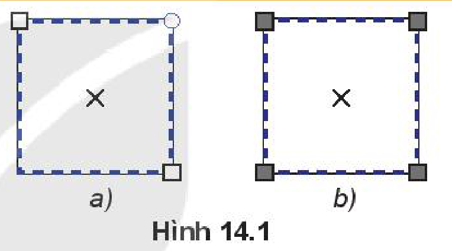
> *Hình 14.1*

Hình khối là đối tượng được định nghĩa sẵn trong Inkscape và xác định bởi các tính chất toán học chặt chẽ. Đối tượng tự do dạng đường do người dùng tạo ra, là tổ hợp của một hay nhiều đoạn cong hoặc thẳng nối lại với nhau.

Khi điều chỉnh hình khối ta thu được hình khối mới với đặc trưng không đổi, trong khi đó với các đối tượng tự do dạng đường có thể điều chỉnh các đoạn độc lập với nhau để tạo ra hình dạng khác.

Ví dụ, đối tượng hình khối chữ nhật (Hình 14.2a) cho phép thay đổi thuộc tính là độ cong tại bốn góc (Hình 14.2b). Trong khi đó Hình 14.2c và Hình 14.2d là các đối tượng tự do có hình dạng ban đầu là hình chữ nhật có thể điều chỉnh thành các hình dạng khác nhau.

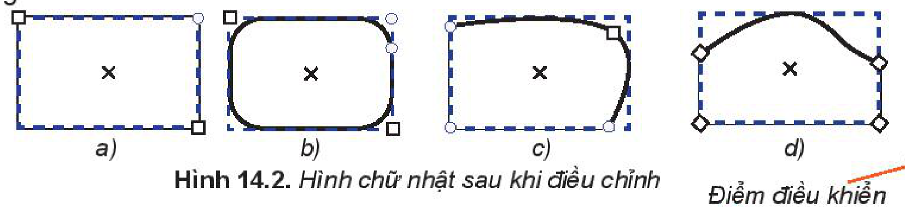
*Hình 14.2. Hình chữ nhật sau khi điều chỉnh*

**Đối tượng đường** thường được biểu diễn bởi một chuỗi các đoạn thẳng hoặc đoạn cong nối với nhau. Mỗi đoạn cong biểu diễn bởi bốn điểm, hai **điểm đầu mút** và hai **điểm điều khiển**. Mỗi điểm điều khiển kết hợp với một điểm đầu mút tạo ra tiếp tuyến của đường cong tại điểm mút tương ứng (Hình 14.3).

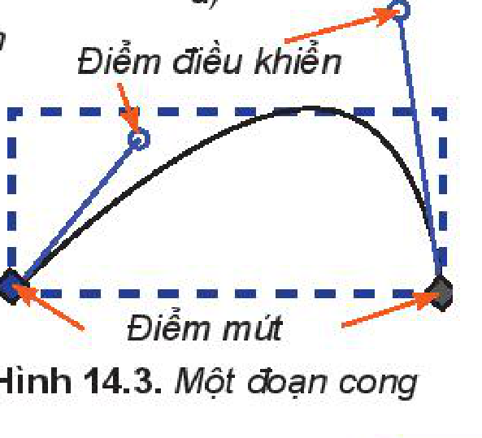
*Hình 14.3. Một đoạn cong*

<!-- pdf:77 -->
*Các bước vẽ đối tượng đường:*

*Bước 1:* Chọn công cụ **Pen** trên hộp công cụ.

*Bước 2:* Chọn kiểu trên thanh điều khiển thuộc tính để tạo đường cong.

*Bước 3:* Nháy chuột để đặt các **điểm neo** trên hình vẽ (có thể kết hợp nháy chuột và kéo thả).

*Bước 4:* Kết thúc đường bằng cách nhấn phím `Enter` hoặc nháy đúp chuột tại vị trí neo cuối cùng.

> 💡 **Kiến thức trọng tâm**
>
> Đường cong thường được biểu diễn bởi một chuỗi các đoạn cong ghép với nhau.

> ❓ **Câu hỏi**
>
> Để vẽ một hình chữ nhật tròn góc em nên dùng công cụ nào? Giải thích tại sao.

## 2. SỬ DỤNG CÔNG CỤ TINH CHỈNH ĐƯỜNG

> **Hoạt động 2: Nhận dạng điểm neo**
>
> Quan sát hình trái tim, xác định xem các điểm được đánh dấu nằm trên Hình 14.4 có những đặc điểm gì?
>
> 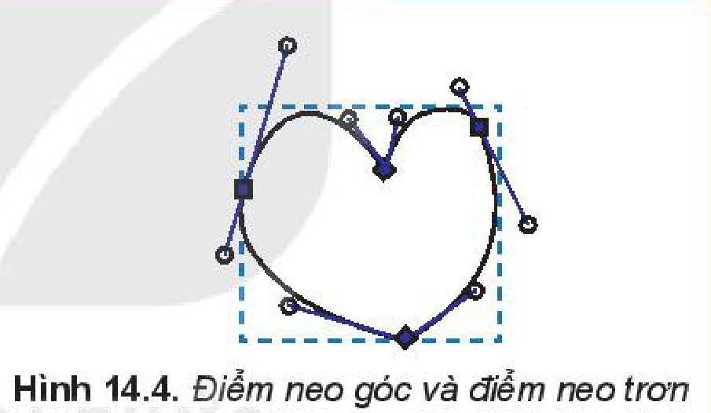
> *Hình 14.4. Điểm neo góc và điểm neo trơn*

Khi nối các đoạn thẳng hoặc đoạn cong với nhau ta thu được đường cong phức tạp hơn.

Các điểm nối giữa các đoạn có thể là **điểm neo trơn** (smooth nodes – thể hiện bởi hình vuông hay hình tròn) hoặc **điểm neo góc** (corner nodes – thể hiện bởi một hình thoi) (Hình 14.4).

Khi xác định điểm neo trên bản vẽ, các đoạn ở giữa sẽ được tự động tạo ra để nối các điểm neo đã có. Hình vẽ ban đầu có thể chưa đúng với ý tưởng hoàn chỉnh, điều này sẽ được chỉnh sửa bằng **công cụ tinh chỉnh điểm**.

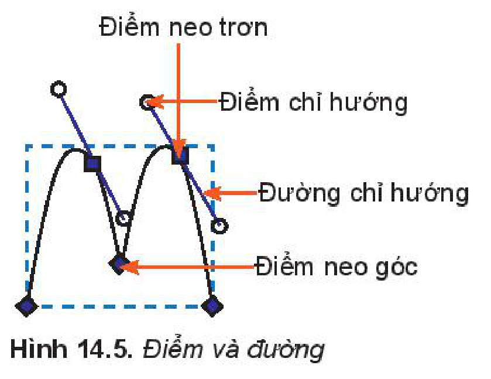
*Hình 14.5. Điểm và đường*

Độ cong tại mỗi điểm neo phụ thuộc vào **điểm chỉ hướng** và **đường chỉ hướng** tại điểm đó (Hình 14.5). Độ cong tại một điểm neo thay đổi bằng cách kéo thả điểm chỉ hướng.

<!-- pdf:78 -->
Điểm neo trơn có hai đường chỉ hướng luôn cùng phương với nhau.

*Các bước thực hiện việc chỉnh sửa điểm neo:*

*Bước 1:* Chọn công cụ tinh chỉnh điểm trên hộp công cụ.
<!-- ocr-ok: đã đối chiếu ảnh trang 78 (trang in 77), SGK in biểu tượng công cụ tinh chỉnh điểm -->

*Bước 2:* Nháy chuột vào hình muốn chỉnh sửa.

*Bước 3:* Nháy vào điểm neo cần sửa, chọn điểm neo hoặc điểm chỉ hướng rồi kéo thả chuột sang vị trí mới.

Nếu muốn loại bỏ, thêm mới hay chuyển đổi loại điểm neo,... ta chọn vào biểu tượng tương ứng trên thanh điều khiển thuộc tính (Hình 14.6).

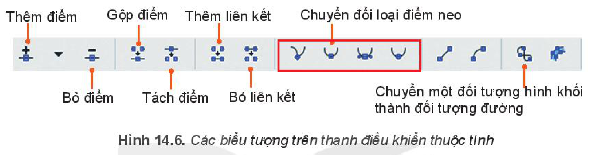
*Hình 14.6. Các biểu tượng trên thanh điều khiển thuộc tính*

Cụ thể:

- Để chuyển loại điểm neo, ta nháy chuột vào điểm neo muốn chuyển và nháy chuột vào biểu tượng điểm neo tương ứng (biểu tượng thứ nhất là neo góc, còn lại là neo trơn).
- Muốn thêm một điểm neo vào giữa hai điểm neo, ta nháy chuột vào đoạn đó trên đường cong và chọn biểu tượng thêm điểm.
- Muốn bỏ một hay nhiều điểm neo, ta chọn các điểm này và chọn biểu tượng bỏ điểm.
- Muốn gộp hai hay nhiều điểm ta chọn các điểm đó và chọn biểu tượng gộp điểm.
- Biểu tượng tách điểm sẽ tách điểm được chọn thành hai điểm rời nhau, sau khi thực hiện tách điểm, ta nháy chuột vào vị trí điểm neo và kéo ra chỗ khác sẽ thấy được hai điểm tách rời – không có đường nối liên kết ở giữa.
- Giữa hai điểm neo không liên kết và vẫn còn dư liên kết (mỗi điểm mới liên kết với không quá một điểm khác) ta có thể thêm đường nối bằng cách chọn biểu tượng thêm liên kết.
- Với hai điểm neo đã có sẵn liên kết, đoạn liên kết này có thể bỏ đi bằng cách chọn biểu tượng bỏ liên kết.

> 💡 **Kiến thức trọng tâm**
>
> Ta có thể tinh chỉnh đối tượng đường dựa vào điểm neo và các điểm, đường chỉ hướng.

> ❓ **Câu hỏi**
>
> Hình 14.7 có mấy đoạn cong? Xác định điểm neo trơn và neo góc của hình.
>
> 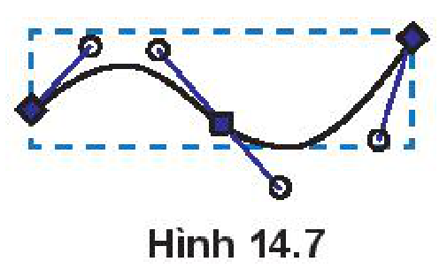
> *Hình 14.7*

<!-- pdf:79 -->
## 3. ĐỐI TƯỢNG VĂN BẢN

> **Hoạt động 3: Tìm hiểu đối tượng văn bản**
>
> Trong các cách trình bày văn bản sau, em thấy cách nào đẹp hơn? Các phần mềm em đã học có thể thiết kế văn bản như vậy không?
>
> 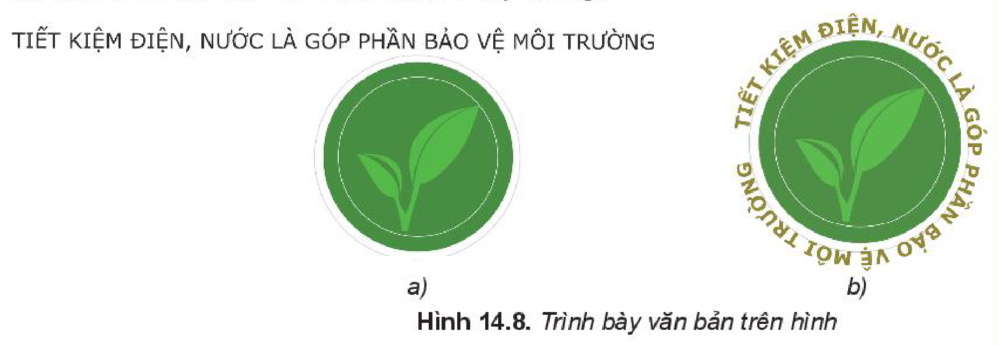
> *Hình 14.8. Trình bày văn bản trên hình*

Inkscape có thể tạo các **đối tượng văn bản** như tiêu đề và chú thích,... một cách đơn giản. Đồng thời có thể điều chỉnh các đối tượng này để cho sinh động và phù hợp với nội dung.

Để bổ sung đối tượng văn bản, ta chọn biểu tượng `A` trên hộp công cụ. Inkscape cung cấp các tính năng chuẩn để điều chỉnh một đoạn văn bản như thay đổi phông chữ, kiểu chữ, màu chữ, kích thước, khoảng cách giữa các dòng và căn chỉnh lề đoạn văn bản. Văn bản có thể nằm ngang hoặc dọc. Mỗi kí tự trong văn bản có thể được chọn và tuỳ chỉnh riêng lẻ. Văn bản có thể được đặt trong một khuôn dạng hoặc uốn lượn theo một đường có sẵn hay theo một đường có hình dạng tuỳ ý.

Ta có thể tuỳ chỉnh *từng phần* trong một đối tượng văn bản bằng cách chọn đối tượng văn bản và bôi đen phần văn bản muốn căn chỉnh, sau đó điều chỉnh tham số trên thanh điều khiển thuộc tính hoặc lệnh trong bảng chọn `Text`.

Bốn ô đầu tiên trên thanh điều khiển thuộc tính (Hình 14.9) cho phép ta thay đổi phông chữ, kiểu chữ (bình thường/ in nghiêng/ in đậm/ in đậm và nghiêng), cỡ chữ và khoảng cách giữa các dòng,...

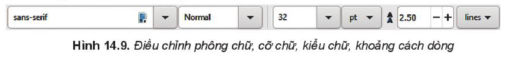
*Hình 14.9. Điều chỉnh phông chữ, cỡ chữ, kiểu chữ, khoảng cách dòng*

Năm ô phía sau điều chỉnh các thông tin như trên Hình 14.10.

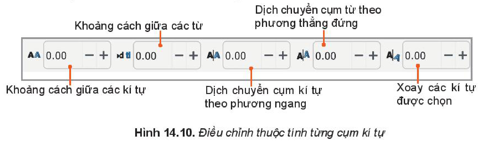
*Hình 14.10. Điều chỉnh thuộc tính từng cụm kí tự*

<!-- pdf:80 -->
Ví dụ: Với đoạn văn bản:

`TIẾT KIỆM ĐIỆN, NƯỚC LÀ GÓP PHẦN BẢO VỆ MÔI TRƯỜNG`

Trong đó ĐIỆN, NƯỚC là cụm kí tự được bôi đen, kết quả thu được khi ta thay đổi giá trị tham số như sau:

*Bảng các lệnh điều chỉnh đối tượng văn bản*

| Ý nghĩa | Lệnh | Kết quả |
| --- | --- | --- |
| Thay đổi khoảng cách giữa các kí tự | `AA 20.00` | `TIẾT KIỆM Đ I Ệ N ,   N Ư Ớ C LÀ GÓP PHẦN BẢO VỆ MÔI TRƯỜNG` |
| Thay đổi khoảng cách giữa các từ | `>d< 20.00` | `TIẾT KIỆM ĐIỆN,     NƯỚC LÀ GÓP PHẦN BẢO VỆ MÔI TRƯỜNG` |
| Dịch cụm kí tự theo chiều ngang | `A|A 20.00` | `TIẾT KIỆM      ĐIỆN, NƯỚC LÀ GÓP PHẦN BẢO VỆ MÔI TRƯỜNG` |
| Dịch cụm kí tự theo chiều thẳng đứng | `A/A 20.00` | Cụm `ĐIỆN, NƯỚC` dịch xuống dưới so với dòng chữ `TIẾT KIỆM ... LÀ GÓP PHẦN BẢO VỆ MÔI TRƯỜNG` |
| Quay cụm kí tự được chọn một góc (20 độ) | `A↻ 20.00` | Từng kí tự trong cụm `ĐIỆN, NƯỚC` quay nghiêng một góc 20 độ |
<!-- ocr-ok: đã đối chiếu ảnh trang 80 (trang in 79), cột Lệnh và Kết quả trong SGK là ảnh chụp giao diện -->

Muốn bỏ các tuỳ chỉnh đã đặt, ta chọn đối tượng văn bản rồi chọn lệnh `Text/ Remove Manual Kerns`.

Muốn đặt văn bản theo đường đã có, ta chọn đối tượng văn bản và đối tượng đường, sau đó chọn lệnh `Text/Put on Path`.

Muốn bỏ đặt văn bản theo đường, ta chọn đối tượng và chọn lệnh `Text/ Remove from Path`.

> 💡 **Kiến thức trọng tâm**
>
> Trong Inskcape, văn bản được bổ sung có thể tuỳ chỉnh theo từng kí tự và có thể đặt đoạn văn bản theo đường hoặc vào một khuôn dạng.

> ❓ **Câu hỏi**
>
> Hãy cho biết phát biểu nào sau đây là **sai** khi làm việc với đoạn văn bản trong Inkscape.
>
> - A. Trong một đoạn văn có nhiều chữ ta có thể tô mỗi chữ bằng một màu khác nhau.
> - B. Nếu đặt đoạn văn uốn lượn theo một đường, ta không thể thay đổi định dạng đó.
> - C. Trong một đoạn văn có nhiều chữ, ta có thể tuỳ chỉnh để mỗi chữ độ cao thấp khác nhau.
> - D. Ta có thể đặt đoạn văn bản theo một khuôn dạng nhất định.

## THỰC HÀNH

### Nhiệm vụ 1. Vẽ chiếc lá và tô màu cho chiếc lá (Hình 14.11).

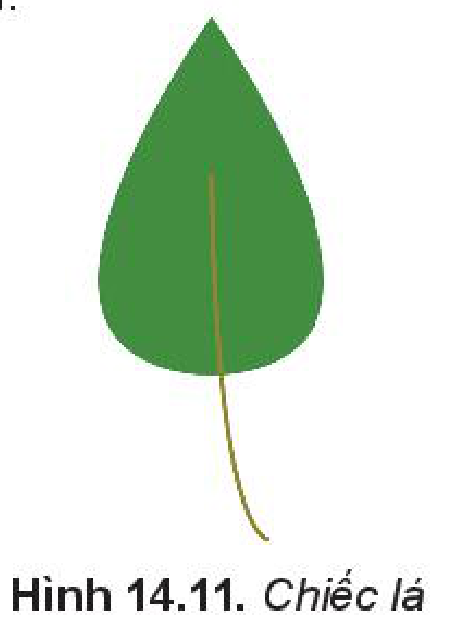
*Hình 14.11. Chiếc lá*

*Hướng dẫn.*

*Bước 1:* Vẽ hình chữ nhật ta được hình chữ nhật với các điểm neo như Hình 14.12a.

<!-- pdf:81 -->
*Bước 2:* Chọn hình chữ nhật và chọn lệnh `Path/Object to Path` để đưa hình chữ nhật thành bốn cạnh với các điểm neo rời nhau (Hình 14.12b).

*Bước 3:* Chọn hai điểm neo cạnh trên của hình chữ nhật để nhập thành một điểm bằng cách chọn biểu tượng gộp điểm trên thanh điều khiển thuộc tính. Ta được hình tam giác (Hình 14.12c).

*Bước 4:* Chọn hai điểm neo ở cạnh dưới của hình tam giác để chuyển thành điểm neo trơn bằng chọn nút lệnh chuyển thành điểm neo trơn (Hình 14.12d).

*Bước 5:* Thêm cuống lá bằng công cụ `Pen` trên thanh công cụ (Hình 14.12e).

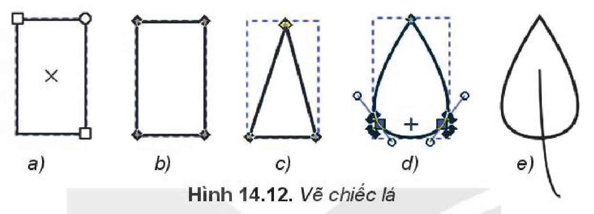
*Hình 14.12. Vẽ chiếc lá*

*Bước 6:* Tô màu cho lá như Hình 14.11.

### Nhiệm vụ 2. Viết chữ theo khuôn dạng của hình (Hình 14.13).

*Hình 14.13. Viết chữ theo hình*

*Hướng dẫn.*

*Bước 1:* Chọn công cụ `Pen`, chọn kiểu vẽ đường cong trên thanh thuộc tính điều khiển.

*Bước 2:* Nháy chuột vào các điểm để xác định điểm neo thứ nhất và thứ hai, cuối cùng nháy đúp chuột tại điểm neo thứ ba, ta nhận được hình tương tự Hình 14.14a.

*Bước 3:* Chọn công cụ tinh chỉnh điểm trên hộp công cụ, ta xác định được các điểm neo (Hình 14.14b). Chọn điểm neo thứ hai, rồi chọn biểu tượng chuyển thành điểm neo trơn để chuyển điểm neo góc thành neo trơn (Hình 14.14c).

*Bước 4:* Nháy vào biểu tượng `A` trong hộp công cụ và gõ dòng chữ "Chúc mừng năm mới!" (Hình 14.14d).

*Bước 5:* Chọn hai đối tượng đường cong và dòng chữ. Chọn lệnh `Text/Put on Path` để đặt dòng chữ uốn theo đường cong (Hình 14.14e). Tô màu cho chữ và chọn nét đường cong không màu (Hình 14.14f).

*Bước 6:* Vẽ hình tam giác tương tự nhiệm vụ 1. Sao chép, xoay, tô màu và di chuyển đến vị trí phù hợp (Hình 14.13).

<!-- pdf:82 -->
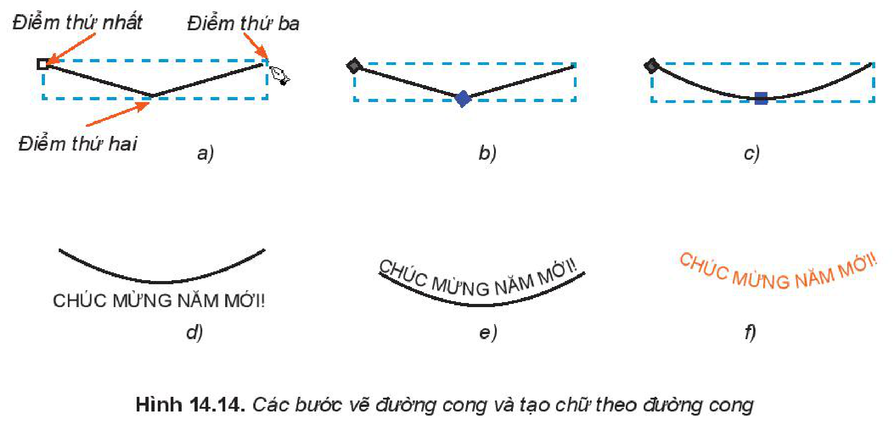
*Hình 14.14. Các bước vẽ đường cong và tạo chữ theo đường cong*

## ✏️ Luyện tập

1. Hãy vẽ hình con chuột (Hình 14.15).
2. Hãy vẽ chiếc lá và tô màu (Hình 14.16).

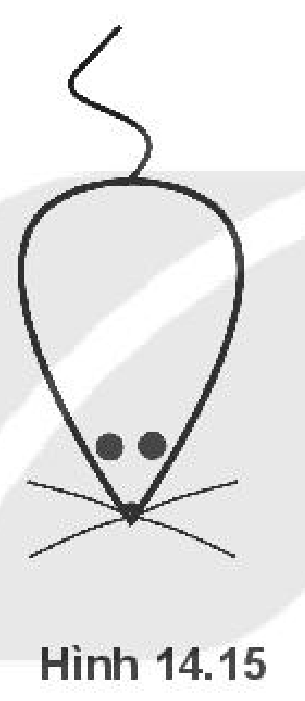
*Hình 14.15*

*Hình 14.16*

3. Em hãy mở lại hình miếng dưa hấu đã vẽ ở bài trước và thêm chi tiết để được hình như Hình 14.17.

*Hình 14.17. Vẽ dưa hấu*

## 🚀 Vận dụng

Em hãy sưu tầm các mẫu logo đơn giản và vẽ lại mẫu.

## 📷 Danh sách hình trong bài

| Mã hình | Trang PDF | Chú thích trong SGK |
| --- | --- | --- |
| H10-tin_hoc-b14-01 | 76 | Hình 14.1 |
| H10-tin_hoc-b14-02 | 76 | Hình 14.2. Hình chữ nhật sau khi điều chỉnh |
| H10-tin_hoc-b14-03 | 76 | Hình 14.3. Một đoạn cong |
| H10-tin_hoc-b14-04 | 77 | Hình 14.4. Điểm neo góc và điểm neo trơn |
| H10-tin_hoc-b14-05 | 77 | Hình 14.5. Điểm và đường |
| H10-tin_hoc-b14-06 | 78 | Hình 14.6. Các biểu tượng trên thanh điều khiển thuộc tính |
| H10-tin_hoc-b14-07 | 78 | Hình 14.7 |
| H10-tin_hoc-b14-08 | 79 | Hình 14.8. Trình bày văn bản trên hình |
| H10-tin_hoc-b14-09 | 79 | Hình 14.9. Điều chỉnh phông chữ, cỡ chữ, kiểu chữ, khoảng cách dòng |
| H10-tin_hoc-b14-10 | 79 | Hình 14.10. Điều chỉnh thuộc tính từng cụm kí tự |
| H10-tin_hoc-b14-11 | 80 | Hình 14.11. Chiếc lá |
| H10-tin_hoc-b14-12 | 81 | Hình 14.12. Vẽ chiếc lá |
| H10-tin_hoc-b14-13 | 81 | Hình 14.13. Viết chữ theo hình |
| H10-tin_hoc-b14-14 | 82 | Hình 14.14. Các bước vẽ đường cong và tạo chữ theo đường cong |
| H10-tin_hoc-b14-15 | 82 | Hình 14.15 |
| H10-tin_hoc-b14-16 | 82 | Hình 14.16 |
| H10-tin_hoc-b14-17 | 82 | Hình 14.17. Vẽ dưa hấu |
