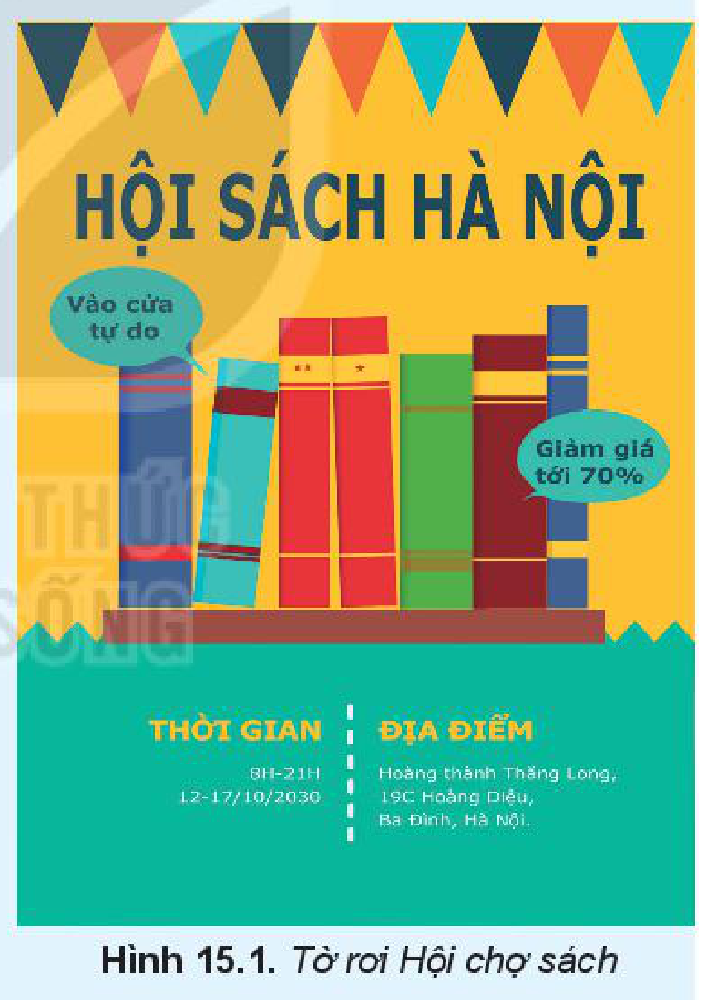
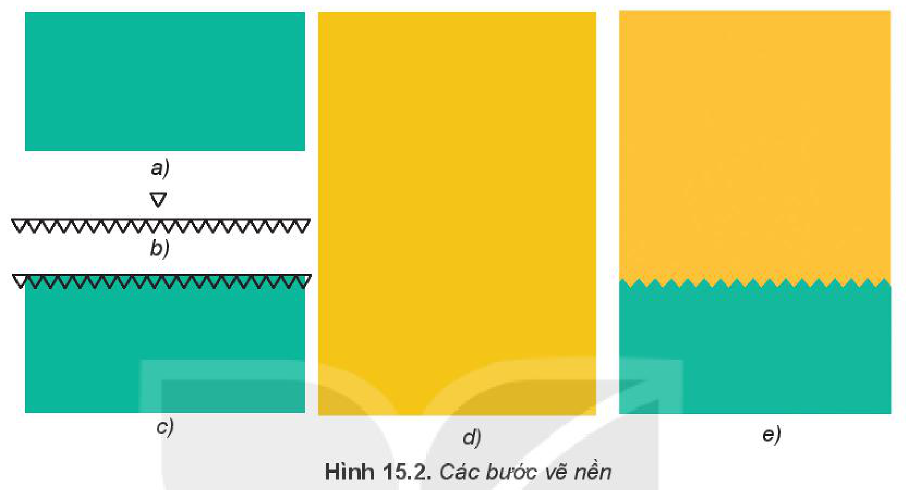
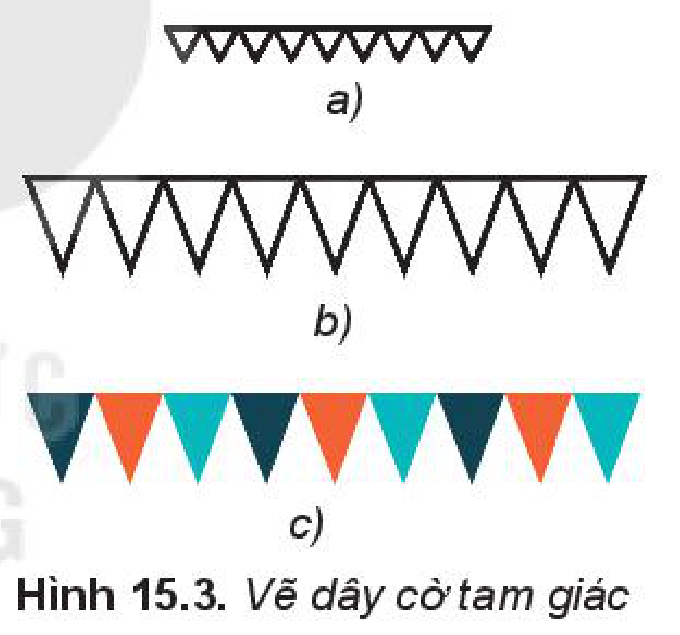
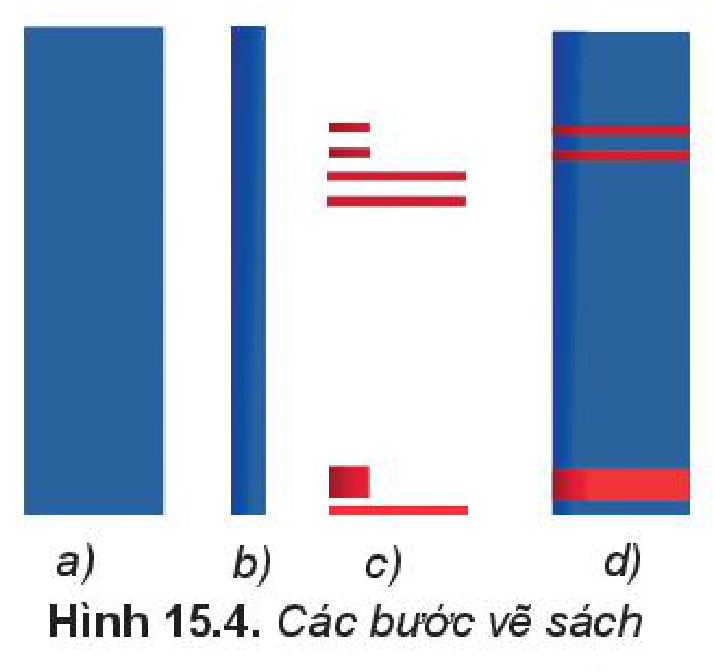
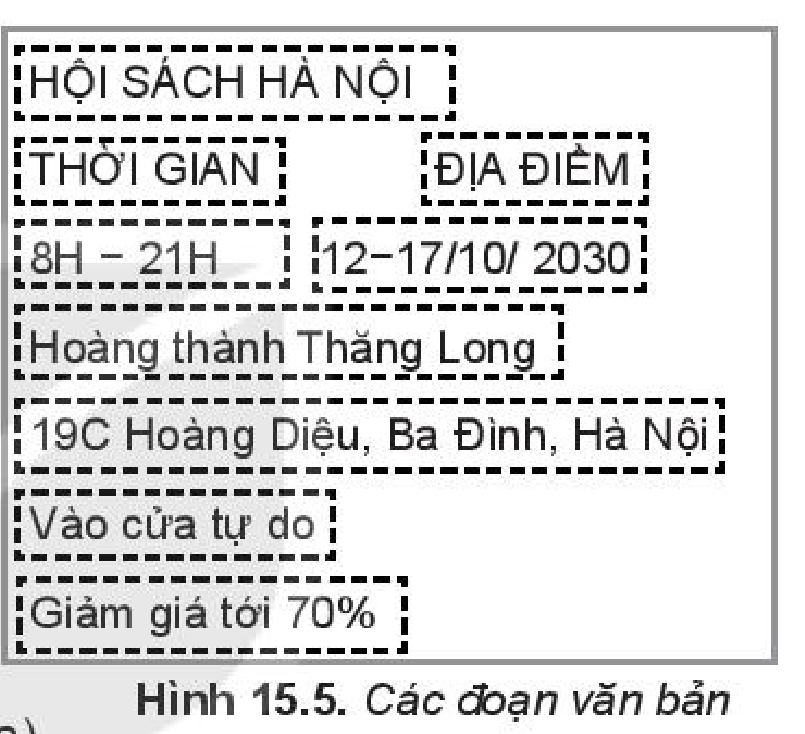
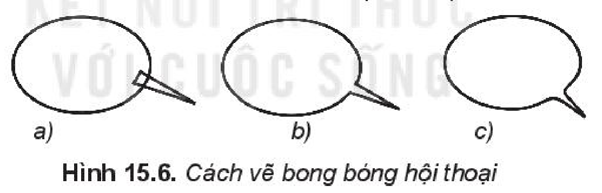
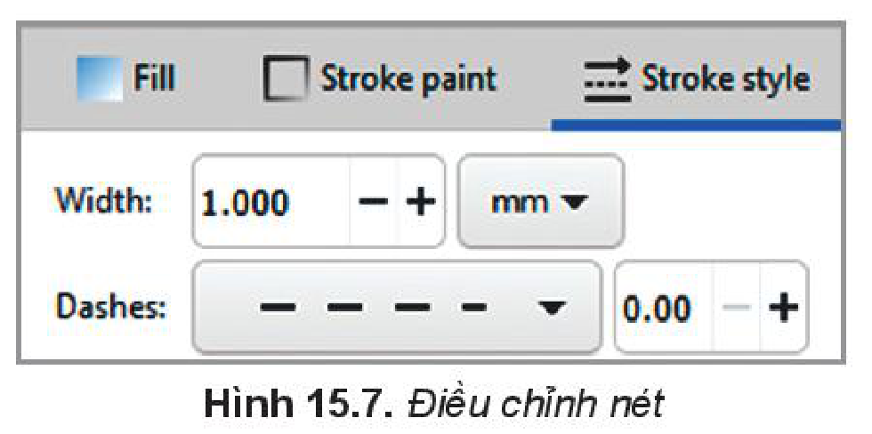
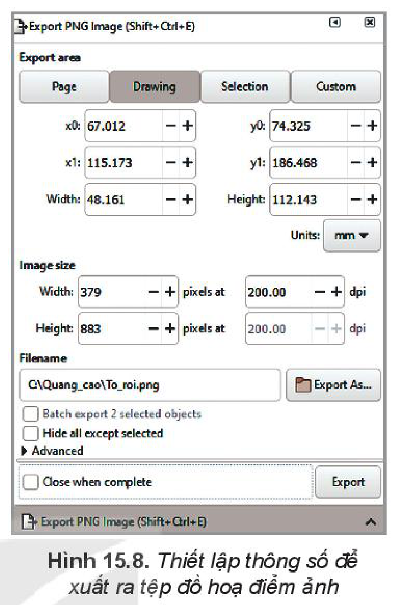
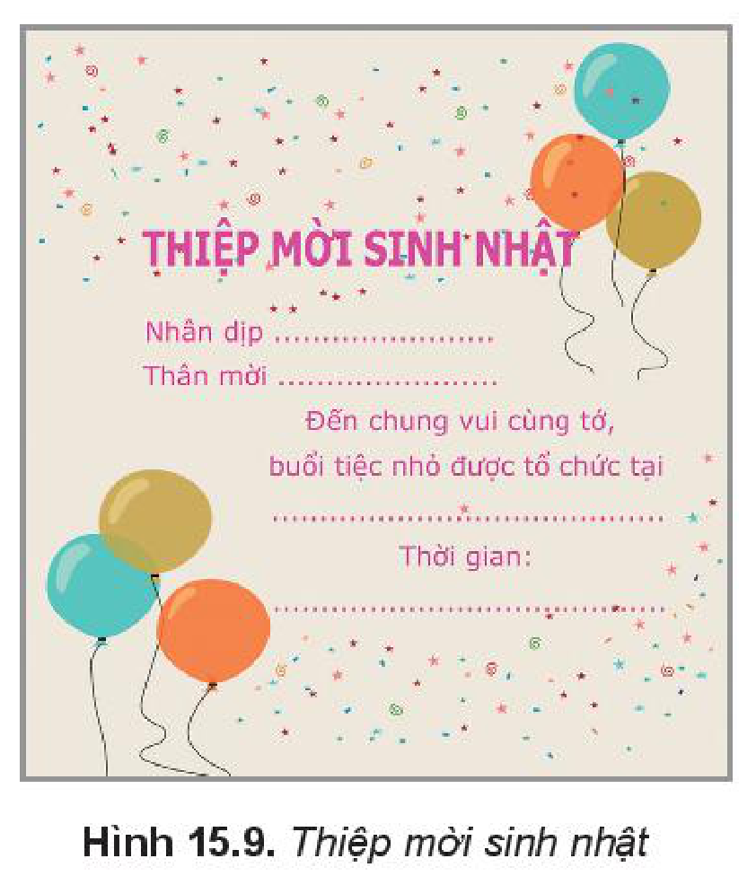

<!-- pdf:83 -->
# BÀI 15: HOÀN THIỆN HÌNH ẢNH ĐỒ HOẠ

## 🎯 Sau bài học này em sẽ:

- Tạo được sản phẩm số đơn giản, hữu ích và thực tế như thiết kế logo, tạo banner, topic quảng cáo, băng-rôn, áp phích, poster và thiệp chúc mừng,...

## 🔴 Khởi động

Em được giao nhiệm vụ thiết kế tờ rơi quảng bá cho Hội chợ sách.

Thảo luận theo nhóm để trả lời các câu hỏi sau:

- Tờ rơi cho Hội chợ sách cần cung cấp cho người xem những thông tin gì?
- Xếp thứ tự độ quan trọng của các thông tin mà nhóm đã chọn.
- Để phù hợp với nội dung là Hội chợ sách, nên có những hình ảnh minh hoạ gì?
- Phân loại các nhóm đối tượng tạo nên tờ rơi.

Tờ rơi cần được thiết kế sáng sủa, dễ nắm bắt thông tin. Trong bài thực hành này, chúng ta sẽ tiến hành thiết kế tờ rơi cho Hội chợ sách theo mẫu Hình 15.1.

*Hình 15.1. Tờ rơi Hội chợ sách*

Hướng dẫn thực hiện: Hình vẽ gồm một số thành phần, ta sẽ chia nhỏ thành các nhóm đối tượng để vẽ, sau đó sắp xếp các đối tượng vào vị trí phù hợp và chỉnh sửa màu sắc (nếu cần).

Các nhóm đối tượng cần vẽ:

1. Nền.
2. Dây cờ tam giác.
3. Sách và giá sách.
4. Các đoạn văn bản.
5. Hai hộp thoại bong bóng.
6. Đoạn nét đứt nằm giữa thời gian và địa điểm.
<!-- ocr-ok: đã đối chiếu ảnh trang 83 (trang in 82), OCR mất số thứ tự 1..6 và nhầm nằm thành năm -->

Ta sẽ tiến hành vẽ từng đối tượng.
<!-- ocr-ok: đã đối chiếu ảnh trang 83 (trang in 82), OCR nhầm tiến thành tiên và đối thành đôi -->

## THỰC HÀNH

### Nhiệm vụ 1. Vẽ nền.

*Hướng dẫn.*

*Bước 1:* Vẽ một hình chữ nhật màu xanh (Hình 15.2a).

*Bước 2:* Vẽ một hình tam giác rồi `Duplicate` và dịch chuyển sang bên cạnh để tạo ra một dây tam giác (Hình 15.2b). `Duplicate` cả dây để thu được hai dây tam giác, để riêng một dây cho phần sau.

<!-- pdf:84 -->
*Bước 3:* Chọn tất cả các tam giác trong dây ban đầu và thực hiện `Union`.

*Bước 4:* Xếp dây tam giác đã `Union` vào trên đỉnh của hình chữ nhật và thực hiện `Difference` (Hình 15.2c).

*Bước 5:* Vẽ hình chữ nhật màu vàng có chiều rộng bằng chiều rộng của hình chữ nhật xanh (Hình 15.2d) và đưa kết quả của bước 4 vào phía dưới (Hình 15.2e).

*Hình 15.2. Các bước vẽ nền*

### Nhiệm vụ 2. Vẽ dây cờ tam giác.

*Hình 15.3. Vẽ dây cờ tam giác*

*Hướng dẫn.*

*Bước 1:* Cắt ra một số tam giác từ dây tam giác đã để riêng trong nhiệm vụ 1 (Hình 15.3a).

*Bước 2:* Nhóm các tam giác lại bằng lệnh **Group**, sau đó thực hiện co dãn để được dây tam giác lớn hơn và có kích thước vừa với khung đã vẽ (Hình 15.3b).

*Bước 3:* Bỏ nhóm dây tam giác bằng lệnh **Ungroup** và tô màu phù hợp (Hình 15.3c).

Xếp dây tam giác lên trên cùng của cụm nền tờ rơi.

### Nhiệm vụ 3. Vẽ sách và giá sách.

*Hình 15.4. Các bước vẽ sách*

*Hướng dẫn.*

*Bước 1:* Vẽ một hình chữ nhật để làm gáy sách (chiều dài tương ứng với độ cao của quyển sách, chiều rộng tương ứng với độ dày) (Hình 15.4a).

*Bước 2:* Để gáy sách có độ cong ở mép ta sẽ thêm một hình chữ nhật có chiều cao bằng hình trên, chiều rộng tương ứng với đoạn rìa và tô màu chuyển sắc sao cho màu ở rìa ngoài đậm hơn và màu phía trong bằng với màu tô gáy sách phía trên (Hình 15.4b).

<!-- pdf:85 -->
*Bước 3:* Để trang trí cho gáy sách (Hình 15.4c) ta có thể:

- Thêm các vạch phía trên và dưới (lưu ý làm hai khoảng màu đậm nhạt như bước 1 và 2).
- Thêm dấu sao hoặc tròn cho những sách cùng bộ.
- Thêm tên sách và quay dọc theo chiều gáy sách.

*Bước 4:* Sắp xếp và tô màu cho phù hợp để hoàn thiện một quyển sách (Hình 15.4d).

Sau đó sao chép các quyển sách và chỉnh sửa kích cỡ các hình chữ nhật, màu sắc và chi tiết trang trí để thu được các quyển sách khác nhau.

*Bước 5:* Vẽ giá sách bằng hình chữ nhật nằm ngang và tô màu phù hợp.

Xếp sách lên giá, quay một vài quyển để tạo cảm giác tự nhiên. Gom cụm cả phần giá sách và đặt lên trên phần nền.

### Nhiệm vụ 4. Nhập các đoạn văn bản.

*Hình 15.5. Các đoạn văn bản*

*Hướng dẫn.*

*Bước 1:* Lần lượt nhập từng đoạn văn bản – mỗi nội dung là đối tượng khác nhau (Hình 15.5).
<!-- ocr-ok: đã đối chiếu ảnh trang 85 (trang in 84), OCR bị lẫn chữ với Hình 15.5 bên phải -->

*Bước 2:* Định dạng cỡ chữ và màu sắc phù hợp, sau đó sắp xếp vào vị trí tương ứng.
<!-- ocr-ok: đã đối chiếu ảnh trang 85 (trang in 84), OCR dính chữ Địnhdạngcỡchữvà và lẫn chữ từ Hình 15.5 -->

### Nhiệm vụ 5. Vẽ bóng hội thoại.

*Hướng dẫn.*

*Bước 1:* Vẽ hình elip và hình tam giác (Hình 15.6a).

*Bước 2:* Xếp hai hình chồng nhau và chọn `Union` (Hình 15.6b).

*Bước 3:* Có thể chỉnh lại như Hình 15.6c, tô màu phù hợp.

*Hình 15.6. Cách vẽ bong bóng hội thoại*

Đặt bóng hội thoại vào vị trí và đặt các cụm chữ tương ứng vào bóng hội thoại và chỉnh lớp (`layer`) để hiển thị phù hợp.

### Nhiệm vụ 6. Vẽ đoạn nét đứt nằm giữa thời gian và địa điểm.

*Hướng dẫn.*

*Bước 1:* Chọn công cụ `Pen` trên hộp công cụ. Vẽ đoạn thẳng đứng để tạo vách ngăn.

*Bước 2:* Mở hộp thoại `Fill and Stroke` điều chỉnh lại độ dày `Width` là 1 và `Dashes` là kiểu nét đứt (Hình 15.7).
<!-- ocr-ok: đã đối chiếu ảnh trang 85 (trang in 84), OCR dính chữ Bước2:MởhộpthoạiFilandStroke -->

*Hình 15.7. Điều chỉnh nét*

*Bước 3:* Điều chỉnh lại bố cục, đổi màu vẽ để thu được hình ảnh hoàn thiện như mẫu.

<!-- pdf:86 -->
### Nhiệm vụ 7. Xuất sản phẩm hoàn thiện ra định dạng đồ hoạ điểm ảnh.

*Hình 15.8. Thiết lập thông số để xuất ra tệp đồ hoạ điểm ảnh*

*Hướng dẫn.*

Sau khi hoàn tất sản phẩm, ta có thể xuất ra tệp dạng đồ hoạ điểm ảnh để dễ dàng sử dụng cho các mục đích khác bằng cách:

Chọn lệnh `File/Export PNG Image`. Cửa sổ thiết lập thông số sẽ xuất hiện như Hình 15.8. Các nội dung chính cần chú ý là:
<!-- term: Xuất tệp đồ hoạ điểm ảnh PNG -->

- **Export area** – Vùng xuất ảnh: thường dùng nhất là `Page` – trang giấy in được đóng khung và `Selection` – chỉ xuất tệp ảnh cho các đối tượng đang được chọn.
- **Image size** – Kích thước và độ phân giải của ảnh.
- **Filename** – Tên tệp và đường dẫn tới tệp.

Sau khi thiết lập các thông số, chọn lệnh `Export` để xuất ra tệp PNG.

## ✏️ Luyện tập

1. Thiết kế một thiệp đơn giản (sinh nhật, tiệc Noel...) (Hình 15.9).
2. Vẽ lại logo tiết kiệm điện nước như Hình 14.8b.

*Hình 15.9. Thiệp mời sinh nhật*

## 🚀 Vận dụng

Vẽ minh hoạ bãi biển (Hình 15.10).

*Hình 15.10. Bãi biển*
<!-- ocr-ok: đã đối chiếu ảnh trang 86 (trang in 85), OCR nhầm Bãi biển thành Bấi biên -->

## 📷 Danh sách hình trong bài

| Mã hình | Trang PDF | Chú thích trong SGK |
| --- | --- | --- |
| H10-tin_hoc-b15-01 | 83 | Hình 15.1. Tờ rơi Hội chợ sách |
| H10-tin_hoc-b15-02 | 84 | Hình 15.2. Các bước vẽ nền |
| H10-tin_hoc-b15-03 | 84 | Hình 15.3. Vẽ dây cờ tam giác |
| H10-tin_hoc-b15-04 | 84 | Hình 15.4. Các bước vẽ sách |
| H10-tin_hoc-b15-05 | 85 | Hình 15.5. Các đoạn văn bản |
| H10-tin_hoc-b15-06 | 85 | Hình 15.6. Cách vẽ bong bóng hội thoại |
| H10-tin_hoc-b15-07 | 85 | Hình 15.7. Điều chỉnh nét |
| H10-tin_hoc-b15-08 | 86 | Hình 15.8. Thiết lập thông số để xuất ra tệp đồ hoạ điểm ảnh |
| H10-tin_hoc-b15-09 | 86 | Hình 15.9. Thiệp mời sinh nhật |
| H10-tin_hoc-b15-10 | 86 | Hình 15.10. Bãi biển |
