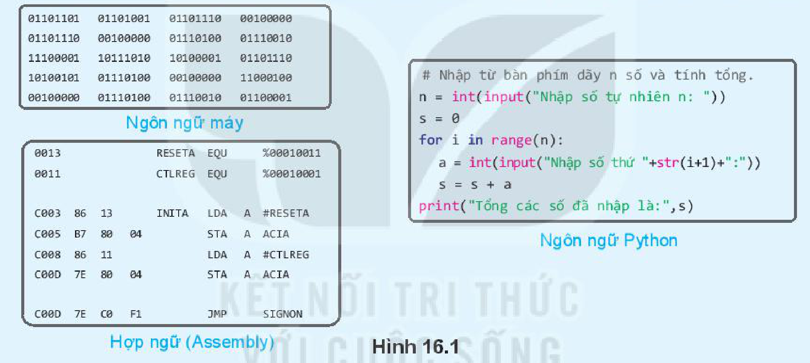
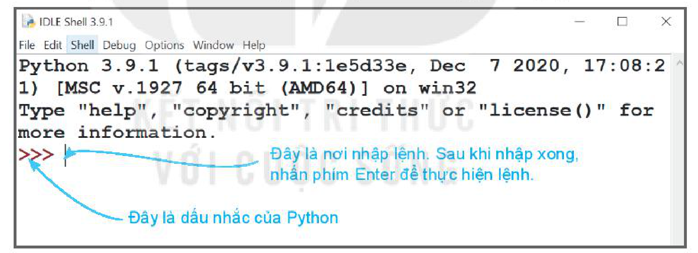
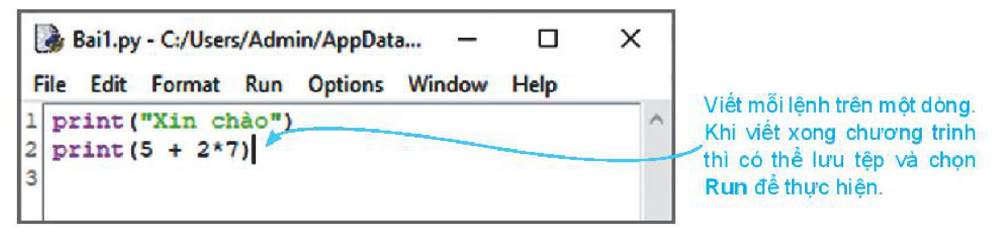
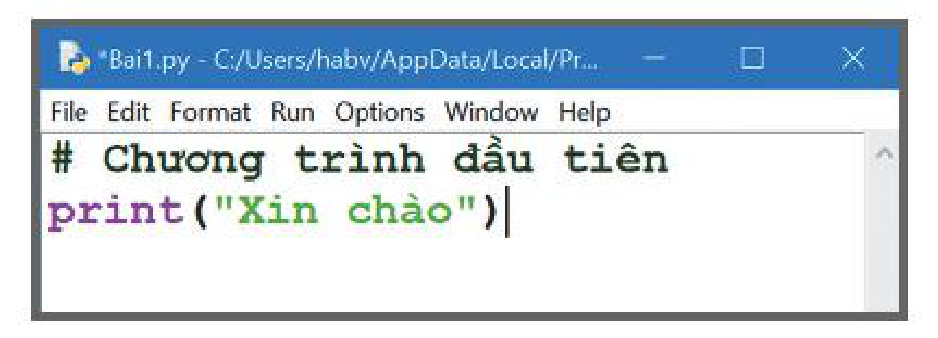

<!-- pdf:87 -->

# BÀI 16: NGÔN NGỮ LẬP TRÌNH BẬC CAO VÀ PYTHON

## 🎯 Sau bài học này em sẽ:

- Biết khái niệm ngôn ngữ lập trình bậc cao và ngôn ngữ lập trình bậc cao Python.
- Phân biệt được chế độ gõ lệnh trực tiếp và chế độ soạn thảo chương trình trong môi trường lập trình Python.
- Biết cách tạo và thực hiện một chương trình Python.

## 🔴 Khởi động

> Em hãy quan sát các đoạn chương trình được viết bằng các ngôn ngữ lập trình khác nhau trong Hình 16.1 và cho biết câu lệnh trong ngôn ngữ nào dễ hiểu nhất.



*Hình 16.1*

 ```python
 # Nhập từ bàn phím dãy n số và tính tổng.
 n = int(input("Nhập số tự nhiên n: "))
 s = 0
 for i in range(n):
     a = int(input("Nhập số thứ "+str(i+1)+":"))
     s = s + a
 print("Tổng các số đã nhập là:",s)
 ```

## 1. NGÔN NGỮ LẬP TRÌNH BẬC CAO

> **Hoạt động 1: Tìm hiểu ngôn ngữ lập trình bậc cao**
>
> 1. Ngôn ngữ lập trình là gì? Có những loại ngôn ngữ lập trình nào?
> 2. Hãy kể tên một số ngôn ngữ lập trình bậc cao mà em biết.

<!-- term: Ngôn ngữ máy -->
<!-- term: Hợp ngữ -->
<!-- term: Ngôn ngữ lập trình bậc cao -->
<!-- term: Chương trình dịch -->
Các lệnh viết bằng **ngôn ngữ máy** ở dạng mã nhị phân hay **hợp ngữ** sử dụng một số từ viết tắt (thường là tiếng Anh) không thuận tiện cho việc viết hoặc hiểu chương trình. Khó khăn đó đã được giảm bớt khi lập trình bằng **ngôn ngữ bậc cao** với các câu lệnh được viết gần với ngôn ngữ tự nhiên. Tuy nhiên, để máy tính có thể hiểu và thực hiện, các chương trình đó cần được dịch sang ngôn ngữ máy nhờ một chương trình chuyên dụng được gọi là **chương trình dịch**.

Hiện nay đã có nhiều ngôn ngữ lập trình bậc cao khác nhau, trong số đó Java, C/C++, Python,... là những ngôn ngữ lập trình thông dụng nhất.

<!-- pdf:88 -->

<!-- term: Ngôn ngữ lập trình Python -->
**Python** là ngôn ngữ lập trình bậc cao do Guido van Rossum, người Hà Lan tạo ra và ra mắt lần đầu năm 1991. Các câu lệnh của Python có cú pháp đơn giản. Môi trường lập trình Python dễ sử dụng, không phụ thuộc vào hệ điều hành, chạy trên nhiều loại máy tính, điện thoại thông minh, robot giáo dục,... Python có mã nguồn mở nên thu hút nhiều nhà khoa học cùng phát triển. Nhờ có các thư viện chương trình phong phú về trí tuệ nhân tạo, phân tích dữ liệu, kĩ thuật robot,... Python là ngôn ngữ lập trình được dùng phổ biến trong nghiên cứu và giáo dục.

> - ***Ngôn ngữ lập trình bậc cao*** có các câu lệnh được viết gần với ngôn ngữ tự nhiên giúp cho việc đọc, hiểu chương trình dễ dàng hơn.
> - **Python** là một ngôn ngữ lập trình bậc cao phổ biến trong nghiên cứu và giáo dục.

> ❓ **Câu hỏi**
>
> Theo em, viết chương trình bằng loại ngôn ngữ lập trình nào dễ nhất?
>
> A. Ngôn ngữ máy.
>
> B. Hợp ngữ.
>
> C. Ngôn ngữ lập trình bậc cao.

## 2. MÔI TRƯỜNG LẬP TRÌNH PYTHON

> **Hoạt động 2: Làm quen với môi trường lập trình Python**
>
> 1. Tìm hiểu cách viết và thực hiện các lệnh trong môi trường lập trình Python.
> 2. Phân biệt chế độ gõ lệnh trực tiếp và chế độ soạn thảo chương trình của Python.

Sau khi khởi động, màn hình làm việc của Python có dạng tương tự như sau:



*Hình 16.2. Màn hình làm việc của Python*

<!-- term: Môi trường lập trình Python -->
Phần mềm Python là một môi trường lập trình cho phép soạn thảo chương trình bằng ngôn ngữ Python, hỗ trợ gỡ lỗi, phân tích cú pháp dòng lệnh và thực hiện các chương trình Python (chương trình hoàn chỉnh hoặc từng câu lệnh). Môi trường lập trình Python có hai chế độ:

- **Chế độ gõ lệnh trực tiếp** thường được dùng để tính toán và kiểm tra nhanh các lệnh.
- **Chế độ soạn thảo** dùng để viết các chương trình có nhiều dòng lệnh.

### a) Chế độ gõ lệnh trực tiếp

<!-- term: Dấu nhắc -->
Trong một phiên làm việc với Python, em có thể *gõ lệnh trực tiếp* sau **dấu nhắc** `>>>` và nhấn phím **Enter** để thực hiện lệnh như sau:

```python
>>> <lệnh Python>
```

<!-- pdf:89 -->

### b) Chế độ soạn thảo

Trong môi trường lập trình Python, chúng ta cũng có thể soạn thảo chương trình hoàn chỉnh bằng cách chọn **File/New File** để mở ra màn hình soạn thảo chương trình tương tự như sau:



*Hình 16.3. Màn hình soạn thảo trong môi trường Python*

*Chú ý.* Người ta có thể soạn thảo chương trình Python bằng phần mềm soạn thảo văn bản hoặc phần mềm lập trình Python như Wingware, PyCharm, Thonny, Visual Studio,...

> Môi trường lập trình của Python có hai chế độ: ***chế độ gõ lệnh trực tiếp*** và ***chế độ soạn thảo***.

> ❓ **Câu hỏi**
>
> 1. Dấu nhắc chính là con trỏ soạn thảo chương trình Python. Đúng hay sai?
> 2. Việc thực hiện câu lệnh ở chế độ gõ lệnh trực tiếp và chế độ soạn thảo có điểm gì giống nhau, khác nhau?

## 3. MỘT SỐ LỆNH PYTHON ĐẦU TIÊN

> **Hoạt động 3: Làm quen với câu lệnh của Python**
>
> Quan sát một số lệnh trong chế độ gõ lệnh trực tiếp để biết chức năng của các lệnh này.

**Ví dụ 1.** Các lệnh đầu tiên.

```python
>>> 5
5
>>> 2.6
2.6
>>> "học sinh lớp 10"
'học sinh lớp 10'
```

Khi nhập `5`, Python hiểu rằng đó là **số nguyên** `5`. Nếu nhập `2.6` thì Python tự động nhận ra đó là **số thực** `2.6`. Còn nếu gõ các chữ giữa cặp dấu nháy kép `" "` thì Python hiểu là **xâu kí tự**.

<!-- term: Kiểu dữ liệu -->
Python tự nhận biết **kiểu dữ liệu** và thực hiện các phép toán ngay trên dòng lệnh.

**Ví dụ 2.** Các lệnh với phép toán.

```python
>>> 3 + 7
10
>>> 12*5
60
```

Các phép toán thông thường với số bao gồm phép cộng (`+`), trừ (`-`), nhân (`*`) và chia (`/`).

<!-- pdf:90 -->

**Ví dụ 3.** Lệnh `print()`.

```python
>>> print(12)
12
>>> print(10,3.4 + 4.1, "hoà bình")
10 7.5 hoà bình
>>> print("Dãy ba số chẵn:",2,4,6)
Dãy ba số chẵn: 2 4 6
>>> print("3 + 7 =",3+7)
3 + 7 = 10
```

*Chú ý:* nếu lệnh `print()` nhiều giá trị thì các dữ liệu này sẽ được đưa ra trên một dòng, giữa các dữ liệu sẽ có dấu cách. Lệnh `print()` có thể tính toán và đưa ra kết quả của biểu thức.

<!-- term: Lệnh print() -->
Trong Python, lệnh **`print()`** có chức năng đưa dữ liệu ra (xuất dữ liệu). Mặc định dữ liệu sẽ được in ra màn hình. Lệnh `print()` cho phép in một hoặc nhiều giá trị ra màn hình. Cú pháp lệnh `print()` như sau:

```python
print(v1, v2,..., vn)
```

trong đó `v1`, `v2`,..., `vn` là các giá trị cần đưa ra màn hình.

> - Khi nhập giá trị số hoặc xâu kí tự từ dòng lệnh, Python tự nhận biết **kiểu dữ liệu**.
> - Python có thể thực hiện các phép toán thông thường với số, phân biệt số thực và số nguyên.
> - Lệnh **`print()`** có chức năng in dữ liệu ra màn hình, có thể in ra một hoặc nhiều giá trị đồng thời.

> ❓ **Câu hỏi**
>
> 1. Kết quả của mỗi lệnh sau là gì? Kết quả đó có kiểu dữ liệu nào?
> ```python
> >>> 5/2
> >>> 12 + 1.5
> >>> "Bạn là học sinh lớp 10"
> >>> 10 + 7/2
> ```
> 2. Lệnh sau sẽ in ra kết quả gì?
> ```python
> >>> print("13 + 10*3/2 - 3*2 = ", 13 + 10*3/2 - 3*2)
> ```

## THỰC HÀNH

**Nhiệm vụ:** Sử dụng chế độ soạn thảo chương trình của Python để tạo, nhập và chạy chương trình đầu tiên có tên `Bai1.py` như sau:

<!-- term: Chú thích lệnh -->
`Bai1.py`

 ```python
 # Chương trình đầu tiên    # Kí hiệu # là vị trí bắt đầu dòng chú thích lệnh của Python.
 print("Xin chào!")
 ```

**Hướng dẫn.**

*Bước 1:* Nháy đúp chuột vào biểu tượng của Python để khởi động.

<!-- pdf:91 -->

*Bước 2:* Chọn chế độ soạn thảo chương trình của môi trường lập trình Python: Trong môi trường lập trình Python, chọn **File/New**.

*Bước 3:* Nhập nội dung chương trình như Hình 16.4.



*Hình 16.4*

*Bước 4:* Chọn **File/Save** hoặc nhấn tổ hợp phím **Ctrl + S** để lưu tệp.

*Bước 5:* Chọn **Run/Run module** hoặc nhấn phím **F5** để thực hiện chương trình.

<!-- term: Lệnh quit() -->
<!-- term: Lệnh exit() -->
*Bước 6:* Để kết thúc một phiên làm việc, nháy nút `X` ở góc trên bên phải màn hình hoặc gõ lệnh **`quit()`** hoặc lệnh **`exit()`** rồi nhấn phím **ENTER**. Ví dụ:

```python
>>> quit()
```

## ✏️ Luyện tập

1. Hãy viết lệnh để tính giá trị các biểu thức sau trong chế độ gõ lệnh trực tiếp của Python:
   a) $10 + 13$
   b) $20 - 7$
   c) $3 \times 10 - 16$
   d) $12/5 + 13/6$

2. Các lệnh sau có lỗi không? Vì sao?
```python
>>> 3 + * 5
>>> "Bạn là học sinh, bạn tên là "Nguyễn Việt Anh""
```

3. Viết các lệnh in ra màn hình thông tin như sau:
   a) `1 x 3 x 5 x 7 = 105.`
   b) `Bạn Hoa năm nay 16 tuổi.`

## 🚀 Vận dụng

1. Ngoài cách viết xâu kí tự giữa cặp dấu nháy đơn hoặc nháy kép còn có thể viết giữa cặp ba dấu nháy kép. Nếu một xâu được viết giữa cặp ba dấu nháy kép thì chúng ta có thể dùng phím **Enter** để xuống dòng ở giữa xâu. Hãy thực hiện lệnh sau và quan sát kết quả:
```python
>>> print("""Không có việc gì khó
Chỉ sợ lòng không bền
Đào núi và lấp biển
Quyết chí ắt làm nên""")
```

2. Viết chương trình Python in ra màn hình bảng nhân trong phạm vi 10.

## 📷 Danh sách hình trong bài

| Mã hình | Trang PDF | Vị trí trong bài | Chú thích gốc |
| --- | --- | --- | --- |
| H10-tin_hoc-b16-01 | 87 | Khởi động | Hình 16.1 |
| H10-tin_hoc-b16-02 | 88 | Mục 2 | Hình 16.2. Màn hình làm việc của Python |
| H10-tin_hoc-b16-03 | 89 | Mục 2.b | Hình 16.3. Màn hình soạn thảo trong môi trường Python |
| H10-tin_hoc-b16-04 | 91 | Thực hành, Bước 3 | Hình 16.4 |
