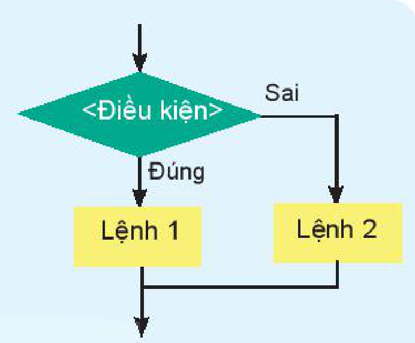
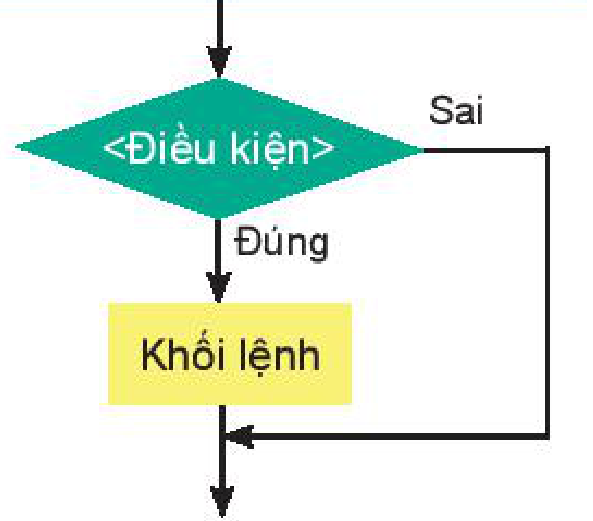
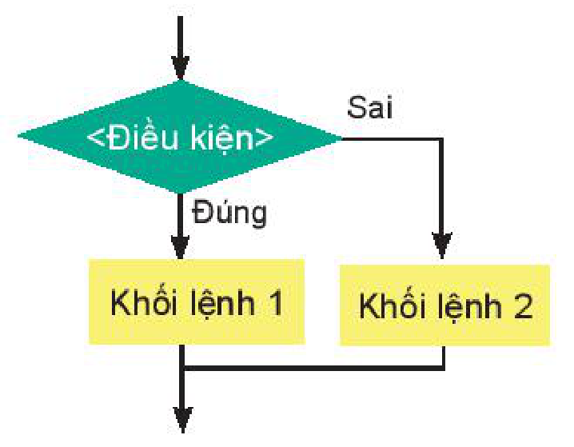

<!-- pdf:102 -->

# BÀI 19: CÂU LỆNH RẼ NHÁNH IF

## 🎯 Sau bài học này em sẽ:

- Biết và trình bày được các phép toán với kiểu dữ liệu lôgic.
- Sử dụng được lệnh rẽ nhánh `if` trong lập trình.

## 🔴 Khởi động

> Trong cuộc sống, chúng ta vẫn thường gặp các tình huống một việc được thực hiện hay không phụ thuộc vào một điều kiện. Ví dụ, em dự định, nếu ngày mai trời không mưa em sẽ đi chơi cùng bạn, ngược lại nếu trời mưa em sẽ ở nhà làm bài tập. Các tình huống như vậy trong lập trình được gọi là rẽ nhánh. Em hãy điền thông tin ở tình huống trên vào vị trí `<Điều kiện>` và lệnh tương ứng trong sơ đồ cấu trúc rẽ nhánh ở Hình 19.1.



*Hình 19.1*

## 1. BIỂU THỨC LÔGIC

> **Hoạt động 1: Khái niệm biểu thức lôgic**
>
> Biểu thức nào sau đây có thể đưa vào vị trí `<điều kiện>` trong lệnh:
> Nếu `<điều kiện>` thì `<lệnh>` của các ngôn ngữ lập trình bậc cao?
>
> A. `m, n = 1, 2.`
>
> B. `a + b > 1.`
>
> C. `a * b < a + b.`
>
> D. `12 + 15 > 2 * 13.`
<!-- ocr-ok: đã đối chiếu ảnh trang 102, tiêu đề Hoạt động 1 chữ trắng trên nền cam và các biểu thức A, B, C, D bị OCR nhận diện sai -->

<!-- term: Biểu thức lôgic -->
Trong Python, **biểu thức lôgic** là biểu thức chỉ nhận giá trị `True` (đúng) hoặc `False` (sai). Biểu thức lôgic đơn giản nhất là các biểu thức so sánh số hoặc xâu kí tự. Trong Hoạt động 1, các phương án B, C, D là biểu thức lôgic.

Quan sát các lệnh sau để nhận biết kiểu dữ liệu lôgic.
<!-- ocr-ok: đã đối chiếu ảnh trang 102, OCR nhận diện sai dấu từ để và kiểu -->

```python
>>> a,b,s = 10,2,"Number"    # Gán a = 10, b = 2, s = "Number"
>>> a > 10
False                        # a > 10 là sai, b < 3 là đúng.
>>> b < 3
True
>>> s == "number"            # s và "number" là hai xâu có giá trị khác nhau.
False
```

<!-- term: Các phép so sánh trong Python -->
Các **phép so sánh** các giá trị số trong Python:

| Phép so sánh | Ý nghĩa | Phép so sánh | Ý nghĩa | Phép so sánh | Ý nghĩa |
| --- | --- | --- | --- | --- | --- |
| `<` | nhỏ hơn | `>` | lớn hơn | `==` | bằng nhau |
| `<=` | nhỏ hơn hoặc bằng | `>=` | lớn hơn hoặc bằng | `!=` | khác nhau |
<!-- ocr-ok: đã đối chiếu ảnh trang 102, bảng các phép so sánh bị OCR dính chữ -->

*Chú ý:* Với xâu kí tự cũng có đầy đủ các phép so sánh (sẽ học sau).

<!-- term: Phép toán lôgic -->
Các **phép toán trên kiểu dữ liệu lôgic** bao gồm phép **`and`** (và), **`or`** (hoặc) và **`not`** (phủ định). Bảng các phép toán lôgic như sau:

<!-- pdf:103 -->

**Phép toán `and`**

| `X` | `Y` | `X and Y` |
| --- | --- | --- |
| `True` | `True` | `True` |
| `True` | `False` | `False` |
| `False` | `True` | `False` |
| `False` | `False` | `False` |

**Phép toán `or`**

| `X` | `Y` | `X or Y` |
| --- | --- | --- |
| `True` | `True` | `True` |
| `True` | `False` | `True` |
| `False` | `True` | `True` |
| `False` | `False` | `False` |

**Phép toán `not`**

| `X` | `not X` |
| --- | --- |
| `True` | `False` |
| `False` | `True` |

**Ví dụ.** Cho các lệnh sau và dự đoán giá trị của các biến lôgic `a`, `b`, `c`.

```python
>>> x, y, z = 10, 5, 9
>>> b = x < 11 and z > 5
>>> c = x > 15 or y < 9
>>> a = not b
```

**Giải thích.** Ta có `x = 10, z = 9` do đó `x < 11` là đúng, `z > 5` đúng. Theo bảng phép toán `and` ta có `b = x < 11 and z > 5` nhận giá trị đúng.

Ta lại có: `x > 15` sai (vì `x = 10`) nhưng `y < 9` đúng (vì `y = 5`). Theo bảng phép toán `or` suy ra `c = x > 15 or y < 9` nhận giá trị đúng.

Cuối cùng, vì `b` là đúng nên `a = not b` sẽ nhận giá trị sai.

> - **Biểu thức lôgic** là biểu thức chỉ nhận giá trị `True` hoặc `False`. Giá trị các biểu thức lôgic thuộc kiểu `bool`.
> - **Các phép toán trên kiểu dữ liệu lôgic** là **`and`** (và), **`or`** (hoặc) và **`not`** (phủ định).

> ❓ **Câu hỏi**
>
> Mỗi biểu thức sau có giá trị `True` hay `False`?
> a) `100%4 == 0`
> b) `111//5 != 20 or 20%3 != 0`
<!-- ocr-ok: đã đối chiếu ảnh trang 103, câu hỏi dẫn bị OCR bỏ sót -->

## 2. LỆNH IF

> **Hoạt động 2: Cấu trúc lệnh if trong Python**
>
> Cho trước số tự nhiên `n` (được gán hoặc nhập từ bàn phím). Đoạn chương trình như sau kiểm tra `n > 0` thì thông báo `"n là số lớn hơn 0"`.
> ```python
> if n > 0:
>     print("n là số lớn hơn 0")
> ```
> Em có nhận xét gì về cấu trúc lệnh `if`? Sau `<điều kiện>` lệnh `if` có kí tự gì? Lệnh `print()` được viết như thế nào?

<!-- term: Câu lệnh rẽ nhánh if -->
<!-- term: Câu lệnh rẽ nhánh dạng thiếu -->
Để xử lí các tình huống rẽ nhánh, giống như các ngôn ngữ lập trình khác, Python cũng có các câu lệnh để mô tả cấu trúc rẽ nhánh:

***Câu lệnh rẽ nhánh dạng thiếu:***

```python
if <điều kiện>:    # Sau điều kiện cần có dấu hai chấm ":".
    <khối lệnh>    # Nhóm, khối lệnh tiếp theo cần viết lùi vào và thẳng hàng, mặc định là 1 tab hay 4 dấu cách.
```



*Hình 19.2*

<!-- pdf:104 -->

Khi thực hiện lệnh, Python sẽ kiểm tra `<điều kiện>` nếu đúng thì thực hiện `<khối lệnh>`, ngược lại thì bỏ qua chuyển sang lệnh tiếp theo sau lệnh `if`.

<!-- term: Câu lệnh rẽ nhánh dạng đủ -->
***Câu lệnh rẽ nhánh dạng đủ:***

```python
if <điều kiện>:      # Từ khoá if và else cần viết thẳng lề trái.
    <khối lệnh 1>    # Các khối lệnh 1 và khối lệnh 2 cần viết lùi vào và thẳng hàng, mặc định là 1 tab hay 4 dấu cách.
else:
    <khối lệnh 2>
```

Khi thực hiện lệnh, Python sẽ kiểm tra `<điều kiện>` nếu đúng thì thực hiện `<khối lệnh 1>`, ngược lại thì thực hiện `<khối lệnh 2>`.

Ví dụ, nếu `a`, `b` là hai số đã được tạo thì lệnh sau sẽ in ra giá trị tuyệt đối của hiệu hai số:

```python
if a > b:
    print(a - b)
else:
    print(b - a)
```



*Hình 19.3*

<!-- term: Khối lệnh trong Python -->
*Chú ý:* Các **khối lệnh** trong Python đều cần viết sau dấu `":"` và lùi vào, thẳng hàng. Đây là điểm khác biệt của Python với các ngôn ngữ lập trình khác.

> **Câu lệnh rẽ nhánh `if`** thể hiện cấu trúc rẽ nhánh trong Python. Khối lệnh rẽ nhánh của `if` được viết sau dấu `":"`, cần viết lùi vào và thẳng hàng.

> ❓ **Câu hỏi**
>
> Đoạn chương trình sau thực hiện công việc gì?
> ```python
> k = int(input("Nhập một số nguyên dương: "))
> if k <= 0:
>     print("Bạn nhập sai rồi!")
> ```

## THỰC HÀNH

**Các bài tập liên quan đến kiểu dữ liệu `bool` và lệnh `if`.**

**Nhiệm vụ 1.** Viết chương trình nhập số tự nhiên `n` từ bàn phím. Sau đó thông báo số em đã nhập là số chẵn hay số lẻ phụ thuộc vào `n` là chẵn hay lẻ.

**Hướng dẫn.** Để kiểm tra một số tự nhiên `n` là chẵn hay lẻ, ta dùng phép toán lấy số dư `n%2`. Nếu số dư bằng `0` thì `n` là số chẵn, ngược lại `n` là số lẻ. Chương trình có thể như sau:

```python
n = int(input("Nhập số tự nhiên n: "))
if n%2 == 0:
    print("Số đã nhập là số chẵn.")
else:
    print("Số đã nhập là số lẻ.")
```

<!-- pdf:105 -->

**Nhiệm vụ 2.** Giả sử giá điện sinh hoạt trong khu vực gia đình em ở được tính luỹ kế theo từng tháng như sau (giá tính theo từng kWh điện tiêu thụ).

- Với mức điện tiêu thụ từ 0 đến 50 kWh, giá thành mỗi kWh là 1,678 nghìn đồng.
- Với mức từ 51 đến 100, giá thành mỗi kWh là 1,734 nghìn đồng.
- Từ mức 101 trở lên, giá thành mỗi kWh là 2,014 nghìn đồng.

Viết chương trình nhập số điện tiêu thụ trong tháng của gia đình em và tính số tiền điện phải trả.

**Hướng dẫn.** Gọi `k` là số kWh điện tiêu thụ của gia đình em. Khi đó theo cách tính luỹ kế trên chúng ta cần tính dựa trên các điều kiện sau:

- Nếu $k \le 50$ thì số tiền cần trả là $k \times 1{,}678$ nghìn đồng.
- Nếu $50 < k \le 100$ thì số tiền cần trả là $50 \times 1{,}678 + (k - 50) \times 1{,}734$ nghìn đồng.
- Nếu $100 < k$ thì số tiền cần trả là: $50 \times 1{,}678 + 50 \times 1{,}734 + (k - 100) \times 2{,}014$ nghìn đồng.

<!-- term: Lệnh round() -->
Chúng ta sử dụng lệnh **`round(t)`** để làm tròn số thực `t`. Chú ý trong máy tính dùng dấu `"."` để viết các số thập phân. Chương trình có thể như sau:

```python
k = float(input("Nhập số kWh tiêu thụ điện nhà em: "))
if k<= 50:
    t = k*1.678
else:
    if k <= 100:
        t = 50*1.678 + (k-50)*1.734
    else:
        t = 50*1.678 + 50*1.734 + (k-100)*2.014
print("Số tiền điện phải trả là:",round(t), "nghìn đồng")
```

## ✏️ Luyện tập

1. Viết biểu thức lôgic ứng với mỗi câu sau:
   a) Số $x$ nằm trong khoảng $(0; 10)$.
   b) Số $y$ nằm ngoài đoạn $[1; 2]$.
   c) Số $z$ nằm trong đoạn $[0; 1]$ hoặc $[5; 10]$.

2. Tìm một vài giá trị `m`, `n` thoả mãn các biểu thức sau:
   a) `100%m == 0 and n%5 != 0`
   b) `m%100 == 0 and m%400 != 0`
   c) `n%3 == 0 or (n%3 != 0 and n%4 == 0)`
<!-- ocr-ok: đã đối chiếu ảnh trang 105, các phép toán % và số 0 bị OCR nhận diện sai -->

## 🚀 Vận dụng

1. Giá bán cam tại siêu thị tính như sau: nếu khối lượng cam mua dưới 5 kg thì giá bán là 12 000 đồng/kg, nếu khối lượng mua lớn hơn hoặc bằng 5 kg thì giá bán là 10 000 đồng/kg. Viết chương trình nhập số lượng mua (tính theo kg) sau đó tính số tiền phải trả.

2. Năm `n` là năm nhuận nếu giá trị `n` thoả mãn điều kiện: `n` chia hết cho 400 hoặc `n` chia hết cho 4 đồng thời không chia hết cho 100. Viết chương trình nhập số năm `n` và cho biết năm `n` có phải là nhuận hay không.

## 📷 Danh sách hình trong bài

| Mã hình | Trang PDF | Vị trí trong bài | Chú thích gốc |
| --- | --- | --- | --- |
| H10-tin_hoc-b19-01 | 102 | Khởi động | Hình 19.1 |
| H10-tin_hoc-b19-02 | 103 | Mục 2 | Hình 19.2 |
| H10-tin_hoc-b19-03 | 104 | Mục 2 | Hình 19.3 |
