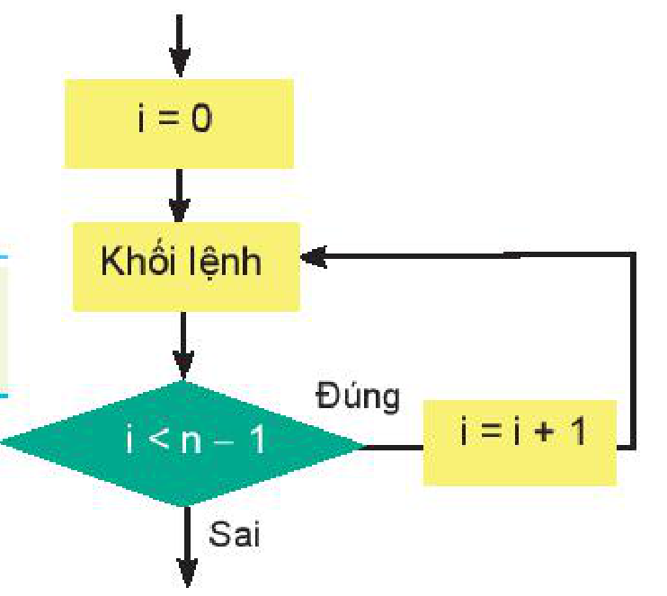

<!-- pdf:106 -->

# BÀI 20: CÂU LỆNH LẶP FOR

## 🎯 Sau bài học này em sẽ:

- Biết được ý nghĩa của vùng giá trị tạo bởi lệnh `range()`.
- Biết được chức năng của lệnh lặp `for` và cách dùng trong Python.

## 🔴 Khởi động

> Em có thể đã gặp những trường hợp cần thực hiện một số công việc lặp đi lặp lại nhiều lần. Ví dụ, để kể tên tất cả các bạn trong lớp có 30 học sinh, em cần lần lượt đọc tên từng bạn; để đếm số lượng các số chia hết cho 3 trong khoảng từ 1 đến 50, em có thể kiểm tra lần lượt các số từ 1 đến 50 và ghi ra các số chia hết cho 3 (chẳng hạn, 3, 6, 9,...) rồi đếm các số đó. Ngôn ngữ lập trình bậc cao có các câu lệnh cho phép viết một cách ngắn gọn các bước cần thực hiện lặp đi lặp lại để tạo thành một cấu trúc lập trình được gọi là cấu trúc lặp.
>
> Em có thể xác định được trong mỗi ví dụ trên công việc nào cần phải lặp và được lặp lại bao nhiêu lần không?

## 1. LỆNH LẶP FOR

> **Hoạt động 1: Làm quen với lệnh lặp for**
>
> Thực hiện đoạn chương trình sau trong chế độ gõ lệnh trực tiếp của Python để tính tổng $0 + 1 + \dots + 9$. Tổng này có giá trị bao nhiêu? Giải thích kết quả.

```python
>>> S = 0
>>> for k in range(10):
        S = S + k
>>> print(S)
45
```

<!-- term: Vùng giá trị -->
<!-- term: Lệnh lặp for -->
Trong đoạn chương trình trên, lệnh `range(10)` trả lại một ***vùng giá trị*** gồm 10 số 0, 1, 2, 3, 4, 5, 6, 7, 8, 9. Lệnh **`for`** sẽ thực hiện 10 lần lặp, mỗi lần lặp ứng với một giá trị `k` trong vùng giá trị trên. Sau lệnh lặp `for` trên, biến `S` sẽ có giá trị là tổng $0 + 1 + \dots + 9 = 45$.

Lệnh **`range(n)`** trả lại *vùng giá trị* gồm `n` số từ `0` đến `n - 1`. Cú pháp của **lệnh lặp với số lần biết trước `for`** trong Python như sau:

```python
for <i> in range(n):
    <khối lệnh>
```

Khi thực hiện, ở mỗi vòng lặp biến `i` sẽ được gán lần lượt các giá trị trong vùng giá trị của lệnh `range()` và thực hiện `<khối lệnh>`.



*Hình 20.1*

<!-- pdf:107 -->

**Ví dụ 1.** Tính tổng các số tự nhiên chẵn nhỏ hơn `n`, với `n` cho trước (`n = 10`).

```python
n = 10
S = 0
for k in range(n):
    if k%2 == 0:    # Điều kiện k là số chẵn là k%2 = 0
        S = S + k
print(S)
```

**Ví dụ 2.** Đếm số các số nguyên nhỏ hơn `n` (`n = 20`) và là bội của 3.

```python
n = 20
C = 0
for k in range(n):
    if k%3 == 0:    # Điều kiện k là bội của 3 là k%3 = 0
        C = C + 1
print(C)
```

> **`for`** là lệnh lặp với số lần biết trước. Số lần lặp thường được xác định bởi vùng giá trị của lệnh **`range()`**.

> ❓ **Câu hỏi**
>
> Với giá trị `n` cho trước, so sánh giá trị `S` trong đoạn chương trình sau với tổng $1 + 2 + \dots + n$.
> ```python
> S = 0
> for k in range(1,n+1):
>     S = S + k
> ```

## 2. LỆNH RANGE

> **Hoạt động 2: Tìm hiểu vùng giá trị xác định bởi lệnh range()**
>
> Quan sát các lệnh `for` sau và so sánh kết quả in ra để biết vùng giá trị được xác định bởi lệnh `range()`. Lưu ý, lệnh `print()` có thêm tham số để in bộ dữ liệu theo hàng ngang.

```python
>>> for k in range(3,10):
        print(k, end = " ")
3 4 5 6 7 8 9                          # Đây là vùng range(3,10)
>>> for k in range(0,15):
        print(k, end = " ")
0 1 2 3 4 5 6 7 8 9 10 11 12 13 14     # Đây là vùng range(0,15)
```

<!-- term: Lệnh range() -->
Lệnh tạo vùng giá trị **`range()`** có các dạng sau:

`range(stop)` trả lại vùng giá trị từ `0` đến `stop - 1`.

`range(start,stop)` trả lại vùng giá trị từ `start` đến `stop - 1`.

Ví dụ, `range(n)` cho vùng gồm các số $0, 1, \dots, n - 1$.

`range(1,n+1)` cho vùng gồm các số $1, 2, \dots, n$.

`range(0,99)` cho vùng giá trị gồm các số $0, 1, 2, \dots, 98$.

`range(100,1)` cho vùng rỗng.
<!-- ocr-ok: đã đối chiếu ảnh trang 107, số 100 trong range(100,1) bị OCR đọc nhầm thành 199 -->

<!-- pdf:108 -->

> **Lệnh tạo vùng giá trị** có cú pháp **`range(start,stop)`** trả lại vùng giá trị gồm các số nguyên liên tiếp từ `start` đến `stop - 1`.

> ❓ **Câu hỏi**
>
> Hãy biểu diễn các dãy sau đây bằng lệnh `range()`.
> a) 1, 2, 3,..., 50.
> b) 5, 6, 7, 8, 9, 10.
> c) 0, 1.
> d) 10.
<!-- ocr-ok: đã đối chiếu ảnh trang 108, các dãy số trong câu hỏi củng cố -->

## THỰC HÀNH. Lệnh lặp for và lệnh range()

**Nhiệm vụ 1.** Nhập số tự nhiên `n` từ bàn phím và in ra màn hình dãy các ước số của `n` theo chiều ngang màn hình. Ví dụ nếu `n = 10` thì chương trình sẽ in ra dãy số 1, 2, 5, 10.

**Hướng dẫn.** Các ước số của `n` là các số tự nhiên `k` thoả mãn: `n%k = 0`. Muốn in các số trên một hàng ngang cần dùng thêm tham số `end = " "` trong lệnh `print()`.

Chương trình có thể như sau:

```python
n = int(input("Nhập số tự nhiên n: "))
for k in range(1, n+1):
    if n%k == 0:
        print(k, end = " ")
```

**Nhiệm vụ 2.** Nhập số tự nhiên `n` từ bàn phím và đếm số các ước số thực sự của `n`. Ước số thực sự của `n` là số tự nhiên $k < n$ và là ước của `n`.

**Hướng dẫn.** Tương tự như chương trình ở nhiệm vụ 1, điểm khác là cần đếm số các ước số này và không tính `n`. Tạo một biến có tên `count` để đếm số các ước số thực sự của `n`.

```python
n = int(input("Nhập số tự nhiên n: "))
count = 0
for k in range(1, n):
    if n%k == 0:
        count = count + 1
print(count)
```

## ✏️ Luyện tập

1. Đoạn chương trình sau in ra kết quả gì?
```python
n = int(input("Nhập số tự nhiên n:"))
S = 0
for k in range(n+1):
    S = S + k
print(S*S)
```

2. Viết đoạn chương trình tính tích $1 \times 2 \times 3 \times \dots \times n$ với `n` được nhập vào từ bàn phím.

## 🚀 Vận dụng

1. Viết chương trình nhập từ bàn phím số tự nhiên `n` và in ra kết quả $S = 1 + \frac{1}{2} + \dots + \frac{1}{n}$.

2. Viết chương trình nhập từ bàn phím số tự nhiên `n` và in ra kết quả là tổng sau:
   $S = 1^3 + 2^3 + \dots + n^3$.

## 📷 Danh sách hình trong bài

| Mã hình | Trang PDF | Vị trí trong bài | Chú thích gốc |
| --- | --- | --- | --- |
| H10-tin_hoc-b20-01 | 106 | Mục 1 | Hình 20.1 |
