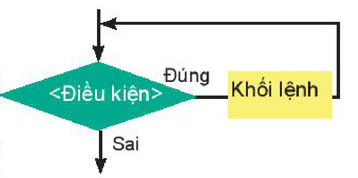

<!-- pdf:109 -->

# BÀI 21: CÂU LỆNH LẶP WHILE

## 🎯 Sau bài học này em sẽ:

- Biết và thực hành giải các bài toán sử dụng lệnh lặp `while` với số lần không biết trước.
- Biết ba cấu trúc lập trình cơ bản: tuần tự, rẽ nhánh, lặp.

## 🔴 Khởi động

> Cho các việc được ghi trong cột A và cột B của bảng sau:
>
> | A | B |
> | --- | --- |
> | Vận động viên chạy 20 vòng xung quanh sân vận động. | Vận động viên chạy nhiều vòng xung quanh sân vận động trong thời gian 2 tiếng. |
> | Em làm 5 bài tập thầy cô giao về nhà. | Em làm các bài tập về nhà đến giờ ăn cơm thì dừng lại. |
> | Em đi lấy 15 xô nước giúp mẹ. | Em xách các xô nước giúp mẹ cho đến khi đầy thùng nước. |
>
> Đối với mỗi hàng, em hãy cho biết công việc được lặp đi lặp lại là gì? Điều kiện để dừng công việc là gì? Số lần thực hiện việc lặp giữa hai cột có gì khác nhau?

## 1. LỆNH LẶP WHILE

> **Hoạt động 1: Làm quen với lệnh lặp while**
>
> Quan sát đoạn chương trình sau, giải thích kết quả in ra.

```python
>>> S = 0
>>> k = 1
>>> while k < 100:    # Điều kiện lặp: nếu <điều kiện> là False thì dừng lặp.
        S = S + k     # Khối các lệnh lặp được viết lùi vào và thẳng hàng. Sau mỗi vòng lặp, k tăng lên 7.
        k = k + 7

>>> print(S)
750
```

<!-- term: Lệnh lặp while -->
**Lệnh lặp `while`** thực hiện khối lệnh với số lần lặp không biết trước. Khối lệnh lặp được thực hiện cho đến khi `<điều kiện> = False`.

Cú pháp của lệnh **`while`** như sau:

```python
while <điều kiện>:    # Sau dấu ":", khối lệnh lặp cần được viết lùi vào và thẳng hàng. Mặc định các lệnh sẽ lùi vào 1 tab hoặc 4 dấu cách.
    <khối lệnh>
```



*Hình 21.1*

Trong đó `<điều kiện>` là biểu thức lôgic. Khi thực hiện lệnh, Python sẽ kiểm tra `<điều kiện>`, nếu đúng thì thực hiện `<khối lệnh>`, nếu sai thì kết thúc lệnh `while`.

Trong đoạn chương trình ở Hoạt động 1, lệnh lặp sẽ dừng khi $k \ge 100$ và giá trị `S` nhận được là tổng $1 + 8 + 15 + \dots + 99$.

<!-- pdf:110 -->

**Ví dụ 1.** Quan sát đoạn chương trình sau và cho biết `S` là giá trị của biểu thức toán học nào?

```python
S = 0
k = 1
while k*k < 100:
    S = S + k*k
    k = k + 1
```

**Giải thích:** Đoạn chương trình tính tổng $1^2 + 2^2 + \dots + k^2$ với điều kiện $k^2 < 100$. Vậy `S` chính là tổng bình phương các số tự nhiên nhỏ hơn 10.

**Ví dụ 2.** Thực hiện các lệnh sau. Kết quả sẽ in ra những số nào?

```python
>>> k = 2
>>> while k < 50:
        print(k,end = " ")
        k = k + 3
```

**Giải thích:** Vòng lặp `while` sẽ dừng khi `k` vượt quá 50. Bắt đầu vòng lặp, `k = 2`. Sau mỗi bước lặp `k` tăng lên 3 đơn vị. Do vậy, kết quả sẽ phải in ra dãy sau:

```python
2 5 8 11 14 17 20 23 26 29 32 35 38 41 44 47
```

> **`while`** là lệnh lặp với số lần không biết trước. Số lần lặp của lệnh **`while`** phụ thuộc vào điều kiện của lệnh.

> ❓ **Câu hỏi**
>
> 1. Lệnh **`while`** kiểm tra điều kiện trước hay sau khi thực hiện khối lệnh lặp?
> 2. Viết đoạn chương trình tính tổng $2 + 4 + \dots + 100$ sử dụng lệnh **`while`**.

**Lưu ý:**

<!-- term: Lặp vô hạn -->
1. Vì lệnh `while` không biết trước số lần lặp, mà phụ thuộc vào điều kiện. Do đó, cần chú ý đến điều kiện của lệnh `while` để tránh bị **lặp vô hạn**.

<!-- term: Lệnh break -->
2. Trong trường hợp nếu muốn dừng và thoát ngay khỏi vòng lặp `while` hoặc `for` có thể dùng lệnh **`break`**.

```python
>>> for k in range(10):
        print(k,end = " ")
        if k == 5:
            break
0 1 2 3 4 5
```

## 2. CẤU TRÚC LẬP TRÌNH

> **Hoạt động 2: Các cấu trúc lập trình cơ bản**
>
> Đọc, thảo luận để hiểu các cấu trúc lập trình cơ bản trong ngôn ngữ lập trình bậc cao.

<!-- term: Cấu trúc tuần tự -->
Với việc sử dụng câu lệnh rẽ nhánh `if` và các câu lệnh lặp `for`, `while` ta có thể thấy một chương trình trên Python nói chung có thể được chia thành các khối lệnh sau:

- Khối gồm các lệnh được thực hiện theo trình tự từ trên xuống dưới. Khối này tương ứng với **cấu trúc tuần tự** trong chương trình và được thể hiện bằng các câu lệnh như gán giá trị, nhập/xuất dữ liệu,...

<!-- pdf:111 -->

<!-- term: Cấu trúc rẽ nhánh -->
<!-- term: Cấu trúc lặp -->
<!-- term: Cấu trúc lập trình cơ bản -->
- Khối các câu lệnh chỉ được thực hiện tuỳ thuộc vào điều kiện nào đó là đúng hay sai. Khối lệnh này tương ứng với **cấu trúc rẽ nhánh** và được thể hiện bằng câu lệnh rẽ nhánh `if`.
- Khối các câu lệnh được thực hiện lặp đi lặp lại tuỳ theo điều kiện nào đó vẫn còn đúng hay sai. Khối lệnh này tương ứng với **cấu trúc lặp** và được thể hiện bằng các câu lệnh lặp `for`, `while`.

Ba cấu trúc chương trình trên được gọi là các **cấu trúc lập trình cơ bản** của các ngôn ngữ lập trình bậc cao.

> **Ba cấu trúc lập trình cơ bản** của các ngôn ngữ lập trình bậc cao gồm: **cấu trúc tuần tự**, **cấu trúc rẽ nhánh**, **cấu trúc lặp**.

## THỰC HÀNH. Sử dụng lệnh lặp while và các lệnh đã học
<!-- ocr-ok: đã đối chiếu ảnh trang 111, tiêu đề THỰC HÀNH và từ while bị OCR nhận diện sai -->

**Nhiệm vụ 1.** Viết chương trình in toàn bộ dãy các số tự nhiên từ 1 đến 100 trên một hàng ngang.

**Hướng dẫn.** Mở phần mềm Python và nhập chương trình sau:

```python
k = 0
while k < 100:
    k = k + 1
    print(k, end = " ")
```

**Nhiệm vụ 2.** Viết chương trình in ra màn hình dãy các chữ cái tiếng Anh từ `"A"` đến `"Z"` theo ba hàng ngang trên màn hình, hai hàng ngang đầu có 10 chữ cái, hàng thứ ba có 6 chữ cái.

<!-- term: Lệnh chr() -->
**Hướng dẫn.** Chúng ta đã biết các chữ cái tiếng Anh từ A đến Z chiếm các vị trí từ 65 đến 90 trong bảng mã ASCII. Với số thứ tự `k` của bảng mã ASCII, chúng ta sử dụng lệnh **`chr(k)`** trả lại kí tự tương ứng trong bảng mã này.

```python
i = 0
k = 65 # bắt đầu từ số thứ tự của chữ cái A.
while k <= 90:
    i = i + 1
    if i%10 == 0:
        print(chr(k))               # Với các chữ cái ở cuối hàng sẽ in ra và xuống dòng.
    else:
        print(chr(k), end = " ")    # Với các chữ cái khác thì in ra trên một hàng ngang.
    k = k + 1
```

## ✏️ Luyện tập

1. Cho dãy số 1, 4, 7, 10,.... Viết chương trình in ra phần tử lớn nhất của dãy nhưng nhỏ hơn 100.

2. Viết chương trình đếm trong dãy 100 số tự nhiên đầu tiên có bao nhiêu số thoả mãn điều kiện: hoặc chia hết cho 5 hoặc chia cho 3 dư 1.

## 🚀 Vận dụng

Viết chương trình in các số tự nhiên từ 1 đến 100 ra màn hình thành 10 hàng, mỗi hàng 10 số, có dạng như sau:

```text
1 2 3 ...   10
11 12 ....  20
................
91 92 ..... 100
```

## 📷 Danh sách hình trong bài

| Mã hình | Trang PDF | Vị trí trong bài | Chú thích gốc |
| --- | --- | --- | --- |
| H10-tin_hoc-b21-01 | 109 | Mục 1 | Hình 21.1 |
