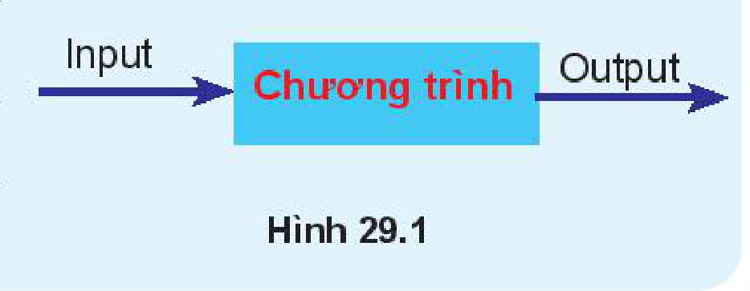

<!-- pdf:142 -->

# BÀI 29: NHẬN BIẾT LỖI CHƯƠNG TRÌNH

## 🎯 Sau bài học này em sẽ:

- Biết và phân loại được một số loại lỗi chương trình.
- Biết được một vài lỗi ngoại lệ thường gặp.

## 🔴 Khởi động

> Một chương trình hoàn chỉnh được mô tả như Hình 29.1: Tiếp nhận các dữ liệu đầu vào, xử lí theo yêu cầu bài toán và đưa ra kết quả đúng theo yêu cầu. Theo em nếu chương trình có lỗi, thì các lỗi này sẽ như thế nào và có thể ở đâu?



*Hình 29.1*

## 1. NHẬN BIẾT LỖI CHƯƠNG TRÌNH

> **Hoạt động 1: Nhận biết và phân biệt một số loại lỗi chương trình**
>
> Quan sát các trường hợp chương trình gặp lỗi như sau, từ đó nhận biết và phân biệt một số loại lỗi của chương trình.

**Trường hợp 1.** Người lập trình viết sai cú pháp lệnh, chương trình lập tức dừng lại và thông báo lỗi cú pháp.

```python
>>> while True print("Hello")
SyntaxError: invalid syntax
```

**Trường hợp 2.** Người dùng nhập dữ liệu sai, chương trình thông báo lỗi nhập dữ liệu không đúng khuôn dạng.

```python
>>> n = int(input("Nhập số nguyên n: "))
Nhập số nguyên n: 1.5
Traceback (most recent call last):
  File "<pyshell#0>", line 1, in <module>
    n = int(input("Nhập số nguyên n: "))
ValueError: invalid literal for int() with base 10: '1.5'
```

**Trường hợp 3.** Chương trình thông báo lỗi chỉ số vượt quá giới hạn cho phép.

**Array_b1.py**

```python
A = [1,3,10,0]
for i in range(5):
    print(A[i],end = " ")
```

<!-- pdf:143 -->

Khi chạy chương trình sẽ báo lỗi:

```python
1 3 10 0 Traceback (most recent call last):
  File "C:\Python\Array_b1.py", line 3, in <module>
    print(A[i],end = " ")
IndexError: list index out of range
```

**Trường hợp 4.** Chương trình thực hiện bình thường nhưng kết quả không đúng với yêu cầu của bài toán. Đây là lỗi lôgic bên trong chương trình.

```python
#Tính tổng của ba số nguyên dương đầu tiên
>>> s = 0
>>> for i in range(3)
        s = s + i
>>> print(s)
3
```

Chương trình cho kết quả là 3 mà kết quả đúng là $1 + 2 + 3 = 6$. Lí do là hàm `range(3)` trả lại vùng giá trị là 0, 1, 2 chứ không phải là 1, 2, 3.

**Giải thích:**

- Với trường hợp 1, chương trình dừng và thông báo lỗi **`Syntax Error`** (**lỗi cú pháp**).
- Với trường hợp 2, khi người dùng nhập dữ liệu sai, hàm `int()` không thể thực hiện được, chương trình dừng lại và báo lỗi. Mã lỗi là **`ValueError`**. Đây là lỗi **`Runtime`** (**lỗi trong khi đang thực hiện**) hay còn gọi là **lỗi ngoại lệ** (**`Exceptions error`**).
- Với trường hợp 3, chương trình phát hiện lỗi chỉ số vượt quá giới hạn tại dòng 3. Chương trình dừng và báo lỗi. Mã lỗi là **`IndexError`**. Đây là lỗi **`Runtime`**.
- Với trường hợp 4, chương trình không còn lỗi **`Runtime`**, nhưng kết quả đưa ra sai. Không có mã lỗi nào được trả lại. Đây là **lỗi ngữ nghĩa** hoặc **lỗi lôgic** bên trong chương trình.

<!-- term: Lỗi chương trình -->
<!-- term: Lỗi cú pháp -->
<!-- term: Lỗi ngoại lệ -->
<!-- term: Lỗi trong khi đang chạy -->
<!-- term: Lỗi lôgic -->
> - Tổng thể có thể phân biệt **lỗi chương trình** Python làm ba loại:
>   1. Lỗi khi có lệnh viết sai cú pháp hoặc sai cấu trúc ngôn ngữ Python quy định. Chương trình sẽ lập tức dừng và thông báo lỗi **`Syntax Error`**.
>   2. Lỗi khi không thể thực hiện một lệnh trong chương trình. Chương trình dừng lại và thông báo một mã lỗi. Lỗi này gọi **lỗi ngoại lệ** (**`Exceptions Error`**), mã lỗi trả lại gọi là **mã lỗi ngoại lệ**.
>   3. Chương trình chạy không lỗi ngoại lệ, nhưng kết quả đưa ra sai, không chính xác. Đây là **lỗi lôgic** bên trong chương trình.
> - Với mỗi loại lỗi trên, cách xử lí và kiểm soát lỗi sẽ khác nhau.

> ❓ **Câu hỏi**
>
> 1. Khi gõ sai cú pháp một lệnh, chương trình sẽ dừng lại và báo lỗi, đó là lỗi loại gì?
> 2. Bài toán yêu cầu sắp xếp dãy số ban đầu thành dãy tăng dần. Giả sử dãy số ban đầu là `[3, 1, 8, 10, 0]`. Kết quả thu được dãy `[1, 3, 8, 10, 0]`. Chương trình có lỗi không? Nếu có thì lỗi đó thuộc loại gì?

<!-- pdf:144 -->

## 2. MỘT SỐ LỖI NGOẠI LỆ THƯỜNG GẶP

Chúng ta đã biết, nếu gặp lỗi ngoại lệ, chương trình Python sẽ dừng lại và báo lỗi. Một trong những vấn đề được đưa ra khi kiểm soát lỗi là làm thế nào để vẫn phát hiện lỗi, xử lí lỗi nhưng chương trình không bị dừng lại trong khi thực hiện.

> **Hoạt động 2: Nhận biết một số lỗi ngoại lệ thường gặp**
>
> Đọc, thảo luận để nhận biết một số lỗi ngoại lệ thường gặp trong chương trình Python.

| Mã lỗi ngoại lệ | Mô tả lỗi |
| --- | --- |
| **`ZeroDivisionError`** | Lỗi này xảy ra khi lệnh thực hiện phép chia cho giá trị 0. |
| **`IndexError`** | Lỗi xảy ra khi lệnh cố gắng truy cập phần tử của danh sách nhưng chỉ số vượt quá giới hạn. |
| **`NameError`** | Lỗi xảy ra khi chương trình muốn tìm một tên nhưng không thấy. Ví dụ khi lệnh gọi một hàm nhưng không có hàm đó. |
| **`TypeError`** | Lỗi kiểu dữ liệu. Một số ví dụ lỗi loại này:<br>– Lệnh truy cập một phần tử của danh sách nhưng chỉ số không là số nguyên.<br>– Lệnh tính biểu thức số nhưng lại có một toán hạng không phải là số. |
| **`ValueError`** | Lỗi liên quan đến giá trị của đối tượng.<br>Lỗi khi thực hiện lệnh chuyển đổi kiểu dữ liệu, đối số của hàm có giá trị mà hàm không hỗ trợ. Ví dụ khi thực hiện lệnh `int("1.55")` sẽ sinh lỗi loại này. |
| **`IndentationError`** | Lỗi khi các dòng lệnh thụt vào không thẳng hàng hoặc không đúng vị trí. |
| **`SyntaxError`** | Lỗi cú pháp. |

> ❓ **Câu hỏi**
>
> Hãy nêu mã lỗi ngoại lệ của mỗi lệnh sau nếu xảy ra lỗi.
> a) `A[1.5]`
> b) `int("abc")`
> c) `"10"*3.5`
> d) `12 + x(10)`

## THỰC HÀNH

**Lập trình và kiểm tra khả năng sinh lỗi khi chạy chương trình.**

### Nhiệm vụ 1. Viết chương trình nhập các số nguyên `m`, `n` từ bàn phím, cách nhau bởi dấu cách. Chương trình đưa ra tổng, hiệu, thương của hai số đã nhập.

**Hướng dẫn.** Chương trình chính là khối các lệnh nhập từ bàn phím hai số nguyên `m`, `n`. Các số này được nhập bằng lệnh `input()`, kết quả là một xâu kí tự. Xâu này sẽ được tách thành danh sách các xâu con bằng lệnh `split()`. Kết quả thu được sẽ

<!-- pdf:145 -->

chuyển đổi thành hai số `m`, `n` bằng lệnh `int()`. Nhập chương trình sau và kiểm tra khả năng sinh lỗi khi chạy chương trình.

```python
s = input("Nhập hai số m, n cách nhau bởi dấu cách: " )
sline = s.split()
m, n = int(sline[0]),int(sline[1])
print("Tổng, hiệu, thương 2 số đã nhập là:",m+n, m-n,m/n)
```

*Gợi ý.* Các khả năng sinh lỗi của chương trình:

- Các số `m`, `n` khi nhập vào không là số nguyên.
- Giữa hai số `m`, `n` không có dấu cách.
- Số `n` nhập vào là số 0.

### Nhiệm vụ 2. Viết chương trình nhập số tự nhiên `n` và nhập lần lượt `n` số nguyên đưa vào danh sách số `A`. Sau khi nhập xong in danh sách `A` ra màn hình.

**Hướng dẫn.** Nhập chương trình sau và kiểm tra khả năng sinh lỗi khi chạy.

```python
n = int(input("Nhập số tự nhiên n: "))
A = []
for k in range(n):
    num = int(input("Nhập số thứ "+str(k+1)+" : "))
    A.append(num)
print("Dãy đã nhập:",A)
```

*Gợi ý.* Các khả năng sinh lỗi của chương trình:

- Số `n` được nhập không là số nguyên.
- Mỗi số hạng của danh sách nhập vào không là số nguyên.

## ✏️ Luyện tập

1. Các lệnh sau có sinh lỗi chương trình không? Nếu có thì mã lỗi là gì?

```python
>>> A = [1,3,5,10,0]
>>> for k in range(1,len(A)+1):
        print(A[k])
```

```python
>>> s1, s2 = "101010",1010101
>>> s = s1 + s2
```

2. Để tính giá trị trung bình của một danh sách số `A`, người lập trình đã dùng lệnh sau để tính:

```python
gttb = sum(A)/len(A)
```

lệnh này có thể sinh lỗi ngoại lệ không? Nếu có thì là những lỗi gì?

## 🚀 Vận dụng

1. Giả sử em được yêu cầu viết một chương trình nhập số tự nhiên `n` từ bàn phím, kết quả đưa ra là danh sách các ước số thực sự của `n`, tính cả 1 và không tính `n`. Hãy viết chương trình và kiểm tra các khả năng sinh lỗi khi thực hiện chương trình.
2. Em hãy viết một chương trình nhỏ để khi chạy sẽ sinh mã lỗi `NameError`.

## 📷 Danh sách hình trong bài

| Mã hình | Trang PDF | Vị trí trong bài | Chú thích gốc |
| --- | --- | --- | --- |
| H10-tin_hoc-b29-01 | 142 | Khởi động | Hình 29.1 |
