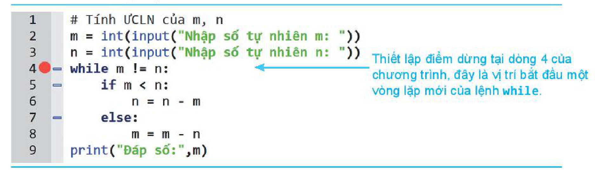

<!-- pdf:146 -->

# BÀI 30: KIỂM THỬ VÀ GỠ LỖI CHƯƠNG TRÌNH

## 🎯 Sau bài học này em sẽ:

- Biết được một vài phương pháp đơn giản kiểm thử chương trình.
- Biết được một vài cách gỡ lỗi đơn giản một chương trình.

## 🔴 Khởi động

> Bài học trước em đã biết khái niệm lỗi ngoại lệ khi chạy chương trình Python. Tuy nhiên, một chương trình chạy không có lỗi ngoại lệ (chương trình không bị dừng) thì không có nghĩa là chương trình không có lỗi. Thậm chí các "lỗi" không tường minh này (các lỗi này được gọi **bug**) càng khó phát hiện và khó sửa.
>
> Theo em, làm thế nào để **kiểm tra** (**test**) và **gỡ lỗi** (**debug**) một chương trình? Môi trường lập trình có công cụ nào hỗ trợ việc đó không?

## 1. MỘT VÀI PHƯƠNG PHÁP KIỂM THỬ CHƯƠNG TRÌNH

> **Hoạt động: Tìm hiểu một số phương pháp kiểm thử chương trình**
>
> Đọc và thảo luận nhóm các phương pháp, công cụ sau để biết chức năng, tác dụng của từng công cụ trong công việc kiểm thử chương trình.

<!-- term: Kiểm thử -->
<!-- term: Gỡ lỗi -->
Có rất nhiều phương pháp và công cụ khác nhau để **kiểm thử** chương trình. Các công cụ này không những có mục đích *tìm ra lỗi* (hay **bug**) của chương trình mà còn có tác dụng *phòng ngừa* và *ngăn chặn* các lỗi phát sinh tiếp trong tương lai.

### a) Quan sát mã lỗi Runtime và bắt lỗi ngoại lệ

Nếu chương trình có lỗi `Runtime` (tức là đang chạy bị dừng lại), cần quan sát các mã lỗi (mã lỗi ngoại lệ) để kiểm tra vị trí dòng lệnh sinh ra lỗi này. Từ đó phân tích, tìm và sửa lỗi.

### b) Kiểm thử chương trình với các bộ dữ liệu test

Chương trình cần được thử với một số **bộ dữ liệu test** gồm đầu vào tiêu biểu phụ thuộc đặc thù của bài toán và kết quả đầu ra đã biết trước. Các bộ test có thể có đầu vào theo các tiêu chí khác nhau như độ lớn và tính đa dạng của dữ liệu. Cần chú ý một số điểm sau:

- *Cần có nhiều bộ test* (theo các tiêu chí khác nhau như độ lớn, tính đa dạng của dữ liệu,...).
- *Cần có bộ test ngẫu nhiên.* Việc sinh ngẫu nhiên dữ liệu đầu vào trong miền xác định của chương trình làm tăng khả năng tìm lỗi nếu có.
- *Cần có bộ test dữ liệu ở vùng biên.* Ví dụ dữ liệu đầu vào là cặp $(x, y)$ xác định trên miền $0 \le x, y \le 1$. Khi đó cần kiểm tra chương trình với bộ dữ liệu biên là $(0; 0)$, $(0; 1)$, $(1; 0)$ và $(1; 1)$. Thực tế cho thấy thường phát sinh lỗi tại các vùng biên hoặc lân cận của biên. Một ví dụ khác của dữ liệu biên là cần tìm các bộ test với $n$ và các giá trị $(x_1, x_2, \dots, x_n)$ rất lớn (vùng cận biên lớn).

<!-- pdf:147 -->

### c) In các thông số trung gian

Bổ sung vào giữa các dòng lệnh các lệnh `print()` để in ra các biến trung gian, qua đó kiểm tra các quy trình hay thuật toán được viết có đúng không.

Giả sử chương trình có đầu vào là $(x_1, x_2, \dots, x_n)$, đầu ra là $(a_1, a_2, \dots, a_m)$ nhưng có sử dụng các biến trung gian $(y_1, y_2, \dots, y_k)$. Khi đó với mỗi bộ test đầu vào, chúng ta sẽ bổ sung vào các dòng lệnh của chương trình để in ra các giá trị trung gian:

$$(x_1, x_2, \dots, x_n), (y_1, y_2, \dots, y_k), (a_1, a_2, \dots, a_m).$$
<!-- ocr-ok: đã đối chiếu ảnh trang 147, biểu thức các bộ giá trị trung gian có chỉ số dưới được chuyển sang LaTeX -->

Thông qua các giá trị trung gian trong quá trình thực hiện chương trình, nếu kết quả cuối cùng có lỗi thì sẽ dễ tìm ra lỗi đó.

### d) Sử dụng công cụ break point (điểm dừng)

<!-- term: Điểm dừng (break point) -->
Công cụ **break point** cho phép tạo ra các "**điểm dừng**" bên trong chương trình. Khi chạy, chương trình sẽ tạm dừng lại tại các "điểm dừng" cho phép người kiểm thử có thể quan sát các thông tin khác bên trong chương trình, qua đó kiểm tra tính đúng đắn của chương trình.

Trên thực tế sử dụng phương pháp điểm dừng thường kết hợp với phương pháp in các giá trị trung gian sẽ là hiệu quả hơn để kiểm thử chương trình.

> Một số ghi nhớ:
> - Sử dụng công cụ in các biến trung gian.
> - Sử dụng công cụ sinh các bộ dữ liệu test.
> - Sử dụng công cụ điểm dừng trong phần mềm soạn thảo lập trình.
> - Quan sát các mã lỗi của chương trình nếu phát sinh.

## 2. VÍ DỤ MINH HOẠ

Xét ví dụ sau: Nhập từ bàn phím hai số tự nhiên `m`, `n`, tính ƯCLN của hai số này.

Gọi $\text{gcd}(m, n)$ là ƯCLN của hai số tự nhiên $m, n$. Thuật toán của bài toán này dựa trên thuật toán sau:

(1) $\text{gcd}(m, m) = m$.

(2) Nếu $n > m$ thì $\text{gcd}(m, n) = \text{gcd}(m, n - m)$.

(3) Nếu $n < m$ thì $\text{gcd}(m, n) = \text{gcd}(m - n, n)$.

Phần cơ bản nhất của chương trình sẽ là một vòng lặp `while`, vòng lặp sẽ kết thúc khi `m = n`. Chương trình như sau:

```python
#Tính ƯCLN của m, n
m = int(input("Nhập số tự nhiên m: "))
n = int(input("Nhập số tự nhiên n: "))
while m != n:
    if m < n:
        n = n - m
    else:
        m = m - n
print("Đáp số:",m)
```

<!-- pdf:148 -->

Chúng ta sẽ tiến hành kiểm thử chương trình này. Cần tập trung kiểm tra kĩ khối lệnh của lệnh lặp `while`.

**Cách 1:** In ra các giá trị trung gian để kiểm soát chương trình.

Bổ sung biến `k` và hai lệnh `print()` vào chương trình như mô tả như sau:

```python
#Tính ƯCLN của m, n
m = int(input("Nhập số tự nhiên m: "))
n = int(input("Nhập số tự nhiên n: "))
k = 0                                     # Bổ sung thêm biến k và hai lệnh print() để in các giá trị trung gian k, m, n.
while m!= n:
    k = k + 1
    print("Vòng lặp",k,":", m, n)
    if m < n:
        n = n - m
    else:
        m = m - n
print("Kết thúc vòng lặp:", m, n)
print("Đáp số:",m)
```

Kết quả thực hiện chương trình trên như sau:

```python
Nhập số tự nhiên m: 20
Nhập số tự nhiên n: 16
Vòng lặp 1 : 20 16
Vòng lặp 2 : 4 16
Vòng lặp 3 : 4 12     # Quan sát sự thay đổi của giá trị các biến k, m, n trong quá trình thực hiện chương trình để phát hiện lỗi (nếu có), đồng thời hiểu được lỗi này và tìm cách sửa lỗi.
Vòng lặp 4 : 4 8
Kết thúc vòng lặp: 4 4
Đáp số: 4
```

**Cách 2:** Sử dụng công cụ tạo điểm dừng của phần mềm soạn thảo lập trình.

Thiết lập điểm dừng tại dòng 4 của chương trình như hình sau. Đây là vị trí bắt đầu chuẩn bị vào vòng lặp.



```python
1  #Tính ƯCLN của m, n
2  m = int(input("Nhập số tự nhiên m: "))
3  n = int(input("Nhập số tự nhiên n: "))
4  while m != n:    # Thiết lập điểm dừng tại dòng 4 của chương trình, đây là vị trí bắt đầu một vòng lặp mới của lệnh while.
5      if m < n:
6          n = n - m
7      else:
8          m = m - n
9  print("Đáp số:",m)
```

<!-- pdf:149 -->

Khi chạy chương trình sẽ dừng lại trước mỗi vòng lặp, chúng ta sẽ ghi lại các giá trị `m`, `n` vào một bảng như bảng sau. Khi kết thúc hết vòng lặp thì kết quả chương trình chính là giá trị `m`.

| Vòng lặp | m | n | Kết quả |
| --- | --- | --- | --- |
| 1 | 20 | 16 | |
| 2 | 4 | 16 | |
| 3 | 4 | 12 | |
| 4 | 4 | 8 | |
| Kết thúc lặp | 4 | 4 | 4 |

Cả hai cách để kiểm soát lỗi là in các giá trị trung gian và thiết lập điểm dừng đều hiệu quả.

## ✏️ Luyện tập

1. Chương trình của em khi chạy phát sinh lỗi ngoại lệ `ZeroDivisionError`. Đó là lỗi gì và em sẽ xử lí lỗi này như thế nào?
2. Chương trình sau có lỗi không? Nếu có thì tìm và sửa lỗi.

```python
m = input("Nhập số tự nhiên m: ")
n = input("Nhập số tự nhiên n: ")
print("Tổng hai số đã nhập là:",m+n)
```

## 🚀 Vận dụng

1. Chương trình sau có chức năng sắp xếp một dãy số cho trước. Hãy kiểm tra xem chương trình có lỗi không. Nếu có thì tìm và sửa lỗi.

```python
A = [10,1,5,2,8,0,4]
for i in range(len(A)-1):
    j = i
    while j > 1 and A[j] < A[j-1]:
        A[j],A[j-1] = A[j-1],A[j]
        j = j - 1
print(A)
```

2. Để kiểm thử một chương trình, nếu chỉ bằng việc kiểm tra thông qua các bộ dữ liệu test thì có bảo đảm tìm ra hết lỗi của chương trình hay không? Vì sao?

## 📷 Danh sách hình trong bài

| Mã hình | Trang PDF | Vị trí trong bài | Chú thích gốc |
| --- | --- | --- | --- |
| H10-tin_hoc-b30-01 | 148 | Mục 2, Cách 2 | Thiết lập điểm dừng tại dòng 4 của chương trình |
