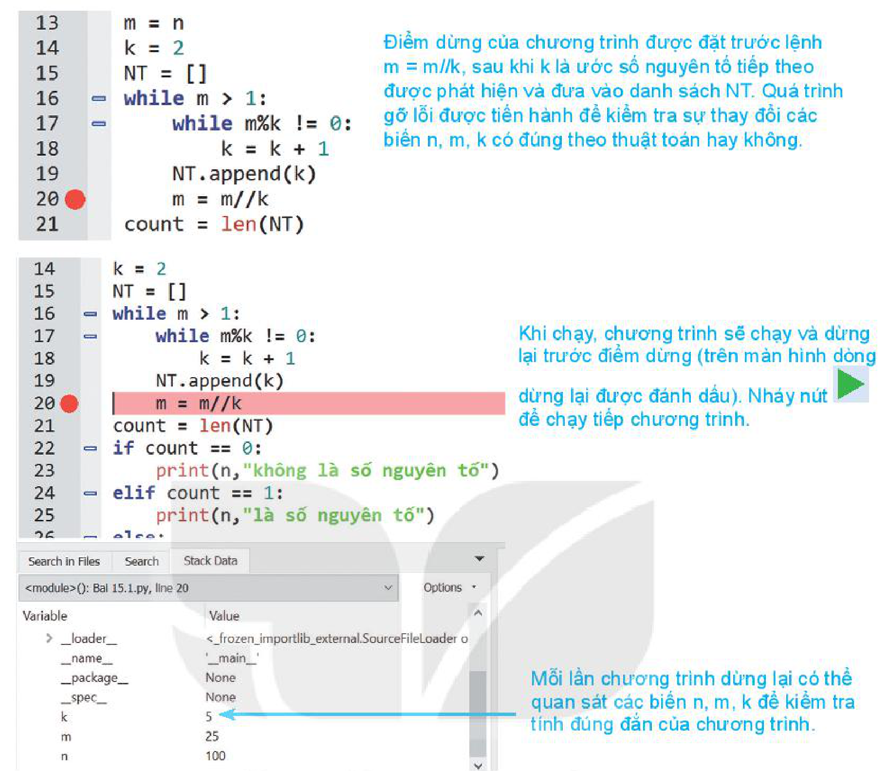

<!-- pdf:150 -->

# BÀI 31: THỰC HÀNH VIẾT CHƯƠNG TRÌNH ĐƠN GIẢN

## 🎯 Sau bài học này em sẽ:

- Thực hành viết chương trình đơn giản bằng ngôn ngữ Python.
- Thực hành được các bước gỡ rối chương trình bằng công cụ debug – thiết lập điểm dừng và chạy theo từng lệnh.

## Nhiệm vụ 1. Viết chương trình nhập từ bàn phím số tự nhiên `n`, kiểm tra `n` có phải là số nguyên tố hay không. Nếu `n` là hợp số thì in ra kết quả phân tích `n` thành tích các thừa số nguyên tố. Chú ý số 1 không là nguyên tố và cũng không là hợp số.

**Hướng dẫn.** Sử dụng biến danh sách `NT` để lưu các thừa số nguyên tố của `n`. Chương trình sẽ thiết lập danh sách `NT` chỉ khi $n > 1$. Kết quả của chương trình sẽ như sau:

- Nếu $n = 1$ thì danh sách `NT` sẽ rỗng.
- Nếu $n > 1$ thì danh sách `NT` không rỗng. Độ dài danh sách `len(NT)` sẽ bằng 1 khi và chỉ khi `n` là số nguyên tố.

Nếu `len(NT) > 1` thì chương trình sẽ in ra khai triển `n` thành tích các thừa số nguyên tố, khai triển này sẽ có dạng: $n = p_1 \times p_1 \times \dots \times p_k$.

**phantichnt.py**

```python
#Nhập số tự nhiên từ bàn phím và kiểm tra n có phải là số nguyên tố hay không.
#Nếu n = 1 thì thông báo n không phải là số nguyên tố.
#Nếu n là hợp số thì in ra phân tích n thành tích các thừa số nguyên tố.
n = int(input("Nhập số tự nhiên n: "))
m = n
k = 2
NT = []
while m > 1:
    while m%k != 0:
        k = k + 1
    NT.append(k)
    m = m//k
count = len(NT)
if count == 0:
    print(n,"không là số nguyên tố")
elif count == 1:
    print(n,"là số nguyên tố")
else:
    print(n,"là hợp số")
    print(n,"=",end = " ")
    for i in range(count):
        if i < count - 1:
            print(NT[i],"x",end = " ")
        else:
            print(NT[i])
```

<!-- pdf:151 -->

Chạy chương trình với công cụ gỡ lỗi của phần mềm lập trình. Thiết lập một điểm dừng tại dòng 20 của chương trình như sau:



```python
13  m = n
14  k = 2
15  NT = []
16  while m > 1:
17      while m%k != 0:
18          k = k + 1
19      NT.append(k)
20  m = m//k           # Điểm dừng của chương trình được đặt trước lệnh m = m//k, sau khi k là ước số nguyên tố tiếp theo được phát hiện và đưa vào danh sách NT. Quá trình gỡ lỗi được tiến hành để kiểm tra sự thay đổi các biến n, m, k có đúng theo thuật toán hay không.
21  count = len(NT)
```

- Điểm dừng của chương trình được đặt trước lệnh `m = m//k`, sau khi `k` là ước số nguyên tố tiếp theo được phát hiện và đưa vào danh sách `NT`. Quá trình gỡ lỗi được tiến hành để kiểm tra sự thay đổi các biến `n`, `m`, `k` có đúng theo thuật toán hay không.
- Khi chạy, chương trình sẽ chạy và dừng lại trước điểm dừng (trên màn hình dòng dừng lại được đánh dấu). Nháy nút chạy tiếp để chạy tiếp chương trình.
- Mỗi lần chương trình dừng lại có thể quan sát các biến `n`, `m`, `k` để kiểm tra tính đúng đắn của chương trình.

Thiết lập bảng theo dõi các giá trị trung gian `k`, `m`, `n`, `NT` sẽ như sau, giả sử giá trị nhập ban đầu của `n = 100`:

| k | m | n | NT | Kết thúc |
| --- | --- | --- | --- | --- |
| 2 | 100 | 100 | `[2]` | |
| 2 | 50 | 100 | `[2, 2]` | |
| 5 | 25 | 100 | `[2, 2, 5]` | |
| 5 | 5 | 100 | `[2, 2, 5, 5]` | |
| | | | | Thông báo: $100 = 2 \times 2 \times 5 \times 5$ |

## Nhiệm vụ 2. Viết chương trình nhập từ bàn phím ba số thực `a`, `b`, `c` và tìm nghiệm của phương trình bậc hai: $ax^2 + bx + c = 0$.

Chương trình cần xét đầy đủ các trường hợp xảy ra.

**Hướng dẫn.**

Với bộ dữ liệu `a`, `b`, `c` đã nhập (là các số thực), chúng ta cần xét đầy đủ các trường hợp sau:

<!-- pdf:152 -->

- Nếu $a = b = c = 0$ phương trình có vô số nghiệm.
- Nếu $a = b = 0; c \ne 0$, phương trình vô nghiệm.
- Nếu $a = 0; b \ne 0$ phương trình là bậc nhất và có nghiệm duy nhất.
- Nếu $a \ne 0$, giải phương trình bậc hai. Nghiệm sẽ phụ thuộc vào giá trị $\text{delta} = b^2 - 4ac$. Phương trình vô nghiệm, có một nghiệm kép hoặc hai nghiệm phân biệt phụ thuộc vào giá trị `delta` là nhỏ hơn 0, bằng 0 hay lớn hơn 0.

Chương trình được thiết kế thông qua các hàm sau:

- `NhapDL()`: hàm nhập ba số `a`, `b`, `c` từ bàn phím.
- `GiaiPT1(b, c)`: hàm giải phương trình bậc nhất: $bx + c = 0$.
- `GiaiPT2(a, b, c)`: hàm giải phương trình bậc hai: $ax^2 + bx + c = 0$.

<!-- term: Cấu trúc if ... elif ... else -->
Trong bài thực hành chúng ta sử dụng cấu trúc mở rộng của lệnh rẽ nhánh `if ... else` trong Python khi các lệnh này lồng nhau. Khi đó các lệnh rẽ nhánh lồng nhau trong mô hình bên trái sẽ được viết gọn hơn như mô hình bên phải.

```python
if <điều kiện 1>:
    <nhóm lệnh 1>
else:
    if <điều kiện 2>:
        <nhóm lệnh 2>
    else:
        <nhóm lệnh 3>
```

```python
if <điều kiện 1>:
    <nhóm lệnh 1>
elif <điều kiện 2>:
    <nhóm lệnh 2>
else:
    <nhóm lệnh 3>
```

*Chú ý:* Cấu trúc **`if ... elif .... else`** có thể lồng nhau nhiều lần.

Chương trình đầy đủ như sau:
<!-- ocr-ok: đã đối chiếu ảnh trang 152, câu ngắn bị OCR nhận diện sai dấu đầy thành đây -->

**giaipt.py**

```python
#Nhập từ bàn phím ba số thực a, b, c và tìm nghiệm của phương trình
#ax2 + bx + c = 0.
def sqrt(x):
    return x**0.5

def NhapDL():
    s = input("Nhập ba số a, b, c cách nhau bởi dấu cách: ")
    snum = s.split()
    return float(snum[0]), float(snum[1]), float(snum[2])

def GiaiPT1(b,c):
    if b != 0:
        print("Phương trình có một nghiệm duy nhất:",round(-c/b,1))
    elif c == 0:
        print("Phương trình có vô số nghiệm")
    else:
        print("Phương trình vô nghiệm")
```

<!-- pdf:153 -->

```python
def GiaiPT2(a,b,c):
    if a == 0:
        GiaiPT1(b,c)
    else:
        delta = b*b - 4*a*c
        if delta > 0:
            x1 = (-b + sqrt(delta))/(2*a)
            x2 = (-b - sqrt(delta))/(2*a)
            print("Phương trình có hai nghiệm khác biệt")
            print("x1 =",round(x1,1),"x2 =",round(x2,1))
        elif delta == 0:
            x = (-b / (2*a))
            print("Phương trình có nghiệm kép")
            print("x1,2 = ",round(x,1))
        else:
            print("Phương trình vô nghiệm")
#Chương trình chính
a,b,c = NhapDL()
GiaiPT2(a,b,c)
```

## ✏️ Luyện tập

1. Viết chương trình yêu cầu nhập số thực dương `a`. Chương trình cần kiểm tra dữ liệu nhập như sau: Nếu số đã nhập nhỏ hơn hoặc bằng 0 thì thông báo: `"Nhập sai, số a phải lớn hơn 0. Hãy nhập lại"`. Chương trình chỉ dừng sau khi người dùng nhập đúng.
2. Viết chương trình in bảng cửu chương ra màn hình như sau:
   - Hàng thứ nhất in ra bảng nhân 1, 2, 3, 4, 5.
   - Hàng thứ hai in ra bảng nhân 6, 7, 8, 9, 10.

## 🚀 Vận dụng

1. Viết chương trình nhập hai số tự nhiên `Y1`, `Y2` là số năm, $Y2 > Y1$. Tính xem trong khoảng thời gian từ năm `Y1` đến năm `Y2` có bao nhiêu năm nhuận. Áp dụng tính xem trong thế kỉ XXI có bao nhiêu năm nhuận.
2. Gọi $\text{ƯCLN}(a, b)$ là hàm ƯCLN của hai số tự nhiên $a, b$. Dễ thấy ta có $\text{ƯCLN}(a, b) = \text{ƯCLN}(b, a\%b)$ nếu $b > 0$ và $\text{ƯCLN}(a, 0) = a$. Từ đó hãy viết chương trình nhập hai số $a, b$ và tính ƯCLN của $a$ và $b$.

## 📷 Danh sách hình trong bài

| Mã hình | Trang PDF | Vị trí trong bài | Chú thích gốc |
| --- | --- | --- | --- |
| H10-tin_hoc-b31-01 | 151 | Nhiệm vụ 1 | Thiết lập điểm dừng tại dòng 20 của chương trình và theo dõi biến trong cửa sổ Stack Data |
