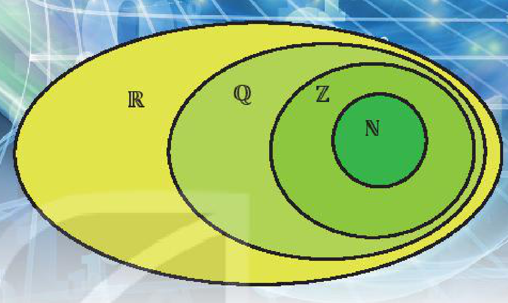
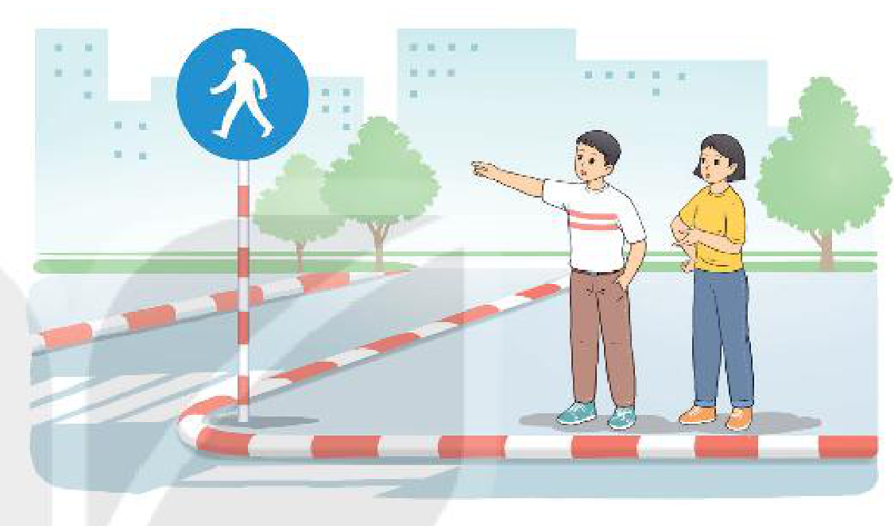
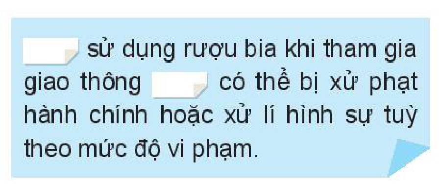
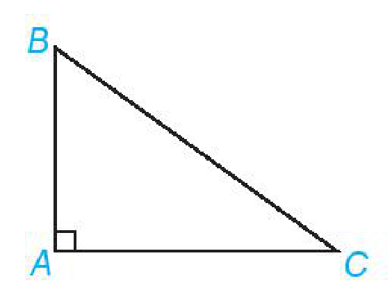
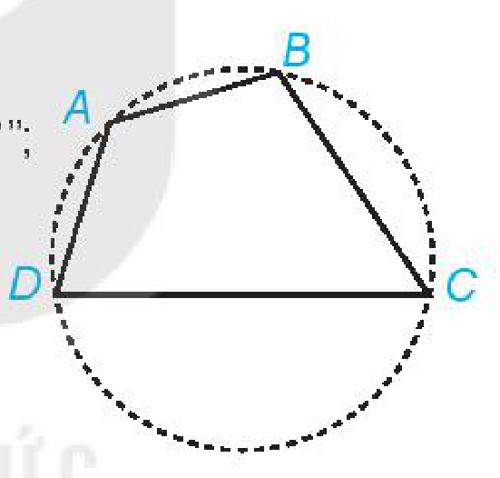
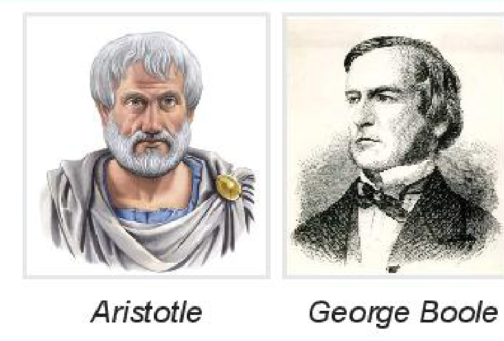

<!-- pdf:6 -->

<!-- Phần giới thiệu Chương I (in chung đầu trang PDF 6): CHƯƠNG I. MỆNH ĐỀ VÀ TẬP HỢP -->

Chương này cung cấp những khái niệm và kí hiệu lôgic thường dùng, củng cố và mở rộng hiểu biết ban đầu về lí thuyết tập hợp đã được học ở các lớp dưới. Từ đó góp phần hình thành khả năng suy luận có lí, khả năng tiếp nhận, diễn đạt các vấn đề một cách chính xác, tạo cơ sở để học tốt các nội dung toán học khác.

# BÀI 1: MỆNH ĐỀ

## 🔤 Thuật ngữ

- Mệnh đề
- Mệnh đề phủ định
- Mệnh đề kéo theo, mệnh đề đảo
- Mệnh đề tương đương
- Điều kiện cần, điều kiện đủ, điều kiện cần và đủ
- Các kí hiệu: $\forall$, $\exists$

## 🎯 Mục tiêu

- Thiết lập và phát biểu mệnh đề phủ định, mệnh đề đảo, mệnh đề kéo theo, mệnh đề tương đương.
- Thiết lập và phát biểu các mệnh đề có chứa kí hiệu $\forall$, $\exists$.
- Xác định tính đúng sai của một mệnh đề trong những trường hợp đơn giản.

## 🔴 Mở đầu

Có bao nhiêu con vật xuất hiện trong hình vẽ?

- **An:** Có $5$ con vật xuất hiện trong hình vẽ.
- **Khoa:** Có $6$ con vật xuất hiện trong hình vẽ.

<!-- pdf:7 -->

## 1. MỆNH ĐỀ, MỆNH ĐỀ CHỨA BIẾN

**a) Mệnh đề**

**HĐ1:** Trong các câu ở *tình huống mở đầu*:
<!-- ocr-ok: đã đối chiếu ảnh trang PDF 7, OCR đọc sai nhãn HĐ1 và dấu câu -->

a) Câu nào đúng?

b) Câu nào sai?

c) Câu nào không xác định được tính đúng sai?

Những câu nói của An và Khoa là những khẳng định có tính đúng hoặc sai. Người ta gọi mỗi câu như vậy là một **mệnh đề lôgic** (gọi tắt là **mệnh đề**). Những câu không xác định được tính đúng sai không phải là mệnh đề.

> Mỗi mệnh đề phải hoặc đúng hoặc sai.
> Một mệnh đề không thể vừa đúng vừa sai.

**Chú ý:** Người ta thường sử dụng các chữ cái $P, Q, R, \dots$ để biểu thị các mệnh đề.

> Những câu nghi vấn, câu cảm thán, câu cầu khiến không phải là mệnh đề.

**Ví dụ 1:** Trong các câu sau, câu nào là mệnh đề? Câu nào không là mệnh đề?

a) Phương trình $3x^2 - 5x + 2 = 0$ có nghiệm nguyên;

b) $5 < 7 - 3$;

c) Có bao nhiêu dấu hiệu nhận biết hai tam giác đồng dạng?

d) Đấy là cách xử lí khôn ngoan!

**Giải:**

Vì phương trình $3x^2 - 5x + 2 = 0$ có nghiệm nguyên $x = 1$ nên câu a là đúng. Câu b là sai. Do đó, câu a và câu b là những mệnh đề.

Câu c là câu hỏi; câu d là câu cảm thán, nêu lên ý kiến của người nói. Do đó, không xác định được tính đúng sai. Vậy các câu c và d không phải là mệnh đề.

**Chú ý:** Những mệnh đề liên quan đến toán học (các mệnh đề ở câu a và câu b trong Ví dụ 1) được gọi là **mệnh đề toán học**.

**Luyện tập 1:** Thay dấu “$?$” bằng dấu “$\checkmark$” vào ô thích hợp trong bảng sau:

| Câu | Không là mệnh đề | Mệnh đề đúng | Mệnh đề sai |
| --- | :---: | :---: | :---: |
| $13$ là số nguyên tố. | $?$ | $?$ | $?$ |
| Tổng độ dài hai cạnh bất kì của một tam giác nhỏ hơn độ dài cạnh còn lại. | $?$ | $?$ | $?$ |
| Bạn đã làm bài tập chưa? | $?$ | $?$ | $?$ |
| Thời tiết hôm nay thật đẹp! | $?$ | $?$ | $?$ |

<!-- pdf:8 -->

**b) Mệnh đề chứa biến**

Xét câu “$n$ chia hết cho $2$” (với $n$ là số tự nhiên).

Ta chưa khẳng định được tính đúng sai của câu này, do đó nó chưa phải là một mệnh đề. Tuy nhiên, nếu thay $n$ bằng số tự nhiên cụ thể thì câu này cho ta một mệnh đề. Chẳng hạn:

- Với $n = 5$ ta được mệnh đề “$5$ chia hết cho $2$”. Đây là mệnh đề sai.
- Với $n = 10$ ta được mệnh đề “$10$ chia hết cho $2$”. Đây là mệnh đề đúng.

Ta nói rằng câu “$n$ chia hết cho $2$” là một **mệnh đề chứa biến**.

> ❓ Xét câu “$x > 5$”. Hãy tìm hai giá trị thực của $x$ để từ câu đã cho, ta nhận được một mệnh đề đúng và một mệnh đề sai.

## 2. MỆNH ĐỀ PHỦ ĐỊNH

**HĐ2:** Quan sát biển báo trong hình bên.

Khoa nói: “Đây là biển báo đường dành cho người đi bộ”.

An không đồng ý với ý kiến của Khoa.

Hãy phát biểu ý kiến của An dưới dạng một mệnh đề.

Để phủ định một mệnh đề $P$, người ta thường thêm (hoặc bớt) từ “không” hoặc “không phải” vào trước vị ngữ của mệnh đề $P$. Ta kí hiệu **mệnh đề phủ định** của mệnh đề $P$ là $\overline{P}$.

> Mệnh đề $P$ và mệnh đề $\overline{P}$ là hai phát biểu trái ngược nhau. Nếu $P$ đúng thì $\overline{P}$ sai, còn nếu $P$ sai thì $\overline{P}$ đúng.

**Ví dụ 2:** Phát biểu mệnh đề phủ định của mỗi mệnh đề sau:

$P$: “$17$ là số chính phương”;

$Q$: “Hình hộp chữ nhật không phải là hình lăng trụ đứng tứ giác”.

**Giải:**

Mệnh đề phủ định của $P$ là $\overline{P}$: “$17$ không phải là số chính phương”.

Mệnh đề phủ định của $Q$ là $\overline{Q}$: “Hình hộp chữ nhật là hình lăng trụ đứng tứ giác”.

**Luyện tập 2:** Phát biểu mệnh đề phủ định của mỗi mệnh đề sau và xác định tính đúng sai của mệnh đề phủ định đó.

$P$: “$2\,022$ chia hết cho $5$”;

$Q$: “Bất phương trình $2x + 1 > 0$ có nghiệm”.
<!-- ocr-ok: đã đối chiếu ảnh trang PDF 8, OCR đọc sai chữ Bất -->

**Vận dụng:** Cho mệnh đề $Q$: “Châu Á là châu lục có diện tích lớn nhất trên thế giới”. Phát biểu mệnh đề phủ định $\overline{Q}$ và xác định tính đúng sai của hai mệnh đề $Q$ và $\overline{Q}$.

<!-- pdf:9 -->

## 3. MỆNH ĐỀ KÉO THEO, MỆNH ĐỀ ĐẢO

**a) Mệnh đề kéo theo**

**HĐ3:** Cặp từ quan hệ nào sau đây phù hợp với vị trí bị che khuất trong câu ghép ở hình bên?

A. Nếu ... thì ...

B. Tuy ... nhưng ...

> `[...]` sử dụng rượu bia khi tham gia giao thông `[...]` có thể bị xử phạt hành chính hoặc xử lí hình sự tuỳ theo mức độ vi phạm.

**HĐ4:** Cho hai câu sau:

$P$: “Tam giác $ABC$ là tam giác vuông tại $A$”;

$Q$: “Tam giác $ABC$ có $AB^2 + AC^2 = BC^2$”.

Hãy phát biểu câu ghép có dạng “Nếu $P$ thì $Q$”.

> Mệnh đề “Nếu $P$ thì $Q$” được gọi là một **mệnh đề kéo theo** và kí hiệu là $P \Rightarrow Q$.

**Chú ý:** Mệnh đề $P \Rightarrow Q$ chỉ sai khi $P$ đúng và $Q$ sai. Do đó ta chỉ cần xét tính đúng sai của mệnh đề $P \Rightarrow Q$ khi $P$ đúng. Khi đó, nếu $Q$ đúng thì $P \Rightarrow Q$ đúng, nếu $Q$ sai thì $P \Rightarrow Q$ sai.

**Ví dụ 3:** Cho tứ giác $ABCD$, xét hai câu sau:

$P$: “Tứ giác $ABCD$ có tổng số đo hai góc đối diện bằng $180^\circ$”;

$Q$: “$ABCD$ là tứ giác nội tiếp đường tròn”.

Phát biểu mệnh đề $P \Rightarrow Q$ và cho biết tính đúng sai của mệnh đề đó.

**Giải:**

$P \Rightarrow Q$: “Nếu tứ giác $ABCD$ có tổng số đo hai góc đối diện bằng $180^\circ$ thì $ABCD$ là tứ giác nội tiếp đường tròn”.

Mệnh đề kéo theo này là mệnh đề đúng.

Các **định lí toán học** là những mệnh đề đúng và thường có dạng $P \Rightarrow Q$. Khi đó ta nói:

> $P$ là **giả thiết** của định lí, $Q$ là **kết luận** của định lí, hoặc
> “$P$ là **điều kiện đủ** để có $Q$” hoặc “$Q$ là **điều kiện cần** để có $P$”.

**b) Mệnh đề đảo**

**HĐ5:** Xét hai câu sau:

$P$: “Phương trình bậc hai $ax^2 + bx + c = 0$ có hai nghiệm phân biệt”;

$Q$: “Phương trình bậc hai $ax^2 + bx + c = 0$ có biệt thức $\Delta = b^2 - 4ac > 0$”.
<!-- ocr-ok: đã đối chiếu ảnh trang PDF 9, OCR dính chữ biệtthức -->

a) Hãy phát biểu mệnh đề $P \Rightarrow Q$.

b) Hãy phát biểu mệnh đề $Q \Rightarrow P$.

<!-- pdf:10 -->

> Mệnh đề $Q \Rightarrow P$ được gọi là **mệnh đề đảo** của mệnh đề $P \Rightarrow Q$.

**Nhận xét:** Mệnh đề đảo của một mệnh đề đúng không nhất thiết là đúng.

**Ví dụ 4:** Hãy phát biểu mệnh đề đảo của mệnh đề: “Nếu tam giác $ABC$ là tam giác đều thì tam giác $ABC$ là tam giác cân” và xác định tính đúng sai của mệnh đề đảo này.

**Giải:**

Mệnh đề đảo là: “Nếu tam giác $ABC$ là tam giác cân thì tam giác $ABC$ là tam giác đều”.

Mệnh đề đảo này là sai.

**Luyện tập 3:** Cho các mệnh đề $P$: “$a$ và $b$ chia hết cho $c$”;

$Q$: “$a + b$ chia hết cho $c$”.

a) Hãy phát biểu định lí $P \Rightarrow Q$. Nêu giả thiết, kết luận của định lí và phát biểu định lí này dưới dạng điều kiện cần, điều kiện đủ.

b) Hãy phát biểu mệnh đề đảo của mệnh đề $P \Rightarrow Q$ rồi xác định tính đúng sai của mệnh đề đảo này.

## 4. MỆNH ĐỀ TƯƠNG ĐƯƠNG

**HĐ6:** Hãy xác định tính đúng sai của mệnh đề sau:

“Một số tự nhiên chia hết cho $5$ nếu số đó có chữ số tận cùng bằng $0$ hoặc $5$ và ngược lại”.

Mệnh đề ở HĐ6 có thể phát biểu dưới dạng: “Một số tự nhiên chia hết cho $5$ nếu và chỉ nếu số đó có chữ số tận cùng bằng $0$ hoặc $5$”.

> Mệnh đề “$P$ nếu và chỉ nếu $Q$” được gọi là một **mệnh đề tương đương** và kí hiệu là $P \Leftrightarrow Q$.

**Nhận xét:** Nếu cả hai mệnh đề $P \Rightarrow Q$ và $Q \Rightarrow P$ đều đúng thì mệnh đề tương đương $P \Leftrightarrow Q$ đúng. Khi đó ta nói “$P$ **tương đương** với $Q$” hoặc “$P$ là **điều kiện cần và đủ** để có $Q$” hoặc “$P$ **khi và chỉ khi** $Q$”.

**Ví dụ 5:** Cho hai mệnh đề:

$P$: “Tứ giác $ABCD$ là hình vuông”;

$Q$: “Tứ giác $ABCD$ là hình chữ nhật có hai đường chéo vuông góc với nhau”.

Hãy phát biểu mệnh đề tương đương $P \Leftrightarrow Q$ và xác định tính đúng sai của mệnh đề tương đương này.

**Giải:**

Mệnh đề tương đương $P \Leftrightarrow Q$: “Tứ giác $ABCD$ là hình vuông khi và chỉ khi tứ giác $ABCD$ là hình chữ nhật có hai đường chéo vuông góc với nhau”. Mệnh đề tương đương này đúng vì cả hai mệnh đề $P \Rightarrow Q$ và $Q \Rightarrow P$ đều đúng.

**Luyện tập 4:** Phát biểu điều kiện cần và đủ để số tự nhiên $n$ chia hết cho $2$.

<!-- pdf:11 -->

## 5. MỆNH ĐỀ CÓ CHỨA KÍ HIỆU $\forall, \exists$

- Câu “Mọi số thực đều có bình phương không âm” là một mệnh đề. Có thể viết mệnh đề này như sau:
  $P$: “$\forall x \in \mathbb{R}, x^2 \ge 0$”.
- Câu “Có một số hữu tỉ mà bình phương của nó bằng $2$” là một mệnh đề. Có thể viết mệnh đề này như sau:
  $Q$: “$\exists x \in \mathbb{Q}, x^2 = 2$”.

<!-- term: Kí hiệu với mọi và tồn tại -->
> Kí hiệu $\forall$ đọc là “với mọi”; kí hiệu $\exists$ đọc là “tồn tại”.
<!-- ocr-ok: đã đối chiếu ảnh trang PDF 11, OCR đọc thiếu dấu chữ hiệu và mọi -->

> ❓ Em hãy xác định tính đúng sai của hai mệnh đề trên.

**Luyện tập 5:** Phát biểu bằng lời mệnh đề sau và cho biết mệnh đề đó đúng hay sai.

$\forall x \in \mathbb{R}, x^2 + 1 \le 0.$

Dưới đây ta xét mệnh đề phủ định của mệnh đề có chứa kí hiệu $\forall, \exists$.

- Mọi số tự nhiên nhân với $1$ đều bằng chính nó: $1 \cdot 1 = 1$; $2 \cdot 1 = 2$; $3 \cdot 1 = 3$; $4 \cdot 1 = 4$; $\dots$
- Không đúng. Có một số tự nhiên nhân với $1$ không bằng chính nó.

<!-- term: Phủ định của mệnh đề chứa kí hiệu với mọi, tồn tại -->
Mệnh đề “Có một số tự nhiên nhân với $1$ không bằng chính nó” là phủ định của mệnh đề “Mọi số tự nhiên nhân với $1$ đều bằng chính nó”. Như vậy mệnh đề phủ định của $P$: “$\forall n \in \mathbb{N}, n \cdot 1 = n$” là mệnh đề $\overline{P}$: “$\exists n \in \mathbb{N}, n \cdot 1 \ne n$”.

**Ví dụ 6:** Viết mệnh đề phủ định của mệnh đề sau và xác định tính đúng sai của nó.

$P$: “$\exists x \in \mathbb{R}, x^2 + 1 = 0$”.

**Giải:**

Mệnh đề $P$ có thể phát biểu là: “Tồn tại một số thực mà bình phương của nó cộng với $1$ bằng $0$”.

Phủ định của mệnh đề $P$ là: “Không tồn tại một số thực mà bình phương của nó cộng với $1$ bằng $0$”, tức là: “Mọi số thực đều có bình phương cộng với $1$ khác $0$”.

Ta có thể viết mệnh đề phủ định của $P$ là $\overline{P}$: “$\forall x \in \mathbb{R}, x^2 + 1 \ne 0$”. Mệnh đề phủ định này đúng.

**Luyện tập 6:** Trong tiết học môn Toán, Nam phát biểu: “Mọi số thực đều có bình phương khác $1$”.

Mai phát biểu: “Có một số thực mà bình phương của nó bằng $1$”.

a) Hãy cho biết bạn nào phát biểu đúng.

b) Dùng kí hiệu $\forall, \exists$ để viết lại các phát biểu của Nam và Mai dưới dạng mệnh đề.

<!-- pdf:12 -->

## ✏️ Bài tập

**1.1.** Trong các câu sau, câu nào là mệnh đề?

a) Trung Quốc là nước đông dân nhất thế giới;

b) Bạn học trường nào?

c) Không được làm việc riêng trong giờ học;

d) Tôi sẽ sút bóng trúng xà ngang.

**1.2.** Xác định tính đúng sai của mỗi mệnh đề sau:
<!-- ocr-ok: đã đối chiếu ảnh trang PDF 12, OCR đọc sai nhãn 1.2 và chữ mỗi -->

a) $\pi > \frac{10}{3}$;

b) Phương trình $3x + 7 = 0$ có nghiệm;
<!-- ocr-ok: đã đối chiếu ảnh trang PDF 12, OCR dính chữ 0có -->

c) Có ít nhất một số cộng với chính nó bằng $0$;

d) $2\,022$ là hợp số.

**1.3.** Cho hai câu sau:
<!-- ocr-ok: đã đối chiếu ảnh trang PDF 12, OCR mất nhãn 1.3 -->

$P$: “Tam giác $ABC$ là tam giác vuông”;

$Q$: “Tam giác $ABC$ có một góc bằng tổng hai góc còn lại”.

Hãy phát biểu mệnh đề tương đương $P \Leftrightarrow Q$ và xác định tính đúng sai của mệnh đề này.

**1.4.** Phát biểu mệnh đề đảo của mỗi mệnh đề sau và xác định tính đúng sai của chúng.

$P$: “Nếu số tự nhiên $n$ có chữ số tận cùng là $5$ thì $n$ chia hết cho $5$”;

$Q$: “Nếu tứ giác $ABCD$ là hình chữ nhật thì tứ giác $ABCD$ có hai đường chéo bằng nhau”.

**1.5.** Với hai số thực $a$ và $b$, xét các mệnh đề $P$: “$a^2 < b^2$” và $Q$: “$0 < a < b$”.
<!-- ocr-ok: đã đối chiếu ảnh trang PDF 12 -->

a) Hãy phát biểu mệnh đề $P \Rightarrow Q$.

b) Hãy phát biểu mệnh đề đảo của mệnh đề ở câu a.

c) Xác định tính đúng sai của mỗi mệnh đề ở câu a và câu b.

**1.6.** Xác định tính đúng sai của mệnh đề sau và tìm mệnh đề phủ định của nó.

$Q$: “$\exists n \in \mathbb{N}$, $n$ chia hết cho $n + 1$”.

**1.7.** Dùng kí hiệu $\forall, \exists$ để viết các mệnh đề sau:

$P$: “Mọi số tự nhiên đều có bình phương lớn hơn hoặc bằng chính nó”;

$Q$: “Có một số thực cộng với chính nó bằng $0$”.

## 💡 Em có biết?

Lôgic mệnh đề lần đầu tiên được phát triển một cách có hệ thống bởi nhà triết học Hy Lạp Aristotle hơn $2\,300$ năm trước và được thảo luận bởi nhà toán học người Anh George Boole vào năm 1854 trong cuốn sách “The Laws of Think”.

*Aristotle — George Boole*

## 📷 Danh sách hình trong bài

| Mã hình | Trang PDF | Vị trí trong bài | Chú thích gốc |
| --- | :---: | --- | --- |
| H10-toan-b01-01 | 6 | Mở đầu chương I | (sách không đánh số, sơ đồ minh hoạ quan hệ giữa các tập hợp số $\mathbb{N}, \mathbb{Z}, \mathbb{Q}, \mathbb{R}$) |
| H10-toan-b01-02 | 6 | Mở đầu | (sách không đánh số, tình huống mở đầu của An và Khoa) |
| H10-toan-b01-03 | 8 | Mục 2, HĐ2 | (sách không đánh số, hình biển báo đường dành cho người đi bộ) |
| H10-toan-b01-04 | 9 | Mục 3.a, HĐ3 | (sách không đánh số, câu ghép bị che khuất cặp từ quan hệ) |
| H10-toan-b01-05 | 9 | Mục 3.a, HĐ4 | (sách không đánh số, tam giác $ABC$ vuông tại $A$) |
| H10-toan-b01-06 | 9 | Mục 3.a, Ví dụ 3 | (sách không đánh số, tứ giác $ABCD$ nội tiếp đường tròn) |
| H10-toan-b01-07 | 11 | Mục 5 | (sách không đánh số, minh hoạ phủ định của mệnh đề chứa kí hiệu $\forall$) |
| H10-toan-b01-08 | 12 | Em có biết? | Aristotle — George Boole |
