<!-- pdf:13 -->

# BÀI 2: TẬP HỢP VÀ CÁC PHÉP TOÁN TRÊN TẬP HỢP

## 🔤 Thuật ngữ

- Tập hợp, tập con, tập hợp bằng nhau, tập rỗng
- Hợp, giao, hiệu của hai tập hợp, phần bù của một tập con
- Biểu đồ Ven

## 🎯 Mục tiêu

- Nhận biết các khái niệm cơ bản về tập hợp.
- Thực hiện các phép toán trên tập hợp và vận dụng giải một số bài toán có nội dung thực tiễn.
- Sử dụng biểu đồ Ven để biểu diễn tập hợp và các phép toán trên tập hợp.

## 🔴 Mở đầu

Câu lạc bộ Lịch sử có $12$ thành viên (không có hai bạn nào trùng tên), tổ chức hai chuyên đề trên một phần mềm họp trực tuyến. Tên các thành viên tham gia mỗi chuyên đề được hiển thị trên màn hình (H.1.1).

> Có bao nhiêu thành viên vắng mặt trong cả hai chuyên đề nhỉ?

*Hình 1.1*

Bài học này sẽ giúp em trả lời câu hỏi trên bằng kiến thức cơ bản về tập hợp và các phép toán trên tập hợp.

## 1. CÁC KHÁI NIỆM CƠ BẢN VỀ TẬP HỢP

**a) Tập hợp**

**HĐ1:** Trong *tình huống trên*, gọi $A$ là tập hợp những thành viên tham gia Chuyên đề 1, $B$ là tập hợp những thành viên tham gia Chuyên đề 2.

a) Nam có là một phần tử của tập hợp $A$ không? Ngân có là một phần tử của tập hợp $B$ không?

b) Hãy mô tả các tập hợp $A$ và $B$ bằng cách liệt kê các phần tử.

<!-- pdf:14 -->

**HĐ2:** Cho tập hợp:

$C = \{\text{châu Á}; \text{châu Âu}; \text{châu Đại Dương}; \text{châu Mỹ}; \text{châu Nam Cực}; \text{châu Phi}\}$.

a) Hãy chỉ ra tính chất đặc trưng cho các phần tử của tập hợp $C$.

b) Tập hợp $C$ có bao nhiêu phần tử?

<!-- term: Cách mô tả tập hợp -->
> Có thể mô tả một tập hợp bằng một trong hai cách sau:
> *Cách 1.* Liệt kê các phần tử của tập hợp;
> *Cách 2.* Chỉ ra tính chất đặc trưng cho các phần tử của tập hợp.

<!-- term: Phần tử thuộc tập hợp -->
> - $a \in S$: phần tử $a$ thuộc tập hợp $S$.
> - $a \notin S$: phần tử $a$ không thuộc tập hợp $S$.

**Ví dụ 1:** Cho $D = \{n \in \mathbb{N} \mid n \text{ là số nguyên tố}, 5 < n < 20\}$.

a) Viết tập hợp $D$ bằng cách liệt kê các phần tử. Tập hợp $D$ có bao nhiêu phần tử?

b) Dùng kí hiệu $\in, \notin$ để viết câu trả lời cho câu hỏi sau: Trong các số $5; 12; 17; 18$, số nào thuộc tập $D$, số nào không thuộc tập $D$?

**Giải:**

a) $D = \{7; 11; 13; 17; 19\}$. Tập hợp $D$ có $5$ phần tử.
<!-- ocr-ok: đã đối chiếu ảnh trang PDF 14, OCR dính chữ Dcó -->

b) $5 \notin D$; $12 \notin D$; $17 \in D$; $18 \notin D$.

**Chú ý:** **Số phần tử của tập hợp** $S$ được kí hiệu là $n(S)$. Chẳng hạn, tập hợp $A$ trong HĐ1 có số phần tử là $7$, ta viết $n(A) = 7$.

- Số nào thuộc tập nghiệm của phương trình $x^2 + 1 = 0$?
- Không có số nào vì phương trình vô nghiệm!

> Tập hợp không chứa phần tử nào được gọi là **tập rỗng**, kí hiệu là $\varnothing$.

Chẳng hạn:

- Tập hợp các nghiệm của phương trình $x^2 + 1 = 0$ là tập rỗng;
- Tập hợp những người sống trên Mặt Trời là tập rỗng.

**Luyện tập 1:** Gọi $S$ là tập nghiệm của phương trình $x^2 - 24x + 143 = 0$.

Các mệnh đề sau đúng hay sai?

a) $13 \in S$;

b) $11 \notin S$;

c) $n(S) = 2$.

**b) Tập hợp con**

**HĐ3:** Gọi $H$ là tập hợp các bạn tham gia Chuyên đề 2 trong *tình huống mở đầu* có tên bắt đầu bằng chữ H. Các phần tử của tập hợp $H$ có là phần tử của tập hợp $B$ trong HĐ1 không?

<!-- pdf:15 -->

> Nếu mọi phần tử của tập hợp $T$ đều là phần tử của tập hợp $S$ thì ta nói $T$ là một **tập hợp con** (**tập con**) của $S$ và viết là $T \subset S$ (đọc là $T$ chứa trong $S$ hoặc $T$ là tập con của $S$).

> - Thay cho $T \subset S$, ta còn viết $S \supset T$ (đọc là $S$ chứa $T$).
> - Kí hiệu $T \not\subset S$ để chỉ $T$ không là tập con của $S$.
<!-- ocr-ok: đã đối chiếu ảnh trang PDF 15, OCR dính chữ trong hộp bóng thoại -->

**Nhận xét:**

- Từ định nghĩa trên, $T$ là tập con của $S$ nếu mệnh đề sau đúng:
  $\forall x, x \in T \Rightarrow x \in S.$
- Quy ước tập rỗng là tập con của mọi tập hợp.

> Người ta thường minh hoạ một tập hợp bằng một hình phẳng được bao quanh bởi một đường kín, gọi là **biểu đồ Ven** (H.1.2).

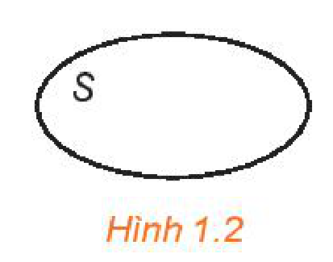
*Hình 1.2*

Minh hoạ $T$ là một tập con của $S$ như Hình 1.3.

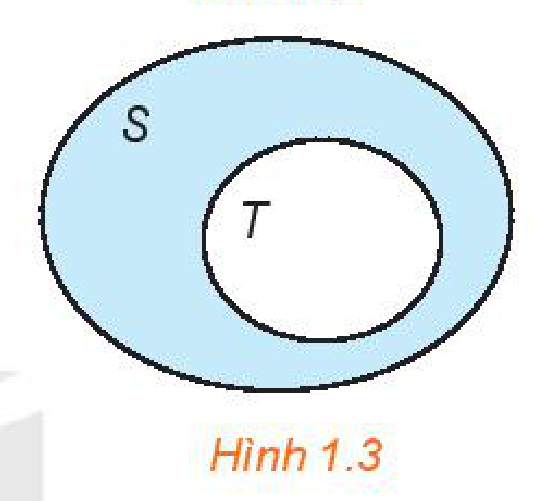
*Hình 1.3*

**Ví dụ 2:** Cho tập hợp $S = \{2; 3; 5\}$. Những tập hợp nào sau đây là tập con của $S$?

$S_1 = \{3\}$; $S_2 = \{0; 2\}$; $S_3 = \{3; 5\}$.

**Giải:**

Các tập hợp $S_1 = \{3\}$, $S_3 = \{3; 5\}$ là những tập con của $S$ (H.1.4).

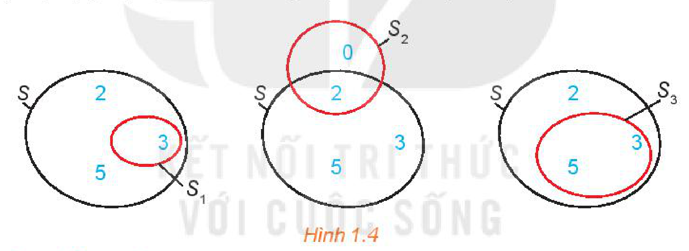
*Hình 1.4*

**c) Hai tập hợp bằng nhau**

**HĐ4:** Sơn và Thu viết tập hợp các số chính phương nhỏ hơn $100$ như sau:

Sơn: $S = \{0; 1; 4; 9; 16; 25; 36; 49; 64; 81\}$;

Thu: $T = \{n \in \mathbb{N} \mid n \text{ là số chính phương}; n < 100\}$.

Hỏi bạn nào viết đúng?

> Hai tập hợp $S$ và $T$ được gọi là **hai tập hợp bằng nhau** nếu mỗi phần tử của $T$ cũng là phần tử của tập hợp $S$ và ngược lại. Kí hiệu là $S = T$.

> Nếu $S \subset T$ và $T \subset S$ thì $S = T$.

**Ví dụ 3:** Cho hai tập hợp:

$C = \{n \in \mathbb{N} \mid n \text{ là bội chung của } 2 \text{ và } 3; n < 30\}$;

$D = \{n \in \mathbb{N} \mid n \text{ là bội của } 6; n < 30\}$.

Chứng minh $C = D$.

<!-- pdf:16 -->

**Giải:**

Ta có: $C = \{0; 6; 12; 18; 24\}$;

$D = \{0; 6; 12; 18; 24\}$.

Vậy $C = D$.

**Luyện tập 2:** Giả sử $C$ là tập hợp các hình bình hành có hai đường chéo vuông góc; $D$ là tập hợp các hình vuông.

Các mệnh đề sau đúng hay sai?

a) $C \subset D$;

b) $C \supset D$;

c) $C = D$.

## 2. CÁC TẬP HỢP SỐ

**a) Mối quan hệ giữa các tập hợp số**

- **Tập hợp các số tự nhiên** $\mathbb{N} = \{0; 1; 2; 3; 4; \dots\}$.
- **Tập hợp các số nguyên** $\mathbb{Z}$ gồm các số tự nhiên và các số nguyên âm:
  $\mathbb{Z} = \{\dots; -3; -2; -1; 0; 1; 2; 3; \dots\}$.
- **Tập hợp các số hữu tỉ** $\mathbb{Q}$ gồm các số viết được dưới dạng phân số $\frac{a}{b}$, với $a, b \in \mathbb{Z}, b \ne 0$.
  Số hữu tỉ còn được biểu diễn dưới dạng số thập phân hữu hạn hoặc vô hạn tuần hoàn.
- **Tập hợp các số thực** $\mathbb{R}$ gồm các số hữu tỉ và các **số vô tỉ**. Số vô tỉ là các số thập phân vô hạn không tuần hoàn.

**HĐ5:** Các mệnh đề sau đúng hay sai?

a) Mọi số nguyên đều viết được dưới dạng phân số;

b) Tập hợp các số thực chứa tập hợp các số hữu tỉ;

c) Tồn tại một số thực không là số hữu tỉ.

> Mối quan hệ giữa các tập hợp số: $\mathbb{N} \subset \mathbb{Z} \subset \mathbb{Q} \subset \mathbb{R}$.

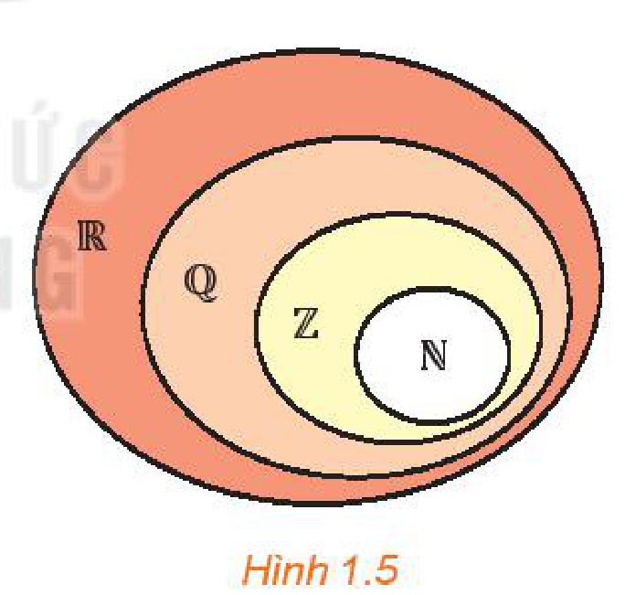
*Hình 1.5*

**Ví dụ 4:** Hãy xác định tính đúng sai của các mệnh đề sau:

a) $3,274 \in \mathbb{Q}$;

b) $\sqrt{2} \in \mathbb{R}$;

c) $\frac{3}{4} \in \mathbb{Z}$.

**Giải:**

a) $3,274 \in \mathbb{Q}$ là mệnh đề đúng.
<!-- ocr-ok: đã đối chiếu ảnh trang PDF 16, OCR dính chữ Qlà -->

b) $\sqrt{2} \in \mathbb{R}$ là mệnh đề đúng.

c) $\frac{3}{4} \in \mathbb{Z}$ là mệnh đề sai.

**Luyện tập 3:** Cho tập hợp $C = \{-4; 0; 1; 2\}$. Các mệnh đề sau đúng hay sai?

a) $C$ là tập con của $\mathbb{Z}$;

b) $C$ là tập con của $\mathbb{N}$;

c) $C$ là tập con của $\mathbb{R}$.

<!-- pdf:17 -->

**b) Các tập con thường dùng của $\mathbb{R}$**

**HĐ6:** Cho hai tập hợp $C = \{x \in \mathbb{R} \mid x \ge 3\}$ và $D = \{x \in \mathbb{R} \mid x > 3\}$.

Các mệnh đề sau đúng hay sai?

a) $C, D$ là các tập con của $\mathbb{R}$;

b) $\forall x, x \in C \Rightarrow x \in D$;

c) $3 \in C$ nhưng $3 \notin D$;

d) $C = D$.

> Một số tập con thường dùng của tập số thực $\mathbb{R}$:
> - **Khoảng**
>   $(a; b) = \{x \in \mathbb{R} \mid a < x < b\}$
>   $(a; +\infty) = \{x \in \mathbb{R} \mid x > a\}$
>   $(-\infty; b) = \{x \in \mathbb{R} \mid x < b\}$
>   $(-\infty; +\infty)$
> - **Đoạn**
>   $[a; b] = \{x \in \mathbb{R} \mid a \le x \le b\}$
> - **Nửa khoảng**
>   $[a; b) = \{x \in \mathbb{R} \mid a \le x < b\}$
>   $(a; b] = \{x \in \mathbb{R} \mid a < x \le b\}$
>   $[a; +\infty) = \{x \in \mathbb{R} \mid x \ge a\}$
>   $(-\infty; b] = \{x \in \mathbb{R} \mid x \le b\}$

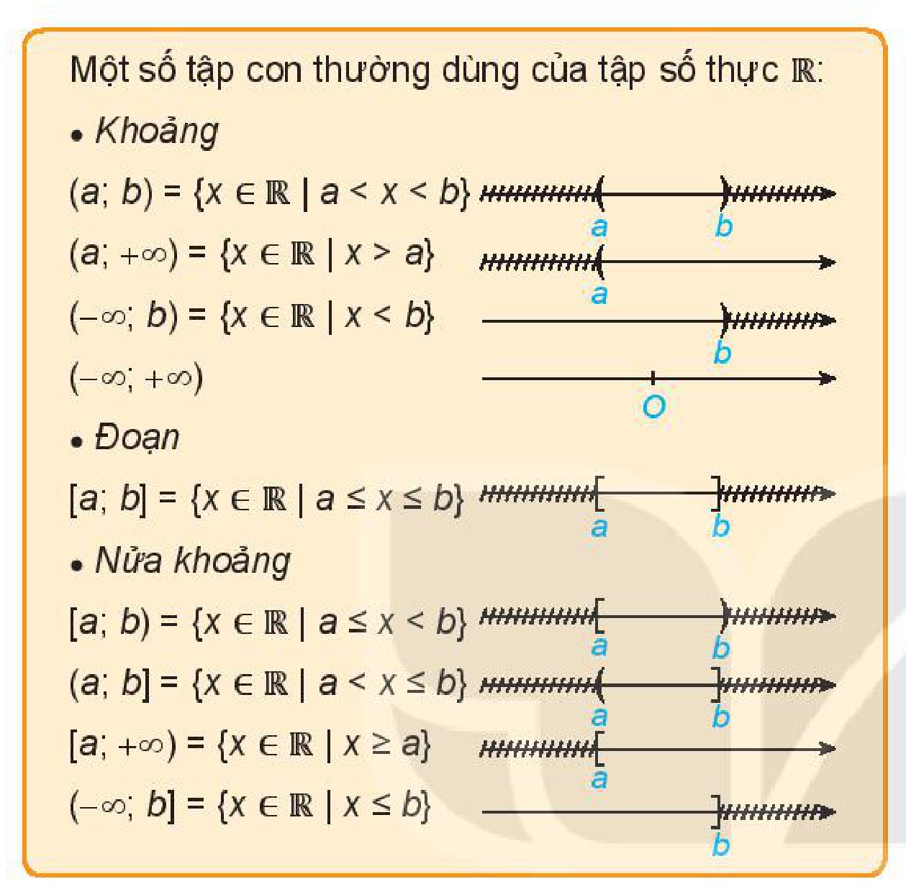

> - Kí hiệu $+\infty$: Đọc là **dương vô cực** (hoặc **dương vô cùng**).
> - Kí hiệu $-\infty$: Đọc là **âm vô cực** (hoặc **âm vô cùng**).
> - $a, b$ gọi là các **đầu mút** của đoạn, khoảng hay nửa khoảng.

**Ví dụ 5:** Viết các tập hợp sau dưới dạng các khoảng, đoạn, nửa khoảng trong $\mathbb{R}$ rồi biểu diễn trên trục số: $C = \{x \in \mathbb{R} \mid 2 \le x \le 7\}$; $D = \{x \in \mathbb{R} \mid x < 2\}$.

**Giải:**

$C = [2; 7]$

$D = (-\infty; 2)$

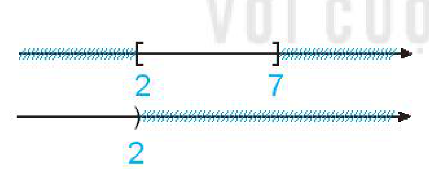

**Luyện tập 4:** Hãy ghép mỗi dòng ở cột bên trái với một dòng thích hợp ở cột bên phải.

| Cột bên trái | Cột bên phải |
| --- | --- |
| 1) $x \in [2; 5]$ | a) $2 < x \le 5$ |
| 2) $x \in (2; 5]$ | b) $x \ge 7$ |
| 3) $x \in [7; +\infty)$ | c) $7 < x < 10$ |
| 4) $x \in (7; 10)$ | d) $2 \le x \le 5$ |
| | e) $2 \le x < 5$ |
<!-- ocr-ok: đã đối chiếu ảnh trang PDF 17, bảng ghép cột toàn công thức toán -->

## 3. CÁC PHÉP TOÁN TRÊN TẬP HỢP

**a) Giao của hai tập hợp**

**HĐ7:** Viết tập hợp $X$ gồm những thành viên tham gia cả hai chuyên đề 1 và 2 trong *tình huống mở đầu*.

Tập $X$ có phải là tập con của tập $A$ không? Tập $X$ có phải là tập con của tập $B$ không? ($A, B$ là các tập hợp trong HĐ1).

<!-- pdf:18 -->

> Tập hợp gồm các phần tử thuộc cả hai tập hợp $S$ và $T$ gọi là **giao của hai tập hợp** $S$ và $T$, kí hiệu là $S \cap T$.
> $S \cap T = \{x \mid x \in S \text{ và } x \in T\}.$

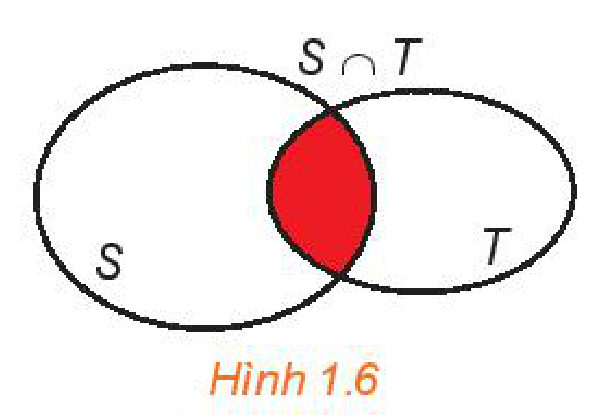
*Hình 1.6*

**Ví dụ 6:**

a) Cho hai tập hợp $C = \{4; 7; 27\}$ và $D = \{2; 4; 9; 27; 36\}$. Hãy xác định tập hợp $C \cap D$.

b) Cho hai tập hợp $E = [1; +\infty)$ và $F = (-\infty; 3]$. Hãy xác định tập hợp $E \cap F$.

**Giải:**

a) Giao của hai tập hợp $C$ và $D$ là $C \cap D = \{4; 27\}$.

b) Giao của hai tập hợp $E$ và $F$ là $E \cap F = [1; 3]$.

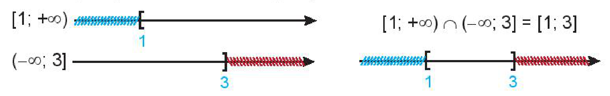

**Luyện tập 5:** Cho các tập hợp $C = [1; 5]$, $D = [-2; 3]$. Hãy xác định tập hợp $C \cap D$.

**b) Hợp của hai tập hợp**

**HĐ8:** Trở lại *tình huống mở đầu*, hãy xác định tập hợp các thành viên tham gia Chuyên đề 1 hoặc Chuyên đề 2.

> Tập hợp gồm các phần tử thuộc tập hợp $S$ hoặc thuộc tập hợp $T$ gọi là **hợp của hai tập hợp** $S$ và $T$, kí hiệu là $S \cup T$.
> $S \cup T = \{x \mid x \in S \text{ hoặc } x \in T\}.$

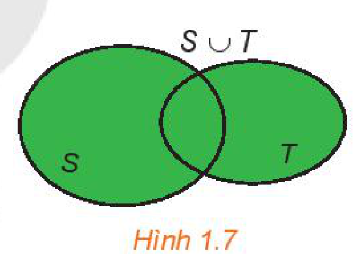
*Hình 1.7*

**Ví dụ 7:**

a) Cho hai tập hợp: $C = \{2; 3; 4; 7\}$ và $D = \{-1; 2; 3; 4; 6\}$. Hãy xác định tập hợp $C \cup D$.

b) Cho hai tập hợp $E = (-1; 2]$ và $F = [0; 3]$. Hãy xác định tập hợp $E \cup F$.

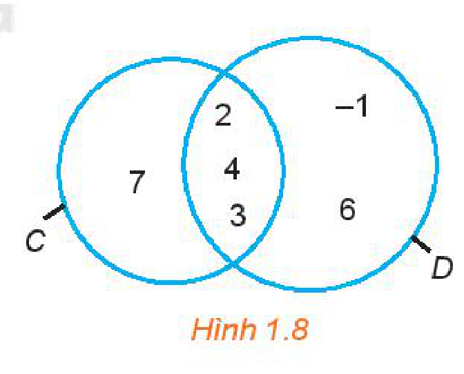
*Hình 1.8*

**Giải:**

a) Hợp của hai tập hợp $C$ và $D$ là $C \cup D = \{-1; 2; 3; 4; 6; 7\}$.

b) Hợp của hai tập hợp $E$ và $F$ là $E \cup F = (-1; 3]$.

**Ví dụ 8:** Trở lại câu hỏi trong *tình huống mở đầu*. Gọi $A$ là tập hợp những thành viên tham gia Chuyên đề 1, $B$ là tập hợp những thành viên tham gia Chuyên đề 2.

Ta có: $A \cup B = \{\text{Nam}; \text{Hương}; \text{Chi}; \text{Tú}; \text{Bình}; \text{Ngân}; \text{Khánh}; \text{Hân}; \text{Hiền}; \text{Lam}\}$.

Tập $A \cup B$ có $10$ phần tử, tức là có $10$ thành viên tham gia một hoặc hai chuyên đề.

Số thành viên vắng mặt trong cả hai chuyên đề là: $12 - 10 = 2$ (thành viên).

**Luyện tập 6:** Hãy biểu diễn tập hợp $A \cup B$ bằng biểu đồ Ven, với $A, B$ được cho trong HĐ1.

<!-- pdf:19 -->

**c) Hiệu của hai tập hợp**

**HĐ9:** Trở lại *tình huống mở đầu*, hãy xác định tập hợp các thành viên chỉ tham gia Chuyên đề 1 mà không tham gia Chuyên đề 2.

> - **Hiệu của hai tập hợp** $S$ và $T$ là tập hợp gồm các phần tử thuộc $S$ nhưng không thuộc $T$, kí hiệu là $S \setminus T$.
>   $S \setminus T = \{x \mid x \in S \text{ và } x \notin T\}.$
> - Nếu $T \subset S$ thì $S \setminus T$ được gọi là **phần bù** của $T$ trong $S$, kí hiệu là $C_S T$.

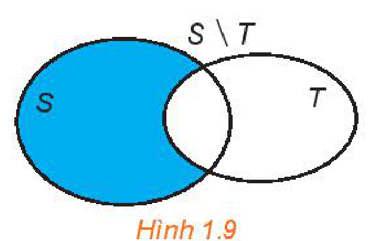
*Hình 1.9*

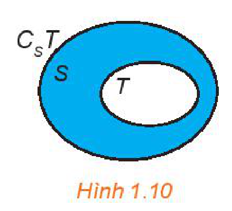
*Hình 1.10*

**Chú ý:** $C_S S = \varnothing$.

**Ví dụ 9:** Cho các tập hợp: $D = \{-2; 3; 5; 6\}$; $E = \{x \mid x \text{ là số nguyên tố nhỏ hơn } 10\}$;

$X = \{x \mid x \text{ là số nguyên dương nhỏ hơn } 10\}$.

a) Tìm $D \setminus E$ và $E \setminus D$.

b) $E$ có là tập con của $X$ không? Hãy tìm phần bù của $E$ trong $X$ (nếu có).

**Giải:**

a) Ta có: $E = \{2; 3; 5; 7\}$.

Do đó, $D \setminus E = \{-2; 6\}$; $E \setminus D = \{2; 7\}$.

b) Ta có: $X = \{1; 2; 3; 4; 5; 6; 7; 8; 9\}$. Vậy $E$ là tập con của $X$.

Phần bù của $E$ trong $X$ là $X \setminus E = C_X E = \{1; 4; 6; 8; 9\}$.
<!-- ocr-ok: đã đối chiếu ảnh trang PDF 19, OCR dính chữ Xlà -->

**Luyện tập 7:** Tìm phần bù của các tập hợp sau trong $\mathbb{R}$:

a) $(-\infty; -2)$;

b) $[-5; +\infty)$.

**Vận dụng:** Lớp 10A có $24$ bạn tham gia thi đấu bóng đá và cầu lông, trong đó có $16$ bạn thi đấu bóng đá và $11$ bạn thi đấu cầu lông. Giả sử các trận bóng đá và cầu lông không tổ chức đồng thời. Hỏi có bao nhiêu bạn lớp 10A tham gia thi đấu cả bóng đá và cầu lông?

<!-- term: Công thức số phần tử của hợp hai tập hợp -->
*Gợi ý:* Gọi $x$ là số bạn tham gia thi đấu cả bóng đá và cầu lông.

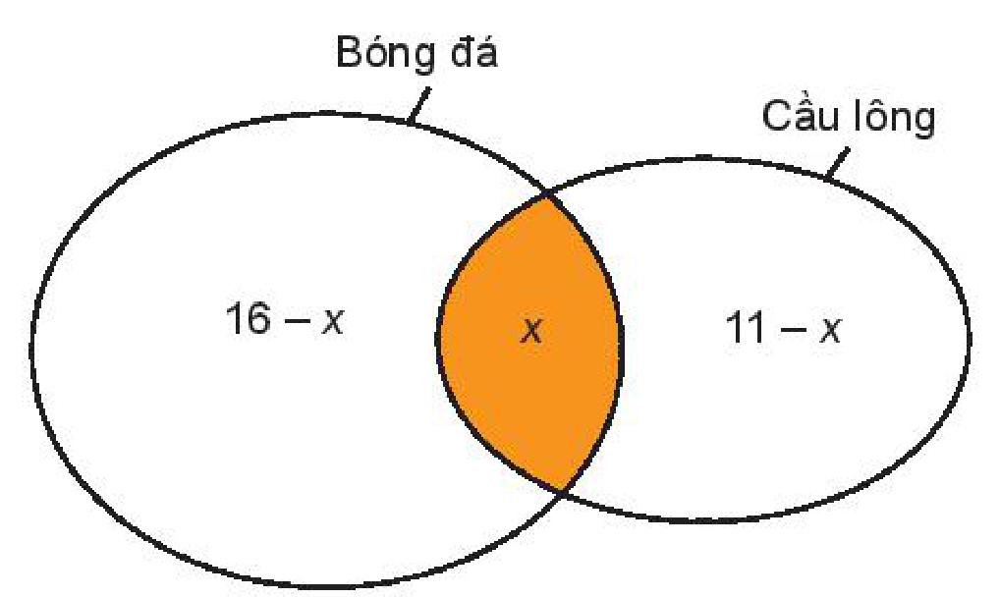

<!-- term: Công thức số phần tử của hợp hai tập hợp -->
> Ta có: $n(A \cup B) = n(A) + n(B) - n(A \cap B)$.

<!-- pdf:20 -->

## ✏️ Bài tập

**1.8.** Gọi $X$ là tập hợp các quốc gia tiếp giáp với Việt Nam. Hãy liệt kê các phần tử của tập hợp $X$ và biểu diễn tập $X$ bằng biểu đồ Ven.

**1.9.** Kí hiệu $E$ là tập hợp các quốc gia tại khu vực Đông Nam Á.

a) Nêu ít nhất hai phần tử thuộc tập hợp $E$.

b) Nêu ít nhất hai phần tử không thuộc tập hợp $E$.

c) Liệt kê các phần tử thuộc tập hợp $E$. Tập hợp $E$ có bao nhiêu phần tử?

**1.10.** Hãy viết tập hợp sau bằng cách nêu tính chất đặc trưng cho các phần tử của tập hợp:

$A = \{0; 4; 8; 12; 16\}.$

**1.11.** Trong các tập hợp sau, tập nào là tập rỗng?

$A = \{x \in \mathbb{R} \mid x^2 - 6 = 0\}$; $B = \{x \in \mathbb{Z} \mid x^2 - 6 = 0\}$.

**1.12.** Cho $X = \{a; b\}$. Các cách viết sau đúng hay sai? Giải thích kết luận đưa ra.

a) $a \subset X$;

b) $\{a\} \subset X$;

c) $\varnothing \in X$.

**1.13.** Cho $A = \{2; 5\}$, $B = \{5; x\}$, $C = \{2; y\}$. Tìm $x$ và $y$ để $A = B = C$.
<!-- ocr-ok: đã đối chiếu ảnh trang PDF 20, OCR dính chữ TImxvayđễê -->

**1.14.** Cho $A = \{x \in \mathbb{Z} \mid x < 4\}$; $B = \{x \in \mathbb{Z} \mid (5x - 3x^2)(x^2 + 2x - 3) = 0\}$.

a) Liệt kê các phần tử của hai tập hợp $A$ và $B$.

b) Hãy xác định các tập hợp $A \cap B$, $A \cup B$ và $A \setminus B$.

**1.15.** Xác định các tập hợp sau và biểu diễn chúng trên trục số.

a) $(-4; 1] \cap [0; 3)$;

b) $(0; 2] \cup (-3; 1]$;

c) $(-2; 1] \cap (1; +\infty)$;

d) $\mathbb{R} \setminus (-\infty; 3]$.

**1.16.** Để phục vụ cho một hội nghị quốc tế, ban tổ chức huy động $35$ người phiên dịch tiếng Anh, $30$ người phiên dịch tiếng Pháp, trong đó có $16$ người phiên dịch được cả tiếng Anh và tiếng Pháp. Hãy trả lời các câu hỏi sau:

a) Ban tổ chức đã huy động bao nhiêu người phiên dịch cho hội nghị đó?

b) Có bao nhiêu người chỉ phiên dịch được tiếng Anh?

c) Có bao nhiêu người chỉ phiên dịch được tiếng Pháp?

## 📷 Danh sách hình trong bài

| Mã hình | Trang PDF | Vị trí trong bài | Chú thích gốc |
| --- | :---: | --- | --- |
| H10-toan-b02-01 | 13 | Mở đầu | Hình 1.1 |
| H10-toan-b02-02 | 14 | Mục 1.a | (sách không đánh số, minh hoạ tập nghiệm của phương trình $x^2 + 1 = 0$ là tập rỗng) |
| H10-toan-b02-03 | 15 | Mục 1.b | Hình 1.2 |
| H10-toan-b02-04 | 15 | Mục 1.b | Hình 1.3 |
| H10-toan-b02-05 | 15 | Mục 1.b, Ví dụ 2 | Hình 1.4 |
| H10-toan-b02-06 | 16 | Mục 2.a | Hình 1.5 |
| H10-toan-b02-07 | 17 | Mục 2.b | (sách không đánh số, bảng các tập con thường dùng của $\mathbb{R}$ và biểu diễn trên trục số) |
| H10-toan-b02-08 | 17 | Mục 2.b, Ví dụ 5 | (sách không đánh số, biểu diễn $C = [2; 7]$ và $D = (-\infty; 2)$ trên trục số) |
| H10-toan-b02-09 | 18 | Mục 3.a | Hình 1.6 |
| H10-toan-b02-10 | 18 | Mục 3.a, Ví dụ 6 | (sách không đánh số, biểu diễn $[1; +\infty) \cap (-\infty; 3] = [1; 3]$ trên trục số) |
| H10-toan-b02-11 | 18 | Mục 3.b | Hình 1.7 |
| H10-toan-b02-12 | 18 | Mục 3.b, Ví dụ 7 | Hình 1.8 |
| H10-toan-b02-13 | 19 | Mục 3.c | Hình 1.9 |
| H10-toan-b02-14 | 19 | Mục 3.c | Hình 1.10 |
| H10-toan-b02-15 | 19 | Mục 3.c, Vận dụng | (sách không đánh số, biểu đồ Ven minh hoạ bài toán thi đấu bóng đá và cầu lông) |
