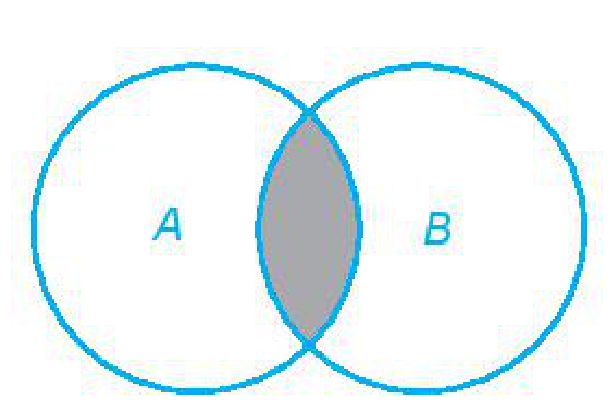
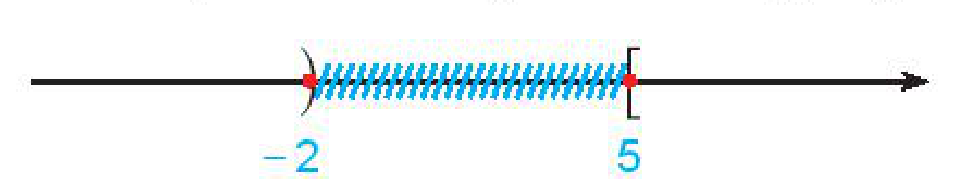
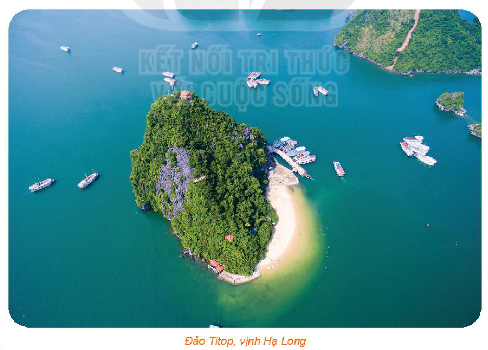

<!-- pdf:21 -->

# BÀI TẬP CUỐI CHƯƠNG I

## ✏️ A – TRẮC NGHIỆM

**1.17.** Câu nào sau đây **không** là mệnh đề?

A. Tam giác đều là tam giác có ba cạnh bằng nhau.

B. $3 < 1$.

C. $4 - 5 = 1$.

D. Bạn học giỏi quá!

**1.18.** Cho định lí: “Nếu hai tam giác bằng nhau thì diện tích của chúng bằng nhau”.

Mệnh đề nào sau đây là đúng?

A. Hai tam giác bằng nhau là điều kiện cần để diện tích của chúng bằng nhau.

B. Hai tam giác bằng nhau là điều kiện cần và đủ để chúng có diện tích bằng nhau.

C. Hai tam giác có diện tích bằng nhau là điều kiện đủ để chúng bằng nhau.

D. Hai tam giác bằng nhau là điều kiện đủ để diện tích của chúng bằng nhau.

**1.19.** Mệnh đề nào sau đây là đúng?

A. $\forall x \in \mathbb{R}, x^2 > 1 \Rightarrow x > -1$.

B. $\forall x \in \mathbb{R}, x^2 > 1 \Rightarrow x > 1$.

C. $\forall x \in \mathbb{R}, x > -1 \Rightarrow x^2 > 1$.

D. $\forall x \in \mathbb{R}, x > 1 \Rightarrow x^2 > 1$.

**1.20.** Cho tập hợp $A = \{a; b; c\}$. Tập $A$ có tất cả bao nhiêu tập con?

A. $4$.

B. $6$.

C. $8$.

D. $10$.

**1.21.** Cho các tập hợp $A, B$ được minh hoạ bằng biểu đồ Ven như hình bên. Phần tô màu xám trong hình là biểu diễn của tập hợp nào sau đây?

A. $A \cap B$.

B. $A \setminus B$.

C. $A \cup B$.

D. $B \setminus A$.

## ✏️ B – TỰ LUẬN

**1.22.** Biểu diễn các tập hợp sau bằng biểu đồ Ven:

a) $A = \{0; 1; 2; 3\}$;

b) $B = \{\text{Lan}; \text{Huệ}; \text{Trang}\}$.

**1.23.** Phần không bị gạch trên trục số dưới đây biểu diễn tập hợp số nào?

<!-- pdf:22 -->

**1.24.** Cho $A = \{x \in \mathbb{N} \mid x < 7\}$; $B = \{1; 2; 3; 6; 7; 8\}$. Xác định các tập hợp sau:

$A \cup B$; $A \cap B$; $A \setminus B$.

**1.25.** Cho hai tập hợp $A = [-2; 3]$ và $B = (1; +\infty)$. Xác định các tập hợp sau:

$A \cap B$; $B \setminus A$ và $C_{\mathbb{R}} B$.

**1.26.** Xác định các tập hợp sau và biểu diễn chúng trên trục số.

a) $(-\infty; 1) \cap (0; +\infty)$;

b) $(4; 7] \cup (-1; 5)$;

c) $(4; 7] \setminus (-3; 5]$.

**1.27.** Một cuộc khảo sát về khách du lịch thăm vịnh Hạ Long cho thấy trong $1\,410$ khách du lịch được phỏng vấn có $789$ khách du lịch đến thăm động Thiên Cung, $690$ khách du lịch đến đảo Titop. Toàn bộ khách được phỏng vấn đã đến ít nhất một trong hai địa điểm trên.

Hỏi có bao nhiêu khách du lịch vừa đến thăm động Thiên Cung vừa đến thăm đảo Titop ở vịnh Hạ Long?

## 💡 Em có biết?

Đảo Titop nằm trong vịnh Hạ Long, thuộc thành phố Hạ Long, tỉnh Quảng Ninh, cách cảng tàu du lịch Bãi Cháy khoảng $7 - 8\text{ km}$ về phía đông nam. Dưới chân đảo là một bãi tắm có hình vầng trăng ôm trọn lấy chân đảo, bãi cát tuy nhỏ nhưng rất thoáng đãng và yên tĩnh, bốn mùa nước sạch và trong xanh. Ngày 22-11-1962, Chủ tịch Hồ Chí Minh cùng nhà du hành vũ trụ người Liên Xô G.Titop lên thăm đảo. Để ghi dấu kỉ niệm chuyến đi đó, Chủ tịch Hồ Chí Minh đã đặt tên cho đảo là đảo Titop.

*(Theo tuoitre.vn)*

*Đảo Titop, vịnh Hạ Long*

## 📷 Danh sách hình trong bài

| Mã hình | Trang PDF | Vị trí trong bài | Chú thích gốc |
| --- | :---: | --- | --- |
| H10-toan-bt-c01-01 | 21 | Bài 1.21 | (sách không đánh số, biểu đồ Ven minh hoạ hai tập hợp $A, B$) |
| H10-toan-bt-c01-02 | 21 | Bài 1.23 | (sách không đánh số, biểu diễn tập hợp số trên trục số) |
| H10-toan-bt-c01-03 | 22 | Em có biết? | Đảo Titop, vịnh Hạ Long |
