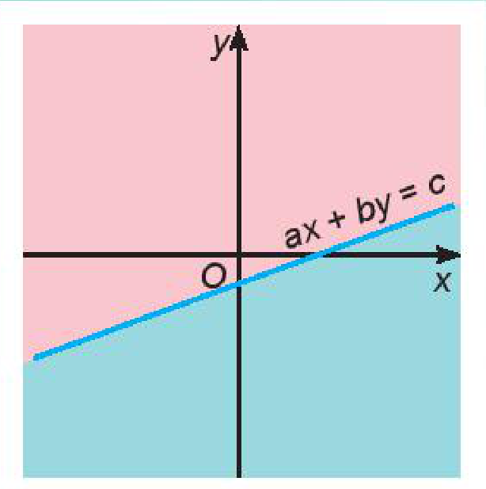
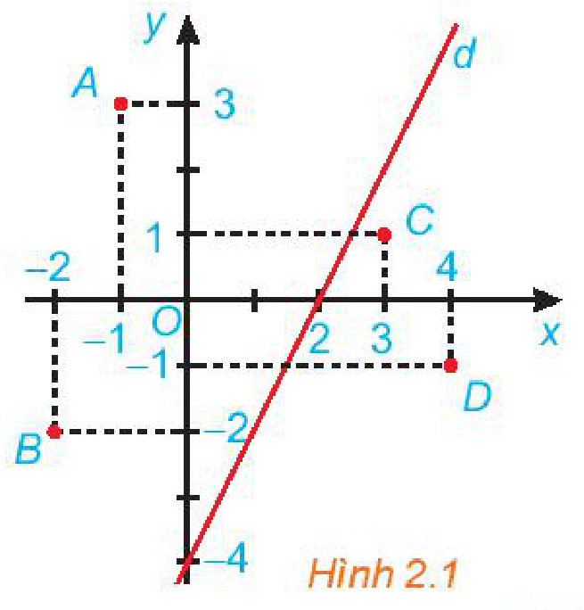
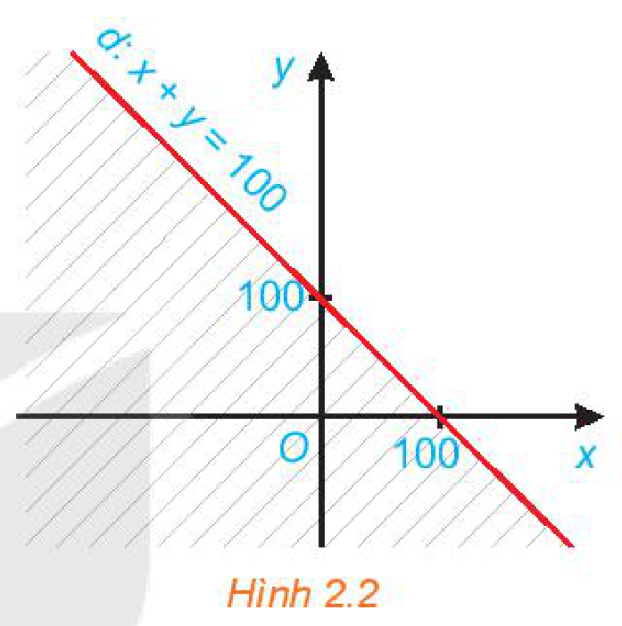
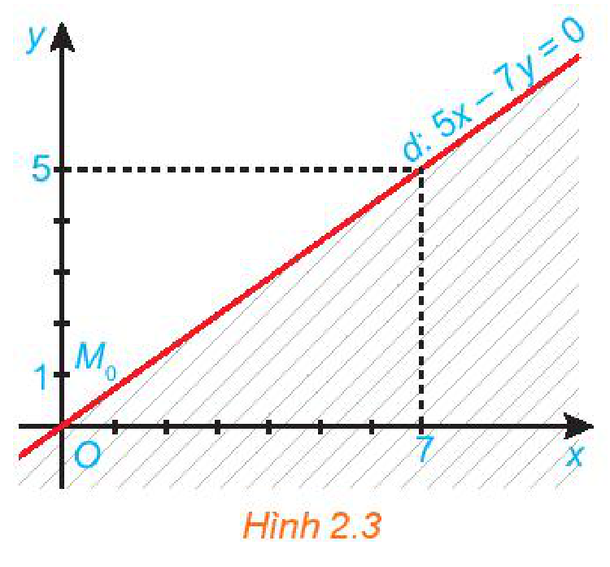
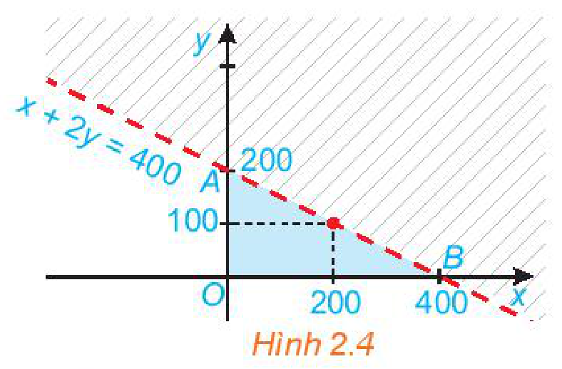

<!-- pdf:23 -->

<!-- Phần giới thiệu Chương II (in chung đầu trang PDF 23): CHƯƠNG II. BẤT PHƯƠNG TRÌNH VÀ HỆ BẤT PHƯƠNG TRÌNH BẬC NHẤT HAI ẨN -->

Các bất phương trình bậc nhất hai ẩn và hệ bất phương trình bậc nhất hai ẩn xuất hiện trong nhiều bài toán kinh tế, như là những ràng buộc trong các bài toán sản xuất, bài toán phân phối hàng hoá,... Chương này cung cấp cách biểu diễn miền nghiệm của các bất phương trình và hệ bất phương trình bậc nhất hai ẩn trên mặt phẳng toạ độ.

# BÀI 3: BẤT PHƯƠNG TRÌNH BẬC NHẤT HAI ẨN

## 🔤 Thuật ngữ

- Bất phương trình bậc nhất hai ẩn
- Miền nghiệm của bất phương trình bậc nhất hai ẩn

## 🎯 Mục tiêu

- Nhận biết bất phương trình bậc nhất hai ẩn.
- Biết biểu diễn miền nghiệm của bất phương trình bậc nhất hai ẩn trên mặt phẳng toạ độ.
- Vận dụng kiến thức về bất phương trình bậc nhất hai ẩn vào giải quyết bài toán thực tiễn.

## 🔴 Mở đầu

Nhân ngày Quốc tế Thiếu nhi 1-6, một rạp chiếu phim phục vụ các khán giả một bộ phim hoạt hình. Vé được bán ra có hai loại:

Loại 1 (dành cho trẻ từ 6-13 tuổi): $50\,000$ đồng/vé;

Loại 2 (dành cho người trên 13 tuổi): $100\,000$ đồng/vé.

Người ta tính toán rằng, để không phải bù lỗ thì số tiền vé thu được ở rạp chiếu phim này phải đạt tối thiểu $20$ triệu đồng.

Hỏi số lượng vé bán được trong những trường hợp nào thì rạp chiếu phim phải bù lỗ?

## 1. BẤT PHƯƠNG TRÌNH BẬC NHẤT HAI ẨN

**HĐ1:** Trong *tình huống mở đầu*, gọi $x$ là số vé loại 1 bán được và $y$ là số vé loại 2 bán được. Viết biểu thức tính số tiền bán vé thu được (đơn vị nghìn đồng) ở rạp chiếu phim đó theo $x$ và $y$.

a) Các số nguyên không âm $x$ và $y$ phải thoả mãn điều kiện gì để số tiền bán vé thu được đạt tối thiểu $20$ triệu đồng?

b) Nếu số tiền bán vé thu được nhỏ hơn $20$ triệu đồng thì $x$ và y thoả mãn điều kiện gì?

<!-- pdf:24 -->

Mỗi hệ thức liên hệ giữa $x$ và $y$ thu được trong HĐ1a và HĐ1b được gọi là một *bất phương trình bậc nhất hai ẩn*.

> **Bất phương trình bậc nhất hai ẩn** $x, y$ có dạng tổng quát là:
> $ax + by \le c \ (ax + by \ge c, \ ax + by < c, \ ax + by > c)$
> trong đó $a, b, c$ là những số thực đã cho, $a$ và $b$ không đồng thời bằng $0$, $x$ và $y$ là các ẩn số.

**Ví dụ 1:** Bất phương trình nào sau đây là bất phương trình bậc nhất hai ẩn?

$2x + 3y < 1; \quad 2x^2 + 3y < 1.$

**Giải:**

Bất phương trình $2x + 3y < 1$ là bất phương trình bậc nhất hai ẩn.

Bất phương trình $2x^2 + 3y < 1$ không phải là bất phương trình bậc nhất hai ẩn vì chứa $x^2$.

**HĐ2:** Cặp số $(x; y) = (100; 100)$ thoả mãn bất phương trình bậc nhất hai ẩn nào trong hai bất phương trình thu được ở HĐ1? Từ đó cho biết rạp chiếu phim có phải bù lỗ hay không nếu bán được $100$ vé loại 1 và $100$ vé loại 2.

Trả lời câu hỏi tương tự với cặp số $(x; y) = (150; 150)$.

> Cặp số $(x_0; y_0)$ được gọi là một **nghiệm** của bất phương trình bậc nhất hai ẩn $ax + by \le c$ nếu bất đẳng thức $ax_0 + by_0 \le c$ đúng.

**Ví dụ 2:** Cho bất phương trình bậc nhất hai ẩn $x + 2y > 5$. Cặp số nào sau đây là một nghiệm của bất phương trình bậc nhất hai ẩn trên?

a) $(x; y) = (3; 4)$;

b) $(x; y) = (0; -1)$.

**Giải:**

a) Vì $3 + 2 \cdot 4 = 11 > 5$ nên cặp số $(3; 4)$ là một nghiệm của bất phương trình đã cho.

b) Vì $0 + 2 \cdot (-1) = -2 < 5$ nên cặp số $(0; -1)$ không phải là một nghiệm của bất phương trình đã cho.

**Luyện tập 1:** Cho bất phương trình bậc nhất hai ẩn $x + 2y \ge 0$.

a) Hãy chỉ ra ít nhất hai nghiệm của bất phương trình trên.

b) Với $y = 0$, có bao nhiêu giá trị của $x$ thoả mãn bất phương trình đã cho?

**Nhận xét:** Bất phương trình bậc nhất hai ẩn luôn có vô số nghiệm.

## 2. BIỂU DIỄN MIỀN NGHIỆM CỦA BẤT PHƯƠNG TRÌNH BẬC NHẤT HAI ẨN TRÊN MẶT PHẲNG TOẠ ĐỘ

**HĐ3:** Cho đường thẳng $d: 2x - y = 4$ trên mặt phẳng toạ độ $Oxy$ (H.2.1). Đường thẳng này chia mặt phẳng thành hai nửa mặt phẳng.

a) Các điểm $O(0; 0)$, $A(-1; 3)$ và $B(-2; -2)$ có thuộc cùng một nửa mặt phẳng bờ là đường thẳng $d$ không?

Tính giá trị của biểu thức $2x - y$ tại các điểm đó và so sánh với $4$.

b) Trả lời câu hỏi tương tự như câu a với các điểm $C(3; 1)$, $D(4; -1)$.

*Hình 2.1*

<!-- pdf:25 -->

> - Trong mặt phẳng toạ độ $Oxy$, tập hợp các điểm có toạ độ là nghiệm của bất phương trình $ax + by \le c$ được gọi là **miền nghiệm** của bất phương trình đó.
> - Người ta chứng minh được rằng đường thẳng $d$ có phương trình $ax + by = c$ chia mặt phẳng toạ độ $Oxy$ thành hai nửa mặt phẳng bờ $d$:
>   - Một nửa mặt phẳng (không kể bờ $d$) gồm các điểm có toạ độ $(x; y)$ thoả mãn $ax + by > c$;
>   - Nửa mặt phẳng còn lại (không kể bờ $d$) gồm các điểm có toạ độ $(x; y)$ thoả mãn $ax + by < c$.
>   Bờ $d$ gồm các điểm có toạ độ $(x; y)$ thoả mãn $ax + by = c$.

**Ví dụ 3:** Biểu diễn miền nghiệm của bất phương trình $x + y \ge 100$ trên mặt phẳng toạ độ.

**Giải:** (H.2.2)

Ta biểu diễn miền nghiệm của bất phương trình bậc nhất hai ẩn $x + y \ge 100$ như sau:

*Bước 1.* Vẽ đường thẳng $d: x + y = 100$ trên mặt phẳng toạ độ $Oxy$.

*Bước 2.* Lấy một điểm bất kì không thuộc $d$ trên mặt phẳng rồi thay vào biểu thức $x + y$. Chẳng hạn, lấy $O(0; 0)$, ta có: $0 + 0 < 100$.

Do đó miền nghiệm của bất phương trình đã cho là nửa mặt phẳng bờ $d$ không chứa gốc toạ độ (miền không bị gạch).

*Hình 2.2*

<!-- term: Biểu diễn miền nghiệm của bất phương trình bậc nhất hai ẩn -->
> **Cách biểu diễn miền nghiệm của bất phương trình bậc nhất hai ẩn** $ax + by \le c$.
> - Vẽ đường thẳng $d: ax + by = c$ trên mặt phẳng toạ độ $Oxy$.
> - Lấy một điểm $M_0(x_0; y_0)$ không thuộc $d$.
> - Tính $ax_0 + by_0$ và so sánh với $c$.
> - Nếu $ax_0 + by_0 < c$ thì nửa mặt phẳng bờ $d$ chứa $M_0$ là miền nghiệm của bất phương trình. Nếu $ax_0 + by_0 > c$ thì nửa mặt phẳng bờ $d$ không chứa $M_0$ là miền nghiệm của bất phương trình.

> - Nếu $c \ne 0$, ta thường chọn $M_0$ chính là gốc toạ độ.
> - Nếu $c = 0$, ta thường chọn $M_0$ có toạ độ $(1; 0)$ hoặc $(0; 1)$.
<!-- ocr-ok: đã đối chiếu ảnh trang PDF 25 -->

**Ví dụ 4:** Biểu diễn miền nghiệm của bất phương trình $5x - 7y \le 0$ trên mặt phẳng toạ độ.

**Giải:** (H.2.3)

*Bước 1.* Vẽ đường thẳng $d: 5x - 7y = 0$ trên mặt phẳng toạ độ $Oxy$.

*Bước 2.* Lấy điểm $M_0(0; 1)$ không thuộc $d$ và thay $x = 0$, $y = 1$ vào biểu thức $5x - 7y$ ta được: $5 \cdot 0 - 7 \cdot 1 = -7 < 0$.
<!-- ocr-ok: đã đối chiếu ảnh trang PDF 25 -->

Do đó miền nghiệm của bất phương trình là nửa mặt phẳng bờ $d$ chứa điểm $M_0$ (miền không bị gạch).

*Hình 2.3*

**Chú ý:** Miền nghiệm của bất phương trình $ax + by < c$ là miền nghiệm của bất phương trình $ax + by \le c$ bỏ đi đường thẳng $ax + by = c$ và biểu diễn đường thẳng bằng nét đứt.

**Luyện tập 2:** Biểu diễn miền nghiệm của bất phương trình $2x + y < 200$ trên mặt phẳng toạ độ.

<!-- pdf:26 -->

**Ví dụ 5:** Giải bài toán ở *tình huống mở đầu*.

**Giải:**

Gọi $x$ là số lượng vé loại 1 bán được ($x \in \mathbb{N}$) và $y$ là số lượng vé loại 2 bán được ($y \in \mathbb{N}$) thì số tiền bán vé thu được là $50x + 100y$ (nghìn đồng). Người ta sẽ phải bù lỗ trong trường hợp số tiền bán vé nhỏ hơn $20$ triệu đồng, tức là: $50x + 100y < 20\,000$ hay $x + 2y < 400$.

Như vậy, việc giải quyết bài toán mở đầu dẫn đến việc đi tìm miền nghiệm của bất phương trình $x + 2y < 400$.

Miền nghiệm của bất phương trình bậc nhất hai ẩn này được xác định như sau:

- Vẽ đường thẳng $d: x + 2y = 400$.
- Ta lấy gốc toạ độ $O(0; 0)$ và tính $0 + 2 \cdot 0 = 0 < 400$.

Do đó, miền nghiệm của bất phương trình là nửa mặt phẳng bờ $d$ chứa gốc toạ độ không kể đường thẳng $d$ (H.2.4).

*Hình 2.4*

Vậy, nếu bán được số vé loại 1 là $x$ và số vé loại 2 là $y$ mà điểm $(x; y)$ nằm trong miền tam giác $OAB$ không kể cạnh $AB$ thì rạp chiếu phim sẽ phải bù lỗ.

> **Miền tam giác** gồm các điểm bên trong và các điểm trên ba cạnh của tam giác.

Nếu điểm $(x; y)$ nằm trên đoạn thẳng $AB$ thì rạp chiếu phim hoà vốn.

**Nhận xét:**

- Nếu bán được $150$ vé loại 1 và $150$ vé loại 2 thì rạp chiếu phim có lãi.
- Nếu bán được $200$ vé loại 1 và $100$ vé loại 2 thì rạp chiếu phim hoà vốn.
- Nếu bán được $100$ vé loại 1 và $100$ vé loại 2 thì rạp chiếu phim phải bù lỗ.

**Vận dụng:** Một công ty viễn thông tính phí $1$ nghìn đồng mỗi phút gọi nội mạng và $2$ nghìn đồng mỗi phút gọi ngoại mạng. Em có thể sử dụng bao nhiêu phút gọi nội mạng và bao nhiêu phút gọi ngoại mạng trong một tháng nếu em muốn số tiền phải trả ít hơn $200$ nghìn đồng?

## ✏️ Bài tập

**2.1.** Bất phương trình nào sau đây là bất phương trình bậc nhất hai ẩn?

a) $2x + 3y > 6$;

b) $2^2 x + y \le 0$;

c) $2x^2 - y \ge 1$.

**2.2.** Biểu diễn miền nghiệm của mỗi bất phương trình sau trên mặt phẳng toạ độ:

a) $3x + 2y \ge 300$;

b) $7x + 20y < 0$.

**2.3.** Ông An muốn thuê một chiếc ô tô (có lái xe) trong một tuần. Giá thuê xe được cho như bảng sau:

| | Phí cố định (nghìn đồng/ngày) | Phí tính theo quãng đường di chuyển (nghìn đồng/kilômét) |
| --- | :---: | :---: |
| Từ thứ Hai đến thứ Sáu | $900$ | $8$ |
| Thứ Bảy và Chủ nhật | $1\,500$ | $10$ |
<!-- ocr-ok: đã đối chiếu ảnh trang PDF 26 -->

a) Gọi $x$ và $y$ lần lượt là số kilômét ông An đi trong các ngày từ thứ Hai đến thứ Sáu và trong hai ngày cuối tuần. Viết bất phương trình biểu thị mối liên hệ giữa $x$ và $y$ sao cho tổng số tiền ông An phải trả không quá $14$ triệu đồng.

b) Biểu diễn miền nghiệm của bất phương trình ở câu a trên mặt phẳng toạ độ.

## 📷 Danh sách hình trong bài

| Mã hình | Trang PDF | Vị trí trong bài | Chú thích gốc |
| --- | --- | --- | --- |
| H10-toan-b03-01 | 23 | Mở đầu chương II | (sách không đánh số, sơ đồ minh hoạ mở đầu Chương II) |
| H10-toan-b03-02 | 23 | Mở đầu | (sách không đánh số, ảnh minh hoạ rạp chiếu phim ở phần Mở đầu) |
| H10-toan-b03-03 | 24 | Mục 2, HĐ3 | Hình 2.1 |
| H10-toan-b03-04 | 25 | Mục 2, Ví dụ 3 | Hình 2.2 |
| H10-toan-b03-05 | 25 | Mục 2, Ví dụ 4 | Hình 2.3 |
| H10-toan-b03-06 | 26 | Mục 2, Ví dụ 5 | Hình 2.4 |
