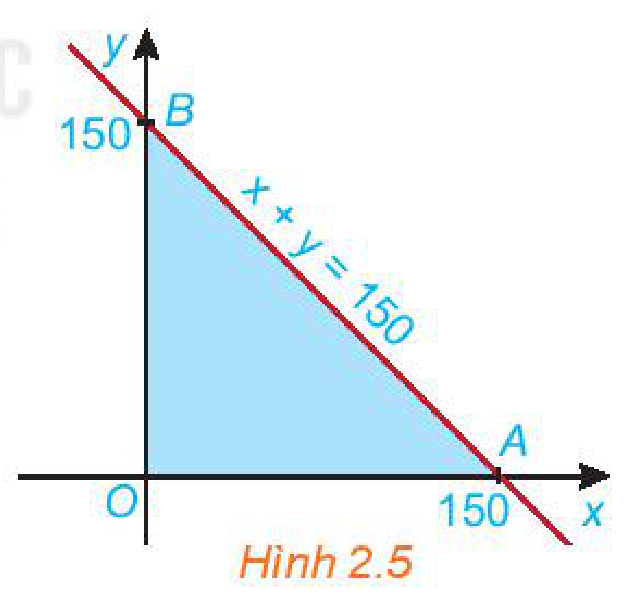
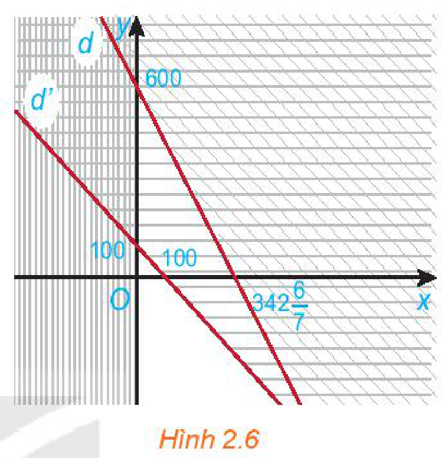
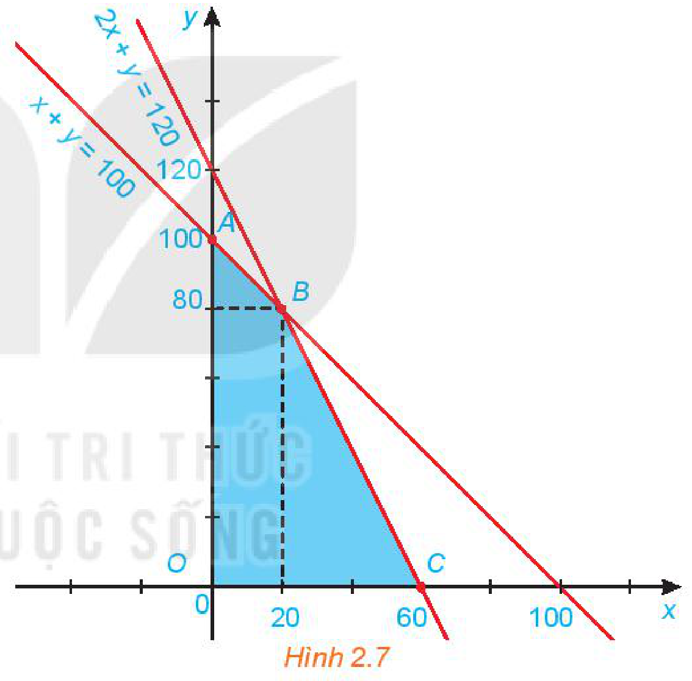

<!-- pdf:27 -->

# BÀI 4: HỆ BẤT PHƯƠNG TRÌNH BẬC NHẤT HAI ẨN

## 🔤 Thuật ngữ

- Hệ bất phương trình bậc nhất hai ẩn
- Miền nghiệm của hệ bất phương trình bậc nhất hai ẩn

## 🎯 Mục tiêu

- Nhận biết hệ bất phương trình bậc nhất hai ẩn.
- Biết biểu diễn miền nghiệm của hệ bất phương trình bậc nhất hai ẩn trên mặt phẳng toạ độ.
- Vận dụng kiến thức hệ bất phương trình bậc nhất hai ẩn vào giải quyết bài toán thực tiễn.

## 🔴 Mở đầu

Trong năm nay, một cửa hàng điện lạnh dự định kinh doanh hai loại máy điều hoà: điều hoà hai chiều và điều hoà một chiều với số vốn ban đầu không vượt quá $1,2$ tỉ đồng.

| | Điều hoà hai chiều | Điều hoà một chiều |
| --- | --- | --- |
| Giá mua vào | $20$ triệu đồng/1 máy | $10$ triệu đồng/1 máy |
| Lợi nhuận dự kiến | $3,5$ triệu đồng/1 máy | $2$ triệu đồng/1 máy |

Cửa hàng ước tính rằng tổng nhu cầu của thị trường sẽ không vượt quá $100$ máy cả hai loại. Nếu là chủ cửa hàng thì em cần đầu tư kinh doanh mỗi loại bao nhiêu máy để lợi nhuận thu được là lớn nhất?

## 1. HỆ BẤT PHƯƠNG TRÌNH BẬC NHẤT HAI ẨN

**HĐ1:** Trong *tình huống mở đầu*, gọi $x$ và $y$ lần lượt là số máy điều hoà loại hai chiều và một chiều mà cửa hàng cần nhập. Tính số tiền vốn mà cửa hàng phải bỏ ra để nhập hai loại máy điều hoà theo $x$ và $y$.

a) Do nhu cầu của thị trường không quá $100$ máy nên $x$ và $y$ cần thoả mãn điều kiện gì?

b) Vì số vốn mà chủ cửa hàng có thể đầu tư không vượt quá $1,2$ tỉ đồng nên $x$ và $y$ phải thoả mãn điều kiện gì?

c) Tính số tiền lãi mà cửa hàng dự kiến thu được theo $x$ và $y$.

Như vậy, $x$ và $y$ trong HĐ1 phải thoả mãn một số bất phương trình bậc nhất hai ẩn.

> - **Hệ bất phương trình bậc nhất hai ẩn** là một hệ gồm hai hay nhiều bất phương trình bậc nhất hai ẩn.
> - Cặp số $(x_0; y_0)$ là **nghiệm** của một hệ bất phương trình bậc nhất hai ẩn khi $(x_0; y_0)$ đồng thời là nghiệm của tất cả các bất phương trình trong hệ đó.

<!-- pdf:28 -->

**Ví dụ 1:** Cho hệ bất phương trình $\begin{cases} x \ge 0 \\ y \ge 0 \\ x + y \le 150. \end{cases}$

a) Hệ trên có phải là một hệ bất phương trình bậc nhất hai ẩn không?

b) Kiểm tra xem cặp số $(x; y) = (0; 0)$ có phải là một nghiệm của hệ bất phương trình trên không.

**Giải:**

a) Hệ bất phương trình đã cho là một hệ bất phương trình bậc nhất hai ẩn $x$ và $y$.

b) Cặp số $(x; y) = (0; 0)$ thoả mãn cả ba bất phương trình của hệ nên nó là một nghiệm của hệ bất phương trình bậc nhất hai ẩn đã cho.

**Luyện tập 1:** Trong *tình huống mở đầu*, gọi $x$ và $y$ lần lượt là số máy điều hoà loại hai chiều và một chiều mà cửa hàng cần nhập. Từ HĐ1, viết hệ bất phương trình hai ẩn $x, y$ và chỉ ra một nghiệm của hệ này.

## 2. BIỂU DIỄN MIỀN NGHIỆM CỦA HỆ BẤT PHƯƠNG TRÌNH BẬC NHẤT HAI ẨN TRÊN MẶT PHẲNG TOẠ ĐỘ

**HĐ2:** Cho đường thẳng $d: x + y = 150$ trên mặt phẳng toạ độ $Oxy$. Đường thẳng này cắt hai trục toạ độ $Ox$ và $Oy$ tại hai điểm $A$ và $B$.
<!-- ocr-ok: đã đối chiếu ảnh trang PDF 28 -->

a) Xác định các miền nghiệm $D_1, D_2, D_3$ của các bất phương trình tương ứng $x \ge 0; y \ge 0$ và $x + y \le 150$.

b) Miền tam giác $OAB$ (H.2.5) có phải là giao của các miền $D_1, D_2$ và $D_3$ hay không?

c) Lấy một điểm trong tam giác $OAB$ (chẳng hạn điểm $(1; 2)$) hoặc một điểm trên cạnh nào đó của tam giác $OAB$ (chẳng hạn điểm $(1; 149)$) và kiểm tra xem toạ độ của các điểm đó có phải là nghiệm của hệ bất phương trình sau hay không:

$\begin{cases} x \ge 0 \\ y \ge 0 \\ x + y \le 150. \end{cases}$

> Phương trình của trục $Ox$ là $y = 0$ và phương trình của trục $Oy$ là $x = 0$.

*Hình 2.5*

> - Trong mặt phẳng toạ độ, tập hợp các điểm có toạ độ là nghiệm của hệ bất phương trình bậc nhất hai ẩn là **miền nghiệm** của hệ bất phương trình đó.
> - Miền nghiệm của hệ là giao các miền nghiệm của các bất phương trình trong hệ.

**Ví dụ 2:** Biểu diễn miền nghiệm của hệ bất phương trình sau trên mặt phẳng toạ độ:

$\begin{cases} 7x + 4y \le 2\,400 \\ x + y \le 100 \\ x \ge 0. \end{cases}$

<!-- pdf:29 -->

**Giải:** (H.2.6)

*Bước 1.* Xác định miền nghiệm $D_1$ của bất phương trình $7x + 4y \le 2\,400$ và gạch bỏ miền còn lại.

- Vẽ đường thẳng $d: 7x + 4y = 2\,400$.
- Vì $7 \cdot 0 + 4 \cdot 0 = 0 < 2\,400$ nên toạ độ điểm $O(0; 0)$ thoả mãn bất phương trình $7x + 4y \le 2\,400$.
<!-- ocr-ok: đã đối chiếu ảnh trang PDF 29 -->

Do đó, miền nghiệm $D_1$ của bất phương trình $7x + 4y \le 2\,400$ là nửa mặt phẳng bờ $d$ chứa gốc toạ độ $O$.

*Bước 2.* Tương tự, miền nghiệm $D_2$ của bất phương trình $x + y \le 100$ là nửa mặt phẳng bờ $d'$ chứa gốc toạ độ $O$.

*Bước 3.* Tương tự, miền nghiệm $D_3$ của bất phương trình $x \ge 0$ là nửa mặt phẳng bờ $Oy$ chứa điểm $(1; 0)$.

Khi đó, miền không bị gạch chính là giao các miền nghiệm của các bất phương trình trong hệ. Vậy miền nghiệm của hệ là miền không bị gạch trong Hình 2.6.

*Hình 2.6*

<!-- term: Biểu diễn miền nghiệm của hệ bất phương trình bậc nhất hai ẩn -->
> **Cách xác định miền nghiệm của một hệ bất phương trình bậc nhất hai ẩn**:
> - Trên cùng một mặt phẳng toạ độ, xác định miền nghiệm của mỗi bất phương trình bậc nhất hai ẩn trong hệ và gạch bỏ miền còn lại.
> - Miền không bị gạch là miền nghiệm của hệ bất phương trình đã cho.

**Chú ý:** Nếu trong HĐ2, hệ được thay bởi $\begin{cases} x \ge 0 \\ y \ge 0 \\ x + y < 150 \end{cases}$ thì miền nghiệm sẽ là miền tam giác $OAB$ bỏ đi cạnh $AB$.

**Luyện tập 2:** Biểu diễn miền nghiệm của hệ bất phương trình bậc nhất hai ẩn sau trên mặt phẳng toạ độ: $\begin{cases} x \ge 0 \\ y > 0 \\ x + y \le 100 \\ 2x + y < 120. \end{cases}$

## 3. ỨNG DỤNG CỦA HỆ BẤT PHƯƠNG TRÌNH BẬC NHẤT HAI ẨN

**HĐ3:** Xét biểu thức $F(x; y) = 2x + 3y$ với $(x; y)$ thuộc miền tam giác $OAB$ ở HĐ2. Toạ độ ba đỉnh là $O(0; 0)$, $A(150; 0)$ và $B(0; 150)$ (H.2.5).

a) Tính giá trị của biểu thức $F(x; y)$ tại mỗi đỉnh $O$, $A$ và $B$.
<!-- ocr-ok: đã đối chiếu ảnh trang PDF 29 -->

b) Nêu nhận xét về dấu của hoành độ $x$ và tung độ $y$ của điểm $(x; y)$ nằm trong miền tam giác $OAB$. Từ đó suy ra giá trị nhỏ nhất của $F(x; y)$ trên miền tam giác $OAB$.

<!-- pdf:30 -->

c) Nêu nhận xét về tổng $x + y$ của điểm $(x; y)$ nằm trong miền tam giác $OAB$. Từ đó suy ra giá trị lớn nhất của $F(x; y)$ trên miền tam giác $OAB$.

<!-- term: Giá trị lớn nhất, nhỏ nhất của biểu thức F(x; y) = ax + by trên miền đa giác -->
**Nhận xét:** Tổng quát, người ta chứng minh được rằng giá trị lớn nhất (hay nhỏ nhất) của biểu thức $F(x; y) = ax + by$, với $(x; y)$ là toạ độ các điểm thuộc miền đa giác $A_1 A_2 \dots A_n$, tức là các điểm nằm bên trong hay nằm trên các cạnh của đa giác, đạt được tại một trong các đỉnh của đa giác đó.

**Ví dụ 3:** Giải bài toán ở *tình huống mở đầu*.

**Giải:**

Giả sử cửa hàng cần nhập số máy điều hoà hai chiều là $x$ và số máy điều hoà một chiều là $y$. Khi đó ta có $x \ge 0, y \ge 0$.

Vì nhu cầu của thị trường không quá $100$ máy nên $x + y \le 100$.

Số tiền để nhập hai loại máy điều hoà với số lượng như trên là: $20x + 10y$ (triệu đồng).

Số tiền tối đa để đầu tư cho hai loại máy là $1,2$ tỉ đồng, nên ta có $20x + 10y \le 1\,200$ hay $2x + y \le 120$.

Từ đó ta thu được hệ bất phương trình bậc nhất hai ẩn sau:

$\begin{cases} x \ge 0 \\ y \ge 0 \\ x + y \le 100 \\ 2x + y \le 120. \end{cases}$

Lợi nhuận thu được khi bán $x$ máy điều hoà hai chiều và $y$ máy điều hoà một chiều là $F(x; y) = 3,5x + 2y$.

Ta cần tìm giá trị lớn nhất của $F(x; y)$ khi $(x; y)$ thoả mãn hệ bất phương trình trên.

*Hình 2.7*

*Bước 1.* Xác định miền nghiệm của hệ bất phương trình trên. Miền nghiệm là miền tứ giác $OABC$ với toạ độ các đỉnh $O(0; 0)$, $A(0; 100)$, $B(20; 80)$ và $C(60; 0)$ (H.2.7).

> Giá trị lớn nhất (hoặc nhỏ nhất) của $F(x; y)$ đạt tại một trong các đỉnh của tứ giác $OABC$.

*Bước 2.* Tính giá trị của biểu thức $F$ tại các đỉnh của tứ giác này:

$F(0; 0) = 0, \ F(0; 100) = 200, \ F(20; 80) = 230, \ F(60; 0) = 210.$

*Bước 3.* So sánh các giá trị thu được của $F$ ở Bước 2, ta được giá trị lớn nhất cần tìm là $F(20; 80) = 230$.

Vậy cửa hàng cần đầu tư kinh doanh $20$ máy điều hoà hai chiều và $80$ máy điều hoà một chiều để lợi nhuận thu được là lớn nhất.

<!-- pdf:31 -->

**Vận dụng:** Một cửa hàng có kế hoạch nhập về hai loại máy tính $A$ và $B$, giá mỗi chiếc lần lượt là $10$ triệu đồng và $20$ triệu đồng với số vốn ban đầu không vượt quá $4$ tỉ đồng. Loại máy $A$ mang lại lợi nhuận $2,5$ triệu đồng cho mỗi máy bán được và loại máy $B$ mang lại lợi nhuận là $4$ triệu đồng cho mỗi máy bán được. Cửa hàng ước tính rằng tổng nhu cầu hằng tháng sẽ không vượt quá $250$ máy. Giả sử trong một tháng cửa hàng cần nhập số máy tính loại $A$ là $x$ và số máy tính loại $B$ là $y$.

a) Viết các bất phương trình biểu thị các điều kiện của bài toán thành một hệ bất phương trình rồi xác định miền nghiệm của hệ đó.

b) Gọi $F$ (triệu đồng) là lợi nhuận mà cửa hàng thu được trong tháng đó khi bán $x$ máy tính loại $A$ và $y$ máy tính loại $B$. Hãy biểu diễn $F$ theo $x$ và $y$.

c) Tìm số lượng máy tính mỗi loại cửa hàng cần nhập về trong tháng đó để lợi nhuận thu được là lớn nhất.

## ✏️ Bài tập

**2.4.** Hệ bất phương trình nào sau đây là hệ bất phương trình bậc nhất hai ẩn?

a) $\begin{cases} x < 0 \\ y \ge 0; \end{cases}$

b) $\begin{cases} x + y^2 < 0 \\ y - x > 1; \end{cases}$

c) $\begin{cases} x + y + z < 0 \\ y < 0; \end{cases}$

d) $\begin{cases} -2x + y < 3^2 \\ 4^2 x + 3y < 1. \end{cases}$

**2.5.** Biểu diễn miền nghiệm của mỗi hệ bất phương trình sau trên mặt phẳng toạ độ:

a) $\begin{cases} y - x < -1 \\ x > 0 \\ y < 0; \end{cases}$

b) $\begin{cases} x \ge 0 \\ y \ge 0 \\ 2x + y \le 4; \end{cases}$

c) $\begin{cases} x \ge 0 \\ x + y > 5 \\ x - y < 0. \end{cases}$

**2.6.** Một gia đình cần ít nhất $900$ đơn vị protein và $400$ đơn vị lipid trong thức ăn mỗi ngày. Mỗi kilôgam thịt bò chứa $800$ đơn vị protein và $200$ đơn vị lipid. Mỗi kilôgam thịt lợn chứa $600$ đơn vị protein và $400$ đơn vị lipid. Biết rằng gia đình này chỉ mua nhiều nhất là $1,6\text{ kg}$ thịt bò và $1,1\text{ kg}$ thịt lợn; giá $1\text{ kg}$ thịt bò là $250$ nghìn đồng; giá $1\text{ kg}$ thịt lợn là $160$ nghìn đồng. Giả sử gia đình đó mua $x$ kilôgam thịt bò và $y$ kilôgam thịt lợn.

a) Viết các bất phương trình biểu thị các điều kiện của bài toán thành một hệ bất phương trình rồi xác định miền nghiệm của hệ đó.

b) Gọi $F$ (nghìn đồng) là số tiền phải trả cho $x$ kilôgam thịt bò và $y$ kilôgam thịt lợn. Hãy biểu diễn $F$ theo $x$ và $y$.

c) Tìm số kilôgam thịt mỗi loại mà gia đình đó cần mua để chi phí là ít nhất.

## 📷 Danh sách hình trong bài

| Mã hình | Trang PDF | Vị trí trong bài | Chú thích gốc |
| --- | --- | --- | --- |
| H10-toan-b04-01 | 28 | Mục 2, HĐ2 | Hình 2.5 |
| H10-toan-b04-02 | 29 | Mục 2, Ví dụ 2 | Hình 2.6 |
| H10-toan-b04-03 | 30 | Mục 3, Ví dụ 3 | Hình 2.7 |
