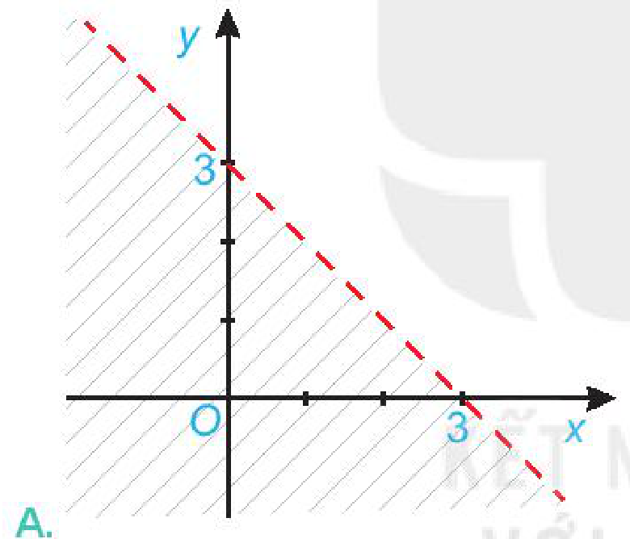
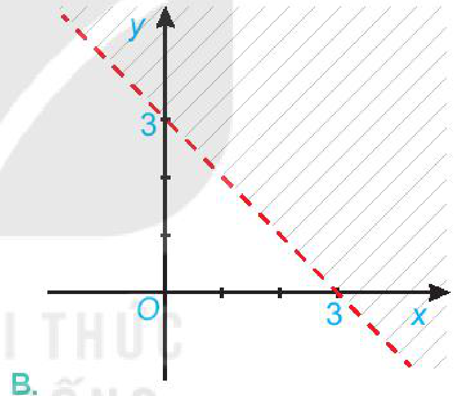
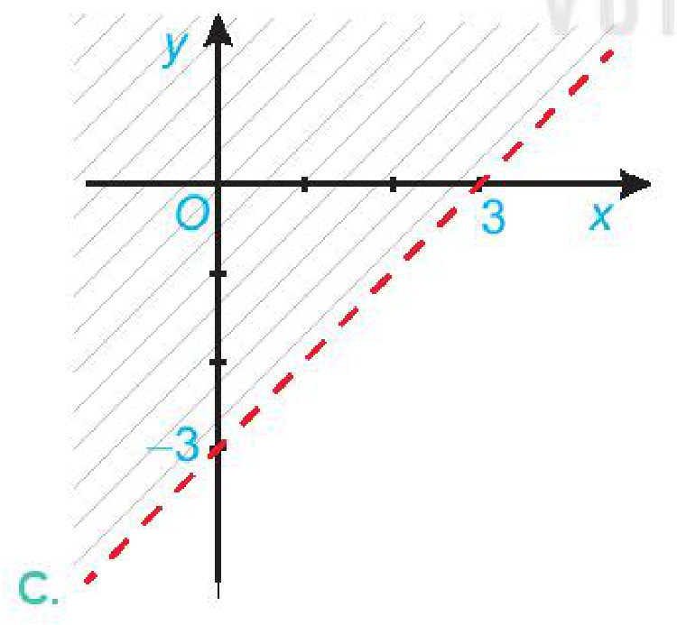
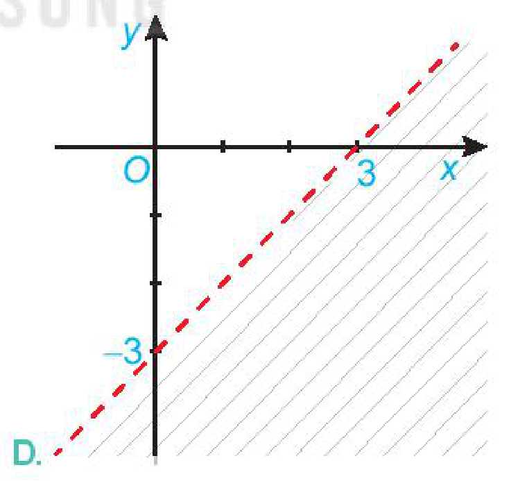

<!-- pdf:32 -->

# BÀI TẬP CUỐI CHƯƠNG II

## ✏️ A – TRẮC NGHIỆM

**2.7.** Bất phương trình nào sau đây là bất phương trình bậc nhất hai ẩn?

A. $x + y > 3$.

B. $x^2 + y^2 \le 4$.

C. $(x - y)(3x + y) \ge 1$.

D. $y^3 - 2 \le 0$.

**2.8.** Cho bất phương trình $2x + y > 3$. Khẳng định nào sau đây là đúng?

A. Bất phương trình đã cho có nghiệm duy nhất.

B. Bất phương trình đã cho vô nghiệm.

C. Bất phương trình đã cho có vô số nghiệm.

D. Bất phương trình đã cho có tập nghiệm là $[3; +\infty)$.

**2.9.** Hình nào sau đây biểu diễn miền nghiệm của bất phương trình $x - y < 3$?

A. 

B. 

C. 

D. 

**2.10.** Hệ bất phương trình nào sau đây là hệ bất phương trình bậc nhất hai ẩn?

A. $\begin{cases} x - y < 0 \\ 2y \ge 0. \end{cases}$

B. $\begin{cases} 3x + y^3 < 0 \\ x + y > 3. \end{cases}$

C. $\begin{cases} x + 2y < 0 \\ y^2 + 3 < 0. \end{cases}$

D. $\begin{cases} -x^3 + y < 4 \\ x + 2y < 1. \end{cases}$

<!-- pdf:33 -->

**2.11.** Cho hệ bất phương trình $\begin{cases} x - y < -3 \\ 2y \ge -4 \end{cases}$. Điểm nào sau đây thuộc miền nghiệm của hệ bất phương trình đã cho?

A. $(0; 0)$.

B. $(-2; 1)$.

C. $(3; -1)$.

D. $(-3; 1)$.

## ✏️ B – TỰ LUẬN

**2.12.** Biểu diễn miền nghiệm của bất phương trình $\frac{x + y}{2} \ge \frac{2x - y + 1}{3}$ trên mặt phẳng toạ độ.

**2.13.** Biểu diễn miền nghiệm của hệ bất phương trình $\begin{cases} x + y < 1 \\ 2x - y \ge 3 \end{cases}$ trên mặt phẳng toạ độ.

**2.14.** Biểu diễn miền nghiệm của hệ bất phương trình $\begin{cases} y - 2x \le 2 \\ y \le 4 \\ x \le 5 \\ x + y \ge -1 \end{cases}$ trên mặt phẳng toạ độ.

Từ đó tìm giá trị lớn nhất và giá trị nhỏ nhất của biểu thức $F(x; y) = -x - y$ với $(x; y)$ thoả mãn hệ trên.

**2.15.** Bác An đầu tư $1,2$ tỉ đồng vào ba loại trái phiếu: trái phiếu chính phủ với lãi suất $7\%$ một năm, trái phiếu ngân hàng với lãi suất $8\%$ một năm và trái phiếu doanh nghiệp rủi ro cao với lãi suất $12\%$ một năm. Vì lí do giảm thuế, bác An muốn số tiền đầu tư trái phiếu chính phủ gấp ít nhất $3$ lần số tiền đầu tư trái phiếu ngân hàng. Hơn nữa, để giảm thiểu rủi ro, bác An đầu tư không quá $200$ triệu đồng cho trái phiếu doanh nghiệp. Hỏi bác An nên đầu tư mỗi loại trái phiếu bao nhiêu tiền để lợi nhuận thu được sau một năm là lớn nhất?

**2.16.** Một công ty dự định chi tối đa $160$ triệu đồng cho quảng cáo một sản phẩm mới trong một tháng trên các đài phát thanh và truyền hình. Biết cùng một thời lượng quảng cáo, số người mới quan tâm đến sản phẩm trên truyền hình gấp $8$ lần trên đài phát thanh, tức là quảng cáo trên truyền hình có hiệu quả gấp $8$ lần trên đài phát thanh.

Đài phát thanh chỉ nhận các quảng cáo có tổng thời lượng trong một tháng tối đa là $900$ giây với chi phí là $80$ nghìn đồng/giây. Đài truyền hình chỉ nhận các quảng cáo có tổng thời lượng trong một tháng tối đa là $360$ giây với chi phí là $400$ nghìn đồng/giây.

Công ty cần đặt thời gian quảng cáo trên các đài phát thanh và truyền hình như thế nào để hiệu quả nhất?

***Gợi ý.*** Nếu coi hiệu quả khi quảng cáo $1$ giây trên đài phát thanh là $1$ (đơn vị) thì hiệu quả khi quảng cáo $1$ giây trên đài truyền hình là $8$ (đơn vị). Khi đó hiệu quả quảng cáo $x$ (giây) trên đài phát thanh và $y$ (giây) trên truyền hình là $F(x; y) = x + 8y$. Ta cần tìm giá trị lớn nhất của hàm $F(x; y)$ với $x, y$ thoả mãn các điều kiện trong đề bài.

## 📷 Danh sách hình trong bài

| Mã hình | Trang PDF | Vị trí trong bài | Chú thích gốc |
| --- | --- | --- | --- |
| H10-toan-bt-c02-01 | 32 | Bài tập 2.9, phương án A | A. |
| H10-toan-bt-c02-02 | 32 | Bài tập 2.9, phương án B | B. |
| H10-toan-bt-c02-03 | 32 | Bài tập 2.9, phương án C | C. |
| H10-toan-bt-c02-04 | 32 | Bài tập 2.9, phương án D | D. |
