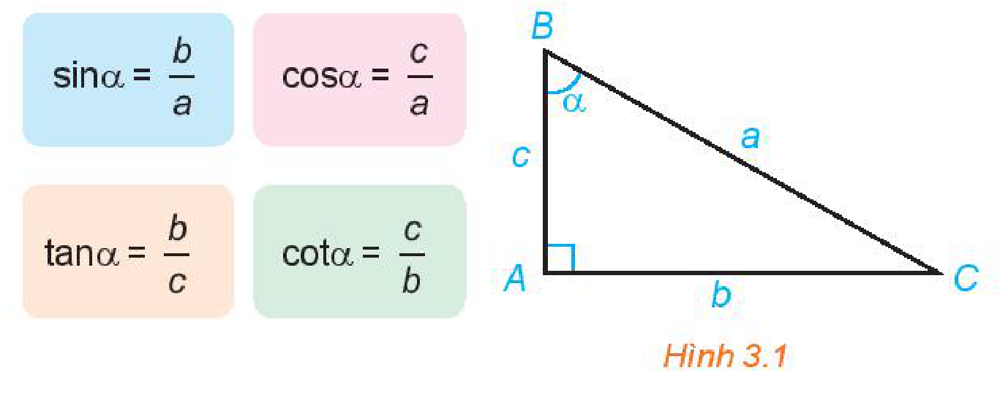
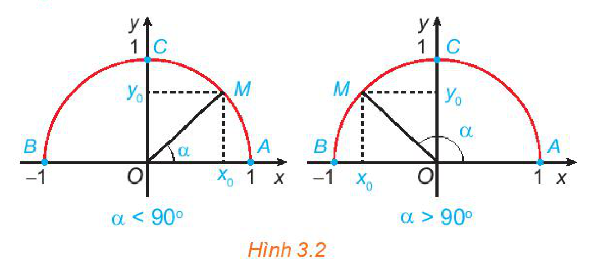
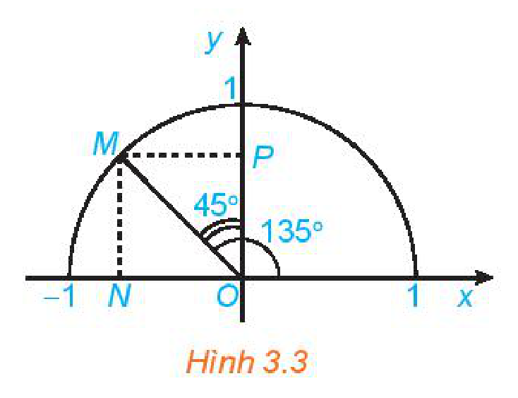
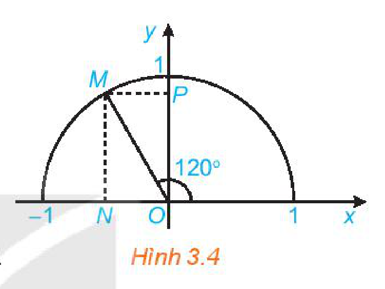
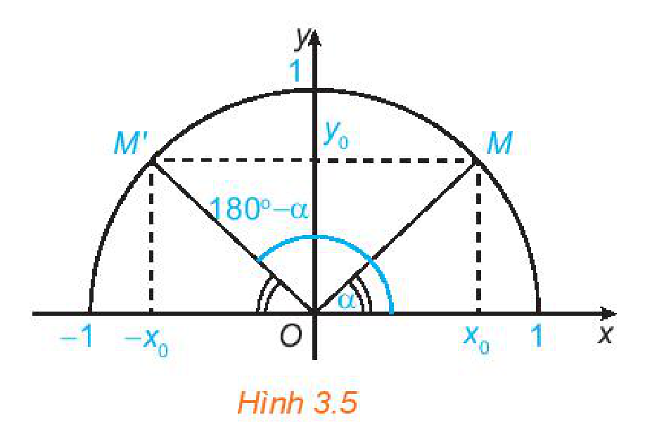
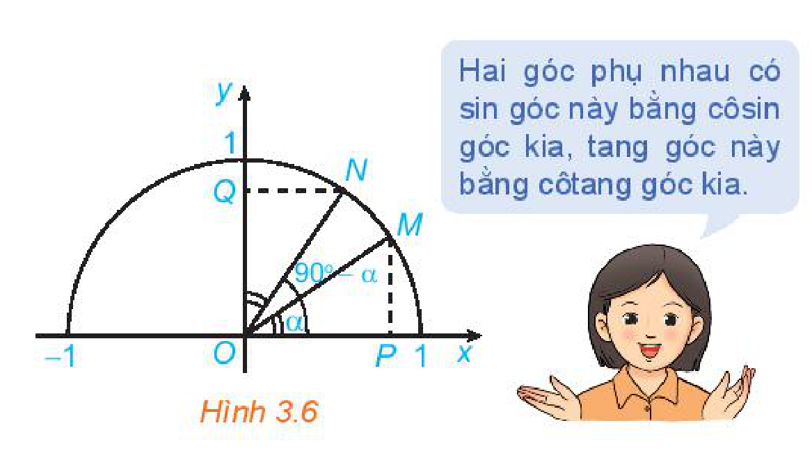
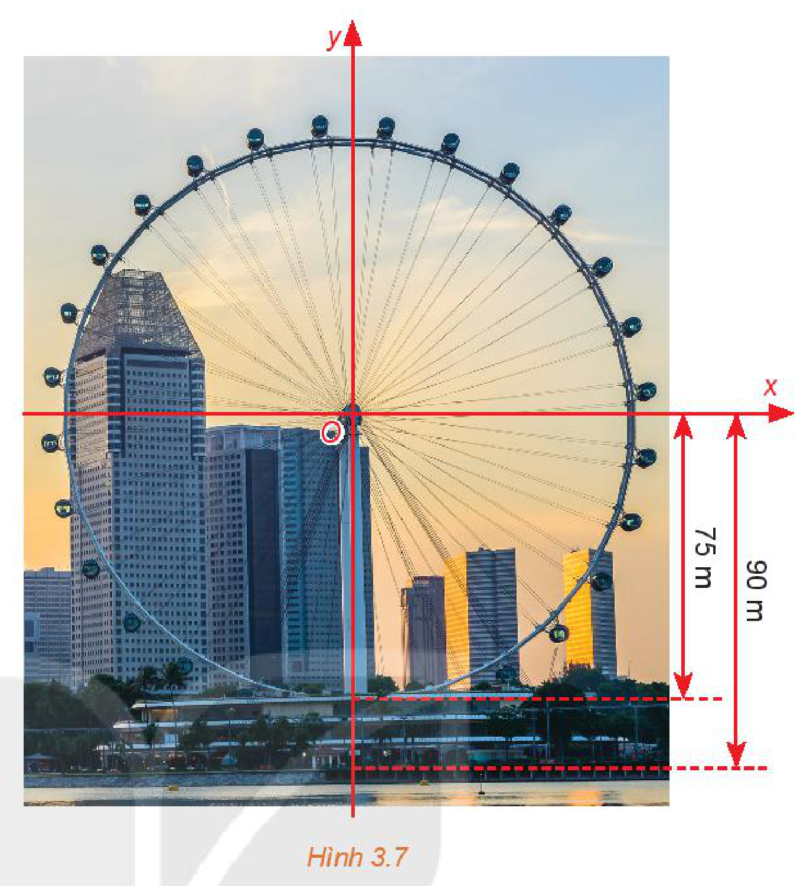

<!-- pdf:34 -->

<!-- Phần giới thiệu Chương III (in chung đầu trang PDF 34): CHƯƠNG III. HỆ THỨC LƯỢNG TRONG TAM GIÁC -->

Lượng giác được phát triển từ nhu cầu tính toán góc và khoảng cách trong rất nhiều lĩnh vực như thiên văn học, lập bản đồ, bản vẽ thiết kế, khảo sát và tìm tầm bắn của pháo binh.

Ở lớp 9, ta đã biết tỉ số lượng giác của một góc nhọn. Chương này mở rộng khái niệm đó cho một góc bất kì từ $0^\circ$ đến $180^\circ$.

# BÀI 5: GIÁ TRỊ LƯỢNG GIÁC CỦA MỘT GÓC TỪ 0° ĐẾN 180°

## 🔤 Thuật ngữ

- Giá trị lượng giác của một góc
- Hai góc bù nhau
- Nửa đường tròn đơn vị

## 🎯 Mục tiêu

- Nhận biết giá trị lượng giác của một góc từ $0^\circ$ đến $180^\circ$.
- Giải thích hệ thức liên hệ giữa các giá trị lượng giác của hai góc phụ nhau, bù nhau.
- Sử dụng máy tính cầm tay để tính các giá trị lượng giác của một góc.
- Vận dụng giải một số bài toán có nội dung thực tiễn.

## 🔴 Mở đầu

$\sin\alpha = \frac{b}{a}, \quad \cos\alpha = \frac{c}{a}, \quad \tan\alpha = \frac{b}{c}, \quad \cot\alpha = \frac{c}{b}.$

Bạn đã biết tỉ số lượng giác của một góc nhọn. Đối với góc tù thì sao?

*Hình 3.1*

<!-- pdf:35 -->

## 1. GIÁ TRỊ LƯỢNG GIÁC CỦA MỘT GÓC

Trong mặt phẳng toạ độ $Oxy$, nửa đường tròn tâm $O$, bán kính $R = 1$ nằm phía trên trục hoành (H.3.2) được gọi là **nửa đường tròn đơn vị**.

Cho trước một góc $\alpha$, $0^\circ \le \alpha \le 180^\circ$. Khi đó, có duy nhất điểm $M(x_0; y_0)$ trên nửa đường tròn đơn vị nói trên để $\widehat{xOM} = \alpha$.

*Hình 3.2*

**HĐ1:** a) Nêu nhận xét về vị trí của điểm $M$ trên nửa đường tròn đơn vị trong mỗi trường hợp sau:
- $\alpha = 90^\circ$;
- $\alpha < 90^\circ$;
- $\alpha > 90^\circ$.

b) Khi $0^\circ < \alpha < 90^\circ$, nêu mối quan hệ giữa $\cos\alpha$, $\sin\alpha$ với hoành độ và tung độ của điểm $M$.

Mở rộng khái niệm tỉ số lượng giác của một góc nhọn cho một góc bất kì từ $0^\circ$ đến $180^\circ$, ta có định nghĩa sau:

<!-- term: Giá trị lượng giác của một góc -->
> Với mỗi góc $\alpha$ ($0^\circ \le \alpha \le 180^\circ$), gọi $M(x_0; y_0)$ là điểm trên nửa đường tròn đơn vị sao cho $\widehat{xOM} = \alpha$. Khi đó:
> - **sin** của góc $\alpha$ là tung độ $y_0$ của điểm $M$, được kí hiệu là $\sin\alpha$;
> - **côsin** của góc $\alpha$ là hoành độ $x_0$ của điểm $M$, được kí hiệu là $\cos\alpha$;
> - Khi $\alpha \ne 90^\circ$ (hay là $x_0 \ne 0$), **tang** của $\alpha$ là $\frac{y_0}{x_0}$, được kí hiệu là $\tan\alpha$;
> - Khi $\alpha \ne 0^\circ$ và $\alpha \ne 180^\circ$ (hay là $y_0 \ne 0$), **côtang** của $\alpha$ là $\frac{x_0}{y_0}$, được kí hiệu là $\cot\alpha$.

Từ định nghĩa trên, ta có:

> $\tan\alpha = \frac{\sin\alpha}{\cos\alpha} \ (\alpha \ne 90^\circ); \quad \cot\alpha = \frac{\cos\alpha}{\sin\alpha} \ (\alpha \ne 0^\circ \text{ và } \alpha \ne 180^\circ); \quad \tan\alpha = \frac{1}{\cot\alpha} \ (\alpha \notin \{0^\circ; 90^\circ; 180^\circ\}).$

<!-- term: Bảng giá trị lượng giác của các góc đặc biệt -->
Sau đây là bảng giá trị lượng giác (GTLG) của một số góc đặc biệt mà em nên nhớ.

| GTLG \ $\alpha$ | $0^\circ$ | $30^\circ$ | $45^\circ$ | $60^\circ$ | $90^\circ$ | $180^\circ$ |
| --- | :---: | :---: | :---: | :---: | :---: | :---: |
| $\sin\alpha$ | $0$ | $\frac{1}{2}$ | $\frac{\sqrt{2}}{2}$ | $\frac{\sqrt{3}}{2}$ | $1$ | $0$ |
| $\cos\alpha$ | $1$ | $\frac{\sqrt{3}}{2}$ | $\frac{\sqrt{2}}{2}$ | $\frac{1}{2}$ | $0$ | $-1$ |
| $\tan\alpha$ | $0$ | $\frac{\sqrt{3}}{3}$ | $1$ | $\sqrt{3}$ | $\Vert$ | $0$ |
| $\cot\alpha$ | $\Vert$ | $\sqrt{3}$ | $1$ | $\frac{\sqrt{3}}{3}$ | $0$ | $\Vert$ |

*Bảng 3.1*

> Trong bảng, kí hiệu $\Vert$ chỉ giá trị lượng giác tương ứng không xác định.

<!-- pdf:36 -->

**Ví dụ 1:** Tìm các giá trị lượng giác của góc $135^\circ$.

**Giải:** (H.3.3)

Gọi $M$ là điểm trên nửa đường tròn đơn vị sao cho $\widehat{xOM} = 135^\circ$. Gọi $N, P$ tương ứng là hình chiếu vuông góc của $M$ lên các trục $Ox, Oy$.

Vì $\widehat{xOM} = 135^\circ$ nên $\widehat{MON} = 45^\circ$, $\widehat{MOP} = 45^\circ$. Vậy các tam giác $MON, MOP$ là vuông cân với cạnh huyền $OM = 1$.

Từ đó, ta có $ON = OP = \frac{\sqrt{2}}{2}$. Mặt khác, điểm $M$ nằm bên trái trục tung nên có toạ độ là $\left(-\frac{\sqrt{2}}{2}; \frac{\sqrt{2}}{2}\right)$.

Theo định nghĩa, ta có:

$\sin 135^\circ = \frac{\sqrt{2}}{2}; \quad \cos 135^\circ = -\frac{\sqrt{2}}{2};$

$\tan 135^\circ = -1; \quad \cot 135^\circ = -1.$

*Hình 3.3*

**Luyện tập 1:** Tìm các giá trị lượng giác của góc $120^\circ$ (H.3.4).

*Hình 3.4*

Ta có thể sử dụng máy tính cầm tay để tính (đúng hoặc gần đúng) các giá trị lượng giác của một góc và tính góc khi biết giá trị lượng giác của góc đó.

Chẳng hạn, với một loại máy tính cầm tay, sau khi mở máy ta bấm phím [SHIFT] [MODE] (SETUP) rồi bấm phím [3] để chọn đơn vị đo góc là “độ”. Sau đó tính giá trị lượng giác của góc hoặc tính góc khi biết giá trị lượng giác của góc đó.

- Tính giá trị lượng giác của một số góc:

| Tính | Bấm phím | Kết quả |
| --- | --- | --- |
| $\sin 48^\circ 50' 40''$ | [sin] [4] [8] [° ' ”] [5] [0] [° ' ”] [4] [0] [° ' ”] [=] | $\sin 48^\circ 50' 40'' \approx 0,7529256291$ |
| $\cos 112^\circ 12' 45''$ | [cos] [1] [1] [2] [° ' ”] [1] [2] [° ' ”] [4] [5] [° ' ”] [=] | $\cos 112^\circ 12' 45'' \approx -0,3780427715$ |
| $\tan 15^\circ$ | [tan] [1] [5] [=] | $\tan 15^\circ = 2 - \sqrt{3}$ |
<!-- ocr-ok: đã đối chiếu ảnh trang PDF 36, OCR đọc sai kí hiệu phím bấm máy tính -->

- Tìm góc khi biết một giá trị lượng giác của góc đó:

| Tìm $x$, biết | Bấm phím | Kết quả |
| --- | --- | --- |
| $\sin x = 0,3456$ | [SHIFT] [sin] ($\sin^{-1}$) [0] [.] [3] [4] [5] [6] [=] [° ' ”] | $x \approx 20^\circ 13' 7''$ |
<!-- ocr-ok: đã đối chiếu ảnh trang PDF 36, OCR đọc sai kí hiệu phím bấm máy tính -->

**Chú ý:**

- Khi tìm $x$ biết $\sin x$, máy tính chỉ đưa ra giá trị $x \le 90^\circ$.
- Muốn tìm $x$ khi biết $\cos x, \tan x$, ta cũng làm tương tự như trên, chỉ thay phím [sin] tương ứng bởi phím [cos], [tan].

<!-- pdf:37 -->

## 2. MỐI QUAN HỆ GIỮA CÁC GIÁ TRỊ LƯỢNG GIÁC CỦA HAI GÓC BÙ NHAU

Ở lớp 9, em đã biết mối quan hệ giữa tỉ số lượng giác của hai góc phụ nhau. Trong mục này, em hãy tìm mối quan hệ giữa các giá trị lượng giác của hai góc bù nhau.

Đối với một góc $\alpha$ tuỳ ý ($0^\circ \le \alpha \le 180^\circ$), gọi $M, M'$ là hai điểm trên nửa đường tròn đơn vị tương ứng với **hai góc bù nhau** $\alpha$ và $180^\circ - \alpha$ ($\widehat{xOM} = \alpha, \widehat{xOM'} = 180^\circ - \alpha$) (H.3.5).

*Hình 3.5*

**HĐ2:** Nêu nhận xét về vị trí của hai điểm $M, M'$ đối với trục $Oy$. Từ đó, nêu các mối quan hệ giữa $\sin\alpha$ và $\sin(180^\circ - \alpha)$, giữa $\cos\alpha$ và $\cos(180^\circ - \alpha)$.

<!-- term: Giá trị lượng giác của hai góc bù nhau -->
> Đối với hai góc bù nhau, $\alpha$ và $180^\circ - \alpha$, ta có:
> - $\sin(180^\circ - \alpha) = \sin\alpha$;
> - $\cos(180^\circ - \alpha) = -\cos\alpha$;
> - $\tan(180^\circ - \alpha) = -\tan\alpha \ (\alpha \ne 90^\circ)$;
> - $\cot(180^\circ - \alpha) = -\cot\alpha \ (0^\circ < \alpha < 180^\circ)$.

<!-- term: Giá trị lượng giác của hai góc bù nhau -->
> Hai góc bù nhau có sin bằng nhau; có côsin, tang, côtang đối nhau.
<!-- ocr-ok: đã đối chiếu ảnh trang PDF 37, OCR đọc lỗi chữ trong bóng thoại -->

**Ví dụ 2:** Tính các giá trị lượng giác của các góc $120^\circ, 135^\circ, 150^\circ$.

**Giải:**

Do các góc $120^\circ, 135^\circ, 150^\circ$ tương ứng bù với các góc $60^\circ, 45^\circ, 30^\circ$ nên từ Bảng 3.1, ta cũng có bảng các giá trị lượng giác sau:

| GTLG \ $\alpha$ | $120^\circ$ | $135^\circ$ | $150^\circ$ |
| --- | :---: | :---: | :---: |
| $\sin\alpha$ | $\frac{\sqrt{3}}{2}$ | $\frac{\sqrt{2}}{2}$ | $\frac{1}{2}$ |
| $\cos\alpha$ | $-\frac{1}{2}$ | $-\frac{\sqrt{2}}{2}$ | $-\frac{\sqrt{3}}{2}$ |
| $\tan\alpha$ | $-\sqrt{3}$ | $-1$ | $-\frac{\sqrt{3}}{3}$ |
| $\cot\alpha$ | $-\frac{\sqrt{3}}{3}$ | $-1$ | $-\sqrt{3}$ |

*Bảng 3.2*

**Luyện tập 2:** Trong Hình 3.6, hai điểm $M, N$ ứng với **hai góc phụ nhau** $\alpha$ và $90^\circ - \alpha$ ($\widehat{xOM} = \alpha, \widehat{xON} = 90^\circ - \alpha$). Chứng minh rằng $\Delta MOP = \Delta NOQ$. Từ đó nêu mối quan hệ giữa $\cos\alpha$ và $\sin(90^\circ - \alpha)$.

<!-- term: Giá trị lượng giác của hai góc phụ nhau -->
> Hai góc phụ nhau có sin góc này bằng côsin góc kia, tang góc này bằng côtang góc kia.

*Hình 3.6*

<!-- pdf:38 -->

**Vận dụng:** Một chiếc đu quay có bán kính $75\text{ m}$, tâm của vòng quay ở độ cao $90\text{ m}$ (H.3.7), thời gian thực hiện mỗi vòng quay của đu quay là $30$ phút. Nếu một người vào cabin tại vị trí thấp nhất của vòng quay, thì sau $20$ phút quay, người đó ở độ cao bao nhiêu mét?

*Hình 3.7*

## ✏️ Bài tập

**3.1.** Không dùng máy tính cầm tay, tính giá trị của các biểu thức sau:

a) $(2\sin 30^\circ + \cos 135^\circ - 3\tan 150^\circ) \cdot (\cos 180^\circ - \cot 60^\circ)$;

b) $\sin^2 90^\circ + \cos^2 120^\circ + \cos^2 0^\circ - \tan^2 60^\circ + \cot^2 135^\circ$;

c) $\cos 60^\circ \cdot \sin 30^\circ + \cos^2 30^\circ$.

**Chú ý:** $\sin^2\alpha = (\sin\alpha)^2$, $\cos^2\alpha = (\cos\alpha)^2$, $\tan^2\alpha = (\tan\alpha)^2$, $\cot^2\alpha = (\cot\alpha)^2$.

**3.2.** Đơn giản các biểu thức sau:

a) $\sin 100^\circ + \sin 80^\circ + \cos 16^\circ + \cos 164^\circ$;

b) $2\sin(180^\circ - \alpha)\cdot\cot\alpha - \cos(180^\circ - \alpha)\cdot\tan\alpha\cdot\cot(180^\circ - \alpha)$, với $0^\circ < \alpha < 90^\circ$.

**3.3.** Chứng minh các hệ thức sau:

a) $\sin^2\alpha + \cos^2\alpha = 1$;

b) $1 + \tan^2\alpha = \frac{1}{\cos^2\alpha} \ (\alpha \ne 90^\circ)$;

c) $1 + \cot^2\alpha = \frac{1}{\sin^2\alpha} \ (0^\circ < \alpha < 180^\circ)$.

**3.4.** Cho góc $\alpha$ ($0^\circ < \alpha < 180^\circ$) thoả mãn $\tan\alpha = 3$.

Tính giá trị của biểu thức: $P = \frac{2\sin\alpha - 3\cos\alpha}{3\sin\alpha + 2\cos\alpha}$.

## 📷 Danh sách hình trong bài

| Mã hình | Trang PDF | Vị trí trong bài | Chú thích gốc |
| --- | --- | --- | --- |
| H10-toan-b05-01 | 34 | Mở đầu | Hình 3.1 |
| H10-toan-b05-02 | 35 | Mục 1 | Hình 3.2 |
| H10-toan-b05-03 | 36 | Mục 1, Ví dụ 1 | Hình 3.3 |
| H10-toan-b05-04 | 36 | Mục 1, Luyện tập 1 | Hình 3.4 |
| H10-toan-b05-05 | 37 | Mục 2 | Hình 3.5 |
| H10-toan-b05-06 | 37 | Mục 2, Luyện tập 2 | Hình 3.6 |
| H10-toan-b05-07 | 38 | Mục 2, Vận dụng | Hình 3.7 |
