<!-- pdf:39 -->

# BÀI 6: HỆ THỨC LƯỢNG TRONG TAM GIÁC

## 🔤 Thuật ngữ

- Định lí côsin
- Định lí sin
- Công thức tính diện tích
- Giải tam giác

## 🎯 Mục tiêu

- Hiểu định lí côsin, định lí sin, công thức tính diện tích tam giác.
- Giải tam giác và giải quyết một số bài toán trong đo đạc.

## 🔴 Mở đầu

Ngắm Tháp Rùa từ bờ, chỉ với những dụng cụ đơn giản, dễ chuẩn bị, ta cũng có thể xác định được khoảng cách từ vị trí ta đứng tới Tháp Rùa. Em có biết vì sao?

*Tháp Rùa nằm trong lòng hồ Hoàn Kiếm ở Thủ đô Hà Nội*

## 1. ĐỊNH LÍ CÔSIN

**HĐ1:** Một tàu biển xuất phát từ cảng Vân Phong (Khánh Hoà) theo hướng đông với vận tốc $20\text{ km/h}$. Sau khi đi được $1$ giờ, tàu chuyển sang hướng đông nam rồi giữ nguyên vận tốc và đi tiếp.

a) Hãy vẽ sơ đồ đường đi của tàu trong $1,5$ giờ kể từ khi xuất phát ($1\text{ km}$ trên thực tế ứng với $1\text{ cm}$ trên bản vẽ).

b) Hãy đo trực tiếp trên bản vẽ và cho biết sau $1,5$ giờ kể từ khi xuất phát, tàu cách cảng Vân Phong bao nhiêu kilômét (số đo gần đúng).

c) Nếu sau khi đi được $2$ giờ, tàu chuyển sang hướng nam (thay vì hướng đông nam) thì có thể dùng định lí Pythagore (Pi-ta-go) để tính chính xác các số đo trong câu b hay không?

> Có hay không, một kiểu định lí Pythagore cho tam giác tuỳ ý?

<!-- term: Các kí hiệu trong tam giác -->
Đối với tam giác $ABC$, ta thường kí hiệu $A, B, C$ là các góc của tam giác tại đỉnh tương ứng; $a, b, c$ tương ứng là độ dài của các cạnh đối diện với đỉnh $A, B, C$; $p$ là nửa chu vi; $S$ là diện tích; $R, r$ tương ứng là bán kính đường tròn ngoại tiếp, nội tiếp tam giác.

**HĐ2:** Trong Hình 3.8, hãy thực hiện các bước sau để thiết lập công thức tính $a$ theo $b, c$ và giá trị lượng giác của góc $A$.

a) Tính $a^2$ theo $BD^2$ và $CD^2$.

b) Tính $a^2$ theo $b, c$ và $DA$.

c) Tính $DA$ theo $c$ và $\cos A$.

d) Chứng minh $a^2 = b^2 + c^2 - 2bc\cos A$.

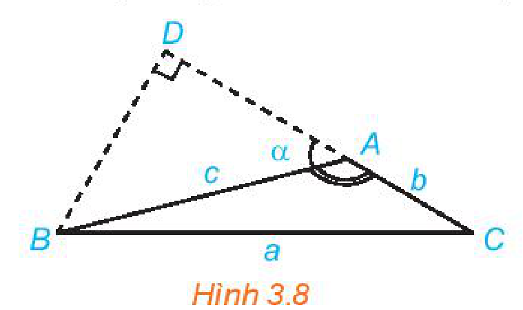
*Hình 3.8*

<!-- pdf:40 -->

**Chú ý:** Người ta chứng minh được kết quả trong HĐ2d đối với cả các trường hợp góc $A$ là góc vuông hoặc nhọn.

> **Định lí côsin**. Trong tam giác $ABC$:
> $a^2 = b^2 + c^2 - 2bc\cos A,$
> $b^2 = c^2 + a^2 - 2ca\cos B,$
> $c^2 = a^2 + b^2 - 2ab\cos C.$

> ❓ Định lí Pythagore có phải là một trường hợp đặc biệt của định lí côsin hay không?

**Ví dụ 1:** Cho tam giác $ABC$ có $\widehat{A} = 120^\circ$ và $AB = 5$, $AC = 8$. Tính độ dài cạnh $BC$.
<!-- ocr-ok: đã đối chiếu ảnh trang PDF 40, OCR đọc nhầm Ví dụ1 -->

**Giải:** (H.3.9)

Áp dụng định lí côsin cho tam giác $ABC$, ta có:

$BC^2 = AB^2 + AC^2 - 2AB \cdot AC \cdot \cos 120^\circ$

$= 5^2 + 8^2 - 2 \cdot 5 \cdot 8 \cdot \left(-\frac{1}{2}\right) = 129$. Vậy $BC = \sqrt{129}$.

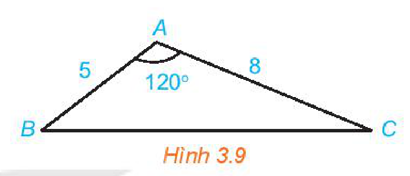
*Hình 3.9*

**Khám phá:** Từ định lí côsin, hãy viết các công thức tính $\cos A, \cos B, \cos C$ theo độ dài các cạnh $a, b, c$ của tam giác $ABC$.

**Luyện tập 1:** Cho tam giác $ABC$ có $AB = 5, AC = 8$ và $\widehat{A} = 45^\circ$. Tính độ dài cạnh và độ lớn các góc còn lại của tam giác.

**Trải nghiệm:** Vẽ một tam giác $ABC$, sau đó đo độ dài các cạnh, số đo góc $A$ và kiểm tra tính đúng đắn của định lí côsin tại đỉnh $A$ đối với tam giác đó.

**Vận dụng 1:** Dùng định lí côsin, tính khoảng cách được đề cập trong HĐ1b.

## 2. ĐỊNH LÍ SIN

**HĐ3:** Trong mỗi hình dưới đây, hãy tính $R$ theo $a$ và $\sin A$.

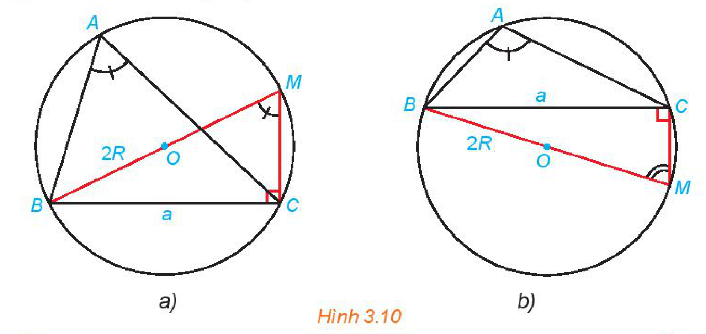
*Hình 3.10*

> **Định lí sin**. Trong tam giác $ABC$: $\frac{a}{\sin A} = \frac{b}{\sin B} = \frac{c}{\sin C} = 2R.$

<!-- pdf:41 -->

**Ví dụ 2:** Cho tam giác $ABC$ có $\widehat{A} = 135^\circ, \widehat{C} = 15^\circ$ và $b = 12$. Tính $a, c, R$ và số đo góc $B$.

**Giải:** (H.3.11)

Ta có: $\widehat{B} = 180^\circ - (\widehat{A} + \widehat{C}) = 180^\circ - (135^\circ + 15^\circ) = 30^\circ$.

Áp dụng định lí sin, ta có: $\frac{a}{\sin 135^\circ} = \frac{12}{\sin 30^\circ} = \frac{c}{\sin 15^\circ} = 2R$.

Suy ra $a = \frac{12}{\sin 30^\circ} \cdot \sin 135^\circ = 12\sqrt{2}$; $c = \frac{12}{\sin 30^\circ} \cdot \sin 15^\circ = 24\sin 15^\circ (\approx 6,21)$; $R = \frac{12}{2\sin 30^\circ} = 12$.

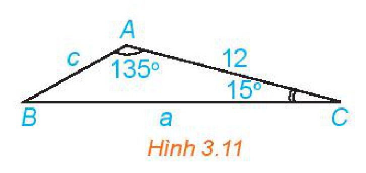
*Hình 3.11*

**Luyện tập 2:** Cho tam giác $ABC$ có $b = 6, c = 5$ và $\widehat{B} = 80^\circ$. Tính số đo các góc, bán kính đường tròn ngoại tiếp và độ dài cạnh còn lại của tam giác.

## 3. GIẢI TAM GIÁC VÀ ỨNG DỤNG THỰC TẾ

Việc tính độ dài các cạnh và số đo các góc của một tam giác khi biết một số yếu tố của tam giác đó được gọi là **giải tam giác**.

**Ví dụ 3:** Giải tam giác $ABC$, biết $c = 14, \widehat{A} = 60^\circ, \widehat{B} = 40^\circ$.

**Giải:**

Ta có $\widehat{C} = 180^\circ - (\widehat{A} + \widehat{B}) = 80^\circ$.

Áp dụng định lí sin, ta có: $\frac{a}{\sin 60^\circ} = \frac{b}{\sin 40^\circ} = \frac{14}{\sin 80^\circ}$.

Suy ra $a = \frac{14\sin 60^\circ}{\sin 80^\circ} \approx 12,31$; $b = \frac{14\sin 40^\circ}{\sin 80^\circ} \approx 9,14$.

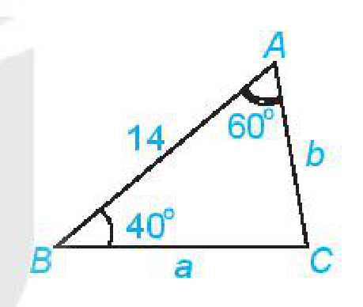

**Luyện tập 3:** Giải tam giác $ABC$, biết $b = 32, c = 45, \widehat{A} = 87^\circ$.

**Chú ý:** Áp dụng các định lí côsin, sin và sử dụng máy tính cầm tay, ta có thể tính (gần đúng) các cạnh và các góc của một tam giác trong các trường hợp sau:
- Biết hai cạnh và góc xen giữa;
- Biết ba cạnh;
- Biết một cạnh và hai góc kề.

**Ví dụ 4:** Trở lại *tình huống mở đầu*, theo các bước sau, ta có thể tiến hành đo khoảng cách từ vị trí $A$ trên bờ hồ Hoàn Kiếm đến Tháp Rùa (H.3.12):

*Bước 1.* Trên bờ, đặt một cọc tiêu tại vị trí $A$ và một cọc tiêu tại vị trí $B$ nào đó. Đo khoảng cách $AB$.

*Bước 2.* Đứng tại $A$, ngắm Tháp Rùa và cọc tiêu $B$ để đo góc tạo bởi hai hướng ngắm đó.

*Bước 3.* Đứng tại $B$, ngắm cọc tiêu $A$ và Tháp Rùa để đo góc tạo bởi hai hướng ngắm đó.
<!-- ocr-ok: đã đối chiếu ảnh trang PDF 41, OCR đọc sai Bước 3 thành Bước 5 -->

*Bước 4.* Gọi $C$ là vị trí của Tháp Rùa. Áp dụng định lí sin cho tam giác $ABC$ để tính độ dài cạnh $AC$.

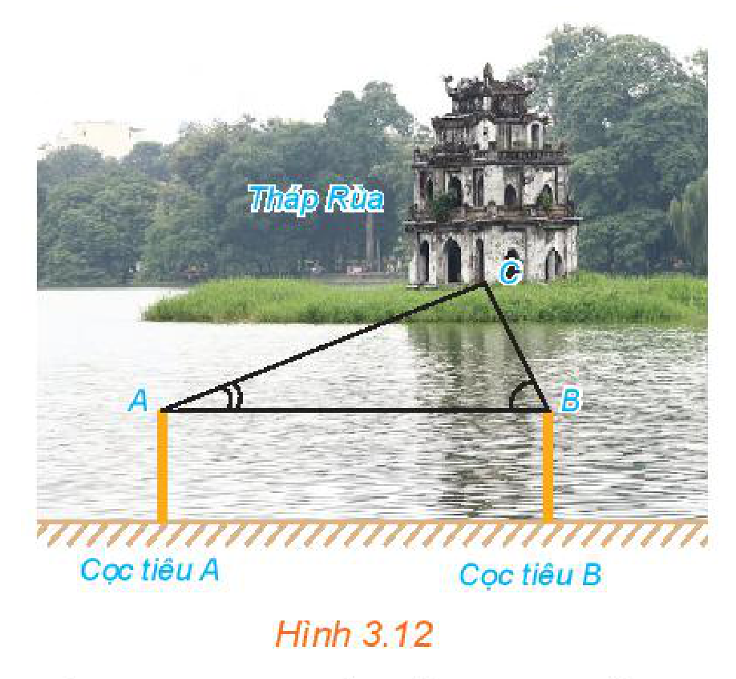
*Hình 3.12*

**Vận dụng 2:** Từ một khu vực có thể quan sát được hai đỉnh núi, ta có thể ngắm và đo để xác định khoảng cách giữa hai đỉnh núi đó. Hãy thảo luận để đưa ra các bước cho một cách đo.

<!-- pdf:42 -->

## 4. CÔNG THỨC TÍNH DIỆN TÍCH TAM GIÁC

Ta đã biết tính diện tích một tam giác theo chiều cao và độ dài cạnh đáy tương ứng. Liệu còn công thức nào khác để tính diện tích tam giác hay không?

**HĐ4:** Cho tam giác $ABC$ với $I$ là tâm đường tròn nội tiếp tam giác.

a) Nêu mối liên hệ giữa diện tích tam giác $ABC$ và diện tích các tam giác $IBC, ICA, IAB$.

b) Tính diện tích tam giác $ABC$ theo $r, a, b, c$.

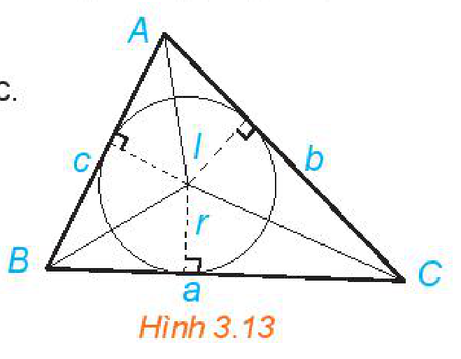
*Hình 3.13*

<!-- term: Công thức tính diện tích tam giác -->
> Công thức tính diện tích tam giác $ABC$: $S = pr = \frac{(a + b + c)r}{2}.$

**HĐ5:** Cho tam giác $ABC$ với đường cao $BD$.

a) Biểu thị $BD$ theo $AB$ và $\sin A$.
<!-- ocr-ok: đã đối chiếu ảnh trang PDF 42 -->

b) Viết công thức tính diện tích $S$ của tam giác $ABC$ theo $b, c, \sin A$.

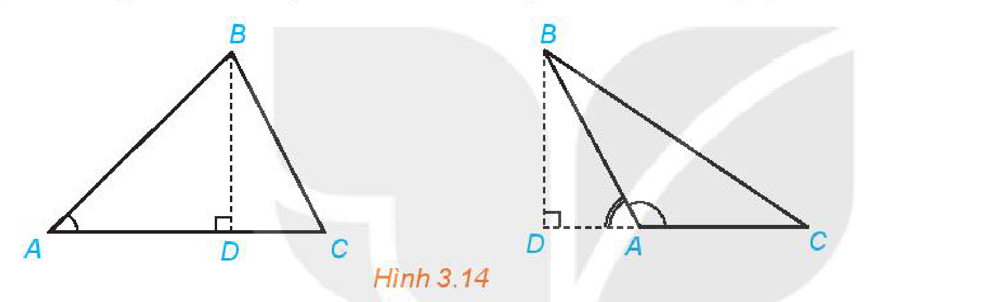
*Hình 3.14*

<!-- term: Công thức tính diện tích tam giác -->
> Công thức tính diện tích tam giác $ABC$: $S = \frac{1}{2}bc\sin A = \frac{1}{2}ca\sin B = \frac{1}{2}ab\sin C.$

**Ví dụ 5:** Tính diện tích $S$ của tam giác $ABC$ có $c = 4, b = 6, \widehat{A} = 150^\circ$.

**Giải:** (H.3.15)

Ta có: $S = \frac{1}{2}bc\sin A = \frac{1}{2} \cdot 6 \cdot 4 \cdot \sin 150^\circ = 6$.

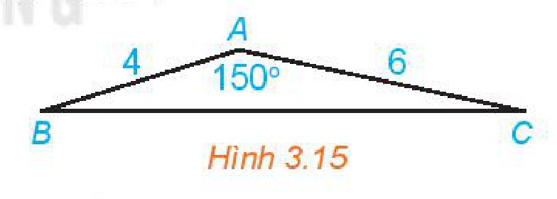
*Hình 3.15*

**Luyện tập 4:** Tính diện tích của tam giác $ABC$ có $b = 2, \widehat{B} = 30^\circ, \widehat{C} = 45^\circ$.

**Chú ý:** Do $\sin A = \frac{a}{2R}$ nên từ công thức $S = \frac{1}{2}bc\sin A$, ta có:

<!-- term: Công thức tính diện tích tam giác -->
> Công thức tính diện tích tam giác $ABC$: $S = \frac{abc}{4R}.$

**Thảo luận:** Ta đã biết tính $\cos A$ theo độ dài các cạnh của tam giác $ABC$. Liệu $\sin A$ và diện tích $S$ có tính được theo độ dài các cạnh của tam giác $ABC$ hay không?

> **Công thức Heron**. Trong tam giác $ABC$: $S = \sqrt{p(p - a)(p - b)(p - c)}.$

<!-- pdf:43 -->

**Ví dụ 6:** Cho tam giác $ABC$ có $a = 13, b = 14, c = 15$.

a) Tính $\sin A$.

b) Tính diện tích $S$ bằng hai cách khác nhau.

**Giải:** (H.3.16)

a) Áp dụng định lí côsin, ta có:

$\cos A = \frac{b^2 + c^2 - a^2}{2bc} = \frac{14^2 + 15^2 - 13^2}{420} = 0,6.$

Do đó $\sin A = \sqrt{1 - \cos^2 A} = 0,8$.

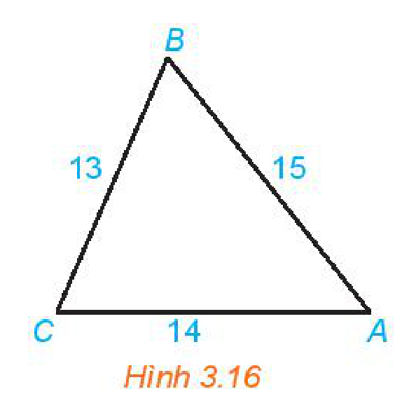
*Hình 3.16*

b) Ta có $S = \frac{1}{2}bc\sin A = 84$.

Áp dụng công thức Heron, ta cũng có thể tính $S$ theo cách thứ hai như sau:

Tam giác $ABC$ có nửa chu vi là: $p = \frac{a + b + c}{2} = \frac{13 + 14 + 15}{2} = 21$.

Khi đó

$S_{ABC} = \sqrt{p(p - a)(p - b)(p - c)} = \sqrt{21 \cdot (21 - 13) \cdot (21 - 14) \cdot (21 - 15)} = \sqrt{21 \cdot 8 \cdot 7 \cdot 6} = 84.$

**Vận dụng 3:** Công viên Hoà Bình (Hà Nội) có dạng hình ngũ giác $ABCDE$ như Hình 3.17. Dùng chế độ tính khoảng cách giữa hai điểm của Google Maps, một người xác định được các khoảng cách như trong hình vẽ. Theo số liệu đó, em hãy tính diện tích của công viên Hoà Bình.

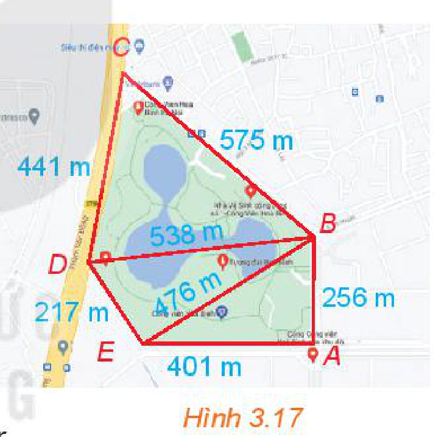
*Hình 3.17*

## ✏️ Bài tập

**3.5.** Cho tam giác $ABC$ có $a = 6, b = 5, c = 8$. Tính $\cos A, S, r$.

**3.6.** Cho tam giác $ABC$ có $a = 10, \widehat{A} = 45^\circ, \widehat{B} = 70^\circ$. Tính $R, b, c$.

**3.7.** Giải tam giác $ABC$ và tính diện tích của tam giác đó, biết $\widehat{A} = 15^\circ, \widehat{B} = 130^\circ, c = 6$.

**3.8.** Một tàu đánh cá xuất phát từ cảng $A$, đi theo hướng $\text{S}70^\circ\text{E}$ với vận tốc $70\text{ km/h}$. Đi được $90$ phút thì động cơ của tàu bị hỏng nên tàu trôi tự do theo hướng nam với vận tốc $8\text{ km/h}$. Sau $2$ giờ kể từ khi động cơ bị hỏng, tàu neo đậu được vào một hòn đảo.

a) Tính khoảng cách từ cảng $A$ tới đảo nơi tàu neo đậu.

b) Xác định hướng từ cảng $A$ tới đảo nơi tàu neo đậu.

> Hướng $\text{S}\alpha^\circ\text{E}$ là hướng tạo với hướng nam góc $\alpha^\circ$ và tạo với hướng đông góc $90^\circ - \alpha^\circ$. Các hướng $\text{S}\alpha^\circ\text{W}$, $\text{N}\alpha^\circ\text{E}$, $\text{N}\alpha^\circ\text{W}$ cũng được định nghĩa một cách tương tự.
> - $\text{N}$: hướng bắc
> - $\text{S}$: hướng nam
> - $\text{W}$: hướng tây
> - $\text{E}$: hướng đông
<!-- ocr-ok: đã đối chiếu ảnh trang PDF 43, OCR đọc lỗi chữ trong khung màu xanh -->

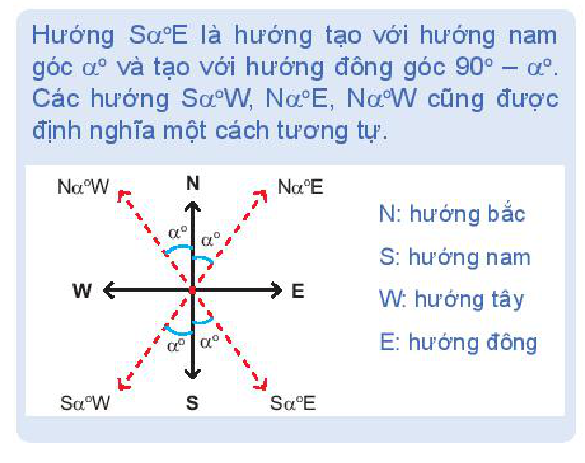

<!-- pdf:44 -->

**3.9.** Trên nóc một toà nhà có một cột ăng-ten cao $5\text{ m}$. Từ một vị trí quan sát $A$ cao $7\text{ m}$ so với mặt đất có thể nhìn thấy đỉnh $B$ và chân $C$ của cột ăng-ten, với các góc tương ứng là $50^\circ$ và $40^\circ$ so với phương nằm ngang (H.3.18).

a) Tính các góc của tam giác $ABC$.

b) Tính chiều cao của toà nhà.

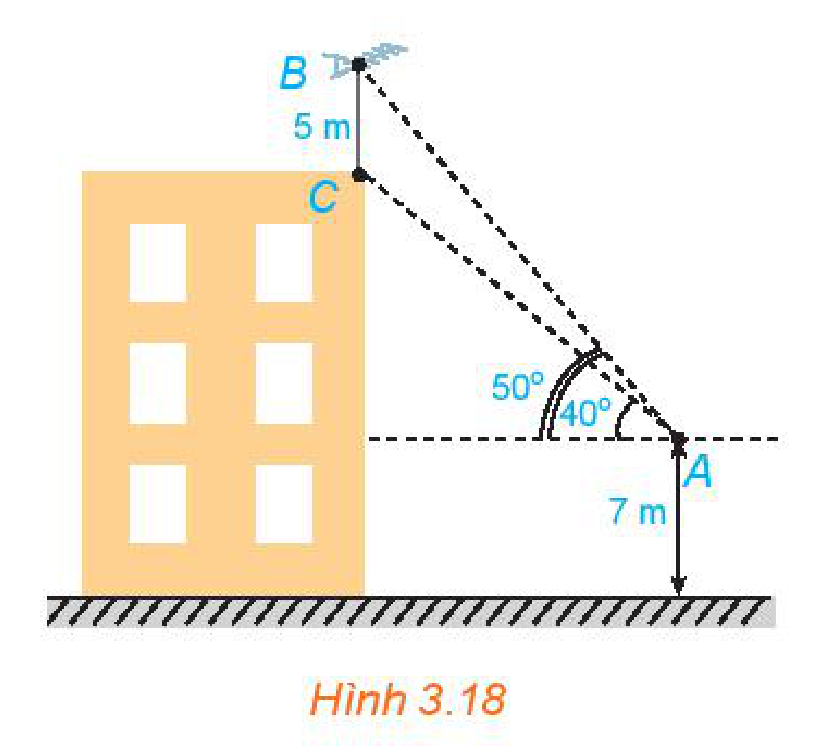
*Hình 3.18*

**3.10.** Từ bãi biển Vũng Chùa, Quảng Bình, ta có thể ngắm được Đảo Yến. Hãy đề xuất một cách xác định bề rộng của hòn đảo (theo chiều ta ngắm được).

*Đảo Yến, nhìn từ bãi biển Vũng Chùa, Quảng Bình*

**3.11.** Để tránh núi, đường giao thông hiện tại phải đi vòng như mô hình trong Hình 3.19. Để rút ngắn khoảng cách và tránh sạt lở núi, người ta dự định làm đường hầm xuyên núi, nối thẳng từ $A$ tới $D$. Hỏi độ dài đường mới sẽ giảm bao nhiêu kilômét so với đường cũ?

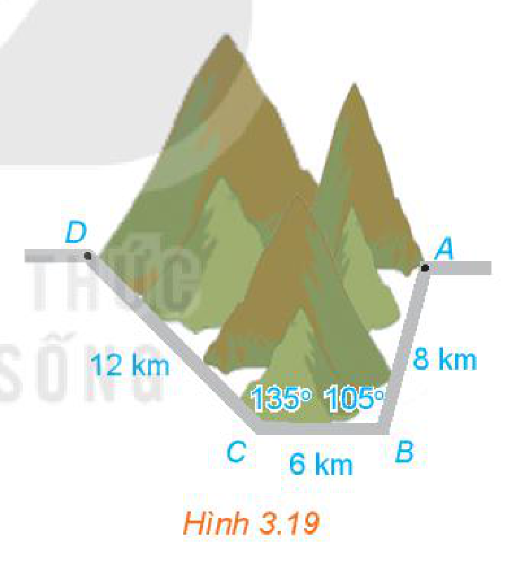
*Hình 3.19*

**Em có biết?**

Heron (Heron of Alexandria) là một nhà phát minh, nhà toán học Hy Lạp, sống vào khoảng thế kỉ I. Mặc dù cỗ máy với động cơ hơi nước đầu tiên trên thế giới ra đời ở thế kỉ XVIII – một sự kiện quan trọng góp phần tạo nên cuộc cách mạng công nghiệp lần thứ nhất, nhưng chính Heron là người đầu tiên mô tả một mô hình đơn giản cho phép biến hơi nước thành chuyển động quay. Trong toán học, Heron mô tả cách tính diện tích của các đa giác đều từ $3$ tới $12$ cạnh, diện tích một số mặt và thể tích một số hình trong không gian.

*(Theo mathshistory.st-andrews.ac.uk)*

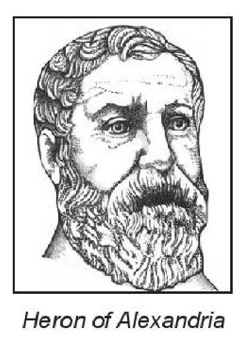
*Heron of Alexandria*

## 📷 Danh sách hình trong bài

| Mã hình | Trang PDF | Vị trí trong bài | Chú thích gốc |
| --- | --- | --- | --- |
| H10-toan-b06-01 | 39 | Mở đầu | Tháp Rùa nằm trong lòng hồ Hoàn Kiếm ở Thủ đô Hà Nội |
| H10-toan-b06-02 | 39 | Mục 1, HĐ2 | Hình 3.8 |
| H10-toan-b06-03 | 40 | Mục 1, Ví dụ 1 | Hình 3.9 |
| H10-toan-b06-04 | 40 | Mục 2, HĐ3 | Hình 3.10 |
| H10-toan-b06-05 | 41 | Mục 2, Ví dụ 2 | Hình 3.11 |
| H10-toan-b06-06 | 41 | Mục 3, Ví dụ 3 | (sách không đánh số, hình minh hoạ Ví dụ 3) |
| H10-toan-b06-07 | 41 | Mục 3, Ví dụ 4 | Hình 3.12 |
| H10-toan-b06-08 | 42 | Mục 4, HĐ4 | Hình 3.13 |
| H10-toan-b06-09 | 42 | Mục 4, HĐ5 | Hình 3.14 |
| H10-toan-b06-10 | 42 | Mục 4, Ví dụ 5 | Hình 3.15 |
| H10-toan-b06-11 | 43 | Mục 4, Ví dụ 6 | Hình 3.16 |
| H10-toan-b06-12 | 43 | Mục 4, Vận dụng 3 | Hình 3.17 |
| H10-toan-b06-13 | 43 | Bài tập 3.8 | (sách không đánh số, sơ đồ giải thích các hướng la bàn) |
| H10-toan-b06-14 | 44 | Bài tập 3.9 | Hình 3.18 |
| H10-toan-b06-15 | 44 | Bài tập 3.10 | Đảo Yến, nhìn từ bãi biển Vũng Chùa, Quảng Bình |
| H10-toan-b06-16 | 44 | Bài tập 3.11 | Hình 3.19 |
| H10-toan-b06-17 | 44 | Em có biết? | Heron of Alexandria |
