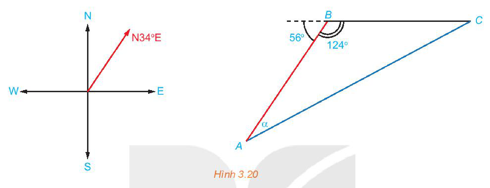
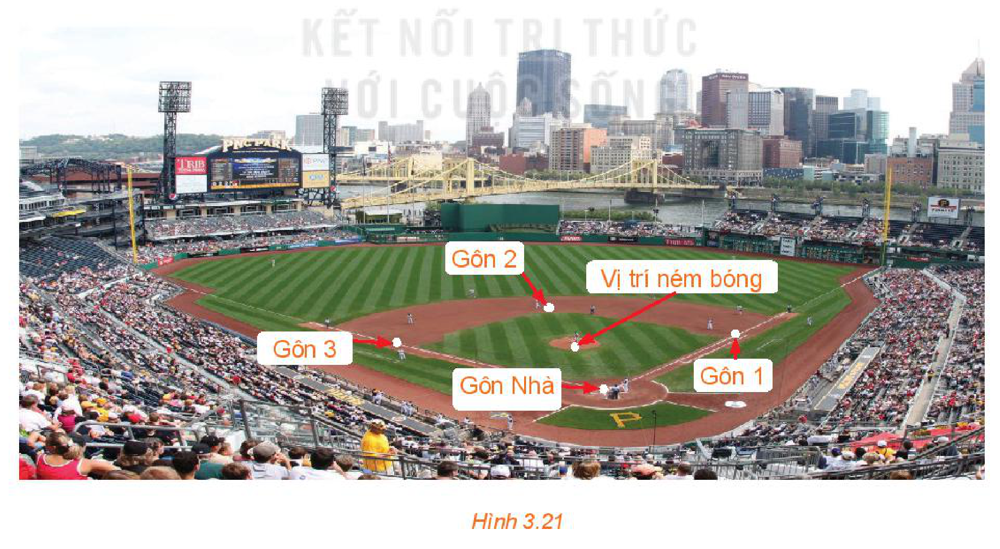

<!-- pdf:45 -->

# BÀI TẬP CUỐI CHƯƠNG III

## ✏️ A – TRẮC NGHIỆM

**3.12.** Cho tam giác $ABC$ có $\widehat{B} = 135^\circ$. Khẳng định nào sau đây là đúng?

a)

A. $S = \frac{1}{2}ca$.

B. $S = \frac{-\sqrt{2}}{4}ac$.

C. $S = \frac{\sqrt{2}}{4}bc$.

D. $S = \frac{\sqrt{2}}{4}ca$.

b)

A. $R = \frac{a}{\sin A}$.

B. $R = \frac{\sqrt{2}}{2}b$.

C. $R = \frac{\sqrt{2}}{2}c$.

D. $R = \frac{\sqrt{2}}{2}a$.

c)

A. $a^2 = b^2 + c^2 + \sqrt{2}ab$.

B. $\frac{b}{\sin A} = \frac{a}{\sin B}$.

C. $\sin B = -\frac{\sqrt{2}}{2}$.

D. $b^2 = c^2 + a^2 - 2ca\cos 135^\circ$.

**3.13.** Cho tam giác $ABC$. Khẳng định nào sau đây là đúng?

a)

A. $S = \frac{abc}{4r}$.

B. $r = \frac{2S}{a + b + c}$.

C. $a^2 = b^2 + c^2 + 2bc\cos A$.

D. $S = r(a + b + c)$.

b)

A. $\sin A = \sin(B + C)$.

B. $\cos A = \cos(B + C)$.

C. $\cos A > 0$.

D. $\sin A \le 0$.

## ✏️ B – TỰ LUẬN

**3.14.** Tính giá trị của các biểu thức sau:
<!-- ocr-ok: đã đối chiếu ảnh trang PDF 45, OCR đọc sai Tĩnh và biếu -->

a) $M = \sin 45^\circ \cdot \cos 45^\circ + \sin 30^\circ$;

b) $N = \sin 60^\circ \cdot \cos 30^\circ + \frac{1}{2}\sin 45^\circ \cdot \cos 45^\circ$;

c) $P = 1 + \tan^2 60^\circ$;

d) $Q = \frac{1}{\sin^2 120^\circ} - \cot^2 120^\circ$.

**3.15.** Cho tam giác $ABC$ có $\widehat{B} = 60^\circ, \widehat{C} = 45^\circ, AC = 10$. Tính $a, R, S, r$.

**3.16.** Cho tam giác $ABC$ có trung tuyến $AM$. Chứng minh rằng:

a) $\cos\widehat{AMB} + \cos\widehat{AMC} = 0$;

b) $MA^2 + MB^2 - AB^2 = 2MA \cdot MB \cdot \cos\widehat{AMB}$ và $MA^2 + MC^2 - AC^2 = 2MA \cdot MC \cdot \cos\widehat{AMC}$;

c) $MA^2 = \frac{2(AB^2 + AC^2) - BC^2}{4}$ (công thức đường trung tuyến).

**3.17.** Cho tam giác $ABC$. Chứng minh rằng:

a) Nếu góc $A$ nhọn thì $b^2 + c^2 > a^2$;

b) Nếu góc $A$ tù thì $b^2 + c^2 < a^2$;

c) Nếu góc $A$ vuông thì $b^2 + c^2 = a^2$.

<!-- pdf:46 -->

**3.18.** Trên biển, tàu $B$ ở vị trí cách tàu $A$ $53\text{ km}$ về hướng $\text{N}34^\circ\text{E}$. Sau đó, tàu $B$ chuyển động thẳng đều với vận tốc có độ lớn $30\text{ km/h}$ về hướng đông, đồng thời tàu $A$ chuyển động thẳng đều với vận tốc có độ lớn $50\text{ km/h}$ để gặp tàu $B$.

a) Hỏi tàu $A$ cần phải chuyển động theo hướng nào?

b) Với hướng chuyển động đó thì sau bao lâu tàu $A$ gặp tàu $B$?

*Hình 3.20*

**3.19.** Trên sân bóng chày dành cho nam, các vị trí gôn Nhà (Home plate), gôn 1 (First base), gôn 2 (Second base), gôn 3 (Third base) là bốn đỉnh của một hình vuông có cạnh dài $27,4\text{ m}$. Vị trí đứng ném bóng (Pitcher's mound) nằm trên đường nối gôn Nhà với gôn 2, và cách gôn Nhà $18,44\text{ m}$. Tính các khoảng cách từ vị trí đứng ném bóng tới các gôn 1 và gôn 3.

*Hình 3.21*

## 📷 Danh sách hình trong bài

| Mã hình | Trang PDF | Vị trí trong bài | Chú thích gốc |
| --- | --- | --- | --- |
| H10-toan-bt-c03-01 | 46 | Bài tập 3.18 | Hình 3.20 |
| H10-toan-bt-c03-02 | 46 | Bài tập 3.19 | Hình 3.21 |
