<!-- pdf:47 -->

<!-- Phần giới thiệu Chương IV (in chung đầu trang PDF 47): CHƯƠNG IV. VECTƠ -->

Hình 4.1 cho thấy ga An Cựu cách Hoàng cung Huế $3,01\text{ km}$ về hướng đông nam. Hai thông tin khoảng cách và hướng cho phép ta xác định được vị trí của ga An Cựu theo vị trí của Hoàng cung Huế.
<!-- ocr-ok: đã đối chiếu ảnh trang PDF 47 (chữ trên nền màu đầu chương) -->

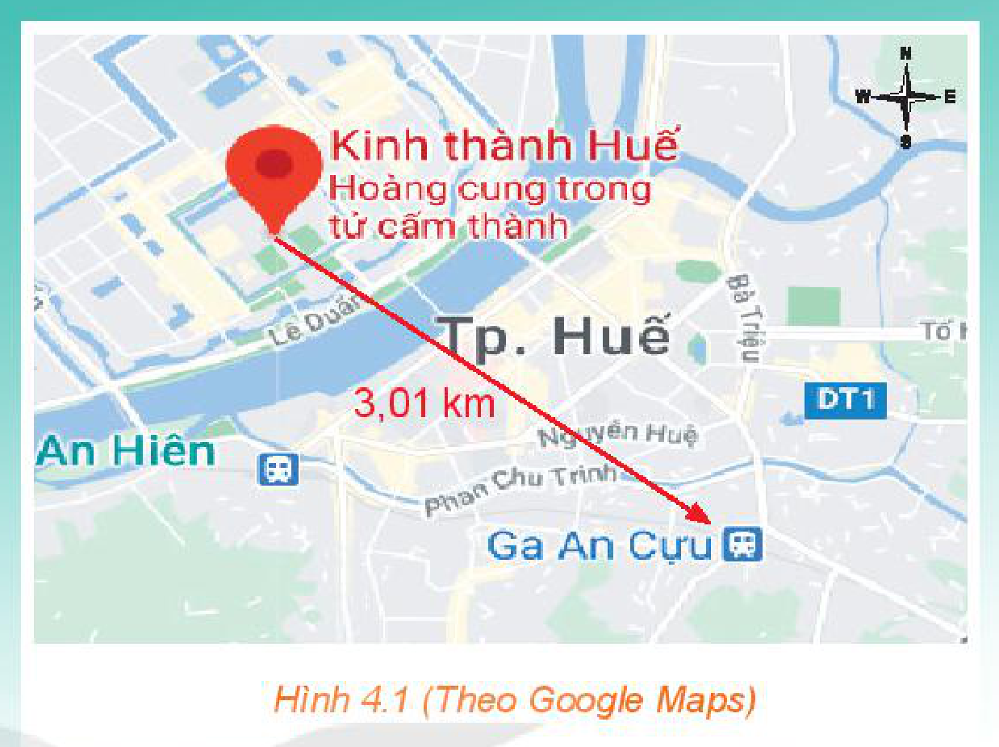
*Hình 4.1 (Theo Google Maps)*
<!-- ocr-ok: đã đối chiếu ảnh trang PDF 47 -->

Một số đại lượng như lực, vận tốc cũng được đặc trưng bởi hai yếu tố là độ lớn và hướng. Chương này xây dựng một đối tượng toán học, được gọi là vectơ, mà ta có thể dùng nó để biểu diễn các đại lượng nói trên.

Vectơ còn được sử dụng để xây dựng các khái niệm toán học, là công cụ để giải quyết nhiều bài toán và góp phần vào việc hình thành và phát triển năng lực tư duy tuyến tính cho người học.

# BÀI 7: CÁC KHÁI NIỆM MỞ ĐẦU

## 🔤 Thuật ngữ

- Vectơ, vectơ-không
- Độ dài của vectơ
- Giá của vectơ
- Hai vectơ cùng phương
- Hai vectơ cùng hướng, ngược hướng
- Hai vectơ bằng nhau

## 🎯 Mục tiêu

- Nhận biết khái niệm vectơ, hai vectơ cùng phương, hai vectơ cùng hướng, hai vectơ bằng nhau, vectơ-không.
- Biểu thị một số đại lượng như lực, vận tốc bằng vectơ.

## 🔴 Mở đầu

Nhiệt độ và gió là hai yếu tố luôn cùng được đề cập trong các bản tin dự báo thời tiết. Tuy nhiên, nhiệt độ là đại lượng chỉ có độ lớn, còn gió có cả hướng và độ lớn. Với một đơn vị đo, ta có thể dùng số để biểu diễn nhiệt độ. Đối với các đại lượng gồm hướng và độ lớn như vận tốc gió thì sao? Ta có thể dùng đối tượng toán học nào để biểu diễn chúng?

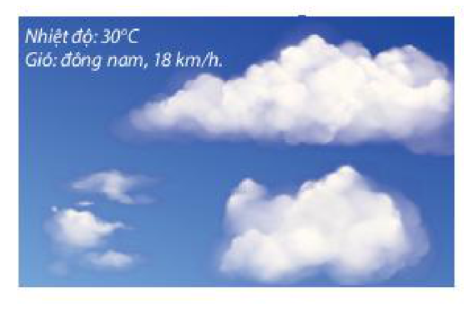
*Hình minh hoạ mở đầu*
<!-- ocr-ok: đã đối chiếu ảnh trang PDF 47 (hình mở đầu không có chú thích in) -->

<!-- pdf:48 -->

## 1. KHÁI NIỆM VECTƠ

**HĐ1:** Một con tàu khởi hành từ đảo $A$, đi thẳng về hướng đông $10\text{ km}$ rồi đi thẳng tiếp $10\text{ km}$ về hướng nam thì tới đảo $B$ (H.4.2). Nếu từ đảo $A$, tàu đi thẳng (không đổi hướng) tới đảo $B$, thì phải đi theo hướng nào và quãng đường phải đi dài bao nhiêu kilômét?

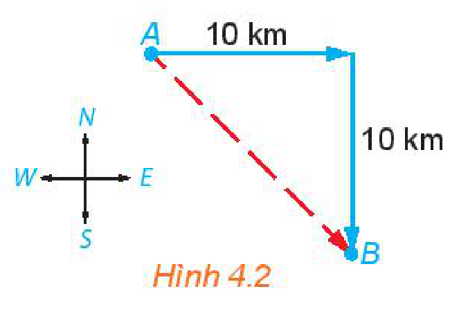
*Hình 4.2*

Ta có thể gắn cho quãng đường thẳng từ đảo $A$ tới đảo $B$ đồng thời hai yếu tố, đó là độ dài và hướng (hướng đi thẳng từ đảo $A$ tới đảo $B$). Từ thực tế này, ta đi tới khái niệm toán học sau:

> - **Vectơ** là một đoạn thẳng có hướng, nghĩa là, trong hai điểm mút của đoạn thẳng, đã chỉ rõ điểm đầu, điểm cuối.
> - **Độ dài của vectơ** là khoảng cách giữa điểm đầu và điểm cuối của vectơ đó.

> **Chú ý:**
> - Vectơ có điểm đầu $A$ và điểm cuối $B$ được kí hiệu là $\overrightarrow{AB}$, đọc là *vectơ $AB$* (H.4.3).
> - Để vẽ một vectơ, ta vẽ đoạn thẳng nối điểm đầu và điểm cuối của nó, rồi đánh dấu mũi tên ở điểm cuối (H.4.3).
> - Vectơ còn được kí hiệu là $\vec{a}, \vec{b}, \vec{x}, \vec{y}, \dots$ (H.4.4).
> - Độ dài của vectơ $\overrightarrow{AB}, \vec{a}$ tương ứng được kí hiệu là $|\overrightarrow{AB}|, |\vec{a}|$.

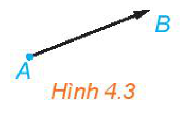
*Hình 4.3*

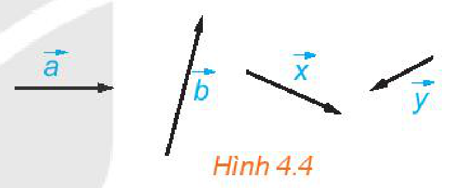
*Hình 4.4*

**Ví dụ 1:** Cho hình vuông $ABCD$ với cạnh có độ dài bằng $1$. Tính độ dài các vectơ $\overrightarrow{AC}, \overrightarrow{CA}, \overrightarrow{BD}$.

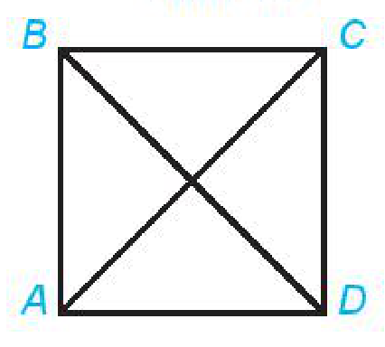
*Hình minh hoạ Ví dụ 1*
<!-- ocr-ok: đã đối chiếu ảnh trang PDF 48 (hình không có chú thích in) -->

**Giải:**

Vì cạnh của hình vuông $ABCD$ có độ dài bằng $1$ nên các đường chéo của hình vuông này có độ dài bằng $\sqrt{2}$.

Vậy $|\overrightarrow{AC}| = AC = \sqrt{2}$, $|\overrightarrow{CA}| = CA = \sqrt{2}$, $|\overrightarrow{BD}| = BD = \sqrt{2}$.

**Luyện tập 1:** Cho tam giác đều $ABC$ với cạnh có độ dài bằng $a$. Hãy chỉ ra các vectơ có độ dài bằng $a$ và có điểm đầu, điểm cuối là các đỉnh của tam giác $ABC$.

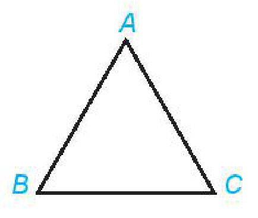
*Hình minh hoạ Luyện tập 1*
<!-- ocr-ok: đã đối chiếu ảnh trang PDF 48 (hình không có chú thích in) -->

## 2. HAI VECTƠ CÙNG PHƯƠNG, CÙNG HƯỚNG, BẰNG NHAU

**HĐ2:** Quan sát các làn đường trong Hình 4.5 và cho biết những nhận xét nào sau đây là đúng.

a) Các làn đường song song với nhau.

b) Các xe chạy theo cùng một hướng.

c) Hai xe bất kì đều chạy theo cùng một hướng hoặc hai hướng ngược nhau.

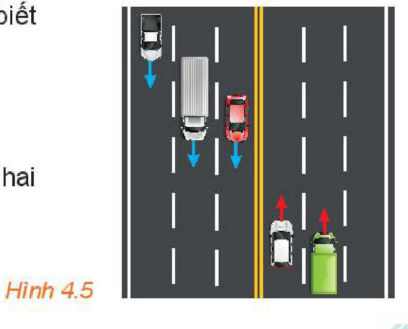
*Hình 4.5*

<!-- pdf:49 -->

> - Đường thẳng đi qua điểm đầu và điểm cuối của một vectơ được gọi là **giá** của vectơ đó.
> - Hai vectơ được gọi là **cùng phương** nếu chúng có giá song song hoặc trùng nhau.

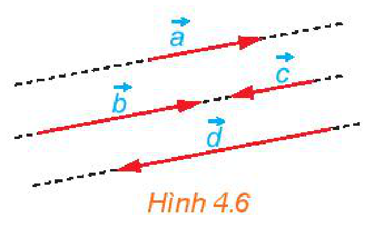
*Hình 4.6*

Trong Hình 4.7, mỗi cặp vectơ trong các vectơ $\overrightarrow{AB}, \vec{a}, \vec{x}, \vec{y}, \vec{z}$ đều cùng phương, nhưng vectơ $\vec{b}$ không cùng phương với mỗi vectơ trên.

**HĐ3:** Xét các vectơ cùng phương trong Hình 4.7. Hai vectơ $\vec{a}$ và $\overrightarrow{AB}$ được gọi là cùng hướng, còn hai vectơ $\vec{a}$ và $\vec{x}$ được gọi là ngược hướng. Hãy chỉ ra các vectơ cùng hướng với vectơ $\vec{a}$ và các vectơ ngược hướng với vectơ $\vec{a}$.

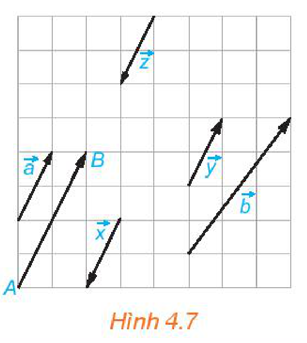
*Hình 4.7*

> Đối với hai vectơ cùng phương thì chúng **cùng hướng** hoặc **ngược hướng**.

> Chỉ khi hai vectơ cùng phương, ta mới nói tới chúng cùng hướng hay ngược hướng.

> Hai vectơ $\vec{a}$ và $\vec{b}$ được gọi là **bằng nhau**, kí hiệu $\vec{a} = \vec{b}$, nếu chúng có cùng độ dài và cùng hướng.

> **Chú ý:**
> - Ta cũng xét các vectơ có điểm đầu và điểm cuối trùng nhau (chẳng hạn $\overrightarrow{AA}, \overrightarrow{BB}, \overrightarrow{MM}$), gọi là các **vectơ-không**.
> - Ta quy ước vectơ-không có độ dài bằng $0$, cùng hướng (do đó cùng phương) với mọi vectơ.
> - Các vectơ-không có cùng độ dài và cùng hướng nên bằng nhau và được kí hiệu chung là $\vec{0}$.
> <!-- term: Sự xác định duy nhất điểm cuối của vectơ bằng vectơ cho trước -->
> - Với mỗi điểm $O$ và vectơ $\vec{a}$ cho trước, có duy nhất điểm $A$ sao cho $\overrightarrow{OA} = \vec{a}$ (H.4.8).

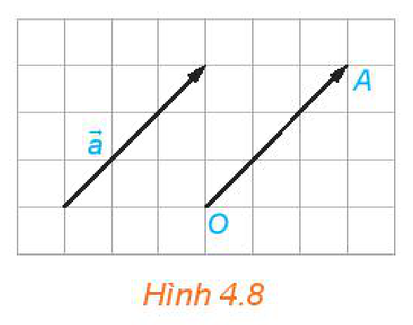
*Hình 4.8*

**Ví dụ 2:** Cho hình chữ nhật $ABCD$. Hãy chỉ ra mối quan hệ về độ dài, phương, hướng giữa các cặp vectơ: $\overrightarrow{AD}$ và $\overrightarrow{BC}$, $\overrightarrow{AB}$ và $\overrightarrow{CD}$, $\overrightarrow{AC}$ và $\overrightarrow{BD}$. Những cặp vectơ nào trong các cặp vectơ trên là bằng nhau?

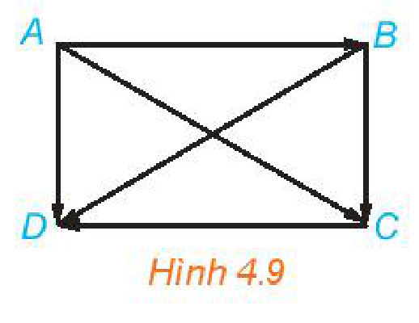
*Hình 4.9*

**Giải:** (H.4.9)

- Hai vectơ $\overrightarrow{AD}$ và $\overrightarrow{BC}$ có cùng độ dài và cùng hướng. Do đó, hai vectơ $\overrightarrow{AD}$ và $\overrightarrow{BC}$ bằng nhau.
- Hai vectơ $\overrightarrow{AB}$ và $\overrightarrow{CD}$ có cùng độ dài và ngược hướng. Do đó, hai vectơ $\overrightarrow{AB}$ và $\overrightarrow{CD}$ không bằng nhau.
- Hai vectơ $\overrightarrow{AC}$ và $\overrightarrow{BD}$ có cùng độ dài nhưng không cùng phương nên không cùng hướng. Do đó, hai vectơ $\overrightarrow{AC}$ và $\overrightarrow{BD}$ không bằng nhau.

Vậy trong các cặp vectơ đang xét, chỉ có cặp vectơ $\overrightarrow{AD}$ và $\overrightarrow{BC}$ là bằng nhau ($\overrightarrow{AD} = \overrightarrow{BC}$).

<!-- pdf:50 -->

**Luyện tập 2:** Cho hình thang cân $ABCD$ với hai đáy $AB, CD$, $AB < CD$ (H.4.10). Hãy chỉ ra mối quan hệ về độ dài, phương, hướng giữa các cặp vectơ $\overrightarrow{AD}$ và $\overrightarrow{BC}$, $\overrightarrow{AB}$ và $\overrightarrow{CD}$, $\overrightarrow{AC}$ và $\overrightarrow{BD}$. Có cặp vectơ nào trong các cặp vectơ trên bằng nhau hay không?

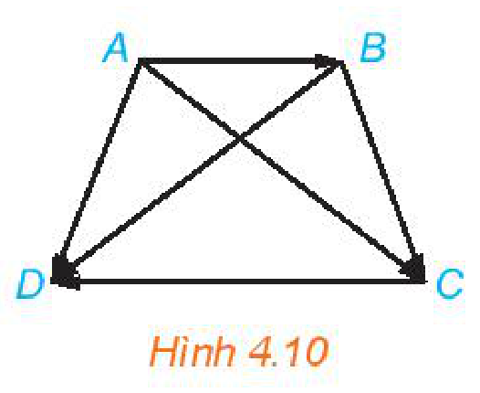
*Hình 4.10*

**Ví dụ 3:** Chứng minh rằng ba điểm phân biệt $A, B, C$ thẳng hàng khi và chỉ khi hai vectơ $\overrightarrow{AB}, \overrightarrow{AC}$ cùng phương.

> Ta có thể dùng ngôn ngữ vectơ để biểu thị một số quan hệ hình học.
<!-- ocr-ok: đã đối chiếu ảnh trang PDF 50 (bóng thoại nhân vật) -->

**Giải:**

- Giả sử ba điểm $A, B, C$ thẳng hàng. Khi đó, chúng cùng thuộc một đường thẳng $d$. Vậy hai vectơ $\overrightarrow{AB}, \overrightarrow{AC}$ có cùng giá là $d$. Suy ra chúng cùng phương.
- Giả sử hai vectơ $\overrightarrow{AB}, \overrightarrow{AC}$ cùng phương. Khi đó, chúng có cùng giá hoặc có hai giá song song với nhau. Mặt khác, giá của các vectơ trên đều đi qua $A$ nên chúng trùng nhau. Vậy $A, B, C$ thẳng hàng.

<!-- term: Điều kiện ba điểm thẳng hàng theo hai vectơ cùng phương -->
> **Nhận xét:** Ba điểm phân biệt $A, B, C$ thẳng hàng khi và chỉ khi $\overrightarrow{AB}, \overrightarrow{AC}$ cùng phương.

**Luyện tập 3:** Trong các điều kiện dưới đây, chọn điều kiện cần và đủ để một điểm $M$ nằm giữa hai điểm phân biệt $A$ và $B$.

a) $\overrightarrow{AB}$ và $\overrightarrow{AM}$ ngược hướng.

b) $\overrightarrow{MA}$ và $\overrightarrow{MB}$ cùng phương.

c) $\overrightarrow{AB}$ và $\overrightarrow{AM}$ cùng hướng.

d) $\overrightarrow{MA}$ và $\overrightarrow{MB}$ ngược hướng.

> **Chú ý:** Ta có thể dùng vectơ để biểu diễn các đại lượng như lực, vận tốc, gia tốc. Hướng của vectơ chỉ hướng của đại lượng, độ dài của vectơ thể hiện cho độ lớn của đại lượng và được lấy tỉ lệ với độ lớn của đại lượng.

**Ví dụ 4:** Một vật $A$ được thả chìm hoàn toàn dưới đáy một cốc chất lỏng. Biết rằng trong ba cách biểu diễn lực đẩy Archimedes (Ác-si-mét) $\vec{F}$ và trọng lực $\vec{P}$ tác động lên vật $A$ ở Hình 4.11, có một cách biểu diễn đúng.

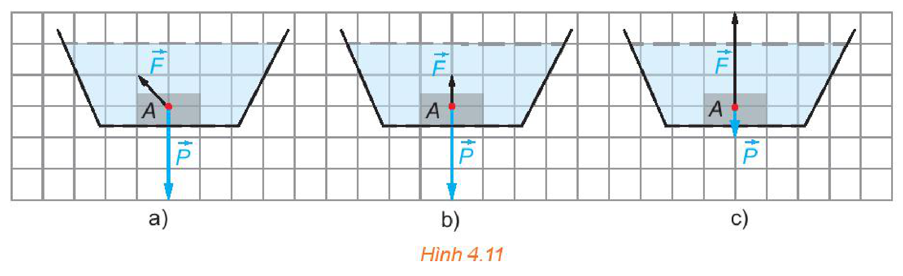
*Hình 4.11*

Hãy chỉ ra mối quan hệ giữa trọng lượng riêng của vật $A$ và trọng lượng riêng của chất lỏng trong cốc.

<!-- pdf:51 -->

**Giải:**

Lực đẩy Archimedes và trọng lực đều tác động lên vật $A$ theo phương thẳng đứng, hai lực này cùng phương nhưng ngược hướng. Do đó, Hình 4.11a không đúng. Vật $A$ chìm xuống đáy nên trọng lực $P$ (có hướng từ trên xuống) lớn hơn lực đẩy Archimedes $F$ (có hướng từ dưới lên). Do vậy, Hình 4.11c không đúng.

Vậy hình biểu diễn đúng là Hình 4.11b. Theo đó, vectơ biểu diễn lực $\vec{P}$ có độ dài gấp $3$ lần độ dài của vectơ biểu diễn lực $\vec{F}$.

Độ lớn của trọng lực và lực đẩy Archimedes tác động lên $A$ là: $|\vec{P}| = d' \cdot V, |\vec{F}| = d \cdot V$, trong đó $V\text{ (m}^3\text{)}$ là thể tích của vật $A$ và $d', d\text{ (N/m}^3\text{)}$ tương ứng là trọng lượng riêng của vật $A$ và của chất lỏng. Do $|\vec{P}| = 3|\vec{F}|$ (theo H.4.11b) nên $d' = 3d$. Vậy trọng lượng riêng của vật $A$ gấp $3$ lần trọng lượng riêng của chất lỏng trong cốc.

**Vận dụng:** Hai ca nô $A$ và $B$ chạy trên sông với các vận tốc riêng có cùng độ lớn là $15\text{ km/h}$. Tuy vậy, ca nô $A$ chạy xuôi dòng còn ca nô $B$ chạy ngược dòng. Vận tốc của dòng nước trên sông là $3\text{ km/h}$.

a) Hãy thể hiện trên hình vẽ, vectơ vận tốc $\vec{v}$ của dòng nước và các vectơ vận tốc thực tế $\vec{v}_a, \vec{v}_b$ của các ca nô $A, B$.

b) Trong các vectơ $\vec{v}, \vec{v}_a, \vec{v}_b$, những cặp vectơ nào cùng phương và những cặp vectơ nào ngược hướng?

## ✏️ Bài tập

**4.1.** Cho ba vectơ $\vec{a}, \vec{b}, \vec{c}$ đều khác $\vec{0}$. Những khẳng định nào sau đây là đúng?

a) $\vec{a}, \vec{b}, \vec{c}$ đều cùng hướng với $\vec{0}$;

b) Nếu $\vec{b}$ không cùng hướng với $\vec{a}$ thì $\vec{b}$ ngược hướng với $\vec{a}$;

c) Nếu $\vec{a}$ và $\vec{b}$ đều cùng phương với $\vec{c}$ thì $\vec{a}$ và $\vec{b}$ cùng phương;
<!-- ocr-ok: đã đối chiếu ảnh trang PDF 51 (nhiều công thức LaTeX) -->

d) Nếu $\vec{a}$ và $\vec{b}$ đều cùng hướng với $\vec{c}$ thì $\vec{a}$ và $\vec{b}$ cùng hướng.
<!-- ocr-ok: đã đối chiếu ảnh trang PDF 51 (nhiều công thức LaTeX) -->

**4.2.** Trong Hình 4.12, hãy chỉ ra các vectơ cùng phương, các cặp vectơ ngược hướng và các cặp vectơ bằng nhau.

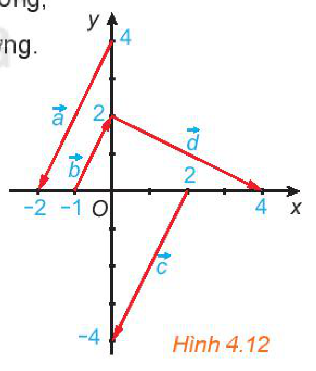
*Hình 4.12*

**4.3.** Chứng minh rằng tứ giác $ABCD$ là một hình bình hành khi và chỉ khi $\overrightarrow{BC} = \overrightarrow{AD}$.

**4.4.** Cho hình vuông $ABCD$ có hai đường chéo cắt nhau tại $O$. Hãy chỉ ra tập hợp $S$ gồm tất cả các vectơ khác $\vec{0}$, có điểm đầu và điểm cuối thuộc tập hợp $\{A; B; C; D; O\}$. Hãy chia tập $S$ thành các nhóm sao cho hai vectơ thuộc cùng một nhóm khi và chỉ khi chúng bằng nhau.

**4.5.** Trên mặt phẳng toạ độ $Oxy$, hãy vẽ các vectơ $\overrightarrow{OA}, \overrightarrow{MN}$ với $A(1; 2), M(0; -1), N(3; 5)$.
<!-- ocr-ok: đã đối chiếu ảnh trang PDF 51 (nhiều công thức LaTeX) -->

a) Chỉ ra mối quan hệ giữa hai vectơ trên.

b) Một vật thể khởi hành từ $M$ và chuyển động thẳng đều với vận tốc (tính theo giờ) được biểu diễn bởi vectơ $\vec{v} = \overrightarrow{OA}$. Hỏi vật thể đó có đi qua $N$ hay không? Nếu có thì sau bao lâu vật sẽ tới $N$?

## 📷 Danh sách hình trong bài

| Mã hình | Trang PDF | Vị trí trong bài | Chú thích gốc |
| --- | --- | --- | --- |
| H10-toan-b07-01 | 47 | Giới thiệu Chương IV | Hình 4.1 (Theo Google Maps) |
| H10-toan-b07-02 | 47 | Mở đầu | Hình minh hoạ mở đầu |
| H10-toan-b07-03 | 48 | Mục 1, HĐ1 | Hình 4.2 |
| H10-toan-b07-04 | 48 | Mục 1, Chú ý | Hình 4.3 |
| H10-toan-b07-05 | 48 | Mục 1, Chú ý | Hình 4.4 |
| H10-toan-b07-06 | 48 | Mục 1, Ví dụ 1 | Hình minh hoạ Ví dụ 1 |
| H10-toan-b07-07 | 48 | Mục 1, Luyện tập 1 | Hình minh hoạ Luyện tập 1 |
| H10-toan-b07-08 | 48 | Mục 2, HĐ2 | Hình 4.5 |
| H10-toan-b07-09 | 49 | Mục 2 | Hình 4.6 |
| H10-toan-b07-10 | 49 | Mục 2, HĐ3 | Hình 4.7 |
| H10-toan-b07-11 | 49 | Mục 2, Chú ý | Hình 4.8 |
| H10-toan-b07-12 | 49 | Mục 2, Ví dụ 2 | Hình 4.9 |
| H10-toan-b07-13 | 50 | Mục 2, Luyện tập 2 | Hình 4.10 |
| H10-toan-b07-14 | 50 | Mục 2, Ví dụ 4 | Hình 4.11 |
| H10-toan-b07-15 | 51 | Bài tập 4.2 | Hình 4.12 |
