<!-- pdf:52 -->

# BÀI 8: TỔNG VÀ HIỆU CỦA HAI VECTƠ

## 🔤 Thuật ngữ

- Tổng của hai vectơ
- Hiệu của hai vectơ
- Vectơ đối

## 🎯 Mục tiêu

- Thực hiện các phép toán cộng, trừ vectơ.
- Mô tả trung điểm của đoạn thẳng, trọng tâm của tam giác bằng vectơ.
- Vận dụng vectơ trong bài toán tổng hợp lực, tổng hợp vận tốc.

## 🔴 Mở đầu

Một con tàu chuyển động từ bờ bên này sang bờ bên kia của một dòng sông với vận tốc riêng không đổi. Giả sử vận tốc dòng nước là không đổi và đáng kể, các yếu tố bên ngoài khác không ảnh hưởng đến vận tốc thực tế của tàu. Nếu không quan tâm đến điểm đến thì cần giữ lái cho tàu tạo với bờ sông một góc bao nhiêu để tàu sang bờ bên kia được nhanh nhất?

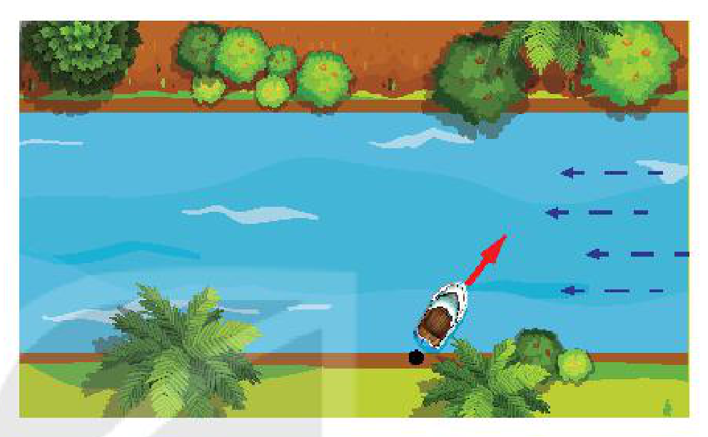
*Hình minh hoạ mở đầu*
<!-- ocr-ok: đã đối chiếu ảnh trang PDF 52 (hình không có chú thích in) -->

Vận tốc thực tế của con tàu trên sông đối với bờ phụ thuộc vào vận tốc riêng của tàu (đối với dòng nước) và vận tốc của dòng nước (đối với bờ). Tương tự, một vật thường chịu tác động của nhiều lực. Ta đã biết dùng vectơ để biểu diễn các đại lượng đó; bài học này xây dựng các phép toán vectơ, tương thích với việc tổng hợp vận tốc, tổng hợp và phân tích lực.

## 1. TỔNG CỦA HAI VECTƠ

**HĐ1:** Với hai vectơ $\vec{a}, \vec{b}$ cho trước, lấy một điểm $A$ và vẽ các vectơ $\overrightarrow{AB} = \vec{a}, \overrightarrow{BC} = \vec{b}$. Lấy điểm $A'$ khác $A$ và cũng vẽ các vectơ $\overrightarrow{A'B'} = \vec{a}, \overrightarrow{B'C'} = \vec{b}$. Hỏi hai vectơ $\overrightarrow{AC}$ và $\overrightarrow{A'C'}$ có mối quan hệ gì?

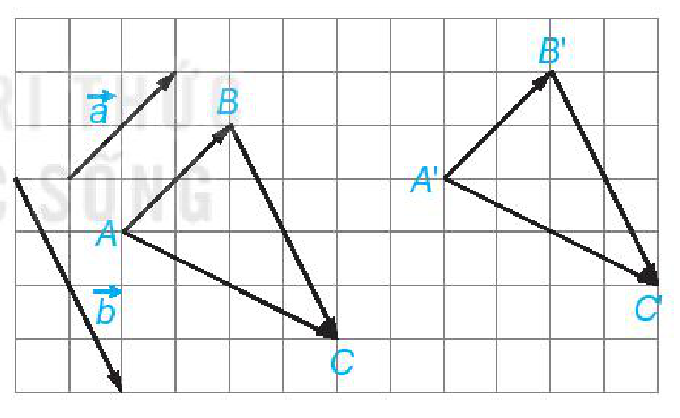
*Hình minh hoạ HĐ1*

> Cho hai vectơ $\vec{a}, \vec{b}$. Lấy một điểm $A$ tuỳ ý và vẽ $\overrightarrow{AB} = \vec{a}, \overrightarrow{BC} = \vec{b}$ (H.4.13). Khi đó vectơ $\overrightarrow{AC}$ được gọi là **tổng của hai vectơ** $\vec{a}$ và $\vec{b}$ và được kí hiệu là $\vec{a} + \vec{b}$.
>
> Phép lấy tổng của hai vectơ được gọi là **phép cộng vectơ**.

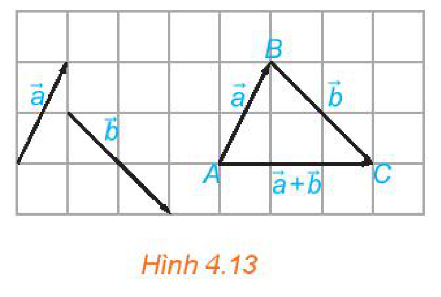
*Hình 4.13*

**HĐ2:** Cho hình bình hành $ABCD$. Tìm mối quan hệ giữa hai vectơ $\overrightarrow{AB} + \overrightarrow{AD}$ và $\overrightarrow{AC}$.

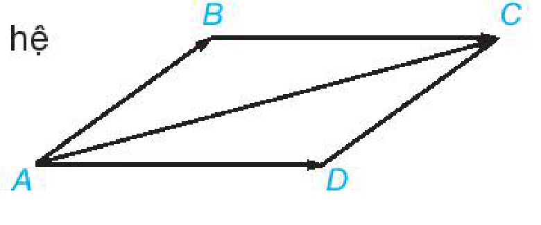
*Hình minh hoạ HĐ2*

<!-- pdf:53 -->

> - **Quy tắc ba điểm:** Với ba điểm bất kì $A, B, C$, ta có $\overrightarrow{AB} + \overrightarrow{BC} = \overrightarrow{AC}$.
> - **Quy tắc hình bình hành:** Nếu $ABCD$ là một hình bình hành thì $\overrightarrow{AB} + \overrightarrow{AD} = \overrightarrow{AC}$.

**HĐ3:** a) Trong Hình 4.14a, hãy chỉ ra vectơ $\vec{a} + \vec{b}$ và vectơ $\vec{b} + \vec{a}$.

b) Trong Hình 4.14b, hãy chỉ ra vectơ $(\vec{a} + \vec{b}) + \vec{c}$ và vectơ $\vec{a} + (\vec{b} + \vec{c})$.

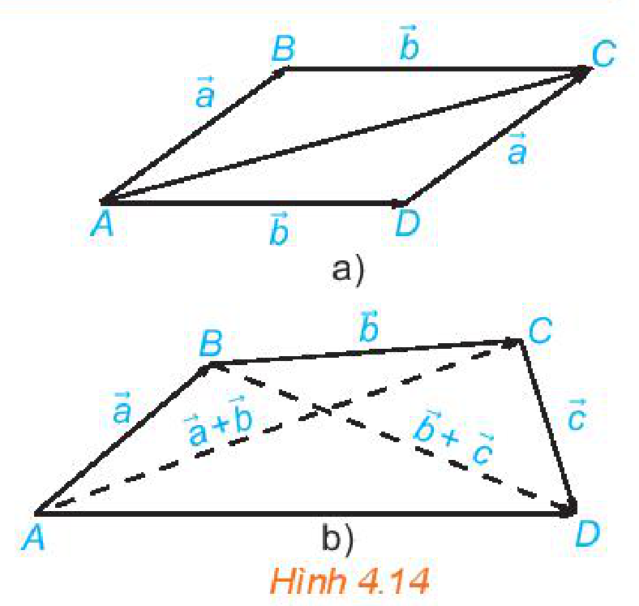
*Hình 4.14*

<!-- term: Tính chất của phép cộng vectơ -->
> Với ba vectơ $\vec{a}, \vec{b}, \vec{c}$ tuỳ ý:
> - Tính chất giao hoán: $\vec{a} + \vec{b} = \vec{b} + \vec{a}$;
> - Tính chất kết hợp: $(\vec{a} + \vec{b}) + \vec{c} = \vec{a} + (\vec{b} + \vec{c})$;
> - Tính chất của vectơ-không: $\vec{a} + \vec{0} = \vec{0} + \vec{a} = \vec{a}$.

> **Chú ý:** Do các vectơ $(\vec{a} + \vec{b}) + \vec{c}$ và $\vec{a} + (\vec{b} + \vec{c})$ bằng nhau, nên ta còn viết chúng dưới dạng $\vec{a} + \vec{b} + \vec{c}$ và gọi là *tổng của ba vectơ* $\vec{a}, \vec{b}, \vec{c}$. Tương tự, ta cũng có thể viết tổng của một số vectơ mà không cần dùng các dấu ngoặc.

**Ví dụ 1:** Cho hình vuông $ABCD$ với cạnh có độ dài bằng $1$. Tính độ dài của các vectơ $\overrightarrow{AB} + \overrightarrow{CB}, \overrightarrow{AB} + \overrightarrow{DC} + \overrightarrow{BD}$.

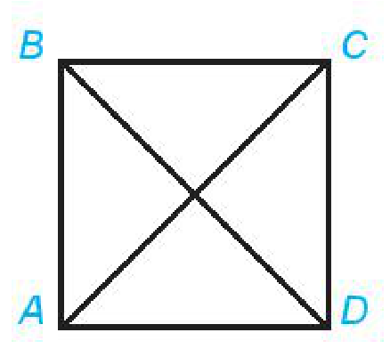
*Hình minh hoạ Ví dụ 1*
<!-- ocr-ok: đã đối chiếu ảnh trang PDF 53 (hình không có chú thích in) -->

**Giải:**

Do $\overrightarrow{AB} = \overrightarrow{DC}$ nên $\overrightarrow{AB} + \overrightarrow{CB} = \overrightarrow{DC} + \overrightarrow{CB} = \overrightarrow{DB}$.

Vậy $|\overrightarrow{AB} + \overrightarrow{CB}| = |\overrightarrow{DB}| = DB = \sqrt{2}$.

Ta có $\overrightarrow{AB} + \overrightarrow{DC} + \overrightarrow{BD} = (\overrightarrow{AB} + \overrightarrow{BD}) + \overrightarrow{DC} = \overrightarrow{AD} + \overrightarrow{DC} = \overrightarrow{AC}$.

Do đó $|\overrightarrow{AB} + \overrightarrow{DC} + \overrightarrow{BD}| = |\overrightarrow{AC}| = AC = \sqrt{2}$.

**Luyện tập 1:** Cho hình thoi $ABCD$ với cạnh có độ dài bằng $1$ và $\widehat{BAD} = 120^\circ$. Tính độ dài của các vectơ $\overrightarrow{CB} + \overrightarrow{CD}, \overrightarrow{DB} + \overrightarrow{CD} + \overrightarrow{BA}$.

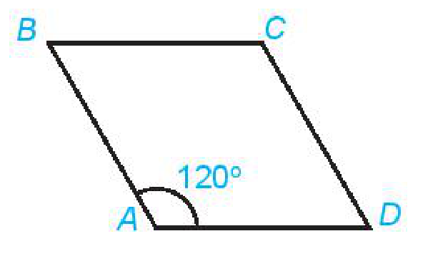
*Hình minh hoạ Luyện tập 1*
<!-- ocr-ok: đã đối chiếu ảnh trang PDF 53 (hình không có chú thích in) -->

## 2. HIỆU CỦA HAI VECTƠ

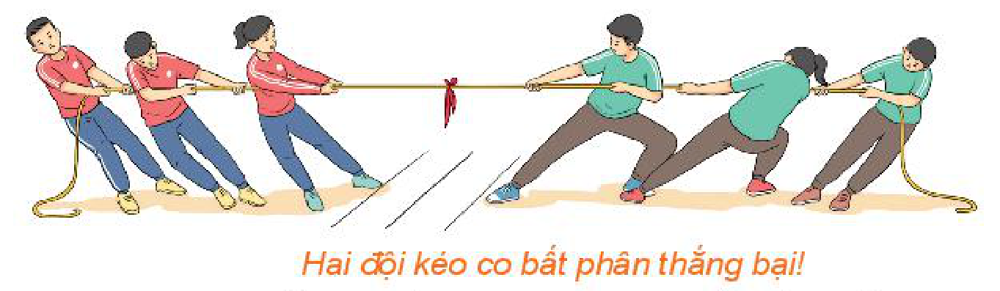
*Hai đội kéo co bất phân thắng bại!*

**HĐ4:** Thế nào là hai lực cân bằng? Nếu dùng hai vectơ để biểu diễn hai lực cân bằng thì hai vectơ này có mối quan hệ gì với nhau?

> - Vectơ có cùng độ dài và ngược hướng với vectơ $\vec{a}$ được gọi là **vectơ đối** của vectơ $\vec{a}$. Vectơ đối của $\vec{a}$ được kí hiệu là $-\vec{a}$.
> - Vectơ $\vec{0}$ được coi là vectơ đối của chính nó.

> **Chú ý:** **Hai vectơ đối nhau** khi và chỉ khi tổng của chúng bằng $\vec{0}$.

<!-- pdf:54 -->

> Vectơ $\vec{a} + (-\vec{b})$ được gọi là **hiệu của hai vectơ** $\vec{a}$ và $\vec{b}$ và được kí hiệu là $\vec{a} - \vec{b}$. Phép lấy hiệu hai vectơ được gọi là **phép trừ vectơ**.

> **Chú ý:** Nếu $\vec{b} + \vec{c} = \vec{a}$ thì $\vec{a} - \vec{b} = \vec{a} + (-\vec{b}) = \vec{c} + \vec{b} + (-\vec{b}) = \vec{c} + \vec{0} = \vec{c}$.
>
> Với ba điểm $O, M, N$ tuỳ ý, ta có $\overrightarrow{MN} = \overrightarrow{MO} + \overrightarrow{ON} = (-\overrightarrow{OM}) + \overrightarrow{ON} = \overrightarrow{ON} - \overrightarrow{OM}$.

> **Quy tắc hiệu:** Với ba điểm $O, M, N$, ta có $\overrightarrow{MN} = \overrightarrow{ON} - \overrightarrow{OM}$.

**Ví dụ 2:** Cho hình bình hành $ABCD$ và một điểm $O$ bất kì. Chứng minh rằng $\overrightarrow{OB} - \overrightarrow{OA} = \overrightarrow{OC} - \overrightarrow{OD}$.

**Giải:**

Áp dụng quy tắc hiệu, ta có $\overrightarrow{OB} - \overrightarrow{OA} = \overrightarrow{AB}, \overrightarrow{OC} - \overrightarrow{OD} = \overrightarrow{DC}$.

Mặt khác $\overrightarrow{AB} = \overrightarrow{DC}$ nên $\overrightarrow{OB} - \overrightarrow{OA} = \overrightarrow{OC} - \overrightarrow{OD}$.

<!-- term: Đẳng thức vectơ của trung điểm đoạn thẳng và trọng tâm tam giác -->
**Ví dụ 3:** a) Chứng minh rằng nếu $I$ là trung điểm của đoạn thẳng $AB$ thì $\overrightarrow{IA} + \overrightarrow{IB} = \vec{0}$.

b) Chứng minh rằng nếu $G$ là trọng tâm của tam giác $ABC$ thì $\overrightarrow{GA} + \overrightarrow{GB} + \overrightarrow{GC} = \vec{0}$.

**Giải:**

a) (H.4.15) Khi $I$ là trung điểm của $AB$, thì hai vectơ $\overrightarrow{IA}$ và $\overrightarrow{IB}$ có cùng độ dài và ngược hướng. Do đó, $\overrightarrow{IA}$ và $\overrightarrow{IB}$ đối nhau, suy ra $\overrightarrow{IA} + \overrightarrow{IB} = \vec{0}$.

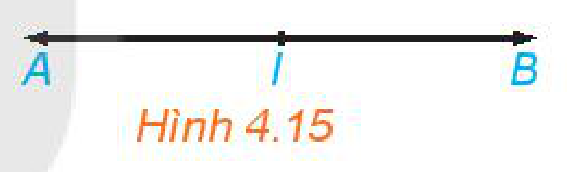
*Hình 4.15*

b) (H.4.16) Trọng tâm $G$ của tam giác $ABC$ thuộc trung tuyến $AI$ và $GA = 2GI$. Lấy điểm $D$ đối xứng với $G$ qua $I$. Khi đó tứ giác $GBDC$ có hai đường chéo cắt nhau tại trung điểm của mỗi đường nên nó là một hình bình hành. Ta có $GA = 2GI = GD$.

Hai vectơ $\overrightarrow{GA}$ và $\overrightarrow{GD}$ có cùng độ dài và ngược hướng nên chúng là hai vectơ đối nhau, do đó $\overrightarrow{GA} + \overrightarrow{GD} = \vec{0}$.

Trong hình bình hành $GBDC$, ta có $\overrightarrow{GB} + \overrightarrow{GC} = \overrightarrow{GD}$.

Vậy $\overrightarrow{GA} + \overrightarrow{GB} + \overrightarrow{GC} = \overrightarrow{GA} + \overrightarrow{GD} = \vec{0}$.

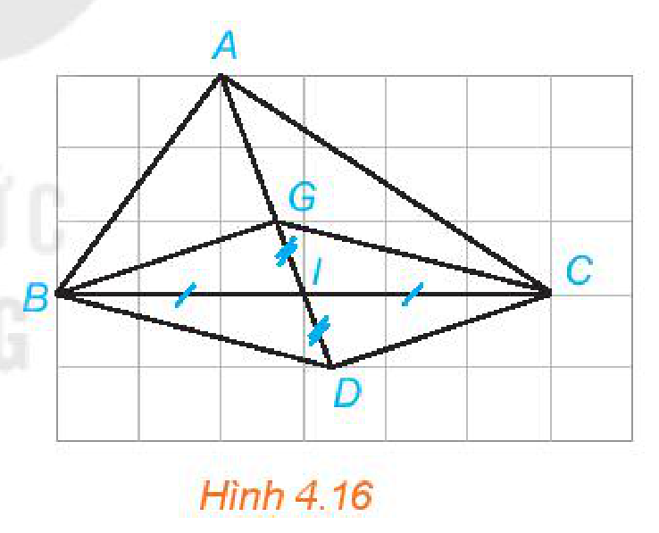
*Hình 4.16*

**Luyện tập 2:** Cho tứ giác $ABCD$. Gọi $M, N$ lần lượt là trung điểm của các cạnh $AB, CD$ và $O$ là trung điểm của $MN$. Chứng minh rằng $\overrightarrow{OA} + \overrightarrow{OB} + \overrightarrow{OC} + \overrightarrow{OD} = \vec{0}$.

> **Chú ý:** Phép cộng vectơ tương ứng với các quy tắc tổng hợp lực, tổng hợp vận tốc:
> - Nếu hai lực cùng tác động vào chất điểm $A$ và được biểu diễn bởi các vectơ $\vec{u}_1, \vec{u}_2$ thì hợp lực tác động vào $A$ được biểu diễn bởi vectơ $\vec{u}_1 + \vec{u}_2$.
> - Nếu một con thuyền di chuyển trên sông với vận tốc riêng (vận tốc so với dòng nước) được biểu diễn bởi vectơ $\vec{v}_r$ và vận tốc của dòng nước (so với bờ) được biểu diễn bởi vectơ $\vec{v}_n$ thì vận tốc thực tế của thuyền (so với bờ) được biểu diễn bởi vectơ $\vec{v}_r + \vec{v}_n$.

> Trong Vật lí, trọng tâm của một vật là điểm đặt của trọng lực tác dụng lên vật đó. Đối với một vật mỏng hình đa giác $A_1A_2 \dots A_n$ thì trọng tâm của nó là điểm $G$ thoả mãn $\overrightarrow{GA_1} + \overrightarrow{GA_2} + \dots + \overrightarrow{GA_n} = \vec{0}$.

<!-- pdf:55 -->

**Ví dụ 4:** Hãy giải bài toán trong *tình huống mở đầu*.

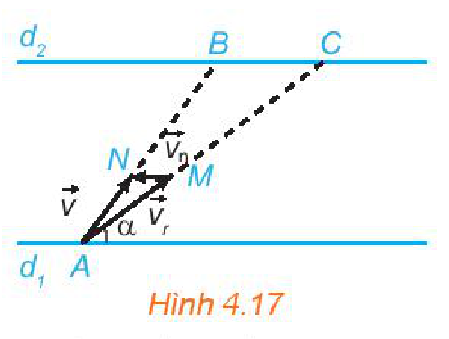
*Hình 4.17*

**Giải:**

Ta biểu thị hai bờ sông là hai đường thẳng song song $d_1, d_2$ (H.4.17). Giả sử tàu xuất phát từ $A \in d_1$ và bánh lái luôn được giữ để tàu tạo với bờ góc $\alpha$. Gọi $\vec{v}_r$ và $\vec{v}_n$ lần lượt là vectơ vận tốc riêng của tàu và vận tốc dòng nước. Gọi $M, N$ là các điểm sao cho $\vec{v}_r = \overrightarrow{AM}, \vec{v}_n = \overrightarrow{MN}$.

Khi đó tàu chuyển động với vectơ vận tốc thực tế là $\vec{v} = \vec{v}_r + \vec{v}_n = \overrightarrow{AM} + \overrightarrow{MN} = \overrightarrow{AN}$.

Gọi $B, C$ tương ứng là giao điểm của $AN, AM$ với $d_2$. Tàu chuyển động thẳng từ $A$ đến $B$ với vectơ vận tốc thực tế $\overrightarrow{AN}$, do đó thời gian cần thiết để tàu sang được bờ $d_2$ là $\frac{AB}{AN} = \frac{AC}{AM}$.

Mặt khác, $AM = |\vec{v}_r|$ không đổi nên $\frac{AC}{AM}$ nhỏ nhất $\Leftrightarrow AC$ nhỏ nhất $\Leftrightarrow AC \perp d_2 \Leftrightarrow AM \perp d_2$.
<!-- ocr-ok: đã đối chiếu ảnh trang PDF 55 (nhiều công thức LaTeX) -->

Vậy để tàu sang được bờ bên kia nhanh nhất, ta cần giữ bánh lái để tàu luôn vuông góc với bờ.

**Vận dụng:** Tính lực kéo cần thiết để kéo một khẩu pháo có trọng lượng $22\,148\text{ N}$ (ứng với khối lượng xấp xỉ $2\,260\text{ kg}$) lên một con dốc nghiêng $30^\circ$ so với phương nằm ngang (H.4.18). Nếu lực kéo của mỗi người bằng $100\text{ N}$, thì cần tối thiểu bao nhiêu người để kéo pháo?

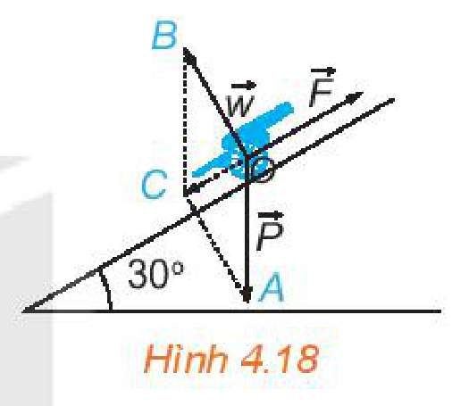
*Hình 4.18*

> **Chú ý:** Ta coi khẩu pháo chịu tác động của ba lực: trọng lực $\vec{P}$ (có độ lớn $|\vec{P}| = 22\,148\text{ N}$, có phương vuông góc với phương nằm ngang và hướng xuống dưới), phản lực $\vec{w}$ (có độ lớn $|\vec{w}| = |\vec{P}|\cos 30^\circ$, có phương vuông góc với mặt dốc và hướng lên trên) và lực kéo $\vec{F}$ (theo phương dốc, hướng từ chân dốc lên đỉnh dốc).

## ✏️ Bài tập

**4.6.** Cho bốn điểm $A, B, C, D$. Chứng minh rằng:
<!-- ocr-ok: đã đối chiếu ảnh trang PDF 55 -->

a) $\overrightarrow{AB} + \overrightarrow{BC} + \overrightarrow{CD} + \overrightarrow{DA} = \vec{0}$;

b) $\overrightarrow{AC} - \overrightarrow{AD} = \overrightarrow{BC} - \overrightarrow{BD}$.

**4.7.** Cho hình bình hành $ABCD$. Hãy tìm điểm $M$ để $\overrightarrow{BM} = \overrightarrow{AB} + \overrightarrow{AD}$. Tìm mối quan hệ giữa hai vectơ $\overrightarrow{CD}$ và $\overrightarrow{CM}$.
<!-- ocr-ok: đã đối chiếu ảnh trang PDF 55 (nhiều công thức LaTeX) -->

**4.8.** Cho tam giác đều $ABC$ có cạnh bằng $a$. Tính độ dài của các vectơ $\overrightarrow{AB} - \overrightarrow{AC}, \overrightarrow{AB} + \overrightarrow{AC}$.

**4.9.** Hình 4.19 biểu diễn hai lực $\vec{F}_1, \vec{F}_2$ cùng tác động lên một vật, cho $|\vec{F}_1| = 3\text{ N}, |\vec{F}_2| = 2\text{ N}$. Tính độ lớn của hợp lực $\vec{F}_1 + \vec{F}_2$.

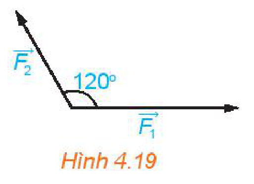
*Hình 4.19*

**4.10.** Hai con tàu xuất phát cùng lúc từ bờ bên này để sang bờ bên kia của dòng sông với vận tốc riêng không đổi và có độ lớn bằng nhau. Hai tàu luôn được giữ lái sao cho chúng tạo với bờ cùng một góc nhọn nhưng một tàu hướng xuống hạ lưu, một tàu hướng lên thượng nguồn (hình bên). Vận tốc dòng nước là đáng kể, các yếu tố bên ngoài khác không ảnh hưởng tới vận tốc của các tàu. Hỏi tàu nào sang bờ bên kia trước?

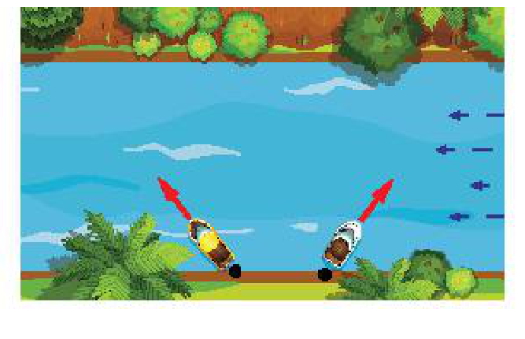
*Hình minh hoạ Bài 4.10*
<!-- ocr-ok: đã đối chiếu ảnh trang PDF 55 (hình không có chú thích in) -->

## 📷 Danh sách hình trong bài

| Mã hình | Trang PDF | Vị trí trong bài | Chú thích gốc |
| --- | --- | --- | --- |
| H10-toan-b08-01 | 52 | Mở đầu | Hình minh hoạ mở đầu |
| H10-toan-b08-02 | 52 | Mục 1, HĐ1 | Hình minh hoạ HĐ1 |
| H10-toan-b08-03 | 52 | Mục 1 | Hình 4.13 |
| H10-toan-b08-04 | 52 | Mục 1, HĐ2 | Hình minh hoạ HĐ2 |
| H10-toan-b08-05 | 53 | Mục 1, HĐ3 | Hình 4.14 |
| H10-toan-b08-06 | 53 | Mục 1, Ví dụ 1 | Hình minh hoạ Ví dụ 1 |
| H10-toan-b08-07 | 53 | Mục 1, Luyện tập 1 | Hình minh hoạ Luyện tập 1 |
| H10-toan-b08-08 | 53 | Mục 2, HĐ4 | Hai đội kéo co bất phân thắng bại! |
| H10-toan-b08-09 | 54 | Mục 2, Ví dụ 3a | Hình 4.15 |
| H10-toan-b08-10 | 54 | Mục 2, Ví dụ 3b | Hình 4.16 |
| H10-toan-b08-11 | 55 | Mục 2, Ví dụ 4 | Hình 4.17 |
| H10-toan-b08-12 | 55 | Mục 2, Vận dụng | Hình 4.18 |
| H10-toan-b08-13 | 55 | Bài tập 4.9 | Hình 4.19 |
| H10-toan-b08-14 | 55 | Bài tập 4.10 | Hình minh hoạ Bài 4.10 |
