<!-- pdf:56 -->

# BÀI 9: TÍCH CỦA MỘT VECTƠ VỚI MỘT SỐ

## 🔤 Thuật ngữ

- Tích của vectơ với một số
- Phân tích một vectơ theo hai vectơ không cùng phương

## 🎯 Mục tiêu

- Thực hiện phép nhân vectơ với một số.
- Mô tả các mối quan hệ cùng phương, cùng hướng bằng vectơ.

## 🔴 Mở đầu

Với mỗi cặp vật đặt trên hai đầu của một thanh đòn $AB$, luôn có duy nhất một điểm $M$ thuộc $AB$ để nếu đặt trụ đỡ tại $M$ thì thanh đòn ở trạng thái cân bằng (H.4.20). Điều trên còn đúng trong những trường hợp tổng quát hơn, chẳng hạn, thanh đòn được thay bởi một tấm ván hình đa giác $n$ đỉnh $A_1, A_2, \dots, A_n$, tại mỗi đỉnh $A_i$ có đặt một vật nặng $m_i\text{ (kg)}$. Ở đây, ta coi thanh đòn, tấm ván là không có trọng lượng. Trong Vật lí, điểm $M$ như trên được gọi là điểm khối tâm của hệ chất điểm $A_1, A_2, \dots, A_n$ ứng với các khối lượng $m_1, m_2, \dots, m_n\text{ (kg)}$.

Qua bài học này, ta sẽ thấy Hình học cho phép xác định vị trí điểm khối tâm của một hệ chất điểm.

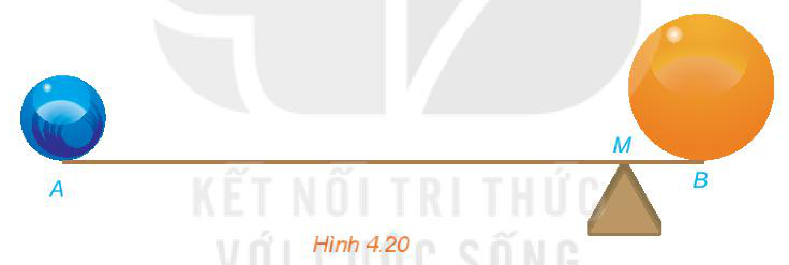
*Hình 4.20*

## 1. TÍCH CỦA MỘT VECTƠ VỚI MỘT SỐ

**HĐ1:** Cho vectơ $\overrightarrow{AB} = \vec{a}$. Hãy xác định điểm $C$ sao cho $\overrightarrow{BC} = \vec{a}$.
<!-- ocr-ok: đã đối chiếu ảnh trang PDF 56 (nhiều công thức LaTeX) -->

a) Tìm mối quan hệ giữa $\overrightarrow{AB}$ và $\vec{a} + \vec{a}$.

b) Vectơ $\vec{a} + \vec{a}$ có mối quan hệ như thế nào về hướng và độ dài đối với vectơ $\vec{a}$?

<!-- term: Tích của một vectơ với một số thực -->
> Tích của một vectơ $\vec{a} \neq \vec{0}$ với một số thực $k > 0$ là một vectơ, kí hiệu là $k\vec{a}$, cùng hướng với vectơ $\vec{a}$ và có độ dài bằng $k|\vec{a}|$.

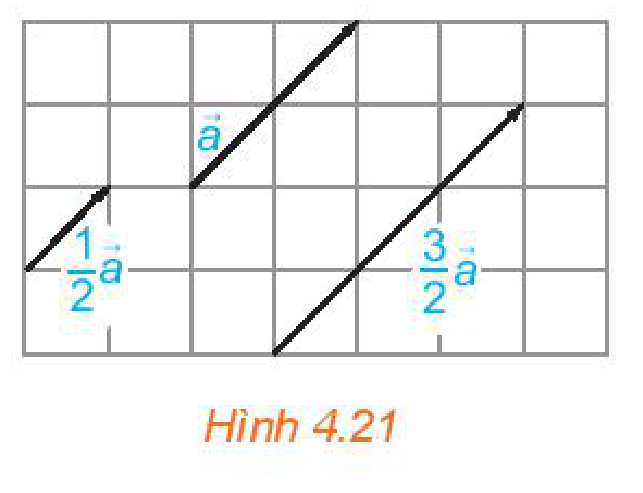
*Hình 4.21*

> ❓ $1\vec{a}$ và $\vec{a}$ có bằng nhau hay không?

<!-- pdf:57 -->

**HĐ2:** Trên một trục số, gọi $O, A, M, N$ tương ứng biểu diễn các số $0; 1; \sqrt{2}; -\sqrt{2}$. Hãy nêu mối quan hệ về hướng và độ dài của mỗi vectơ $\overrightarrow{OM}, \overrightarrow{ON}$ với vectơ $\vec{a} = \overrightarrow{OA}$. Viết đẳng thức thể hiện mối quan hệ giữa hai vectơ $\overrightarrow{OM}$ và $\overrightarrow{OA}$.

> Mối quan hệ giữa $\overrightarrow{ON}$ và $\overrightarrow{OA}$ được thể hiện bởi đẳng thức nào?

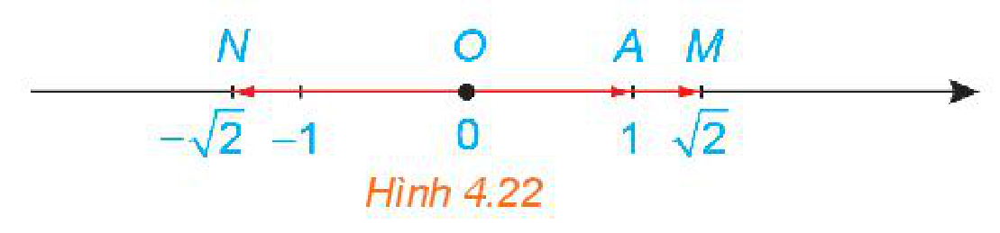
*Hình 4.22*

<!-- term: Tích của một vectơ với một số thực âm -->
> Tích của một vectơ $\vec{a} \neq \vec{0}$ với một số thực $k < 0$ là một vectơ, kí hiệu là $k\vec{a}$, ngược hướng với vectơ $\vec{a}$ và có độ dài bằng $(-k)|\vec{a}|$.

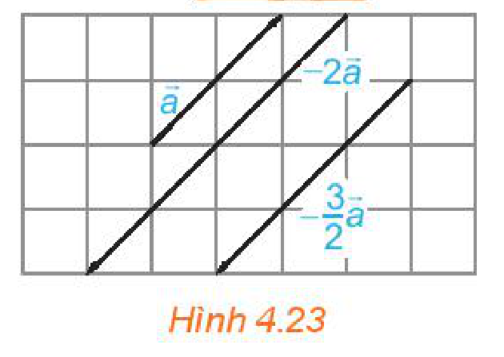
*Hình 4.23*

> **Chú ý:** Ta quy ước $k\vec{a} = \vec{0}$ nếu $\vec{a} = \vec{0}$ hoặc $k = 0$.

Trong Hình 4.24, hai trung tuyến $AM$ và $BN$ của tam giác $ABC$ cắt nhau tại $G$.

Ta có $\overrightarrow{GA} = -2\overrightarrow{GM}, \overrightarrow{MN} = -\frac{1}{2}\overrightarrow{AB}$.

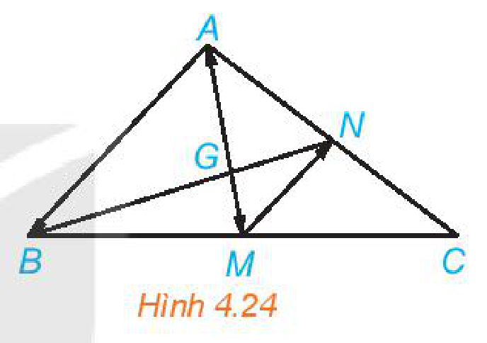
*Hình 4.24*

> **Nhận xét:** Vectơ $k\vec{a}$ có độ dài bằng $|k||\vec{a}|$ và cùng hướng với $\vec{a}$ nếu $k \ge 0$, ngược hướng với $\vec{a}$ nếu $\vec{a} \neq \vec{0}$ và $k < 0$.
<!-- ocr-ok: đã đối chiếu ảnh trang PDF 57 (nhiều công thức LaTeX) -->

> Phép lấy tích của vectơ với một số gọi là **phép nhân vectơ với một số** (hay **phép nhân một số với vectơ**).

> ❓ $-\vec{a}$ và $(-1)\vec{a}$ có mối quan hệ gì?

<!-- term: Điều kiện để hai vectơ cùng phương -->
**Ví dụ 1:** Chứng minh rằng hai vectơ $\vec{a}$ và $\vec{b}$ ($\vec{b} \neq \vec{0}$) cùng phương khi và chỉ khi tồn tại số $k$ để $\vec{a} = k\vec{b}$.

**Giải:**

Thật vậy, nếu $\vec{a} = k\vec{b}$ thì $\vec{a}$ và $\vec{b}$ cùng phương.

Ngược lại, giả sử $\vec{a}$ và $\vec{b}$ cùng phương, ta lấy $k = \frac{|\vec{a}|}{|\vec{b}|}$ nếu $\vec{a}$ và $\vec{b}$ cùng hướng và lấy $k = -\frac{|\vec{a}|}{|\vec{b}|}$ nếu $\vec{a}$ và $\vec{b}$ ngược hướng. Khi đó $\vec{a} = k\vec{b}$.

**Luyện tập 1:** Cho đường thẳng $d$ đi qua hai điểm phân biệt $A$ và $B$ (H.4.25). Những khẳng định nào sau đây là đúng?

a) Điểm $M$ thuộc đường thẳng $d$ khi và chỉ khi tồn tại số $t$ để $\overrightarrow{AM} = t\overrightarrow{AB}$.

b) Với điểm $M$ bất kì, ta luôn có $\overrightarrow{AM} = \frac{AM}{AB}\overrightarrow{AB}$.

c) Điểm $M$ thuộc tia đối của tia $AB$ khi và chỉ khi tồn tại số $t \le 0$ để $\overrightarrow{AM} = t\overrightarrow{AB}$.

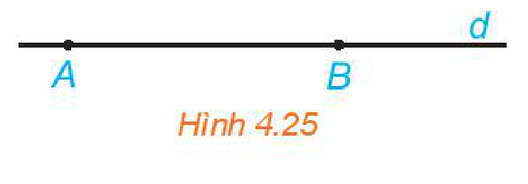
*Hình 4.25*

<!-- pdf:58 -->

## 2. CÁC TÍNH CHẤT CỦA PHÉP NHÂN VECTƠ VỚI MỘT SỐ
<!-- ocr-ok: đã đối chiếu ảnh trang PDF 58 -->

**HĐ3:** Với $\vec{u} \neq \vec{0}$ và hai số thực $k, t$, những khẳng định nào sau đây là đúng?

a) Hai vectơ $k(t\vec{u})$ và $(kt)\vec{u}$ có cùng độ dài bằng $|kt||\vec{u}|$.

b) Nếu $kt \ge 0$ thì cả hai vectơ $k(t\vec{u}), (kt)\vec{u}$ cùng hướng với $\vec{u}$.

c) Nếu $kt < 0$ thì cả hai vectơ $k(t\vec{u}), (kt)\vec{u}$ ngược hướng với $\vec{u}$.

d) Hai vectơ $k(t\vec{u})$ và $(kt)\vec{u}$ bằng nhau.
<!-- ocr-ok: đã đối chiếu ảnh trang PDF 58 (nhiều công thức LaTeX) -->

**HĐ4:** Hãy chỉ ra trên Hình 4.26 hai vectơ $3(\vec{u} + \vec{v})$ và $3\vec{u} + 3\vec{v}$.

Từ đó, nêu mối quan hệ giữa $3(\vec{u} + \vec{v})$ và $3\vec{u} + 3\vec{v}$.
<!-- ocr-ok: đã đối chiếu ảnh trang PDF 58 (nhiều công thức LaTeX) -->

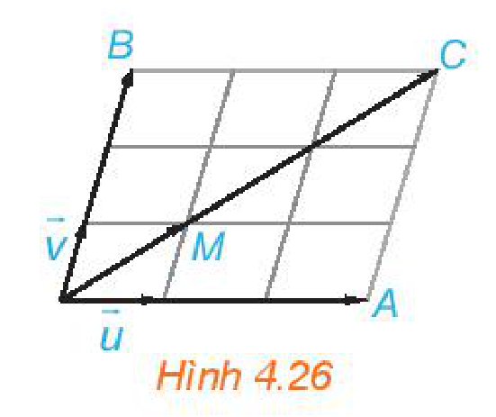
*Hình 4.26*

<!-- term: Tính chất của phép nhân vectơ với một số -->
> Với hai vectơ $\vec{a}, \vec{b}$ và hai số thực $k, t$, ta luôn có:
> - $k(t\vec{a}) = (kt)\vec{a}$;
> - $(k + t)\vec{a} = k\vec{a} + t\vec{a}$;
> - $k(\vec{a} + \vec{b}) = k\vec{a} + k\vec{b}$; $k(\vec{a} - \vec{b}) = k\vec{a} - k\vec{b}$;
> - $1\vec{a} = \vec{a}$; $(-1)\vec{a} = -\vec{a}$.

<!-- term: Hệ thức vectơ của trung điểm đoạn thẳng và trọng tâm tam giác với điểm bất kì -->
**Ví dụ 2:** Cho đoạn thẳng $AB$ có trung điểm $I$. Chứng minh rằng với điểm $O$ tuỳ ý, ta có

$$\overrightarrow{OA} + \overrightarrow{OB} = 2\overrightarrow{OI}.$$
<!-- ocr-ok: đã đối chiếu ảnh trang PDF 58 (công thức LaTeX) -->

**Giải:**

Vì $I$ là trung điểm của $AB$ nên $\overrightarrow{IA} + \overrightarrow{IB} = \vec{0}$ (Ví dụ 3a, Bài 8).

Do đó $\overrightarrow{OA} + \overrightarrow{OB} = (\overrightarrow{OI} + \overrightarrow{IA}) + (\overrightarrow{OI} + \overrightarrow{IB}) = 2\overrightarrow{OI} + (\overrightarrow{IA} + \overrightarrow{IB}) = 2\overrightarrow{OI}$.

**Luyện tập 2:** Cho tam giác $ABC$ có trọng tâm $G$. Chứng minh rằng với điểm $O$ tuỳ ý, ta có

$$\overrightarrow{OA} + \overrightarrow{OB} + \overrightarrow{OC} = 3\overrightarrow{OG}.$$
<!-- ocr-ok: đã đối chiếu ảnh trang PDF 58 -->

> **Nhận xét:**
> - Điểm $I$ là trung điểm của đoạn thẳng $AB$ khi và chỉ khi $\overrightarrow{IA} + \overrightarrow{IB} = \vec{0}$.
> - Điểm $G$ là trọng tâm của tam giác $ABC$ khi và chỉ khi $\overrightarrow{GA} + \overrightarrow{GB} + \overrightarrow{GC} = \vec{0}$.

**Luyện tập 3:** Trong Hình 4.27, hãy biểu thị mỗi vectơ $\vec{u}, \vec{v}$ theo hai vectơ $\vec{a}, \vec{b}$, tức là tìm các số $x, y, z, t$ để $\vec{u} = x\vec{a} + y\vec{b}$, $\vec{v} = t\vec{a} + z\vec{b}$.

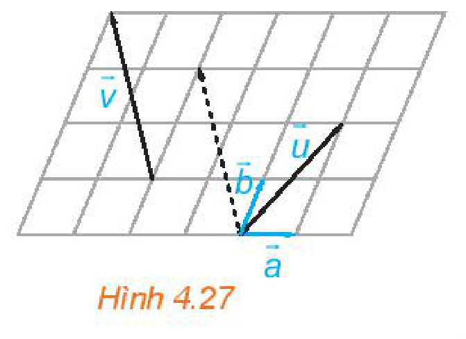
*Hình 4.27*

<!-- term: Biểu thị một vectơ theo hai vectơ không cùng phương -->
> **Chú ý:** Cho hai vectơ không cùng phương $\vec{a}, \vec{b}$ (H.4.28). Khi đó, mọi vectơ $\vec{u}$ đều biểu thị (phân tích) được một cách duy nhất theo hai vectơ $\vec{a}, \vec{b}$, nghĩa là có duy nhất cặp số $(x; y)$ sao cho $\vec{u} = x\vec{a} + y\vec{b}$.

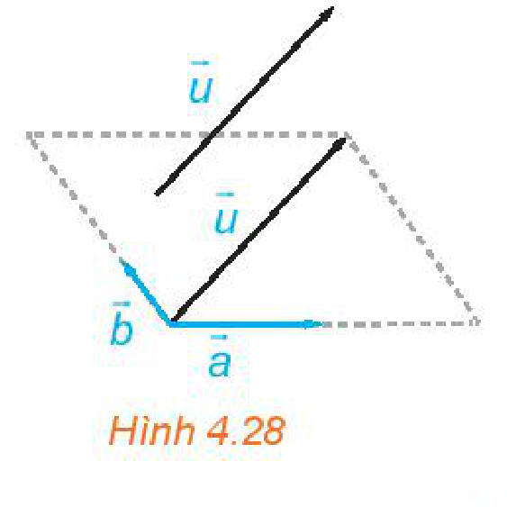
*Hình 4.28*

<!-- pdf:59 -->

**Ví dụ 3:** Cho tam giác $ABC$. Hãy xác định điểm $M$ để $\overrightarrow{MA} + 3\overrightarrow{MB} + 2\overrightarrow{MC} = \vec{0}$.

**Giải:** (H.4.29)

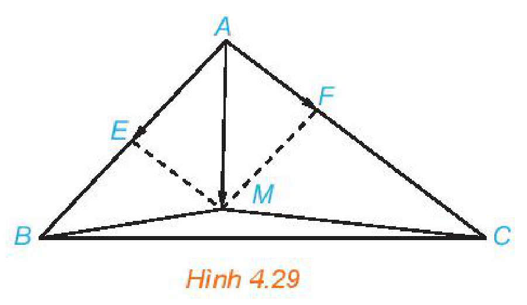
*Hình 4.29*

Để xác định vị trí của $M$, trước hết ta biểu thị $\overrightarrow{AM}$ (với gốc $A$ đã biết) theo hai vectơ đã biết $\overrightarrow{AB}, \overrightarrow{AC}$.

Đẳng thức vectơ đã cho tương đương với: $\overrightarrow{MA} + 3(\overrightarrow{MA} + \overrightarrow{AB}) + 2(\overrightarrow{MA} + \overrightarrow{AC}) = \vec{0}$

$$\Leftrightarrow 6\overrightarrow{MA} + 3\overrightarrow{AB} + 2\overrightarrow{AC} = \vec{0} \Leftrightarrow \overrightarrow{AM} = \frac{1}{2}\overrightarrow{AB} + \frac{1}{3}\overrightarrow{AC}.$$
<!-- ocr-ok: đã đối chiếu ảnh trang PDF 59 (công thức LaTeX) -->

Lấy điểm $E$ là trung điểm của $AB$ và điểm $F$ thuộc cạnh $AC$ sao cho $AF = \frac{1}{3}AC$.
<!-- ocr-ok: đã đối chiếu ảnh trang PDF 59 (nhiều công thức LaTeX) -->

Khi đó $\overrightarrow{AE} = \frac{1}{2}\overrightarrow{AB}$ và $\overrightarrow{AF} = \frac{1}{3}\overrightarrow{AC}$. Vì vậy $\overrightarrow{AM} = \overrightarrow{AE} + \overrightarrow{AF}$.
<!-- ocr-ok: đã đối chiếu ảnh trang PDF 59 (nhiều công thức LaTeX) -->

Suy ra $M$ là đỉnh thứ tư của hình bình hành $EAFM$.

Ta trở lại vấn đề đã được nêu trong phần đầu bài học. Điểm khối tâm $M$ của hệ các chất điểm $A_1, A_2, \dots, A_n$ với các khối lượng tương ứng $m_1, m_2, \dots, m_n$ được xác định bởi đẳng thức vectơ

$$m_1\overrightarrow{MA_1} + m_2\overrightarrow{MA_2} + \dots + m_n\overrightarrow{MA_n} = \vec{0}.$$
<!-- ocr-ok: đã đối chiếu ảnh trang PDF 59 (công thức LaTeX) -->

Vì vậy, việc xác định điểm khối tâm được quy về việc xác định điểm thoả mãn đẳng thức vectơ tương ứng.

## ✏️ Bài tập

**4.11.** Cho hình bình hành $ABCD$. Gọi $M$ là trung điểm của cạnh $BC$. Hãy biểu thị $\overrightarrow{AM}$ theo hai vectơ $\overrightarrow{AB}$ và $\overrightarrow{AD}$.
<!-- ocr-ok: đã đối chiếu ảnh trang PDF 59 -->

**4.12.** Cho tứ giác $ABCD$. Gọi $M, N$ tương ứng là trung điểm của các cạnh $AB, CD$. Chứng minh rằng $\overrightarrow{BC} + \overrightarrow{AD} = 2\overrightarrow{MN} = \overrightarrow{AC} + \overrightarrow{BD}$.

**4.13.** Cho hai điểm phân biệt $A$ và $B$.
<!-- ocr-ok: đã đối chiếu ảnh trang PDF 59 -->

a) Hãy xác định điểm $K$ sao cho $\overrightarrow{KA} + 2\overrightarrow{KB} = \vec{0}$.

b) Chứng minh rằng với mọi điểm $O$, ta có $\overrightarrow{OK} = \frac{1}{3}\overrightarrow{OA} + \frac{2}{3}\overrightarrow{OB}$.

**4.14.** Cho tam giác $ABC$.

a) Hãy xác định điểm $M$ để $\overrightarrow{MA} + \overrightarrow{MB} + 2\overrightarrow{MC} = \vec{0}$.

b) Chứng minh rằng với mọi điểm $O$, ta có $\overrightarrow{OA} + \overrightarrow{OB} + 2\overrightarrow{OC} = 4\overrightarrow{OM}$.

<!-- pdf:60 -->

**4.15.** Chất điểm $A$ chịu tác động của ba lực $\vec{F}_1, \vec{F}_2, \vec{F}_3$ như Hình 4.30 và ở trạng thái cân bằng (tức là $\vec{F}_1 + \vec{F}_2 + \vec{F}_3 = \vec{0}$). Tính độ lớn của các lực $\vec{F}_2, \vec{F}_3$, biết $\vec{F}_1$ có độ lớn là $20\text{ N}$.

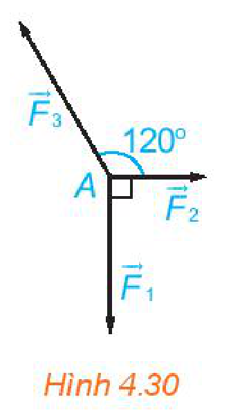
*Hình 4.30*

> **Em có biết?**
>
> Mặc dù dựa vào lực đẩy của gió, bằng cách đi theo đường dích dắc, thuyền buồm vẫn có thể di chuyển tới một vị trí ở ngược hướng gió so với vị trí xuất phát.
>
> Ta hãy dùng kiến thức về vectơ để phân tích các lực chính tác động tới sự chuyển động của thuyền buồm trong trường hợp này. Lực $\vec{F}$ do gió tác động vào cánh buồm được phân tích thành lực $\vec{p}$ cùng phương với cánh buồm và lực $\vec{q}$ vuông góc với cánh buồm. Do cánh buồm mỏng nên lực $\vec{p}$ chỉ trượt đi mà không tác động lên cánh buồm. Ta lại phân tích lực $\vec{q}$ thành lực $\vec{a}$ cùng phương với sống thuyền và lực $\vec{b}$ có phương vuông góc với sống thuyền. Thuyền buồm có sống thuyền sâu (mũi nhọn) nên nó chịu một lực cản $\vec{b}'$ đáng kể của nước, vuông góc với sống thuyền. Người ta điều chỉnh hướng thuyền (hướng sống thuyền), phương của cánh buồm để lực cản $\vec{b}'$ của nước (lực này không phụ thuộc vào sự điều chỉnh) thắng lực $\vec{b}$ (có thể điều chỉnh độ lớn). Cuối cùng, dưới tác động của lực $\vec{a}$ thuyền di chuyển và sau một khoảng thời gian, nó lại được điều chỉnh hướng, để đi đến đích theo đường dích dắc.

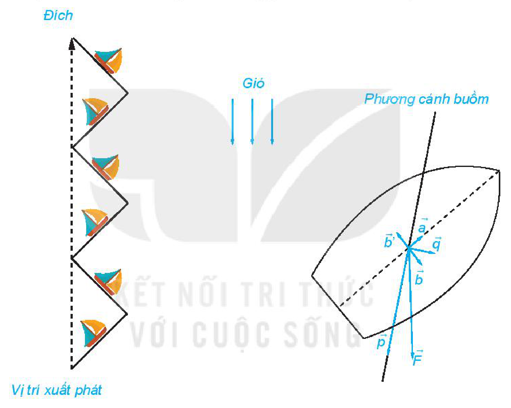
*Hình minh hoạ thuyền buồm*
<!-- ocr-ok: đã đối chiếu ảnh trang PDF 60 (hình không có chú thích in) -->

## 📷 Danh sách hình trong bài

| Mã hình | Trang PDF | Vị trí trong bài | Chú thích gốc |
| --- | --- | --- | --- |
| H10-toan-b09-01 | 56 | Mở đầu | Hình 4.20 |
| H10-toan-b09-02 | 56 | Mục 1 | Hình 4.21 |
| H10-toan-b09-03 | 57 | Mục 1, HĐ2 | Hình 4.22 |
| H10-toan-b09-04 | 57 | Mục 1 | Hình 4.23 |
| H10-toan-b09-05 | 57 | Mục 1, Chú ý | Hình 4.24 |
| H10-toan-b09-06 | 57 | Mục 1, Luyện tập 1 | Hình 4.25 |
| H10-toan-b09-07 | 58 | Mục 2, HĐ4 | Hình 4.26 |
| H10-toan-b09-08 | 58 | Mục 2, Luyện tập 3 | Hình 4.27 |
| H10-toan-b09-09 | 58 | Mục 2, Chú ý | Hình 4.28 |
| H10-toan-b09-10 | 59 | Mục 2, Ví dụ 3 | Hình 4.29 |
| H10-toan-b09-11 | 60 | Bài tập 4.15 | Hình 4.30 |
| H10-toan-b09-12 | 60 | Em có biết? | Hình minh hoạ thuyền buồm |
