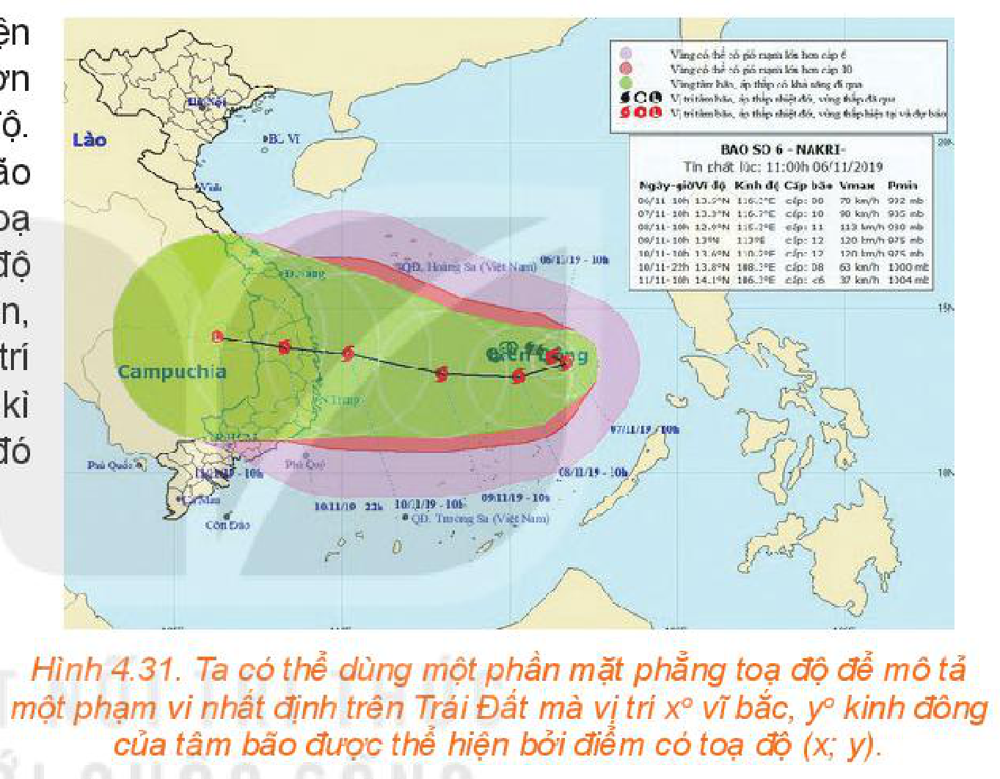
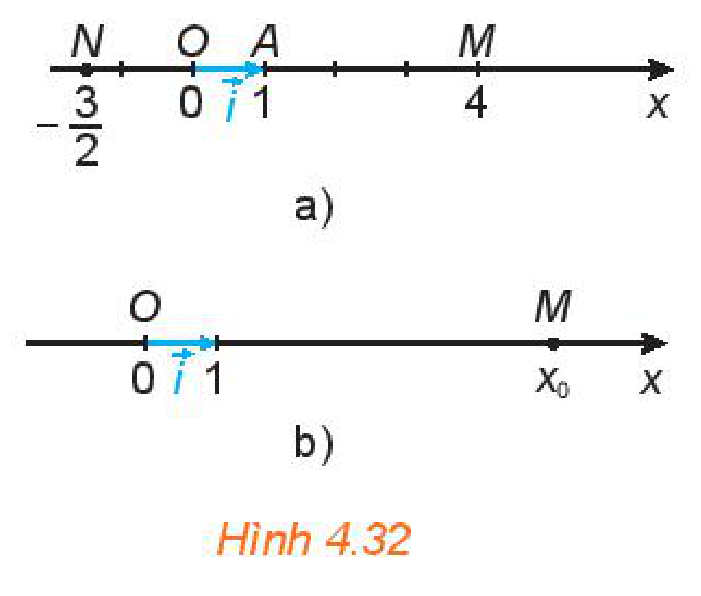
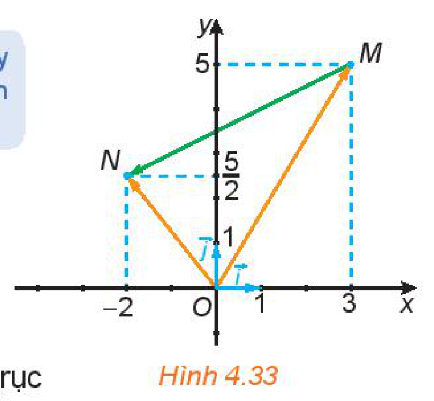
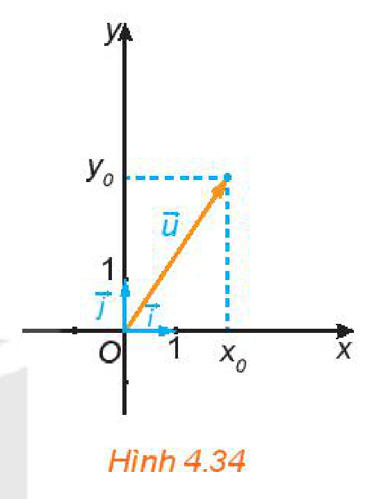
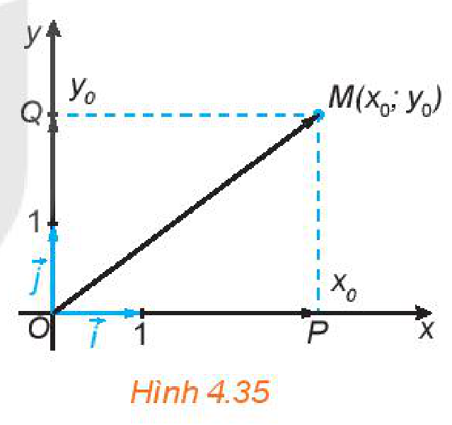
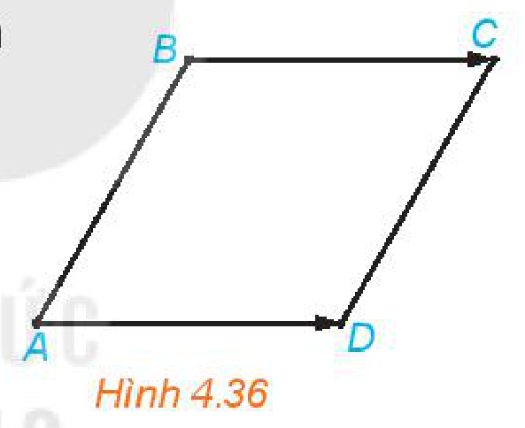
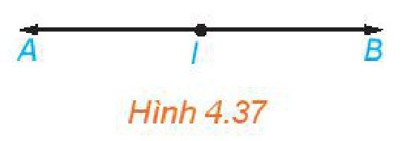
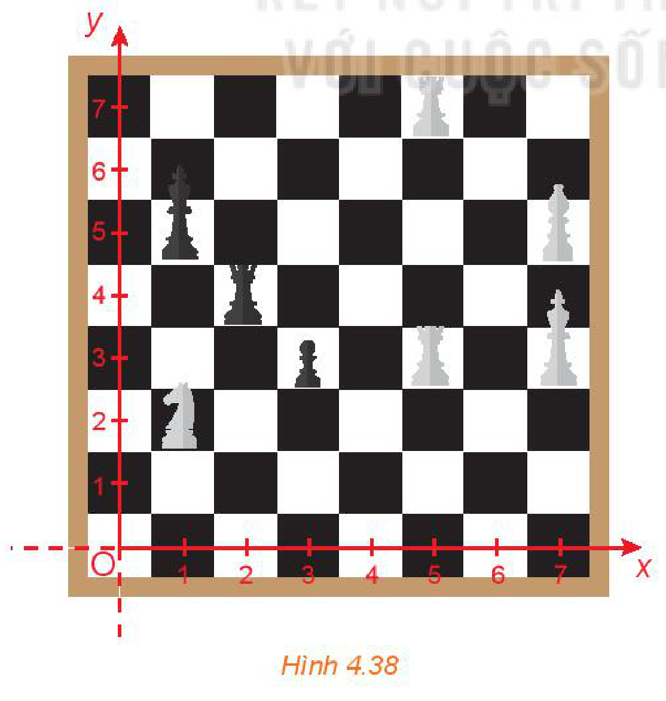

<!-- pdf:61 -->

# BÀI 10: VECTƠ TRONG MẶT PHẲNG TOẠ ĐỘ

## 🔤 Thuật ngữ

- Mặt phẳng toạ độ
- Toạ độ của vectơ

## 🎯 Mục tiêu

- Nhận biết toạ độ của vectơ và thể hiện các phép toán vectơ theo toạ độ.
- Thể hiện mối quan hệ giữa các vectơ thông qua toạ độ của chúng.
- Ứng dụng của toạ độ vectơ trong bài toán xác định vị trí của vật trên mặt phẳng toạ độ.

## 🔴 Mở đầu

Một bản tin dự báo thời tiết thể hiện đường đi trong $12$ giờ của một cơn bão trên một mặt phẳng toạ độ. Trong khoảng thời gian đó, tâm bão di chuyển thẳng đều từ vị trí có toạ độ $(13,8; 108,3)$ đến vị trí có toạ độ $(14,1; 106,3)$. Dựa vào thông tin trên, liệu ta có thể dự đoán được vị trí của tâm bão tại thời điểm bất kì trong khoảng thời gian $12$ giờ đó hay không?

*Hình 4.31. Ta có thể dùng một phần mặt phẳng toạ độ để mô tả một phạm vi nhất định trên Trái Đất mà vị trí $x^\circ$ vĩ bắc, $y^\circ$ kinh đông của tâm bão được thể hiện bởi điểm có toạ độ $(x; y)$.*

Trong bài học này, ta gắn cho mỗi vectơ trên mặt phẳng toạ độ một cặp số để có thể làm việc với vectơ thông qua cặp số đó.

## 1. TOẠ ĐỘ CỦA VECTƠ

**HĐ1:** Trên trục số $Ox$, gọi $A$ là điểm biểu diễn số $1$ và đặt $\overrightarrow{OA} = \vec{i}$ (H.4.32a). Gọi $M$ là điểm biểu diễn số $4$, $N$ là điểm biểu diễn số $-\frac{3}{2}$. Hãy biểu thị mỗi vectơ $\overrightarrow{OM}, \overrightarrow{ON}$ theo vectơ $\vec{i}$.

Dùng vectơ, ta có thể diễn đạt lại trục số như sau:

**Trục toạ độ** (còn gọi là *trục*, hay *trục số*) là một đường thẳng mà trên đó đã xác định một điểm $O$ và một vectơ $\vec{i}$ có độ dài bằng $1$. Điểm $O$ gọi là *gốc toạ độ*, vectơ $\vec{i}$ gọi là **vectơ đơn vị** của trục. Điểm $M$ trên trục biểu diễn số $x_0$ nếu $\overrightarrow{OM} = x_0\vec{i}$ (H.4.32b).

*Hình 4.32*

<!-- pdf:62 -->

**HĐ2:** Trong Hình 4.33:

a) Hãy biểu thị mỗi vectơ $\overrightarrow{OM}, \overrightarrow{ON}$ theo các vectơ $\vec{i}, \vec{j}$.

b) Hãy biểu thị vectơ $\overrightarrow{MN}$ theo các vectơ $\overrightarrow{OM}, \overrightarrow{ON}$, từ đó biểu thị vectơ $\overrightarrow{MN}$ theo các vectơ $\vec{i}, \vec{j}$.

> Hãy nhớ lại quy tắc hình bình hành và quy tắc hiệu.

*Hình 4.33*

Trên mặt phẳng với một đơn vị đo độ dài cho trước, xét hai trục $Ox, Oy$ có chung gốc $O$ và vuông góc với nhau. Kí hiệu vectơ đơn vị của trục $Ox$ là $\vec{i}$, vectơ đơn vị của trục $Oy$ là $\vec{j}$. Hệ gồm hai trục $Ox, Oy$ như vậy được gọi là **hệ trục toạ độ** $Oxy$. Điểm $O$ gọi là *gốc toạ độ*, trục $Ox$ gọi là *trục hoành*, trục $Oy$ gọi là *trục tung*. Mặt phẳng chứa hệ trục toạ độ $Oxy$ gọi là **mặt phẳng toạ độ** $Oxy$ hay mặt phẳng $Oxy$ (H.4.34).

*Hình 4.34*

> Với mỗi vectơ $\vec{u}$ trên mặt phẳng $Oxy$, có duy nhất cặp số $(x_0; y_0)$ sao cho $\vec{u} = x_0\vec{i} + y_0\vec{j}$. Ta nói vectơ $\vec{u}$ có **toạ độ** $(x_0; y_0)$ và viết $\vec{u} = (x_0; y_0)$ hay $\vec{u}(x_0; y_0)$. Các số $x_0, y_0$ tương ứng được gọi là **hoành độ**, **tung độ** của $\vec{u}$.

<!-- term: Điều kiện hai vectơ bằng nhau theo toạ độ -->
> **Nhận xét:** Hai vectơ bằng nhau khi và chỉ khi chúng có cùng toạ độ.
>
> $$\vec{u}(x; y) = \vec{v}(x'; y') \Leftrightarrow \begin{cases} x = x' \\ y = y'. \end{cases}$$

**Ví dụ 1:** Tìm toạ độ của các vectơ đơn vị $\vec{i}, \vec{j}$ tương ứng của các trục $Ox, Oy$.

**Giải:**

Vì $\vec{i} = 1\vec{i} + 0\vec{j}$ nên $\vec{i}$ có toạ độ là $(1; 0)$.

Vì $\vec{j} = 0\vec{i} + 1\vec{j}$ nên $\vec{j}$ có toạ độ là $(0; 1)$.

**Luyện tập 1:** Tìm toạ độ của $\vec{0}$.

## 2. BIỂU THỨC TOẠ ĐỘ CỦA CÁC PHÉP TOÁN VECTƠ

**HĐ3:** Trong mặt phẳng toạ độ $Oxy$, cho $\vec{u} = (2; -3), \vec{v} = (4; 1), \vec{a} = (8; -12)$.

a) Hãy biểu thị mỗi vectơ $\vec{u}, \vec{v}, \vec{a}$ theo các vectơ $\vec{i}, \vec{j}$.

b) Tìm toạ độ của các vectơ $\vec{u} + \vec{v}, 4\vec{u}$.

c) Tìm mối liên hệ giữa hai vectơ $\vec{u}, \vec{a}$.

<!-- term: Biểu thức toạ độ của các phép toán vectơ -->
> Cho hai vectơ $\vec{u} = (x; y)$ và $\vec{v} = (x'; y')$. Khi đó:
> - $\vec{u} + \vec{v} = (x + x'; y + y')$;
> - $\vec{u} - \vec{v} = (x - x'; y - y')$;
> - $k\vec{u} = (kx; ky)$, với $k \in \mathbb{R}$.
<!-- ocr-ok: đã đối chiếu ảnh trang PDF 62 (nhiều công thức LaTeX) -->

<!-- pdf:63 -->

**Ví dụ 2:** Cho $\vec{a} = (1; 2), \vec{b} = \left(\frac{3}{2}; 3\right)$.

a) Tìm toạ độ của $\vec{a} + \vec{b}, \vec{a} - 2\vec{b}$.

b) Hỏi $\vec{a}$ và $\vec{b}$ có cùng phương hay không?

**Giải:**

a) Vì $\vec{a} = (1; 2), \vec{b} = \left(\frac{3}{2}; 3\right)$ nên $\vec{a} + \vec{b} = \left(\frac{5}{2}; 5\right)$.

Ta có $2\vec{b} = (3; 6)$ nên $\vec{a} - 2\vec{b} = (-2; -4)$.

b) Do $\frac{3}{2}\vec{a} = \left(\frac{3}{2}; 3\right) = \vec{b}$ nên hai vectơ $\vec{a}$ và $\vec{b}$ cùng phương.
<!-- ocr-ok: đã đối chiếu ảnh trang PDF 63 (nhiều công thức LaTeX) -->

<!-- term: Điều kiện hai vectơ cùng phương theo toạ độ -->
> **Nhận xét:** Vectơ $\vec{v}(x'; y')$ cùng phương với vectơ $\vec{u}(x; y) \neq \vec{0}$ khi và chỉ khi tồn tại số $k$ sao cho $x' = kx, y' = ky$ (hay là $\frac{x'}{x} = \frac{y'}{y}$ nếu $xy \neq 0$).

**HĐ4:** Trong mặt phẳng toạ độ $Oxy$, cho điểm $M(x_0; y_0)$.

Gọi $P, Q$ tương ứng là hình chiếu vuông góc của $M$ trên trục hoành $Ox$ và trục tung $Oy$ (H.4.35).

a) Trên trục $Ox$, điểm $P$ biểu diễn số nào? Biểu thị $\overrightarrow{OP}$ theo $\vec{i}$ và tính độ dài của $\overrightarrow{OP}$ theo $x_0$.

b) Trên trục $Oy$, điểm $Q$ biểu diễn số nào? Biểu thị $\overrightarrow{OQ}$ theo $\vec{j}$ và tính độ dài của $\overrightarrow{OQ}$ theo $y_0$.

c) Dựa vào hình chữ nhật $OPMQ$, tính độ dài của $\overrightarrow{OM}$ theo $x_0, y_0$.

d) Biểu thị $\overrightarrow{OM}$ theo các vectơ $\vec{i}, \vec{j}$.

*Hình 4.35*

<!-- term: Liên hệ giữa toạ độ của điểm và toạ độ của vectơ trong mặt phẳng -->
> Nếu điểm $M$ có toạ độ $(x; y)$ thì vectơ $\overrightarrow{OM}$ có toạ độ $(x; y)$ và độ dài $|\overrightarrow{OM}| = \sqrt{x^2 + y^2}$.

<!-- term: Công thức tính độ dài của vectơ theo toạ độ -->
> **Nhận xét:** Với vectơ $\vec{u} = (x; y)$, ta lấy điểm $M(x; y)$ thì $\vec{u} = \overrightarrow{OM}$. Do đó, $|\vec{u}| = |\overrightarrow{OM}| = \sqrt{x^2 + y^2}$.
>
> Chẳng hạn, vectơ $\vec{u} = (2; -1)$ có độ dài là $|\vec{u}| = \sqrt{2^2 + (-1)^2} = \sqrt{5}$.
<!-- ocr-ok: đã đối chiếu ảnh trang PDF 63 (nhiều công thức LaTeX) -->

**HĐ5:** Trong mặt phẳng toạ độ $Oxy$, cho các điểm $M(x; y)$ và $N(x'; y')$.

a) Tìm toạ độ của các vectơ $\overrightarrow{OM}, \overrightarrow{ON}$.

b) Biểu thị vectơ $\overrightarrow{MN}$ theo các vectơ $\overrightarrow{OM}, \overrightarrow{ON}$ và tìm toạ độ của $\overrightarrow{MN}$.

c) Tìm độ dài của vectơ $\overrightarrow{MN}$.

<!-- pdf:64 -->

<!-- term: Toạ độ của vectơ và khoảng cách giữa hai điểm -->
> Với hai điểm $M(x; y)$ và $N(x'; y')$ thì $\overrightarrow{MN} = (x' - x; y' - y)$ và khoảng cách giữa hai điểm $M, N$ là $MN = |\overrightarrow{MN}| = \sqrt{(x' - x)^2 + (y' - y)^2}$.
<!-- ocr-ok: đã đối chiếu ảnh trang PDF 64 (nhiều công thức LaTeX) -->

**Ví dụ 3:** Trong mặt phẳng toạ độ $Oxy$, cho ba điểm $A(1; -2), B(3; 2), C(7; 4)$.

a) Tìm toạ độ của các vectơ $\overrightarrow{AB}, \overrightarrow{BC}$. So sánh các khoảng cách từ $B$ tới $A$ và $C$.

b) Ba điểm $A, B, C$ có thẳng hàng hay không?

c) Tìm điểm $D(x; y)$ để $ABCD$ là một hình thoi.

**Giải:**

a) Ta có $\overrightarrow{AB} = (3 - 1; 2 - (-2)) = (2; 4), \overrightarrow{BC} = (7 - 3; 4 - 2) = (4; 2)$.

Các khoảng cách từ $B$ tới $A$ và $C$ lần lượt là:
<!-- ocr-ok: đã đối chiếu ảnh trang PDF 64 -->

$$AB = |\overrightarrow{AB}| = \sqrt{2^2 + 4^2} = 2\sqrt{5}; \quad BC = |\overrightarrow{BC}| = \sqrt{4^2 + 2^2} = 2\sqrt{5}.$$
<!-- ocr-ok: đã đối chiếu ảnh trang PDF 64 (công thức LaTeX) -->

Do đó các khoảng cách này bằng nhau.

b) Hai vectơ $\overrightarrow{AB} = (2; 4), \overrightarrow{BC} = (4; 2)$ không cùng phương (vì $\frac{2}{4} \neq \frac{4}{2}$). Do đó các điểm $A, B, C$ không cùng nằm trên một đường thẳng. Vậy chúng không thẳng hàng.

c) Các điểm $A, B, C$ không thẳng hàng và $BA = BC$ nên $ABCD$ là một hình thoi khi và chỉ khi $\overrightarrow{AD} = \overrightarrow{BC}$.

Do $\overrightarrow{AD} = (x - 1; y + 2), \overrightarrow{BC} = (4; 2)$ nên

$$\overrightarrow{AD} = \overrightarrow{BC} \Leftrightarrow \begin{cases} x - 1 = 4 \\ y + 2 = 2 \end{cases} \Leftrightarrow \begin{cases} x = 5 \\ y = 0. \end{cases}$$
<!-- ocr-ok: đã đối chiếu ảnh trang PDF 64 (công thức LaTeX) -->

Vậy điểm cần tìm là $D(5; 0)$.

*Hình 4.36*

**Luyện tập 2:** Trong mặt phẳng toạ độ $Oxy$, cho hai điểm $A(2; 1), B(3; 3)$.

a) Các điểm $O, A, B$ có thẳng hàng hay không?

b) Tìm điểm $M(x; y)$ để $OABM$ là một hình bình hành.

**Ví dụ 4:** Trong mặt phẳng toạ độ $Oxy$, cho ba điểm không thẳng hàng:

$$A(1; 3), B(-2; 6), C(5; 1).$$
<!-- ocr-ok: đã đối chiếu ảnh trang PDF 64 (công thức LaTeX) -->

a) Tìm toạ độ trung điểm $I$ của đoạn thẳng $AB$.

b) Tìm toạ độ trọng tâm $G$ của tam giác $ABC$.

<!-- pdf:65 -->

**Giải:**

a) (H.4.37) Điểm $I(x; y)$ là trung điểm của đoạn thẳng $AB$ khi và chỉ khi $\overrightarrow{IA} + \overrightarrow{IB} = \vec{0}$ $(*)$.

*Hình 4.37*

Mặt khác $\overrightarrow{IA} = (1 - x; 3 - y), \overrightarrow{IB} = (-2 - x; 6 - y), \overrightarrow{IA} + \overrightarrow{IB} = (-1 - 2x; 9 - 2y)$.

Do đó, $(*)$ tương đương với $\begin{cases} -1 - 2x = 0 \\ 9 - 2y = 0 \end{cases} \Leftrightarrow \begin{cases} x = -\frac{1}{2} \\ y = \frac{9}{2}. \end{cases}$

Vậy $I\left(-\frac{1}{2}; \frac{9}{2}\right)$.

b) Điểm $G(x; y)$ là trọng tâm của tam giác $ABC$ khi và chỉ khi $\overrightarrow{GA} + \overrightarrow{GB} + \overrightarrow{GC} = \vec{0}$ $(**)$.

Mặt khác

$$\overrightarrow{GA} = (1 - x; 3 - y), \overrightarrow{GB} = (-2 - x; 6 - y), \overrightarrow{GC} = (5 - x; 1 - y),$$

$$\overrightarrow{GA} + \overrightarrow{GB} + \overrightarrow{GC} = (4 - 3x; 10 - 3y).$$
<!-- ocr-ok: đã đối chiếu ảnh trang PDF 65 (công thức LaTeX) -->

Do đó, $(**)$ tương đương với $\begin{cases} 4 - 3x = 0 \\ 10 - 3y = 0 \end{cases} \Leftrightarrow \begin{cases} x = \frac{4}{3} \\ y = \frac{10}{3}. \end{cases}$

Vậy $G\left(\frac{4}{3}; \frac{10}{3}\right)$.

<!-- term: Toạ độ trung điểm của đoạn thẳng và trọng tâm của tam giác -->
> **Chú ý:**
> - Trung điểm $M$ của đoạn thẳng $AB$ có toạ độ là $\left(\frac{x_A + x_B}{2}; \frac{y_A + y_B}{2}\right)$.
> - Trọng tâm $G$ của tam giác $ABC$ có toạ độ là $\left(\frac{x_A + x_B + x_C}{3}; \frac{y_A + y_B + y_C}{3}\right)$.

**Vận dụng:** Từ thông tin dự báo bão được đưa ra ở đầu bài học, hãy xác định toạ độ vị trí $M$ của tâm bão tại thời điểm $9$ giờ trong khoảng thời gian $12$ giờ của dự báo.

> Trong $12$ giờ, tâm bão được dự báo di chuyển thẳng đều từ $A(13,8; 108,3)$ tới $B(14,1; 106,3)$. Gọi toạ độ của $M$ là $(x; y)$. Bạn hãy tìm mối liên hệ giữa hai vectơ $\overrightarrow{AM}$ và $\overrightarrow{AB}$ rồi thể hiện mối quan hệ đó theo toạ độ để tìm $x; y$.
<!-- ocr-ok: đã đối chiếu ảnh trang PDF 65 (bóng thoại nhân vật) -->

> **Chú ý:** Để thể hiện một phần Trái Đất trên một bản đồ phẳng người ta dùng một phép chiếu bản đồ, với độ sai khác nhất định giữa bản vẽ và thực địa (thường được quy định với từng loại bản đồ). Về nguyên tắc, phạm vi thể hiện càng hẹp thì càng chính xác. Trong vận dụng này, ta chỉ tính toán trong phạm vi một đoạn đường đi ngắn của tâm bão.

<!-- pdf:66 -->

## ✏️ Bài tập

**4.16.** Trong mặt phẳng toạ độ $Oxy$, cho các điểm $M(1; 3), N(4; 2)$.

a) Tính độ dài của các đoạn thẳng $OM, ON, MN$.

b) Chứng minh rằng tam giác $OMN$ vuông cân.

**4.17.** Trong mặt phẳng toạ độ $Oxy$, cho các vectơ $\vec{a} = 3\vec{i} - 2\vec{j}, \vec{b} = (4; -1)$ và các điểm $M(-3; 6), N(3; -3)$.

a) Tìm mối liên hệ giữa các vectơ $\overrightarrow{MN}$ và $2\vec{a} - \vec{b}$.
<!-- ocr-ok: đã đối chiếu ảnh trang PDF 66 (nhiều công thức LaTeX) -->

b) Các điểm $O, M, N$ có thẳng hàng hay không?

c) Tìm điểm $P(x; y)$ để $OMNP$ là một hình bình hành.

**4.18.** Trong mặt phẳng toạ độ $Oxy$, cho các điểm $A(1; 3), B(2; 4), C(-3; 2)$.

a) Chứng minh rằng $A, B, C$ là ba đỉnh của một tam giác.

b) Tìm toạ độ trung điểm $M$ của đoạn thẳng $AB$.

c) Tìm toạ độ trọng tâm $G$ của tam giác $ABC$.

d) Tìm điểm $D(x; y)$ để $O(0; 0)$ là trọng tâm của tam giác $ABD$.

**4.19.** Sự chuyển động của một tàu thuỷ được thể hiện trên một mặt phẳng toạ độ như sau: Tàu khởi hành từ vị trí $A(1; 2)$ chuyển động thẳng đều với vận tốc (tính theo giờ) được biểu thị bởi vectơ $\vec{v} = (3; 4)$. Xác định vị trí của tàu (trên mặt phẳng toạ độ) tại thời điểm sau khi khởi hành $1,5$ giờ.

**4.20.** Trong Hình 4.38, quân mã đang ở vị trí có toạ độ $(1; 2)$. Hỏi sau một nước đi, quân mã có thể đến những vị trí nào?

> Bạn có thể tìm hiểu để biết quy tắc đi của quân mã.

*Hình 4.38*

## 📷 Danh sách hình trong bài

| Mã hình | Trang PDF | Vị trí trong bài | Chú thích gốc |
| --- | --- | --- | --- |
| H10-toan-b10-01 | 61 | Mở đầu | Hình 4.31. Ta có thể dùng một phần mặt phẳng toạ độ để mô tả một phạm vi nhất định trên Trái Đất mà vị trí $x^\circ$ vĩ bắc, $y^\circ$ kinh đông của tâm bão được thể hiện bởi điểm có toạ độ $(x; y)$. |
| H10-toan-b10-02 | 61 | Mục 1, HĐ1 | Hình 4.32 |
| H10-toan-b10-03 | 62 | Mục 1, HĐ2 | Hình 4.33 |
| H10-toan-b10-04 | 62 | Mục 1 | Hình 4.34 |
| H10-toan-b10-05 | 63 | Mục 2, HĐ4 | Hình 4.35 |
| H10-toan-b10-06 | 64 | Mục 2, Ví dụ 3 | Hình 4.36 |
| H10-toan-b10-07 | 65 | Mục 2, Ví dụ 4 | Hình 4.37 |
| H10-toan-b10-08 | 66 | Bài tập 4.20 | Hình 4.38 |
