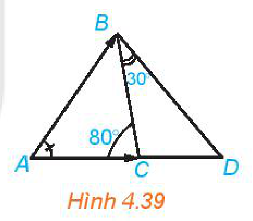
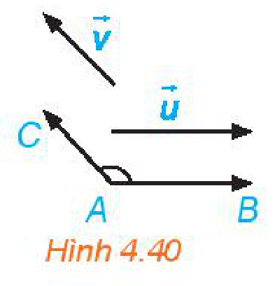
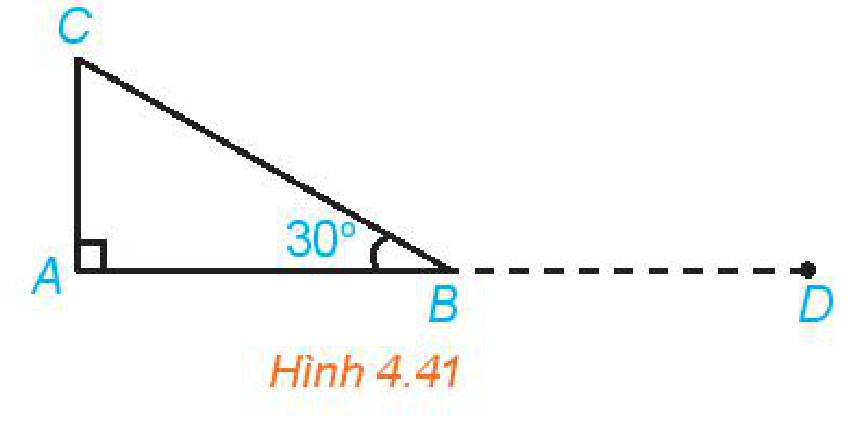
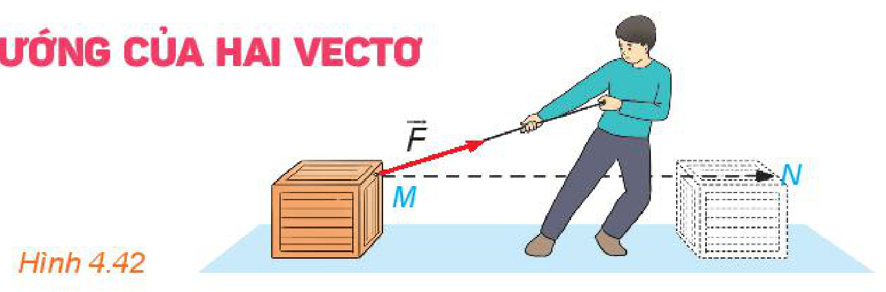
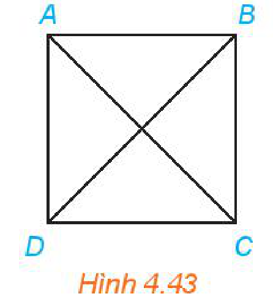
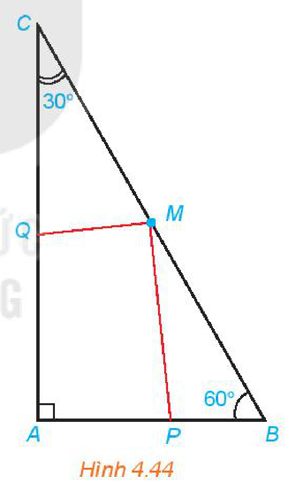
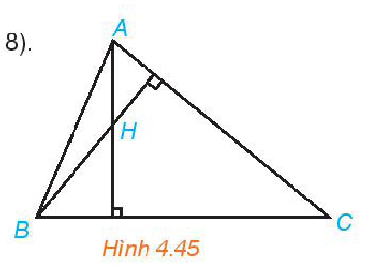
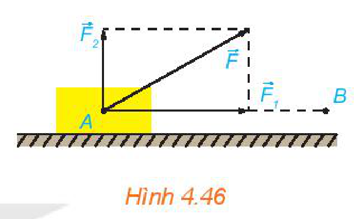

<!-- pdf:67 -->

# BÀI 11: TÍCH VÔ HƯỚNG CỦA HAI VECTƠ

## 🔤 Thuật ngữ

- Góc giữa hai vectơ
- Tích vô hướng của hai vectơ

## 🎯 Mục tiêu

- Tính góc, tích vô hướng của hai vectơ trong những trường hợp cụ thể.
- Công thức toạ độ của tích vô hướng, tính chất của tích vô hướng.
- Liên hệ khái niệm tích vô hướng với khái niệm công trong Vật lí.

## 🔴 Mở đầu

Toán học cung cấp ngôn ngữ và công cụ cho nhiều ngành khoa học. Trong các bài học trước, ta đã dùng vectơ để biểu diễn các đại lượng lực, vận tốc và dùng phép toán vectơ để tính hợp lực và tổng hợp vận tốc. Bài học này tiếp tục xây dựng khái niệm tích vô hướng giữa hai vectơ – đối tượng toán học còn được dùng để định nghĩa khái niệm công sinh bởi một lực trong Vật lí.

## 1. GÓC GIỮA HAI VECTƠ

**HĐ1:** Trong Hình 4.39, số đo góc $BAC$ cũng được gọi là số đo góc giữa hai vectơ $\overrightarrow{AB}$ và $\overrightarrow{AC}$. Hãy tìm số đo các góc giữa $\overrightarrow{BC}$ và $\overrightarrow{BD}$, $\overrightarrow{DA}$ và $\overrightarrow{DB}$.

*Hình 4.39*

> Cho hai vectơ $\vec{u}$ và $\vec{v}$ khác $\vec{0}$. Từ một điểm $A$ tuỳ ý, vẽ các vectơ $\overrightarrow{AB} = \vec{u}$ và $\overrightarrow{AC} = \vec{v}$ (H.4.40). Khi đó, số đo của góc $BAC$ được gọi là số đo góc giữa hai vectơ $\vec{u}$ và $\vec{v}$ hay đơn giản là **góc giữa hai vectơ** $\vec{u}, \vec{v}$, kí hiệu là $(\vec{u}, \vec{v})$.

*Hình 4.40*

<!-- term: Hai vectơ vuông góc -->
> **Chú ý:**
> - Quy ước rằng góc giữa hai vectơ $\vec{u}$ và $\vec{0}$ có thể nhận một giá trị tuỳ ý từ $0^\circ$ đến $180^\circ$.
> - Nếu $(\vec{u}, \vec{v}) = 90^\circ$ thì ta nói rằng $\vec{u}$ và $\vec{v}$ vuông góc với nhau, kí hiệu là $\vec{u} \perp \vec{v}$ hoặc $\vec{v} \perp \vec{u}$. Đặc biệt, $\vec{0}$ được coi là vuông góc với mọi vectơ.

> ❓ Khi nào thì góc giữa hai vectơ bằng $0^\circ$, bằng $180^\circ$?

**Ví dụ 1:** Cho tam giác $ABC$ vuông tại $A$ và $\widehat{B} = 30^\circ$.

Tính $(\overrightarrow{AB}, \overrightarrow{AC}), (\overrightarrow{CA}, \overrightarrow{CB}), (\overrightarrow{AB}, \overrightarrow{BC})$.

*Hình 4.41*

**Giải:** (H.4.41)

Ta có: $(\overrightarrow{AB}, \overrightarrow{AC}) = \widehat{BAC} = 90^\circ$, $(\overrightarrow{CA}, \overrightarrow{CB}) = \widehat{ACB} = 60^\circ$, $(\overrightarrow{AB}, \overrightarrow{BC}) = (\overrightarrow{BD}, \overrightarrow{BC}) = \widehat{DBC} = 150^\circ$.

**Luyện tập 1:** Cho tam giác đều $ABC$. Tính $(\overrightarrow{AB}, \overrightarrow{BC})$.

<!-- pdf:68 -->

## 2. TÍCH VÔ HƯỚNG CỦA HAI VECTƠ

*Hình 4.42*

Trong Vật lí, nếu lực $\vec{F}$ không đổi tác động vào một vật và điểm đặt của lực chuyển động thẳng từ $M$ tới $N$, thì công $A$ của lực $\vec{F}$ được tính theo công thức: $A = |\vec{F}| \cdot |\overrightarrow{MN}| \cdot \cos(\vec{F}, \overrightarrow{MN})$,

trong đó $|\vec{F}|$ là độ lớn của lực $\vec{F}$ (theo đơn vị Newton);

$|\overrightarrow{MN}|$ là độ dài của vectơ $\overrightarrow{MN}$ (theo đơn vị mét);

$(\vec{F}, \overrightarrow{MN})$ là góc giữa hai vectơ $\vec{F}$ và $\overrightarrow{MN}$.

Toán học gọi giá trị $A$ (không kể đơn vị đo) trong biểu thức nói trên là tích vô hướng của hai vectơ $\vec{F}$ và $\overrightarrow{MN}$.

> **Tích vô hướng** của hai vectơ khác vectơ-không $\vec{u}$ và $\vec{v}$ là một số, kí hiệu là $\vec{u} \cdot \vec{v}$, được xác định bởi công thức sau:
>
> $$\vec{u} \cdot \vec{v} = |\vec{u}| \cdot |\vec{v}| \cdot \cos(\vec{u}, \vec{v}).$$
<!-- ocr-ok: đã đối chiếu ảnh trang PDF 68 (công thức LaTeX) -->

> ❓ Khi nào thì tích vô hướng của hai vectơ khác vectơ-không $\vec{u}, \vec{v}$ là một số dương? Là một số âm?

<!-- term: Điều kiện hai vectơ vuông góc theo tích vô hướng -->
> **Chú ý:**
> - $\vec{u} \perp \vec{v} \Leftrightarrow \vec{u} \cdot \vec{v} = 0$.
> - $\vec{u} \cdot \vec{u}$ còn được viết là $\vec{u}^2$ và được gọi là **bình phương vô hướng** của vectơ $\vec{u}$. Ta có $\vec{u}^2 = |\vec{u}| \cdot |\vec{u}| \cdot \cos 0^\circ = |\vec{u}|^2$.
<!-- ocr-ok: đã đối chiếu ảnh trang PDF 68 (nhiều công thức LaTeX) -->

> Bình phương vô hướng của một vectơ bằng bình phương độ dài của vectơ đó.

> ❓ Khi nào thì $(\vec{u} \cdot \vec{v})^2 = \vec{u}^2 \cdot \vec{v}^2$?

**Ví dụ 2:** Cho hình vuông $ABCD$ có cạnh bằng $a$.

Tính các tích vô hướng sau: $\overrightarrow{AB} \cdot \overrightarrow{AD}$, $\overrightarrow{AB} \cdot \overrightarrow{AC}$, $\overrightarrow{AB} \cdot \overrightarrow{BD}$.

*Hình 4.43*

**Giải:** Vì $(\overrightarrow{AB}, \overrightarrow{AD}) = 90^\circ$ nên $\overrightarrow{AB} \cdot \overrightarrow{AD} = 0$.

Hình vuông có cạnh bằng $a$ nên có đường chéo bằng $a\sqrt{2}$.

Mặt khác, $(\overrightarrow{AB}, \overrightarrow{AC}) = 45^\circ$, $(\overrightarrow{AB}, \overrightarrow{BD}) = 135^\circ$, do đó

$$\overrightarrow{AB} \cdot \overrightarrow{AC} = AB \cdot AC \cdot \cos 45^\circ = a \cdot a\sqrt{2} \cdot \frac{\sqrt{2}}{2} = a^2;$$
<!-- ocr-ok: đã đối chiếu ảnh trang PDF 68 (công thức LaTeX) -->

$$\overrightarrow{AB} \cdot \overrightarrow{BD} = AB \cdot BD \cdot \cos 135^\circ = a \cdot a\sqrt{2} \cdot \left(-\frac{\sqrt{2}}{2}\right) = -a^2.$$
<!-- ocr-ok: đã đối chiếu ảnh trang PDF 68 (công thức LaTeX) -->

**Luyện tập 2:** Cho tam giác $ABC$ có $BC = a, CA = b, AB = c$.

Hãy tính $\overrightarrow{AB} \cdot \overrightarrow{AC}$ theo $a, b, c$.

> Hãy nhớ lại định lí côsin.
<!-- ocr-ok: đã đối chiếu ảnh trang PDF 68 (bóng thoại nhân vật) -->

<!-- pdf:69 -->

## 3. BIỂU THỨC TOẠ ĐỘ VÀ TÍNH CHẤT CỦA TÍCH VÔ HƯỚNG

**HĐ2:** Cho hai vectơ cùng phương $\vec{u} = (x; y)$ và $\vec{v} = (kx; ky)$. Hãy kiểm tra công thức $\vec{u} \cdot \vec{v} = k(x^2 + y^2)$ theo từng trường hợp sau:
<!-- ocr-ok: đã đối chiếu ảnh trang PDF 69 (nhiều công thức LaTeX) -->

a) $\vec{u} = \vec{0}$;

b) $\vec{u} \neq \vec{0}$ và $k \ge 0$;

c) $\vec{u} \neq \vec{0}$ và $k < 0$.

**HĐ3:** Trong mặt phẳng toạ độ $Oxy$, cho hai vectơ không cùng phương $\vec{u} = (x; y)$ và $\vec{v} = (x'; y')$.

a) Xác định toạ độ của các điểm $A$ và $B$ sao cho $\overrightarrow{OA} = \vec{u}, \overrightarrow{OB} = \vec{v}$.

b) Tính $AB^2, OA^2, OB^2$ theo toạ độ của $A$ và $B$.

c) Tính $\overrightarrow{OA} \cdot \overrightarrow{OB}$ theo toạ độ của $A, B$.

> Để ý rằng, theo định lí côsin, ta có:
>
> $$\overrightarrow{OA} \cdot \overrightarrow{OB} = \frac{OA^2 + OB^2 - AB^2}{2}.$$
<!-- ocr-ok: đã đối chiếu ảnh trang PDF 69 (bóng thoại nhân vật) -->

<!-- term: Biểu thức toạ độ của tích vô hướng -->
> Tích vô hướng của hai vectơ $\vec{u} = (x; y)$ và $\vec{v} = (x'; y')$ được tính theo công thức:
>
> $$\vec{u} \cdot \vec{v} = xx' + yy'.$$
<!-- ocr-ok: đã đối chiếu ảnh trang PDF 69 (công thức LaTeX) -->

<!-- term: Điều kiện hai vectơ vuông góc và công thức côsin góc giữa hai vectơ theo toạ độ -->
> **Nhận xét:**
> - Hai vectơ $\vec{u}$ và $\vec{v}$ vuông góc với nhau khi và chỉ khi $xx' + yy' = 0$.
> - Bình phương vô hướng của $\vec{u}(x; y)$ là $\vec{u}^2 = x^2 + y^2$.
> - Nếu $\vec{u} \neq \vec{0}$ và $\vec{v} \neq \vec{0}$ thì $\cos(\vec{u}, \vec{v}) = \frac{\vec{u} \cdot \vec{v}}{|\vec{u}| \cdot |\vec{v}|} = \frac{xx' + yy'}{\sqrt{x^2 + y^2} \cdot \sqrt{x'^2 + y'^2}}$.
<!-- ocr-ok: đã đối chiếu ảnh trang PDF 69 (nhiều công thức LaTeX) -->

**Ví dụ 3:** Trong mặt phẳng toạ độ $Oxy$, tính tích vô hướng của các cặp vectơ sau:

a) $\vec{u} = (2; -3)$ và $\vec{v} = (5; 3)$;

b) Hai vectơ đơn vị $\vec{i}$ và $\vec{j}$ tương ứng của các trục $Ox, Oy$.

**Giải:**

a) Ta có: $\vec{u} \cdot \vec{v} = 2 \cdot 5 + (-3) \cdot 3 = 10 - 9 = 1$.

b) Vì $\vec{i} = (1; 0)$ và $\vec{j} = (0; 1)$ nên $\vec{i} \cdot \vec{j} = 1 \cdot 0 + 0 \cdot 1 = 0$.

**Luyện tập 3:** Tính tích vô hướng và góc giữa hai vectơ $\vec{u} = (0; -5), \vec{v} = (\sqrt{3}; 1)$.

**HĐ4:** Cho ba vectơ $\vec{u} = (x_1; y_1), \vec{v} = (x_2; y_2), \vec{w} = (x_3; y_3)$.

a) Tính $\vec{u} \cdot (\vec{v} + \vec{w}), \vec{u} \cdot \vec{v} + \vec{u} \cdot \vec{w}$ theo toạ độ của các vectơ $\vec{u}, \vec{v}, \vec{w}$.

b) So sánh $\vec{u} \cdot (\vec{v} + \vec{w})$ và $\vec{u} \cdot \vec{v} + \vec{u} \cdot \vec{w}$.

c) So sánh $\vec{u} \cdot \vec{v}$ và $\vec{v} \cdot \vec{u}$.

<!-- pdf:70 -->

> **Tính chất của tích vô hướng**
>
> Với ba vectơ $\vec{u}, \vec{v}, \vec{w}$ bất kì và mọi số thực $k$, ta có:
> - $\vec{u} \cdot \vec{v} = \vec{v} \cdot \vec{u}$ (tính chất giao hoán);
> - $\vec{u} \cdot (\vec{v} + \vec{w}) = \vec{u} \cdot \vec{v} + \vec{u} \cdot \vec{w}$ (tính chất phân phối đối với phép cộng);
> - $(k\vec{u}) \cdot \vec{v} = k(\vec{u} \cdot \vec{v}) = \vec{u} \cdot (k\vec{v})$.

<!-- term: Các hằng đẳng thức của tích vô hướng -->
> **Chú ý:** Từ các tính chất trên, ta có thể chứng minh được:
> - $\vec{u} \cdot (\vec{v} - \vec{w}) = \vec{u} \cdot \vec{v} - \vec{u} \cdot \vec{w}$ (tính chất phân phối đối với phép trừ);
> - $(\vec{u} + \vec{v})^2 = \vec{u}^2 + 2\vec{u} \cdot \vec{v} + \vec{v}^2$; $(\vec{u} - \vec{v})^2 = \vec{u}^2 - 2\vec{u} \cdot \vec{v} + \vec{v}^2$;
> - $(\vec{u} + \vec{v}) \cdot (\vec{u} - \vec{v}) = \vec{u}^2 - \vec{v}^2$.

**Ví dụ 4:** Cho tam giác $ABC$ vuông tại $A$ có $\widehat{B} = 60^\circ$. Gọi $M$ là trung điểm của cạnh $BC$. Trên các cạnh $AB, AC$ lần lượt lấy các điểm $P, Q$. Chứng minh rằng $\widehat{PMQ} = 90^\circ$ khi và chỉ khi $BP + \sqrt{3}CQ = BC$.

*Hình 4.44*

**Giải:** (H.4.44)

Đặt $MB = MC = a$.

Ta có $\widehat{PMQ} = 90^\circ \Leftrightarrow \overrightarrow{MP} \cdot \overrightarrow{MQ} = 0$

$$\Leftrightarrow (\overrightarrow{MB} + \overrightarrow{BP}) \cdot (\overrightarrow{MC} + \overrightarrow{CQ}) = 0$$
<!-- ocr-ok: đã đối chiếu ảnh trang PDF 70 (công thức LaTeX) -->

$$\Leftrightarrow \overrightarrow{MB} \cdot \overrightarrow{MC} + \overrightarrow{MB} \cdot \overrightarrow{CQ} + \overrightarrow{BP} \cdot \overrightarrow{MC} + \overrightarrow{BP} \cdot \overrightarrow{CQ} = 0. \quad (1)$$
<!-- ocr-ok: đã đối chiếu ảnh trang PDF 70 (công thức LaTeX) -->

Mặt khác,

$$\overrightarrow{MB} \cdot \overrightarrow{MC} = MB \cdot MC \cdot \cos 180^\circ = -a^2;$$
<!-- ocr-ok: đã đối chiếu ảnh trang PDF 70 (công thức LaTeX) -->

$$\overrightarrow{MB} \cdot \overrightarrow{CQ} = MB \cdot CQ \cdot \cos 30^\circ = \frac{\sqrt{3}}{2}a \cdot CQ;$$
<!-- ocr-ok: đã đối chiếu ảnh trang PDF 70 (công thức LaTeX) -->

$$\overrightarrow{BP} \cdot \overrightarrow{MC} = BP \cdot MC \cdot \cos 60^\circ = \frac{1}{2}a \cdot BP;$$
<!-- ocr-ok: đã đối chiếu ảnh trang PDF 70 (công thức LaTeX) -->

$$\overrightarrow{BP} \cdot \overrightarrow{CQ} = BP \cdot CQ \cdot \cos 90^\circ = 0.$$
<!-- ocr-ok: đã đối chiếu ảnh trang PDF 70 (công thức LaTeX) -->

Do đó

$$(1) \Leftrightarrow -a^2 + \frac{\sqrt{3}}{2}a \cdot CQ + \frac{1}{2}a \cdot BP = 0$$
<!-- ocr-ok: đã đối chiếu ảnh trang PDF 70 (công thức LaTeX) -->

$$\Leftrightarrow \frac{\sqrt{3}}{2}CQ + \frac{1}{2}BP - a = 0$$
<!-- ocr-ok: đã đối chiếu ảnh trang PDF 70 (công thức LaTeX) -->

$$\Leftrightarrow \sqrt{3}CQ + BP = 2a$$
<!-- ocr-ok: đã đối chiếu ảnh trang PDF 70 (công thức LaTeX) -->

$$\Leftrightarrow \sqrt{3}CQ + BP = BC.$$
<!-- ocr-ok: đã đối chiếu ảnh trang PDF 70 (công thức LaTeX) -->

Ta có điều phải chứng minh.

<!-- pdf:71 -->

**Luyện tập 4:** Cho tam giác $ABC$ với $A(-1; 2), B(8; -1), C(8; 8)$. Gọi $H$ là trực tâm của tam giác.

a) Chứng minh rằng $\overrightarrow{AH} \cdot \overrightarrow{BC} = 0$ và $\overrightarrow{BH} \cdot \overrightarrow{CA} = 0$.

b) Tìm toạ độ của $H$.

c) Giải tam giác $ABC$.

*Hình 4.45*

**Vận dụng:** Một lực $\vec{F}$ không đổi tác động vào một vật và điểm đặt của lực chuyển động thẳng từ $A$ đến $B$. Lực $\vec{F}$ được phân tích thành hai lực thành phần là $\vec{F}_1$ và $\vec{F}_2$ ($\vec{F} = \vec{F}_1 + \vec{F}_2$).

a) Dựa vào tính chất của tích vô hướng, hãy giải thích vì sao công sinh bởi lực $\vec{F}$ (đã được đề cập ở trên) bằng tổng của các công sinh bởi các lực $\vec{F}_1$ và $\vec{F}_2$.

b) Giả sử các lực thành phần $\vec{F}_1, \vec{F}_2$ tương ứng cùng phương, vuông góc với phương chuyển động của vật. Hãy tìm mối quan hệ giữa các công sinh bởi lực $\vec{F}$ và lực $\vec{F}_1$.

*Hình 4.46*

## ✏️ Bài tập

**4.21.** Trong mặt phẳng toạ độ $Oxy$, hãy tính góc giữa hai vectơ $\vec{a}$ và $\vec{b}$ trong mỗi trường hợp sau:

a) $\vec{a} = (-3; 1), \vec{b} = (2; 6)$;

b) $\vec{a} = (3; 1), \vec{b} = (2; 4)$;

c) $\vec{a} = (-\sqrt{2}; 1), \vec{b} = (2; -\sqrt{2})$.

**4.22.** Tìm điều kiện của $\vec{u}, \vec{v}$ để:
<!-- ocr-ok: đã đối chiếu ảnh trang PDF 71 -->

a) $\vec{u} \cdot \vec{v} = |\vec{u}| \cdot |\vec{v}|$;

b) $\vec{u} \cdot \vec{v} = -|\vec{u}| \cdot |\vec{v}|$.

**4.23.** Trong mặt phẳng toạ độ $Oxy$, cho hai điểm $A(1; 2), B(-4; 3)$. Gọi $M(t; 0)$ là một điểm thuộc trục hoành.

a) Tính $\overrightarrow{AM} \cdot \overrightarrow{BM}$ theo $t$.

b) Tìm $t$ để $\widehat{AMB} = 90^\circ$.

**4.24.** Trong mặt phẳng toạ độ $Oxy$, cho ba điểm không thẳng hàng $A(-4; 1), B(2; 4), C(2; -2)$.

a) Giải tam giác $ABC$.

b) Tìm toạ độ trực tâm $H$ của tam giác $ABC$.

**4.25.** Chứng minh rằng với mọi tam giác $ABC$,

$$S_{ABC} = \frac{1}{2}\sqrt{\overrightarrow{AB}^2 \cdot \overrightarrow{AC}^2 - (\overrightarrow{AB} \cdot \overrightarrow{AC})^2}.$$
<!-- ocr-ok: đã đối chiếu ảnh trang PDF 71 (công thức LaTeX) -->

**4.26.** Cho tam giác $ABC$ có trọng tâm $G$. Chứng minh rằng với mọi điểm $M$,

$$MA^2 + MB^2 + MC^2 = 3MG^2 + GA^2 + GB^2 + GC^2.$$
<!-- ocr-ok: đã đối chiếu ảnh trang PDF 71 (công thức LaTeX) -->

## 📷 Danh sách hình trong bài

| Mã hình | Trang PDF | Vị trí trong bài | Chú thích gốc |
| --- | --- | --- | --- |
| H10-toan-b11-01 | 67 | Mục 1, HĐ1 | Hình 4.39 |
| H10-toan-b11-02 | 67 | Mục 1 | Hình 4.40 |
| H10-toan-b11-03 | 67 | Mục 1, Ví dụ 1 | Hình 4.41 |
| H10-toan-b11-04 | 68 | Mục 2 | Hình 4.42 |
| H10-toan-b11-05 | 68 | Mục 2, Ví dụ 2 | Hình 4.43 |
| H10-toan-b11-06 | 70 | Mục 3, Ví dụ 4 | Hình 4.44 |
| H10-toan-b11-07 | 71 | Mục 3, Luyện tập 4 | Hình 4.45 |
| H10-toan-b11-08 | 71 | Mục 3, Vận dụng | Hình 4.46 |
