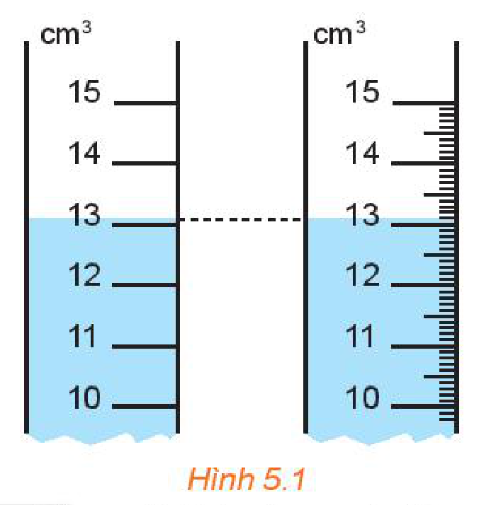
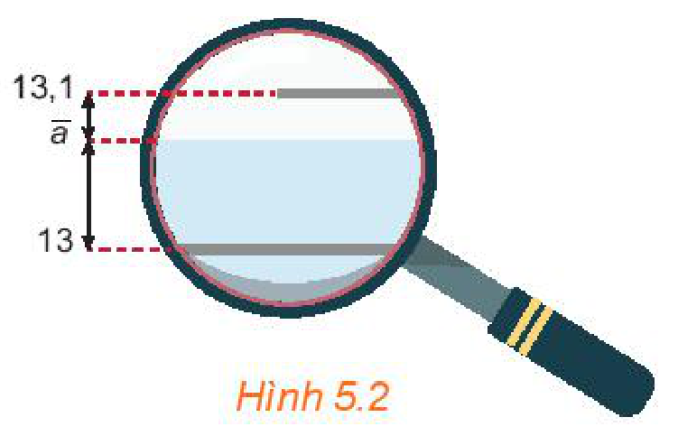
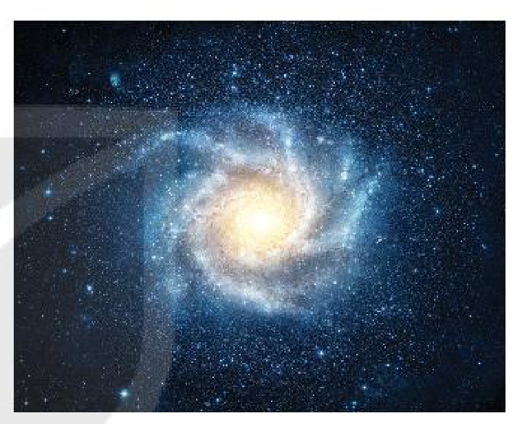

<!-- pdf:74 -->

<!-- Phần giới thiệu Chương V (in chung đầu trang PDF 74): CHƯƠNG V. CÁC SỐ ĐẶC TRƯNG CỦA MẪU SỐ LIỆU KHÔNG GHÉP NHÓM -->

“Thống kê là cơ sở của khoa học”.
Karl Pearson (nhà thống kê người Anh, 1857 – 1936)

# BÀI 12: SỐ GẦN ĐÚNG VÀ SAI SỐ

## 🔤 Thuật ngữ

- Số gần đúng
- Sai số tuyệt đối
- Độ chính xác
- Sai số tương đối
- Số quy tròn

## 🎯 Kiến thức, kĩ năng

- Hiểu khái niệm số gần đúng, sai số tuyệt đối.
- Xác định số gần đúng của một số với độ chính xác cho trước.
- Xác định sai số tương đối của số gần đúng.
- Xác định số quy tròn của số gần đúng với độ chính xác cho trước.
- Biết sử dụng máy tính cầm tay để tính toán với các số gần đúng.

## 🔴 Mở đầu

Đỉnh Everest được mệnh danh là “nóc nhà của thế giới”, bởi đây là đỉnh núi cao nhất trên Trái Đất so với mực nước biển. Có rất nhiều con số khác nhau đã từng được công bố về chiều cao của đỉnh Everest:

$8\,848\text{ m}; \ 8\,848,13\text{ m}; \ 8\,844,43\text{ m}; \ 8\,850\text{ m}; \dots$

Vì sao lại có nhiều kết quả khác nhau như vậy và đâu là con số chính xác? Chúng ta sẽ cùng tìm câu trả lời trong bài học này, sau khi tìm hiểu về số gần đúng và sai số.


*Đỉnh Everest*

<!-- pdf:75 -->

## 1. SỐ GẦN ĐÚNG

**HĐ1:** Ngày 8-12-2020, Trung Quốc và Nepal ra thông cáo chung khẳng định chiều cao mới đo được của đỉnh núi cao nhất thế giới Everest là $8\,848,86\text{ m}$.

*(Theo Tuoitre.vn)*

Trong các số được đưa ra ở tình huống mở đầu, số nào gần nhất với số được công bố ở trên?

**HĐ2:** Trang và Hoà thực hiện đo thể tích một cốc nước bằng hai ống đong có vạch chia được kết quả như Hình 5.1. Hãy cho biết số đo thể tích trên mỗi ống.


*Hình 5.1*

> Trong nhiều trường hợp, ta không biết hoặc khó biết **số đúng** (kí hiệu là $\bar{a}$) mà chỉ tìm được giá trị khác xấp xỉ nó. Giá trị này được gọi là **số gần đúng**, kí hiệu là $a$.

Chẳng hạn, các số đo khác nhau về chiều cao của đỉnh Everest trong tình huống mở đầu đều là các số gần đúng.

**Câu hỏi:** Hãy lấy một ví dụ khác về số gần đúng.
<!-- ocr-ok: đã đối chiếu ảnh trang PDF 75, OCR đọc sai biểu tượng câu hỏi và chữ lấy -->

**Ví dụ 1:** Gọi $d$ là độ dài đường chéo của hình vuông cạnh bằng $1$. Trong hai số $\sqrt{2}$ và $1,41$, số nào là số đúng, số nào là số gần đúng của $d$?

**Giải:**

Hình vuông có cạnh bằng $1$ có độ dài của đường chéo là $d = 1 \cdot \sqrt{2} = \sqrt{2}$. Vậy $\sqrt{2}$ là số đúng; $1,41$ là số gần đúng của $d$.

**Luyện tập 1:** Gọi $P$ là chu vi của đường tròn bán kính $1\text{ cm}$. Hãy tìm một giá trị gần đúng của $P$.

**Chú ý:** Ta có thể sử dụng máy tính cầm tay để tìm giá trị gần đúng của các biểu thức chứa các số vô tỉ như $\pi, \sqrt{a}, \sqrt[3]{a}, \dots$ Chẳng hạn, dùng máy tính cầm tay để tính $2^9 \cdot \sqrt{3}$, bấm các phím như sau:

```text
[2] [x^■] [9] [▶] [×] [√■] [3] [SHIFT] [MODE] [6] [3] [=]
```

Kết quả nhận được có ba chữ số thập phân sau dấu phẩy là $886,810$.

## 2. SAI SỐ TUYỆT ĐỐI VÀ SAI SỐ TƯƠNG ĐỐI

**a) Sai số tuyệt đối**

**HĐ3:** Trong HĐ2, Hoà dùng kính lúp để quan sát mực nước trên ống đo thứ hai được hình ảnh như Hình 5.2. Kí hiệu $\bar{a}$ ($\text{cm}^3$) là số đo thể tích của nước.

Quan sát hình vẽ để so sánh $|13 - \bar{a}|$ và $|13,1 - \bar{a}|$ rồi cho biết trong hai số đo thể tích $13\text{ cm}^3$ và $13,1\text{ cm}^3$, số đo nào gần với thể tích của cốc nước hơn.


*Hình 5.2*

<!-- pdf:76 -->

> Giá trị $\Delta_a = |a - \bar{a}|$ phản ánh mức độ sai lệch giữa số đúng $\bar{a}$ và số gần đúng $a$, được gọi là **sai số tuyệt đối** của số gần đúng $a$.

**Chú ý:**

- Trên thực tế, nhiều khi ta không biết $\bar{a}$ nên cũng không biết $\Delta_a$. Tuy nhiên, ta có thể đánh giá được $\Delta_a$ không vượt quá một số dương $d$ nào đó.
  Chẳng hạn, trong HĐ3, ta thấy $|13,1 - \bar{a}| < |13,1 - 13| = 0,1\ (\text{cm}^3)$.
  Vậy với $a = 13,1\ (\text{cm}^3)$, sai số tuyệt đối của $a$ không vượt quá $0,1\text{ cm}^3$.
- Nếu $\Delta_a \le d$ thì $a - d \le \bar{a} \le a + d$, khi đó ta viết $\bar{a} = a \pm d$ và hiểu là số đúng $\bar{a}$ nằm trong đoạn $[a - d; a + d]$. Do $d$ càng nhỏ thì $a$ càng gần $\bar{a}$ nên $d$ được gọi là **độ chính xác của số gần đúng**.

**Ví dụ 2:** Một công ty sử dụng dây chuyền A để đóng gạo vào bao với khối lượng mong muốn là $5\text{ kg}$. Trên bao bì ghi thông tin khối lượng là $5 \pm 0,2\text{ kg}$. Gọi $\bar{a}$ là khối lượng thực của một bao gạo do dây chuyền A đóng gói.

a) Xác định số đúng, số gần đúng và độ chính xác.

b) Giá trị của $\bar{a}$ nằm trong đoạn nào?


**Giải:**

a) Khối lượng thực của bao gạo $\bar{a}$ là số đúng. Tuy không biết $\bar{a}$ nhưng ta xem khối lượng bao gạo là $5\text{ kg}$ nên $5$ là số gần đúng cho $\bar{a}$. Độ chính xác là $d = 0,2\ (\text{kg})$.

b) Giá trị của $\bar{a}$ nằm trong đoạn $[5 - 0,2; 5 + 0,2]$ hay $[4,8; 5,2]$.

**Luyện tập 2:** Một phép đo đường kính nhân tế bào cho kết quả là $5 \pm 0,3\ \mu\text{m}$. Đường kính thực của nhân tế bào thuộc đoạn nào?

**Chú ý:** Trong các phép đo, độ chính xác $d$ của số gần đúng bằng một nửa đơn vị của thước đo. Chẳng hạn, một thước đo có chia vạch đến xentimét thì mọi giá trị đo nằm giữa $6,5\text{ cm}$ và $7,5\text{ cm}$ đều được coi là $7\text{ cm}$. Vì vậy, thước đo có thang đo càng nhỏ thì cho giá trị đo càng chính xác.

**b) Sai số tương đối**

**HĐ4:** Công ty (trong Ví dụ 2) cũng sử dụng dây chuyền B để đóng gạo với khối lượng chính xác là $20\text{ kg}$. Trên bao bì ghi thông tin khối lượng là $20 \pm 0,5\text{ kg}$.

Khẳng định “Dây chuyền A tốt hơn dây chuyền B” là đúng hay sai?

Mặc dù độ chính xác của khối lượng bao gạo đóng bằng dây chuyền A nhỏ hơn nhưng do bao gạo đóng bằng dây chuyền B nặng hơn nhiều nên ta không dựa vào sai số tuyệt đối mà dựa vào **sai số tương đối** để so sánh.

<!-- pdf:77 -->

> **Sai số tương đối** của số gần đúng $a$, kí hiệu là $\delta_a$, là tỉ số giữa sai số tuyệt đối và $|a|$, tức là $\delta_a = \frac{\Delta_a}{|a|}$.

**Nhận xét:** Nếu $\bar{a} = a \pm d$ thì $\Delta_a \le d$, do đó $\delta_a \le \frac{d}{|a|}$. Nếu $\frac{d}{|a|}$ càng nhỏ thì chất lượng của phép đo hay tính toán càng cao. Người ta thường viết sai số tương đối dưới dạng phần trăm.

**Ví dụ 3:** Trong một cuộc điều tra dân số, người ta viết dân số của một tỉnh là:

$3\,574\,625\text{ người} \pm 50\,000\text{ người}.$

Hãy đánh giá sai số tương đối của số gần đúng này.

**Giải:**

Ta có $a = 3\,574\,625$ người và $d = 50\,000$ người, do đó sai số tương đối là:

$\delta_a \le \frac{d}{|a|} = \frac{50\,000}{3\,574\,625} \approx 1,4\%.$

**Luyện tập 3:** Đánh giá sai số tương đối của khối lượng bao gạo được đóng gói theo hai dây chuyền A, B ở Ví dụ 2 và HĐ4. Dựa trên tiêu chí này, dây chuyền nào tốt hơn?

## 3. QUY TRÒN SỐ GẦN ĐÚNG

Trong thực tế đo đạc và tính toán, nhiều khi ta chỉ cần biết giá trị gần đúng của một đại lượng với độ chính xác nào đó (kể cả khi biết được giá trị đúng của nó). Khi đó, để cho gọn, các số thường được làm tròn (còn gọi là quy tròn).

> Số thu được sau khi thực hiện làm tròn số được gọi là **số quy tròn**. Số quy tròn là một số gần đúng của số ban đầu.

<!-- term: Quy tắc làm tròn số -->
> - Đối với chữ số hàng làm tròn:
>   - Giữ nguyên nếu chữ số ngay bên phải nó nhỏ hơn $5$;
>   - Tăng $1$ đơn vị nếu chữ số ngay bên phải nó lớn hơn hoặc bằng $5$.
> - Đối với chữ số sau hàng làm tròn:
>   - Bỏ đi nếu ở phần thập phân;
>   - Thay bởi các chữ số $0$ nếu ở phần số nguyên.

**Ví dụ 4:**

a) Làm tròn số $2\,359,3$ đến hàng chục, số $18,693$ đến hàng phần trăm và số đúng $d \in [5,5; 6,5)$ đến hàng đơn vị. Đánh giá sai số tuyệt đối của phép làm tròn số đúng $d$.

b) Cho số gần đúng $a = 2,53$ với độ chính xác $d = 0,01$. Số đúng $\bar{a}$ thuộc đoạn nào? Nếu làm tròn số $a$ thì nên làm tròn đến hàng nào? Vì sao?

**Giải:**

a) Số quy tròn của số $2\,359,3$ đến hàng chục là $2\,360$; số quy tròn của số $18,693$ đến hàng phần trăm là $18,69$. Mọi số đúng $d \in [5,5; 6,5)$ khi làm tròn đến hàng đơn vị đều thu được số quy tròn là $6$ và sai số tuyệt đối $|d - 6| \le 0,5$.

b) Số đúng $\bar{a}$ thuộc đoạn $[2,53 - 0,01; 2,53 + 0,01]$ hay $[2,52; 2,54]$. Khi làm tròn số gần đúng $a$ ta nên làm tròn đến hàng phần chục do chữ số hàng phần trăm của $a$ là chữ số không chắc chắn đúng.

<!-- pdf:78 -->

<!-- term: Quy tắc quy tròn số gần đúng theo độ chính xác -->
**Nhận xét:**
- Khi thay số đúng bởi số quy tròn đến một hàng nào đó thì sai số tuyệt đối của số quy tròn không vượt quá nửa đơn vị của hàng làm tròn.
- Cho số gần đúng $a$ với độ chính xác $d$. Khi được yêu cầu làm tròn số $a$ mà không nói rõ làm tròn đến hàng nào thì ta làm tròn số $a$ đến hàng thấp nhất mà $d$ nhỏ hơn $1$ đơn vị của hàng đó.

**Ví dụ 5:** Cho số gần đúng $a = 581\,268$ với độ chính xác $d = 200$. Hãy viết số quy tròn của số $a$.

**Giải:**

Vì độ chính xác đến hàng trăm ($d = 200$) nên ta làm tròn $a$ đến hàng nghìn theo quy tắc làm tròn ở trên. Số quy tròn của $a$ là $581\,000$.

**Luyện tập 4:** Hãy viết số quy tròn của số gần đúng trong những trường hợp sau:

a) $11\,251\,900 \pm 300$;

b) $18,2857 \pm 0,01$.

**Vận dụng:** Các nhà vật lí sử dụng hai phương pháp khác nhau để đo tuổi của vũ trụ (đơn vị tỉ năm) lần lượt cho hai kết quả là: $13,807 \pm 0,026$ và $13,799 \pm 0,021$.

Hãy đánh giá sai số tương đối của mỗi phương pháp. Căn cứ trên tiêu chí này, phương pháp nào cho kết quả chính xác hơn?



## ✏️ Bài tập

**5.1.** Trong các số sau, những số nào là số gần đúng?

a) Cân một túi gạo cho kết quả là $10,2\text{ kg}$.

b) Bán kính Trái Đất là $6\,371\text{ km}$.
<!-- ocr-ok: đã đối chiếu ảnh trang PDF 78, OCR đọc sai Đất thành Đắt -->

c) Trái Đất quay một vòng quanh Mặt Trời mất $365$ ngày.
<!-- ocr-ok: đã đối chiếu ảnh trang PDF 78, OCR đọc sai Đất/mất/365 -->

**5.2.** Giải thích kết quả “Đo độ cao của một ngọn núi cho kết quả là $1\,235 \pm 5\text{ m}$” và thực hiện làm tròn số gần đúng.

**5.3.** Sử dụng máy tính cầm tay tìm số gần đúng cho $\sqrt[3]{7}$ với độ chính xác $0,0005$.

**5.4.** Các nhà vật lí sử dụng ba phương pháp đo hằng số Hubble lần lượt cho kết quả như sau:

$67,31 \pm 0,96$; $\quad 67,90 \pm 0,55$; $\quad 67,74 \pm 0,46$.

Phương pháp nào chính xác nhất tính theo sai số tương đối?

**5.5.** An và Bình cùng tính chu vi của hình tròn bán kính $2\text{ cm}$ với hai kết quả như sau:

Kết quả của An: $S_1 = 2\pi R \approx 2 \cdot 3,14 \cdot 2 = 12,56\text{ cm}$;

Kết quả của Bình: $S_2 = 2\pi R \approx 2 \cdot 3,1 \cdot 2 = 12,4\text{ cm}$.

Hỏi:

a) Hai giá trị tính được có phải là các số gần đúng không?

b) Giá trị nào chính xác hơn?

**5.6.** Làm tròn số $8\,316,4$ đến hàng chục và $9,754$ đến hàng phần trăm rồi tính sai số tuyệt đối của số quy tròn.

## 📷 Danh sách hình trong bài

| Mã hình | Trang PDF | Vị trí trong bài | Chú thích gốc |
| --- | --- | --- | --- |
| H10-toan-b12-01 | 74 | Mở đầu | Đỉnh Everest |
| H10-toan-b12-02 | 75 | Mục 1, HĐ2 | Hình 5.1 |
| H10-toan-b12-03 | 75 | Mục 2.a, HĐ3 | Hình 5.2 |
| H10-toan-b12-04 | 76 | Mục 2.a, Ví dụ 2 | (sách không đánh số, ảnh bao gạo Bắc Thơm TL: $5 \pm 0,2\text{ kg}$) |
| H10-toan-b12-05 | 78 | Mục 3, Vận dụng | (sách không đánh số, ảnh minh hoạ thiên hà) |
