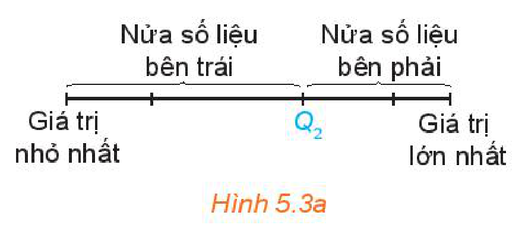
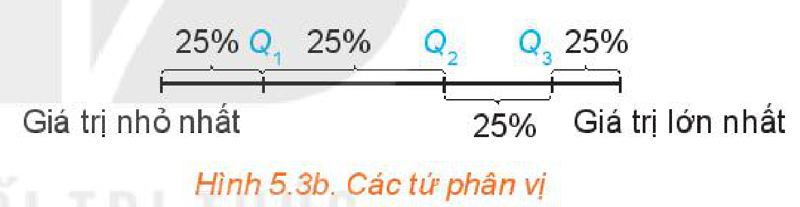
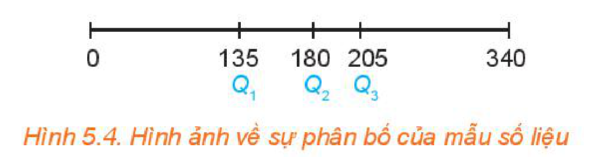
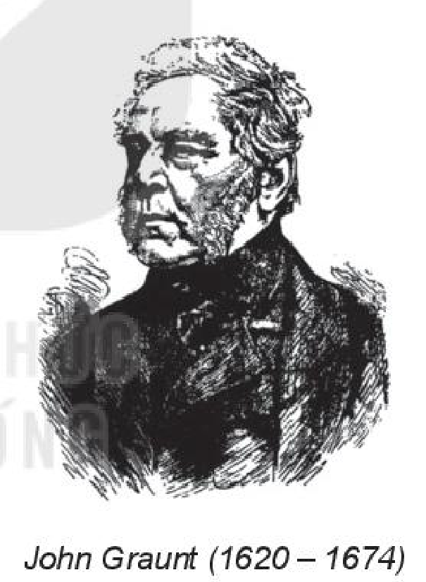

<!-- pdf:79 -->

# BÀI 13: CÁC SỐ ĐẶC TRƯNG ĐO XU THẾ TRUNG TÂM

## 🔤 Thuật ngữ

- Số trung bình
- Trung vị
- Tứ phân vị
- Mốt

## 🎯 Kiến thức, kĩ năng

- Lựa chọn và tính các số đặc trưng đo xu thế trung tâm của một mẫu số liệu: số trung bình, trung vị, tứ phân vị, mốt.
- Giải thích ý nghĩa, vai trò của các số đặc trưng trong mẫu số liệu thực tiễn.
- Rút ra kết luận từ ý nghĩa của các số đặc trưng đo xu thế trung tâm.

## 🔴 Mở đầu

Hai phương pháp học tiếng Anh khác nhau được áp dụng cho hai lớp A và B có trình độ tiếng Anh tương đương nhau. Sau hai tháng, điểm khảo sát tiếng Anh (thang điểm $10$) của hai lớp được cho như hình bên.
<!-- ocr-ok: đã đối chiếu ảnh trang PDF 79, OCR đọc lẫn cột chữ và bảng số liệu bên phải -->

| $2$ | $7$ | $6$ | $3$ | $9$ |
| :---: | :---: | :---: | :---: | :---: |
| $8$ | $6$ | $7$ | $9$ | $2$ |
| $5$ | $7$ | $5$ | $9$ | $8$ |
| $8$ | $7$ | $4$ | $3$ | $5$ |
| $5$ | $4$ | $5$ | $7$ | $7$ |

*Lớp A*

| $6$ | $7$ | $6$ | $4$ | $7$ |
| :---: | :---: | :---: | :---: | :---: |
| $9$ | $3$ | $8$ | $7$ | $5$ |
| $5$ | $6$ | $8$ | $7$ | $4$ |
| $5$ | $3$ | $10$ | $7$ | $9$ |
| $6$ | $7$ | $6$ | $7$ | $5$ |

*Lớp B*

Quan sát hai mẫu số liệu trên, có thể đánh giá được phương pháp học tập nào hiệu quả hơn không?

Để làm được điều đó, người ta thường tính toán các số đặc trưng cho mỗi mẫu số liệu rồi so sánh.

Bài học này sẽ giới thiệu về các **số đặc trưng đo xu thế trung tâm**, tức là các số cho ta biết thông tin về vị trí trung tâm của mẫu số liệu và được dùng làm đại diện cho mẫu số liệu.

## 1. SỐ TRUNG BÌNH VÀ TRUNG VỊ

**a) Số trung bình**

Từ mẫu số liệu về điểm số của hai lớp A, B trên, em hãy:

**HĐ1:** Tính trung bình cộng điểm khảo sát tiếng Anh của mỗi lớp A và B.

**HĐ2:** Dựa trên điểm trung bình, hãy cho biết phương pháp học tập nào hiệu quả hơn.

> **Số trung bình** (**số trung bình cộng**) của mẫu số liệu $x_1, x_2, \dots, x_n$, kí hiệu là $\bar{x}$, được tính bằng công thức:
>
> $\bar{x} = \frac{x_1 + x_2 + \dots + x_n}{n}.$

<!-- term: Công thức tính số trung bình từ bảng tần số -->
**Chú ý:** Trong trường hợp mẫu số liệu cho dưới dạng bảng tần số thì số trung bình được tính theo công thức:

$\bar{x} = \frac{m_1 x_1 + m_2 x_2 + \dots + m_k x_k}{n},$

trong đó $m_k$ là tần số của giá trị $x_k$ và $n = m_1 + m_2 + \dots + m_k$.

**Ví dụ 1:** Thống kê số cuốn sách mỗi bạn trong lớp đã đọc trong năm 2021, An thu được kết quả như bảng bên. Hỏi trong năm 2021, trung bình mỗi bạn trong lớp đọc bao nhiêu cuốn sách?

| Số cuốn sách | $1$ | $2$ | $3$ | $4$ | $5$ |
| :--- | :---: | :---: | :---: | :---: | :---: |
| Số bạn | $3$ | $5$ | $15$ | $10$ | $7$ |

<!-- pdf:80 -->

**Giải:**

Số bạn trong lớp là $n = 3 + 5 + 15 + 10 + 7 = 40$ (bạn).
<!-- ocr-ok: đã đối chiếu ảnh trang PDF 80, OCR đọc dính làn= -->

Trong năm 2021, trung bình mỗi bạn trong lớp đọc số cuốn sách là:

$\frac{3 \cdot 1 + 5 \cdot 2 + 15 \cdot 3 + 10 \cdot 4 + 7 \cdot 5}{40} = 3,325$ (cuốn).

**Ý nghĩa:** Số trung bình là giá trị trung bình cộng của các số trong mẫu số liệu, nó cho biết vị trí trung tâm của mẫu số liệu và có thể dùng để đại diện cho mẫu số liệu.

**Luyện tập 1:** Bảng sau cho biết thời gian chạy cự li $100\text{ m}$ của các bạn trong lớp (đơn vị giây):

| Thời gian | $12$ | $13$ | $14$ | $15$ | $16$ |
| :--- | :---: | :---: | :---: | :---: | :---: |
| Số bạn | $5$ | $7$ | $10$ | $8$ | $6$ |

Hãy tính thời gian chạy trung bình cự li $100\text{ m}$ của các bạn trong lớp.

**b) Trung vị**

**HĐ3:** Một công ty nhỏ gồm $1$ giám đốc và $5$ nhân viên, thu nhập hằng tháng của giám đốc là $20$ triệu đồng, của mỗi nhân viên là $4$ triệu đồng.

a) Tính thu nhập trung bình của các thành viên trong công ty.

b) Thu nhập trung bình có phản ánh đúng thu nhập của nhân viên công ty không?

Trong trường hợp mẫu số liệu có giá trị bất thường (rất lớn hoặc rất bé so với đa số các giá trị khác), người ta không dùng số trung bình để đo xu thế trung tâm mà dùng **trung vị**.

> Để tìm **trung vị** (kí hiệu là $M_e$) của một mẫu số liệu, ta thực hiện như sau:
> - Sắp xếp các giá trị trong mẫu số liệu theo thứ tự không giảm.
> - Nếu số giá trị của mẫu số liệu là số lẻ thì giá trị chính giữa của mẫu là trung vị. Nếu là số chẵn thì trung vị là trung bình cộng của hai giá trị chính giữa của mẫu.

**Ví dụ 2:** Hãy tìm trung vị cho mẫu số liệu về lương của giám đốc và nhân viên công ty được cho trong HĐ3.

**Giải:**

Để tìm trung vị của mẫu số liệu trên, ta làm như sau:

- Sắp xếp số liệu theo thứ tự không giảm:

$4 \quad 4 \quad \underbrace{4 \quad 4}_{\text{Hai giá trị chính giữa}} \quad 4 \quad 20.$

- Dãy trên có hai giá trị chính giữa cùng bằng $4$. Vậy trung vị của mẫu số liệu cũng bằng $4$.

Trong mẫu số liệu được sắp xếp trên, số phần tử ở bên trái trung vị và số phần tử ở bên phải trung vị bằng nhau và bằng $3$. Lương của giám đốc cao hơn hẳn số trung bình, đây chính là *giá trị bất thường*. Nếu ta thay lương của giám đốc là $30; \ 40; \ 50; \dots$ (triệu đồng) thì trung vị vẫn không thay đổi trong khi số trung bình sẽ thay đổi.

**Ý nghĩa:** Trung vị không bị ảnh hưởng bởi giá trị bất thường trong khi số trung bình bị ảnh hưởng bởi giá trị bất thường. Vì vậy, khi mẫu số liệu có giá trị bất thường người ta thường dùng trung vị đại diện cho các số liệu thống kê.

**Luyện tập 2:** Chiều dài (đơn vị feet) của $7$ con cá voi trưởng thành được cho như sau:

$48 \quad 53 \quad 51 \quad 31 \quad 53 \quad 112 \quad 52.$

Tìm số trung bình và trung vị của mẫu số liệu trên. Trong hai số đó, số nào phù hợp hơn để đại diện cho chiều dài của $7$ con cá voi trưởng thành này?

<!-- pdf:81 -->

## 2. TỨ PHÂN VỊ

**HĐ4:** Điểm (thang điểm $100$) của $12$ thí sinh cao điểm nhất trong một cuộc thi như sau:

$58 \quad 74 \quad 92 \quad 81 \quad 97 \quad 88 \quad 75 \quad 69 \quad 87 \quad 69 \quad 75 \quad 77.$

Ban tổ chức muốn trao các giải Nhất, Nhì, Ba, Tư cho các thí sinh này, mỗi giải trao cho $25\%$ số thí sinh ($3$ thí sinh).

Em hãy giúp ban tổ chức xác định các ngưỡng điểm để phân loại thí sinh.

> Để tìm các tứ phân vị của mẫu số liệu có $n$ giá trị, ta làm như sau:
> - Sắp xếp mẫu số liệu theo thứ tự không giảm.
> - Tìm trung vị. Giá trị này là $Q_2$.
> - Tìm trung vị của nửa số liệu bên trái $Q_2$ (không bao gồm $Q_2$ nếu $n$ lẻ). Giá trị này là $Q_1$.
> - Tìm trung vị của nửa số liệu bên phải $Q_2$ (không bao gồm $Q_2$ nếu $n$ lẻ). Giá trị này là $Q_3$.
>
> $Q_1, Q_2, Q_3$ được gọi là các **tứ phân vị** của mẫu số liệu.

*Hình 5.3a*

**Chú ý:** $Q_1$ được gọi là **tứ phân vị thứ nhất** hay **tứ phân vị dưới**, $Q_3$ được gọi là **tứ phân vị thứ ba** hay **tứ phân vị trên**.

**Ý nghĩa:** Các điểm $Q_1, Q_2, Q_3$ chia mẫu số liệu đã sắp xếp theo thứ tự từ nhỏ đến lớn thành bốn phần, mỗi phần đều chứa $25\%$ giá trị (H.5.3b).
<!-- ocr-ok: đã đối chiếu ảnh trang PDF 81, OCR đọc lẫn chữ của Hình 5.3b bên phải -->

*Hình 5.3b. Các tứ phân vị*

**Ví dụ 3:** Hàm lượng Natri (đơn vị miligam, $1\text{ mg} = 0,001\text{ g}$) trong $100\text{ g}$ một số loại ngũ cốc được cho như sau:

$0 \quad 340 \quad 70 \quad 140 \quad 200 \quad 180 \quad 210 \quad 150 \quad 100 \quad 130$

$140 \quad 180 \quad 190 \quad 160 \quad 290 \quad 50 \quad 220 \quad 180 \quad 200 \quad 210.$

Hãy tìm các tứ phân vị. Các tứ phân vị này cho ta thông tin gì?

**Giải:**

- Sắp xếp các giá trị này theo thứ tự không giảm:

$0 \ \ 50 \ \ 70 \ \ 100 \ \ 130 \ \ 140 \ \ 140 \ \ 150 \ \ 160 \ \ \underbrace{180 \ \ 180}_{\text{Hai giá trị chính giữa}} \ \ 180 \ \ 190 \ \ 200 \ \ 200 \ \ 210 \ \ 210 \ \ 220 \ \ 290 \ \ 340.$

- Vì $n = 20$ là số chẵn nên $Q_2$ là trung bình cộng của hai giá trị chính giữa:

$Q_2 = (180 + 180) : 2 = 180.$

- Ta tìm $Q_1$ là trung vị của nửa số liệu bên trái $Q_2$:

$0 \quad 50 \quad 70 \quad 100 \quad 130 \quad 140 \quad 140 \quad 150 \quad 160 \quad 180$

và tìm được $Q_1 = (130 + 140) : 2 = 135$.

<!-- pdf:82 -->

- Ta tìm $Q_3$ là trung vị của nửa số liệu bên phải $Q_2$:

$180 \quad 180 \quad 190 \quad 200 \quad 200 \quad 210 \quad 210 \quad 220 \quad 290 \quad 340$

và tìm được $Q_3 = (200 + 210) : 2 = 205$.

*Hình 5.4. Hình ảnh về sự phân bố của mẫu số liệu*

Các tứ phân vị cho ta hình ảnh phân bố của mẫu số liệu. Khoảng cách từ $Q_1$ đến $Q_2$ là $45$ trong khi khoảng cách từ $Q_2$ đến $Q_3$ là $25$. Điều này cho thấy mẫu số liệu tập trung với mật độ cao ở bên phải của $Q_2$ và mật độ thấp ở bên trái của $Q_2$ (H.5.4).

**Luyện tập 3:** Bảng sau đây cho biết số lần học tiếng Anh trên Internet trong một tuần của một số học sinh lớp 10:

| Số lần | $0$ | $1$ | $2$ | $3$ | $4$ | $5$ |
| :--- | :---: | :---: | :---: | :---: | :---: | :---: |
| Số học sinh | $2$ | $4$ | $6$ | $12$ | $8$ | $3$ |
<!-- ocr-ok: đã đối chiếu ảnh trang PDF 82, OCR đọc vỡ bảng Luyện tập 3 -->

Hãy tìm các tứ phân vị cho mẫu số liệu này.

## 3. MỐT

**HĐ5:** Một cửa hàng giày thể thao đã thống kê cỡ giày của một số khách hàng nam được chọn ngẫu nhiên cho kết quả như sau:

$38 \quad 39 \quad 39 \quad 38 \quad 40 \quad 41 \quad 39 \quad 39 \quad 38 \quad 39 \quad 39 \quad 39 \quad 40 \quad 39 \quad 39.$

a) Tính cỡ giày trung bình. Số trung bình này có ý nghĩa gì với cửa hàng không?

b) Cửa hàng nên nhập cỡ giày nào với số lượng nhiều nhất?

> **Mốt** của mẫu số liệu là giá trị xuất hiện với tần số lớn nhất.

**Ý nghĩa:** Có thể dùng mốt để đo xu thế trung tâm của mẫu số liệu khi mẫu số liệu có nhiều giá trị trùng nhau.

**Ví dụ 4:** Thời gian truy cập Internet (đơn vị giờ) trong một ngày của một số học sinh lớp 10 được cho như sau:

$0 \quad 0 \quad 1 \quad 1 \quad 1 \quad 3 \quad 4 \quad 4 \quad 5 \quad 6.$

Tìm mốt cho mẫu số liệu này.

**Giải:**

Vì số học sinh truy cập Internet $1$ giờ mỗi ngày là lớn nhất (có $3$ học sinh) nên mốt là $1$.

**Nhận xét:**

- Mốt có thể không là duy nhất. Chẳng hạn, với mẫu số liệu
  $8 \quad 7 \quad 10 \quad 9 \quad 7 \quad 5 \quad 7 \quad 8 \quad 8$
  các số $7; 8$ đều xuất hiện với số lần lớn nhất ($3$ lần) nên mẫu số liệu này có hai mốt là $7$ và $8$.
- Khi các giá trị trong mẫu số liệu xuất hiện với tần số như nhau thì mẫu số liệu không có mốt.

<!-- pdf:83 -->

- Mốt còn được định nghĩa cho **mẫu dữ liệu định tính** (dữ liệu không phải là số). Ví dụ báo Tuổi trẻ đã thực hiện thăm dò ý kiến của bạn đọc với câu hỏi “Theo bạn, VFF nên chọn huấn luyện viên ngoại hay nội dẫn dắt đội tuyển bóng đá nam Việt Nam?”.
  Tại thời điểm 21 giờ ngày 27-4-2021 kết quả bình chọn như sau:

| Lựa chọn | Huấn luyện viên nội | Huấn luyện viên ngoại | Ý kiến khác |
| :--- | :---: | :---: | :---: |
| Số lượt bình chọn | $1\,897$ | $3\,781$ | $747$ |

  Trong mẫu dữ liệu này, lựa chọn “huấn luyện viên ngoại” có nhiều người bình chọn nhất, được gọi là *mốt*.

**Vận dụng:** Hãy tính các số đặc trưng đo xu thế trung tâm cho mẫu số liệu về điểm khảo sát của lớp A và lớp B ở đầu bài học để phân tích và so sánh hiệu quả học tập của hai phương pháp này.

## ✏️ Bài tập

**5.7.** Tìm số trung bình, trung vị, mốt và tứ phân vị của mỗi mẫu số liệu sau đây:

a) Số điểm mà $5$ vận động viên bóng rổ ghi được trong một trận đấu:

$9 \quad 8 \quad 15 \quad 8 \quad 20.$

b) Giá của một số loại giày (đơn vị nghìn đồng):

$350 \quad 300 \quad 650 \quad 300 \quad 450 \quad 500 \quad 300 \quad 250.$

c) Số kênh được chiếu của một số hãng truyền hình cáp:

$36 \quad 38 \quad 33 \quad 34 \quad 32 \quad 30 \quad 34 \quad 35.$

**5.8.** Hãy chọn số đặc trưng đo xu thế trung tâm của mỗi mẫu số liệu sau. Giải thích và tính giá trị của số đặc trưng đó.

a) Số mặt trăng đã biết của các hành tinh:

| Hành tinh | Thuỷ tinh | Kim tinh | Trái Đất | Hoả tinh | Mộc tinh | Thổ tinh | Thiên Vương tinh | Hải Vương tinh |
| :--- | :---: | :---: | :---: | :---: | :---: | :---: | :---: | :---: |
| Số mặt trăng | $0$ | $0$ | $1$ | $2$ | $63$ | $34$ | $27$ | $13$ |
<!-- ocr-ok: đã đối chiếu ảnh trang PDF 83, OCR tách dòng tên hành tinh trong bảng -->

*(Theo NASA)*

b) Số đường chuyền thành công trong một trận đấu của một số cầu thủ bóng đá:

$32 \quad 24 \quad 20 \quad 14 \quad 23.$

c) Chỉ số IQ của một nhóm học sinh: $80 \quad 102 \quad 83 \quad 103 \quad 108 \quad 94 \quad 110 \quad 106 \quad 104 \quad 100$.

d) Các sai số trong một phép đo: $10 \quad 15 \quad 18 \quad 15 \quad 14 \quad 13 \quad 42 \quad 15 \quad 12 \quad 14 \quad 42$.

<!-- pdf:84 -->

**5.9.** Số lượng học sinh giỏi Quốc gia năm học 2018 – 2019 của $10$ trường Trung học phổ thông được cho như sau:

$0 \quad 0 \quad 4 \quad 0 \quad 0 \quad 0 \quad 10 \quad 0 \quad 6 \quad 0.$

a) Tìm số trung bình, mốt, các tứ phân vị của mẫu số liệu trên.

b) Giải thích tại sao tứ phân vị thứ nhất và trung vị trùng nhau.

**5.10.** Bảng sau đây cho biết số chỗ ngồi của một số sân vận động được sử dụng trong Giải Bóng đá Vô địch Quốc gia Việt Nam năm 2018 (số liệu gần đúng).

| Sân vận động | Cẩm Phả | Thiên Trường | Hàng Đẫy | Thanh Hoá | Mỹ Đình |
| :--- | :---: | :---: | :---: | :---: | :---: |
| Số chỗ ngồi | $20\,120$ | $21\,315$ | $23\,405$ | $20\,120$ | $37\,546$ |
<!-- ocr-ok: đã đối chiếu ảnh trang PDF 84, OCR đọc dính chữ trong bảng Bài 5.10 -->

*(Theo vov.vn)*

Các giá trị số trung bình, trung vị, mốt bị ảnh hưởng thế nào nếu bỏ đi số liệu chỗ ngồi của Sân vận động Quốc gia Mỹ Đình?

## 💡 Em có biết?

John Graunt (1620 – 1674) là một nhà buôn người Anh. Ông được xem là người đầu tiên đưa ra suy luận về tổng thể dựa trên thông tin của một phần (mẫu). Năm 1662, khi điều tra nhân khẩu, ông nhận ra rằng trung bình mỗi năm trong $11$ gia đình có $3$ người mất. Với giả thiết tỉ lệ này không đổi trong toàn bộ dân cư London và biết rằng trung bình trong một năm ở London có $13\,000$ người mất, ông đã ước lượng được số hộ gia đình ở London khoảng $48\,000$. Và với giả thiết trung bình mỗi gia đình có $8$ người, ông ước lượng được dân số của London khoảng $384\,000$ người.

*John Graunt (1620 – 1674)*

## 📷 Danh sách hình trong bài

| Mã hình | Trang PDF | Vị trí trong bài | Chú thích gốc |
| --- | --- | --- | --- |
| H10-toan-b13-01 | 81 | Mục 2 | Hình 5.3a |
| H10-toan-b13-02 | 81 | Mục 2, Ý nghĩa | Hình 5.3b. Các tứ phân vị |
| H10-toan-b13-03 | 82 | Mục 2, Ví dụ 3 | Hình 5.4. Hình ảnh về sự phân bố của mẫu số liệu |
| H10-toan-b13-04 | 84 | Em có biết? | John Graunt (1620 – 1674) |
