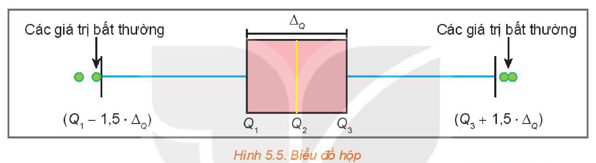
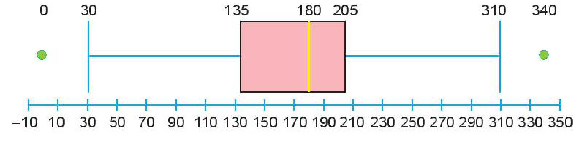
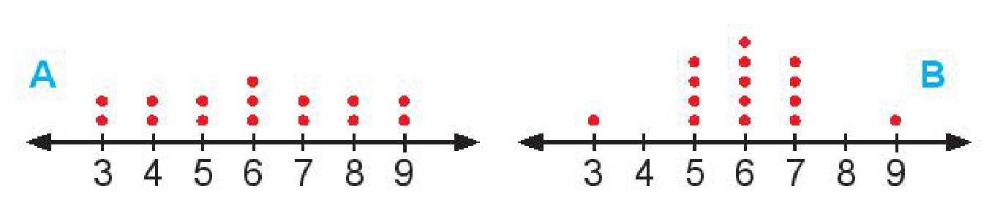

<!-- pdf:85 -->

# BÀI 14: CÁC SỐ ĐẶC TRƯNG ĐO ĐỘ PHÂN TÁN

## 🔤 Thuật ngữ

- Khoảng biến thiên
- Khoảng tứ phân vị
- Phương sai
- Độ lệch chuẩn

## 🎯 Kiến thức, kĩ năng

- Tính các số đặc trưng đo độ phân tán.
- Biết ý nghĩa của các số đặc trưng đo độ phân tán.
- Phát hiện các giá trị bất thường sử dụng các công cụ toán học.

## 🔴 Mở đầu

Dưới đây là điểm trung bình môn học kì I của hai bạn An và Bình:

| | Toán | Vật lí | Hoá học | Ngữ văn | Lịch sử | Địa lí | Tin học | Tiếng Anh |
| :--- | :---: | :---: | :---: | :---: | :---: | :---: | :---: | :---: |
| An | $9,2$ | $8,7$ | $9,5$ | $6,8$ | $8,0$ | $8,0$ | $7,3$ | $6,5$ |
| Bình | $8,2$ | $8,1$ | $8,0$ | $7,8$ | $8,3$ | $7,9$ | $7,6$ | $8,1$ |
<!-- ocr-ok: đã đối chiếu ảnh trang PDF 85, OCR đọc dính các ô tiêu đề bảng -->

Điểm trung bình môn học kì của An và Bình đều là $8,0$ nhưng rõ ràng Bình “học đều” hơn An.

Có thể dùng những số đặc trưng nào để đo mức độ “học đều”?

Bài này sẽ giới thiệu một vài số đặc trưng như vậy.

## 1. KHOẢNG BIẾN THIÊN VÀ KHOẢNG TỨ PHÂN VỊ

**HĐ1:** Một cổ động viên đã thống kê điểm số mà hai câu lạc bộ Leicester City và Everton đạt được trong năm mùa giải Ngoại hạng Anh gần đây, từ mùa giải 2014 – 2015 đến mùa giải 2018 – 2019 như sau:

Leicester City: $41 \quad 81 \quad 44 \quad 47 \quad 52$.

Everton: $47 \quad 47 \quad 61 \quad 49 \quad 54$.

Cổ động viên đó cho rằng, Everton thi đấu ổn định hơn Leicester City. Em có đồng ý với nhận định này không? Vì sao?

Trong $5$ mùa giải, điểm thấp nhất, cao nhất của Leicester City lần lượt là $41; 81$ trong khi của Everton là $47; 61$. Về trực quan, thành tích của Everton ổn định hơn Leicester City. Người ta có nhiều cách để đo sự ổn định này. Cách đơn giản nhất là dùng hiệu số (Điểm cao nhất – Điểm thấp nhất). Giá trị này được gọi là **khoảng biến thiên**.

> **Khoảng biến thiên**, kí hiệu là $R$, là hiệu số giữa giá trị lớn nhất và giá trị nhỏ nhất trong mẫu số liệu.

**Ý nghĩa:** Khoảng biến thiên dùng để đo độ phân tán của mẫu số liệu. Khoảng biến thiên càng lớn thì mẫu số liệu càng phân tán.

**Ví dụ 1:** Điểm kiểm tra học kì môn Toán của các bạn Tổ 1, Tổ 2 lớp 10A được cho như sau:

Tổ 1: $7 \quad 8 \quad 8 \quad 9 \quad 8 \quad 8 \quad 8$.

Tổ 2: $10 \quad 6 \quad 8 \quad 9 \quad 9 \quad 7 \quad 8 \quad 7 \quad 8$.

<!-- pdf:86 -->

a) Điểm kiểm tra trung bình của hai tổ có như nhau không?

b) Tính các khoảng biến thiên của hai mẫu số liệu. Căn cứ trên chỉ số này, các bạn tổ nào học đồng đều hơn?

**Giải:**

a) Điểm kiểm tra trung bình của hai tổ đều bằng $8$.

b) Đối với Tổ 1: Điểm kiểm tra thấp nhất, cao nhất tương ứng là $7; 9$. Do đó khoảng biến thiên là: $R_1 = 9 - 7 = 2$.

Đối với Tổ 2: Điểm kiểm tra thấp nhất, cao nhất tương ứng là $6; 10$. Do đó khoảng biến thiên là: $R_2 = 10 - 6 = 4$.

Do $R_2 > R_1$ nên ta nói các bạn Tổ 1 học đều hơn các bạn Tổ 2.

**Luyện tập 1:** Mẫu số liệu sau cho biết chiều cao (đơn vị cm) của các bạn trong tổ:

$163 \quad 159 \quad 172 \quad 167 \quad 165 \quad 168 \quad 170 \quad 161.$

Tính khoảng biến thiên của mẫu số liệu này.

**Nhận xét:** Sử dụng khoảng biến thiên có ưu điểm là đơn giản, dễ tính toán song khoảng biến thiên chỉ sử dụng thông tin của giá trị lớn nhất và giá trị nhỏ nhất mà bỏ qua thông tin từ tất cả các giá trị khác. Do đó, khoảng biến thiên rất dễ bị ảnh hưởng bởi các giá trị bất thường.

**HĐ2:** Trong một tuần, nhiệt độ cao nhất trong ngày (đơn vị $^\circ\text{C}$) tại hai thành phố Hà Nội và Điện Biên được cho như sau:

Hà Nội: $23 \quad 25 \quad 28 \quad 28 \quad 32 \quad 33 \quad 35$.

Điện Biên: $16 \quad 24 \quad 26 \quad 26 \quad 26 \quad 27 \quad 28$.

a) Tính các khoảng biến thiên của mỗi mẫu số liệu và so sánh.

b) Em có nhận xét gì về sự ảnh hưởng của giá trị $16$ đến khoảng biến thiên của mẫu số liệu về nhiệt độ cao nhất trong ngày tại Điện Biên?

c) Tính các tứ phân vị và hiệu $Q_3 - Q_1$ cho mỗi mẫu số liệu. Có thể dùng hiệu này để đo độ phân tán của mẫu số liệu không?

> **Khoảng tứ phân vị**, kí hiệu là $\Delta_Q$, là hiệu số giữa tứ phân vị thứ ba và tứ phân vị thứ nhất, tức là:
>
> $\Delta_Q = Q_3 - Q_1.$

> Về bản chất, khoảng tứ phân vị là khoảng biến thiên của $50\%$ số liệu chính giữa của mẫu số liệu đã sắp xếp.

**Ý nghĩa:** Khoảng tứ phân vị cũng là một số đo độ phân tán của mẫu số liệu. Khoảng tứ phân vị càng lớn thì mẫu số liệu càng phân tán.

**Chú ý:** Một số tài liệu gọi khoảng biến thiên là **biên độ** và khoảng tứ phân vị là **độ trải giữa**.

**Ví dụ 2:** Mẫu số liệu sau cho biết số ghế trống tại một rạp chiếu phim trong $9$ ngày:

$7 \quad 8 \quad 22 \quad 20 \quad 15 \quad 18 \quad 19 \quad 13 \quad 11.$

Tìm khoảng tứ phân vị cho mẫu số liệu này.

**Giải:**

Trước hết, ta sắp xếp mẫu số liệu theo thứ tự không giảm:

$7 \quad 8 \quad 11 \quad 13 \quad 15 \quad 18 \quad 19 \quad 20 \quad 22.$

<!-- pdf:87 -->

Mẫu số liệu gồm $9$ giá trị nên trung vị là số ở vị trí chính giữa $Q_2 = 15$.

Nửa số liệu bên trái là $7, 8, 11, 13$ gồm $4$ giá trị, hai phần tử chính giữa là $8, 11$.

Do đó, $Q_1 = (8 + 11) : 2 = 9,5$.

Nửa số liệu bên phải là $18, 19, 20, 22$ gồm $4$ giá trị, hai phần tử chính giữa là $19, 20$.

Do đó, $Q_3 = (19 + 20) : 2 = 19,5$.

Vậy khoảng tứ phân vị cho mẫu số liệu là $\Delta_Q = 19,5 - 9,5 = 10$.

**Luyện tập 2:** Mẫu số liệu sau đây cho biết số bài hát ở mỗi album trong bộ sưu tập của An:

$12 \quad 7 \quad 10 \quad 9 \quad 12 \quad 9 \quad 10 \quad 11 \quad 10 \quad 14.$

Hãy tìm khoảng tứ phân vị cho mẫu số liệu này.

## 2. PHƯƠNG SAI VÀ ĐỘ LỆCH CHUẨN

Khoảng biến thiên chỉ sử dụng thông tin của giá trị lớn nhất và nhỏ nhất của mẫu số liệu (bỏ qua thông tin của tất cả các giá trị khác), còn khoảng tứ phân vị chỉ sử dụng thông tin của $50\%$ số liệu chính giữa. Có một vài số đặc trưng khác đo độ phân tán sử dụng thông tin của tất cả các giá trị trong mẫu số liệu. Hai trong số đó là *phương sai* và *độ lệch chuẩn*.

Cụ thể là với mẫu số liệu $x_1, x_2, \dots, x_n$, nếu gọi số trung bình là $\bar{x}$ thì với mỗi giá trị $x_i$, **độ lệch** của nó so với giá trị trung bình là $x_i - \bar{x}$.

> - **Phương sai** là giá trị $s^2 = \frac{(x_1 - \bar{x})^2 + (x_2 - \bar{x})^2 + \dots + (x_n - \bar{x})^2}{n}$.
> - Căn bậc hai của phương sai, $s = \sqrt{s^2}$, được gọi là **độ lệch chuẩn**.

**Chú ý:** Người ta còn sử dụng đại lượng để đo độ phân tán của mẫu số liệu:

$\hat{s}^2 = \frac{(x_1 - \bar{x})^2 + (x_2 - \bar{x})^2 + \dots + (x_n - \bar{x})^2}{n - 1}.$

**Ý nghĩa:** Nếu số liệu càng phân tán thì phương sai và độ lệch chuẩn càng lớn.

**Ví dụ 3:** Mẫu số liệu sau đây cho biết sĩ số của $5$ lớp khối 10 tại một trường:

$43 \quad 45 \quad 46 \quad 41 \quad 40.$

Tìm phương sai và độ lệch chuẩn cho mẫu số liệu này.

**Giải:**

Số trung bình của mẫu số liệu là: $\bar{x} = \frac{43 + 45 + 46 + 41 + 40}{5} = 43$.

Ta có bảng sau:

| Giá trị | Độ lệch | Bình phương độ lệch |
| :---: | :---: | :---: |
| $43$ | $43 - 43 = 0$ | $0$ |
| $45$ | $45 - 43 = 2$ | $4$ |
| $46$ | $46 - 43 = 3$ | $9$ |
| $41$ | $41 - 43 = -2$ | $4$ |
| $40$ | $40 - 43 = -3$ | $9$ |
| Tổng | | $26$ |

> Bạn có thể sử dụng máy tính cầm tay, phần mềm bảng tính hay phần mềm thống kê để tính các số đặc trưng.

Mẫu số liệu gồm $5$ giá trị nên $n = 5$. Do đó phương sai là: $s^2 = \frac{26}{5} = 5,2$.

Độ lệch chuẩn là: $s = \sqrt{5,2} \approx 2,28$.

<!-- pdf:88 -->

**Luyện tập 3:** Dùng đồng hồ đo thời gian có độ chia nhỏ nhất đến $0,001$ giây để đo $7$ lần thời gian rơi tự do của một vật bắt đầu từ điểm $A$ ($v_A = 0$) đến điểm $B$. Kết quả đo như sau:

$0,398 \quad 0,399 \quad 0,408 \quad 0,410 \quad 0,406 \quad 0,405 \quad 0,402.$

*(Theo Bài tập Vật lí 10, Nhà xuất bản Giáo dục Việt Nam, 2018)*

Hãy tính phương sai và độ lệch chuẩn cho mẫu số liệu này. Qua các đại lượng này, em có nhận xét gì về độ chính xác của phép đo trên?

## 3. PHÁT HIỆN SỐ LIỆU BẤT THƯỜNG HOẶC KHÔNG CHÍNH XÁC BẰNG BIỂU ĐỒ HỘP

Trong mẫu số liệu thống kê, có khi gặp những giá trị quá lớn hoặc quá nhỏ so với đa số các giá trị khác. Những giá trị này được gọi là **giá trị bất thường**. Chúng xuất hiện trong mẫu số liệu có thể do nhầm lẫn hay sai sót nào đó. Ta có thể dùng **biểu đồ hộp** để phát hiện những giá trị bất thường này.

*Hình 5.5. Biểu đồ hộp*

Các giá trị lớn hơn $Q_3 + 1,5 \cdot \Delta_Q$ hoặc bé hơn $Q_1 - 1,5 \cdot \Delta_Q$ được xem là **giá trị bất thường**.

**Ví dụ 4:** Hàm lượng Natri (đơn vị mg) trong $100\text{ g}$ một số loại ngũ cốc được cho như sau:

$0 \quad 340 \quad 70 \quad 140 \quad 200 \quad 180 \quad 210 \quad 150 \quad 100 \quad 130$

$140 \quad 180 \quad 190 \quad 160 \quad 290 \quad 50 \quad 220 \quad 180 \quad 200 \quad 210.$

Tìm giá trị bất thường trong mẫu số liệu trên bằng cách sử dụng biểu đồ hộp.

**Giải:**

Từ mẫu số liệu ta tính được $Q_1 = 135$ và $Q_3 = 205$. Do đó, khoảng tứ phân vị là:

$\Delta_Q = 205 - 135 = 70.$

Biểu đồ hộp cho mẫu số liệu này là:

Ta có $Q_1 - 1,5 \cdot \Delta_Q = 30$ và $Q_3 + 1,5 \cdot \Delta_Q = 310$ nên trong mẫu số liệu có hai giá trị được xem là bất thường là $340\text{ mg}$ (lớn hơn $310\text{ mg}$) và $0\text{ mg}$ (bé hơn $30\text{ mg}$).

**Luyện tập 4:** Một mẫu số liệu có tứ phân vị thứ nhất là $56$ và tứ phân vị thứ ba là $84$. Hãy kiểm tra xem trong hai giá trị $10$ và $100$ giá trị nào được xem là giá trị bất thường.

<!-- pdf:89 -->

## ✏️ Bài tập

**5.11.** Mỗi khẳng định sau đúng hay sai?
<!-- ocr-ok: đã đối chiếu ảnh trang PDF 89, OCR mất số 5.11 và đọc sai Mỗi thành Mối -->

(1) Nếu các giá trị của mẫu số liệu càng tập trung quanh giá trị trung bình thì độ lệch chuẩn càng lớn.

(2) Khoảng biến thiên chỉ sử dụng thông tin của giá trị lớn nhất và bé nhất, bỏ qua thông tin của các giá trị còn lại.

(3) Khoảng tứ phân vị có sử dụng thông tin của giá trị lớn nhất, giá trị bé nhất.

(4) Khoảng tứ phân vị chính là khoảng biến thiên của nửa dưới mẫu số liệu đã sắp xếp.

(5) Các số đo độ phân tán đều không âm.

**5.12.** Cho hai biểu đồ chấm điểm biểu diễn hai mẫu số liệu A, B như sau:

> Số chấm trên mỗi giá trị biểu diễn cho tần số của giá trị đó.

Không tính toán, hãy cho biết:

a) Hai mẫu số liệu này có cùng khoảng biến thiên và số trung bình không?

b) Mẫu số liệu nào có phương sai lớn hơn?

**5.13.** Cho mẫu số liệu gồm $10$ số dương không hoàn toàn giống nhau. Các số đo độ phân tán (khoảng biến thiên, khoảng tứ phân vị, độ lệch chuẩn) sẽ thay đổi như thế nào nếu:

a) Nhân mỗi giá trị của mẫu số liệu với $2$.

b) Cộng mỗi giá trị của mẫu số liệu với $2$.

**5.14.** Từ mẫu số liệu về thuế thuốc lá của $51$ thành phố tại một quốc gia, người ta tính được:

Giá trị nhỏ nhất bằng $2,5$; $Q_1 = 36$; $Q_2 = 60$; $Q_3 = 100$; giá trị lớn nhất bằng $205$.

a) Tỉ lệ thành phố có thuế thuốc lá lớn hơn $36$ là bao nhiêu?

b) Chỉ ra hai giá trị sao cho có $50\%$ giá trị của mẫu số liệu nằm giữa hai giá trị này.

c) Tìm khoảng tứ phân vị của mẫu số liệu.

**5.15.** Mẫu số liệu sau đây cho biết cân nặng của $10$ trẻ sơ sinh (đơn vị kg):

$2,977 \quad 3,155 \quad 3,920 \quad 3,412 \quad 4,236$

$2,593 \quad 3,270 \quad 3,813 \quad 4,042 \quad 3,387.$

Hãy tính khoảng biến thiên, khoảng tứ phân vị và độ lệch chuẩn cho mẫu số liệu này.

**5.16.** Tỉ lệ thất nghiệp ở một số quốc gia vào năm 2007 (đơn vị $\%$) được cho như sau:

$7,8 \quad 3,2 \quad 7,7 \quad 8,7 \quad 8,6 \quad 8,4 \quad 7,2 \quad 3,6$

$5,0 \quad 4,4 \quad 6,7 \quad 7,0 \quad 4,5 \quad 6,0 \quad 5,4.$

Hãy tìm các giá trị bất thường (nếu có) của mẫu số liệu trên.

## 📷 Danh sách hình trong bài

| Mã hình | Trang PDF | Vị trí trong bài | Chú thích gốc |
| --- | --- | --- | --- |
| H10-toan-b14-01 | 88 | Mục 3 | Hình 5.5. Biểu đồ hộp |
| H10-toan-b14-02 | 88 | Mục 3, Ví dụ 4 | (sách không đánh số, biểu đồ hộp của mẫu số liệu hàm lượng Natri) |
| H10-toan-b14-03 | 89 | Bài tập 5.12 | (sách không đánh số, hai biểu đồ chấm điểm A và B) |
