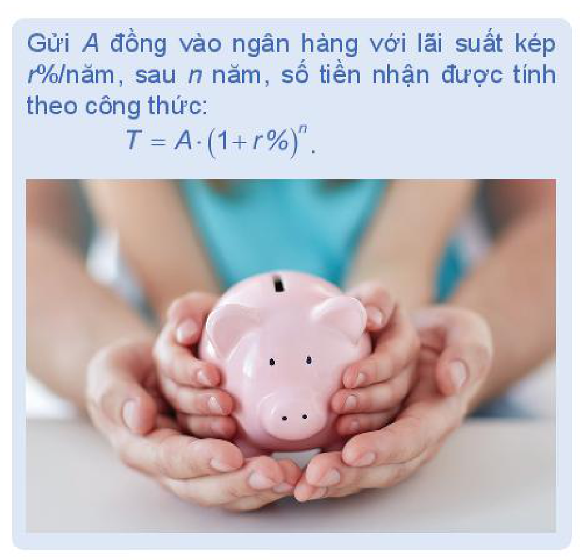
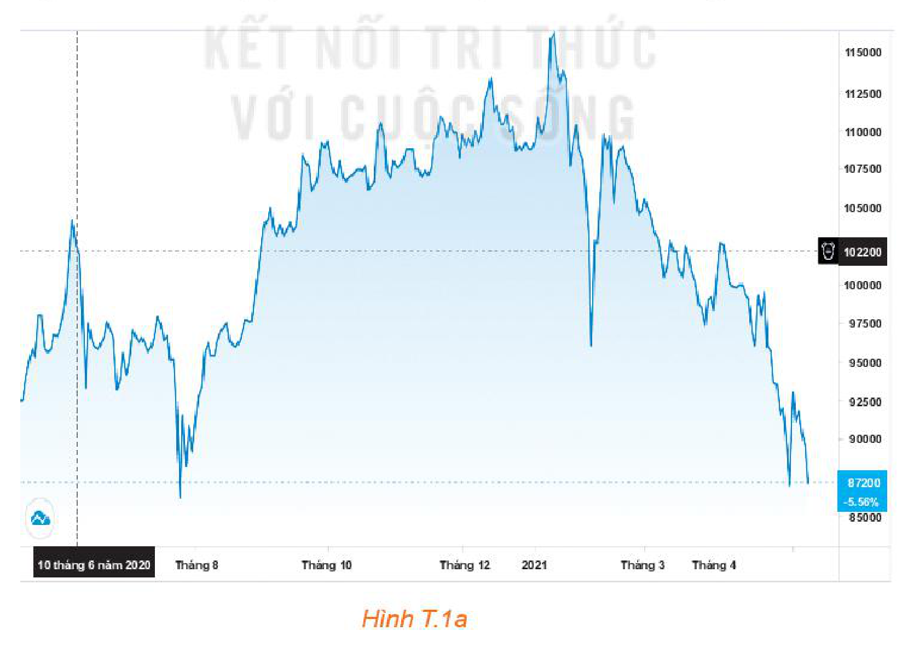
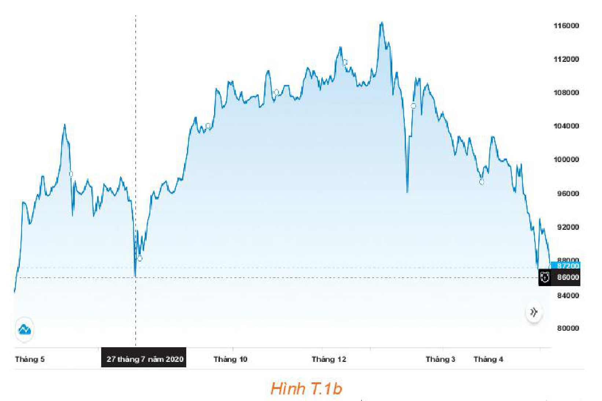
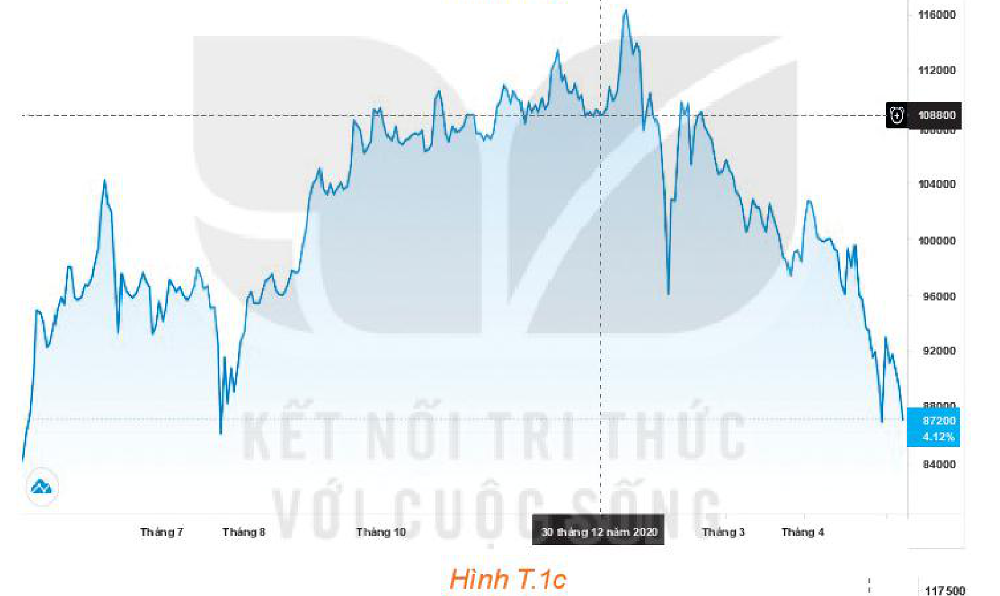
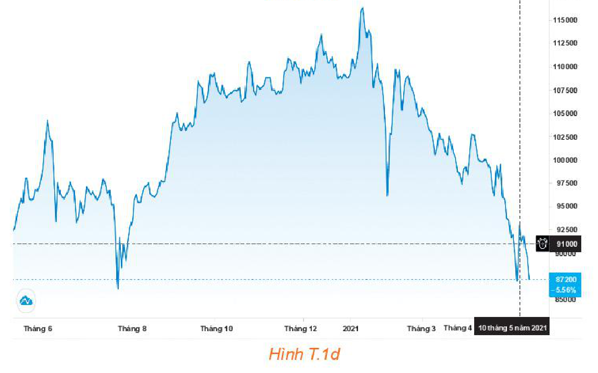
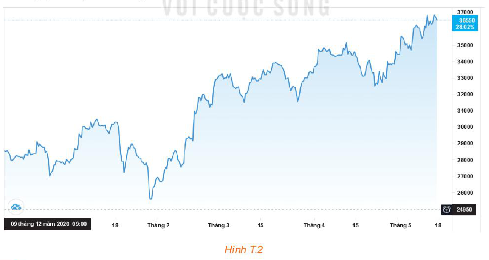

<!-- pdf:92 -->

<!-- Phần tiêu đề chung: HOẠT ĐỘNG THỰC HÀNH TRẢI NGHIỆM -->

# TÌM HIỂU MỘT SỐ KIẾN THỨC VỀ TÀI CHÍNH

## 🎯 Mục tiêu

- Hiểu sự khác biệt giữa tiết kiệm và đầu tư.
- Thực hành thiết lập kế hoạch đầu tư cá nhân để đạt được tỉ lệ tăng trưởng như mong đợi.

## 🔴 Mở đầu

Tiết kiệm và đầu tư là các phương thức khác biệt đóng vai trò quan trọng trong kế hoạch xây dựng tài sản và phân bổ ngân sách chi tiêu của em. Bài học này giúp em thực hành ứng dụng các kiến thức toán học vào thực tiễn, đặc biệt là trong quản lí tài chính.

<!-- pdf:93 -->

## 1. TIẾT KIỆM VÀ ĐẦU TƯ

**HĐ1:** Tháng 1 năm 2018, bác Việt gửi tiết kiệm $2\,000\,000\,000$ đồng kì hạn $36$ tháng ở ngân hàng với lãi suất $7\%/\text{năm}$. Đến tháng 1 năm 2021, bác Việt rút tiền tiết kiệm nêu trên để mua một căn hộ chung cư với giá $30\,626\,075$ đồng/mét vuông.

a) Hỏi tổng số tiền tiết kiệm bác Việt rút ra được vào tháng 1 năm 2021 là bao nhiêu?

b) Với số tiền nêu trên, bác Việt mua được căn hộ chung cư với diện tích bao nhiêu mét vuông?

> Gửi $A$ đồng vào ngân hàng với **lãi suất kép** $r\%/\text{năm}$, sau $n$ năm, số tiền nhận được tính theo công thức:
>
> $T = A \cdot (1 + r\%)^n.$

**Trao đổi:**

Để mua được căn hộ $100$ mét vuông ở thời điểm tháng 1 năm 2021, bác Việt cần phải gửi tiết kiệm từ tháng 1 năm 2018 bao nhiêu tiền?

**HĐ2:** Cô Lan có $511\,000\,000$ đồng và dự định đầu tư vào chứng khoán của công ty A. Biểu đồ chứng khoán của công ty A được cho trong Hình T.1 với những thời điểm khác nhau.

*Hình T.1a*

<!-- pdf:94 -->

*Hình T.1b*

*Hình T.1c*

*Hình T.1d*

<!-- pdf:95 -->

| Thời gian | 10-6-2020 | 27-7-2020 | 30-12-2020 | 10-5-2021 |
| :--- | :---: | :---: | :---: | :---: |
| Giá mỗi cổ phiếu (đồng) | $102\,200$ | $86\,000$ | $108\,800$ | $91\,000$ |
| Số cổ phiếu | $5\,000$ | $5\,000$ | $5\,000$ | $5\,000$ |
| Tổng | $511\,000\,000$ | | | |

a) Nếu cô Lan bán $5\,000$ cổ phiếu của công ty A vào các thời điểm sau thì tổng số tiền tương ứng cô Lan thu được là bao nhiêu?

27-7-2020; $\quad$ 30-12-2020; $\quad$ 10-5-2021.

b) Nếu ngày 10-6-2020 cô Lan dùng số tiền $511\,000\,000$ đồng để gửi tiết kiệm với lãi suất $6\%/\text{năm}$ cho kì hạn một tháng thì vào ngày 10-5-2021, tổng số tiền cô Lan nhận được là bao nhiêu?

**Trao đổi:**

a) Với tình huống trên, cô Lan nên đầu tư như thế nào để hiệu quả nhất?

b) Nếu so sánh giữa việc gửi tiết kiệm và đầu tư, cô Lan nên chọn hình thức nào?

## 💡 Em có biết?

Tiết kiệm và đầu tư là nền tảng cho các hoạt động về tài chính. Về cơ bản, có thể hiểu **tiết kiệm** là việc lưu giữ giá trị, biến sức mua hiện tại thành sức mua trong tương lai; còn **đầu tư** là nhằm gia tăng giá trị. Đầu tư liên quan đến việc đưa tài chính vào các khoản đầu tư, chẳng hạn như cổ phiếu, với hi vọng tài chính sẽ tăng lên.

**Vận dụng 1:** Anh Tiến có $898\,200\,000$ đồng dự định đầu tư. Anh Tiến mong muốn sau $2$ năm sẽ nhận được số tiền (cả gốc lẫn lãi) là $1$ tỉ đồng. Ngày 9-12-2020, anh Tiến quyết định đầu tư mua cổ phiếu của công ty B. Giá mỗi cổ phiếu là $24\,950$ đồng. Biểu đồ chứng khoán của công ty B được cho trong Hình T.2.

*Hình T.2*

<!-- pdf:96 -->

Dựa vào biểu đồ trên, hãy tính số tiền mà anh Tiến thu được khi bán cổ phiếu của công ty B tại các thời điểm sau:

a) 15-3-2021; $\quad$ b) 15-4-2021; $\quad$ c) 18-5-2021.

## 2. THUẾ THU NHẬP CÁ NHÂN

**HĐ3:** Thuế suất biểu luỹ tiến từng phần được phân loại chi tiết trong bảng sau:

| Bậc thuế | Phần thu nhập tính thuế/tháng (triệu đồng) | Thuế suất ($\%$) |
| :---: | :--- | :---: |
| $1$ | Đến $05$ | $5$ |
| $2$ | Trên $05$ đến $10$ | $10$ |
| $3$ | Trên $10$ đến $18$ | $15$ |
| $4$ | Trên $18$ đến $32$ | $20$ |
| $5$ | Trên $32$ đến $52$ | $25$ |
| $6$ | Trên $52$ đến $80$ | $30$ |
| $7$ | Trên $80$ | $35$ |
<!-- ocr-ok: đã đối chiếu ảnh trang PDF 96, OCR đọc lẫn bảng bậc thuế với khung giải thích bên phải -->

> - **Thuế thu nhập cá nhân** là khoản tiền (thuế) mà người có thu nhập phải trích nộp một phần vào ngân sách nhà nước sau khi đã tính các khoản được giảm trừ. Các khoản giảm trừ thông thường bao gồm:
>   - Giảm trừ bản thân;
>   - Giảm trừ người phụ thuộc.
> - **Thuế suất thuế thu nhập cá nhân** là tỉ lệ phần trăm dùng để tính số thuế phải nộp căn cứ vào phần thu nhập tính thuế của mỗi người.

> - $\text{Thu nhập tính thuế} = \text{Thu nhập chịu thuế} - \text{Các khoản giảm trừ}.$
> - $\text{Thuế thu nhập cá nhân} = \text{Thu nhập tính thuế} \times \text{Thuế suất}.$

a) Hãy lập công thức hàm số bậc nhất mô tả sự phụ thuộc của thuế thu nhập cá nhân vào phần thu nhập tính thuế/tháng với mức thu nhập tính thuế/tháng không quá $5$ triệu đồng và vẽ đồ thị hàm số này.

b) Hãy lập công thức hàm số bậc nhất mô tả sự phụ thuộc của thuế thu nhập cá nhân vào phần thu nhập tính thuế/tháng với mức thu nhập tính thuế/tháng trên $5$ triệu đồng và không quá $10$ triệu đồng. Vẽ đồ thị hàm số này.

c) Anh Nam làm việc ở một ngân hàng với mức thu nhập chịu thuế đều đặn là $28$ triệu đồng/tháng và có một người phụ thuộc (một con nhỏ dưới $18$ tuổi). Hãy giúp anh Nam tính số thuế thu nhập cá nhân mà anh phải nộp trong một năm, biết rằng các khoản giảm trừ được tính bao gồm giảm trừ bản thân cho anh Nam ($11$ triệu đồng/tháng) và giảm trừ người phụ thuộc ($4,4$ triệu đồng/tháng cho mỗi người phụ thuộc).

**Vận dụng 2:** Hãy sử dụng bảng thuế suất biểu luỹ tiến từng phần được cho trong HĐ3 để xây dựng công thức tính thuế thu nhập cá nhân theo từng trường hợp (căn cứ vào phần thu nhập tính thuế).

## 📷 Danh sách hình trong bài

| Mã hình | Trang PDF | Vị trí trong bài | Chú thích gốc |
| --- | --- | --- | --- |
| H10-toan-hd-thtn-01-01 | 92 | Mở đầu | (sách không đánh số, ảnh hai lọ SAVE OR INVEST) |
| H10-toan-hd-thtn-01-02 | 93 | Mục 1, HĐ1 | (sách không đánh số, khung công thức lãi kép và ảnh heo đất) |
| H10-toan-hd-thtn-01-03 | 93 | Mục 1, HĐ2 | Hình T.1a |
| H10-toan-hd-thtn-01-04 | 94 | Mục 1, HĐ2 | Hình T.1b |
| H10-toan-hd-thtn-01-05 | 94 | Mục 1, HĐ2 | Hình T.1c |
| H10-toan-hd-thtn-01-06 | 94 | Mục 1, HĐ2 | Hình T.1d |
| H10-toan-hd-thtn-01-07 | 95 | Mục 1, Vận dụng 1 | Hình T.2 |
