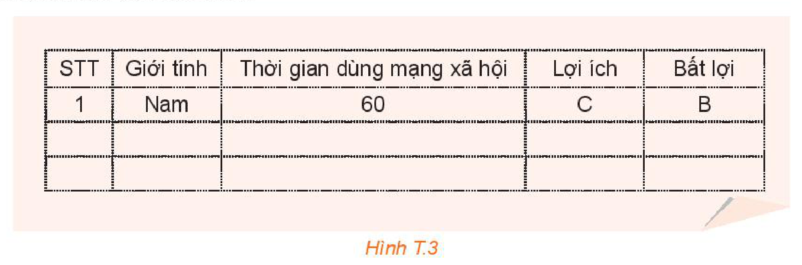
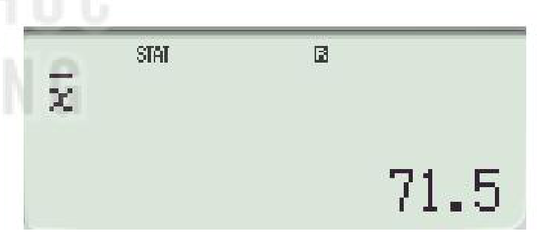
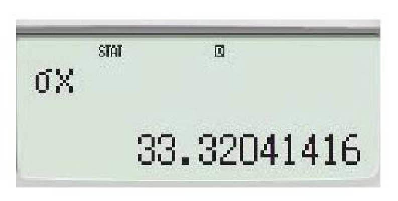
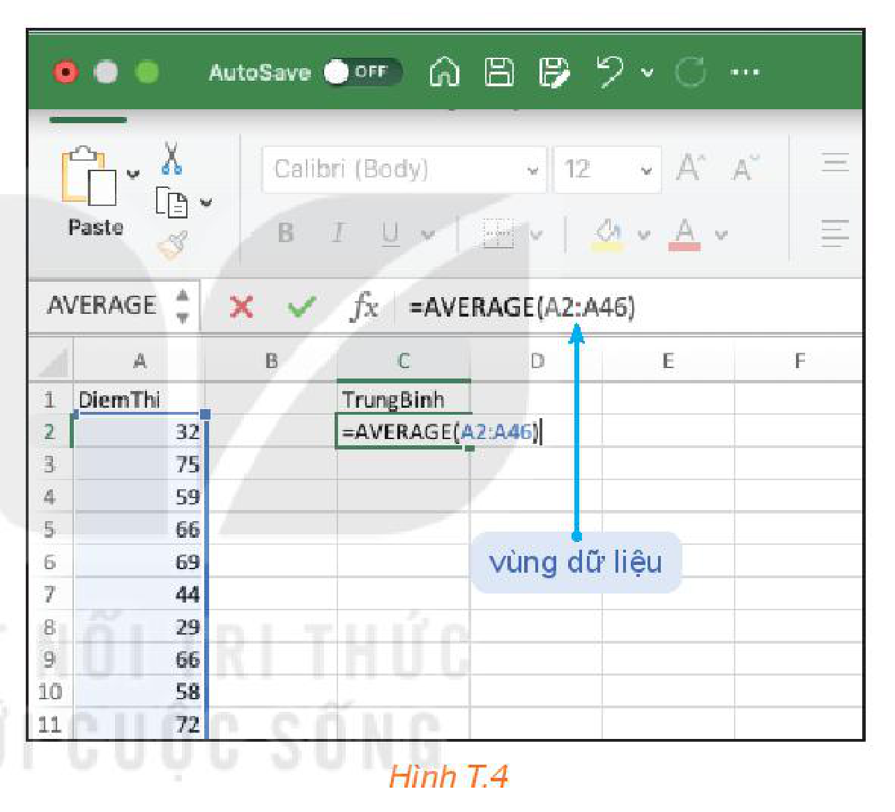
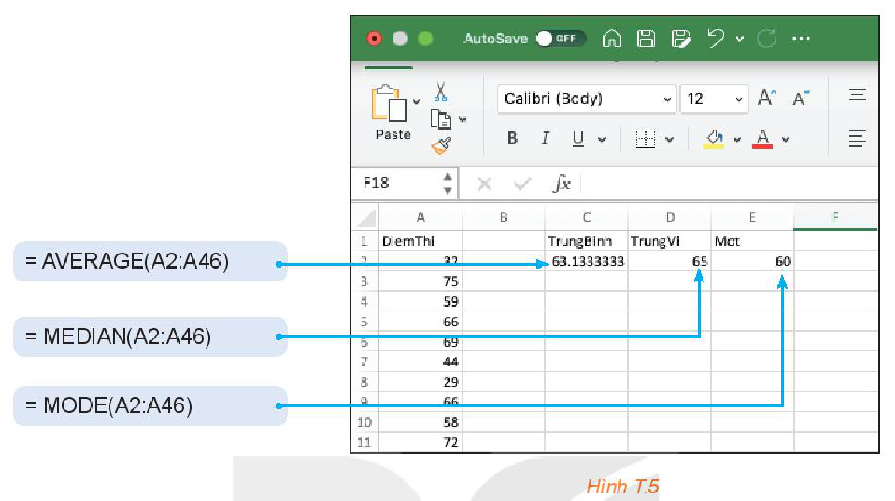
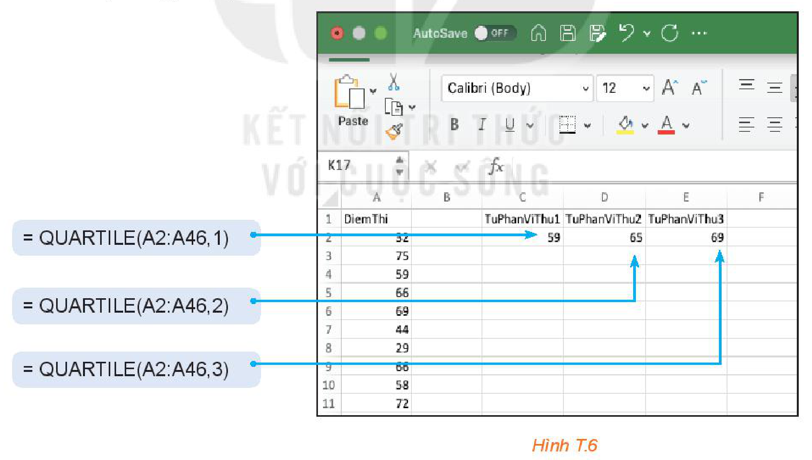
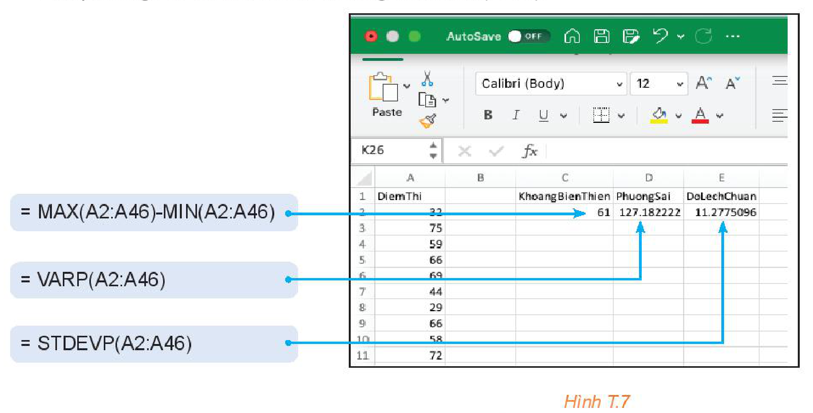
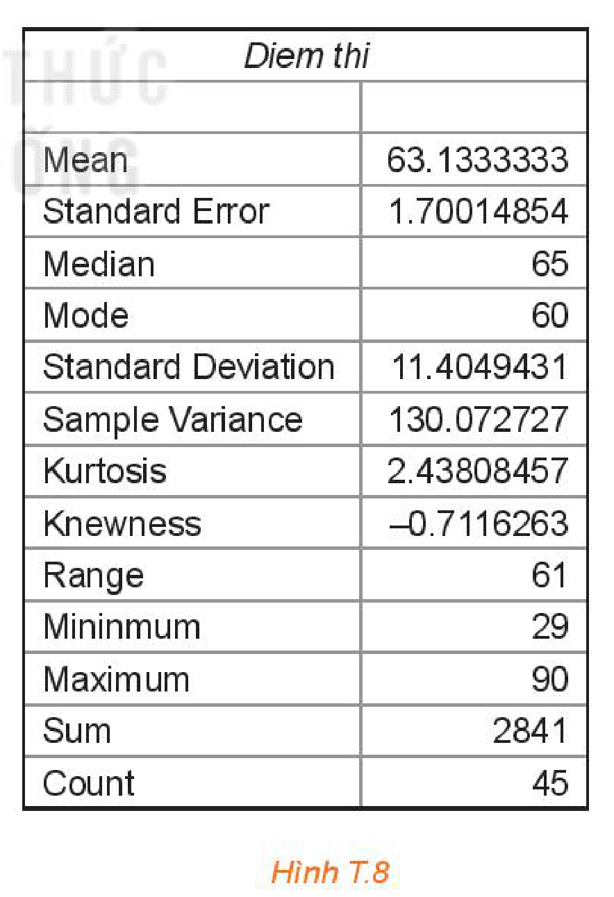

<!-- pdf:97 -->

# MẠNG XÃ HỘI: LỢI VÀ HẠI

## 🔴 Mở đầu

Ngày nay cùng với Internet, mạng xã hội đã trở nên quen thuộc với nhiều người. Một nhóm các bạn học sinh lớp 10A muốn tìm hiểu thực tế sử dụng mạng xã hội của các bạn trong lớp mình. Những vấn đề các bạn quan tâm là:

1. Lợi ích, bất lợi lớn nhất khi dùng mạng xã hội là gì?
2. Thời gian sử dụng mạng xã hội của các bạn trong lớp như thế nào?
3. Các bạn nam và bạn nữ có thời gian sử dụng mạng xã hội khác nhau không?


## 1. THU THẬP DỮ LIỆU

Các bạn trong nhóm đã lập một phiếu khảo sát để thu thập dữ liệu như sau:

> **KHẢO SÁT VỀ SỬ DỤNG MẠNG XÃ HỘI**
>
> 1. Giới tính của bạn:
>    $\square$ Nữ $\quad \square$ Nam
> 2. Lợi ích lớn nhất mà mạng xã hội mang lại là (chọn một phương án):
>    A. Kết nối với bạn bè $\quad$ B. Giải trí
>    C. Thu thập thông tin $\quad$ D. Tìm hiểu thế giới xung quanh
> 3. Điều bất lợi lớn nhất khi sử dụng mạng xã hội là (chọn một phương án):
>    A. Có nguy cơ tiếp xúc với những bài viết, hình ảnh, video, ý kiến tiêu cực, không thích hợp
>    B. Thông tin cá nhân bị đánh cắp
>    C. Có thể bị bắt nạt trên Internet
>    D. Mất thời gian sử dụng Internet
> 4. Thời gian (ước lượng số phút) bạn sử dụng mạng xã hội trong một ngày:
>    ......................................................................................................................

<!-- pdf:98 -->

**HĐ1:** Hãy dùng phiếu khảo sát theo mẫu trên, tiến hành thu thập dữ liệu với ít nhất $30$ phiếu và ghi lại dữ liệu theo mẫu sau:

| STT | Giới tính | Thời gian dùng mạng xã hội | Lợi ích | Bất lợi |
| :---: | :---: | :---: | :---: | :---: |
| $1$ | Nam | $60$ | C | B |
| ... | ... | ... | ... | ... |


*Hình T.3*

## 2. XỬ LÍ VÀ PHÂN TÍCH SỐ LIỆU

**HĐ2:** Lợi ích và bất lợi của mạng xã hội

Để biết các bạn học sinh tham gia khảo sát đánh giá thế nào về lợi ích và bất lợi của mạng xã hội, hãy thực hiện các yêu cầu sau:

a) Lập bảng tần số của dữ liệu ý kiến về lợi ích/bất lợi của mạng xã hội theo mẫu sau:

| Ý kiến | Kết nối với bạn bè | Giải trí | Thu thập thông tin | Tìm hiểu thế giới xung quanh |
| :--- | :---: | :---: | :---: | :---: |
| Số học sinh | | | | |
<!-- ocr-ok: đã đối chiếu ảnh trang PDF 98, OCR tách dòng tiêu đề cột trong Bảng T.1 -->

*Bảng T.1*

b) Rút ra nhận xét từ bảng tần số thu được.

**HĐ3:** Thời gian sử dụng mạng xã hội

Hãy tính một số số đo thống kê mô tả được liệt kê trong Bảng T.2 của mẫu số liệu về thời gian sử dụng mạng xã hội:

| Giá trị nhỏ nhất | $Q_1$ | Số trung bình | Trung vị | $Q_3$ | Mốt | Giá trị lớn nhất |
| :---: | :---: | :---: | :---: | :---: | :---: | :---: |
| | | | | | | |

*Bảng T.2*

Dựa trên những số đặc trưng tính được, hãy nêu nhận xét về thời gian sử dụng mạng xã hội của các học sinh được khảo sát.

**HĐ4:** Thời gian sử dụng mạng xã hội của học sinh nam và học sinh nữ

a) Hãy tính số trung bình, trung vị, tứ phân vị của thời gian sử dụng mạng xã hội trên hai nhóm học sinh nữ và học sinh nam để so sánh thời gian sử dụng mạng xã hội của hai nhóm.

| | Số trung bình | $Q_1$ | Trung vị ($Q_2$) | $Q_3$ |
| :--- | :---: | :---: | :---: | :---: |
| Nữ | | | | |
| Nam | | | | |

*Bảng T.3*

<!-- pdf:99 -->

b) Hãy tính một vài số đo độ phân tán để so sánh sự biến động của thời gian sử dụng mạng xã hội trên hai nhóm học sinh.

| | Khoảng biến thiên | Khoảng tứ phân vị | Độ lệch chuẩn |
| :--- | :---: | :---: | :---: |
| Nữ | | | |
| Nam | | | |

*Bảng T.4*

## 3. GÓC CÔNG NGHỆ THÔNG TIN

Ta có thể dùng máy tính cầm tay hoặc phần mềm bảng tính để tính các số đặc trưng của mẫu số liệu.

**Sử dụng máy tính cầm tay:**

Giả sử khảo sát được thời gian sử dụng mạng xã hội của một số bạn như sau:

$60 \quad 90 \quad 120 \quad 60 \quad 15 \quad 50 \quad 80 \quad 30 \quad 120 \quad 90.$

Sử dụng máy tính cầm tay để tính những số đặc trưng của mẫu số liệu trên:

1. Vào chế độ thống kê:

```text
[MODE] [3] [1]
```

2. Nhập số liệu vào máy:

```text
[6] [0] [=] [9] [0] [=] [1] [2] [0] [=] [6] [0] [=] [1] [5] [=] [5] [0] [=]
[8] [0] [=] [3] [0] [=] [1] [2] [0] [=] [9] [0] [=]
```

3. Tính số trung bình:

```text
[AC] [SHIFT] [1] [4] [2] [=]
```

Ta được kết quả số trung bình là $71,5$.



4. Tính độ lệch chuẩn:

```text
[AC] [SHIFT] [1] [4] [3] [=]
```

Ta được kết quả độ lệch chuẩn là $s = 33,32041416$.



**Chú ý:** Để tính đại lượng:

$\hat{s} = \sqrt{\frac{(x_1 - \bar{x})^2 + (x_2 - \bar{x})^2 + \dots + (x_n - \bar{x})^2}{n - 1}}$

ta ấn:

```text
[AC] [SHIFT] [1] [4] [4] [=]
```

Kết quả là $\hat{s} = 35,12280045$.

<!-- pdf:100 -->

**Sử dụng phần mềm bảng tính:**

Với những mẫu số liệu lớn hơn, phần mềm thống kê sẽ giúp cho việc xử lí dữ liệu trở nên nhanh chóng và chính xác. Những hướng dẫn sau được minh hoạ trên số liệu về điểm thi khảo sát môn Tiếng Anh (thang điểm $100$) của $45$ học sinh:

$32 \quad 75 \quad 59 \quad 66 \quad 69 \quad 44 \quad 29 \quad 66 \quad 58 \quad 72 \quad 65 \quad 62 \quad 88 \quad 71 \quad 60$

$64 \quad 68 \quad 69 \quad 57 \quad 60 \quad 72 \quad 54 \quad 65 \quad 62 \quad 90 \quad 61 \quad 59 \quad 68 \quad 56 \quad 42$

$69 \quad 67 \quad 67 \quad 55 \quad 66 \quad 72 \quad 55 \quad 61 \quad 71 \quad 70 \quad 65 \quad 61 \quad 60 \quad 60 \quad 79$

**a) Dùng các hàm tính số đặc trưng**

Việc tính các số đặc trưng của một mẫu số liệu có thể thực hiện trên phần mềm bảng tính nhờ những hàm có sẵn. Chẳng hạn, để tính số trung bình ta làm như sau:

1. Nhập số liệu vào một cột của bảng tính.
2. Tại một ô trống để chứa kết quả gõ:

```text
= AVERAGE(vùng dữ liệu)
```

Trong ví dụ trên kết quả trả về giá trị trung bình của mẫu số liệu là $63,13$ (H.T.4).


*Hình T.4*

Để tính những số đặc trưng khác em hãy thay hàm `AVERAGE` bởi hàm thích hợp theo bảng sau:

| Số đặc trưng | Hàm |
| :--- | :---: |
| Số trung bình | `AVERAGE` |
| Trung vị | `MEDIAN` |
| Mốt | `MODE` |
| Tứ phân vị | `QUARTILE` |

*Bảng T.5. Danh sách hàm để tính số đo xu thế trung tâm*

| Số đặc trưng | Hàm |
| :--- | :---: |
| Giá trị nhỏ nhất | `MIN` |
| Giá trị lớn nhất | `MAX` |
| Phương sai | `VAR`, `VARP` |
| Độ lệch chuẩn | `STDEV`, `STDEVP` |

*Bảng T.6. Danh sách hàm để tính số đo độ phân tán*

<!-- pdf:101 -->

- Tính số trung bình, trung vị, mốt (H.T.5).

```text
= AVERAGE(A2:A46)
= MEDIAN(A2:A46)
= MODE(A2:A46)
```


*Hình T.5*

**Chú ý:** Hàm `MODE` sẽ trả về giá trị `#N/A` nếu mẫu số liệu không có giá trị lặp lại. Trong trường hợp mẫu số liệu có nhiều mốt thì phần mềm bảng tính hiển thị giá trị mốt nhỏ nhất.

- Tính tứ phân vị (H.T.6).

```text
= QUARTILE(A2:A46,1)
= QUARTILE(A2:A46,2)
= QUARTILE(A2:A46,3)
```


*Hình T.6*

**Chú ý:** Kết quả tính tứ phân vị bằng phần mềm bảng tính có sự sai khác nhỏ so với cách tính được giới thiệu ở Bài 13 (do dùng công thức khác nhau).

<!-- pdf:102 -->

- Tính phương sai, độ lệch chuẩn, khoảng biến thiên (H.T.7).

```text
= MAX(A2:A46)-MIN(A2:A46)
= VARP(A2:A46)
= STDEVP(A2:A46)
```


*Hình T.7*

**Chú ý:** Để tính $\hat{s}^2$ và $\hat{s}$ ta thay `VARP` bởi `VAR` và thay `STDEVP` bởi `STDEV`.

**b) Dùng chức năng phân tích dữ liệu trên thanh công cụ**

Ngoài các hàm tính các số đặc trưng riêng lẻ, phần mềm bảng tính cho phép in ra một bảng tổng hợp gồm nhiều số đặc trưng khác nhau. Cách thực hiện như sau:

1. Nhập số liệu vào một cột.
2. Trên menu chọn `Tools` $\to$ `Data Analysis` $\to$ `Descriptive Statistics`.
3. Tại `Input Range` chọn vùng dữ liệu (`A1: A46`). Nháy chọn `Label in first row`. Tại `Output Range` chọn một ô trống để xác định vị trí hiển thị kết quả tích và nháy chọn `Summary statistics`.
<!-- ocr-ok: đã đối chiếu ảnh trang PDF 102, OCR đọc lẫn cột hướng dẫn với Hình T.8 bên phải -->


*Hình T.8*

**Chú ý:**

- Trong hình bên, phương sai và độ lệch chuẩn tính theo công thức tính $\hat{s}^2$ và $\hat{s}$ tương ứng. Có một vài số đặc trưng chưa được giới thiệu trong phạm vi Toán 10.
- Để tính những số đặc trưng cho hai mẫu số liệu ta nhập số liệu vào hai cột và tiến hành tương tự.

## 📷 Danh sách hình trong bài

| Mã hình | Trang PDF | Vị trí trong bài | Chú thích gốc |
| --- | --- | --- | --- |
| H10-toan-hd-thtn-02-01 | 97 | Mở đầu | (sách không đánh số, hình minh hoạ Social Network) |
| H10-toan-hd-thtn-02-02 | 98 | Mục 1, HĐ1 | Hình T.3 |
| H10-toan-hd-thtn-02-03 | 99 | Mục 3, bước 3 | (sách không đánh số, màn hình máy tính hiển thị $\bar{x} = 71.5$) |
| H10-toan-hd-thtn-02-04 | 99 | Mục 3, bước 4 | (sách không đánh số, màn hình máy tính hiển thị $\sigma x = 33.32041416$) |
| H10-toan-hd-thtn-02-05 | 100 | Mục 3.a | Hình T.4 |
| H10-toan-hd-thtn-02-06 | 101 | Mục 3.a | Hình T.5 |
| H10-toan-hd-thtn-02-07 | 101 | Mục 3.a | Hình T.6 |
| H10-toan-hd-thtn-02-08 | 102 | Mục 3.a | Hình T.7 |
| H10-toan-hd-thtn-02-09 | 102 | Mục 3.b | Hình T.8 |
