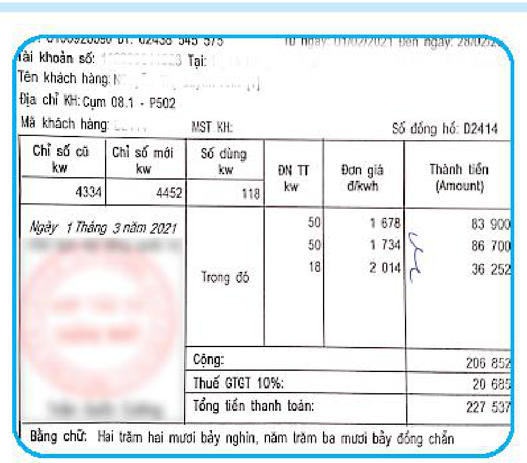
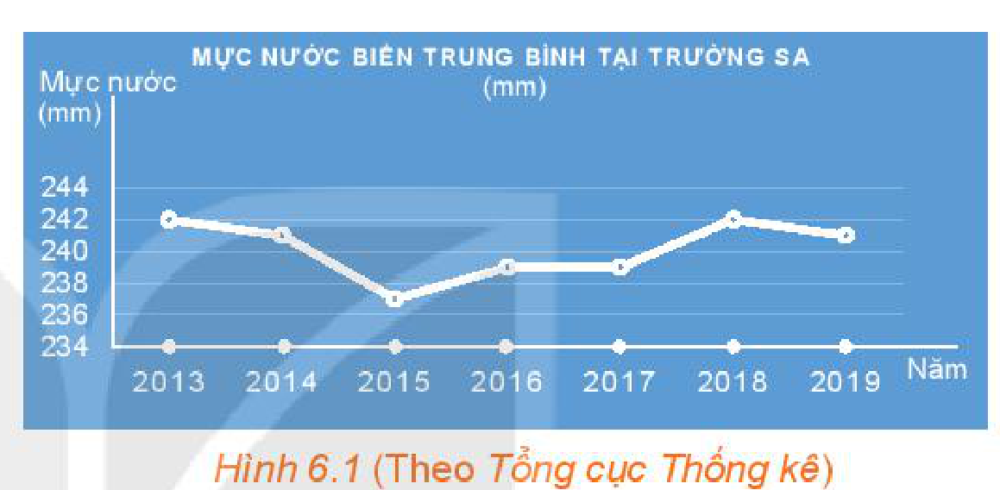
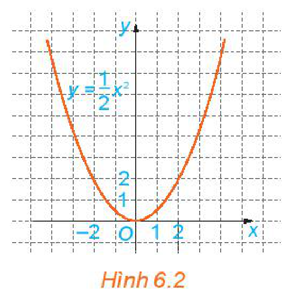
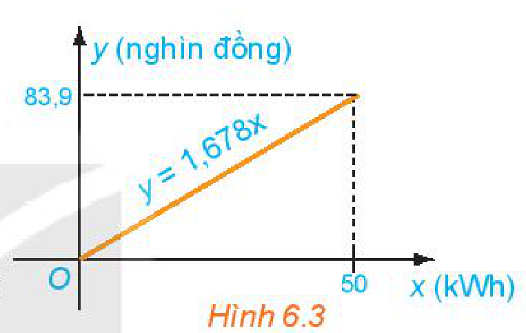
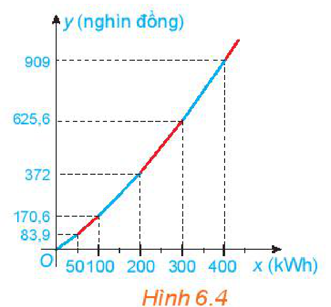
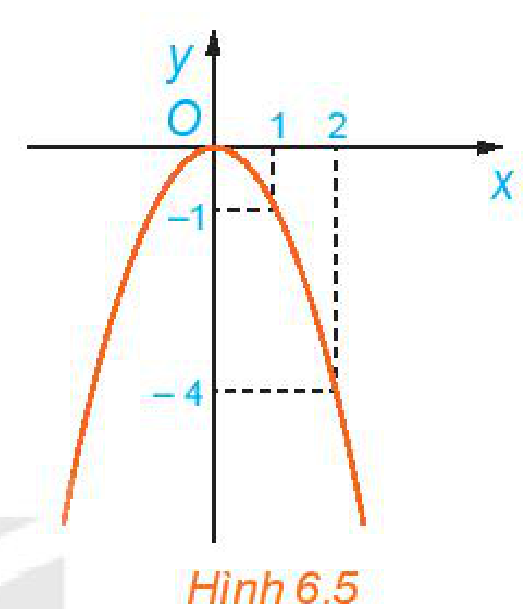
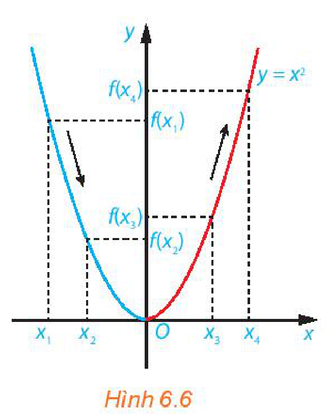
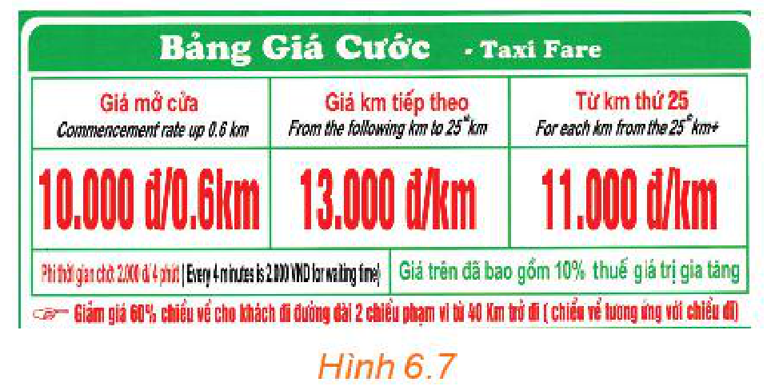
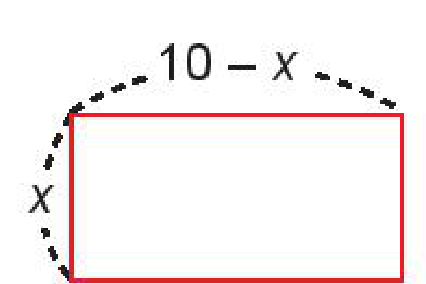

<!-- pdf:5 -->

<!-- Phần giới thiệu Chương VI (in chung đầu trang PDF 5): CHƯƠNG VI. HÀM SỐ, ĐỒ THỊ VÀ ỨNG DỤNG -->

Chương này hệ thống hoá các khái niệm cơ bản về hàm số và đồ thị của hàm số đã được học ở các lớp dưới; cách vẽ đồ thị của hàm số bậc hai; xét dấu của tam thức bậc hai và vận dụng để giải bất phương trình bậc hai, bài toán thực tiễn. Ta cũng xét các phương trình chứa căn thức đơn giản có thể quy về phương trình bậc hai.

# BÀI 15: HÀM SỐ

## 🔤 Thuật ngữ

- Tập xác định
- Tập giá trị
- Đồ thị của hàm số
- Hàm số đồng biến
- Hàm số nghịch biến

## 🎯 Mục tiêu

- Nhận biết những mô hình dẫn đến khái niệm hàm số.
- Mô tả các khái niệm cơ bản về hàm số: định nghĩa hàm số, tập xác định, tập giá trị, hàm số đồng biến, hàm số nghịch biến, đồ thị của hàm số.
- Mô tả dạng đồ thị của hàm số đồng biến, nghịch biến.
- Vận dụng kiến thức của hàm số vào giải quyết một số bài toán thực tiễn.

## 🔴 Mở đầu

Quan sát hoá đơn tiền điện ở hình bên. Hãy cho biết tổng lượng điện tiêu thụ trong tháng và số tiền phải trả (chưa tính thuế giá trị gia tăng).

Có cách nào mô tả sự phụ thuộc của số tiền phải trả vào tổng lượng điện tiêu thụ hay không?

<!-- pdf:6 -->

## 1. KHÁI NIỆM HÀM SỐ

**HĐ1:** Bảng 6.1 cho biết nồng độ bụi PM 2.5 trong không khí theo thời gian trong ngày 25-3-2021 tại một trạm quan trắc ở Thủ đô Hà Nội:

| Thời điểm (giờ) | $0$ | $4$ | $8$ | $12$ | $16$ |
| --- | --- | --- | --- | --- | --- |
| Nồng độ bụi PM 2.5 ($\mu\text{g/m}^3$) | $74,27$ | $64,58$ | $57,9$ | $69,07$ | $81,78$ |

*Bảng 6.1 (Theo moitruongthudo.vn)*

> Bụi PM 2.5 là hạt bụi mịn có đường kính nhỏ hơn $2,5$ micrômét, gây tác hại cho sức khoẻ.

a) Hãy cho biết nồng độ bụi PM 2.5 tại mỗi thời điểm $8$ giờ, $12$ giờ, $16$ giờ.

b) Trong Bảng 6.1, mỗi thời điểm tương ứng với bao nhiêu giá trị của nồng độ bụi PM 2.5?

**HĐ2:** Quan sát Hình 6.1.

a) Thời gian theo dõi mực nước biển ở Trường Sa được thể hiện trong hình từ năm nào đến năm nào?

b) Trong khoảng thời gian đó, năm nào mực nước biển trung bình tại Trường Sa cao nhất, thấp nhất?

*Hình 6.1 (Theo Tổng cục Thống kê)*

**HĐ3:** Tính tiền điện

a) Dựa vào Bảng 6.2 về giá bán lẻ điện sinh hoạt, hãy tính số tiền phải trả ứng với mỗi lượng điện tiêu thụ ở Bảng 6.3:

| Lượng điện tiêu thụ ($\text{kWh}$) | $50$ | $100$ | $200$ |
| --- | --- | --- | --- |
| Số tiền (nghìn đồng) | $?$ | $?$ | $?$ |

*Bảng 6.3*

| Mức điện tiêu thụ | Giá bán điện (đồng/$\text{kWh}$) |
| --- | --- |
| Bậc 1 (từ $0$ đến $50\text{ kWh}$) | $1\,678$ |
| Bậc 2 (từ trên $50$ đến $100\text{ kWh}$) | $1\,734$ |
| Bậc 3 (từ trên $100$ đến $200\text{ kWh}$) | $2\,014$ |
| Bậc 4 (từ trên $200$ đến $300\text{ kWh}$) | $2\,536$ |
| Bậc 5 (từ trên $300$ đến $400\text{ kWh}$) | $2\,834$ |
| Bậc 6 (từ trên $400\text{ kWh}$ trở lên) | $2\,927$ |
<!-- ocr-ok: đã đối chiếu ảnh trang PDF 6, OCR đọc lỗi chữ Bậc và kWh -->

*Bảng 6.2 (Theo Tập đoàn Điện lực Việt Nam ngày 20-3-2019)*

b) Gọi $x$ là lượng điện tiêu thụ (đơn vị $\text{kWh}$) và $y$ là số tiền phải trả tương ứng (đơn vị nghìn đồng). Hãy viết công thức mô tả sự phụ thuộc của $y$ vào $x$ khi $0 \le x \le 50$.

> $\text{kWh}$ hay $\text{kW.h}$ (kilôoát giờ, còn gọi là số điện) là đơn vị để đo lượng điện tiêu thụ. Ví dụ, một chiếc bàn là công suất $2\text{ kW}$, nếu sử dụng liên tục trong $1$ giờ sẽ tiêu thụ lượng điện là $2\text{ kWh}$.

Trong HĐ1, nếu gọi $x$ là thời điểm và $y$ là nồng độ bụi PM 2.5 thì với mỗi giá trị của $x$, xác định được chỉ một giá trị tương ứng của $y$. Ta tìm thấy mối quan hệ phụ thuộc tương tự giữa các đại lượng trong HĐ2, HĐ3.

Giả sử có đại lượng $y$ phụ thuộc vào đại lượng thay đổi $x$, trong đó $x$ nhận giá trị thuộc tập hợp số $D$.

<!-- pdf:7 -->

> Nếu với mỗi giá trị của $x$ thuộc tập hợp số $D$ *có một và chỉ một* giá trị tương ứng của $y$ thuộc tập số thực $\mathbb{R}$ thì ta có một hàm số.
>
> Ta gọi $x$ là **biến số** và $y$ là **hàm số** của $x$.
>
> Tập hợp $D$ gọi là **tập xác định** của hàm số.
>
> Tập tất cả các giá trị $y$ nhận được, gọi là **tập giá trị** của hàm số.

> Khi $y$ là hàm số của $x$, ta có thể viết $y = f(x)$, $y = g(x)$, ...
<!-- ocr-ok: đã đối chiếu ảnh trang PDF 7, OCR đọc sai dấu tiếng Việt trong bóng nói -->

**Ví dụ 1:** Trong HĐ1, nếu gọi $x$ là thời điểm, $y$ là nồng độ bụi PM 2.5 thì $x$ là biến số và $y$ là hàm số của $x$. Đó là *hàm số được cho bằng bảng*.

Tập xác định của hàm số là $D = \{0; 4; 8; 12; 16\}$.

Tập giá trị của hàm số là $\{74,27; 64,58; 57,9; 69,07; 81,78\}$.

**Ví dụ 2:** Viết hàm số mô tả sự phụ thuộc của quãng đường đi được vào thời gian của một vật chuyển động thẳng đều với vận tốc $2\text{ m/s}$. Tìm tập xác định của hàm số đó. Tính quãng đường vật đi được sau $5\text{ s}$, $10\text{ s}$.

**Giải:**

Một vật chuyển động thẳng đều với vận tốc $v = 2\text{ m/s}$ thì quãng đường đi được $S$ (mét) phụ thuộc vào thời gian $t$ (giây) theo công thức $S = 2t$, trong đó $t$ là biến số, $S = S(t)$ là hàm số của $t$.

Tập xác định của hàm số là $D = [0; +\infty)$.

Quãng đường vật đi được sau $5\text{ s}$ là: $S_1 = S(5) = 2 \cdot 5 = 10\text{ (m)}$.

Quãng đường vật đi được sau $10\text{ s}$ là: $S_2 = S(10) = 2 \cdot 10 = 20\text{ (m)}$.

**Chú ý:** Khi cho *hàm số bằng công thức* $y = f(x)$ mà không chỉ rõ tập xác định của nó thì ta quy ước tập xác định của hàm số là tập hợp tất cả các số thực $x$ sao cho biểu thức $f(x)$ có nghĩa.

**Ví dụ 3:** Tìm tập xác định của các hàm số sau:

a) $y = \sqrt{2x - 4}$;

b) $y = \frac{1}{x - 1}$.

**Giải:**

a) Biểu thức $\sqrt{2x - 4}$ có nghĩa khi $2x - 4 \ge 0$, tức là khi $x \ge 2$.

Vậy tập xác định của hàm số đã cho là $D = [2; +\infty)$.

b) Biểu thức $\frac{1}{x - 1}$ có nghĩa khi $x - 1 \ne 0$, tức là khi $x \ne 1$.

Vậy tập xác định của hàm số đã cho là $D = \mathbb{R} \setminus \{1\}$.

**Luyện tập 1:**

a) Hãy cho biết Bảng 6.4 có cho ta một hàm số hay không. Nếu có, tìm tập xác định và tập giá trị của hàm số đó.

| Thời điểm (năm) | $2013$ | $2014$ | $2015$ | $2016$ | $2017$ | $2018$ |
| --- | --- | --- | --- | --- | --- | --- |
| Tuổi thọ trung bình của người Việt Nam (tuổi) | $73,1$ | $73,2$ | $73,3$ | $73,4$ | $73,5$ | $73,5$ |

*Bảng 6.4 (Theo Tổng cục Thống kê)*

b) Trở lại HĐ2, ta có *hàm số cho bằng biểu đồ*. Hãy cho biết giá trị của hàm số tại $x = 2018$.

c) Cho hàm số $y = f(x) = -2x^2$. Tính $f(1)$; $f(2)$ và tìm tập xác định, tập giá trị của hàm số này.

**Nhận xét:** Một hàm số có thể được cho bằng bảng, bằng biểu đồ, bằng công thức hoặc mô tả bằng lời.

<!-- pdf:8 -->

## 2. ĐỒ THỊ CỦA HÀM SỐ

**HĐ4:** Quan sát Hình 6.2 và cho biết những điểm nào sau đây nằm trên đồ thị của hàm số $y = \frac{1}{2}x^2$:

$(0; 0), (2; 2), (-2; 2), (1; 2), (-1; 2).$

Nêu nhận xét về mối quan hệ giữa hoành độ và tung độ của những điểm nằm trên đồ thị.

*Hình 6.2*

> **Đồ thị của hàm số** $y = f(x)$ xác định trên tập $D$ là tập hợp tất cả các điểm $M(x; f(x))$ trên mặt phẳng toạ độ với mọi $x$ thuộc $D$.
<!-- ocr-ok: đã đối chiếu ảnh trang PDF 8, OCR đọc lỗi các kí hiệu toán học và dấu tiếng Việt -->

**Ví dụ 4:** Viết công thức của hàm số cho ở HĐ3b. Tìm tập xác định, tập giá trị và vẽ đồ thị của hàm số này.

**Giải:**

Công thức của hàm số cho ở HĐ3b là $y = 1,678x$ với $0 \le x \le 50$.

Tập xác định của hàm số này là $D = [0; 50]$.

Vì $0 \le x \le 50$ nên $0 \le y \le 1,678 \cdot 50 = 83,9$.

Vậy tập giá trị của hàm số là $[0; 83,9]$.

Đồ thị của hàm số $y = 1,678x$ trên $[0; 50]$ là một đoạn thẳng (H.6.3).

*Hình 6.3*

**Luyện tập 2:**

a) Dựa vào đồ thị của hàm số $y = \frac{1}{2}x^2$ (H.6.2), tìm $x$ sao cho $y = 8$.

b) Vẽ đồ thị của các hàm số $y = 2x + 1$ và $y = 2x^2$ trên cùng một mặt phẳng toạ độ.

**Vận dụng 1:** Nếu lượng điện tiêu thụ từ trên $50$ đến $100\text{ kWh}$ ($50 < x \le 100$) thì công thức liên hệ giữa $y$ và $x$ đã thiết lập ở HĐ3 không còn đúng nữa.

Theo bảng giá bán lẻ điện sinh hoạt (Bảng 6.2) thì số tiền phải trả là:

$y = 1,678 \cdot 50 + 1,734(x - 50) = 83,9 + 1,734(x - 50)$, hay $y = 1,734x - 2,8$ (nghìn đồng).

Vậy trên tập xác định $D = (50; 100]$, hàm số $y$ mô tả số tiền phải thanh toán có công thức là $y = 1,734x - 2,8$; tập giá trị của nó là $(83,9; 170,6]$.

Hãy vẽ đồ thị ở Hình 6.3 vào vở rồi vẽ tiếp đồ thị của hàm số $y = 1,734x - 2,8$ trên tập $D = (50; 100]$.

## 💡 Tìm hiểu thêm

<!-- term: Hàm số cho bởi nhiều công thức -->
Hàm số mô tả sự phụ thuộc của $y$ (số tiền phải trả) vào $x$ (lượng điện tiêu thụ) trên từng khoảng giá trị $x$ được cho bằng công thức như sau:

$y = \begin{cases} 1,678x & \text{nếu } 0 \le x \le 50 \\ 1,734x - 2,8 & \text{nếu } 50 < x \le 100 \\ 2,014x - 30,8 & \text{nếu } 100 < x \le 200 \\ 2,536x - 135,2 & \text{nếu } 200 < x \le 300 \\ 2,834x - 224,6 & \text{nếu } 300 < x \le 400 \\ 2,927x - 261,8 & \text{nếu } x > 400. \end{cases}$

Đồ thị của hàm số trên được vẽ như Hình 6.4.

*Hình 6.4*

<!-- pdf:9 -->

## 3. SỰ ĐỒNG BIẾN, NGHỊCH BIẾN CỦA HÀM SỐ

**HĐ5:** Cho các hàm số $y = -x + 1$ và $y = x$. Tính giá trị $y$ theo giá trị $x$ để hoàn thành bảng sau:

| $x$ | $-2$ | $-1$ | $0$ | $1$ | $2$ |
| --- | --- | --- | --- | --- | --- |
| $y = -x + 1$ | $?$ | $?$ | $?$ | $?$ | $?$ |
| $y = x$ | $?$ | $?$ | $?$ | $?$ | $?$ |

Khi giá trị $x$ tăng, giá trị $y$ tương ứng của mỗi hàm số $y = -x + 1$ và $y = x$ tăng hay giảm?

**HĐ6:** Quan sát đồ thị của hàm số $y = f(x) = -x^2$ trên $\mathbb{R}$ (H.6.5).

Hỏi:

a) Giá trị của $f(x)$ tăng hay giảm khi $x$ tăng trên khoảng $(-\infty; 0)$?

b) Giá trị của $f(x)$ tăng hay giảm khi $x$ tăng trên khoảng $(0; +\infty)$?

*Hình 6.5*

> Hàm số $y = f(x)$ được gọi là **đồng biến** (tăng) trên khoảng $(a; b)$, nếu
>
> $\forall x_1, x_2 \in (a; b), x_1 < x_2 \Rightarrow f(x_1) < f(x_2).$
>
> Hàm số $y = f(x)$ được gọi là **nghịch biến** (giảm) trên khoảng $(a; b)$, nếu
>
> $\forall x_1, x_2 \in (a; b), x_1 < x_2 \Rightarrow f(x_1) > f(x_2).$

<!-- term: Xét chiều biến thiên của hàm số -->
**Ví dụ 5:** Hàm số $y = x^2$ đồng biến hay nghịch biến trên mỗi khoảng: $(-\infty; 0)$ và $(0; +\infty)$?

**Giải:**

Vẽ đồ thị hàm số $y = f(x) = x^2$ như Hình 6.6.

- Trên khoảng $(-\infty; 0)$, đồ thị "đi xuống" từ trái sang phải và với $x_1, x_2 \in (-\infty; 0)$, $x_1 < x_2$ thì $f(x_1) > f(x_2)$.
  Như vậy, hàm số $y = x^2$ nghịch biến trên khoảng $(-\infty; 0)$.
- Trên khoảng $(0; +\infty)$, đồ thị "đi lên" từ trái sang phải và với $x_3, x_4 \in (0; +\infty)$, $x_3 < x_4$ thì $f(x_3) < f(x_4)$.
  Như vậy, hàm số $y = x^2$ đồng biến trên khoảng $(0; +\infty)$.

*Hình 6.6*

**Chú ý:**

- Đồ thị của một hàm số đồng biến trên khoảng $(a; b)$ là đường "đi lên" từ trái sang phải;
- Đồ thị của một hàm số nghịch biến trên khoảng $(a; b)$ là đường "đi xuống" từ trái sang phải.

<!-- pdf:10 -->

**Luyện tập 3:** Vẽ đồ thị của các hàm số $y = 3x + 1$ và $y = -2x^2$. Hãy cho biết:

a) Hàm số $y = 3x + 1$ đồng biến hay nghịch biến trên $\mathbb{R}$.

b) Hàm số $y = -2x^2$ đồng biến hay nghịch biến trên mỗi khoảng: $(-\infty; 0)$ và $(0; +\infty)$.
<!-- ocr-ok: đã đối chiếu ảnh trang PDF 10, OCR đọc chữ mỗi thành mối -->

**Vận dụng 2:** Quan sát bảng giá cước taxi bốn chỗ trong Hình 6.7.

a) Tính số tiền phải trả khi di chuyển $25\text{ km}$.

b) Lập công thức tính số tiền cước taxi phải trả theo số kilômét di chuyển.

c) Vẽ đồ thị và cho biết hàm số đồng biến trên khoảng nào, nghịch biến trên khoảng nào.

*Hình 6.7*

## ✏️ Bài tập

**6.1.** Xét hai đại lượng $x, y$ phụ thuộc vào nhau theo các hệ thức dưới đây. Những trường hợp nào thì $y$ là hàm số của $x$?

a) $x + y = 1$;

b) $y = x^2$;

c) $y^2 = x$;

d) $x^2 - y^2 = 0$.

**6.2.** Hãy cho một ví dụ về hàm số được cho bằng bảng hoặc biểu đồ. Hãy chỉ ra tập xác định và tập giá trị của hàm số đó.

**6.3.** Tìm tập xác định của các hàm số sau:

a) $y = 2x^3 + 3x + 1$;

b) $y = \frac{x - 1}{x^2 - 3x + 2}$;

c) $y = \sqrt{x + 1} + \sqrt{1 - x}$.

**6.4.** Tìm tập xác định và tập giá trị của mỗi hàm số sau:

a) $y = 2x + 3$;

b) $y = 2x^2$.

**6.5.** Vẽ đồ thị các hàm số sau và chỉ ra các khoảng đồng biến, nghịch biến của chúng.

a) $y = -2x + 1$;

b) $y = -\frac{1}{2}x^2$.

**6.6.** Giá thuê xe ô tô tự lái là $1,2$ triệu đồng một ngày cho hai ngày đầu tiên và $900$ nghìn đồng cho mỗi ngày tiếp theo. Tổng số tiền $T$ phải trả là một hàm số của số ngày $x$ mà khách thuê xe.

a) Viết công thức của hàm số $T = T(x)$.

b) Tính $T(2), T(3), T(5)$ và cho biết ý nghĩa của mỗi giá trị này.

## 💡 Em có biết?: Hàm số và mô hình hoá

Nhiều tình huống trong thực tiễn đời sống hoặc trong khoa học liên quan đến việc tìm hiểu một đại lượng thay đổi phụ thuộc vào một đại lượng khác như thế nào. Việc tìm hàm số mô tả sự phụ thuộc của đại lượng này vào đại lượng kia được gọi là **mô hình hoá**. Ta thường sử dụng những tính chất hình học hoặc tính chất đại số của đối tượng cần nghiên cứu để thiết lập mô hình. Dựa vào mô hình đã được thiết lập, ta có thể phân tích và dự đoán các tính chất của đối tượng hoặc của tình huống cần nghiên cứu.

<!-- pdf:11 -->

Quá trình mô hình hoá bằng cách dùng hàm số thường bao gồm các bước sau:

**Bước 1: Diễn tả mô hình bằng lời**

Xác định đại lượng cần mô hình hoá và diễn tả bằng lời sự phụ thuộc của nó vào những đại lượng khác trong bài toán.

**Bước 2: Chọn biến số**

Xác định tất cả các đại lượng được dùng để diễn tả sự phụ thuộc bằng lời ở Bước 1. Dùng kí hiệu, chẳng hạn $x$, để chỉ một đại lượng thích hợp nào đó và biểu diễn các đại lượng khác theo $x$.

**Bước 3: Thiết lập mô hình**

Biểu diễn sự phụ thuộc ở Bước 1 như là một hàm số của biến số $x$ đã được chọn ở Bước 2.

**Bước 4: Sử dụng mô hình**

Sử dụng hàm số đã thiết lập ở Bước 3 để trả lời các câu hỏi của bài toán.

Kiểm tra sự phù hợp của mô hình.

Dưới đây ta xét một ví dụ đơn giản minh hoạ cho quá trình mô hình hoá này.

**Ví dụ:** Bác An dùng $20\text{ m}$ lưới thép gai rào thành một mảnh vườn hình chữ nhật để trồng rau.

a) Thiết lập hàm số mô tả diện tích của mảnh vườn.

b) Bác An có thể rào thành mảnh vườn có diện tích bằng $21\text{ m}^2$ được không?

c) Chiều rộng của mảnh vườn phải như thế nào để diện tích của mảnh vườn lớn hơn $24\text{ m}^2$?

d) Tìm kích thước của mảnh vườn hình chữ nhật có diện tích lớn nhất mà bác An có thể rào được.

**Giải:**

*Bước 1. Diễn tả mô hình bằng lời*

Ta biết rằng

Diện tích mảnh vườn hình chữ nhật $=$ chiều rộng $\times$ chiều dài.

*Bước 2. Chọn biến số*

Có hai đại lượng thay đổi là chiều rộng và chiều dài. Vì ta muốn lập hàm số chỉ phụ thuộc vào một biến số ta chọn, chẳng hạn

$x =$ chiều rộng của mảnh vườn hình chữ nhật.

Ta cần tính chiều dài của mảnh vườn hình chữ nhật theo $x$. Do chu vi của mảnh vườn hình chữ nhật không đổi bằng $20\text{ m}$ và nửa chu vi bằng tổng của chiều rộng và chiều dài nên chiều dài của mảnh vườn sẽ là $10 - x\text{ (m)}$.

*Bước 3. Thiết lập mô hình*

Diện tích của mảnh vườn hình chữ nhật là

$S(x) = \text{chiều rộng} \times \text{chiều dài} = x(10 - x) = -x^2 + 10x\text{ (m}^2\text{)}.$

Như vậy, ở đây diện tích $S(x)$ của mảnh vườn là hàm số của chiều rộng $x$.

*Bước 4. Sử dụng mô hình*

Ta có thể sử dụng mô hình đã thiết lập để trả lời các câu hỏi ở phần b, c, d. Chẳng hạn, với câu hỏi ở phần b, ta cần tìm chiều rộng $x$ của mảnh vườn sao cho

$S(x) = 21$ hay $-x^2 + 10x = 21$, hay $x^2 - 10x + 21 = 0$.

Giải phương trình bậc hai này ta được hai nghiệm $x = 3$ và $x = 7$.

Vì chiều rộng phải nhỏ hơn hoặc bằng chiều dài nên chỉ có nghiệm $x = 3$ là thoả mãn.

Khi đó mảnh vườn hình chữ nhật có chiều rộng là $3\text{ m}$ và chiều dài là $10 - 3 = 7\text{ (m)}$.

Vậy bác An có thể dùng $20\text{ m}$ hàng rào dây thép gai để rào thành mảnh vườn hình chữ nhật có diện tích bằng $21\text{ m}^2$.

Trong các bài sau, các em sẽ được học những kiến thức toán học cần thiết để sử dụng hàm số $S(x)$ trả lời cho các câu hỏi ở phần c và phần d.

## 📷 Danh sách hình trong bài

| Mã hình | Trang PDF | Vị trí trong bài | Chú thích gốc |
| --- | --- | --- | --- |
| H10-toan-b15-01 | 5 | Mở đầu | (sách không đánh số, hoá đơn tiền điện) |
| H10-toan-b15-02 | 6 | Mục 1, HĐ2 | Hình 6.1 (Theo Tổng cục Thống kê) |
| H10-toan-b15-03 | 8 | Mục 2, HĐ4 | Hình 6.2 |
| H10-toan-b15-04 | 8 | Mục 2, Ví dụ 4 | Hình 6.3 |
| H10-toan-b15-05 | 8 | Tìm hiểu thêm | Hình 6.4 |
| H10-toan-b15-06 | 9 | Mục 3, HĐ6 | Hình 6.5 |
| H10-toan-b15-07 | 9 | Mục 3, Ví dụ 5 | Hình 6.6 |
| H10-toan-b15-08 | 10 | Mục 3, Vận dụng 2 | Hình 6.7 |
| H10-toan-b15-09 | 11 | Em có biết? | (sách không đánh số, mảnh vườn hình chữ nhật chiều rộng $x$, chiều dài $10 - x$) |
