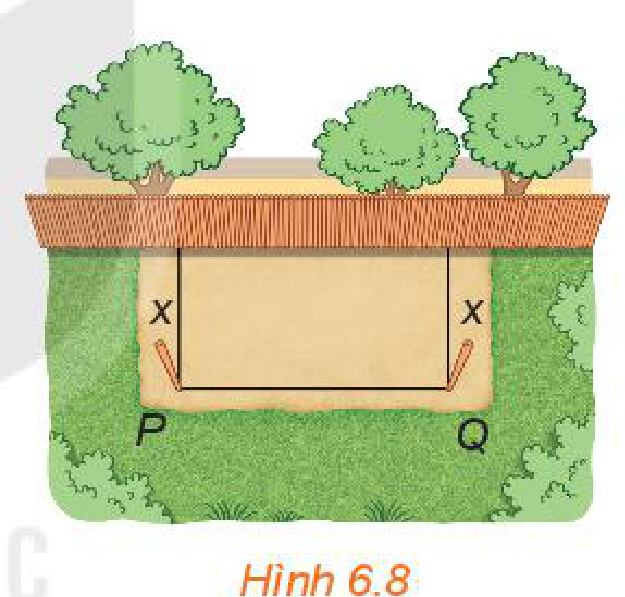
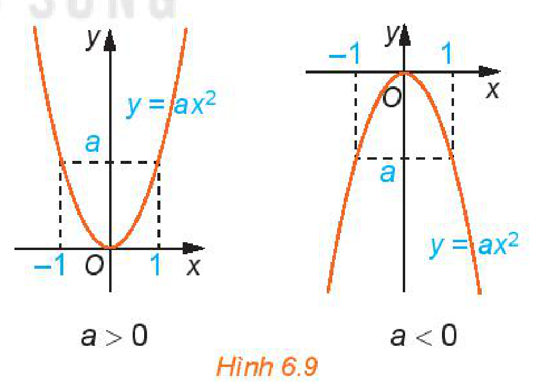
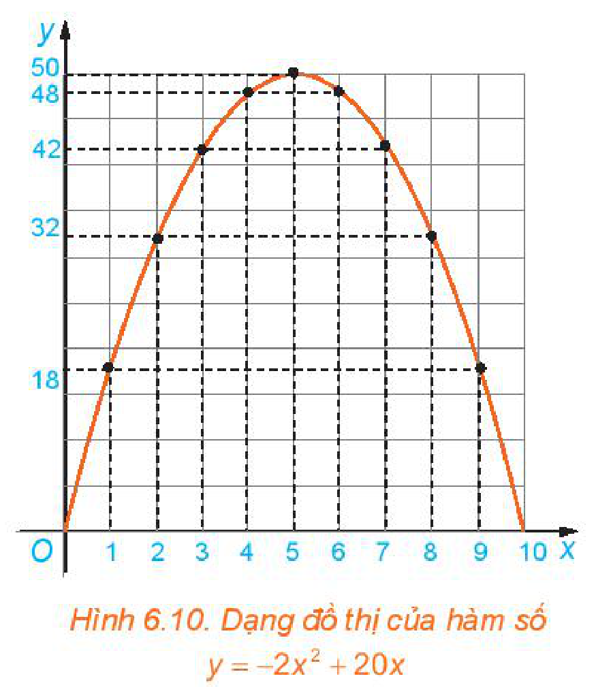
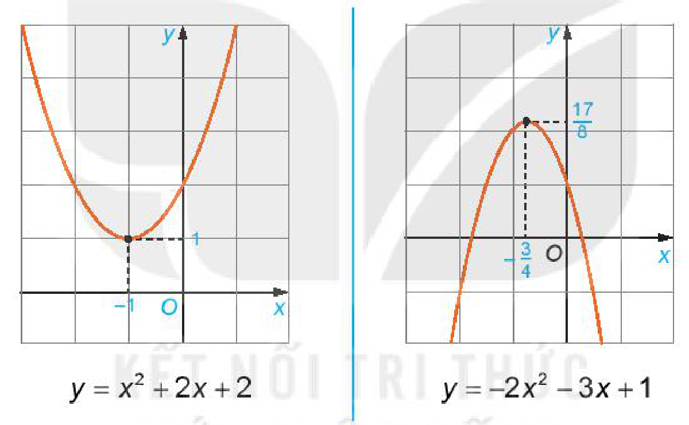
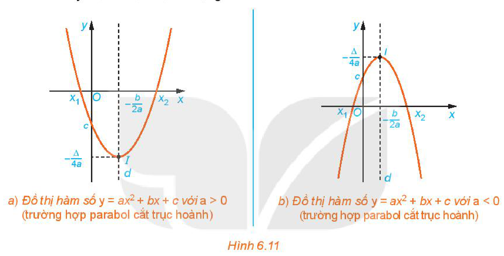
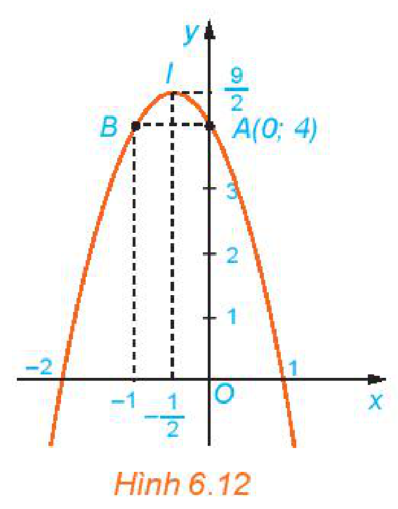
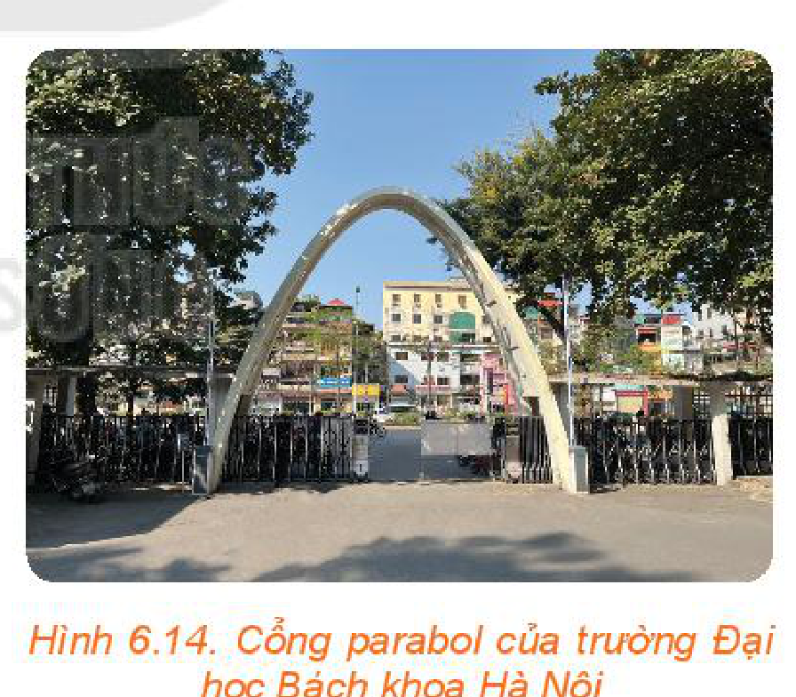
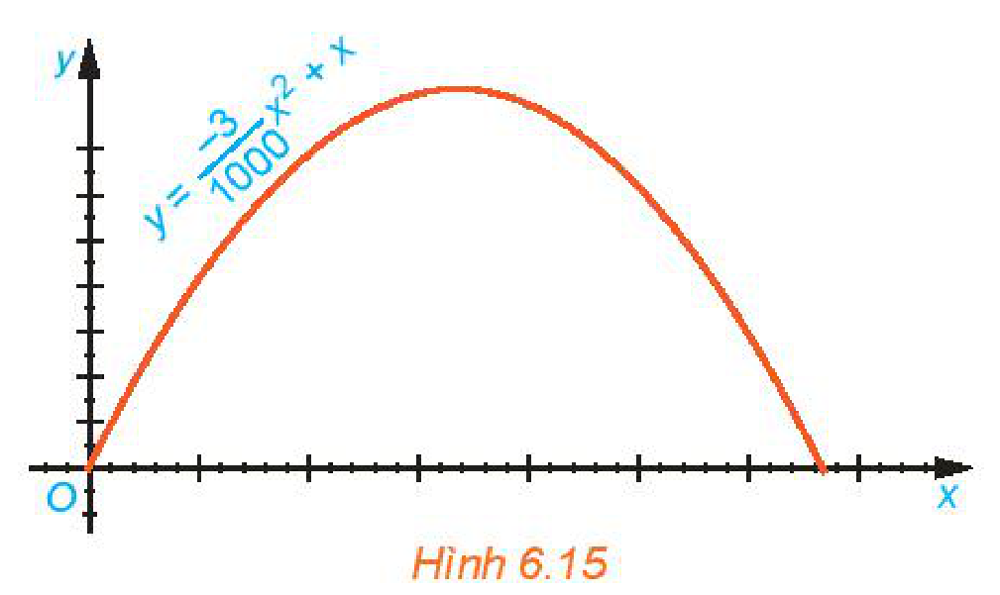
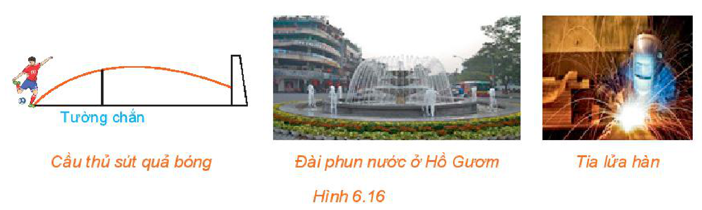

<!-- pdf:12 -->

# BÀI 16: HÀM SỐ BẬC HAI

## 🔤 Thuật ngữ

- Hàm số bậc hai
- Bảng giá trị
- Parabol
- Đỉnh
- Trục đối xứng

## 🎯 Mục tiêu

- Nhận biết hàm số bậc hai.
- Thiết lập bảng giá trị của hàm số bậc hai.
- Vẽ parabol (parabola) là đồ thị của hàm số bậc hai.
- Nhận biết các yếu tố cơ bản của đường parabol như đỉnh, trục đối xứng.
- Nhận biết và giải thích các tính chất của hàm số bậc hai thông qua đồ thị.
- Vận dụng kiến thức về hàm số bậc hai và đồ thị vào giải quyết bài toán thực tiễn.

## 🔴 Mở đầu

Bác Việt có một tấm lưới hình chữ nhật dài $20\text{ m}$. Bác muốn dùng tấm lưới này rào chắn ba mặt áp bên bờ tường của khu vườn nhà mình thành một mảnh đất hình chữ nhật để trồng rau.

Hỏi hai cột góc hàng rào cần phải cắm cách bờ tường bao xa để mảnh đất được rào chắn của bác có diện tích lớn nhất?

*Hình 6.8*

## 1. KHÁI NIỆM HÀM SỐ BẬC HAI

**HĐ1:** Xét bài toán rào vườn ở tình huống mở đầu. Gọi $x$ mét ($0 < x < 10$) là khoảng cách từ điểm cắm cọc đến bờ tường (H.6.8). Hãy tính theo $x$:

a) Độ dài cạnh $PQ$ của mảnh đất.

b) Diện tích $S(x)$ của mảnh đất được rào chắn.

Ở đây ta tính được $S(x) = -2x^2 + 20x$.

Đây là một hàm số cho bởi công thức và gọi là một hàm số bậc hai của biến số $x$.

Tổng quát, ta có

> **Hàm số bậc hai** là hàm số cho bởi công thức
>
> $y = ax^2 + bx + c,$
>
> trong đó $x$ là biến số, $a, b, c$ là các hằng số và $a \ne 0$.
>
> Tập xác định của hàm số bậc hai là $\mathbb{R}$.

<!-- pdf:13 -->

> ❓ Hàm số nào dưới đây là hàm số bậc hai?
>
> A. $y = x^4 + 3x^2 + 2$.
>
> B. $y = \frac{1}{x^2}$.
>
> C. $y = -3x^2 + 1$.
>
> D. $y = 3\left(\frac{1}{x}\right)^2 + 3\frac{1}{x} - 1$.

**Nhận xét:** Hàm số $y = ax^2 \ (a \ne 0)$ đã học ở lớp 9 là một trường hợp đặc biệt của hàm số bậc hai với $b = c = 0$.

**Ví dụ 1:** Xét hàm số bậc hai $y = -2x^2 + 20x$. Thay dấu "$?$" bằng các số thích hợp để hoàn thành bảng giá trị sau của hàm số.

| $x$ | $0$ | $2$ | $4$ | $5$ | $6$ | $8$ | $10$ |
| --- | --- | --- | --- | --- | --- | --- | --- |
| $y$ | $?$ | $?$ | $?$ | $?$ | $?$ | $?$ | $?$ |

> **Bảng giá trị** của hàm số $y = -2x^2 + 20x$ tại một số điểm.

**Giải:**

Thay các giá trị của $x$ vào công thức hàm số, ta được:

| $x$ | $0$ | $2$ | $4$ | $5$ | $6$ | $8$ | $10$ |
| --- | --- | --- | --- | --- | --- | --- | --- |
| $y$ | $0$ | $32$ | $48$ | $50$ | $48$ | $32$ | $0$ |

**Luyện tập 1:** Cho hàm số $y = (x - 1)(2 - 3x)$.

a) Hàm số đã cho có phải là hàm số bậc hai không? Nếu có, hãy xác định các hệ số $a, b, c$ của nó.

b) Thay dấu "$?$" bằng các số thích hợp để hoàn thành bảng giá trị sau của hàm số đã cho.

| $x$ | $-2$ | $-1$ | $0$ | $1$ |
| --- | --- | --- | --- | --- |
| $y$ | $?$ | $?$ | $?$ | $?$ |

**Vận dụng 1:** Một viên bi rơi tự do từ độ cao $19,6\text{ m}$ xuống mặt đất. Độ cao $h$ (mét) so với mặt đất của viên bi trong khi rơi phụ thuộc vào thời gian $t$ (giây) theo công thức: $h = 19,6 - 4,9t^2$; $h, t \ge 0$.

a) Hỏi sau bao nhiêu giây kể từ khi rơi thì viên bi chạm đất?

b) Tìm tập xác định và tập giá trị của hàm số $h$.

## 2. ĐỒ THỊ CỦA HÀM SỐ BẬC HAI

Ở lớp 9, ta đã biết dạng đồ thị của hàm số $y = ax^2 \ (a \ne 0)$ (H.6.9). Trong mục này ta sẽ tìm hiểu đồ thị của hàm số bậc hai $y = ax^2 + bx + c \ (a \ne 0)$.

*Hình 6.9*

**HĐ2:** Xét hàm số $y = S(x) = -2x^2 + 20x \ (0 < x < 10)$.

a) Trên mặt phẳng toạ độ $Oxy$, biểu diễn toạ độ các điểm trong bảng giá trị của hàm số lập được ở Ví dụ 1. Nối các điểm đã vẽ lại ta được dạng đồ thị hàm số $y = -2x^2 + 20x$ trên khoảng $(0; 10)$ như trong Hình 6.10. Dạng đồ thị của hàm số $y = -2x^2 + 20x$ có giống với đồ thị của hàm số $y = -2x^2$ hay không?

<!-- pdf:14 -->

b) Quan sát dạng đồ thị của hàm số $y = -2x^2 + 20x$ trong Hình 6.10, tìm toạ độ điểm cao nhất của đồ thị.

c) Thực hiện phép biến đổi

$y = -2x^2 + 20x = -2(x^2 - 10x) = -2(x^2 - 2 \cdot 5 \cdot x + 25) + 50 = -2(x - 5)^2 + 50.$

Hãy cho biết giá trị lớn nhất của diện tích mảnh đất được rào chắn. Từ đó suy ra lời giải của bài toán ở phần mở đầu.

*Hình 6.10. Dạng đồ thị của hàm số $y = -2x^2 + 20x$*

**HĐ3:** Tương tự HĐ2, ta có dạng đồ thị của một số hàm số bậc hai sau.

Từ các đồ thị hàm số trên, hãy nêu nội dung thay vào ô có dấu "$?$" trong bảng sau cho thích hợp.

| Hàm số | Hệ số $a$ | Bề lõm của đồ thị (Quay lên/Quay xuống) | Toạ độ điểm cao nhất/điểm thấp nhất | Trục đối xứng |
| --- | --- | --- | --- | --- |
| $y = x^2 + 2x + 2$ | $1$ | Quay lên | $(-1; 1)$ | $x = -1$ |
| $y = -2x^2 - 3x + 1$ | $?$ | $?$ | $?$ | $?$ |
<!-- ocr-ok: đã đối chiếu ảnh trang PDF 14, OCR đọc lỗi cấu trúc bảng -->

Tổng quát, ta có thể viết hàm số bậc hai $y = ax^2 + bx + c \ (a \ne 0)$ dưới dạng

$y = ax^2 + bx + c = a\left(x^2 + 2\frac{b}{2a}x + \frac{b^2}{4a^2}\right) - \frac{b^2}{4a} + c = a\left(x + \frac{b}{2a}\right)^2 - \frac{\Delta}{4a}$, với $\Delta = b^2 - 4ac$.

<!-- pdf:15 -->

Ta thấy điểm $I\left(-\frac{b}{2a}; -\frac{\Delta}{4a}\right)$ thuộc đồ thị hàm số bậc hai và là một điểm đặc biệt, nó đóng vai trò như điểm $O(0; 0)$ của đồ thị hàm số $y = ax^2$. Cụ thể:

- Nếu $a > 0$ thì $y = a\left(x + \frac{b}{2a}\right)^2 - \frac{\Delta}{4a} \ge -\frac{\Delta}{4a}$ với mọi $x$. Như vậy điểm $I$ là điểm thấp nhất trên đồ thị.
- Nếu $a < 0$ thì $y = a\left(x + \frac{b}{2a}\right)^2 - \frac{\Delta}{4a} \le -\frac{\Delta}{4a}$ với mọi $x$. Như vậy điểm $I$ là điểm cao nhất trên đồ thị.

Gọi $(P_0)$ là **parabol** $y = ax^2$. Nếu ta "dịch chuyển" $(P_0)$ theo vectơ $\overrightarrow{OI}$ thì ta sẽ thu được đồ thị $(P)$ của hàm số $y = ax^2 + bx + c$ có dạng như Hình 6.11.

*Hình 6.11. a) Đồ thị hàm số $y = ax^2 + bx + c$ với $a > 0$ (trường hợp parabol cắt trục hoành). b) Đồ thị hàm số $y = ax^2 + bx + c$ với $a < 0$ (trường hợp parabol cắt trục hoành).*

**Nhận xét:** Đồ thị hàm số bậc hai $y = ax^2 + bx + c$ là một parabol.

<!-- term: Cách vẽ đồ thị hàm số bậc hai -->
> - Đồ thị hàm số $y = ax^2 + bx + c \ (a \ne 0)$ là một đường **parabol** có **đỉnh** là điểm $I\left(-\frac{b}{2a}; -\frac{\Delta}{4a}\right)$, có **trục đối xứng** là đường thẳng $x = -\frac{b}{2a}$. Parabol này quay bề lõm lên trên nếu $a > 0$, xuống dưới nếu $a < 0$.
> - Để vẽ đường parabol $y = ax^2 + bx + c$ ta tiến hành theo các bước sau:
>   1. Xác định toạ độ đỉnh $I\left(-\frac{b}{2a}; -\frac{\Delta}{4a}\right)$;
>   2. Xác định trục đối xứng $x = -\frac{b}{2a}$;
>   3. Xác định toạ độ các giao điểm của parabol với trục tung, trục hoành (nếu có) và một vài điểm đặc biệt trên parabol;
>   4. Vẽ parabol.

<!-- pdf:16 -->

**Ví dụ 2:**

a) Vẽ parabol $y = -2x^2 - 2x + 4$.

b) Từ đồ thị, hãy tìm khoảng đồng biến, nghịch biến và giá trị lớn nhất của hàm số $y = -2x^2 - 2x + 4$.

**Giải:**

a) Ta có $a = -2 < 0$ nên parabol quay bề lõm xuống dưới.

Đỉnh $I\left(-\frac{1}{2}; \frac{9}{2}\right)$. Trục đối xứng $x = -\frac{1}{2}$. Giao điểm của đồ thị với trục $Oy$ là $A(0; 4)$. Parabol cắt trục hoành tại hai điểm có hoành độ là nghiệm của phương trình $-2x^2 - 2x + 4 = 0$, tức là $x = 1$ và $x = -2$ (H.6.12).

Để vẽ đồ thị chính xác hơn, ta có thể lấy thêm điểm đối xứng với $A$ qua trục đối xứng $x = -\frac{1}{2}$ là $B(-1; 4)$.

*Hình 6.12*

b) Từ đồ thị ta thấy:

- Hàm số $y = -2x^2 - 2x + 4$ đồng biến trên $\left(-\infty; -\frac{1}{2}\right)$, nghịch biến trên $\left(-\frac{1}{2}; +\infty\right)$;
- Giá trị lớn nhất của hàm số là $y = \frac{9}{2}$, khi $x = -\frac{1}{2}$.

**Luyện tập 2:** Vẽ parabol $y = 3x^2 - 10x + 7$. Từ đó tìm khoảng đồng biến, nghịch biến và giá trị nhỏ nhất của hàm số $y = 3x^2 - 10x + 7$.

**Nhận xét:** Từ đồ thị hàm số $y = ax^2 + bx + c \ (a \ne 0)$, ta suy ra tính chất của hàm số $y = ax^2 + bx + c \ (a \ne 0)$:

<!-- term: Tính chất của hàm số bậc hai -->
| Với $a > 0$ | Với $a < 0$ |
| --- | --- |
| Hàm số nghịch biến trên khoảng $\left(-\infty; -\frac{b}{2a}\right)$; | Hàm số đồng biến trên khoảng $\left(-\infty; -\frac{b}{2a}\right)$; |
| Hàm số đồng biến trên khoảng $\left(-\frac{b}{2a}; +\infty\right)$; | Hàm số nghịch biến trên khoảng $\left(-\frac{b}{2a}; +\infty\right)$; |
| $-\frac{\Delta}{4a}$ là giá trị nhỏ nhất của hàm số. | $-\frac{\Delta}{4a}$ là giá trị lớn nhất của hàm số. |

**Vận dụng 2:** Bạn Nam đứng dưới chân cầu vượt ba tầng ở nút giao ngã ba Huế, thuộc thành phố Đà Nẵng để ngắm cầu vượt (H.6.13). Biết rằng trụ tháp cầu có dạng đường parabol, khoảng cách giữa hai chân trụ tháp khoảng $27\text{ m}$, chiều cao của trụ tháp tính từ điểm trên mặt đất cách chân trụ tháp $2,26\text{ m}$ là $20\text{ m}$. Hãy giúp bạn Nam ước lượng độ cao của đỉnh trụ tháp cầu (so với mặt đất).

**Hướng dẫn:**

Chọn hệ trục toạ độ $Oxy$ sao cho một chân trụ tháp đặt tại gốc toạ độ, chân còn lại đặt trên tia $Ox$. Khi đó trụ tháp là một phần của đồ thị hàm số dạng $y = ax^2 + bx$.

*Hình 6.13. Cầu vượt ba tầng ở nút giao ngã ba Huế thuộc thành phố Đà Nẵng.*

<!-- pdf:17 -->

## ✏️ Bài tập

**6.7.** Vẽ các đường parabol sau:

a) $y = x^2 - 3x + 2$;

b) $y = -2x^2 + 2x + 3$;

c) $y = x^2 + 2x + 1$;

d) $y = -x^2 + x - 1$.

**6.8.** Từ các parabol đã vẽ ở Bài tập 6.7, hãy cho biết khoảng đồng biến và khoảng nghịch biến của mỗi hàm số bậc hai tương ứng.

**6.9.** Xác định parabol $y = ax^2 + bx + 1$, trong mỗi trường hợp sau:
<!-- ocr-ok: đã đối chiếu ảnh trang PDF 17, OCR đọc chữ mỗi thành mối -->

a) Đi qua hai điểm $A(1; 0)$ và $B(2; 4)$;

b) Đi qua điểm $A(1; 0)$ và có trục đối xứng $x = 1$;

c) Có đỉnh $I(1; 2)$;

d) Đi qua điểm $C(-1; 1)$ và có tung độ đỉnh bằng $-0,25$.

**6.10.** Xác định parabol $y = ax^2 + bx + c$, biết rằng parabol đó đi qua điểm $A(8; 0)$ và có đỉnh là $I(6; -12)$.

**Gợi ý:** Phương trình parabol có thể viết dưới dạng $y = a(x - h)^2 + k$, trong đó $I(h; k)$ là toạ độ đỉnh của parabol.

**6.11.** Gọi $(P)$ là đồ thị hàm số bậc hai $y = ax^2 + bx + c$. Hãy xác định dấu của hệ số $a$ và biệt thức $\Delta$, trong mỗi trường hợp sau:
<!-- ocr-ok: đã đối chiếu ảnh trang PDF 17, OCR đọc lỗi kí hiệu biệt thức Delta -->

a) $(P)$ nằm hoàn toàn phía trên trục hoành;

b) $(P)$ nằm hoàn toàn phía dưới trục hoành;

c) $(P)$ cắt trục hoành tại hai điểm phân biệt và có đỉnh nằm phía dưới trục hoành;

d) $(P)$ tiếp xúc với trục hoành và nằm phía trên trục hoành.

**6.12.** Hai bạn An và Bình trao đổi với nhau:

An nói: *Tớ đọc ở một tài liệu thấy nói rằng cổng Trường Đại học Bách khoa Hà Nội (H.6.14) có dạng một parabol, khoảng cách giữa hai chân cổng là $8\text{ m}$ và chiều cao của cổng tính từ một điểm trên mặt đất cách chân cổng $0,5\text{ m}$ là $2,93\text{ m}$. Từ đó tớ tính ra được chiều cao của cổng parabol đó là $12\text{ m}$.*

Sau một hồi suy nghĩ, Bình nói: *Nếu dữ kiện như bạn nói, thì chiều cao của cổng parabol mà bạn tính ra ở trên là không chính xác.*

Dựa vào thông tin mà An đọc được, em hãy tính chiều cao của cổng Trường Đại học Bách khoa Hà Nội để xem kết quả bạn An tính được có chính xác không nhé!

*Hình 6.14. Cổng parabol của trường Đại học Bách khoa Hà Nội*

**6.13.** Bác Hùng dùng $40\text{ m}$ lưới thép gai rào thành một mảnh vườn hình chữ nhật để trồng rau.

a) Tính diện tích mảnh vườn hình chữ nhật rào được theo chiều rộng $x$ (mét) của nó.

b) Tìm kích thước của mảnh vườn hình chữ nhật có diện tích lớn nhất mà bác Hùng có thể rào được.

**6.14.** Quỹ đạo của một vật được ném lên từ gốc $O$ (được chọn là điểm ném) trong mặt phẳng toạ độ $Oxy$ là một parabol có phương trình $y = \frac{-3}{1\,000}x^2 + x$, trong đó $x$ (mét) là khoảng

<!-- pdf:18 -->

cách theo phương ngang trên mặt đất từ vị trí của vật đến gốc $O$, $y$ (mét) là độ cao của vật so với mặt đất (H.6.15).

a) Tìm độ cao lớn nhất của vật trong quá trình bay.

b) Tính khoảng cách từ điểm chạm đất sau khi bay của vật đến gốc $O$. Khoảng cách này gọi là *tầm xa* của quỹ đạo.

*Hình 6.15*

## 💡 Em có biết?: Một số mô hình toán học sử dụng hàm số bậc hai

Hàm số bậc hai được sử dụng trong nhiều mô hình thực tế. Dưới đây ta xét một số mô hình đơn giản thường gặp.

– Phương trình chuyển động của vật chuyển động thẳng biến đổi đều

$x = x_0 + v_0t + \frac{at^2}{2},$

trong đó $x_0$ là toạ độ ban đầu của vật, $v_0$ là vận tốc ban đầu của vật và $a$ là gia tốc của vật ($a$ cùng dấu với $v_0$ nếu vật chuyển động nhanh dần đều và ngược dấu với $v_0$ nếu vật chuyển động chậm dần đều). Như vậy toạ độ $x(t)$ của vật là một hàm số bậc hai của thời gian $t$.

Nói riêng, khi bỏ qua sức cản của không khí, nếu ném một vật lên trên theo phương thẳng đứng thì chuyển động của vật sẽ chỉ chịu ảnh hưởng của trọng lực và vật sẽ có gia tốc bằng gia tốc trọng trường. Khi đó độ cao (so với mặt đất) của vật tại thời điểm $t$ cho bởi phương trình

$y(t) = y_0 + v_0t - \frac{1}{2}gt^2,$

trong đó $y_0\text{ (mét)}$ là độ cao ban đầu của vật khi ném lên, $v_0\text{ (m/s)}$ là vận tốc ban đầu của vật và $g$ là gia tốc trọng trường ($g \approx 9,8\text{ m/s}^2$).

Đặc biệt, khi bỏ qua sức cản không khí, nếu một vật rơi tự do từ độ cao $y_0\text{ (mét)}$ so với mặt đất thì độ cao $y\text{ (mét)}$ của nó tại thời điểm $t\text{ (giây)}$ cho bởi công thức

$y(t) = y_0 - \frac{1}{2}gt^2.$

– Phương trình chuyển động của vật ném xiên

Một vật được ném từ độ cao $h\text{ (mét)}$ so với mặt đất, với vận tốc ban đầu $v_0\text{ (m/s)}$ hợp với phương ngang một góc $\alpha$. Khi đó quỹ đạo chuyển động của vật tuân theo phương trình

$y = \frac{-g}{2v_0^2\cos^2\alpha}x^2 + x\tan\alpha + h,$

<!-- pdf:19 -->

ở đó $x\text{ (mét)}$ là khoảng cách vật bay được theo phương ngang tính từ mặt đất tại điểm ném, $y\text{ (mét)}$ là độ cao so với mặt đất của vật trong quá trình bay, $g$ là gia tốc trọng trường. Như vậy quỹ đạo chuyển động của một vật ném xiên là một parabol.

Tương tự, đường đi của quả bóng khi được cầu thủ đá lên không trung, quỹ đạo của viên đạn pháo khi bắn ra khỏi nòng pháo, tia lửa hàn, hạt nước bắn lên từ đài phun nước,... đều có dạng đường parabol (H.6.16).

*Hình 6.16. Cầu thủ sút quả bóng – Đài phun nước ở Hồ Gươm – Tia lửa hàn*

– Doanh thu bán hàng

Trong kinh tế, doanh thu bán hàng là số tiền nhận được khi bán một mặt hàng. Doanh thu $R$ bằng đơn giá $x$ của mặt hàng (tức là giá bán của một sản phẩm) nhân với số lượng $n$ sản phẩm đã bán được, tức là

$R = x \cdot n.$

Định luật nhu cầu khẳng định rằng giữa $x$ và $n$ có mối liên hệ với nhau: Khi cái này tăng thì cái kia sẽ giảm. Phương trình liên hệ giữa $x$ và $n$ gọi là **phương trình nhu cầu**. Nếu phương trình nhu cầu là liên hệ bậc nhất, tức là $n = a - bx$ ($a, b$ là những hằng số dương) thì doanh thu bán hàng sẽ là hàm số bậc hai của đơn giá

$R(x) = xn = x(a - bx) = ax - bx^2.$

Khi đó người ta thường quan tâm đến việc tìm giá bán $x$ để doanh thu đạt cực đại, hoặc tìm giá bán $x$ để doanh thu vượt một mức nào đó.

## 📷 Danh sách hình trong bài

| Mã hình | Trang PDF | Vị trí trong bài | Chú thích gốc |
| --- | --- | --- | --- |
| H10-toan-b16-01 | 12 | Mở đầu | Hình 6.8 |
| H10-toan-b16-02 | 13 | Mục 2 | Hình 6.9 |
| H10-toan-b16-03 | 14 | Mục 2, HĐ2 | Hình 6.10. Dạng đồ thị của hàm số $y = -2x^2 + 20x$ |
| H10-toan-b16-04 | 14 | Mục 2, HĐ3 | (sách không đánh số, đồ thị hai hàm số $y = x^2 + 2x + 2$ và $y = -2x^2 - 3x + 1$) |
| H10-toan-b16-05 | 15 | Mục 2 | Hình 6.11. a) Đồ thị hàm số $y = ax^2 + bx + c$ với $a > 0$ (trường hợp parabol cắt trục hoành). b) Đồ thị hàm số $y = ax^2 + bx + c$ với $a < 0$ (trường hợp parabol cắt trục hoành). |
| H10-toan-b16-06 | 16 | Mục 2, Ví dụ 2 | Hình 6.12 |
| H10-toan-b16-07 | 16 | Mục 2, Vận dụng 2 | Hình 6.13. Cầu vượt ba tầng ở nút giao ngã ba Huế thuộc thành phố Đà Nẵng. |
| H10-toan-b16-08 | 17 | Bài tập 6.12 | Hình 6.14. Cổng parabol của trường Đại học Bách khoa Hà Nội |
| H10-toan-b16-09 | 18 | Bài tập 6.14 | Hình 6.15 |
| H10-toan-b16-10 | 19 | Em có biết? | Hình 6.16 |
