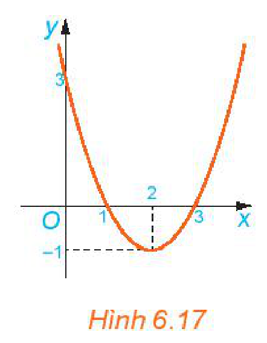
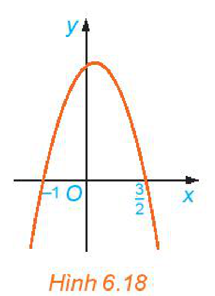
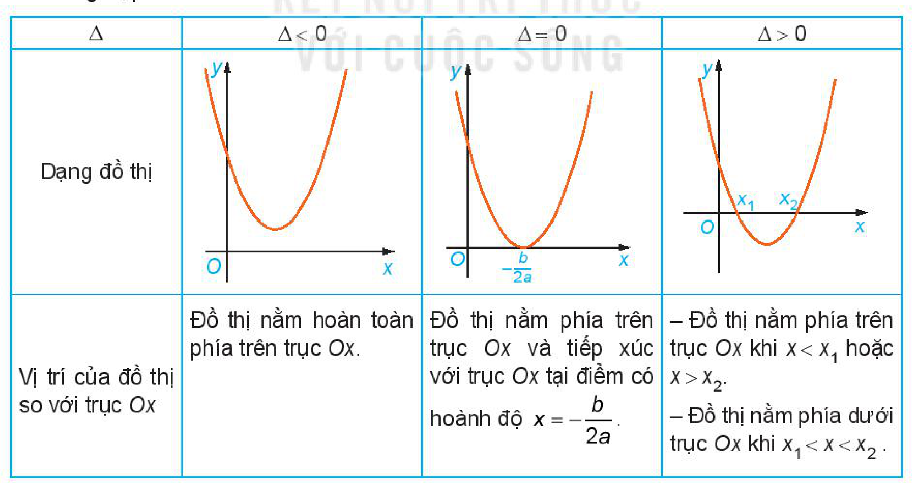
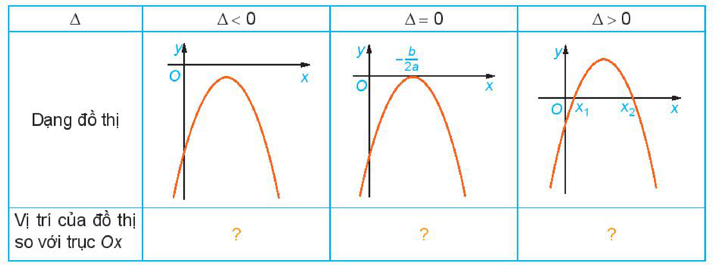
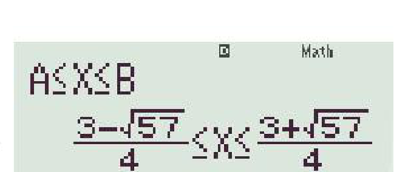
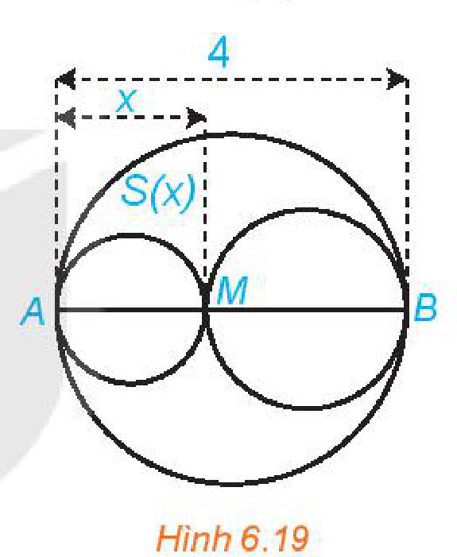

<!-- pdf:20 -->

# BÀI 17: DẤU CỦA TAM THỨC BẬC HAI

## 🔤 Thuật ngữ

- Tam thức bậc hai
- Dấu của tam thức bậc hai
- Bất phương trình bậc hai

## 🎯 Mục tiêu

- Giải thích định lí về dấu của tam thức bậc hai từ việc quan sát đồ thị của hàm bậc hai.
- Giải bất phương trình bậc hai.
- Vận dụng bất phương trình bậc hai vào giải quyết bài toán thực tiễn.

## 🔴 Mở đầu

Xét bài toán rào vườn ở Bài 16, nhưng ta trả lời câu hỏi: Hai cột góc hàng rào (H.6.8) cần phải cắm cách bờ tường bao nhiêu mét để mảnh đất được rào chắn có diện tích không nhỏ hơn $48\text{ m}^2$?

## 1. DẤU CỦA TAM THỨC BẬC HAI

**HĐ1:** Hãy chỉ ra một vài đặc điểm chung của các biểu thức dưới đây:

$A = 0,5x^2; \quad B = 1 - x^2; \quad C = x^2 + x + 1; \quad D = (1 - x)(2x + 1).$

> **Tam thức bậc hai** (đối với $x$) là biểu thức có dạng $ax^2 + bx + c$, trong đó $a, b, c$ là những số thực cho trước (với $a \ne 0$), được gọi là các **hệ số** của tam thức bậc hai.

Người ta thường viết $f(x) = ax^2 + bx + c$. Các đa thức đã cho trong HĐ1 là những tam thức bậc hai. Ở đa thức $A$, ta có $a = 0,5; b = 0; c = 0$.

**Luyện tập 1:** Hãy cho biết biểu thức nào sau đây là tam thức bậc hai.

$A = 3x + 2\sqrt{x} + 1; \quad B = -5x^4 + 3x^2 + 4; \quad C = -\frac{2}{3}x^2 + 7x - 4; \quad D = \left(\frac{1}{x}\right)^2 + 2\frac{1}{x} + 3.$

**Chú ý:** Nghiệm của phương trình bậc hai $ax^2 + bx + c = 0$ cũng được gọi là **nghiệm của tam thức bậc hai** $ax^2 + bx + c$.

> $\Delta = b^2 - 4ac$ và $\Delta' = b'^2 - ac$, với $b = 2b'$ tương ứng được gọi là **biệt thức** và **biệt thức thu gọn** của tam thức bậc hai $ax^2 + bx + c$.

**HĐ2:** Cho hàm số bậc hai $y = f(x) = x^2 - 4x + 3$.

a) Xác định hệ số $a$. Tính $f(0), f(1), f(2), f(3), f(4)$ và nhận xét về dấu của chúng so với dấu của hệ số $a$.

<!-- pdf:21 -->

b) Cho đồ thị hàm số $y = f(x)$ (H.6.17). Xét trên từng khoảng $(-\infty; 1)$, $(1; 3)$, $(3; +\infty)$, đồ thị nằm phía trên hay nằm phía dưới trục $Ox$?

c) Nhận xét về dấu của $f(x)$ và dấu của hệ số $a$ trên từng khoảng đó.

*Hình 6.17*

**HĐ3:** Cho đồ thị hàm số $y = g(x) = -2x^2 + x + 3$ như Hình 6.18.

a) Xét trên từng khoảng $(-\infty; -1)$, $\left(-1; \frac{3}{2}\right)$, $\left(\frac{3}{2}; +\infty\right)$, đồ thị nằm phía trên trục $Ox$ hay nằm phía dưới trục $Ox$?

b) Nhận xét về dấu của $g(x)$ và dấu của hệ số $a$ trên từng khoảng đó.

*Hình 6.18*

**Nhận xét:**

Từ HĐ2 và HĐ3 ta thấy, nếu tam thức bậc hai $f(x) = ax^2 + bx + c$ có hai nghiệm phân biệt $x_1, x_2 \ (x_1 < x_2)$ thì $f(x)$ luôn cùng dấu với hệ số $a$ với mọi giá trị $x \in (-\infty; x_1) \cup (x_2; +\infty)$ (ở ngoài đoạn hai nghiệm) và trái dấu với $a$ với mọi giá trị $x \in (x_1; x_2)$ (ở trong khoảng hai nghiệm).

**HĐ4:** Nêu nội dung thay vào ô có dấu "$?$" trong bảng sau cho thích hợp.

- Trường hợp $a > 0$

| $\Delta$ | $\Delta < 0$ | $\Delta = 0$ | $\Delta > 0$ |
| --- | --- | --- | --- |
| Vị trí của đồ thị so với trục $Ox$ | Đồ thị nằm hoàn toàn phía trên trục $Ox$. | Đồ thị nằm phía trên trục $Ox$ và tiếp xúc với trục $Ox$ tại điểm có hoành độ $x = -\frac{b}{2a}$. | – Đồ thị nằm phía trên trục $Ox$ khi $x < x_1$ hoặc $x > x_2$. – Đồ thị nằm phía dưới trục $Ox$ khi $x_1 < x < x_2$. |

<!-- pdf:22 -->

- Trường hợp $a < 0$

| $\Delta$ | $\Delta < 0$ | $\Delta = 0$ | $\Delta > 0$ |
| --- | --- | --- | --- |
| Vị trí của đồ thị so với trục $Ox$ | $?$ | $?$ | $?$ |

Mối quan hệ giữa **dấu của tam thức bậc hai** $ax^2 + bx + c$ với dấu của hệ số $a$ trong từng trường hợp của $\Delta$ được phát biểu trong **định lí về dấu của tam thức bậc hai** sau đây.

<!-- term: Nội dung định lí về dấu của tam thức bậc hai -->
> Cho tam thức bậc hai $f(x) = ax^2 + bx + c \ (a \ne 0)$.
> - Nếu $\Delta < 0$ thì $f(x)$ cùng dấu với hệ số $a$ với mọi $x \in \mathbb{R}$.
> - Nếu $\Delta = 0$ thì $f(x)$ cùng dấu với hệ số $a$ với mọi $x \ne -\frac{b}{2a}$ và $f\left(-\frac{b}{2a}\right) = 0$.
> - Nếu $\Delta > 0$ thì tam thức $f(x)$ có hai nghiệm phân biệt $x_1$ và $x_2 \ (x_1 < x_2)$. Khi đó, $f(x)$ cùng dấu với hệ số $a$ với mọi $x \in (-\infty; x_1) \cup (x_2; +\infty)$; $f(x)$ trái dấu với hệ số $a$ với mọi $x \in (x_1; x_2)$.
<!-- ocr-ok: đã đối chiếu ảnh trang PDF 22, OCR đọc lỗi các công thức toán học -->

> Khi $\Delta > 0$, dấu của $f(x)$ và $a$ là: "Trong trái, ngoài cùng".
<!-- ocr-ok: đã đối chiếu ảnh trang PDF 22, OCR đọc lỗi bóng nói -->

**Chú ý:** Trong định lí về dấu của tam thức bậc hai có thể thay $\Delta$ bởi $\Delta'$.

**Ví dụ 1:** Xét dấu các tam thức bậc hai sau:

a) $x^2 + x + 1$;

b) $-\frac{3}{2}x^2 + 9x - \frac{27}{2}$;

c) $2x^2 + 6x - 8$.

**Giải:**

a) $f(x) = x^2 + x + 1$ có $\Delta = -3 < 0$ và $a = 1 > 0$ nên $f(x) > 0$ với mọi $x \in \mathbb{R}$.
<!-- ocr-ok: đã đối chiếu ảnh trang PDF 22, đoạn chứa nhiều công thức toán học -->

b) $f(x) = -\frac{3}{2}x^2 + 9x - \frac{27}{2}$ có $\Delta = 0$ và $a = -\frac{3}{2} < 0$ nên $f(x)$ có nghiệm kép $x = 3$ và $f(x) < 0$ với mọi $x \ne 3$.
<!-- ocr-ok: đã đối chiếu ảnh trang PDF 22, đoạn chứa nhiều công thức toán học -->

c) Dễ thấy $f(x) = 2x^2 + 6x - 8$ có $\Delta' = 25 > 0$, $a = 2 > 0$ và có hai nghiệm phân biệt $x_1 = -4; x_2 = 1$. Do đó ta có **bảng xét dấu** $f(x)$:

| $x$ | $-\infty$ | | $-4$ | | $1$ | | $+\infty$ |
| --- | --- | --- | --- | --- | --- | --- | --- |
| $f(x)$ | | $+$ | $0$ | $-$ | $0$ | $+$ | |

Suy ra $f(x) > 0$ với mọi $x \in (-\infty; -4) \cup (1; +\infty)$ và $f(x) < 0$ với mọi $x \in (-4; 1)$.
<!-- ocr-ok: đã đối chiếu ảnh trang PDF 22, đoạn chứa nhiều công thức toán học -->

<!-- pdf:23 -->

**Luyện tập 2:** Xét dấu các tam thức bậc hai sau:

a) $-3x^2 + x - \sqrt{2}$;

b) $x^2 + 8x + 16$;

c) $-2x^2 + 7x - 3$.

## 2. BẤT PHƯƠNG TRÌNH BẬC HAI

**HĐ5:** Trở lại *tình huống mở đầu*. Với yêu cầu mảnh đất được rào chắn có diện tích không nhỏ hơn $48\text{ m}^2$, hãy viết bất đẳng thức thể hiện sự so sánh biểu thức tính diện tích $S(x) = -2x^2 + 20x$ với $48$.

Từ HĐ5, ta có $2x^2 - 20x + 48 \le 0$. $\quad (1)$

Đây là một bất phương trình bậc hai.

Tổng quát, ta có định nghĩa sau:

> - **Bất phương trình bậc hai** ẩn $x$ là bất phương trình có dạng $ax^2 + bx + c > 0$ (hoặc $ax^2 + bx + c \ge 0$, $ax^2 + bx + c < 0$, $ax^2 + bx + c \le 0$), trong đó $a, b, c$ là những số thực đã cho và $a \ne 0$.
> - Số thực $x_0$ gọi là một **nghiệm của bất phương trình bậc hai** $ax^2 + bx + c > 0$, nếu $ax_0^2 + bx_0 + c > 0$. Tập hợp gồm tất cả các nghiệm của bất phương trình bậc hai $ax^2 + bx + c > 0$ gọi là **tập nghiệm** của bất phương trình này.
> - **Giải một bất phương trình bậc hai** là tìm tập nghiệm của nó.

<!-- term: Cách giải bất phương trình bậc hai -->
**Nhận xét:** Để giải bất phương trình bậc hai $ax^2 + bx + c > 0$ (hoặc $ax^2 + bx + c \ge 0$, $ax^2 + bx + c < 0$, $ax^2 + bx + c \le 0$) ta cần xét dấu tam thức $ax^2 + bx + c$, từ đó suy ra tập nghiệm.

**Ví dụ 2:** Giải các bất phương trình sau:

a) $3x^2 + x + 5 \le 0$;

b) $-3x^2 + 2\sqrt{3}x - 1 \ge 0$;

c) $-x^2 + 2x + 1 > 0$.

**Giải:**

a) Tam thức $f(x) = 3x^2 + x + 5$ có $\Delta = -59 < 0$, hệ số $a = 3 > 0$ nên $f(x)$ luôn dương (cùng dấu với $a$) với mọi $x$, tức là $3x^2 + x + 5 > 0$ với mọi $x \in \mathbb{R}$. Suy ra bất phương trình vô nghiệm.
<!-- ocr-ok: đã đối chiếu ảnh trang PDF 23, đoạn chứa nhiều công thức toán học -->

b) Tam thức $f(x) = -3x^2 + 2\sqrt{3}x - 1$ có $\Delta' = 0$, hệ số $a = -3 < 0$ nên $f(x)$ có nghiệm kép $x = \frac{\sqrt{3}}{3}$ và $f(x)$ luôn âm (cùng dấu với $a$) với mọi $x \ne \frac{\sqrt{3}}{3}$, tức là $-3x^2 + 2\sqrt{3}x - 1 < 0$ với mọi $x \ne \frac{\sqrt{3}}{3}$.
<!-- ocr-ok: đã đối chiếu ảnh trang PDF 23, đoạn chứa nhiều công thức toán học -->

Suy ra bất phương trình có nghiệm duy nhất $x = \frac{\sqrt{3}}{3}$.

<!-- pdf:24 -->

c) Tam thức $f(x) = -x^2 + 2x + 1$ có $\Delta' = 2 > 0$ nên $f(x)$ có hai nghiệm $x_1 = 1 - \sqrt{2}$ và $x_2 = 1 + \sqrt{2}$.
<!-- ocr-ok: đã đối chiếu ảnh trang PDF 24, đoạn chứa nhiều công thức toán học -->

Mặt khác $a = -1 < 0$, do đó ta có bảng xét dấu sau:

| $x$ | $-\infty$ | | $1 - \sqrt{2}$ | | $1 + \sqrt{2}$ | | $+\infty$ |
| --- | --- | --- | --- | --- | --- | --- | --- |
| $f(x)$ | | $-$ | $0$ | $+$ | $0$ | $-$ | |

Tập nghiệm của bất phương trình là $S = \left(1 - \sqrt{2}; 1 + \sqrt{2}\right)$.

**Ví dụ 3:** Giải bất phương trình $(1)$, từ đó suy ra lời giải cho bài toán rào vườn ở *tình huống mở đầu*.

**Giải:**

Tam thức bậc hai $f(x) = 2x^2 - 20x + 48$ có hai nghiệm $x_1 = 4; x_2 = 6$ và hệ số $a = 2 > 0$. Từ đó suy ra tập nghiệm của bất phương trình $(1)$ là đoạn $[4; 6]$. Như vậy khoảng cách từ điểm cắm cột đến bờ tường phải lớn hơn hoặc bằng $4\text{ m}$ và nhỏ hơn hoặc bằng $6\text{ m}$ thì mảnh đất rào chắn của bác Việt sẽ có diện tích không nhỏ hơn $48\text{ m}^2$.

**Luyện tập 3:** Giải các bất phương trình bậc hai sau:

a) $-5x^2 + x - 1 \le 0$;

b) $x^2 - 8x + 16 \le 0$;

c) $x^2 - x - 6 > 0$.

**Vận dụng:** Độ cao so với mặt đất của một quả bóng được ném lên theo phương thẳng đứng được mô tả bởi hàm số bậc hai $h(t) = -4,9t^2 + 20t + 1$, ở đó độ cao $h(t)$ tính bằng mét và thời gian $t$ tính bằng giây. Trong khoảng thời điểm nào trong quá trình bay của nó, quả bóng sẽ ở độ cao trên $5\text{ m}$ so với mặt đất?

## 💡 Tìm hiểu thêm

Ta có thể dùng máy tính cầm tay để giải bất phương trình bậc hai. Sau khi mở máy, ta bấm liên tiếp các phím sau đây:

| Mode | $\downarrow$ | $1$ | $1$ |
| --- | --- | --- | --- |

Sau đó chọn một trong bốn dạng bất phương trình bậc hai rồi nhập các hệ số $a, b, c$, từ đó nhận được nghiệm.

Ví dụ để giải bất phương trình: $2x^2 - 3x - 6 \le 0$ ta bấm tổ hợp phím
<!-- ocr-ok: đã đối chiếu ảnh trang PDF 24, OCR đọc chữ để thành đề -->

| Mode | $\downarrow$ | $1$ | $1$ | $4$ | $2$ | $=$ | $-3$ | $=$ | $-6$ | $=$ | $=$ |
| --- | --- | --- | --- | --- | --- | --- | --- | --- | --- | --- | --- |

Màn hình máy tính hiển thị: $\frac{3 - \sqrt{57}}{4} \le x \le \frac{3 + \sqrt{57}}{4}$.

Tập nghiệm của bất phương trình là $\left[\frac{3 - \sqrt{57}}{4}; \frac{3 + \sqrt{57}}{4}\right]$.

<!-- pdf:25 -->

## ✏️ Bài tập

**6.15.** Xét dấu các tam thức bậc hai sau:

a) $3x^2 - 4x + 1$;

b) $x^2 + 2x + 1$;

c) $-x^2 + 3x - 2$;

d) $-x^2 + x - 1$.

**6.16.** Giải các bất phương trình bậc hai:

a) $x^2 - 1 \ge 0$;

b) $x^2 - 2x - 1 < 0$;

c) $-3x^2 + 12x + 1 \le 0$;

d) $5x^2 + x + 1 \ge 0$.

**6.17.** Tìm các giá trị của tham số $m$ để tam thức bậc hai sau dương với mọi $x \in \mathbb{R}$:

$x^2 + (m + 1)x + 2m + 3.$

**6.18.** Một vật được ném theo phương thẳng đứng xuống dưới từ độ cao $320\text{ m}$ với vận tốc ban đầu $v_0 = 20\text{ m/s}$. Hỏi sau ít nhất bao nhiêu giây, vật đó cách mặt đất không quá $100\text{ m}$? Giả thiết rằng sức cản của không khí là không đáng kể.

**6.19.** Xét đường tròn đường kính $AB = 4$ và một điểm $M$ di chuyển trên đoạn $AB$, đặt $AM = x$ (H.6.19). Xét hai đường tròn đường kính $AM$ và $MB$. Kí hiệu $S(x)$ là diện tích phần hình phẳng nằm trong hình tròn lớn và nằm ngoài hai hình tròn nhỏ. Xác định các giá trị của $x$ để diện tích $S(x)$ không vượt quá một nửa tổng diện tích hai hình tròn nhỏ.

*Hình 6.19*

## 📷 Danh sách hình trong bài

| Mã hình | Trang PDF | Vị trí trong bài | Chú thích gốc |
| --- | --- | --- | --- |
| H10-toan-b17-01 | 21 | Mục 1, HĐ2 | Hình 6.17 |
| H10-toan-b17-02 | 21 | Mục 1, HĐ3 | Hình 6.18 |
| H10-toan-b17-03 | 21 | Mục 1, HĐ4 | (sách không đánh số, bảng vị trí đồ thị so với trục $Ox$ trường hợp $a > 0$) |
| H10-toan-b17-04 | 22 | Mục 1, HĐ4 | (sách không đánh số, bảng vị trí đồ thị so với trục $Ox$ trường hợp $a < 0$) |
| H10-toan-b17-05 | 24 | Tìm hiểu thêm | (sách không đánh số, màn hình máy tính cầm tay hiển thị nghiệm bất phương trình) |
| H10-toan-b17-06 | 25 | Bài tập 6.19 | Hình 6.19 |
