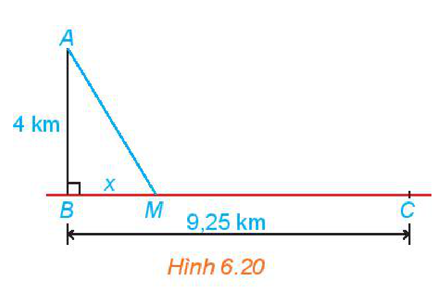
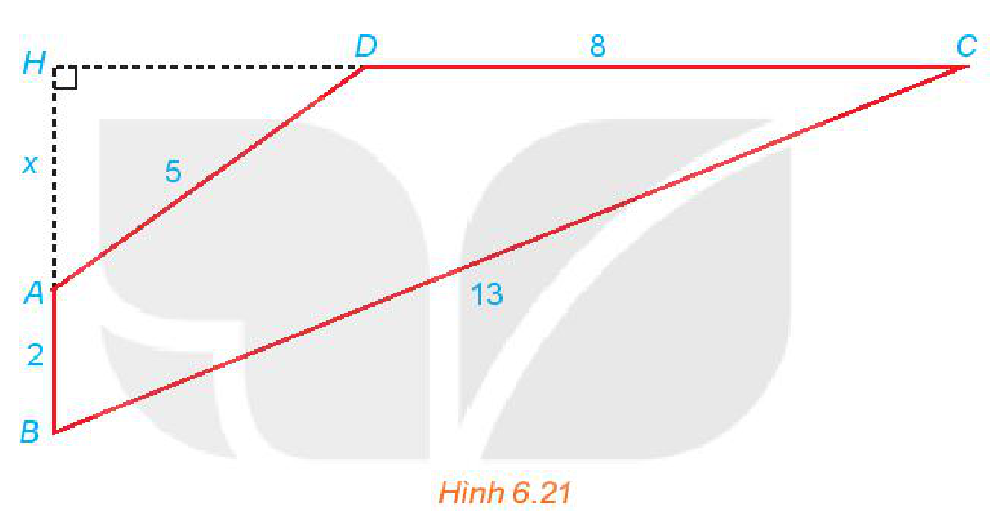
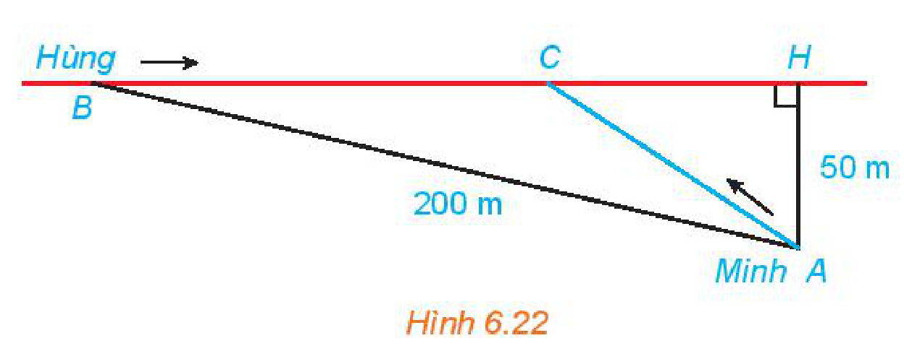

<!-- pdf:26 -->

# BÀI 18: PHƯƠNG TRÌNH QUY VỀ PHƯƠNG TRÌNH BẬC HAI

## 🔤 Thuật ngữ

- Phương trình chứa căn thức

## 🎯 Mục tiêu

- Giải một số phương trình chứa căn bậc hai đơn giản có thể quy về phương trình bậc hai.

## 🔴 Mở đầu

<!-- term: Phương trình một ẩn $x$ -->
Trong bài này chúng ta sẽ giải các **phương trình chứa căn thức** thường gặp có dạng $\sqrt{ax^2 + bx + c} = \sqrt{dx^2 + ex + f}$ và $\sqrt{ax^2 + bx + c} = dx + e$.

## 1. PHƯƠNG TRÌNH DẠNG $\sqrt{ax^2 + bx + c} = \sqrt{dx^2 + ex + f}$

<!-- term: Giải một phương trình -->
**HĐ1:** Cho phương trình $\sqrt{x^2 - 3x + 2} = \sqrt{-x^2 - 2x + 2}$.

<!-- term: Phép biến đổi tương đương một phương trình -->
a) Bình phương hai vế phương trình để khử căn và giải phương trình nhận được.

<!-- term: Hai phương trình tương đương -->
b) Thử lại các giá trị $x$ tìm được ở câu a có thoả mãn phương trình đã cho hay không.

<!-- term: Cách giải phương trình dạng $\sqrt{ax^2 + bx + c} = \sqrt{dx^2 + ex + f}$ -->
> Để giải phương trình $\sqrt{ax^2 + bx + c} = \sqrt{dx^2 + ex + f}$, ta thực hiện như sau:
> - Bình phương hai vế và giải phương trình nhận được;
> - Thử lại các giá trị $x$ tìm được ở trên có thoả mãn phương trình đã cho hay không và kết luận nghiệm.

**Ví dụ 1:** Giải phương trình $\sqrt{2x^2 - 4x - 2} = \sqrt{x^2 - x - 2}$.

**Giải:**

Bình phương hai vế của phương trình, ta được

$2x^2 - 4x - 2 = x^2 - x - 2.$

Sau khi thu gọn ta được $x^2 - 3x = 0$. Từ đó tìm được $x = 0$ hoặc $x = 3$.

Thay lần lượt hai giá trị này của $x$ vào phương trình đã cho, ta thấy chỉ có $x = 3$ thoả mãn.

Vậy nghiệm của phương trình đã cho là $x = 3$.

**Luyện tập 1:** Giải các phương trình sau:

a) $\sqrt{3x^2 - 6x + 1} = \sqrt{-2x^2 - 9x + 1}$;

b) $\sqrt{2x^2 - 3x - 5} = \sqrt{x^2 - 7}$.

## 2. PHƯƠNG TRÌNH DẠNG $\sqrt{ax^2 + bx + c} = dx + e$

**HĐ2:** Cho phương trình $\sqrt{26x^2 - 63x + 38} = 5x - 6$.

a) Bình phương hai vế và giải phương trình nhận được.

b) Thử lại các giá trị $x$ tìm được ở câu a có thoả mãn phương trình đã cho hay không.

<!-- pdf:27 -->

<!-- term: Cách giải phương trình dạng $\sqrt{ax^2 + bx + c} = dx + e$ -->
> Để giải phương trình $\sqrt{ax^2 + bx + c} = dx + e$, ta thực hiện như sau:
> - Bình phương hai vế và giải phương trình nhận được;
> - Thử lại các giá trị $x$ tìm được ở trên có thoả mãn phương trình đã cho hay không và kết luận nghiệm.

**Ví dụ 2:** Giải phương trình $\sqrt{2x^2 - 5x - 9} = x - 1$.

**Giải:**

Bình phương hai vế của phương trình ta được

$2x^2 - 5x - 9 = x^2 - 2x + 1.$

Sau khi thu gọn ta được $x^2 - 3x - 10 = 0$.

Từ đó tìm được $x = -2$ hoặc $x = 5$.

> Với $x = -2$ thì vế phải âm, vế trái không âm. Do đó, ta có thể kết luận $x = -2$ không là nghiệm của phương trình đã cho mà không cần thử lại.
<!-- ocr-ok: đã đối chiếu ảnh trang PDF 27, OCR đọc lỗi bóng nói -->

Thay lần lượt hai giá trị này của $x$ vào phương trình đã cho, ta thấy chỉ có $x = 5$ thoả mãn.

Vậy nghiệm của phương trình đã cho là $x = 5$.

**Luyện tập 2:** Giải các phương trình sau:

a) $\sqrt{2x^2 + x + 3} = 1 - x$;

b) $\sqrt{3x^2 - 13x + 14} = x - 3$.

**Vận dụng:** Bác Việt sống và làm việc tại trạm hải đăng cách bờ biển $4\text{ km}$. Hằng tuần bác chèo thuyền vào vị trí gần nhất trên bờ biển là bến Bính để nhận hàng hoá do cơ quan cung cấp. Tuần này, do trục trặc về vận chuyển nên toàn bộ số hàng vẫn đang nằm ở thôn Hoành, bên bờ biển cách bến Bính $9,25\text{ km}$ và sẽ được anh Nam vận chuyển trên con đường dọc bờ biển tới bến Bính bằng xe kéo. Bác Việt đã gọi điện thống nhất với anh Nam là họ sẽ gặp nhau ở vị trí nào đó giữa bến Bính và thôn Hoành để hai người có mặt tại đó cùng lúc, không mất thời gian chờ nhau. Giả thiết rằng đường dọc bờ biển là thẳng và bác Việt cũng di chuyển theo một đường thẳng để tới điểm hẹn. Tìm vị trí hai người hẹn gặp, biết rằng vận tốc của anh Nam là $5\text{ km/h}$ và của bác Việt là $4\text{ km/h}$.

**Hướng dẫn:**

Ta mô hình hoá bài toán như trong Hình 6.20: Trạm hải đăng ở vị trí $A$; bến Bính ở $B$ và thôn Hoành ở $C$. Giả sử bác Việt chèo thuyền cập bến ở vị trí $M$ và ta đặt $BM = x\text{ (km)} \ (x > 0)$. Để hai người không phải chờ nhau thì thời gian chèo thuyền bằng thời gian kéo xe nên ta có phương trình:

$\frac{\sqrt{x^2 + 16}}{4} = \frac{9,25 - x}{5}.$

Giải phương trình này sẽ tìm được vị trí hai người dự định gặp nhau.

*Hình 6.20*

<!-- pdf:28 -->

## ✏️ Bài tập

**6.20.** Giải các phương trình sau:

a) $\sqrt{3x^2 - 4x - 1} = \sqrt{2x^2 - 4x + 3}$;

b) $\sqrt{x^2 + 2x - 3} = \sqrt{-2x^2 + 5}$;

c) $\sqrt{2x^2 + 3x - 3} = \sqrt{-x^2 - x + 1}$;

d) $\sqrt{-x^2 + 5x - 4} = \sqrt{-2x^2 + 4x + 2}$.

**6.21.** Giải các phương trình sau:

a) $\sqrt{6x^2 + 13x + 13} = 2x + 4$;

b) $\sqrt{2x^2 + 5x + 3} = -3 - x$;

c) $\sqrt{3x^2 - 17x + 23} = x - 3$;

d) $\sqrt{-x^2 + 2x + 4} = x - 2$.

**6.22.** Cho tứ giác $ABCD$ có $AB \perp CD$; $AB = 2$; $BC = 13$; $CD = 8$; $DA = 5$ (H.6.21). Gọi $H$ là giao điểm của $AB$ và $CD$ và đặt $x = AH$. Hãy thiết lập một phương trình để tính độ dài $x$, từ đó tính diện tích tứ giác $ABCD$.

*Hình 6.21*

**6.23.** Hằng ngày bạn Hùng đều đón bạn Minh đi học tại một vị trí trên lề đường thẳng đến trường. Minh đứng tại vị trí $A$ cách lề đường một khoảng $50\text{ m}$ để chờ Hùng. Khi nhìn thấy Hùng đạp xe đến địa điểm $B$, cách mình một đoạn $200\text{ m}$ thì Minh bắt đầu đi bộ ra lề đường để bắt kịp xe. Vận tốc đi bộ của Minh là $5\text{ km/h}$, vận tốc xe đạp của Hùng là $15\text{ km/h}$. Hãy xác định vị trí $C$ trên lề đường (H.6.22) để hai bạn gặp nhau mà không bạn nào phải chờ người kia (làm tròn kết quả đến hàng phần mười).

*Hình 6.22*

## 📷 Danh sách hình trong bài

| Mã hình | Trang PDF | Vị trí trong bài | Chú thích gốc |
| --- | --- | --- | --- |
| H10-toan-b18-01 | 27 | Mục 2, Vận dụng | Hình 6.20 |
| H10-toan-b18-02 | 28 | Bài tập 6.22 | Hình 6.21 |
| H10-toan-b18-03 | 28 | Bài tập 6.23 | Hình 6.22 |
