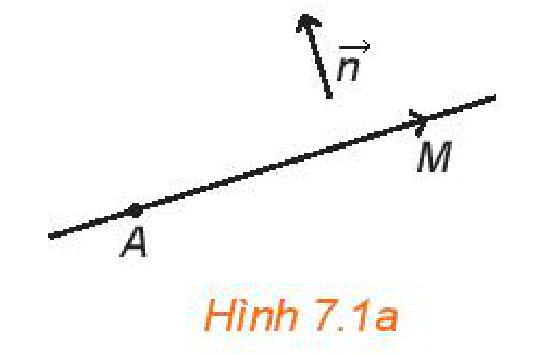
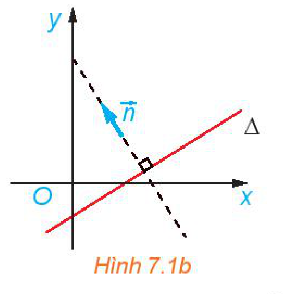
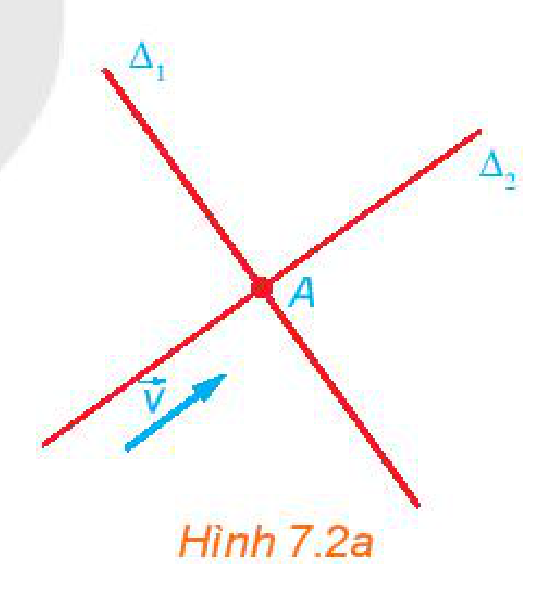
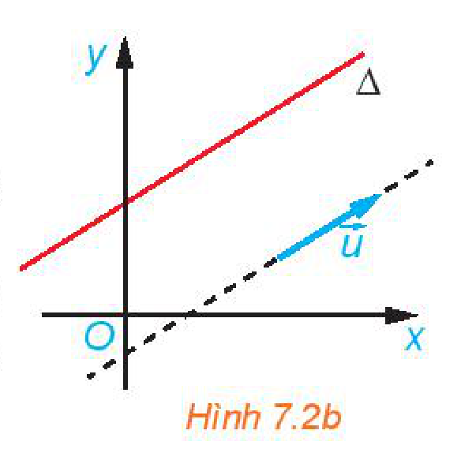
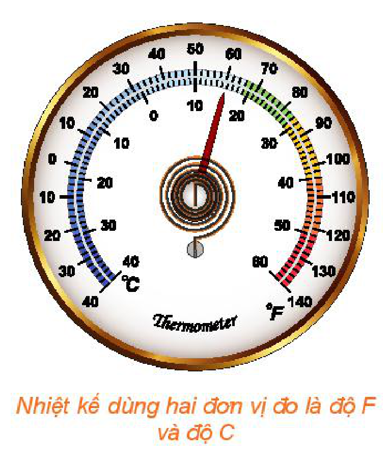
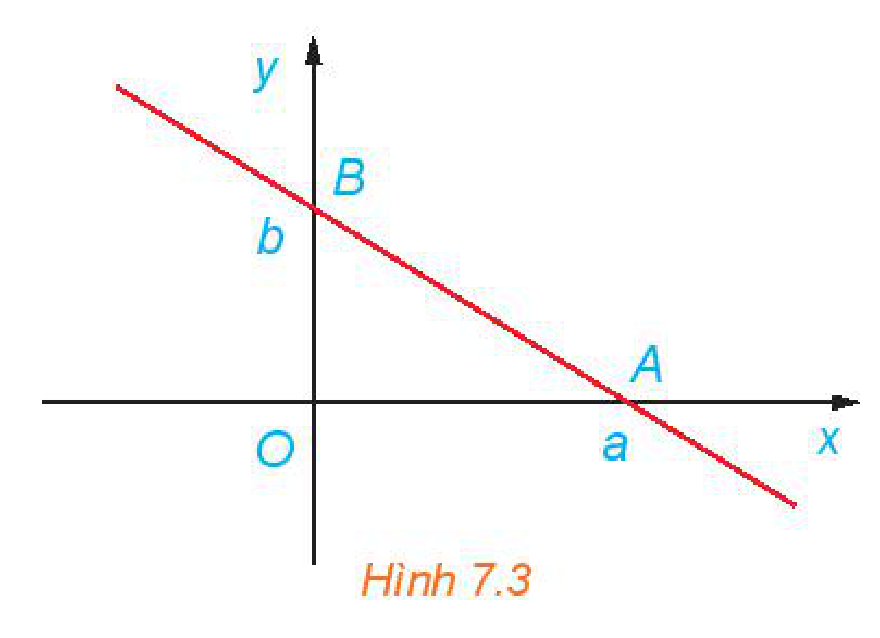
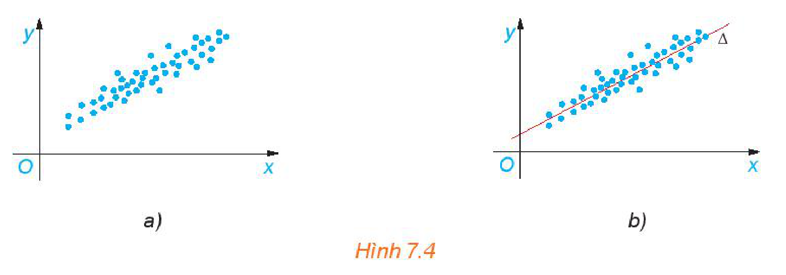

<!-- pdf:31 -->

<!-- Phần giới thiệu Chương VII (in chung đầu trang PDF 31): CHƯƠNG VII. PHƯƠNG PHÁP TOẠ ĐỘ TRONG MẶT PHẲNG -->
<!-- term: Phương pháp toạ độ trong mặt phẳng -->
Sau điểm và vectơ, những đối tượng khác của hình học phẳng như đường thẳng, đường tròn, ... sẽ lần lượt được đại số hoá ở chương này. Đối với mỗi đối tượng hình học đó, trước hết ta đưa ra đối tượng đại số tương ứng, được gọi là phương trình của nó. Các mối quan hệ, công thức tính toán hình học sẽ được thể hiện theo các yếu tố của phương trình tương ứng.

Nhờ đại số hoá hình học, ta có thể dùng ngôn ngữ và phương pháp của đại số để diễn đạt và học tập hình học. Ngoài ra, đại số hoá hình học là bước quan trọng cho phép ta dùng ngôn ngữ của máy tính để diễn đạt hình học. Nhờ đó, ta có thể sử dụng công nghệ thông tin trong học tập và áp dụng hình học, chẳng hạn, các phần mềm vẽ hình như GeoGebra (dùng trong học tập), Autocad (dùng trong vẽ thiết kế) đều sử dụng các kiến thức hình học.

# BÀI 19: PHƯƠNG TRÌNH ĐƯỜNG THẲNG

## 🔤 Thuật ngữ

- Vectơ chỉ phương
- Vectơ pháp tuyến
- Phương trình tổng quát
- Phương trình tham số

## 🎯 Mục tiêu

- Mô tả phương trình tổng quát và phương trình tham số của đường thẳng.
- Lập phương trình của đường thẳng khi biết một điểm và một vectơ pháp tuyến hoặc một điểm và một vectơ chỉ phương hoặc hai điểm.
- Giải thích mối liên hệ giữa đồ thị hàm bậc nhất và đường thẳng.
- Vận dụng kiến thức về phương trình đường thẳng để giải một số bài toán có liên quan đến thực tiễn.

## 🔴 Mở đầu

Đường thẳng là một tập hợp điểm, được xác định bởi tính chất đặc trưng của các điểm thuộc đường thẳng đó. Do vậy, ta có thể đại số hoá đường thẳng bằng cách thể hiện tính chất đặc trưng đó bởi điều kiện đại số đối với toạ độ của các điểm tương ứng.

<!-- pdf:32 -->

## 1. PHƯƠNG TRÌNH TỔNG QUÁT CỦA ĐƯỜNG THẲNG

**HĐ1:** Cho vectơ $\vec{n} \ne \vec{0}$ và điểm $A$. Tìm tập hợp những điểm $M$ sao cho $\overrightarrow{AM}$ vuông góc với $\vec{n}$.
<!-- ocr-ok: đã đối chiếu ảnh trang PDF 32 -->

*Hình 7.1a*

> Vectơ $\vec{n}$ khác $\vec{0}$ được gọi là **vectơ pháp tuyến** của đường thẳng $\Delta$ nếu giá của nó vuông góc với $\Delta$.

*Hình 7.1b*

**Nhận xét:**
- Nếu $\vec{n}$ là vectơ pháp tuyến của đường thẳng $\Delta$ thì $k\vec{n}$ ($k \ne 0$) cũng là vectơ pháp tuyến của $\Delta$.
- Đường thẳng hoàn toàn xác định nếu biết một điểm và một vectơ pháp tuyến của nó.

**Ví dụ 1:** Trong mặt phẳng toạ độ, cho tam giác có ba đỉnh là $A(3; 1)$, $B(4; 0)$, $C(5; 3)$. Hãy chỉ ra một vectơ pháp tuyến của đường trung trực của đoạn thẳng $AB$ và một vectơ pháp tuyến của đường cao kẻ từ $A$ của tam giác $ABC$.

**Giải:**

Đường trung trực của đoạn thẳng $AB$ vuông góc với $AB$ nên có một vectơ pháp tuyến là $\overrightarrow{AB}(1; -1)$.

Đường cao kẻ từ $A$ của tam giác $ABC$ vuông góc với $BC$ nên có một vectơ pháp tuyến là $\overrightarrow{BC}(1; 3)$.

**HĐ2:** Trong mặt phẳng toạ độ, cho đường thẳng $\Delta$ đi qua điểm $A(x_0; y_0)$ và có vectơ pháp tuyến $\vec{n}(a; b)$. Chứng minh rằng điểm $M(x; y)$ thuộc $\Delta$ khi và chỉ khi

$a(x - x_0) + b(y - y_0) = 0. \quad (1)$

**Nhận xét:**

Trong HĐ2, nếu đặt $c = -ax_0 - by_0$ thì $(1)$ còn được viết dưới dạng $ax + by + c = 0$ và được gọi là *phương trình tổng quát* của $\Delta$. Như vậy, điểm $M(x; y)$ thuộc đường thẳng $\Delta$ khi và chỉ khi toạ độ của nó thoả mãn phương trình tổng quát của $\Delta$.

> Trong mặt phẳng toạ độ, mọi đường thẳng đều có **phương trình tổng quát** dạng $ax + by + c = 0$, với $a$ và $b$ không đồng thời bằng $0$. Ngược lại, mỗi phương trình dạng $ax + by + c = 0$, với $a$ và $b$ không đồng thời bằng $0$, đều là phương trình của một đường thẳng, nhận $\vec{n}(a; b)$ là một vectơ pháp tuyến.

**Ví dụ 2:** Trong mặt phẳng toạ độ, lập phương trình tổng quát của đường thẳng $\Delta$ đi qua điểm $A(2; 1)$ và nhận $\vec{n}(3; 4)$ là một vectơ pháp tuyến.

**Giải:**

Đường thẳng $\Delta$ có phương trình là $3(x - 2) + 4(y - 1) = 0$ hay $3x + 4y - 10 = 0$.

<!-- pdf:33 -->

**Luyện tập 1:** Trong mặt phẳng toạ độ, cho tam giác có ba đỉnh $A(-1; 5)$, $B(2; 3)$, $C(6; 1)$. Lập phương trình tổng quát của đường cao kẻ từ $A$ của tam giác $ABC$.

**Ví dụ 3:** Trong mặt phẳng toạ độ, lập phương trình đường thẳng $\Delta$ đi qua điểm $A(0; b)$ và có vectơ pháp tuyến $\vec{n}(a; -1)$, với $a, b$ là các số cho trước. Hãy chỉ ra mối liên hệ giữa đường thẳng $\Delta$ với đồ thị của hàm số $y = ax + b$.

**Giải:**

Đường thẳng $\Delta$ có phương trình là $a(x - 0) - 1(y - b) = 0$ hay $ax - y + b = 0$.

Đường thẳng $\Delta$ là tập hợp những điểm $M(x; y)$ thoả mãn $ax - y + b = 0$, hay là $y = ax + b$.
<!-- ocr-ok: đã đối chiếu ảnh trang PDF 33 -->

Do đó, đường thẳng $\Delta: ax - y + b = 0$ chính là đồ thị của hàm số $y = ax + b$.

**Luyện tập 2:** Hãy chỉ ra một vectơ pháp tuyến của đường thẳng $\Delta: y = 3x + 4$.

**Nhận xét:** Trong mặt phẳng toạ độ, cho đường thẳng $\Delta: ax + by + c = 0$.
- Nếu $b = 0$ thì phương trình có thể đưa về dạng $x = m$ (với $m = -\frac{c}{a}$) và $\Delta$ vuông góc với $Ox$.
- Nếu $b \ne 0$ thì phương trình có thể đưa về dạng $y = nx + p$ (với $n = -\frac{a}{b}, p = -\frac{c}{b}$).

## 2. PHƯƠNG TRÌNH THAM SỐ CỦA ĐƯỜNG THẲNG

**HĐ3:** Trong Hình 7.2a, nếu một vật thể chuyển động với vectơ vận tốc bằng $\vec{v}$ và đi qua $A$ thì nó di chuyển trên đường nào?

*Hình 7.2a*

> Vectơ $\vec{u}$ khác $\vec{0}$ được gọi là **vectơ chỉ phương** của đường thẳng $\Delta$ nếu giá của nó song song hoặc trùng với $\Delta$.

**Nhận xét:**
- Nếu $\vec{u}$ là vectơ chỉ phương của đường thẳng $\Delta$ thì $k\vec{u}$ ($k \ne 0$) cũng là vectơ chỉ phương của $\Delta$.
- Đường thẳng hoàn toàn xác định nếu biết một điểm và một vectơ chỉ phương của nó.
- Vectơ $\vec{n}(a; b)$ vuông góc với các vectơ $\vec{u}(-b; a)$ và $\vec{v}(b; -a)$ nên nếu $\vec{n}$ là vectơ pháp tuyến của đường thẳng $\Delta$ thì $\vec{u}, \vec{v}$ là hai vectơ chỉ phương của đường thẳng đó và ngược lại.

*Hình 7.2b*

<!-- pdf:34 -->

**Ví dụ 4:** Trong mặt phẳng toạ độ, cho $A(3; 2)$, $B(1; -4)$. Hãy chỉ ra hai vectơ chỉ phương của đường thẳng $AB$.

**Giải:**

Đường thẳng $AB$ nhận $\overrightarrow{AB}(-2; -6)$ là một vectơ chỉ phương.

Lấy $\vec{u} = -\frac{1}{2}\overrightarrow{AB} = (1; 3)$, khi đó $\vec{u}$ cũng là một vectơ chỉ phương của đường thẳng $AB$.

**Luyện tập 3:** Hãy chỉ ra một vectơ chỉ phương của đường thẳng $\Delta: 2x - y + 1 = 0$.

**HĐ4:** Chuyển động của một vật thể được thể hiện trên mặt phẳng $Oxy$. Vật thể khởi hành từ $A(2; 1)$ và chuyển động thẳng đều với vectơ vận tốc $\vec{v}(3; 4)$.

a) Hỏi vật thể chuyển động trên đường thẳng nào (chỉ ra điểm đi qua và vectơ chỉ phương của đường thẳng đó)?

b) Chứng minh rằng, tại thời điểm $t$ ($t > 0$) tính từ khi khởi hành, vật thể ở vị trí có toạ độ là $(2 + 3t; 1 + 4t)$.

> Cho đường thẳng $\Delta$ đi qua điểm $A(x_0; y_0)$ và có vectơ chỉ phương $\vec{u}(a; b)$. Khi đó điểm $M(x; y)$ thuộc đường thẳng $\Delta$ khi và chỉ khi tồn tại số thực $t$ sao cho $\overrightarrow{AM} = t\vec{u}$, hay $\begin{cases} x = x_0 + at \\ y = y_0 + bt. \end{cases} \quad (2)$
> Hệ $(2)$ được gọi là **phương trình tham số** của đường thẳng $\Delta$ ($t$ là tham số).

**Ví dụ 5:** Lập phương trình tham số của đường thẳng $\Delta$ đi qua điểm $A(2; -3)$ và có vectơ chỉ phương $\vec{u}(4; -1)$.

**Giải:**

Phương trình tham số của đường thẳng $\Delta$ là $\begin{cases} x = 2 + 4t \\ y = -3 - t. \end{cases}$

**Luyện tập 4:** Lập phương trình tham số của đường thẳng $\Delta$ đi qua điểm $M(-1; 2)$ và song song với đường thẳng $d: 3x - 4y - 1 = 0$.

**Ví dụ 6:** Lập phương trình tham số của đường thẳng đi qua hai điểm $A(2; 3)$ và $B(1; 5)$.

**Giải:**

Đường thẳng $AB$ đi qua $A(2; 3)$ và có vectơ chỉ phương $\overrightarrow{AB} = (-1; 2)$, do đó có phương trình tham số là $\begin{cases} x = 2 - t \\ y = 3 + 2t. \end{cases}$

**Luyện tập 5:** Lập phương trình tham số và phương trình tổng quát của đường thẳng đi qua hai điểm phân biệt $A(x_1; y_1)$, $B(x_2; y_2)$ cho trước.

<!-- pdf:35 -->

**Vận dụng:** Việc quy đổi nhiệt độ giữa đơn vị độ C (Anders Celsius, 1701 – 1744) và đơn vị độ F (Daniel Fahrenheit, 1686 – 1736) được xác định bởi hai mốc sau:

Nước đóng băng ở $0\text{ }^\circ\text{C}$, $32\text{ }^\circ\text{F}$;

Nước sôi ở $100\text{ }^\circ\text{C}$, $212\text{ }^\circ\text{F}$.

Trong quy đổi đó, nếu $a\text{ }^\circ\text{C}$ tương ứng với $b\text{ }^\circ\text{F}$ thì trên mặt phẳng toạ độ $Oxy$, điểm $M(a; b)$ thuộc đường thẳng đi qua $A(0; 32)$ và $B(100; 212)$.

Hỏi $0\text{ }^\circ\text{F}$, $100\text{ }^\circ\text{F}$ tương ứng với bao nhiêu độ C?

*Nhiệt kế dùng hai đơn vị đo là độ F và độ C*
<!-- ocr-ok: đã đối chiếu ảnh trang PDF 35 -->

## ✏️ Bài tập

**7.1.** Trong mặt phẳng toạ độ, cho $\vec{n} = (2; 1)$, $\vec{v} = (3; 2)$, $A(1; 3)$, $B(-2; 1)$.

a) Lập phương trình tổng quát của đường thẳng $\Delta_1$ đi qua $A$ và có vectơ pháp tuyến $\vec{n}$.

b) Lập phương trình tham số của đường thẳng $\Delta_2$ đi qua $B$ và có vectơ chỉ phương $\vec{v}$.

c) Lập phương trình tham số của đường thẳng $AB$.

**7.2.** Lập phương trình tổng quát của các trục toạ độ.

**7.3.** Cho hai đường thẳng $\Delta_1: \begin{cases} x = 1 + 2t \\ y = 3 + 5t \end{cases}$ và $\Delta_2: 2x + 3y - 5 = 0$.

a) Lập phương trình tổng quát của $\Delta_1$.

b) Lập phương trình tham số của $\Delta_2$.

**7.4.** Trong mặt phẳng toạ độ, cho tam giác $ABC$ có $A(1; 2)$, $B(3; 0)$ và $C(-2; -1)$.
<!-- ocr-ok: đã đối chiếu ảnh trang PDF 35 -->

a) Lập phương trình đường cao kẻ từ $A$.

b) Lập phương trình đường trung tuyến kẻ từ $B$.

**7.5.** (**Phương trình đoạn chắn** của đường thẳng) Chứng minh rằng, đường thẳng đi qua hai điểm $A(a; 0)$, $B(0; b)$ với $ab \ne 0$ (H.7.3) có phương trình là $\frac{x}{a} + \frac{y}{b} = 1$.

*Hình 7.3*

**7.6.** Theo Google Maps, sân bay Nội Bài có vĩ độ $21,2^\circ$ Bắc, kinh độ $105,8^\circ$ Đông, sân bay Đà Nẵng có vĩ độ $16,1^\circ$ Bắc, kinh độ $108,2^\circ$ Đông. Một máy bay, bay từ sân bay Nội Bài đến sân bay Đà Nẵng. Tại thời điểm $t$ giờ, tính từ lúc xuất phát, máy bay ở vị trí có vĩ độ $x^\circ$ Bắc, kinh độ $y^\circ$ Đông được tính theo công thức

<!-- pdf:36 -->

$\begin{cases} x = 21,2 - \frac{153}{40}t \\ y = 105,8 + \frac{9}{5}t. \end{cases}$

a) Hỏi chuyến bay từ Hà Nội đến Đà Nẵng mất mấy giờ?

b) Tại thời điểm $1$ giờ kể từ lúc cất cánh, máy bay đã bay qua vĩ tuyến $17$ ($17^\circ$ Bắc) chưa?

## 💡 Em có biết?

Hồi quy tuyến tính là một phương pháp được sử dụng trong thống kê để dự báo về mối quan hệ giữa các đại lượng dựa trên kết quả thống kê mẫu. Chẳng hạn, để dự báo về mối quan hệ giữa hai đại lượng $x$ và $y$ ($y$ phụ thuộc vào $x$ như thế nào), từ kết quả thống kê được thể hiện ở Hình 7.4a, phương pháp hồi quy tuyến tính đưa ra đường thẳng $\Delta$ (H.7.4b) thể hiện gần đúng nhất mối quan hệ giữa các đại lượng $x$ và $y$ đã được thống kê. Về mặt hình ảnh, các chấm xanh trên hình vẽ (có toạ độ là các cặp giá trị $(x; y)$ trong kết quả thống kê, tập trung dọc theo $\Delta$.

Để xác định $\Delta$ (phương trình $y = ax + b$), người ta thường dùng tiêu chuẩn gọi là bình phương nhỏ nhất như sau: Với mỗi cặp $(x_0; y_0)$ trong kết quả thống kê, xét bình phương khoảng cách từ $M(x_0; y_0)$ đến $M'(x_0; ax_0 + b)$. Khi đó, $a, b$ được chọn sao cho tổng các bình phương này là nhỏ nhất.

Nhờ đưa ra được đường thẳng biểu thị (gần đúng) sự phụ thuộc giữa đại lượng $y$ theo đại lượng $x$, người ta có thể đưa ra các dự báo nằm ngoài kết quả thống kê. Tất nhiên, không phải mô hình nào cũng phù hợp với phương pháp này, ngay cả khi kết quả thống kê tập trung dọc một đường thẳng. Chẳng hạn, để xác định đường đi của một quả tên lửa, nếu dựa vào một số quan sát ban đầu để dự đoán, ta có thể nghĩ rằng nó chuyển động thẳng, nhưng trên thực tế, nhìn chung nó đi theo đường parabol. Sai lầm trong những dự báo như vậy thật là tai hại!

*Hình 7.4*

## 📷 Danh sách hình trong bài

| Mã hình | Trang PDF | Vị trí trong bài | Chú thích gốc |
| --- | --- | --- | --- |
| H10-toan-b19-01 | 32 | Mục 1, HĐ1 | Hình 7.1a |
| H10-toan-b19-02 | 32 | Mục 1, định nghĩa vectơ pháp tuyến | Hình 7.1b |
| H10-toan-b19-03 | 33 | Mục 2, HĐ3 | Hình 7.2a |
| H10-toan-b19-04 | 33 | Mục 2, Nhận xét | Hình 7.2b |
| H10-toan-b19-05 | 35 | Mục 2, Vận dụng | Nhiệt kế dùng hai đơn vị đo là độ F và độ C |
| H10-toan-b19-06 | 35 | Bài tập 7.5 | Hình 7.3 |
| H10-toan-b19-07 | 36 | Em có biết? | Hình 7.4 |
