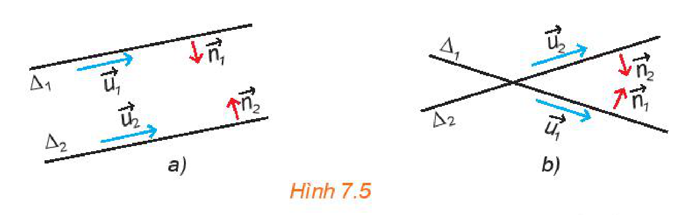
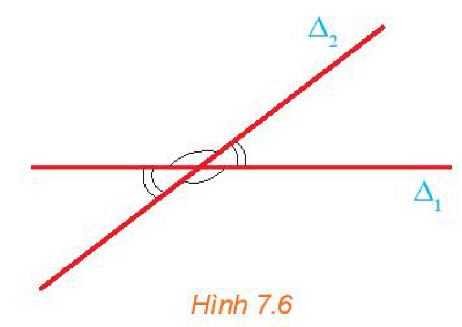
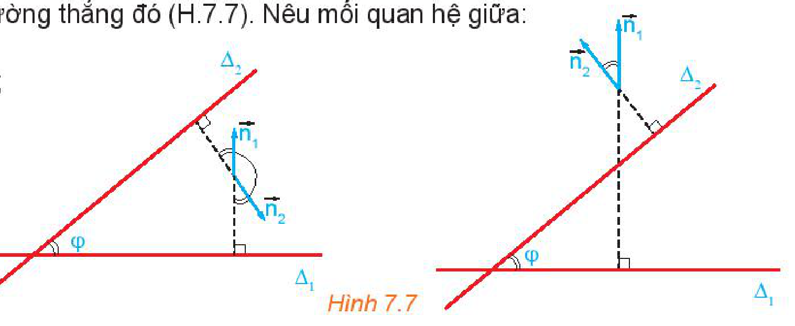
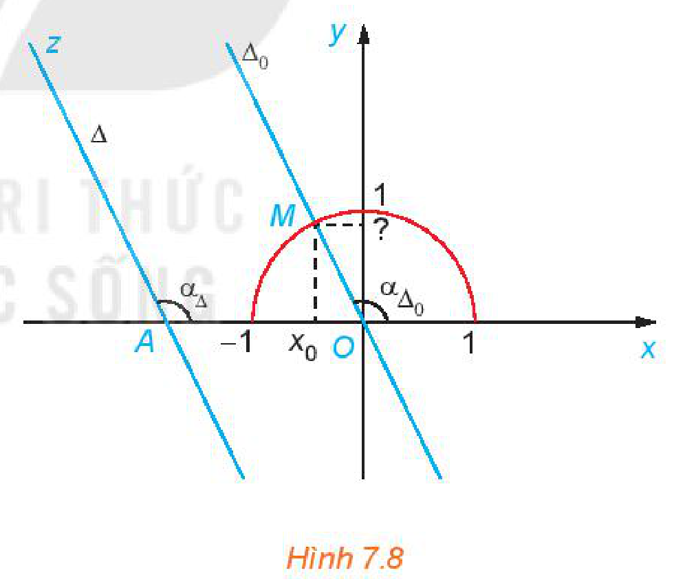
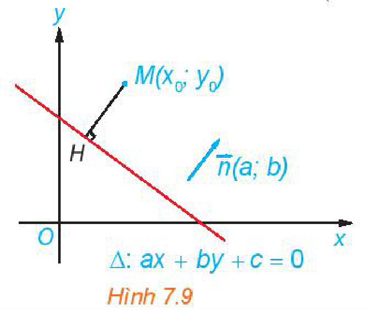
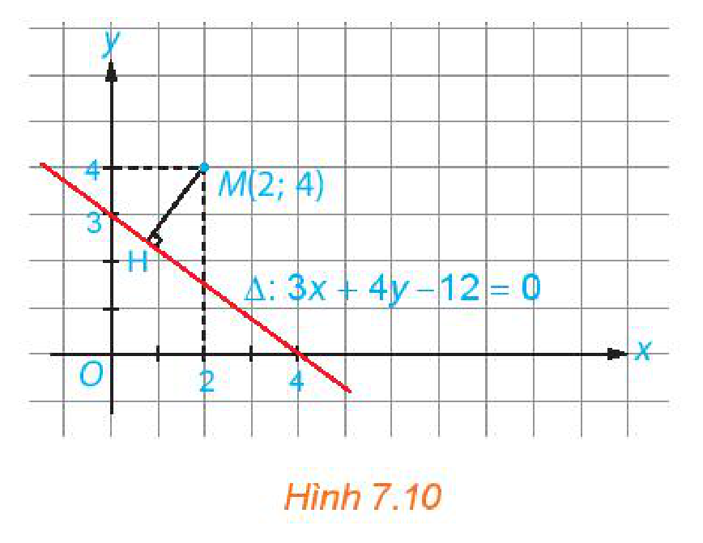
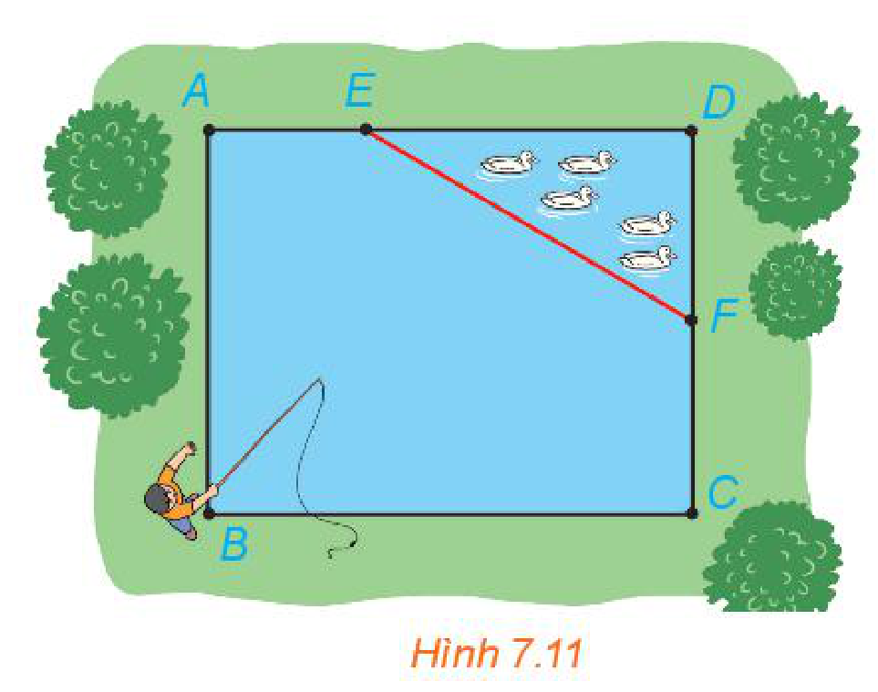
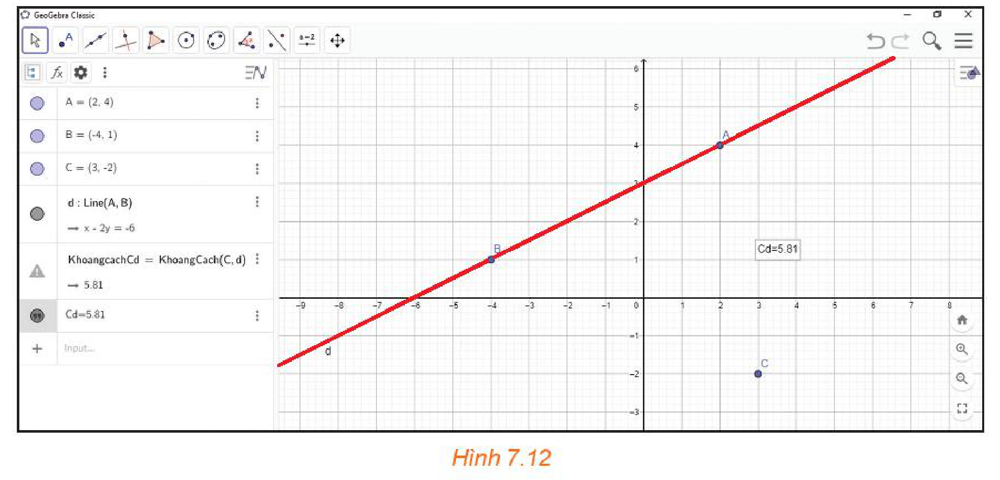

<!-- pdf:37 -->

# BÀI 20: VỊ TRÍ TƯƠNG ĐỐI GIỮA HAI ĐƯỜNG THẲNG. GÓC VÀ KHOẢNG CÁCH

## 🔤 Thuật ngữ

- Vị trí tương đối giữa hai đường thẳng
- Góc, khoảng cách

## 🎯 Mục tiêu

- Nhận biết hai đường thẳng cắt nhau, song song, trùng nhau, vuông góc.
- Thiết lập công thức tính góc giữa hai đường thẳng.
- Tính khoảng cách từ một điểm đến một đường thẳng.
- Vận dụng các công thức tính góc và khoảng cách để giải một số bài toán có liên quan đến thực tiễn.

## 🔴 Mở đầu

Trong mặt phẳng toạ độ, mỗi đường thẳng đều có đối tượng đại số tương ứng, gọi là phương trình của nó. Vậy các yếu tố liên quan tới đường thẳng được thể hiện như thế nào qua phương trình tương ứng?

## 1. VỊ TRÍ TƯƠNG ĐỐI GIỮA HAI ĐƯỜNG THẲNG

**HĐ1:** Trong mặt phẳng toạ độ, cho hai đường thẳng

$\Delta_1: x - 2y + 3 = 0,$

$\Delta_2: 3x - y - 1 = 0.$

a) Điểm $M(1; 2)$ có thuộc cả hai đường thẳng nói trên hay không?

b) Giải hệ $\begin{cases} x - 2y + 3 = 0 \\ 3x - y - 1 = 0. \end{cases}$

c) Chỉ ra mối quan hệ giữa toạ độ giao điểm của $\Delta_1$ và $\Delta_2$ với nghiệm của hệ phương trình trên.

**Nhận xét:** Mỗi đường thẳng trong mặt phẳng toạ độ là tập hợp những điểm có toạ độ thoả mãn phương trình của đường thẳng đó. Vì vậy, bài toán tìm giao điểm của hai đường thẳng được quy về bài toán giải hệ gồm hai phương trình tương ứng.

Trên mặt phẳng toạ độ, xét hai đường thẳng

$\Delta_1: a_1x + b_1y + c_1 = 0$ và $\Delta_2: a_2x + b_2y + c_2 = 0$.

Khi đó, toạ độ giao điểm của $\Delta_1$ và $\Delta_2$ là nghiệm của hệ phương trình:

$\begin{cases} a_1x + b_1y + c_1 = 0 \\ a_2x + b_2y + c_2 = 0. \end{cases} \quad (*)$

<!-- term: Vị trí tương đối giữa hai đường thẳng -->
> $\Delta_1$ cắt $\Delta_2$ tại $M(x_0; y_0)$ khi và chỉ khi hệ $(*)$ có nghiệm duy nhất $(x_0; y_0)$.
> $\Delta_1$ song song với $\Delta_2$ khi và chỉ khi hệ $(*)$ vô nghiệm.
> $\Delta_1$ trùng $\Delta_2$ khi và chỉ khi hệ $(*)$ có vô số nghiệm.

<!-- pdf:38 -->

**Chú ý:**

*Hình 7.5*

Dựa vào các vectơ chỉ phương $\vec{u}_1, \vec{u}_2$ hoặc các vectơ pháp tuyến $\vec{n}_1, \vec{n}_2$ của $\Delta_1, \Delta_2$, ta có:
- $\Delta_1$ và $\Delta_2$ song song hoặc trùng nhau $\Leftrightarrow \vec{u}_1$ và $\vec{u}_2$ cùng phương $\Leftrightarrow \vec{n}_1$ và $\vec{n}_2$ cùng phương.
- $\Delta_1$ và $\Delta_2$ cắt nhau $\Leftrightarrow \vec{u}_1$ và $\vec{u}_2$ không cùng phương $\Leftrightarrow \vec{n}_1$ và $\vec{n}_2$ không cùng phương.
<!-- ocr-ok: đã đối chiếu ảnh trang PDF 38 -->

**Ví dụ 1:** Xét vị trí tương đối giữa đường thẳng $\Delta: x - \sqrt{2}y + 4\sqrt{3} = 0$ và mỗi đường thẳng sau:

$\Delta_1: \sqrt{3}x - \sqrt{6}y + 12 = 0;$

$\Delta_2: \sqrt{2}x - 2y = 0.$

**Giải:**

Ta có $x - \sqrt{2}y + 4\sqrt{3} = 0 \Leftrightarrow \sqrt{3}(x - \sqrt{2}y + 4\sqrt{3}) = 0 \Leftrightarrow \sqrt{3}x - \sqrt{6}y + 12 = 0$.

Vậy $\Delta$ và $\Delta_1$ là một, nói cách khác chúng trùng nhau.

Hai đường thẳng $\Delta$ và $\Delta_2$ có hai vectơ pháp tuyến $\vec{n}(1; -\sqrt{2})$ và $\vec{n}_2(\sqrt{2}; -2)$ cùng phương. Do đó, chúng song song hoặc trùng nhau. Mặt khác, điểm $O(0; 0)$ thuộc đường thẳng $\Delta_2$ nhưng không thuộc đường thẳng $\Delta$, nên hai đường thẳng này không trùng nhau.

Vậy $\Delta$ và $\Delta_2$ song song với nhau.
<!-- ocr-ok: đã đối chiếu ảnh trang PDF 38 -->

**Nhận xét:** Giả sử hai đường thẳng $\Delta_1, \Delta_2$ có hai vectơ chỉ phương $\vec{u}_1, \vec{u}_2$ (hay hai vectơ pháp tuyến $\vec{n}_1, \vec{n}_2$) cùng phương. Khi đó:
- Nếu $\Delta_1$ và $\Delta_2$ có điểm chung thì $\Delta_1$ trùng $\Delta_2$;
- Nếu tồn tại điểm thuộc $\Delta_1$ nhưng không thuộc $\Delta_2$ thì $\Delta_1$ song song với $\Delta_2$.

**Luyện tập 1:** Xét vị trí tương đối giữa các cặp đường thẳng sau:

a) $\Delta_1: x + 4y - 3 = 0$ và $\Delta_2: x - 4y - 3 = 0$;

b) $\Delta_1: x + 2y - \sqrt{5} = 0$ và $\Delta_2: 2x + 4y - 3\sqrt{5} = 0$.

## 2. GÓC GIỮA HAI ĐƯỜNG THẲNG

**HĐ2:** Hai đường thẳng $\Delta_1$ và $\Delta_2$ cắt nhau tạo thành bốn góc (H.7.6). Các số đo của bốn góc đó có mối quan hệ gì với nhau?

*Hình 7.6*

<!-- pdf:39 -->

> Hai đường thẳng cắt nhau tạo thành bốn góc, số đo của góc không tù được gọi là **số đo góc** (hay đơn giản là **góc**) giữa hai đường thẳng.
> **Góc giữa hai đường thẳng** song song hoặc trùng nhau được quy ước bằng $0^\circ$.

**HĐ3:** Cho hai đường thẳng cắt nhau $\Delta_1, \Delta_2$ tương ứng có các vectơ pháp tuyến $\vec{n}_1, \vec{n}_2$. Gọi $\varphi$ là góc giữa hai đường thẳng đó (H.7.7). Nêu mối quan hệ giữa:

a) góc $\varphi$ và góc $(\vec{n}_1, \vec{n}_2)$;

b) $\cos\varphi$ và $\cos(\vec{n}_1, \vec{n}_2)$.

*Hình 7.7*

<!-- term: Công thức tính góc giữa hai đường thẳng -->
> Cho hai đường thẳng $\Delta_1: a_1x + b_1y + c_1 = 0$ và $\Delta_2: a_2x + b_2y + c_2 = 0$, với các vectơ pháp tuyến $\vec{n}_1(a_1; b_1)$ và $\vec{n}_2(a_2; b_2)$ tương ứng. Khi đó, góc $\varphi$ giữa hai đường thẳng đó được xác định thông qua công thức
> $\cos\varphi = |\cos(\vec{n}_1, \vec{n}_2)| = \frac{|\vec{n}_1 \cdot \vec{n}_2|}{|\vec{n}_1| \cdot |\vec{n}_2|} = \frac{|a_1a_2 + b_1b_2|}{\sqrt{a_1^2 + b_1^2} \cdot \sqrt{a_2^2 + b_2^2}}.$

**Chú ý:**
- $\Delta_1 \perp \Delta_2 \Leftrightarrow \vec{n}_1 \perp \vec{n}_2 \Leftrightarrow a_1a_2 + b_1b_2 = 0$.
- Nếu $\Delta_1, \Delta_2$ có các vectơ chỉ phương $\vec{u}_1, \vec{u}_2$ thì góc $\varphi$ giữa $\Delta_1$ và $\Delta_2$ cũng được xác định thông qua công thức $\cos\varphi = |\cos(\vec{u}_1, \vec{u}_2)|$.

**Ví dụ 2:** Tính góc giữa hai đường thẳng

$\Delta_1: \sqrt{3}x - y + 2 = 0$ và $\Delta_2: x - \sqrt{3}y - 2 = 0$.

**Giải:**

Vectơ pháp tuyến của $\Delta_1$ là $\vec{n}_1 = (\sqrt{3}; -1)$, của $\Delta_2$ là $\vec{n}_2 = (1; -\sqrt{3})$.
<!-- ocr-ok: đã đối chiếu ảnh trang PDF 39 -->

Gọi $\varphi$ là góc giữa hai đường thẳng $\Delta_1$ và $\Delta_2$. Ta có

$\cos\varphi = |\cos(\vec{n}_1, \vec{n}_2)| = \frac{|\vec{n}_1 \cdot \vec{n}_2|}{|\vec{n}_1| \cdot |\vec{n}_2|} = \frac{|\sqrt{3} \cdot 1 + (-1) \cdot (-\sqrt{3})|}{\sqrt{(\sqrt{3})^2 + (-1)^2} \cdot \sqrt{1^2 + (-\sqrt{3})^2}} = \frac{\sqrt{3}}{2}.$

Do đó, góc giữa $\Delta_1$ và $\Delta_2$ là $\varphi = 30^\circ$.
<!-- ocr-ok: đã đối chiếu ảnh trang PDF 39 -->

<!-- pdf:40 -->

**Luyện tập 2:** Tính góc giữa hai đường thẳng

$\Delta_1: x + 3y + 2 = 0$ và $\Delta_2: y = 3x + 1$.

**Ví dụ 3:** Tính góc giữa hai đường thẳng $\Delta_1: x = 3$ và $\Delta_2: \begin{cases} x = 2 - t \\ y = 3 + t. \end{cases}$

**Giải:**

Đường thẳng $\Delta_1$ có phương trình $x - 3 = 0$ nên có vectơ pháp tuyến $\vec{n}_1(1; 0)$. Đường thẳng $\Delta_2$ có vectơ chỉ phương $\vec{u}_2(-1; 1)$ nên có vectơ pháp tuyến $\vec{n}_2(1; 1)$. Gọi $\varphi$ là góc giữa hai đường thẳng $\Delta_1$ và $\Delta_2$, ta có

$\cos\varphi = |\cos(\vec{n}_1, \vec{n}_2)| = \frac{|\vec{n}_1 \cdot \vec{n}_2|}{|\vec{n}_1| \cdot |\vec{n}_2|} = \frac{|1 \cdot 1 + 0 \cdot 1|}{\sqrt{1^2 + 0^2} \cdot \sqrt{1^2 + 1^2}} = \frac{1}{\sqrt{2}}.$

Do đó, góc giữa $\Delta_1$ và $\Delta_2$ là $\varphi = 45^\circ$.
<!-- ocr-ok: đã đối chiếu ảnh trang PDF 40 -->

**Luyện tập 3:** Tính góc giữa hai đường thẳng $\Delta_1: \begin{cases} x = 2 + t \\ y = 1 - 2t \end{cases}$ và $\Delta_2: \begin{cases} x = 1 + t' \\ y = 5 + 3t'. \end{cases}$

Xét đường thẳng $\Delta$ bất kì cắt trục hoành $Ox$ tại một điểm $A$. Điểm $A$ chia đường thẳng $\Delta$ thành hai tia, trong đó, gọi $Az$ là tia nằm phía trên trục hoành. Kí hiệu $\alpha_\Delta$ là số đo của góc $\widehat{xAz}$ (H.7.8). Qua luyện tập sau, ta sẽ thấy ý nghĩa hình học của **hệ số góc**.

*Hình 7.8*

**Luyện tập 4:** Cho đường thẳng $\Delta: y = ax + b$, với $a \ne 0$.

a) Chứng minh rằng $\Delta$ cắt trục hoành.

b) Lập phương trình đường thẳng $\Delta_0$ đi qua $O(0; 0)$ và song song (hoặc trùng) với $\Delta$.

c) Hãy chỉ ra mối quan hệ giữa $\alpha_\Delta$ và $\alpha_{\Delta_0}$.

d) Gọi $M$ là giao điểm của $\Delta_0$ với nửa đường tròn đơn vị và $x_0$ là hoành độ của $M$. Tính tung độ của $M$ theo $x_0$ và $a$. Từ đó, chứng minh rằng $\tan\alpha_\Delta = a$.

<!-- pdf:41 -->

## 3. KHOẢNG CÁCH TỪ MỘT ĐIỂM ĐẾN MỘT ĐƯỜNG THẲNG

**HĐ4:** Cho điểm $M(x_0; y_0)$ và đường thẳng $\Delta: ax + by + c = 0$ có vectơ pháp tuyến $\vec{n}(a; b)$. Gọi $H$ là hình chiếu vuông góc của $M$ trên $\Delta$ (H.7.9).

a) Chứng minh rằng $|\vec{n} \cdot \overrightarrow{HM}| = \sqrt{a^2 + b^2} \cdot HM$.

b) Giả sử $H$ có toạ độ $(x_1; y_1)$. Chứng minh rằng: $\vec{n} \cdot \overrightarrow{HM} = a(x_0 - x_1) + b(y_0 - y_1) = ax_0 + by_0 + c$.

c) Chứng minh rằng $HM = \frac{|ax_0 + by_0 + c|}{\sqrt{a^2 + b^2}}$.

*Hình 7.9*

<!-- term: Khoảng cách từ một điểm đến một đường thẳng -->
> Cho điểm $M(x_0; y_0)$ và đường thẳng $\Delta: ax + by + c = 0$. **Khoảng cách** từ điểm $M$ đến đường thẳng $\Delta$, kí hiệu là $d(M, \Delta)$, được tính bởi công thức
> $d(M, \Delta) = \frac{|ax_0 + by_0 + c|}{\sqrt{a^2 + b^2}}.$

**Ví dụ 4:** Tính khoảng cách từ điểm $M(2; 4)$ đến đường thẳng $\Delta: 3x + 4y - 12 = 0$.

**Giải:**

Áp dụng công thức tính khoảng cách từ điểm $M$ đến đường thẳng $\Delta$, ta có

$d(M, \Delta) = \frac{|3 \cdot 2 + 4 \cdot 4 - 12|}{\sqrt{3^2 + 4^2}} = \frac{10}{5} = 2.$

Vậy khoảng cách từ điểm $M$ đến đường thẳng $\Delta$ là $2$.

**Trải nghiệm:** Đo trực tiếp khoảng cách từ điểm $M$ đến đường thẳng $\Delta$ (H.7.10) và giải thích vì sao kết quả đo đạc đó phù hợp với kết quả tính toán trong lời giải của Ví dụ 4.

*Hình 7.10*

**Luyện tập 5:** Tính khoảng cách từ điểm $M(1; 2)$ đến đường thẳng $\Delta: \begin{cases} x = 5 + 3t \\ y = -5 - 4t. \end{cases}$

<!-- pdf:42 -->

**Vận dụng:** Nhân dịp nghỉ hè, Nam về quê ở với ông bà nội. Nhà ông bà nội có một ao cá có dạng hình chữ nhật $ABCD$ với chiều dài $AD = 15\text{ m}$, chiều rộng $AB = 12\text{ m}$. Phần tam giác $DEF$ là nơi ông bà nuôi vịt, $AE = 5\text{ m}$, $CF = 6\text{ m}$ (H.7.11).

a) Chọn hệ trục toạ độ $Oxy$, có điểm $O$ trùng với điểm $B$, các tia $Ox, Oy$ tương ứng trùng với các tia $BC, BA$. Chọn $1$ đơn vị độ dài trên mặt phẳng toạ độ tương ứng với $1\text{ m}$ trong thực tế. Hãy xác định toạ độ của các điểm $A, B, C, D, E, F$ và viết phương trình đường thẳng $EF$.

b) Nam đứng ở vị trí $B$ câu cá và có thể quăng lưỡi câu xa $10,7\text{ m}$. Hỏi lưỡi câu có thể rơi vào nơi nuôi vịt hay không?

*Hình 7.11*

## ✏️ Bài tập

**7.7.** Xét vị trí tương đối giữa các cặp đường thẳng sau:

a) $\Delta_1: 3\sqrt{2}x + \sqrt{2}y - \sqrt{3} = 0$ và $\Delta_2: 6x + 2y - \sqrt{6} = 0$.

b) $d_1: x - \sqrt{3}y + 2 = 0$ và $d_2: \sqrt{3}x - 3y + 2 = 0$.

c) $m_1: x - 2y + 1 = 0$ và $m_2: 3x + y - 2 = 0$.

**7.8.** Tính góc giữa các cặp đường thẳng sau:

a) $\Delta_1: \sqrt{3}x + y - 4 = 0$ và $\Delta_2: x + \sqrt{3}y + 3 = 0$;

b) $d_1: \begin{cases} x = -1 + 2t \\ y = 3 + 4t \end{cases}$ và $d_2: \begin{cases} x = 3 + s \\ y = 1 - 3s \end{cases}$ ($t, s$ là các tham số).
<!-- ocr-ok: đã đối chiếu ảnh trang PDF 42 -->

**7.9.** Trong mặt phẳng toạ độ $Oxy$, cho điểm $A(0; -2)$ và đường thẳng $\Delta: x + y - 4 = 0$.

a) Tính khoảng cách từ điểm $A$ đến đường thẳng $\Delta$.

b) Viết phương trình đường thẳng $a$ đi qua điểm $M(-1; 0)$ và song song với $\Delta$.

c) Viết phương trình đường thẳng $b$ đi qua điểm $N(0; 3)$ và vuông góc với $\Delta$.

**7.10.** Trong mặt phẳng toạ độ, cho tam giác $ABC$ có $A(1; 0)$, $B(3; 2)$ và $C(-2; -1)$.

a) Tính độ dài đường cao kẻ từ đỉnh $A$ của tam giác $ABC$.

b) Tính diện tích tam giác $ABC$.
<!-- ocr-ok: đã đối chiếu ảnh trang PDF 42 -->

**7.11.** Chứng minh rằng hai đường thẳng $d: y = ax + b$ ($a \ne 0$) và $d': y = a'x + b'$ ($a' \ne 0$) vuông góc với nhau khi và chỉ khi $aa' = -1$.

**7.12.** Trong mặt phẳng toạ độ, một tín hiệu âm thanh phát đi từ một vị trí và được ba thiết bị ghi tín hiệu đặt tại ba vị trí $O(0; 0)$, $A(1; 0)$, $B(1; 3)$ nhận được cùng một thời điểm. Hãy xác định vị trí phát tín hiệu âm thanh.

<!-- pdf:43 -->

## 💡 Em có biết?

**Cơ sở toán học cho các tính toán trong phần mềm GeoGebra.**

*Hình 7.12*

Hình 7.12 được chụp lại từ một màn hình máy tính đang sử dụng phần mềm vẽ hình GeoGebra:
- Chọn chức năng vẽ điểm, sau đó, nháy chuột vào ba điểm $A, B, C$ trên cửa sổ màn hình, phần mềm tự động xác định toạ độ của ba điểm đó là $A(2; 4)$, $B(-4; 1)$, $C(3; -2)$.
- Chọn chức năng vẽ đường thẳng đi qua hai điểm, sau đó, nháy vào hai điểm $A, B$ ta được đường thẳng đi qua hai điểm $A, B$; phần mềm tự động xác định được phương trình của đường thẳng là $x - 2y + 6 = 0$.
- Chọn chức năng tính khoảng cách, sau đó, nháy vào điểm $C$ và đường thẳng $AB$, phần mềm sẽ tự động cho ta khoảng cách từ $C$ tới đường thẳng đó là $5,81$.

Cơ sở toán học để phần mềm có được tính toán nói trên là công thức đã được nêu trong bài học này.

## 📷 Danh sách hình trong bài

| Mã hình | Trang PDF | Vị trí trong bài | Chú thích gốc |
| --- | --- | --- | --- |
| H10-toan-b20-01 | 38 | Mục 1, Chú ý | Hình 7.5 |
| H10-toan-b20-02 | 38 | Mục 2, HĐ2 | Hình 7.6 |
| H10-toan-b20-03 | 39 | Mục 2, HĐ3 | Hình 7.7 |
| H10-toan-b20-04 | 40 | Mục 2, Luyện tập 4 | Hình 7.8 |
| H10-toan-b20-05 | 41 | Mục 3, HĐ4 | Hình 7.9 |
| H10-toan-b20-06 | 41 | Mục 3, Trải nghiệm | Hình 7.10 |
| H10-toan-b20-07 | 42 | Mục 3, Vận dụng | Hình 7.11 |
| H10-toan-b20-08 | 43 | Em có biết? | Hình 7.12 |
