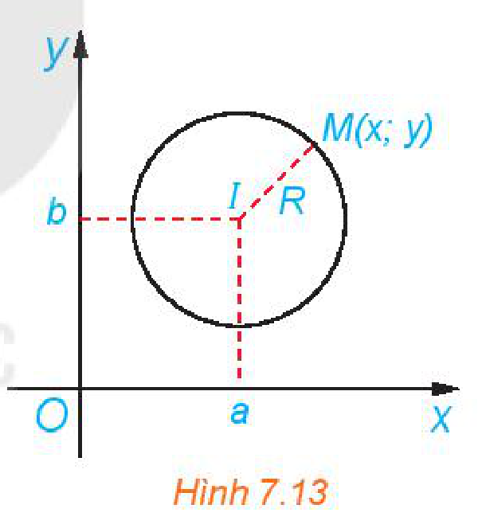
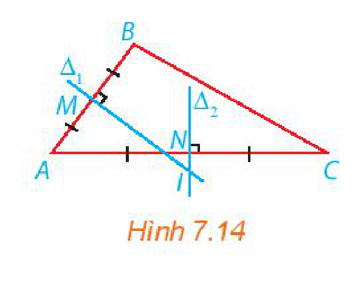
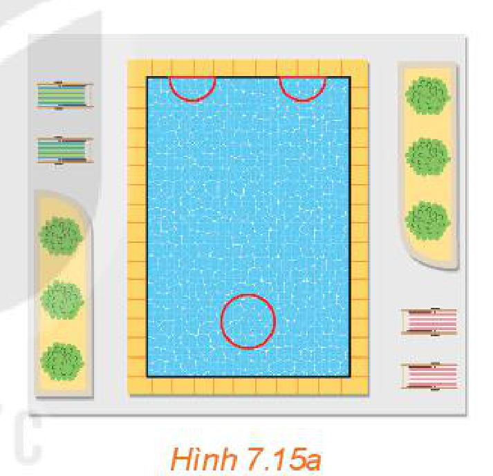
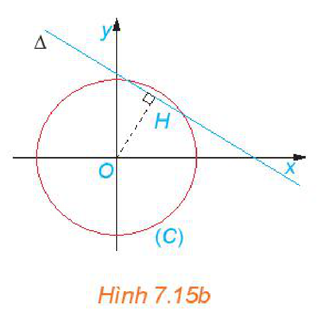
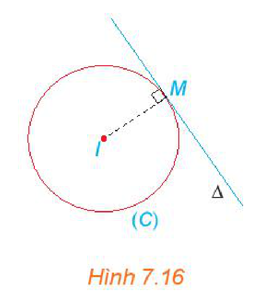

<!-- pdf:44 -->

# BÀI 21: ĐƯỜNG TRÒN TRONG MẶT PHẲNG TOẠ ĐỘ

## 🔤 Thuật ngữ

- Đường tròn
- Tâm
- Bán kính
- Phương trình đường tròn
- Phương trình tiếp tuyến

## 🎯 Mục tiêu

- Lập phương trình đường tròn khi biết toạ độ tâm và bán kính hoặc biết toạ độ ba điểm thuộc đường tròn.
- Xác định tâm và bán kính của đường tròn khi biết phương trình của nó.
- Lập phương trình tiếp tuyến của đường tròn khi biết toạ độ của tiếp điểm.
- Vận dụng kiến thức về phương trình đường tròn để giải một số bài toán liên quan đến thực tiễn.

## 🔴 Mở đầu

Cũng như đối với đường thẳng, việc đại số hoá đường tròn gồm hai bước:
- Thiết lập đối tượng đại số tương ứng với đường tròn, gọi là phương trình của đường tròn.
- Chuyển các yếu tố liên quan tới đường tròn từ hình học sang đại số.

## 1. PHƯƠNG TRÌNH ĐƯỜNG TRÒN

Đường tròn tâm $I$, bán kính $R$ là tập hợp những điểm $M$ thoả mãn điều kiện $IM = R$. Do đó, để lập phương trình đường tròn đó, ta cần chuyển điều kiện hình học $IM = R$ thành một điều kiện đại số.

**HĐ1:** Trong mặt phẳng toạ độ $Oxy$, cho đường tròn $(C)$, tâm $I(a; b)$, bán kính $R$ (H.7.13). Khi đó, một điểm $M(x; y)$ thuộc đường tròn $(C)$ khi và chỉ khi toạ độ của nó thoả mãn điều kiện đại số nào?

*Hình 7.13*

> Điểm $M(x; y)$ thuộc **đường tròn** $(C)$, **tâm** $I(a; b)$, **bán kính** $R$ khi và chỉ khi
> $(x - a)^2 + (y - b)^2 = R^2. \quad (1)$
> Ta gọi $(1)$ là **phương trình của đường tròn** $(C)$. <!-- term: Phương trình đường tròn -->

**Ví dụ 1:** Tìm tâm và bán kính của đường tròn $(C)$ có phương trình: $(x - 2)^2 + (y + 3)^2 = 16$. Viết phương trình đường tròn $(C')$ có tâm $J(2; -1)$ và có bán kính gấp đôi bán kính đường tròn $(C)$.

**Giải:**

Ta viết phương trình của $(C)$ ở dạng $(x - 2)^2 + (y - (-3))^2 = 4^2$.

Vậy $(C)$ có tâm $I(2; -3)$ và bán kính $R = 4$.

Đường tròn $(C')$ có tâm $J(2; -1)$ và có bán kính $R' = 2R = 8$, nên có phương trình
$(x - 2)^2 + (y + 1)^2 = 64.$

<!-- pdf:45 -->

**Luyện tập 1:** Tìm tâm và bán kính của đường tròn $(C): (x + 2)^2 + (y - 4)^2 = 7$.

**Nhận xét:** Phương trình $(1)$ tương đương với
$x^2 + y^2 - 2ax - 2by + (a^2 + b^2 - R^2) = 0.$
<!-- ocr-ok: đã đối chiếu ảnh trang PDF 45 -->

**Ví dụ 2:** Cho $a, b, c$ là các hằng số. Tìm tập hợp những điểm $M(x; y)$ thoả mãn phương trình
$x^2 + y^2 - 2ax - 2by + c = 0. \quad (2)$

**Giải:**

Phương trình $(2)$ tương đương với
$(x - a)^2 + (y - b)^2 + c - a^2 - b^2 = 0 \Leftrightarrow (x - a)^2 + (y - b)^2 = a^2 + b^2 - c.$

Xét $I(a; b)$, khi đó, $IM = \sqrt{(x - a)^2 + (y - b)^2}$ và phương trình trên trở thành
$IM^2 = a^2 + b^2 - c. \quad (3)$

Từ đó, ta xét các trường hợp sau:
- Nếu $a^2 + b^2 - c > 0$ thì tập hợp những điểm $M$ thoả mãn $(2)$ là đường tròn tâm $I(a; b)$, bán kính $R = \sqrt{a^2 + b^2 - c}$.
- Nếu $a^2 + b^2 - c = 0$ thì $(3) \Leftrightarrow IM = 0$. Do đó, tập hợp những điểm $M$ thoả mãn $(2)$ chỉ gồm một điểm là $I(a; b)$.
- Nếu $a^2 + b^2 - c < 0$ thì tập hợp những điểm $M$ là tập rỗng.

**Nhận xét:** Phương trình $x^2 + y^2 - 2ax - 2by + c = 0$ là phương trình của một đường tròn $(C)$ khi và chỉ khi $a^2 + b^2 - c > 0$. Khi đó, $(C)$ có tâm $I(a; b)$ và bán kính $R = \sqrt{a^2 + b^2 - c}$.

**Luyện tập 2:** Hãy cho biết phương trình nào dưới đây là phương trình của một đường tròn. Tìm tâm và bán kính của đường tròn đó.

a) $x^2 - y^2 - 2x + 4y - 1 = 0$;

b) $x^2 + y^2 - 2x + 4y + 6 = 0$;

c) $x^2 + y^2 + 6x - 4y + 2 = 0$.

**Ví dụ 3:** Viết phương trình đường tròn $(C)$ đi qua ba điểm $A(2; 0)$, $B(0; 4)$, $C(-7; 3)$.

**Giải:**

Các đoạn thẳng $AB$, $AC$ tương ứng có trung điểm là $M(1; 2)$, $N\left(-\frac{5}{2}; \frac{3}{2}\right)$. Đường thẳng trung trực $\Delta_1$ của đoạn thẳng $AB$ đi qua $M(1; 2)$ và có vectơ pháp tuyến $\overrightarrow{AB}(-2; 4)$.

Vì $\overrightarrow{AB}(-2; 4)$ cùng phương với $\vec{n}_1(1; -2)$ nên $\Delta_1$ cũng nhận $\vec{n}_1(1; -2)$ là vectơ pháp tuyến. Do đó, phương trình của $\Delta_1$ là
$1(x - 1) - 2(y - 2) = 0$ hay $x - 2y + 3 = 0$.

*Hình 7.14*

<!-- pdf:46 -->

Đường thẳng trung trực $\Delta_2$ của đoạn thẳng $AC$ đi qua $N\left(-\frac{5}{2}; \frac{3}{2}\right)$ và có vectơ pháp tuyến $\overrightarrow{AC}(-9; 3)$.

Vì $\overrightarrow{AC}(-9; 3)$ cùng phương với $\vec{n}_2(3; -1)$ nên $\Delta_2$ cũng nhận $\vec{n}_2(3; -1)$ là vectơ pháp tuyến. Do đó, phương trình của $\Delta_2$ là
$3\left(x + \frac{5}{2}\right) - 1\left(y - \frac{3}{2}\right) = 0$ hay $3x - y + 9 = 0$.

Tâm $I$ của đường tròn $(C)$ cách đều ba điểm $A, B, C$ nên $I$ là giao điểm của $\Delta_1$ và $\Delta_2$.

Vậy toạ độ của $I$ là nghiệm của hệ phương trình $\begin{cases} x - 2y + 3 = 0 \\ 3x - y + 9 = 0. \end{cases}$

Suy ra $I(-3; 0)$. Đường tròn $(C)$ có bán kính là $IA = 5$. Vậy phương trình của $(C)$ là
$(x + 3)^2 + y^2 = 25.$

**Luyện tập 3:** Viết phương trình đường tròn $(C)$ đi qua ba điểm $M(4; -5)$, $N(2; -1)$, $P(3; -8)$.

**Vận dụng 1:** Bên trong một hồ bơi, người ta dự định thiết kế hai bể sục nửa hình tròn bằng nhau và một bể sục hình tròn (H.7.15a) để người bơi có thể ngồi tựa lưng vào thành các bể sục thư giãn. Hãy tìm bán kính của các bể sục để tổng chu vi của ba bể là $32\text{ m}$ mà tổng diện tích (chiếm hồ bơi) là nhỏ nhất. Trong tính toán, lấy $\pi = 3,14$, độ dài tính theo mét và làm tròn tới chữ số thập phân thứ hai.
<!-- ocr-ok: đã đối chiếu ảnh trang PDF 46 -->

*Hình 7.15a*

*Hướng dẫn:*
- Gọi bán kính bể hình tròn và bể nửa hình tròn tương ứng là $x, y\text{ (m)}$. Khi đó, tổng chu vi ba bể là $32\text{ m}$ khi và chỉ khi
$1,57x + 2,57y - 8 = 0.$
- Gọi tổng diện tích của ba bể sục là $S\text{ (m}^2\text{)}$. Khi đó
$x^2 + y^2 = \frac{S}{3,14}.$
- Trong mặt phẳng toạ độ $Oxy$, xét đường tròn $(C): x^2 + y^2 = \frac{S}{3,14}$ có tâm $O(0; 0)$, bán kính $R = \sqrt{\frac{S}{3,14}}$ và đường thẳng $\Delta: 1,57x + 2,57y - 8 = 0$. Khi đó bài toán được chuyển thành: Tìm $R$ nhỏ nhất để $(C)$ và $\Delta$ có ít nhất một điểm chung, với hoành độ và tung độ đều là các số dương (H.7.15b).

*Hình 7.15b*

<!-- pdf:47 -->

## 2. PHƯƠNG TRÌNH TIẾP TUYẾN CỦA ĐƯỜNG TRÒN

**HĐ2:** Cho đường tròn $(C): (x - 1)^2 + (y - 2)^2 = 25$ và điểm $M(4; -2)$.

a) Chứng minh điểm $M(4; -2)$ thuộc đường tròn $(C)$.

b) Xác định tâm và bán kính của $(C)$.

c) Gọi $\Delta$ là tiếp tuyến của $(C)$ tại $M$. Hãy chỉ ra một vectơ pháp tuyến của đường thẳng $\Delta$ (H.7.16). Từ đó, viết phương trình đường thẳng $\Delta$.

*Hình 7.16*

> Cho điểm $M(x_0; y_0)$ thuộc đường tròn $(C): (x - a)^2 + (y - b)^2 = R^2$ (tâm $I(a; b)$, bán kính $R$). Khi đó, **tiếp tuyến** $\Delta$ của $(C)$ tại $M(x_0; y_0)$ có vectơ pháp tuyến $\overrightarrow{MI} = (a - x_0; b - y_0)$ và phương trình <!-- term: Phương trình tiếp tuyến -->
> $(a - x_0)(x - x_0) + (b - y_0)(y - y_0) = 0.$

**Ví dụ 4:** Cho đường tròn $(C)$ có phương trình $(x + 1)^2 + (y - 3)^2 = 5$. Điểm $M(0; 1)$ có thuộc đường tròn $(C)$ hay không? Nếu có, hãy viết phương trình tiếp tuyến tại $M$ của $(C)$.

**Giải:**

Do $(0 + 1)^2 + (1 - 3)^2 = 5$, nên điểm $M$ thuộc $(C)$.

Đường tròn $(C)$ có tâm là $I(-1; 3)$. Tiếp tuyến của $(C)$ tại $M(0; 1)$ có vectơ pháp tuyến $\overrightarrow{MI} = (-1; 2)$, nên có phương trình
$-1(x - 0) + 2(y - 1) = 0 \Leftrightarrow x - 2y + 2 = 0.$

**Luyện tập 4:** Cho đường tròn $(C): x^2 + y^2 - 2x + 4y + 1 = 0$. Viết phương trình tiếp tuyến $\Delta$ của $(C)$ tại điểm $N(1; 0)$.

**Vận dụng 2:** Trên mặt phẳng toạ độ $Oxy$, một vật chuyển động nhanh trên đường tròn có phương trình $x^2 + y^2 = 25$. Khi tới vị trí $M(3; 4)$ thì vật bị văng khỏi quỹ đạo tròn và ngay sau đó, trong một khoảng thời gian ngắn bay theo hướng tiếp tuyến của đường tròn. Hỏi trong khoảng thời gian ngắn ngay sau khi văng, vật chuyển động trên đường thẳng nào?

## ✏️ Bài tập

**7.13.** Tìm tâm và tính bán kính của đường tròn
$(x + 3)^2 + (y - 3)^2 = 36.$

<!-- pdf:48 -->

**7.14.** Hãy cho biết phương trình nào dưới đây là phương trình của một đường tròn và tìm tâm, bán kính của đường tròn tương ứng.

a) $x^2 + y^2 + xy + 4x - 2 = 0$;

b) $x^2 + y^2 - 2x - 4y + 5 = 0$;

c) $x^2 + y^2 + 6x - 8y + 1 = 0$.

**7.15.** Viết phương trình của đường tròn trong mỗi trường hợp sau:

a) Có tâm $I(-2; 5)$ và bán kính $R = 7$;

b) Có tâm $I(1; -2)$ và đi qua điểm $A(-2; 2)$;

c) Có đường kính $AB$, với $A(-1; -3)$, $B(-3; 5)$;

d) Có tâm $I(1; 3)$ và tiếp xúc với đường thẳng $x + 2y + 3 = 0$.

**7.16.** Trong mặt phẳng toạ độ, cho tam giác $ABC$, với $A(6; -2)$, $B(4; 2)$, $C(5; -5)$. Viết phương trình đường tròn ngoại tiếp tam giác đó.

**7.17.** Cho đường tròn $(C): x^2 + y^2 + 2x - 4y + 4 = 0$. Viết phương trình tiếp tuyến $d$ của $(C)$ tại điểm $M(0; 2)$.
<!-- ocr-ok: đã đối chiếu ảnh trang PDF 48 -->

**7.18.** Chuyển động của một vật thể trong khoảng thời gian $180$ phút được thể hiện trong mặt phẳng toạ độ. Theo đó, tại thời điểm $t$ ($0 \le t \le 180$) vật thể ở vị trí có toạ độ $(2 + \sin t^\circ; 4 + \cos t^\circ)$.

a) Tìm vị trí ban đầu và vị trí kết thúc của vật thể.

b) Tìm quỹ đạo chuyển động của vật thể.

## 📷 Danh sách hình trong bài

| Mã hình | Trang PDF | Vị trí trong bài | Chú thích gốc |
| --- | --- | --- | --- |
| H10-toan-b21-01 | 44 | Mục 1, HĐ1 | Hình 7.13 |
| H10-toan-b21-02 | 45 | Mục 1, Ví dụ 3 | Hình 7.14 |
| H10-toan-b21-03 | 46 | Mục 1, Vận dụng 1 | Hình 7.15a |
| H10-toan-b21-04 | 46 | Mục 1, Vận dụng 1 | Hình 7.15b |
| H10-toan-b21-05 | 47 | Mục 2, HĐ2 | Hình 7.16 |
