<!-- pdf:49 -->

# BÀI 22: BA ĐƯỜNG CONIC

## 🔤 Thuật ngữ

- Conic, elip, hypebol, parabol
- Tiêu điểm
- Tiêu cự
- Phương trình chính tắc
- Đường chuẩn, tham số tiêu

## 🎯 Mục tiêu

- Nhận biết ba đường conic bằng hình học.
- Nhận biết phương trình chính tắc của ba đường conic.
- Giải quyết một số vấn đề thực tiễn gắn với ba đường conic.

## 🔴 Mở đầu

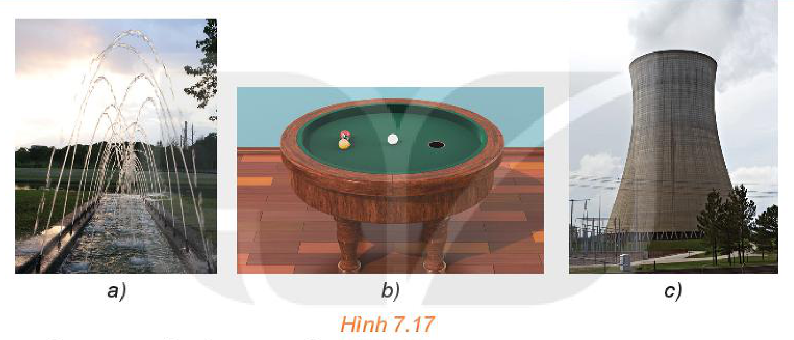
*Hình 7.17*

Trong thực tế, em có thể bắt gặp nhiều hình ảnh ứng với các đường elip (ellipse), hypebol (hyperbola), parabol (parabola), gọi chung là ba đường **conic**. Được phát hiện và nghiên cứu từ thời Hy Lạp cổ đại, nhưng các ứng dụng phong phú và quan trọng của các đường conic chỉ được phát hiện trong những thế kỉ gần đây, khởi đầu là định luật nổi tiếng của Kepler (Johannes Kepler, 1571–1630) về quỹ đạo của các hành tinh trong hệ Mặt Trời. Để có thể tiếp tục câu chuyện thú vị này, ta cần tìm hiểu kĩ hơn, đặc biệt là tìm phương trình đại số mô tả các đường conic.

## 1. ELIP

**HĐ1:** Đính hai đầu của một sợi dây không đàn hồi vào hai vị trí cố định $F_1, F_2$ trên một mặt bàn (độ dài sợi dây lớn hơn khoảng cách giữa hai điểm $F_1, F_2$). Kéo căng sợi dây tại một điểm $M$ bởi một đầu bút dạ (hoặc phấn). Di chuyển đầu bút dạ để nó vẽ trên mặt bàn một đường khép kín (H.7.18).

a) Đường vừa nhận được có liên hệ với hình ảnh nào ở Hình 7.17?

b) Trong quá trình đầu bút di chuyển để vẽ nên đường nói trên, tổng các khoảng cách từ nó tới các vị trí $F_1, F_2$ có thay đổi không? Vì sao?

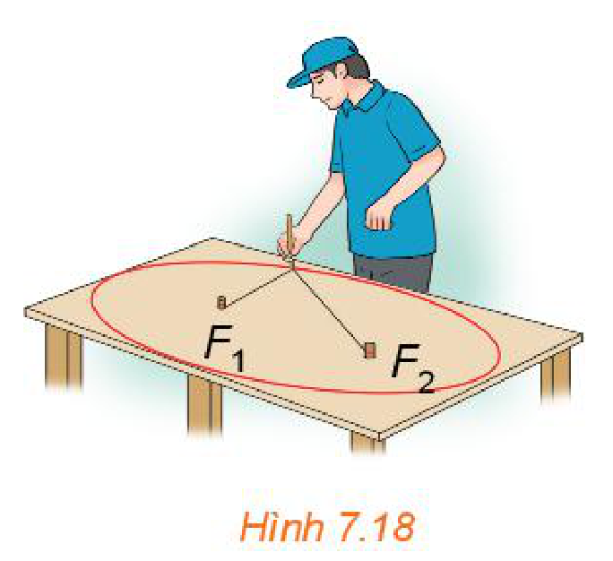
*Hình 7.18*

<!-- pdf:50 -->

> Cho hai điểm cố định và phân biệt $F_1, F_2$. Đặt $F_1F_2 = 2c > 0$. Cho số thực $a$ lớn hơn $c$. Tập hợp các điểm $M$ sao cho $MF_1 + MF_2 = 2a$ được gọi là **đường elip** (hay **elip**). Hai điểm $F_1, F_2$ được gọi là hai **tiêu điểm** và $F_1F_2 = 2c$ được gọi là **tiêu cự** của elip đó.

**Câu hỏi:** Tại sao trong định nghĩa elip cần điều kiện $a > c$?

**Ví dụ 1:** Cho lục giác đều $ABCDEF$. Chứng minh rằng bốn điểm $B, C, E, F$ cùng thuộc một elip có hai tiêu điểm là $A$ và $D$.

**Giải:**

Lục giác đều $ABCDEF$ có các cạnh bằng nhau và các góc đều có số đo là $120^\circ$ (H.7.19). Do đó, các tam giác $ABC$, $BCD$, $DEF$, $EFA$ bằng nhau (c.g.c). Suy ra $AC = BD = DF = AE$. Từ đó, ta có $BA + BD = CA + CD = EA + ED = FA + FD > AD$. Vậy $B, C, E, F$ cùng thuộc một elip có hai tiêu điểm là $A$ và $D$.

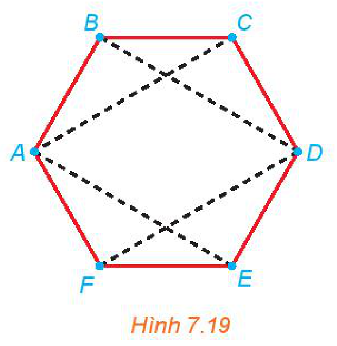
*Hình 7.19*

**Luyện tập 1:** Trên bàn bida hình elip có một lỗ thu bi tại một tiêu điểm (H.7.20). Nếu gậy chơi tác động đủ mạnh vào một bi đặt tại tiêu điểm còn lại của bàn, thì sau khi va vào thành bàn, bi sẽ bật lại và chạy về lỗ thu (bỏ qua các tác động phụ). Hỏi độ dài quãng đường bi lăn từ điểm xuất phát tới lỗ thu có phụ thuộc vào đường đi của bi hay không? Vì sao?

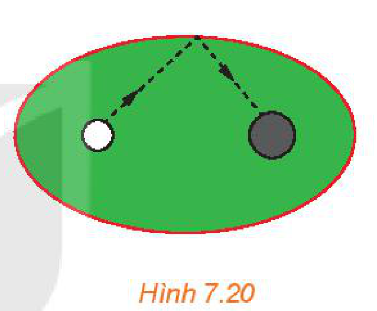
*Hình 7.20*

**HĐ2:** Xét một elip $(E)$ với các kí hiệu như trong định nghĩa. Chọn hệ trục toạ độ $Oxy$ có gốc $O$ là trung điểm của $F_1F_2$, tia $Ox$ trùng tia $OF_2$ (H.7.21).

a) Nêu toạ độ của các tiêu điểm $F_1, F_2$.

b) Giải thích vì sao điểm $M(x; y)$ thuộc elip khi và chỉ khi
$\sqrt{(x + c)^2 + y^2} + \sqrt{(x - c)^2 + y^2} = 2a. \quad (1)$

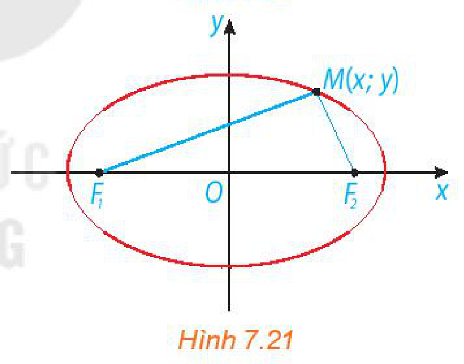
*Hình 7.21*

**Chú ý:** Người ta có thể biến đổi $(1)$ về dạng $\frac{x^2}{a^2} + \frac{y^2}{b^2} = 1$, với $b = \sqrt{a^2 - c^2}$.

> Trong mặt phẳng toạ độ $Oxy$, elip có hai tiêu điểm thuộc trục hoành sao cho $O$ là trung điểm của đoạn nối hai tiêu điểm đó thì có phương trình
> $\frac{x^2}{a^2} + \frac{y^2}{b^2} = 1$, với $a > b > 0. \quad (2)$
> Ngược lại, mỗi phương trình có dạng $(2)$ đều là phương trình của elip có hai tiêu điểm $F_1\left(-\sqrt{a^2 - b^2}; 0\right)$, $F_2\left(\sqrt{a^2 - b^2}; 0\right)$, tiêu cự $2c = 2\sqrt{a^2 - b^2}$ và tổng các khoảng cách từ mỗi điểm thuộc elip đó tới hai tiêu điểm bằng $2a$.
> Phương trình $(2)$ được gọi là **phương trình chính tắc của elip** tương ứng. <!-- term: Phương trình chính tắc -->

<!-- pdf:51 -->

**Ví dụ 2:** Cho elip có phương trình chính tắc $\frac{x^2}{25} + \frac{y^2}{16} = 1$. Tìm các tiêu điểm và tiêu cự của elip. Tính tổng các khoảng cách từ mỗi điểm trên elip tới hai tiêu điểm.

**Giải:**

Ta có: $a^2 = 25, b^2 = 16$. Do đó $c = \sqrt{a^2 - b^2} = 3$. Vậy elip có hai tiêu điểm là $F_1(-3; 0); F_2(3; 0)$ và tiêu cự là $F_1F_2 = 2c = 6$. Ta có $a = \sqrt{25} = 5$, nên tổng các khoảng cách từ mỗi điểm trên elip tới hai tiêu điểm bằng $2a = 10$.

**Luyện tập 2:** Cho elip có phương trình chính tắc $\frac{x^2}{100} + \frac{y^2}{64} = 1$. Tìm các tiêu điểm và tiêu cự của elip.

**Vận dụng 1:** Trong bản vẽ thiết kế, vòm của ô thoáng trong Hình 7.22 là nửa nằm phía trên trục hoành của elip có phương trình
$\frac{x^2}{16} + \frac{y^2}{4} = 1.$
Biết rằng $1$ đơn vị trên mặt phẳng toạ độ của bản vẽ thiết kế ứng với $30\text{ cm}$ trên thực tế. Tính chiều cao $h$ của ô thoáng tại điểm cách điểm chính giữa của đế ô thoáng $75\text{ cm}$.

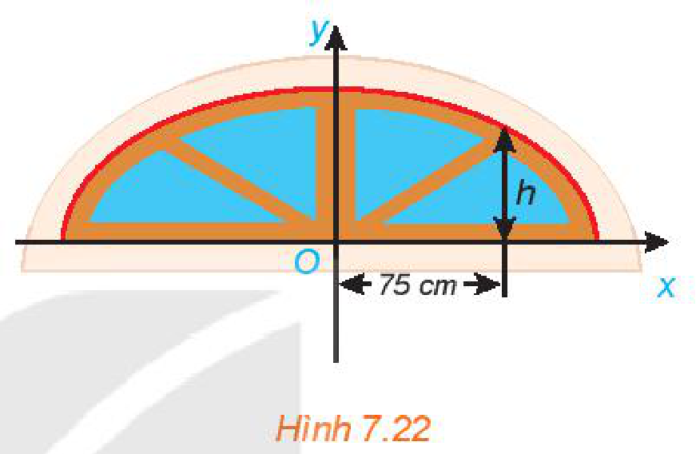
*Hình 7.22*

## 2. HYPEBOL

Trên mặt phẳng, nếu hai thiết bị đặt tại các vị trí $F_1, F_2$ nhận được một tín hiệu âm thanh cùng lúc thì vị trí phát ra tín hiệu cách đều hai điểm $F_1, F_2$ và do đó, nằm trên đường trung trực của đoạn thẳng $F_1F_2$.

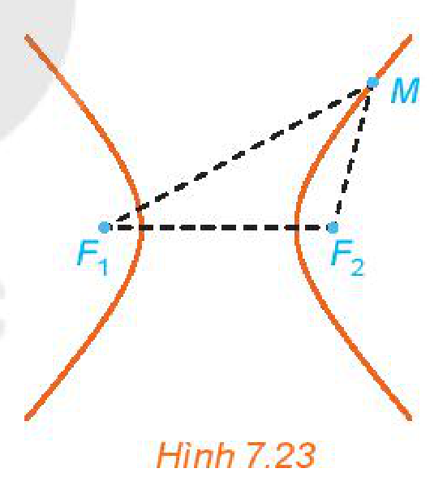
*Hình 7.23*

**HĐ3:** Giả sử thiết bị tại $F_2$ nhận được tín hiệu âm thanh sớm hơn thiết bị tại $F_1$ là $2$ giây và vận tốc âm thanh là $343\text{ m/s}$.

a) Tìm mối quan hệ giữa các khoảng cách từ nơi phát ra tín hiệu âm thanh tới $F_1, F_2$.

b) Việc giới hạn khu vực tìm kiếm nơi phát ra tín hiệu âm thanh có liên quan đến bài toán tìm tập hợp những điểm $M$ thoả mãn $MF_1 - MF_2 = 686\text{ (m)}$ hay không?

> Cho hai điểm phân biệt cố định $F_1$ và $F_2$. Đặt $F_1F_2 = 2c$. Cho số thực dương $a$ nhỏ hơn $c$. Tập hợp các điểm $M$ sao cho $|MF_1 - MF_2| = 2a$ được gọi là **đường hypebol** (hay **hypebol**). Hai điểm $F_1, F_2$ được gọi là hai **tiêu điểm** và $F_1F_2 = 2c$ được gọi là **tiêu cự** của hypebol đó.

**Câu hỏi:** Tại sao trong định nghĩa hypebol cần điều kiện $a < c$?

<!-- pdf:52 -->

**Chú ý:** Hypebol có hai nhánh (H.7.23), một nhánh gồm những điểm $M$ thoả mãn $MF_1 - MF_2 = 2a$ và nhánh còn lại gồm những điểm $M$ thoả mãn $MF_1 - MF_2 = -2a$ (hay $MF_2 - MF_1 = 2a$).

**Ví dụ 3:** Trên biển có hai đảo hình tròn với bán kính khác nhau. Tại vùng biển giữa hai đảo đó, người ta xác định một đường ranh giới cách đều hai đảo, tức là, đường mà khoảng cách từ mỗi vị trí trên đó đến hai đảo là bằng nhau. Hỏi đường ranh giới đó có thuộc một nhánh của một hypebol hay không?

**Chú ý:** Khoảng cách từ một vị trí trên biển đến đảo hình tròn bằng hiệu của khoảng cách từ vị trí đó đến tâm đảo và bán kính của đảo.

**Giải:** Giả sử đảo thứ nhất có tâm $O_1$ và bán kính $R_1$, đảo thứ hai có tâm $O_2$ và bán kính $R_2$ (H.7.24). Do hai đường tròn $(O_1, R_1)$, $(O_2, R_2)$ nằm ngoài nhau nên $O_1O_2 > R_1 + R_2$.

Gọi $M$ là một điểm bất kì thuộc đường ranh giới.

Vì $M$ cách đều hai đảo nên
$MO_1 - R_1 = MO_2 - R_2 \Leftrightarrow MO_1 - MO_2 = R_1 - R_2.$

Vậy đường ranh giới thuộc một nhánh của hypebol với tiêu điểm $F_1$ trùng $O_1$, $F_2$ trùng $O_2$, $2c = O_1O_2$, $2a = |R_1 - R_2|$.

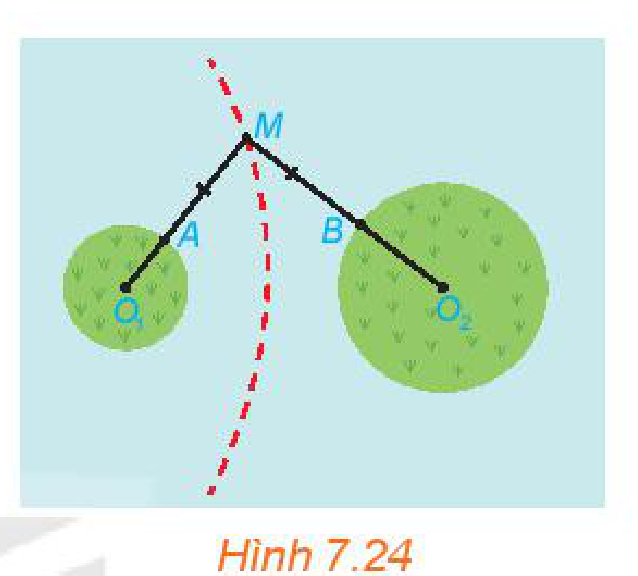
*Hình 7.24*

**Luyện tập 3:** Cho hình chữ nhật $ABCD$ và $M, N$ tương ứng là trung điểm của các cạnh $AB, CD$ (H.7.25). Chứng minh rằng bốn điểm $A, B, C, D$ cùng thuộc một hypebol có hai tiêu điểm là $M$ và $N$.

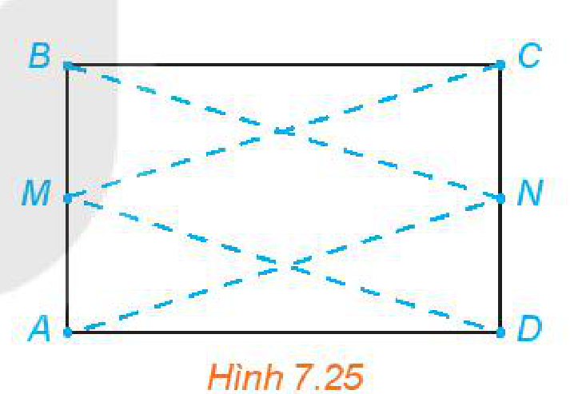
*Hình 7.25*

**HĐ4:** Xét một hypebol $(H)$ với các kí hiệu như trong định nghĩa. Chọn hệ trục toạ độ $Oxy$ có gốc $O$ là trung điểm của $F_1F_2$, tia $Ox$ trùng tia $OF_2$ (H.7.26). Nêu toạ độ của các tiêu điểm $F_1, F_2$. Giải thích vì sao điểm $M(x; y)$ thuộc $(H)$ khi và chỉ khi
$\left|\sqrt{(x + c)^2 + y^2} - \sqrt{(x - c)^2 + y^2}\right| = 2a. \quad (3)$

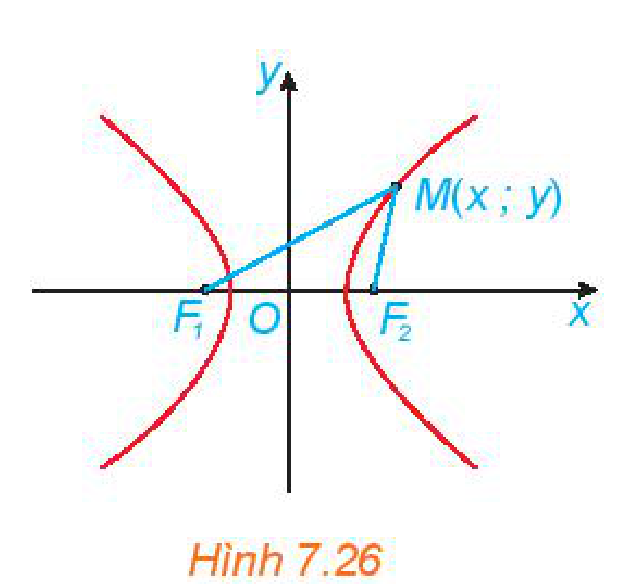
*Hình 7.26*

**Chú ý:** Người ta có thể biến đổi $(3)$ về dạng
$\frac{x^2}{a^2} - \frac{y^2}{b^2} = 1$, với $b = \sqrt{c^2 - a^2}$.
<!-- ocr-ok: đã đối chiếu ảnh trang PDF 52 -->

> Trong mặt phẳng toạ độ $Oxy$, hypebol có hai tiêu điểm thuộc trục hoành sao cho $O$ là trung điểm của đoạn nối hai tiêu điểm đó thì có phương trình
> $\frac{x^2}{a^2} - \frac{y^2}{b^2} = 1$, với $a, b > 0. \quad (4)$
> Ngược lại, mỗi phương trình có dạng $(4)$ đều là phương trình của hypebol có hai tiêu điểm $F_1\left(-\sqrt{a^2 + b^2}; 0\right)$, $F_2\left(\sqrt{a^2 + b^2}; 0\right)$, tiêu cự $2c = 2\sqrt{a^2 + b^2}$ và giá trị tuyệt đối của hiệu các khoảng cách từ mỗi điểm thuộc hypebol đến hai tiêu điểm bằng $2a$.
> Phương trình $(4)$ được gọi là **phương trình chính tắc của hypebol** tương ứng.

<!-- pdf:53 -->

**Ví dụ 4:** Cho hypebol có phương trình chính tắc $\frac{x^2}{9} - \frac{y^2}{16} = 1$. Tìm các tiêu điểm và tiêu cự của hypebol. Hiệu các khoảng cách từ một điểm nằm trên hypebol tới hai tiêu điểm có giá trị tuyệt đối bằng bao nhiêu?

**Giải:**

Ta có $a^2 = 9, b^2 = 16$, nên $c = \sqrt{a^2 + b^2} = 5$. Vậy hypebol có hai tiêu điểm là $F_1(-5; 0), F_2(5; 0)$ và có tiêu cự $2c = 10$. Hiệu các khoảng cách từ một điểm nằm trên hypebol tới hai tiêu điểm có giá trị tuyệt đối bằng $2a = 2\sqrt{9} = 6$.

**Luyện tập 4:** Cho hypebol $(H): \frac{x^2}{144} - \frac{y^2}{25} = 1$. Tìm các tiêu điểm và tiêu cự của $(H)$.

## 3. PARABOL

**HĐ5:** Cho parabol $(P): y = \frac{1}{4}x^2$. Xét $F(0; 1)$ và đường thẳng $\Delta: y + 1 = 0$. Với điểm $M(x; y)$ bất kì, chứng minh rằng $MF = d(M, \Delta) \Leftrightarrow M(x; y)$ thuộc $(P)$.
<!-- ocr-ok: đã đối chiếu ảnh trang PDF 53 -->

*(Gợi ý: $MF = \sqrt{x^2 + (y - 1)^2}$, $d(M, \Delta) = |y + 1|$)*

Như vậy, parabol $(P): y = \frac{1}{4}x^2$ là tập hợp những điểm cách đều điểm $F(0; 1)$ và đường thẳng $\Delta: y + 1 = 0$.

> Cho một điểm $F$ cố định và một đường thẳng $\Delta$ cố định không đi qua $F$. Tập hợp các điểm $M$ cách đều $F$ và $\Delta$ được gọi là **đường parabol** (hay **parabol**). Điểm $F$ được gọi là **tiêu điểm**, $\Delta$ được gọi là **đường chuẩn**, khoảng cách từ $F$ đến $\Delta$ được gọi là **tham số tiêu** của parabol đó.

**HĐ6:** Xét $(P)$ là một parabol với tiêu điểm $F$ và đường chuẩn $\Delta$. Gọi $p$ là tham số tiêu của $(P)$ và $H$ là hình chiếu vuông góc của $F$ trên $\Delta$. Chọn hệ trục toạ độ $Oxy$ có gốc $O$ là trung điểm của $HF$, tia $Ox$ trùng tia $OF$ (H.7.27).

a) Nêu toạ độ của $F$ và phương trình của $\Delta$.

b) Giải thích vì sao điểm $M(x; y)$ thuộc $(P)$ khi và chỉ khi
$\sqrt{\left(x - \frac{p}{2}\right)^2 + y^2} = \left|x + \frac{p}{2}\right|.$

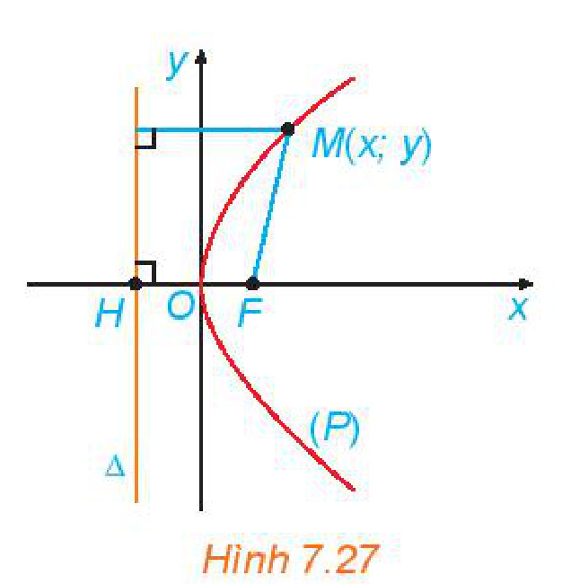
*Hình 7.27*

**Chú ý:** Bình phương hai vế của phương trình trên rồi rút gọn, ta dễ dàng nhận được phương trình $y^2 = 2px$.

<!-- pdf:54 -->

> Xét $(P)$ là một parabol với tiêu điểm $F$, đường chuẩn $\Delta$. Gọi $H$ là hình chiếu vuông góc của $F$ trên $\Delta$. Khi đó, trong hệ trục toạ độ $Oxy$ với gốc $O$ là trung điểm của $HF$, tia $Ox$ trùng tia $OF$, parabol $(P)$ có phương trình
> $y^2 = 2px$ (với $p > 0$). $\quad (5)$
> Phương trình $(5)$ được gọi là **phương trình chính tắc của parabol** $(P)$.
> Ngược lại, mỗi phương trình dạng $(5)$, với $p > 0$, là phương trình chính tắc của parabol có tiêu điểm $F\left(\frac{p}{2}; 0\right)$ và đường chuẩn $\Delta: x = -\frac{p}{2}$.

**Ví dụ 5:** Cho parabol $(P): y^2 = x$.

a) Tìm tiêu điểm $F$, đường chuẩn $\Delta$ của $(P)$.

b) Tìm những điểm trên $(P)$ có khoảng cách tới $F$ bằng $3$. *(Gợi ý: Sử dụng $M$ cách đều $F$ và $\Delta$.)*
<!-- ocr-ok: đã đối chiếu ảnh trang PDF 54 -->

**Giải:**

a) Ta có $2p = 1$ nên $p = \frac{1}{2}$.

Parabol có tiêu điểm $F\left(\frac{1}{4}; 0\right)$ và đường chuẩn $\Delta: x = -\frac{1}{4}$.

b) Điểm $M(x_0; y_0)$ thuộc $(P)$ có khoảng cách tới $F$ bằng $3$ khi và chỉ khi $y_0^2 = x_0$ và $MF = 3$. Do $MF = d(M, \Delta)$ nên $d(M, \Delta) = 3$.
<!-- ocr-ok: đã đối chiếu ảnh trang PDF 54 -->

Mặt khác $\Delta: x + \frac{1}{4} = 0$ và $x_0 = y_0^2 \ge 0$ nên $3 = d(M, \Delta) = \left|x_0 + \frac{1}{4}\right| = x_0 + \frac{1}{4}$.

Vậy $x_0 = \frac{11}{4}$ và $y_0 = \frac{\sqrt{11}}{2}$ hoặc $y_0 = -\frac{\sqrt{11}}{2}$.

Vậy có hai điểm $M$ thoả mãn bài toán với toạ độ là $\left(\frac{11}{4}; \frac{\sqrt{11}}{2}\right)$ và $\left(\frac{11}{4}; -\frac{\sqrt{11}}{2}\right)$.

**Vận dụng 2:** Tại một vùng biển giữa đất liền và một đảo, người ta phân định một đường ranh giới cách đều đất liền và đảo (H.7.28). Coi bờ biển vùng đất liền đó là một đường thẳng và đảo là hình tròn. Hỏi đường ranh giới nói trên có hình gì? Vì sao?

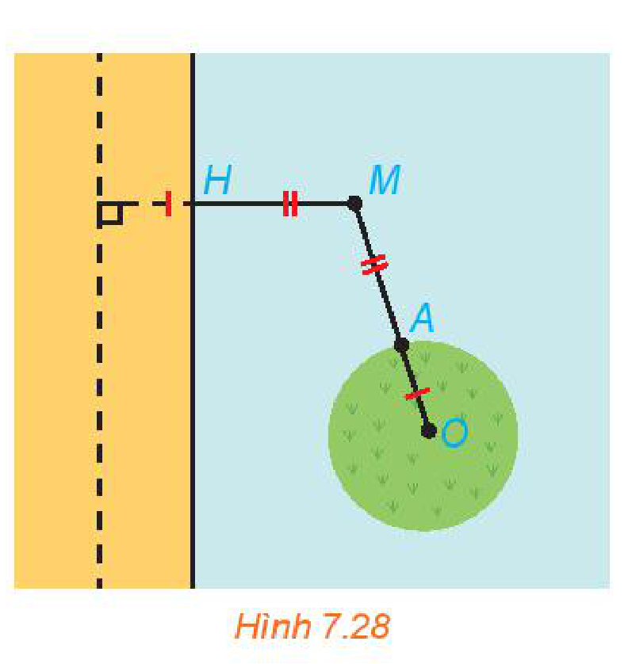
*Hình 7.28*

<!-- pdf:55 -->

## 4. MỘT SỐ ỨNG DỤNG CỦA BA ĐƯỜNG CONIC

**TÍNH CHẤT QUANG HỌC**

Tương tự gương cầu lồi thường đặt ở những khúc đường cua, người ta cũng có những gương (lồi, lõm) elip, hypebol, parabol. Tia sáng gặp các gương này, đều được phản xạ theo một quy tắc được xác định rõ bằng hình học, chẳng hạn:
- Tia sáng phát ra từ một tiêu điểm của elip, hypebol (đối với các gương lõm elip, hypebol) sau khi gặp elip, hypebol sẽ bị hắt lại theo một tia (tia phản xạ) nằm trên đường thẳng đi qua tiêu điểm còn lại (H.7.29).

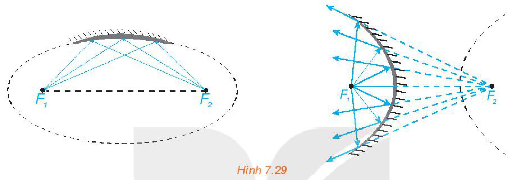
*Hình 7.29*

- Tia sáng hướng tới một tiêu điểm của elip, hypebol (đối với các gương elip, hypebol lồi), khi gặp elip, hypebol sẽ bị hắt lại theo một tia nằm trên đường thẳng đi qua tiêu điểm còn lại (H.7.30).

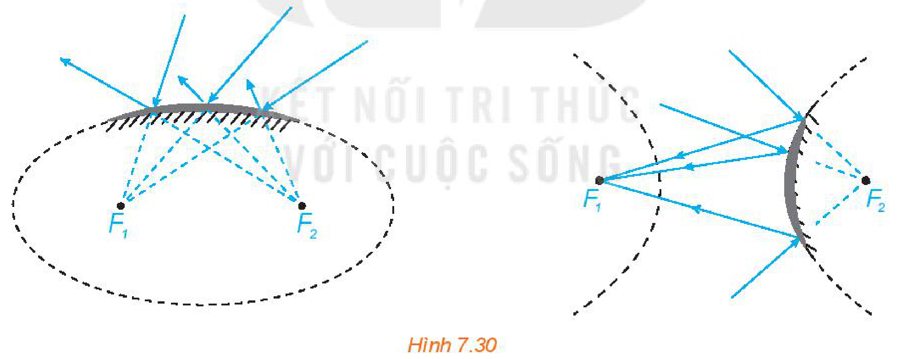
*Hình 7.30*

- Với gương parabol lõm, tia sáng phát ra từ tiêu điểm khi gặp parabol sẽ bị hắt lại theo một tia vuông góc với đường chuẩn của parabol (H.7.31). Ngược lại, nếu tia tới vuông góc với đường chuẩn của parabol thì tia phản xạ sẽ đi qua tiêu điểm của parabol.

Tính chất quang học được đề cập ở trên giúp ta nhận được ánh sáng mạnh hơn khi các tia sáng hội tụ và giúp ta đổi hướng ánh sáng khi cần. Ta cũng có điều tương tự đối với tín hiệu âm thanh, tín hiệu truyền từ vệ tinh.

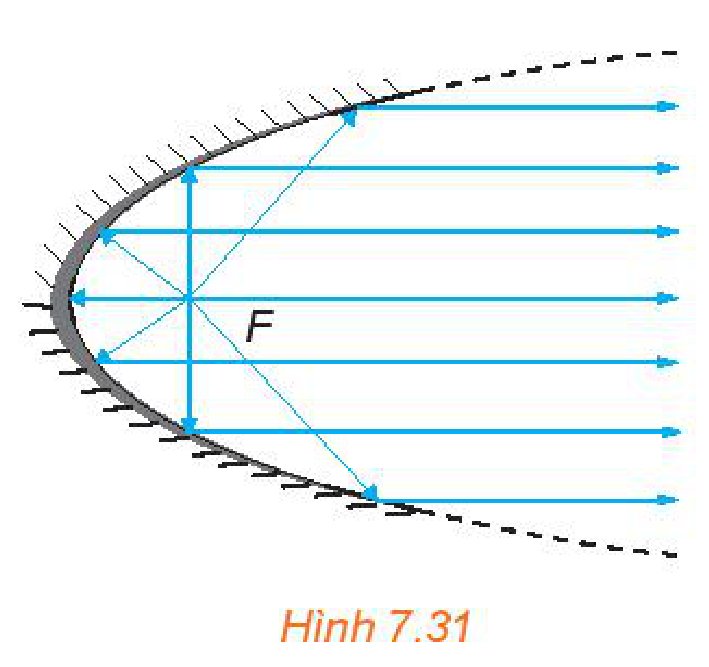
*Hình 7.31*

<!-- pdf:56 -->

**MỘT SỐ ỨNG DỤNG**

*Nhà vòm hoa (Flower Dome) trong Khu vườn bên vịnh (Gardens by the Bay), Singapore*

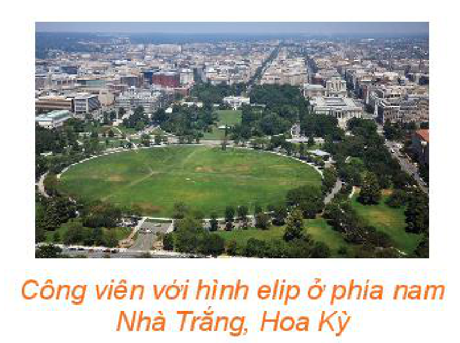
*Công viên với hình elip ở phía nam Nhà Trắng, Hoa Kỳ*
<!-- ocr-ok: đã đối chiếu ảnh trang PDF 56 -->

Ba đường conic xuất hiện và có nhiều ứng dụng trong khoa học và trong cuộc sống, chẳng hạn:
- Tia nước bắn ra từ đài phun nước, đường đi bổng của quả bóng là những hình ảnh về đường parabol;
- Khi nghiêng cốc nước hình trụ, mặt nước trong cốc có hình elip. Tương tự, dưới ánh sáng mặt trời, bóng của một quả bóng, nhìn chung, là một elip;
- Ánh sáng phát ra từ một bóng đèn Led trên trần nhà có thể tạo nên trên tường các nhánh hypebol;
- Nhiều công trình kiến trúc có hình elip, parabol hay hypebol.

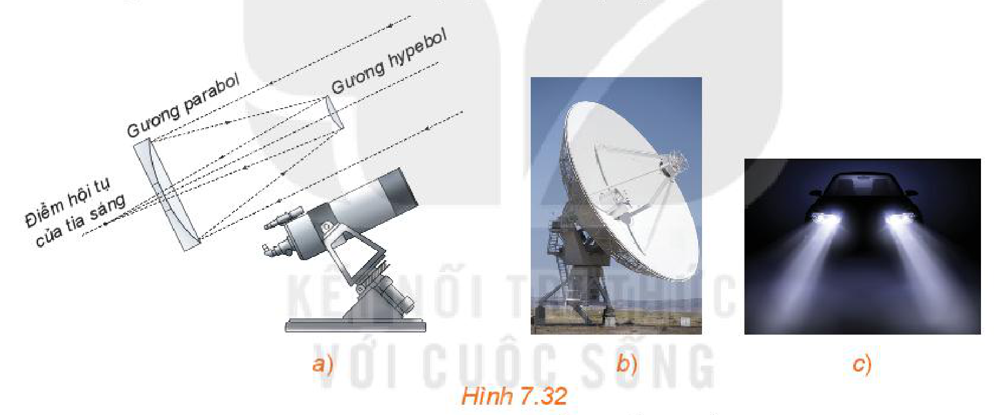
*Hình 7.32*

- Trong vũ trụ bao la, ánh sáng đóng vai trò sứ giả truyền tin. Ánh sáng phát ra từ một thiên thể sẽ mang những thông tin về nơi nó xuất phát. Khi nhận được ánh sáng, các nhà khoa học sẽ dựa vào đó để nghiên cứu, khám phá thiên thể. Trong thiên văn học, các gương trong kính thiên văn (H.7.32a) giúp nhà khoa học nhận được hình ảnh quan sát rõ nét hơn, ánh sáng thu được có các chỉ số phân tích rõ hơn.
- Ăng-ten vệ tinh parabol (H.7.32b) là thiết bị thu tín hiệu truyền về từ vệ tinh. Tín hiệu sau khi gặp parabol bị hắt lại và hội tụ về điểm thu được đặt tại tiêu điểm của parabol.
- Đèn pha đáy parabol (H.7.32c) giúp ánh sáng có thể phát xa (chẳng hạn, giúp đèn ô tô có thể chiếu xa). Ánh sáng xuất phát từ vị trí tiêu điểm của parabol, chiếu vào đáy đèn, các tia sáng bị hắt lại thành các tia sáng nằm trên các đường thẳng song song.
- Trong y học, để tán sỏi thận, người ta có thể dùng chùm tia laser phát ra từ một tiêu điểm của gương elip để sau khi phản xạ sẽ hội tụ tại tiêu điểm còn lại cũng chính là vị trí sỏi.
- Tháp giải nhiệt hình hypebol trong lò phản ứng hạt nhân (H.7.17c) hay trong nhà máy nhiệt điện có kiến trúc đảm bảo độ vững chãi, tiết kiệm nguyên vật liệu và giúp quá trình toả nhiệt được thuận lợi.

<!-- pdf:57 -->

- Bằng các quan sát và phân tích thiên văn, Johannes Kepler (1571 – 1630) đã đưa ra định luật nói rằng, các hành tinh trong hệ Mặt Trời chuyển động theo các quỹ đạo là các đường elip nhận tâm Mặt Trời là một tiêu điểm.

**Vận dụng 3:** Gương elip trong một máy tán sỏi thận (H.7.33) ứng với elip có phương trình chính tắc $\frac{x^2}{400} + \frac{y^2}{76} = 1$ (theo đơn vị cm). Tính khoảng cách từ vị trí đầu phát sóng của máy đến vị trí của sỏi thận cần tán.

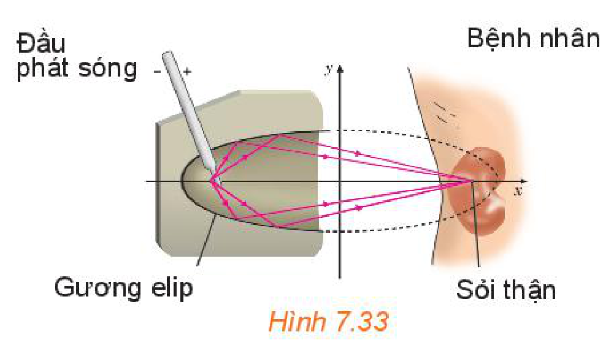
*Hình 7.33*

## ✏️ Bài tập

**7.19.** Cho elip có phương trình: $\frac{x^2}{36} + \frac{y^2}{9} = 1$. Tìm tiêu điểm và tiêu cự của elip.

**7.20.** Cho hypebol có phương trình: $\frac{x^2}{7} - \frac{y^2}{9} = 1$. Tìm tiêu điểm và tiêu cự của hypebol.

**7.21.** Cho parabol có phương trình: $y^2 = 8x$. Tìm tiêu điểm và đường chuẩn của parabol.

**7.22.** Lập phương trình chính tắc của elip đi qua điểm $A(5; 0)$ và có một tiêu điểm là $F_2(3; 0)$.

**7.23.** Lập phương trình chính tắc của parabol đi qua điểm $M(2; 4)$.

**7.24.** Có hai trạm phát tín hiệu vô tuyến đặt tại hai vị trí $A, B$ cách nhau $300\text{ km}$. Tại cùng một thời điểm, hai trạm cùng phát tín hiệu với vận tốc $292\,000\text{ km/s}$ để một tàu thuỷ thu và đo độ lệch thời gian. Tín hiệu từ $A$ đến sớm hơn tín hiệu từ $B$ là $0,0005\text{ s}$. Từ thông tin trên, ta có thể xác định được tàu thuỷ thuộc đường hypebol nào? Viết phương trình chính tắc của hypebol đó theo đơn vị kilômét.

**7.25.** Khúc cua của một con đường có dạng hình parabol, điểm đầu vào khúc cua là $A$, điểm cuối là $B$, khoảng cách $AB = 400\text{ m}$. Đỉnh parabol $(P)$ của khúc cua cách đường thẳng $AB$ một khoảng $20\text{ m}$ và cách đều $A, B$ (H.7.34).

a) Lập phương trình chính tắc của $(P)$, với $1$ đơn vị đo trong mặt phẳng toạ độ tương ứng $1\text{ m}$ trên thực tế.

b) Lập phương trình chính tắc của $(P)$, với $1$ đơn vị đo trong mặt phẳng toạ độ tương ứng $1\text{ km}$ trên thực tế.

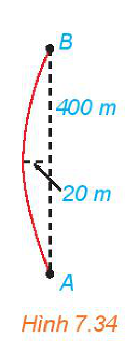
*Hình 7.34*

## 💡 Em có biết?

Hệ thống định vị trên mặt đất LORAN (Long Range Navigation) được hoạt động dựa trên nguyên lí đo sự chênh lệch thời gian tiếp nhận tín hiệu và sử dụng tính chất của hypebol để xác định vị trí của nơi nhận tín hiệu. Ta có thể hình dung một tình huống đơn giản như sau: Hai trạm phát sóng radio đặt tại hai vị trí xác định $A, B$, cùng lúc phát tín hiệu và được một tàu thuỷ thu và đo độ lệch về thời gian tiếp nhận. Từ vận tốc truyền sóng, có thể xác định được hiệu khoảng cách từ tàu thuỷ đến các vị trí $A, B$. Như vậy,

<!-- pdf:58 -->

tàu thuỷ nằm trên một nhánh hypebol hoàn toàn xác định. Tương tự, nếu có trạm phát sóng thứ ba $C$ (hoặc một cặp trạm $C, D$), thì cặp trạm phát sóng $A, C$ (hay $C, D$), cũng cho phép ta xác định một nhánh hypebol đi qua vị trí tàu thuỷ. Do đó, vị trí tàu thuỷ được xác định như là giao điểm của hai nhánh hypebol (H.7.35a).

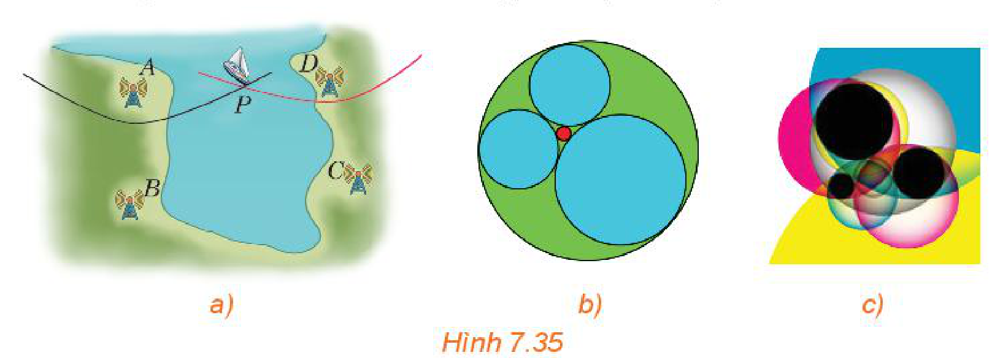
*Hình 7.35*

Nền tảng toán học cho ứng dụng trên đã được biết đến từ hơn $2\,000$ năm trước. Bài toán xác định đường tròn tiếp xúc với ba đường tròn cho trước đã được đặt ra và nghiên cứu bởi Apollonius (khoảng $262 - 190$, TCN). Trong Hình 7.35c, với ba đường tròn màu đen cho trước, đôi một ngoài nhau, có tám đường tròn tiếp xúc với cả ba đường tròn đó mà ta có thể đếm được trên hình vẽ. Nói chung, bài toán Apollonius có tám nghiệm hình, tuy vậy, trong một số trường hợp đặc biệt, số nghiệm có thể khác. Trong Hình 7.35b, với ba đường tròn đôi một tiếp xúc ngoài với nhau cho trước (ba hình tròn được tô cùng màu), có hai đường tròn tiếp xúc với chúng. Gọi $r_1, r_2, r_3$ là bán kính của ba đường tròn cho trước trong Hình 7.35b và $r, R$ ($r < R$) là bán kính của hai đường tròn nghiệm. Năm $1643$, trong một bức thư gửi công chúa Elisabeth ($1618 - 1680$), Descartes ($1596 - 1650$) đã đưa ra các công thức sau, cho phép tính bán kính của các đường tròn nghiệm theo các đường tròn đã cho
$\left(\frac{1}{r_1} + \frac{1}{r_2} + \frac{1}{r_3} + \frac{1}{r}\right)^2 = 2\left(\frac{1}{r_1^2} + \frac{1}{r_2^2} + \frac{1}{r_3^2} + \frac{1}{r^2}\right)$ và $\left(\frac{1}{r_1} + \frac{1}{r_2} + \frac{1}{r_3} - \frac{1}{R}\right)^2 = 2\left(\frac{1}{r_1^2} + \frac{1}{r_2^2} + \frac{1}{r_3^2} + \frac{1}{R^2}\right).$

Định lí của Descartes còn được phát hiện một cách độc lập bởi Steiner năm $1826$, Beecroft năm $1842$, Soddy năm $1936$. Soddy đã công bố phát hiện của mình trên tạp chí Nature dưới dạng một bài thơ với tên "The Kiss Precise".

Các thông tin trên cũng được đề cập trong bài báo của Coxter trên tạp chí American Mathematical Monthly, số $75$, năm $1968$.

Bài toán Apollonius còn được hiểu theo nghĩa rộng hơn, ở đó, ba đường cho trước có thể là đường tròn, đường thẳng, hay điểm. Để một đường tròn tiếp xúc ngoài (tiếp xúc trong) với hai đường tròn cho trước, thì tâm của nó phải thuộc một nhánh hypebol (hoặc elip). Do đó việc xác định tâm của đường tròn nghiệm của bài toán Apollonius có thể chuyển thành bài toán xác định giao của hai đường conic. Ta hoàn toàn có thể nhìn ra mối liên hệ giữa bài toán Apollonius với Ví dụ 3, Vận dụng 2 trong Bài 22, cũng như bài toán định vị trong hệ thống LORAN.

## 📷 Danh sách hình trong bài

| Mã hình | Trang PDF | Vị trí trong bài | Chú thích gốc |
| --- | --- | --- | --- |
| H10-toan-b22-01 | 49 | Mở đầu | Hình 7.17 |
| H10-toan-b22-02 | 49 | Mục 1, HĐ1 | Hình 7.18 |
| H10-toan-b22-03 | 50 | Mục 1, Ví dụ 1 | Hình 7.19 |
| H10-toan-b22-04 | 50 | Mục 1, Luyện tập 1 | Hình 7.20 |
| H10-toan-b22-05 | 50 | Mục 1, HĐ2 | Hình 7.21 |
| H10-toan-b22-06 | 51 | Mục 1, Vận dụng 1 | Hình 7.22 |
| H10-toan-b22-07 | 51 | Mục 2, mở đầu | Hình 7.23 |
| H10-toan-b22-08 | 52 | Mục 2, Ví dụ 3 | Hình 7.24 |
| H10-toan-b22-09 | 52 | Mục 2, Luyện tập 3 | Hình 7.25 |
| H10-toan-b22-10 | 52 | Mục 2, HĐ4 | Hình 7.26 |
| H10-toan-b22-11 | 53 | Mục 3, HĐ6 | Hình 7.27 |
| H10-toan-b22-12 | 54 | Mục 3, Vận dụng 2 | Hình 7.28 |
| H10-toan-b22-13 | 55 | Mục 4, Tính chất quang học | Hình 7.29 |
| H10-toan-b22-14 | 55 | Mục 4, Tính chất quang học | Hình 7.30 |
| H10-toan-b22-15 | 55 | Mục 4, Tính chất quang học | Hình 7.31 |
| H10-toan-b22-16 | 56 | Mục 4, Một số ứng dụng | Nhà vòm hoa (Flower Dome) trong Khu vườn bên vịnh (Gardens by the Bay), Singapore |
| H10-toan-b22-17 | 56 | Mục 4, Một số ứng dụng | Công viên với hình elip ở phía nam Nhà Trắng, Hoa Kỳ |
| H10-toan-b22-18 | 56 | Mục 4, Một số ứng dụng | Hình 7.32 |
| H10-toan-b22-19 | 57 | Mục 4, Vận dụng 3 | Hình 7.33 |
| H10-toan-b22-20 | 57 | Bài tập 7.25 | Hình 7.34 |
| H10-toan-b22-21 | 58 | Em có biết? | Hình 7.35 |
