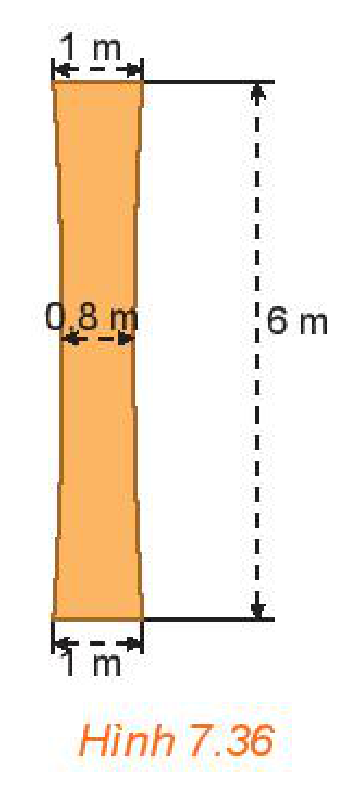

<!-- pdf:59 -->

# BÀI TẬP CUỐI CHƯƠNG VII

## ✏️ A – TRẮC NGHIỆM

**7.26.** Phương trình nào sau đây là phương trình tham số của đường thẳng?

A. $2x - y + 1 = 0$.

B. $\begin{cases} x = 2t \\ y = t \end{cases}$.

C. $x^2 + y^2 = 1$.

D. $y = 2x + 3$.

**7.27.** Phương trình nào sau đây là phương trình tổng quát của đường thẳng?

A. $-x - 2y + 3 = 0$.

B. $\begin{cases} x = 2 + t \\ y = 3 - t \end{cases}$.

C. $y^2 = 2x$.

D. $\frac{x^2}{10} + \frac{y^2}{6} = 1$.

**7.28.** Phương trình nào sau đây là phương trình của đường tròn?

A. $x^2 - y^2 = 1$.

B. $(x - 1)^2 + (y - 2)^2 = -4$.

C. $x^2 + y^2 = 2$.

D. $y^2 = 8x$.

**7.29.** Phương trình nào sau đây là phương trình chính tắc của đường elip?

A. $\frac{x^2}{9} + \frac{y^2}{9} = 1$.

B. $\frac{x^2}{1} + \frac{y^2}{6} = 1$.

C. $\frac{x^2}{4} - \frac{y^2}{1} = 1$.

D. $\frac{x^2}{2} + \frac{y^2}{1} = 1$.

**7.30.** Phương trình nào sau đây là phương trình chính tắc của đường hypebol?

A. $\frac{x^2}{3} - \frac{y^2}{2} = -1$.

B. $\frac{x^2}{1} - \frac{y^2}{6} = 1$.

C. $\frac{x^2}{6} + \frac{y^2}{1} = 1$.

D. $\frac{x^2}{2} + \frac{y^2}{1} = -1$.

**7.31.** Phương trình nào sau đây là phương trình chính tắc của đường parabol?

A. $x^2 = 4y$.

B. $x^2 = -6y$.

C. $y^2 = 4x$.

D. $y^2 = -4x$.

## ✏️ B – TỰ LUẬN

**7.32.** Trong mặt phẳng toạ độ, cho $A(1; -1)$, $B(3; 5)$, $C(-2; 4)$. Tính diện tích tam giác $ABC$.

**7.33.** Trong mặt phẳng toạ độ, cho hai điểm $A(-1; 0)$ và $B(3; 1)$.

a) Viết phương trình đường tròn tâm $A$ và đi qua $B$.

b) Viết phương trình tổng quát của đường thẳng $AB$.

c) Viết phương trình đường tròn tâm $O$ và tiếp xúc với đường thẳng $AB$.

**7.34.** Cho đường tròn $(C)$ có phương trình $x^2 + y^2 - 4x + 6y - 12 = 0$.

a) Tìm toạ độ tâm $I$ và bán kính $R$ của $(C)$.

b) Chứng minh rằng điểm $M(5; 1)$ thuộc $(C)$. Viết phương trình tiếp tuyến $d$ của $(C)$ tại $M$.

<!-- pdf:60 -->

**7.35.** Cho elip $(E): \frac{x^2}{a^2} + \frac{y^2}{b^2} = 1$ ($a > b > 0$).

a) Tìm các giao điểm $A_1, A_2$ của $(E)$ với trục hoành và các giao điểm $B_1, B_2$ của $(E)$ với trục tung. Tính $A_1A_2, B_1B_2$.

b) Xét một điểm bất kì $M(x_0; y_0)$ thuộc $(E)$. Chứng minh rằng, $b^2 \le x_0^2 + y_0^2 \le a^2$ và $b \le OM \le a$.

**Chú ý:** $A_1A_2, B_1B_2$ tương ứng được gọi là trục lớn, trục nhỏ của elip $(E)$ và tương ứng có độ dài là $2a, 2b$.

**7.36.** Cho hypebol có phương trình: $\frac{x^2}{a^2} - \frac{y^2}{b^2} = 1$.

a) Tìm các giao điểm $A_1, A_2$ của hypebol với trục hoành (hoành độ của $A_1$ nhỏ hơn của $A_2$).

b) Chứng minh rằng, nếu điểm $M(x; y)$ thuộc nhánh nằm bên trái trục tung của hypebol thì $x \le -a$, nếu điểm $M(x; y)$ thuộc nhánh nằm bên phải trục tung của hypebol thì $x \ge a$.

c) Tìm các điểm $M_1, M_2$ tương ứng thuộc các nhánh bên trái, bên phải trục tung của hypebol để $M_1M_2$ nhỏ nhất.

**7.37.** Một cột trụ hình hypebol (H.7.36), có chiều cao $6\text{ m}$, chỗ nhỏ nhất ở chính giữa và rộng $0,8\text{ m}$, đỉnh cột và đáy cột đều rộng $1\text{ m}$. Tính độ rộng của cột ở độ cao $5\text{ m}$ (tính theo đơn vị mét và làm tròn tới hai chữ số sau dấu phẩy).

*Hình 7.36*

## 📷 Danh sách hình trong bài

| Mã hình | Trang PDF | Vị trí trong bài | Chú thích gốc |
| --- | --- | --- | --- |
| H10-toan-bt-c07-01 | 60 | Bài tập 7.37 | Hình 7.36 |
