<!-- pdf:61 -->

<!-- Phần giới thiệu Chương VIII (in chung đầu trang PDF 61): CHƯƠNG VIII. ĐẠI SỐ TỔ HỢP -->

Chương này cung cấp những kiến thức cơ bản về Đại số tổ hợp, bao gồm hai quy tắc đếm thường dùng là quy tắc cộng và quy tắc nhân; các khái niệm và công thức về hoán vị, chỉnh hợp, tổ hợp; công thức khai triển nhị thức Newton trong trường hợp số mũ thấp.

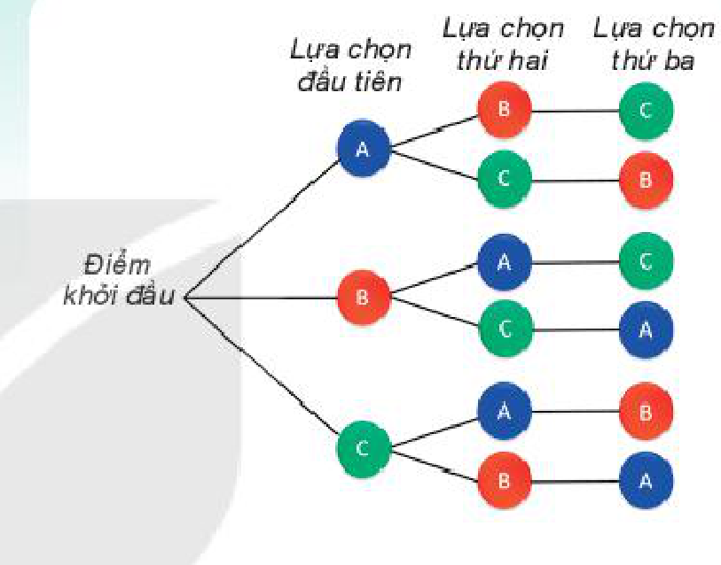

# BÀI 23: QUY TẮC ĐẾM

## 🔤 Thuật ngữ

- Quy tắc cộng
- Quy tắc nhân
- Sơ đồ hình cây

## 🎯 Mục tiêu

- Vận dụng quy tắc cộng, quy tắc nhân để tính toán số cách thực hiện một công việc hoặc đếm số phần tử của một tập hợp.
- Vận dụng sơ đồ hình cây trong các bài toán đếm đơn giản.

## 🔴 Mở đầu

Đếm là một bài toán cổ xưa nhất của nhân loại. Trong khoa học và trong cuộc sống, người ta cần đếm các đối tượng để giải quyết các vấn đề khác nhau. Chẳng hạn như bài toán sau:

Mỗi mật khẩu của một trang web là một dãy có từ $2$ tới $3$ kí tự, trong đó kí tự đầu tiên là một trong $26$ chữ cái in thường trong bảng chữ cái tiếng Anh (từ a đến z), mỗi kí tự còn lại là một chữ số từ $0$ đến $9$. Hỏi có thể tạo được bao nhiêu mật khẩu khác nhau?

Bài học này sẽ giúp em hiểu và áp dụng hai quy tắc đếm cơ bản để giải quyết bài toán trên.

<!-- pdf:62 -->

## 1. QUY TẮC CỘNG VÀ SƠ ĐỒ HÌNH CÂY

**HĐ1:** Chọn chuyến đi (H.8.1)
<!-- ocr-ok: đã đối chiếu ảnh trang PDF 62, OCR đọc sai nhãn HĐ1 và dấu thanh -->

Từ Hà Nội vào Vinh mỗi ngày có $7$ chuyến tàu hoả và $2$ chuyến máy bay. Bạn An muốn ngày Chủ nhật này đi từ Hà Nội vào Vinh bằng tàu hoả hoặc máy bay.

Hỏi bạn An có bao nhiêu cách chọn chuyến đi?

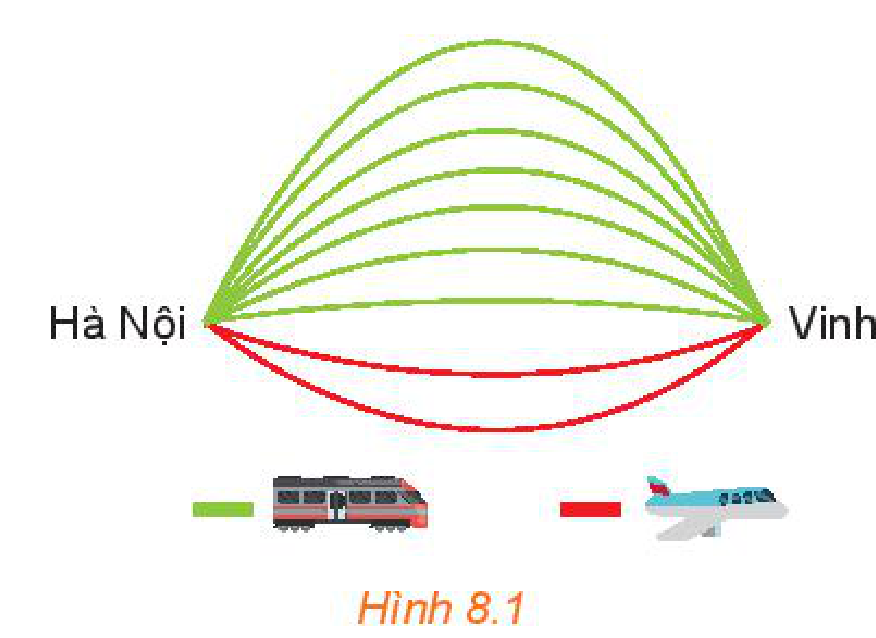
*Hình 8.1*

**HĐ2:** Chọn vé tàu (H.8.2)

Bạn An đã quyết định mua vé tàu đi từ Hà Nội vào Vinh trên chuyến tàu SE7. Trên tàu có các toa ghế ngồi và các toa giường nằm. Toa ngồi có hai loại vé: ngồi cứng và ngồi mềm. Toa nằm có loại khoang $4$ giường và khoang $6$ giường. Khoang $4$ giường có hai loại vé: tầng $1$ và tầng $2$, khoang $6$ giường có ba loại vé: tầng $1$, tầng $2$ và tầng $3$. Hỏi:

a) Có bao nhiêu loại vé ghế ngồi và bao nhiêu loại vé giường nằm?

b) Có bao nhiêu loại vé để bạn An lựa chọn?

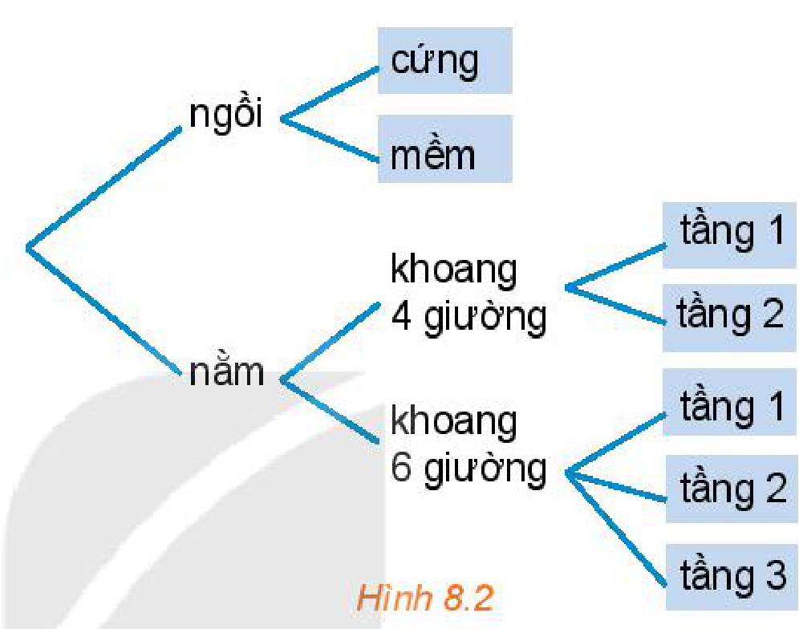
*Hình 8.2*

> **Quy tắc cộng**
> Giả sử một công việc có thể thực hiện theo một trong hai phương án khác nhau:
> - Phương án một có $n_1$ cách thực hiện,
> - Phương án hai có $n_2$ cách thực hiện (không trùng với bất kì cách thực hiện nào của phương án một).
> Khi đó số cách thực hiện công việc sẽ là: $n_1 + n_2$ cách.

**Chú ý:** Sơ đồ minh hoạ cách phân chia trường hợp như trong Hình 8.2 được gọi là **sơ đồ hình cây**. Trong các bài toán đếm, người ta thường dùng sơ đồ hình cây để minh hoạ, giúp cho việc đếm thuận tiện và không bỏ sót trường hợp.

**Ví dụ 1:** Một quán phục vụ ăn sáng có bán phở và bún. Phở có $2$ loại là phở bò và phở gà. Bún có $3$ loại là bún bò, bún riêu cua và bún cá. Một khách hàng muốn chọn một món để ăn sáng. Vẽ sơ đồ hình cây minh hoạ và cho biết khách hàng đó có bao nhiêu cách lựa chọn một món ăn sáng.

**Giải:** Ta có sơ đồ hình cây như Hình 8.3.

Theo quy tắc cộng, số cách chọn một món ăn sáng là:

$2 + 3 = 5\text{ (cách)}.$

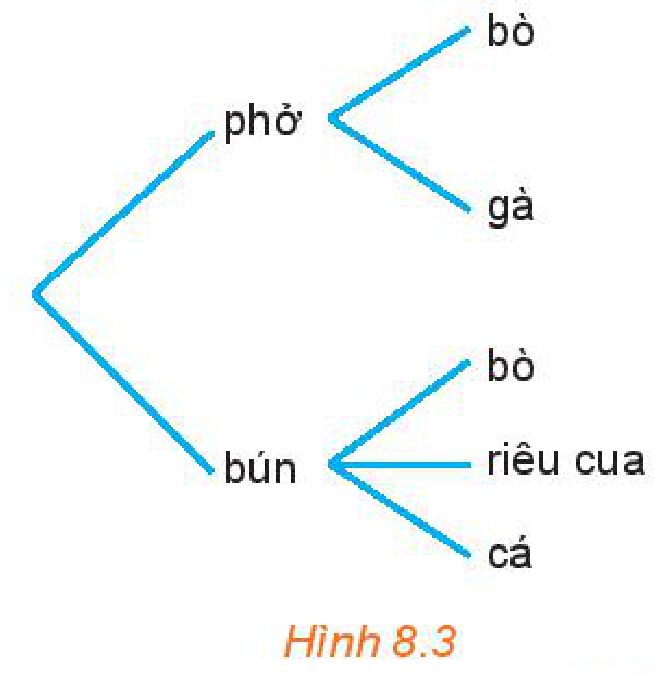
*Hình 8.3*

<!-- pdf:63 -->

**Chú ý:** Ta áp dụng quy tắc cộng cho một công việc có nhiều phương án khi các phương án đó phải rời nhau, không phụ thuộc vào nhau (độc lập với nhau).

**Ví dụ 2:** Một bộ cờ vua có $32$ quân cờ như Hình 8.4.

a) Bạn Nam lấy ra tất cả các quân tốt. Hãy đếm xem Nam lấy ra bao nhiêu quân cờ.

b) Bạn Nam lấy ra tất cả các quân cờ trắng và tất cả các quân tốt. Hãy đếm số quân cờ Nam lấy ra.

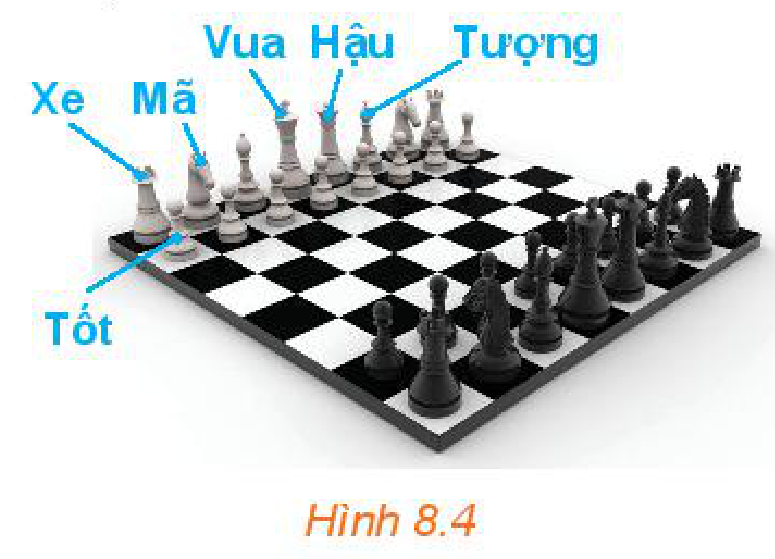
*Hình 8.4*

**Giải:**

a) Quân cờ bạn Nam lấy ra có thể thuộc hai loại: màu trắng hoặc màu đen.

- Số quân tốt trắng: $8$ quân;
- Số quân tốt đen: $8$ quân.

Nam lấy ra: $8 + 8 = 16\text{ (quân cờ)}$.

b) Nam lấy tất cả các quân trắng và tất cả các quân tốt.

- Đầu tiên ta đếm tất cả các quân cờ trắng, có $16$ quân;
- Tiếp theo ta đếm tất cả các quân tốt, có $16$ quân tốt.

Vì trong $16$ quân tốt có $8$ quân tốt trắng đã được đếm nên số quân cờ Nam lấy ra là:

$16 + 16 - 8 = 24\text{ (quân cờ)}.$

<!-- term: Quy tắc đếm số phần tử của hợp hai tập hợp hữu hạn -->
**Nhận xét:** Ở câu b), nếu gọi $A$ là tập hợp gồm tất cả các quân cờ trắng, $B$ là tập hợp gồm tất cả các quân tốt thì các quân cờ Nam lấy ra chính là các phần tử của tập hợp $A \cup B$. Nếu ta áp dụng quy tắc cộng: $n(A \cup B) = n(A) + n(B) = 32\text{ (quân cờ)}$, suy ra Nam lấy ra $32$ quân cờ. Kết luận khi đó là sai, vì $A \cap B \ne \varnothing$ nên ta không thể áp dụng quy tắc cộng để tính trong trường hợp này.

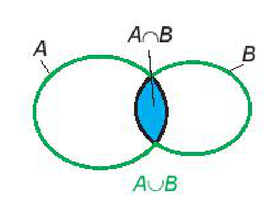

**Luyện tập 1:** Có bao nhiêu số tự nhiên từ $1$ đến $30$ mà không nguyên tố cùng nhau với $35$?

> Hai số tự nhiên $a$ và $b$ gọi là **nguyên tố cùng nhau** nếu chúng có ước chung lớn nhất là $1$.

## 2. QUY TẮC NHÂN

**HĐ3:** Thầy Trung muốn đi từ Hà Nội vào Huế, rồi từ Huế vào Quảng Nam. Biết rằng từ Hà Nội vào Huế có thể đi bằng $3$ cách: ô tô, tàu hoả hoặc máy bay. Còn từ Huế vào Quảng Nam có thể đi bằng $2$ cách: ô tô hoặc tàu hoả (H.8.5).

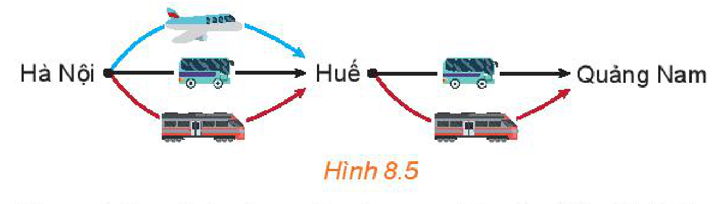
*Hình 8.5*

Hỏi thầy Trung có bao nhiêu cách chọn các phương tiện để đi từ Hà Nội vào Quảng Nam?

<!-- pdf:64 -->

**HĐ4:** Để lắp ghế vào một phòng chiếu phim, các ghế được gắn nhãn bằng một chữ cái in hoa (trong bảng $26$ chữ cái tiếng Anh từ A đến Z) đứng trước và một số nguyên từ $1$ đến $20$, chẳng hạn X15, Z2, ...

Hỏi có thể gắn nhãn tối đa được cho bao nhiêu ghế?

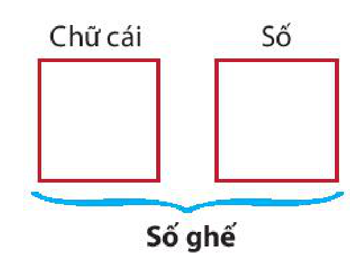

Ta nhận thấy muốn làm một việc có hai công đoạn lần lượt thì trước hết ta xét xem công đoạn một có bao nhiêu cách, sau đó với mỗi cách của công đoạn một, ta tính xem công đoạn hai có bao nhiêu cách. Khi đó số cách thực hiện công việc tính theo quy tắc sau:

> **Quy tắc nhân**
> Giả sử một công việc phải hoàn thành qua hai công đoạn liên tiếp nhau:
> - Công đoạn một có $m_1$ cách thực hiện,
> - Với mỗi cách thực hiện công đoạn một, có $m_2$ cách thực hiện công đoạn hai.
> Khi đó số cách thực hiện công việc là: $m_1 \cdot m_2$ cách.

**Chú ý:** Quy tắc nhân áp dụng để tính số cách thực hiện một công việc có nhiều công đoạn, các công đoạn nối tiếp nhau và những công đoạn này độc lập với nhau.

**Ví dụ 3:** Một người muốn mua vé tàu ngồi đi từ Hà Nội vào Vinh. Có ba chuyến tàu là SE5, SE7 và SE35. Trên mỗi tàu có $2$ loại vé ngồi khác nhau: ngồi cứng hoặc ngồi mềm. Hỏi có bao nhiêu loại vé ngồi khác nhau để người đó lựa chọn?

**Giải:**

Để mua được vé tàu, người đó phải thực hiện hai công đoạn: Chọn chuyến tàu $\rightarrow$ Chọn loại vé.

Có $3$ cách chọn chuyến tàu, với mỗi chuyến tàu có $2$ cách chọn loại vé ngồi. Áp dụng quy tắc nhân, ta có số cách chọn loại vé là: $3 \cdot 2 = 6\text{ (cách)}$.

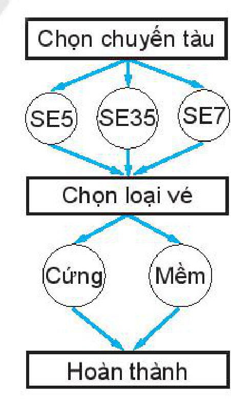

**Chú ý:** Ta cũng có thể dùng quy tắc cộng. Người mua vé có thể lựa chọn một trong ba trường hợp: SE5, SE7 hoặc SE35.

Nếu lựa chọn SE5, có hai loại vé: loại vé SE5 ngồi cứng và SE5 ngồi mềm. Tương tự cho trường hợp SE7 và trường hợp SE35.

Mỗi trường hợp có hai loại vé. Tổng cộng có:

$2 + 2 + 2 = 6\text{ (cách chọn loại vé)}.$

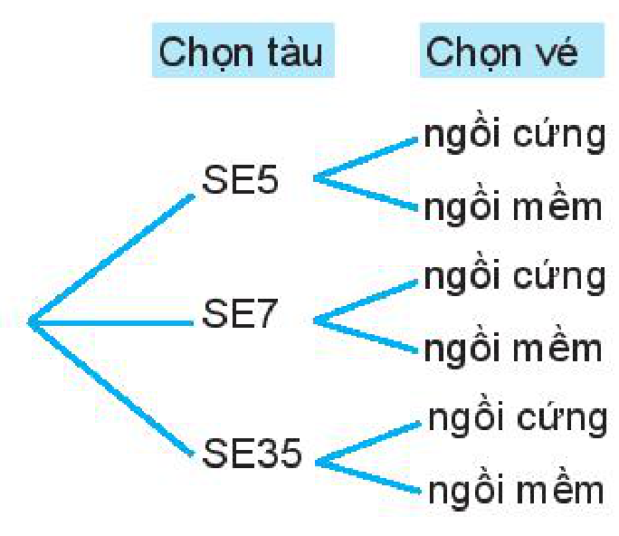

<!-- pdf:65 -->

**Luyện tập 2:** Tại kì World Cup năm 2018, vòng bảng gồm có $32$ đội tham gia, được chia vào $8$ bảng, mỗi bảng $4$ đội thi đấu vòng tròn (mỗi đội chơi một trận với từng đội khác trong cùng bảng). Hỏi tổng cộng vòng bảng có bao nhiêu trận đấu?

## 3. KẾT HỢP QUY TẮC CỘNG VÀ QUY TẮC NHÂN

Trong các ví dụ trước, chúng ta chỉ cần áp dụng một quy tắc đếm. Tuy nhiên, hầu hết các bài toán đếm trong thực tế sẽ phức tạp hơn và thường phải áp dụng cả hai quy tắc.

**Ví dụ 4:** Để tổ chức bữa tiệc, người ta chọn thực đơn gồm một món khai vị, một món chính và một món tráng miệng. Nhà hàng đưa ra danh sách: khai vị có $2$ loại súp và $3$ loại sa lát; món chính có $4$ loại thịt, $3$ loại cá và $3$ loại tôm; tráng miệng có $5$ loại kem và $3$ loại bánh. Hỏi có thể thiết kế bao nhiêu thực đơn khác nhau?

**Giải:**

Để chọn thực đơn, ta chia thành $3$ công đoạn chọn món.

Công đoạn 1, chọn món khai vị: vì có hai phương án là súp hoặc sa lát nên ta áp dụng quy tắc cộng. Số cách chọn là: $2 + 3 = 5\text{ (cách)}$.

Công đoạn 2, chọn món chính: tương tự, ta có số cách chọn là: $4 + 3 + 3 = 10\text{ (cách)}$.

Công đoạn 3, chọn món tráng miệng: tương tự, ta có số cách chọn là: $5 + 3 = 8\text{ (cách)}$.

Tổng kết, theo quy tắc nhân, số cách chọn thực đơn là: $5 \cdot 10 \cdot 8 = 400\text{ (cách)}$.

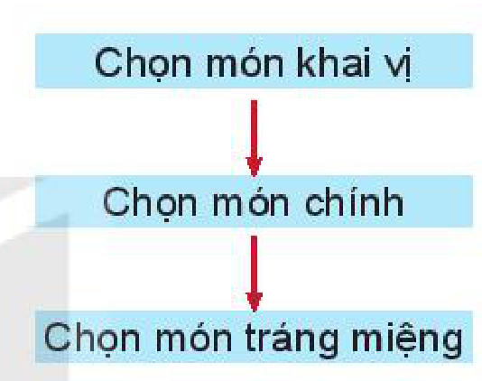

<!-- term: Phân biệt quy tắc cộng và quy tắc nhân -->
**Chú ý:** Quy tắc cộng được áp dụng khi công việc được chia thành các phương án phân biệt (thực hiện một trong các phương án để hoàn thành công việc). Quy tắc nhân được áp dụng khi công việc có nhiều công đoạn nối tiếp nhau (phải thực hiện tất cả các công đoạn để hoàn thành công việc).

**Luyện tập 3:** Từ các chữ số $0, 1, 2, 3$ có thể lập được bao nhiêu số thoả mãn:

a) Là số tự nhiên có ba chữ số khác nhau?

b) Là số tự nhiên chẵn có ba chữ số khác nhau?

**Ví dụ 5:** Trở lại *tình huống mở đầu*, ta thấy có hai trường hợp: độ dài của mật khẩu là $2$ hoặc $3$ kí tự.

- Trường hợp 1: độ dài mật khẩu là $2$ kí tự. Chọn từng kí tự và áp dụng quy tắc nhân.
  Kí tự đầu tiên có $26$ cách chọn trong các chữ cái in thường tiếng Anh.
  Kí tự thứ hai có $10$ cách chọn trong các chữ số từ $0$ đến $9$.
  Vậy, theo quy tắc nhân, ta có $26 \cdot 10 = 260$ cách chọn mật khẩu trong trường hợp 1.
- Trường hợp 2: độ dài mật khẩu là $3$ kí tự.
  Tương tự như trường hợp 1, ta có $26 \cdot 10^2 = 2\,600$ cách chọn mật khẩu.

<!-- pdf:66 -->

Vì có hai trường hợp rời nhau, mật khẩu có thể rơi vào một trong hai trường hợp, nên ta áp dụng quy tắc cộng. Tổng số mật khẩu có thể là $260 + 2\,600 = 2\,860$.

**Vận dụng:** Khối lớp 10 của một trường trung học phổ thông có ba lớp 10A, 10B, 10C. Lớp 10A có $30$ bạn, lớp 10B có $35$ bạn, lớp 10C có $32$ bạn. Nhà trường muốn chọn $4$ bạn để thành lập đội cờ đỏ của khối sao cho có đủ đại diện của các lớp. Hỏi có bao nhiêu cách lựa chọn?

## ✏️ BÀI TẬP

**8.1.** Trên giá sách có $8$ cuốn truyện ngắn, $7$ cuốn tiểu thuyết và $5$ tập thơ (tất cả đều khác nhau). Vẽ sơ đồ hình cây minh hoạ và cho biết bạn Phong có bao nhiêu cách chọn một cuốn để đọc vào ngày cuối tuần.

**8.2.** Một người gieo đồng xu hai mặt, sau mỗi lần gieo thì ghi lại kết quả là sấp hay ngửa. Hỏi nếu người đó gieo $3$ lần thì có thể có bao nhiêu khả năng xảy ra?

**8.3.** Ở một loài thực vật, A là gene trội quy định tính trạng hoa kép, a là gene lặn quy định tính trạng hoa đơn.

a) Sự tổ hợp giữa hai gene trên tạo ra mấy kiểu gene? Viết các kiểu gene đó.

b) Khi giao phối ngẫu nhiên, có bao nhiêu kiểu giao phối khác nhau từ các kiểu gene đó?

**8.4.** Có bao nhiêu số tự nhiên

a) có $3$ chữ số khác nhau?

b) là số lẻ có $3$ chữ số khác nhau?

c) là số có $3$ chữ số và chia hết cho $5$?

d) là số có $3$ chữ số khác nhau và chia hết cho $5$?

**8.5.** a) Mật khẩu của chương trình máy tính quy định gồm $3$ kí tự, mỗi kí tự là một chữ số. Hỏi có thể tạo được bao nhiêu mật khẩu khác nhau?

b) Nếu chương trình máy tính quy định mới mật khẩu vẫn gồm $3$ kí tự, nhưng kí tự đầu tiên phải là một chữ cái in hoa trong bảng chữ cái tiếng Anh gồm $26$ chữ (từ A đến Z) và $2$ kí tự sau là các chữ số (từ $0$ đến $9$). Hỏi quy định mới có thể tạo được nhiều hơn quy định cũ bao nhiêu mật khẩu khác nhau?

## 📷 Danh sách hình trong bài

| Mã hình | Trang PDF | Vị trí trong bài | Chú thích gốc |
| --- | --- | --- | --- |
| H10-toan-b23-01 | 61 | Mở đầu chương VIII | (sách không đánh số, sơ đồ minh hoạ mở đầu Chương VIII) |
| H10-toan-b23-02 | 62 | Mục 1, HĐ1 | Hình 8.1 |
| H10-toan-b23-03 | 62 | Mục 1, HĐ2 | Hình 8.2 |
| H10-toan-b23-04 | 62 | Mục 1, Ví dụ 1 | Hình 8.3 |
| H10-toan-b23-05 | 63 | Mục 1, Ví dụ 2 | Hình 8.4 |
| H10-toan-b23-06 | 63 | Mục 1, Nhận xét | (sách không đánh số, biểu đồ Venn minh hoạ hai tập hợp $A$ và $B$) |
| H10-toan-b23-07 | 63 | Mục 2, HĐ3 | Hình 8.5 |
| H10-toan-b23-08 | 64 | Mục 2, HĐ4 | (sách không đánh số, sơ đồ minh hoạ cách gắn nhãn ghế) |
| H10-toan-b23-09 | 64 | Mục 2, Ví dụ 3 | (sách không đánh số, sơ đồ hai công đoạn chọn vé tàu) |
| H10-toan-b23-10 | 64 | Mục 2, Chú ý | (sách không đánh số, sơ đồ hình cây chọn tàu và chọn vé) |
| H10-toan-b23-11 | 65 | Mục 3, Ví dụ 4 | (sách không đánh số, sơ đồ ba công đoạn chọn món trong thực đơn) |
