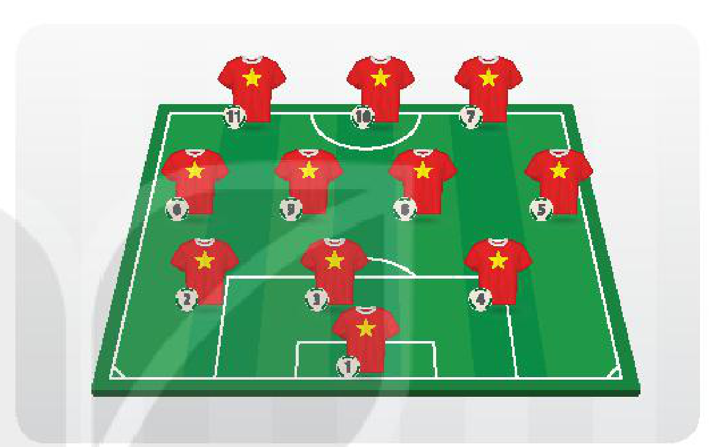
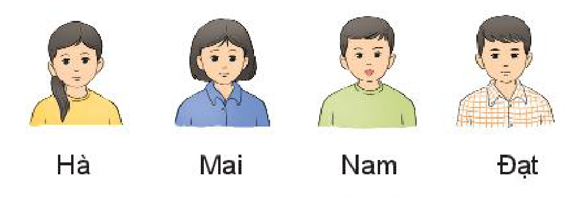
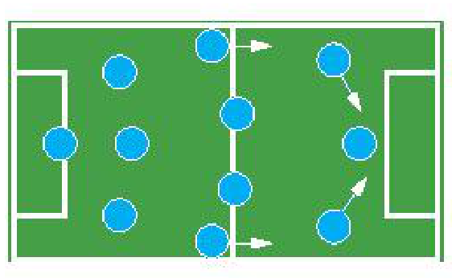

<!-- pdf:67 -->

# BÀI 24: HOÁN VỊ, CHỈNH HỢP VÀ TỔ HỢP

## 🔤 Thuật ngữ

- Hoán vị
- Chỉnh hợp
- Tổ hợp

## 🎯 Mục tiêu

- Tính số hoán vị, chỉnh hợp, tổ hợp.
- Tính số hoán vị, chỉnh hợp, tổ hợp bằng máy tính cầm tay.

## 🔴 Mở đầu

Danh sách các cầu thủ của Đội tuyển bóng đá quốc gia tham dự một trận đấu quốc tế có $23$ cầu thủ gồm $3$ thủ môn, $7$ hậu vệ, $8$ tiền vệ và $5$ tiền đạo. Huấn luyện viên rất bí mật, không cho ai biết đội hình (danh sách $11$ cầu thủ) sẽ ra sân. Trong cuộc họp báo, ông chỉ tiết lộ đội sẽ đá theo sơ đồ $3 - 4 - 3$ (nghĩa là $3$ hậu vệ, $4$ tiền vệ, $3$ tiền đạo và $1$ thủ môn). Đối thủ đã có danh sách $23$ cầu thủ (tên và vị trí của từng cầu thủ) và rất muốn dự đoán đội hình, họ xét hết các khả năng có thể xảy ra. Hỏi nếu đối thủ đã dự đoán được trước vị trí thủ môn thì họ sẽ phải xét bao nhiêu đội hình có thể?

## 1. HOÁN VỊ

**HĐ1:** Một nhóm gồm bốn bạn Hà, Mai, Nam, Đạt xếp thành một hàng, từ trái sang phải, để tham gia một cuộc phỏng vấn.

a) Hãy liệt kê ba cách sắp xếp bốn bạn trên theo thứ tự.

b) Có bao nhiêu cách sắp xếp thứ tự bốn bạn trên để tham gia phỏng vấn?

**Nhận xét:** Mỗi cách sắp xếp thứ tự của bốn bạn tham gia phỏng vấn ở HĐ1 được gọi là một *hoán vị* của tập hợp gồm bốn bạn này. Số các hoán vị của bốn bạn ở HĐ1 là $4 \cdot 3 \cdot 2 \cdot 1$.

<!-- pdf:68 -->

Tổng quát ta có

> Một **hoán vị** của một tập hợp có $n$ phần tử là một cách sắp xếp có thứ tự $n$ phần tử đó (với $n$ là một số tự nhiên, $n \ge 1$).
> Số các hoán vị của tập hợp có $n$ phần tử, kí hiệu là $P_n$, được tính bằng công thức
> $P_n = n \cdot (n - 1) \cdot (n - 2) \dots 2 \cdot 1.$

**Chú ý:** Kí hiệu $n \cdot (n - 1) \cdot (n - 2) \dots 2 \cdot 1$ là $n!$ (đọc là **$n$ giai thừa**), ta có: $P_n = n!$. Chẳng hạn $P_3 = 3! = 3 \cdot 2 \cdot 1 = 6$. Quy ước $0! = 1$.
<!-- ocr-ok: đã đối chiếu ảnh trang PDF 68, OCR bỏ sót nhãn Chú ý và đọc sai kí hiệu toán -->

**Ví dụ 1:** Từ các chữ số $6, 7, 8$ và $9$ có thể lập được bao nhiêu số có bốn chữ số khác nhau?

**Giải:**

Mỗi cách sắp xếp bốn chữ số đã cho để lập thành một số có bốn chữ số khác nhau là một hoán vị của bốn chữ số đó.

Vậy số các số có bốn chữ số khác nhau có thể lập được là $P_4 = 4! = 24$.

**Luyện tập 1:** Trong một cuộc thi điền kinh gồm $6$ vận động viên chạy trên $6$ đường chạy. Hỏi có bao nhiêu cách xếp các vận động viên vào các đường chạy đó?

## 2. CHỈNH HỢP

**HĐ2:** Trong lớp 10T có bốn bạn Tuấn, Hương, Việt, Dung tham gia cuộc thi hùng biện của trường. Hỏi có bao nhiêu cách chọn:

a) Hai bạn phụ trách nhóm từ bốn bạn?

b) Hai bạn phụ trách nhóm, trong đó một bạn làm nhóm trưởng, một bạn làm nhóm phó?

**Nhận xét:** Trong HĐ2b, mỗi cách sắp xếp hai bạn từ bốn bạn làm nhóm trưởng, nhóm phó được gọi là một *chỉnh hợp* chập $2$ của $4$. Để tính số các chỉnh hợp ta dùng quy tắc nhân.

Tổng quát ta có:

> Một **chỉnh hợp chập $k$ của $n$** là một cách sắp xếp có thứ tự $k$ phần tử từ một tập hợp $n$ phần tử (với $k, n$ là các số tự nhiên, $1 \le k \le n$).
> Số các chỉnh hợp chập $k$ của $n$, kí hiệu là $A_n^k$, được tính bằng công thức
> $A_n^k = n \cdot (n - 1) \dots (n - k + 1)$ hay $A_n^k = \frac{n!}{(n - k)!} \ (1 \le k \le n).$

**Ví dụ 2:** Một lớp có $30$ học sinh, giáo viên cần chọn lần lượt $4$ học sinh trồng bốn cây khác nhau để tham gia lễ phát động Tết trồng cây của trường. Hỏi giáo viên có bao nhiêu cách chọn?

<!-- pdf:69 -->

**Giải:**

Mỗi cách chọn lần lượt $4$ trong $30$ học sinh để trồng bốn cây khác nhau là một chỉnh hợp chập $4$ của $30$.
<!-- ocr-ok: đã đối chiếu ảnh trang PDF 69, OCR mất dấu thanh tiếng Việt -->

Vậy số cách chọn là $A_{30}^4 = 657\,720\text{ (cách)}$.

> Ngày 28-11-1959, Chủ tịch Hồ Chí Minh đã phát động ngày “Tết trồng cây” với mong muốn: Trong mười năm, đất nước ta phong cảnh sẽ ngày càng tươi đẹp hơn, khí hậu điều hoà hơn, ...

<!-- term: Quan hệ giữa hoán vị và chỉnh hợp -->
**Chú ý:**
- Hoán vị sắp xếp tất cả các phần tử của tập hợp, còn chỉnh hợp chọn ra một số phần tử và sắp xếp chúng.
- Mỗi hoán vị của $n$ phần tử cũng chính là một chỉnh hợp chập $n$ của $n$ phần tử đó. Vì vậy $P_n = A_n^n$.

**Luyện tập 2:** Trong một giải đua ngựa gồm $12$ con ngựa, người ta chỉ quan tâm đến $3$ con ngựa: con nhanh nhất, nhanh nhì và nhanh thứ ba. Hỏi có bao nhiêu kết quả có thể xảy ra?

## 3. TỔ HỢP

**HĐ3:** Trở lại HĐ2.

a) Hãy cho biết sự khác biệt khi chọn ra hai bạn ở câu HĐ2a và HĐ2b.

b) Từ kết quả tính được ở câu HĐ2b (áp dụng chỉnh hợp), hãy chỉ ra cách tính kết quả ở câu HĐ2a.

**Nhận xét:** Mỗi cách chọn ra $2$ bạn từ $4$ bạn ở HĐ2a được gọi là một *tổ hợp* chập $2$ của $4$. Vì không cần sắp xếp thứ tự hai bạn được chọn nên số cách chọn sẽ giảm đi $2!$ lần so với việc chọn ra hai bạn có sắp xếp thứ tự (ở câu HĐ2b).

Tổng quát ta có:

> Một **tổ hợp chập $k$ của $n$** là một cách chọn $k$ phần tử từ một tập hợp $n$ phần tử (với $k, n$ là các số tự nhiên, $0 \le k \le n$).
> Số các tổ hợp chập $k$ của $n$, kí hiệu là $C_n^k$, được tính bằng công thức
> $C_n^k = \frac{n!}{(n - k)!k!} \ (0 \le k \le n).$

<!-- term: Quan hệ giữa chỉnh hợp và tổ hợp -->
**Chú ý:**
- $C_n^k = \frac{A_n^k}{k!}$.
- Chỉnh hợp và tổ hợp có điểm giống nhau là đều chọn một số phần tử trong một tập hợp, nhưng khác nhau ở chỗ, chỉnh hợp là chọn có xếp thứ tự, còn tổ hợp là chọn không xếp thứ tự.

**Ví dụ 3:** Có $7$ bạn học sinh muốn chơi cờ cá ngựa, nhưng mỗi ván chỉ có $4$ người chơi. Hỏi có bao nhiêu cách chọn $4$ bạn chơi cờ cá ngựa?

<!-- pdf:70 -->

**Giải:**

Mỗi cách chọn $4$ bạn trong $7$ bạn học sinh là một tổ hợp chập $4$ của $7$.

Vậy số cách chọn $4$ bạn chơi cờ cá ngựa là $C_7^4 = \frac{7!}{4!3!} = 35\text{ (cách)}$.

**Luyện tập 3:** Trong ngân hàng đề kiểm tra cuối học kì II môn Vật lí có $20$ câu lí thuyết và $40$ câu bài tập. Người ta chọn ra $2$ câu lí thuyết và $3$ câu bài tập trong ngân hàng đề để tạo thành một đề thi. Hỏi có bao nhiêu cách lập đề thi gồm $5$ câu hỏi theo cách chọn như trên?

## 4. ỨNG DỤNG HOÁN VỊ, CHỈNH HỢP, TỔ HỢP VÀO CÁC BÀI TOÁN ĐẾM

Các khái niệm hoán vị, chỉnh hợp và tổ hợp liên quan mật thiết với nhau và là những khái niệm cốt lõi của các phép đếm. Rất nhiều bài toán đếm liên quan đến việc lựa chọn, việc sắp xếp, vì vậy các công thức tính $P_n, A_n^k, C_n^k$ sẽ được dùng rất nhiều.

Dưới đây ta xét một số ví dụ về các bài toán đếm.

**Ví dụ 4:** Một lần anh Hưng đến Hà Nội và dự định từ Hà Nội tham quan Đền Hùng, Ninh Bình, Hạ Long, Đường Lâm và Bát Tràng, mỗi ngày đi tham quan một địa điểm rồi lại về Hà Nội.

a) Hỏi anh Hưng có thể xếp được bao nhiêu lịch trình đi tham quan tất cả các địa điểm (ở đây lịch trình tính cả thứ tự tham quan)?

b) Anh Hưng có việc đột xuất phải về sớm, nên anh chỉ có $3$ ngày để đi tham quan $3$ địa điểm. Hỏi anh Hưng có bao nhiêu cách xếp lịch trình đi tham quan?

**Giải:**

a) Anh Hưng đi tham quan $5$ địa điểm, mỗi cách xếp lịch trình là một cách chọn có thứ tự của $5$ địa điểm trên. Vậy số cách xếp lịch trình chính bằng số các hoán vị của $5$ địa điểm, và bằng

$P_5 = 5! = 5 \cdot 4 \cdot 3 \cdot 2 \cdot 1 = 120\text{ (cách)}.$

b) Nếu anh Hưng chỉ có $3$ ngày để đi tham quan $3$ nơi, thì mỗi cách xếp lịch trình của anh chính là một cách chọn có thứ tự $3$ địa điểm từ $5$ địa điểm, tức là một chỉnh hợp chập $3$ của $5$.

Vậy số cách xếp lịch trình đi tham quan trong trường hợp này là

$A_5^3 = \frac{5!}{(5 - 3)!} = \frac{5!}{2!} = 60\text{ (cách)}.$

**Ví dụ 5:** Giải bài toán trong *tình huống mở đầu* về đội hình của Đội tuyển bóng đá quốc gia.

**Giải:**

Vì mỗi đội hình gồm có $1$ thủ môn, $3$ hậu vệ, $4$ tiền vệ và $3$ tiền đạo và đã biết trước vị trí thủ môn, nên để chọn đội hình ta cần thực hiện $3$ công đoạn:

1. Chọn hậu vệ là chọn $3$ trong số $7$ hậu vệ: có $C_7^3 = 35\text{ (cách)}$.
2. Chọn tiền vệ là chọn $4$ trong số $8$ tiền vệ: có $C_8^4 = 70\text{ (cách)}$.
3. Chọn tiền đạo là chọn $3$ trong số $5$ tiền đạo: có $C_5^3 = 10\text{ (cách)}$.

Vậy, theo quy tắc nhân, số các đội hình có thể có (khi đã biết vị trí thủ môn) là $35 \cdot 70 \cdot 10 = 24\,500\text{ (đội hình)}$.

<!-- pdf:71 -->

**Vận dụng:** Một câu lạc bộ có $20$ học sinh.
<!-- ocr-ok: đã đối chiếu ảnh trang PDF 71, OCR đọc sai nhãn Vận dụng -->

a) Có bao nhiêu cách chọn $6$ thành viên vào Ban quản lí?

b) Có bao nhiêu cách chọn Trưởng ban, $1$ Phó ban, $4$ thành viên khác vào Ban quản lí?

## 5. SỬ DỤNG MÁY TÍNH CẦM TAY

Ta có thể dùng máy tính cầm tay để tính số các hoán vị, chỉnh hợp và tổ hợp.

**Hoán vị**

Để tính $n!$, ta ấn phím theo trình tự sau:

Ấn số $n$, ấn phím `[SHIFT]` `[x!]`, sau đó ấn phím `[=]`. Khi đó, kết quả sẽ hiển thị ở dòng kết quả.

*Ví dụ.* Tính $9!$.

Ta ấn liên tiếp các phím như sau: `[9]` `[SHIFT]` `[x!]` `[=]`
<!-- ocr-ok: đã đối chiếu ảnh trang PDF 71, OCR đọc sai biểu tượng phím máy tính -->

Dòng kết quả hiện ra $362\,880$.

**Chỉnh hợp**

Để tính $A_n^k$ ta ấn phím theo trình tự sau:

Ấn số $n$, ấn phím `[SHIFT]` `[×]`, ấn số $k$, sau đó ấn phím `[=]`. Khi đó, kết quả sẽ hiển thị ở dòng kết quả.

*Ví dụ.* Tính $A_{15}^2$.

Ta ấn các phím theo trình tự sau: `[1]` `[5]` `[SHIFT]` `[×]` `[2]` `[=]`

Dòng kết quả hiện ra $210$.

**Tổ hợp**

Để tính $C_n^k$ ta ấn phím theo trình tự sau:

Ấn số $n$, ấn phím `[SHIFT]` `[÷]`, ấn số $k$, sau đó ấn phím `[=]`. Khi đó, kết quả sẽ hiển thị ở dòng kết quả.

*Ví dụ.* Tính $C_{20}^5$.

Ta ấn các phím theo trình tự sau: `[2]` `[0]` `[SHIFT]` `[÷]` `[5]` `[=]`

Dòng kết quả hiện ra $15\,504$.

## ✏️ BÀI TẬP

**8.6.** Một hoạ sĩ cần trưng bày $10$ bức tranh nghệ thuật khác nhau thành một hàng ngang. Hỏi có bao nhiêu cách để hoạ sĩ sắp xếp các bức tranh?

**8.7.** Từ các chữ số $0, 1, 2, 3, 4$ có thể lập được bao nhiêu số tự nhiên có ba chữ số khác nhau?

**8.8.** Có bao nhiêu cách chọn một tập hợp gồm hai số nguyên dương nhỏ hơn $100$? Có bao nhiêu cách chọn một tập hợp gồm ba số nguyên dương nhỏ hơn $100$?

**8.9.** Bạn Hà có $5$ viên bi xanh và $7$ viên bi đỏ. Có bao nhiêu cách để Hà chọn ra đúng $2$ viên bi khác màu?

<!-- pdf:72 -->

**8.10.** Một câu lạc bộ cờ vua có $10$ bạn nam và $7$ bạn nữ. Huấn luyện viên muốn chọn $4$ bạn đi thi đấu cờ vua.

a) Có bao nhiêu cách chọn $4$ bạn nam?

b) Có bao nhiêu cách chọn $4$ bạn không phân biệt nam, nữ?

c) Có bao nhiêu cách chọn $4$ bạn, trong đó có $2$ bạn nam và $2$ bạn nữ?

**8.11.** Có bao nhiêu số tự nhiên chia hết cho $5$ mà mỗi số có bốn chữ số khác nhau?
<!-- ocr-ok: đã đối chiếu ảnh trang PDF 72, OCR bỏ sót số bài 8.11 và đọc sai dấu -->

## 💡 Em có biết?

<!-- term: Dãy số Fibonacci -->
- Có thể coi người đầu tiên đưa các bài toán tổ hợp vào châu Âu là Leonardo Fibonacci ở thành Pisa (thuộc nước Italia ngày nay) vào thế kỉ XIII. Trong cuốn sách *Liber Abaci* (*Sách tính*), ông đã giới thiệu dãy số Fibonacci: $F_0 = 0, F_1 = 1, F_2 = 1, F_3 = 2, F_4 = 3, F_5 = 5, \dots$ Trong dãy số này, kể từ số hạng thứ ba trở đi, mỗi số hạng bằng tổng của hai số hạng đứng ngay trước nó, tức là $F_{n+1} = F_n + F_{n-1}$. Bằng các lập luận tổ hợp, có thể chứng minh được rằng tổng số các cách khác nhau để xếp được một hình chữ nhật có kích thước $1 \times n$ từ hai loại gạch có kích thước $1 \times 1$ và $1 \times 2$ chính là $F_{n+1}$. Sử dụng tính chất này, ta có hằng đẳng thức
  $F_{n+1} = \sum_{k+m=n} C_m^k,$
  trong đó vế phải là tổng của tất cả các số $C_m^k$ với $k + m = n$.

*Fibonacci (1170 – 1250)*

- Câu hỏi một ván cờ vua có thể có nhiều nhất bao nhiêu nước đi có vẻ rất phức tạp vì mỗi ván một vẻ. Vậy mà bằng các tính toán tổ hợp, người ta đã chứng minh rằng về lí thuyết, một ván cờ có tối đa $5\,950$ nước đi.

## 📷 Danh sách hình trong bài

| Mã hình | Trang PDF | Vị trí trong bài | Chú thích gốc |
| --- | --- | --- | --- |
| H10-toan-b24-01 | 67 | Mở đầu | (sách không đánh số, sơ đồ đội hình bóng đá $3 - 4 - 3$) |
| H10-toan-b24-02 | 67 | Mục 1, HĐ1 | (sách không đánh số, minh hoạ bốn bạn Hà, Mai, Nam, Đạt) |
| H10-toan-b24-03 | 70 | Mục 4, Ví dụ 5 | (sách không đánh số, sơ đồ chiến thuật đội hình bóng đá) |
| H10-toan-b24-04 | 72 | Em có biết? | Fibonacci (1170 – 1250) |
