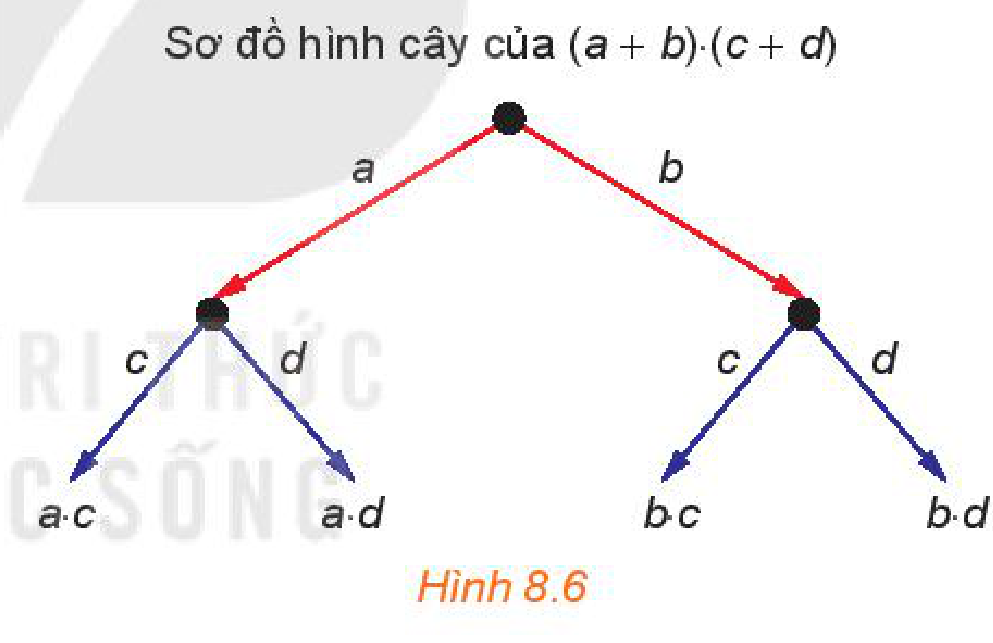
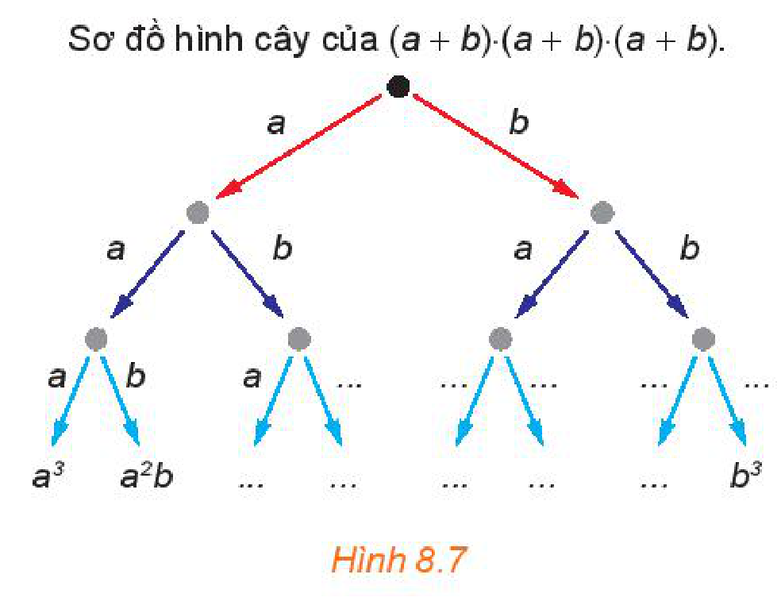
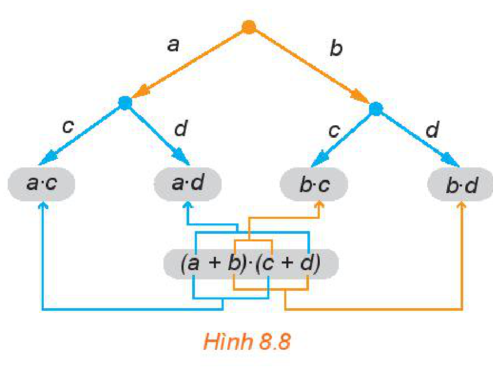
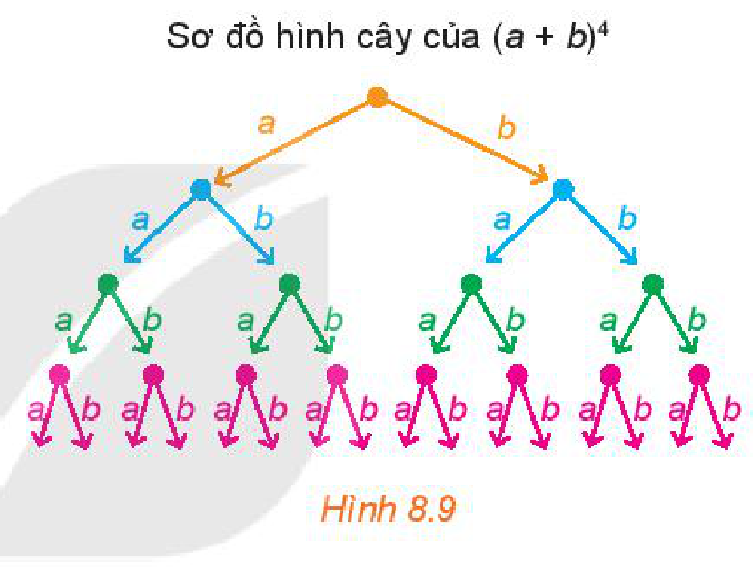

<!-- pdf:73 -->

# BÀI 25: NHỊ THỨC NEWTON

## 🔤 Thuật ngữ

- Khai triển
- Nhị thức

## 🎯 Mục tiêu

- Khai triển nhị thức Newton $(a + b)^n$ bằng vận dụng tổ hợp với số mũ thấp ($n = 4$ hoặc $n = 5$).

## 🔴 Mở đầu

Ở lớp 8, khi học về hằng đẳng thức, ta đã biết **khai triển**:

$(a + b)^2 = a^2 + 2ab + b^2;$
$(a + b)^3 = a^3 + 3a^2b + 3ab^2 + b^3.$

Quan sát các đơn thức ở vế phải của các đẳng thức trên, hãy nhận xét về quy luật số mũ của $a$ và $b$. Có thể tìm được cách tính các hệ số của đơn thức trong khai triển $(a + b)^n$ khi $n \in \{4; 5\}$ không?

**HĐ1:** Sơ đồ hình cây của tích hai **nhị thức** $(a + b) \cdot (c + d)$ được xây dựng như sau:

- Từ một điểm gốc, kẻ các mũi tên, mỗi mũi tên tương ứng với một đơn thức (gọi là nhãn của mũi tên) của nhị thức thứ nhất (H.8.6);
- Từ ngọn của mỗi mũi tên đã xây dựng, kẻ các mũi tên, mỗi mũi tên tương ứng với một đơn thức của nhị thức thứ hai;
- Tại ngọn của các mũi tên xây dựng tại bước sau cùng, ghi lại tích của các nhãn của các mũi tên đi từ điểm gốc đến đầu mút đó.

Hãy lấy tổng của các tích nhận được và so sánh kết quả với khai triển của tích $(a + b) \cdot (c + d)$.

*Hình 8.6*

**HĐ2:** Hãy cho biết các đơn thức còn thiếu $(\dots)$ trong sơ đồ hình cây (H.8.7) của tích $(a + b) \cdot (a + b) \cdot (a + b)$.

Có bao nhiêu tích nhận được lần lượt bằng $a^3, a^2b, ab^2, b^3$?

Hãy so sánh chúng với các hệ số nhận được khi khai triển $(a + b)^3$.

*Hình 8.7*

<!-- pdf:74 -->

**Nhận xét:** Các tích nhận được từ sơ đồ hình cây của một tích các đa thức giống như cách lấy ra một đơn thức từ mỗi đa thức rồi nhân lại với nhau. Hơn nữa, tổng của chúng cho ta **khai triển** của tích các đa thức đã cho.

Chẳng hạn, trong sơ đồ hình cây (H.8.8) của $(a + b) \cdot (c + d)$ thì các tích nhận được là $a \cdot c, a \cdot d, b \cdot c, b \cdot d$ cũng chính là các tích nhận được khi ta lấy một hạng tử của **nhị thức** thứ nhất (là $a$ hoặc $b$) nhân với một hạng tử của nhị thức thứ hai (là $c$ hoặc $d$). Ta có

$(a + b) \cdot (c + d) = a \cdot c + a \cdot d + b \cdot c + b \cdot d.$

*Hình 8.8*

**HĐ3:** Sơ đồ hình cây của khai triển $(a + b)^4$ được mô tả như Hình 8.9. Sau khi khai triển, ta thu được một tổng gồm $2^4$ (theo quy tắc nhân) đơn thức có dạng $x \cdot y \cdot z \cdot t$, trong đó mỗi $x, y, z, t$ là $a$ hoặc $b$. Chẳng hạn, nếu $x, y, t$ là $a$, còn $z$ là $b$ thì ta có đơn thức $a \cdot a \cdot b \cdot a$, thu gọn là $a^3b$. Để có đơn thức này, thì trong $4$ nhân tử $x, y, z, t$ có $1$ nhân tử là $b$, $3$ nhân tử còn lại là $a$. Khi đó số đơn thức đồng dạng với $a^3b$ trong tổng là $C_4^1$.

*Hình 8.9*

Lập luận tương tự trên, dùng kiến thức về tổ hợp, hãy cho biết trong tổng nêu trên, có bao nhiêu đơn thức đồng dạng với mỗi đơn thức thu gọn sau:

- $a^4$;
- $a^3b$;
- $a^2b^2$;
- $ab^3$;
- $b^4$.

Từ HĐ3, sau khi rút gọn các đơn thức đồng dạng ta thu được:

<!-- term: Công thức khai triển $(a + b)^4$ -->
<!-- term: Nhị thức Newton -->
> $(a + b)^4 = C_4^0 a^4 + C_4^1 a^3b + C_4^2 a^2b^2 + C_4^3 ab^3 + C_4^4 b^4$
> $= a^4 + 4a^3b + 6a^2b^2 + 4ab^3 + b^4.$

<!-- term: Công thức khai triển $(a + b)^4$ -->
<!-- term: Nhị thức Newton -->
> Trong khai triển nhị thức Newton $(a + b)^4$, các đơn thức có bậc là $4$.

**Ví dụ 1:** Khai triển $(2x + 1)^4$.

**Giải:**

Thay $a = 2x$ và $b = 1$ trong công thức khai triển của $(a + b)^4$, ta được:

$(2x + 1)^4 = (2x)^4 + 4 \cdot (2x)^3 \cdot 1 + 6 \cdot (2x)^2 \cdot 1^2 + 4 \cdot (2x) \cdot 1^3 + 1^4$
$= 16x^4 + 32x^3 + 24x^2 + 8x + 1.$

**Luyện tập 1:** Khai triển $(x - 2)^4$.

<!-- pdf:75 -->

**HĐ4:** Tương tự như HĐ3, sau khi khai triển $(a + b)^5$, ta thu được một tổng gồm $2^5$ đơn thức có dạng $x \cdot y \cdot z \cdot t \cdot u$, trong đó mỗi kí hiệu $x, y, z, t, u$ là $a$ hoặc $b$. Chẳng hạn, nếu $x, z$ là $a$, còn $y, t, u$ là $b$ thì ta có đơn thức $a \cdot b \cdot a \cdot b \cdot b$, thu gọn là $a^2b^3$. Để có đơn thức này, thì trong $5$ nhân tử $x, y, z, t, u$ có $3$ nhân tử là $b$, $2$ nhân tử còn lại là $a$. Khi đó số đơn thức đồng dạng với $a^2b^3$ trong tổng là $C_5^3$.

Lập luận tương tự như trên, dùng kiến thức về tổ hợp, hãy cho biết, trong tổng nhận được nêu trên có bao nhiêu đơn thức đồng dạng với mỗi đơn thức thu gọn sau:

- $a^5$;
- $a^4b$;
- $a^3b^2$;
- $a^2b^3$;
- $ab^4$;
- $b^5$.

Từ HĐ4, sau khi rút gọn các đơn thức đồng dạng ta thu được:

<!-- term: Công thức khai triển $(a + b)^5$ -->
<!-- term: Nhị thức Newton -->
> $(a + b)^5 = C_5^0 a^5 + C_5^1 a^4b + C_5^2 a^3b^2 + C_5^3 a^2b^3 + C_5^4 ab^4 + C_5^5 b^5$
> $= a^5 + 5a^4b + 10a^3b^2 + 10a^2b^3 + 5ab^4 + b^5.$

<!-- term: Công thức khai triển $(a + b)^5$ -->
<!-- term: Nhị thức Newton -->
> Trong khai triển nhị thức Newton $(a + b)^5$, các đơn thức có bậc là $5$.

**Ví dụ 2:** Khai triển $(x + 3)^5$.
<!-- ocr-ok: đã đối chiếu ảnh trang PDF 75, OCR đọc sai nhãn Ví dụ 2 -->

**Giải:**

Thay $a = x$ và $b = 3$ trong công thức khai triển của $(a + b)^5$, ta được:

$(x + 3)^5 = x^5 + 5 \cdot x^4 \cdot 3 + 10 \cdot x^3 \cdot 3^2 + 10 \cdot x^2 \cdot 3^3 + 5 \cdot x \cdot 3^4 + 3^5$
$= x^5 + 15x^4 + 90x^3 + 270x^2 + 405x + 243.$

**Luyện tập 2:** Khai triển $(3x - 2)^5$.

<!-- term: Nhị thức Newton -->
**Nhận xét:** Các công thức khai triển $(a + b)^n$, với $n \in \{4; 5\}$, là một công cụ hiệu quả để tính chính xác hoặc xấp xỉ một số đại lượng mà không cần dùng máy tính.

**Vận dụng:**

a) Dùng hai số hạng đầu tiên trong khai triển của $(1 + 0,05)^4$ để tính giá trị gần đúng của $1,05^4$.

b) Dùng máy tính cầm tay tính giá trị của $1,05^4$ và tính sai số tuyệt đối của giá trị gần đúng nhận được ở câu a.

## ✏️ BÀI TẬP

**8.12.** Khai triển các đa thức:

a) $(x - 3)^4$;

b) $(3x - 2y)^4$;

c) $(x + 5)^4 + (x - 5)^4$;

d) $(x - 2y)^5$.

**8.13.** Tìm hệ số của $x^4$ trong khai triển của $(3x - 1)^5$.

**8.14.** Biểu diễn $(3 + \sqrt{2})^5 - (3 - \sqrt{2})^5$ dưới dạng $a + b\sqrt{2}$ với $a, b$ là các số nguyên.
<!-- ocr-ok: đã đối chiếu ảnh trang PDF 75, OCR bỏ sót số bài 8.14 và công thức căn -->

<!-- pdf:76 -->

**8.15.** a) Dùng hai số hạng đầu tiên trong khai triển của $(1 + 0,02)^5$ để tính giá trị gần đúng của $1,02^5$.

b) Dùng máy tính cầm tay tính giá trị của $1,02^5$ và tính sai số tuyệt đối của giá trị gần đúng nhận được ở câu a.

**8.16.** Số dân của một tỉnh ở thời điểm hiện tại là khoảng $800$ nghìn người. Giả sử rằng tỉ lệ tăng dân số hằng năm của tỉnh đó là $r\%$.

a) Viết công thức tính số dân của tỉnh đó sau $1$ năm, sau $2$ năm. Từ đó suy ra công thức tính số dân của tỉnh đó sau $5$ năm nữa là $P = 800\left(1 + \frac{r}{100}\right)^5$ (nghìn người).

b) Với $r = 1,5$, dùng hai số hạng đầu trong khai triển của $(1 + 0,015)^5$, hãy ước tính số dân của tỉnh đó sau $5$ năm nữa (theo đơn vị nghìn người).

## 💡 Em có biết?

<!-- term: Nguyên lí Hardy – Weinberg -->
Trong di truyền học quần thể, nguyên lí Hardy – Weinberg đưa ra công thức toán học tính tần số của các kiểu gene trong một quần thể (thoả mãn một số điều kiện) ở các thế hệ. Trong trường hợp ở mỗi vị trí trên nhiễm sắc thể chỉ có hai alen (là một trạng thái cụ thể của một gene) $A$ và $B$ với các tần số khởi đầu lần lượt là $p$ và $q$ ($p + q = 1$, tức là $100\%$), công thức của Hardy – Weinberg là tương ứng với khai triển nhị thức Newton.

Chẳng hạn:

- Tần số các kiểu gene $AA, AB, BB$ tương ứng là $p^2, 2pq, q^2$ (ứng với quy tắc kết hợp $(pA + qB) \times (pA + qB) = (pA + qB)^2 = p^2AA + 2pqAB + q^2BB$);
- Tần số các kiểu gene $AAA, AAB, ABB, BBB$ tương ứng là $p^3, 3p^2q, 3pq^2, q^3$ (ứng với $(pA + qB)^3 = p^3AAA + 3p^2qAAB + 3pq^2ABB + q^3BBB$);
- Tần số các kiểu gene $AAAA, AAAB, AABB, ABBB, BBBB$ tương ứng là $p^4, 4p^3q, 6p^2q^2, 4pq^3, q^4$ (ứng với $(pA + qB)^4 = C_4^0 p^4 AAAA + C_4^1 p^3q AAAB + C_4^2 p^2q^2 AABB + C_4^3 pq^3 ABBB + C_4^4 q^4 BBBB$);
- Tổng quát, ta có tần số kiểu gene gồm $i$ alen $A$ và $j$ alen $B$ là $C_{i+j}^j p^i q^j$.

*(Theo Sinh học 12, Nhà xuất bản Giáo dục Việt Nam, 2017)*

## 📷 Danh sách hình trong bài

| Mã hình | Trang PDF | Vị trí trong bài | Chú thích gốc |
| --- | --- | --- | --- |
| H10-toan-b25-01 | 73 | HĐ1 | Hình 8.6 |
| H10-toan-b25-02 | 73 | HĐ2 | Hình 8.7 |
| H10-toan-b25-03 | 74 | Nhận xét | Hình 8.8 |
| H10-toan-b25-04 | 74 | HĐ3 | Hình 8.9 |
