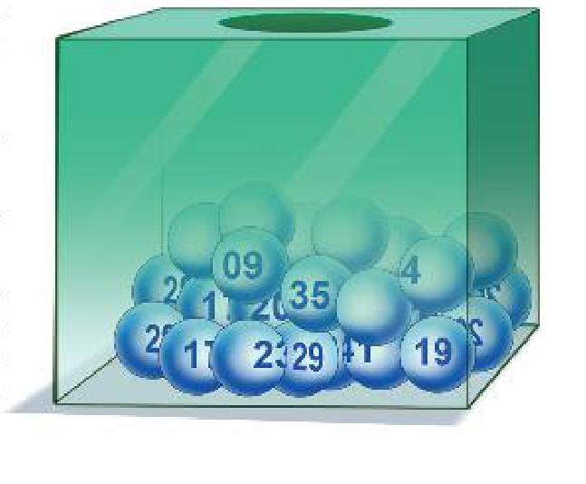
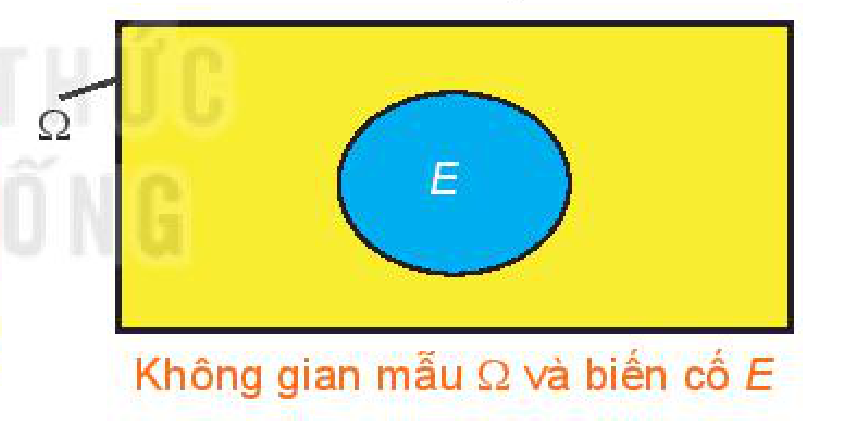
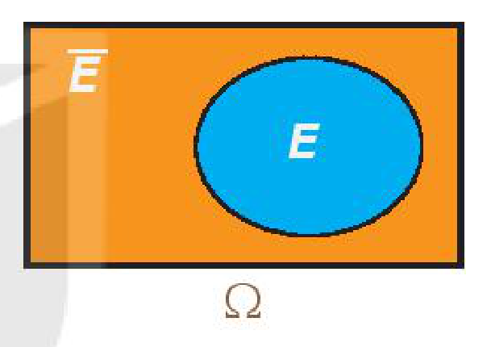
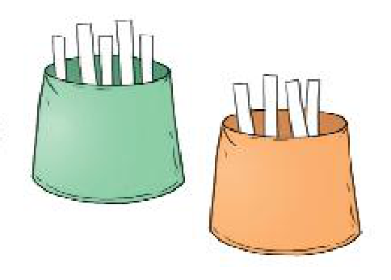

<!-- pdf:78 -->

<!-- Phần giới thiệu Chương IX (in chung đầu trang PDF 78): CHƯƠNG IX. TÍNH XÁC SUẤT THEO ĐỊNH NGHĨA CỔ ĐIỂN -->

Lí thuyết Xác suất là một ngành toán học nghiên cứu các hiện tượng ngẫu nhiên. Nhà toán học Pháp P. S. Laplace đã viết “*Lí thuyết Xác suất ra đời từ việc nghiên cứu các trò chơi may rủi, đã và đang trở thành một trong những đối tượng quan trọng nhất của tri thức nhân loại. Phần lớn những vấn đề quan trọng nhất của cuộc sống là những bài toán của Lí thuyết Xác suất*”.

Chương này giới thiệu định nghĩa cổ điển của xác suất, phương pháp tổ hợp và sơ đồ hình cây để tính xác suất theo định nghĩa cổ điển.

*P. S. Laplace (1749 – 1827)*
<!-- ocr-ok: đã đối chiếu ảnh trang PDF 78, OCR bỏ sót chú thích chân dung Laplace -->

# BÀI 26: BIẾN CỐ VÀ ĐỊNH NGHĨA CỔ ĐIỂN CỦA XÁC SUẤT

## 🔤 Thuật ngữ

- Biến cố đối
- Định nghĩa cổ điển của xác suất
- Nguyên lí xác suất bé

## 🎯 Mục tiêu

- Nhận biết một số khái niệm: Phép thử ngẫu nhiên, không gian mẫu, biến cố là tập con của không gian mẫu, biến cố đối, định nghĩa cổ điển của xác suất, nguyên lí xác suất bé.
- Mô tả không gian mẫu, biến cố trong một số phép thử đơn giản.
- Mô tả tính chất cơ bản của xác suất.

## 🔴 Mở đầu

Khi tham gia một trò chơi bốc thăm trúng thưởng, mỗi người chơi chọn một bộ $6$ số đôi một khác nhau từ $45$ số: $1; 2; 3; \dots; 45$, chẳng hạn bạn An chọn bộ số $\{5; 13; 20; 31; 32; 35\}$.

Sau đó, người quản trò bốc ngẫu nhiên $6$ quả bóng (không hoàn lại) từ một thùng kín đựng $45$ quả bóng như nhau ghi các số $1; 2; 3; \dots; 45$. Bộ $6$ số ghi trên $6$ quả bóng đó được gọi là *bộ số trúng thưởng*.

Nếu bộ số của người chơi trùng với bộ số trúng thưởng thì người chơi trúng giải độc đắc; nếu trùng với $5$ số của bộ số trúng thưởng thì người chơi trúng giải nhất.

Tính xác suất bạn An trúng giải độc đắc, giải nhất khi chơi.

Trong bài học này, ta sẽ tìm hiểu một số khái niệm cơ bản và định nghĩa cổ điển của xác suất, từ đó giúp ta có cơ sở trả lời câu hỏi nêu trên.

<!-- pdf:79 -->

## 1. BIẾN CỐ

Ở lớp 9 ta đã biết những khái niệm quan trọng sau:

> - **Phép thử ngẫu nhiên** (gọi tắt là **phép thử**) là một thí nghiệm hay một hành động mà kết quả của nó không thể biết được trước khi phép thử được thực hiện.
> - **Không gian mẫu** của phép thử là tập hợp tất cả các kết quả có thể xảy ra khi thực hiện phép thử. Không gian mẫu của phép thử được kí hiệu là $\Omega$.
> - **Kết quả thuận lợi** cho một biến cố $E$ liên quan tới phép thử $T$ là kết quả của phép thử $T$ làm cho biến cố đó xảy ra.

**Chú ý:** Ta chỉ xét các phép thử mà không gian mẫu gồm hữu hạn kết quả.

**Ví dụ 1:** Một tổ trong lớp 10A có ba học sinh nữ là Hương, Hồng, Dung và bốn học sinh nam là Sơn, Tùng, Hoàng, Tiến. Giáo viên chọn ngẫu nhiên một học sinh trong tổ đó để kiểm tra vở bài tập. Phép thử ngẫu nhiên là gì? Mô tả không gian mẫu.

**Giải:**

Phép thử ngẫu nhiên là chọn ngẫu nhiên một học sinh trong tổ để kiểm tra vở bài tập.

Không gian mẫu là tập hợp tất cả các học sinh trong tổ.

Ta có $\Omega = \{\text{Hương}; \text{Hồng}; \text{Dung}; \text{Sơn}; \text{Tùng}; \text{Hoàng}; \text{Tiến}\}$.

**HĐ1:** Trở lại Ví dụ 1, xét hai biến cố sau:

$A$: “Học sinh được chọn là một bạn nữ”;

$B$: “Học sinh được chọn có tên bắt đầu bằng chữ H”.

Hãy liệt kê các kết quả thuận lợi cho biến cố $A, B$.

Theo định nghĩa, ta thấy mỗi kết quả thuận lợi cho biến cố $E$ chính là một phần tử thuộc không gian mẫu $\Omega$. Do đó về mặt toán học, ta có:

> Mỗi **biến cố** là một tập con của không gian mẫu $\Omega$. Tập con này là tập tất cả các kết quả thuận lợi cho biến cố đó.

*Không gian mẫu $\Omega$ và biến cố $E$*
<!-- ocr-ok: đã đối chiếu ảnh trang PDF 79, OCR đọc sai kí hiệu Omega và chữ biến cố -->

**Nhận xét:** **Biến cố chắc chắn** là tập $\Omega$, **biến cố không thể** là tập $\varnothing$.
<!-- ocr-ok: đã đối chiếu ảnh trang PDF 79, OCR bỏ sót nhãn Nhận xét -->

**Ví dụ 2:** Trở lại *tình huống mở đầu* về trò chơi bốc thăm trúng thưởng.

a) Phép thử là gì? Mô tả không gian mẫu $\Omega$.

b) Gọi $F$ là biến cố: “Bạn An trúng giải độc đắc”. Hỏi $F$ là tập con nào của không gian mẫu?

c) Gọi $G$ là biến cố: “Bạn An trúng giải nhất”. Hãy chỉ ra ba phần tử của tập $G$. Từ đó, hãy mô tả tập hợp $G$ bằng cách chỉ ra tính chất đặc trưng cho các phần tử của tập $G$.

**Giải:**

a) Phép thử là chọn ngẫu nhiên $6$ số trong $45$ số: $1; 2; 3; \dots; 45$. Không gian mẫu $\Omega$ là tập hợp tất cả các tập con có $6$ phần tử của tập $\{1; 2; 3; \dots; 45\}$.

b) $F = \{5; 13; 20; 31; 32; 35\}$.

<!-- pdf:80 -->

c) Ba phần tử thuộc $G$ chẳng hạn là:

$\{6; 13; 20; 31; 32; 35\}; \{5; 7; 20; 31; 32; 35\}; \{5; 13; 8; 31; 32; 35\}.$

$G$ là tập hợp tất cả các tập con gồm sáu phần tử của tập $\{1; 2; 3; \dots; 45\}$ có tính chất: năm phần tử của nó thuộc tập $\{5; 13; 20; 31; 32; 35\}$ và một phần tử còn lại không thuộc tập $\{5; 13; 20; 31; 32; 35\}$.

**Luyện tập 1:** Phần thưởng trong một chương trình khuyến mãi của một siêu thị là: ti vi, bàn ghế, tủ lạnh, máy tính, bếp từ, bộ bát đĩa. Ông Dũng tham gia chương trình được chọn ngẫu nhiên một mặt hàng.

a) Mô tả không gian mẫu.

b) Gọi $D$ là biến cố: “Ông Dũng chọn được mặt hàng là đồ điện”. Hỏi $D$ là tập con nào của không gian mẫu?

**HĐ2:** Trở lại Ví dụ 1, hãy cho biết khi nào biến cố $C$: “Học sinh được chọn là một bạn nam” xảy ra.

Ta thấy biến cố $C$ xảy ra khi và chỉ khi biến cố $A$ không xảy ra.

Ta nói biến cố $C$ là *biến cố đối* của $A$.

> **Biến cố đối** của biến cố $E$ là biến cố “$E$ không xảy ra”.
> Biến cố đối của $E$ được kí hiệu là $\overline{E}$.

**Nhận xét:** Nếu biến cố $E$ là tập con của không gian mẫu $\Omega$ thì biến cố đối $\overline{E}$ là tập tất cả các phần tử của $\Omega$ mà không là phần tử của $E$. Vậy biến cố $\overline{E}$ là phần bù của $E$ trong $\Omega$: $\overline{E} = C_\Omega E$.

**Ví dụ 3:** Gieo một con xúc xắc $6$ mặt và quan sát số chấm xuất hiện trên con xúc xắc.

a) Mô tả không gian mẫu.

b) Gọi $M$ là biến cố: “Số chấm xuất hiện trên con xúc xắc là một số chẵn”. Nội dung biến cố đối $\overline{M}$ của $M$ là gì?

c) Các biến cố $M$ và $\overline{M}$ là tập con nào của không gian mẫu?

**Giải:**

a) Không gian mẫu $\Omega = \{1; 2; 3; 4; 5; 6\}$.

b) Biến cố đối $\overline{M}$ của $M$ là biến cố: “Số chấm xuất hiện trên con xúc xắc là một số lẻ”.

c) Ta có $M = \{2; 4; 6\} \subset \Omega$; $\overline{M} = C_\Omega M = \{1; 3; 5\} \subset \Omega$.

**Luyện tập 2:** Gieo một con xúc xắc. Gọi $K$ là biến cố: “Số chấm xuất hiện trên con xúc xắc là một số nguyên tố”.

a) Biến cố: “Số chấm xuất hiện trên con xúc xắc là một hợp số” có là biến cố $\overline{K}$ không?

b) Các biến cố $K$ và $\overline{K}$ là tập con nào của không gian mẫu?

<!-- pdf:81 -->

## 2. ĐỊNH NGHĨA CỔ ĐIỂN CỦA XÁC SUẤT

Ở lớp 9 ta đã học những kiến thức cơ bản sau:

- Các kết quả có thể của phép thử $T$ gọi là **đồng khả năng** nếu chúng có khả năng xuất hiện như nhau.
- Giả sử các kết quả có thể của phép thử $T$ là đồng khả năng. Khi đó xác suất của biến cố $E$ bằng tỉ số giữa số kết quả thuận lợi của $E$ và số kết quả có thể.

**HĐ3:** Một hộp chứa $12$ tấm thẻ được đánh số $1; 2; 3; 4; 5; 6; 7; 8; 9; 10; 11; 12$. Rút ngẫu nhiên từ hộp đó một tấm thẻ.
<!-- ocr-ok: đã đối chiếu ảnh trang PDF 81, OCR bỏ sót nhãn HĐ3 và đọc sai chữ tấm -->

a) Mô tả không gian mẫu $\Omega$. Các kết quả có thể có đồng khả năng không?

b) Xét biến cố $E$: “Rút được thẻ ghi số nguyên tố”. Biến cố $E$ là tập con nào của không gian mẫu?

c) Phép thử có bao nhiêu kết quả có thể? Biến cố $E$ có bao nhiêu kết quả thuận lợi? Từ đó, hãy tính xác suất của biến cố $E$.

Ta đã biết không gian mẫu $\Omega$ của phép thử $T$ là tập hợp tất cả các kết quả có thể của $T$; biến cố $E$ liên quan đến phép thử $T$ là tập con của $\Omega$. Vì thế số kết quả có thể của phép thử $T$ chính là số phần tử tập $\Omega$; số kết quả thuận lợi của biến cố $E$ chính là số phần tử của tập $E$. Do đó, ta có **định nghĩa cổ điển của xác suất** như sau:

> Cho phép thử $T$ có không gian mẫu là $\Omega$. Giả thiết rằng các kết quả có thể của $T$ là đồng khả năng. Khi đó nếu $E$ là một biến cố liên quan đến phép thử $T$ thì **xác suất** của $E$ được cho bởi công thức
> $P(E) = \frac{n(E)}{n(\Omega)},$
> trong đó $n(\Omega)$ và $n(E)$ tương ứng là số phần tử của tập $\Omega$ và tập $E$.

**Nhận xét:**

- Với mỗi biến cố $E$, ta có $0 \le P(E) \le 1$.
- Với biến cố chắc chắn (là tập $\Omega$), ta có $P(\Omega) = 1$.
- Với biến cố không thể (là tập $\varnothing$), ta có $P(\varnothing) = 0$.

> ❓ Từ định nghĩa cổ điển của xác suất, hãy chứng minh các nhận xét trên.

**Ví dụ 4:** Gieo một đồng xu cân đối liên tiếp ba lần. Gọi $E$ là biến cố: “Có hai lần xuất hiện mặt sấp và một lần xuất hiện mặt ngửa”. Tính xác suất của biến cố $E$.

**Giải:**

Kí hiệu S và N tương ứng là đồng xu ra mặt sấp và đồng xu ra mặt ngửa.

Không gian mẫu $\Omega = \{\text{SSN}; \text{SNS}; \text{SNN}; \text{SSS}; \text{NSN}; \text{NNS}; \text{NNN}; \text{NSS}\}$.

$E = \{\text{SSN}; \text{SNS}; \text{NSS}\}$.

Ta có $n(\Omega) = 8; n(E) = 3$. Do đồng xu cân đối nên các kết quả có thể là đồng khả năng.

Vậy $P(E) = \frac{n(E)}{n(\Omega)} = \frac{3}{8}$.

<!-- pdf:82 -->

**Ví dụ 5:** Hai túi I và II chứa các tấm thẻ được đánh số. Túi I: $\{1; 2; 3; 4; 5\}$, túi II: $\{1; 2; 3; 4\}$. Rút ngẫu nhiên một tấm thẻ từ mỗi túi I và II. Tính xác suất để tổng hai số trên hai tấm thẻ lớn hơn $6$.

**Giải:**

Mô tả không gian mẫu $\Omega$ bằng cách lập bảng như sau.

| Túi I \ Túi II | $1$ | $2$ | $3$ | $4$ |
| :---: | :---: | :---: | :---: | :---: |
| $1$ | $(1, 1)$ | $(1, 2)$ | $(1, 3)$ | $(1, 4)$ |
| $2$ | $(2, 1)$ | $(2, 2)$ | $(2, 3)$ | $(2, 4)$ |
| $3$ | $(3, 1)$ | $(3, 2)$ | $(3, 3)$ | $(3, 4)$ |
| $4$ | $(4, 1)$ | $(4, 2)$ | $(4, 3)$ | $(4, 4)$ |
| $5$ | $(5, 1)$ | $(5, 2)$ | $(5, 3)$ | $(5, 4)$ |

Mỗi ô là một kết quả có thể. Có $20$ ô, vậy $n(\Omega) = 20$.

Biến cố $E$: “Tổng hai số trên hai tấm thẻ lớn hơn $6$” xảy ra khi tổng là một trong ba trường hợp:

Tổng bằng $7$ gồm các kết quả: $(3, 4); (4, 3); (5, 2)$.

Tổng bằng $8$ gồm các kết quả: $(4, 4); (5, 3)$.

Tổng bằng $9$ có một kết quả: $(5, 4)$.

Vậy biến cố $E = \{(3, 4); (4, 3); (5, 2); (4, 4); (5, 3); (5, 4)\}$. Từ đó $n(E) = 6$ và $P(E) = \frac{6}{20} = \frac{3}{10} = 0,3$.
<!-- ocr-ok: đã đối chiếu ảnh trang PDF 82 -->

**Chú ý:** Trong những phép thử đơn giản, ta đếm số phần tử của tập $\Omega$ và số phần tử của biến cố $E$ bằng cách liệt kê ra tất cả các phần tử của hai tập hợp này.

**Luyện tập 3:** Gieo đồng thời hai con xúc xắc cân đối. Tính xác suất để tổng số chấm xuất hiện trên hai con xúc xắc bằng $4$ hoặc bằng $6$.

## 3. NGUYÊN LÍ XÁC SUẤT BÉ

Qua thực tế người ta thấy rằng một biến cố có xác suất rất bé thì sẽ không xảy ra khi ta thực hiện một phép thử hay một vài phép thử. Từ đó người ta đã thừa nhận nguyên lí sau đây gọi là **nguyên lí xác suất bé**:

> Nếu một biến cố có xác suất rất bé thì trong một phép thử biến cố đó sẽ không xảy ra.

Chẳng hạn, xác suất một chiếc máy bay rơi là rất bé, khoảng $0,00000027$. Mỗi hành khách khi đi máy bay đều tin rằng biến cố: “Máy bay rơi” sẽ không xảy ra trong chuyến bay của mình, do đó người ta vẫn không ngần ngại đi máy bay.

**Chú ý:** Trong thực tế, xác suất của một biến cố được coi là bé phụ thuộc vào từng trường hợp cụ thể. Chẳng hạn, xác suất một chiếc điện thoại bị lỗi kĩ thuật là $0,001$ được coi là rất bé, nhưng nếu xác suất cháy nổ động cơ của một máy bay là $0,001$ thì xác suất này không được coi là rất bé.

<!-- pdf:83 -->

<!-- term: Ý nghĩa thực tế của xác suất -->
**Vận dụng:** Xác suất của biến cố có ý nghĩa thực tế như sau:
*Giả sử biến cố $A$ có xác suất $P(A)$. Khi thực hiện phép thử $n$ lần ($n \ge 30$) thì số lần xuất hiện biến cố $A$ sẽ xấp xỉ bằng $n \cdot P(A)$ (nói chung khi $n$ càng lớn thì sai số tương đối càng bé).*

Giả thiết rằng xác suất sinh con trai là $0,512$ và xác suất sinh con gái là $0,488$. Vận dụng ý nghĩa thực tế của xác suất, hãy ước tính trong số trẻ mới sinh với $10\,000$ bé gái thì có bao nhiêu bé trai.

*Hướng dẫn.* Gọi $n$ là số trẻ mới sinh. Ta coi mỗi lần sinh là một phép thử và biến cố liên quan đến phép thử là biến cố: “Sinh con gái”. Như vậy ta có $n$ phép thử. Ước tính $n$, từ đó ước tính số bé trai.

## ✏️ BÀI TẬP

**9.1.** Chọn ngẫu nhiên một số nguyên dương không lớn hơn $30$.

a) Mô tả không gian mẫu.

b) Gọi $A$ là biến cố: “Số được chọn là số nguyên tố”. Các biến cố $A$ và $\overline{A}$ là tập con nào của không gian mẫu?

**9.2.** Chọn ngẫu nhiên một số nguyên dương không lớn hơn $22$.

a) Mô tả không gian mẫu.

b) Gọi $B$ là biến cố: “Số được chọn chia hết cho $3$”. Các biến cố $B$ và $\overline{B}$ là các tập con nào của không gian mẫu?

**9.3.** Gieo đồng thời một con xúc xắc và một đồng xu.

a) Mô tả không gian mẫu.

b) Xét các biến cố sau:

$C$: “Đồng xu xuất hiện mặt sấp”;

$D$: “Đồng xu xuất hiện mặt ngửa hoặc số chấm xuất hiện trên con xúc xắc là $5$”.

Các biến cố $C, \overline{C}, D$ và $\overline{D}$ là các tập con nào của không gian mẫu?

**9.4.** Một túi có chứa một số bi xanh, bi đỏ, bi đen và bi trắng. Lấy ngẫu nhiên một viên bi từ trong túi.

a) Gọi $H$ là biến cố: “Bi lấy ra có màu đỏ”. Biến cố: “Bi lấy ra có màu xanh hoặc màu đen hoặc trắng” có phải là biến cố $\overline{H}$ hay không?

b) Gọi $K$ là biến cố: “Bi lấy ra có màu xanh hoặc màu trắng”. Biến cố: “Bi lấy ra màu đen” có phải là biến cố $\overline{K}$ hay không?

**9.5.** Hai bạn An và Bình mỗi người gieo một con xúc xắc cân đối. Tính xác suất để:

a) Số chấm xuất hiện trên mỗi con xúc xắc bé hơn $3$;

b) Số chấm xuất hiện trên con xúc xắc mà An gieo lớn hơn hoặc bằng $5$;

c) Tích hai số chấm xuất hiện trên hai con xúc xắc bé hơn $6$;

d) Tổng hai số chấm xuất hiện trên hai con xúc xắc là một số nguyên tố.

## 📷 Danh sách hình trong bài

| Mã hình | Trang PDF | Chú thích trong sách | Mô tả ngắn |
| :--- | :---: | :--- | :--- |
| H10-toan-b26-01 | 78 | (không có) | Thùng kín đựng các quả bóng ghi số từ $1$ đến $45$ trong trò chơi bốc thăm trúng thưởng |
| H10-toan-b26-02 | 79 | Không gian mẫu $\Omega$ và biến cố $E$ | Biểu đồ Venn minh hoạ biến cố $E$ là tập con của không gian mẫu $\Omega$ |
| H10-toan-b26-03 | 80 | (không có) | Biểu đồ Venn minh hoạ biến cố $E$ và biến cố đối $\overline{E}$ trong không gian mẫu $\Omega$ |
| H10-toan-b26-04 | 82 | (không có) | Minh hoạ hai túi I và II chứa các tấm thẻ đánh số trong Ví dụ 5 |
