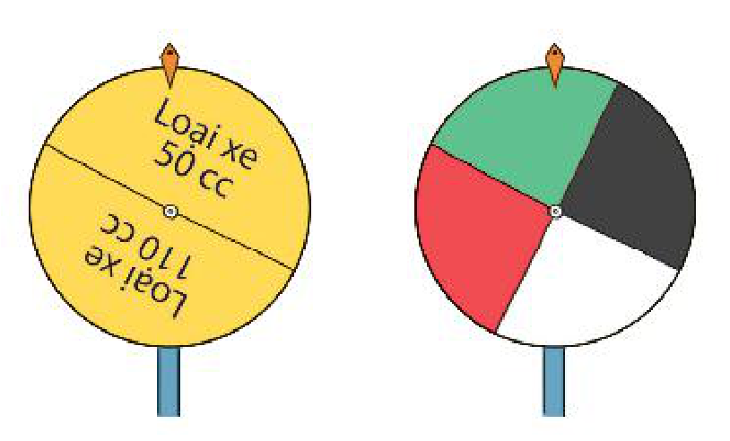
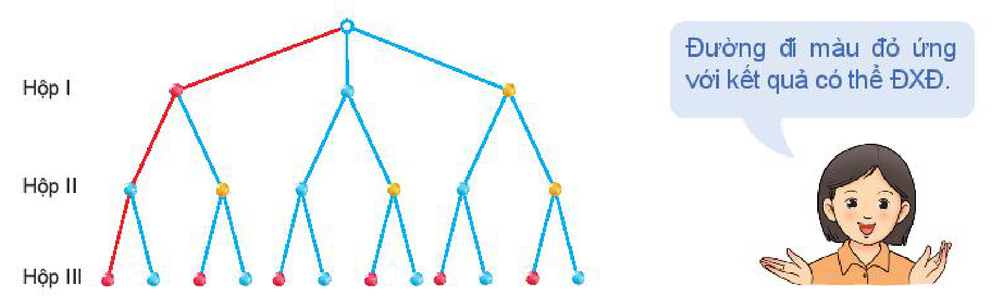

<!-- pdf:84 -->

# BÀI 27: THỰC HÀNH TÍNH XÁC SUẤT THEO ĐỊNH NGHĨA CỔ ĐIỂN

## 🔤 Thuật ngữ

- Xác suất của biến cố đối

## 🎯 Mục tiêu

- Tính xác suất trong một số bài toán đơn giản bằng phương pháp tổ hợp.
- Tính xác suất trong một số bài toán đơn giản bằng cách sử dụng sơ đồ hình cây.
- Nắm và vận dụng quy tắc tính xác suất của biến cố đối.

## 🔴 Mở đầu

Trở lại *tình huống mở đầu* trong Bài 26. Hãy tính xác suất trúng giải độc đắc, trúng giải nhất của bạn An khi chọn bộ số $\{5; 13; 20; 31; 32; 35\}$.

## 1. SỬ DỤNG PHƯƠNG PHÁP TỔ HỢP

**HĐ1:** Theo định nghĩa cổ điển của xác suất, để tính xác suất của biến cố $F$: “Bạn An trúng giải độc đắc” và biến cố $G$: “Bạn An trúng giải nhất” ta cần xác định $n(\Omega), n(F)$ và $n(G)$. Liệu có thể tính $n(\Omega), n(F)$ và $n(G)$ bằng cách liệt kê ra hết các phần tử của $\Omega, F$ và $G$ rồi kiểm đếm được không?

> Trong nhiều bài toán, để tính số phần tử của không gian mẫu, của các biến cố, ta thường sử dụng các quy tắc đếm, các công thức tính số hoán vị, chỉnh hợp và tổ hợp.

> Đôi khi người ta gọi Đại số tổ hợp là “sự kiểm đếm không cần phải liệt kê”.

**Ví dụ 1:** Một tổ trong lớp 10A có $10$ học sinh trong đó có $6$ học sinh nam và $4$ học sinh nữ. Giáo viên chọn ngẫu nhiên $6$ học sinh trong tổ đó để tham gia đội tình nguyện Mùa hè xanh. Tính xác suất của hai biến cố sau:

$C$: “$6$ học sinh được chọn đều là nam”;

$D$: “Trong $6$ học sinh được chọn có $4$ nam và $2$ nữ”.
<!-- ocr-ok: đã đối chiếu ảnh trang PDF 84 -->

**Giải:**

Không gian mẫu là tập tất cả các tập con gồm $6$ học sinh trong $10$ học sinh. Vậy

$n(\Omega) = C_{10}^6 = 210.$

a) Tập $C$ chỉ có một phần tử là tập $6$ học sinh nam. Vậy $n(C) = 1$, do đó $P(C) = \frac{1}{210}$.

b) Mỗi phần tử của $D$ được hình thành từ hai công đoạn.

*Công đoạn 1.* Chọn $4$ học sinh nam từ $6$ học sinh nam, có $C_6^4 = 15$ (cách chọn).

*Công đoạn 2.* Chọn $2$ học sinh nữ từ $4$ học sinh nữ, có $C_4^2 = 6$ (cách chọn).

Theo quy tắc nhân, tập $D$ có $15 \cdot 6 = 90$ (phần tử). Vậy $n(D) = 90$. Từ đó $P(D) = \frac{90}{210} = \frac{3}{7}$.

<!-- pdf:85 -->

**Luyện tập 1:** Một tổ trong lớp 10B có $12$ học sinh, trong đó có $7$ học sinh nam và $5$ học sinh nữ. Giáo viên chọn ngẫu nhiên $6$ học sinh trong tổ để kiểm tra vở bài tập Toán. Tính xác suất để trong $6$ học sinh được chọn số học sinh nữ bằng số học sinh nam.

## 2. SỬ DỤNG SƠ ĐỒ HÌNH CÂY

**HĐ2:** Trong trò chơi “Vòng quay may mắn”, người chơi sẽ quay hai bánh xe. Mũi tên ở bánh xe thứ nhất có thể dừng ở một trong hai vị trí: Loại xe $50\text{ cc}$ và Loại xe $110\text{ cc}$. Mũi tên ở bánh xe thứ hai có thể dừng ở một trong bốn vị trí: màu đen, màu trắng, màu đỏ và màu xanh. Vị trí của mũi tên trên hai bánh xe sẽ xác định người chơi nhận được loại xe nào, màu gì.

Phép thử $T$ là quay hai bánh xe. Hãy vẽ sơ đồ hình cây mô tả các phần tử của không gian mẫu.

> Trong một số bài toán, phép thử $T$ được hình thành từ một vài phép thử, chẳng hạn: gieo xúc xắc liên tiếp bốn lần; lấy ba viên bi, mỗi viên từ một hộp;... Khi đó ta sử dụng **sơ đồ hình cây** để có thể mô tả đầy đủ, trực quan không gian mẫu và biến cố cần tính xác suất.

**Ví dụ 2:** Có ba chiếc hộp. Hộp I có chứa ba viên bi: $1$ viên màu đỏ, $1$ viên màu xanh và $1$ viên màu vàng. Hộp II chứa hai viên bi: $1$ viên màu xanh và $1$ viên màu vàng. Hộp III chứa hai viên bi: $1$ viên màu đỏ và $1$ viên màu xanh. Từ mỗi hộp ta lấy ngẫu nhiên một viên bi.

a) Vẽ sơ đồ hình cây để mô tả các phần tử của không gian mẫu.

b) Tính xác suất để trong ba viên bi lấy ra có đúng một viên bi màu xanh.

**Giải:**

a) Kí hiệu Đ, X, V tương ứng là viên bi màu đỏ, màu xanh và màu vàng.

> Đường đi màu đỏ ứng với kết quả có thể ĐXĐ.

Các kết quả có thể là: ĐXĐ, ĐXX, ĐVĐ, ĐVX, XXĐ, XXX, XVĐ, XVX, VXĐ, VXX, VVĐ, VVX.

Do đó $\Omega = \{\text{ĐXĐ}; \text{ĐXX}; \text{ĐVĐ}; \text{ĐVX}; \text{XXĐ}; \text{XXX}; \text{XVĐ}; \text{XVX}; \text{VXĐ}; \text{VXX}; \text{VVĐ}; \text{VVX}\}$.

Vậy $n(\Omega) = 12$.

<!-- pdf:86 -->

b) Gọi $K$ là biến cố: “Trong ba viên bi lấy ra có đúng một viên bi màu xanh”. Ta có

$K = \{\text{ĐXĐ}; \text{ĐVX}; \text{XVĐ}; \text{VXĐ}; \text{VVX}\}$. Vậy $n(K) = 5$. Từ đó

$P(K) = \frac{n(K)}{n(\Omega)} = \frac{5}{12}.$

**Luyện tập 2:** Trở lại trò chơi “Vòng quay may mắn” ở HĐ2. Tính xác suất để người chơi nhận được loại xe $110\text{ cc}$ có màu trắng hoặc màu xanh.

**Luyện tập 3:** Trong một cuộc tổng điều tra dân số, điều tra viên chọn ngẫu nhiên một gia đình có ba người con và quan tâm giới tính của ba người con này.

a) Vẽ sơ đồ hình cây để mô tả các phần tử của không gian mẫu.

b) Giả thiết rằng khả năng sinh con trai và khả năng sinh con gái là như nhau. Tính xác suất để gia đình đó có một con trai và hai con gái.

## 3. XÁC SUẤT CỦA BIẾN CỐ ĐỐI

**HĐ3:** Cho $E$ là một biến cố và $\Omega$ là không gian mẫu. Tính $n(\overline{E})$ theo $n(\Omega)$ và $n(E)$.
<!-- ocr-ok: đã đối chiếu ảnh trang PDF 86 -->

Ta có công thức sau đây liên hệ giữa xác suất của một biến cố với **xác suất của biến cố đối**.

> Cho $E$ là một biến cố. Xác suất của biến cố $\overline{E}$ liên hệ với xác suất của $E$ bởi công thức sau:
> $P(\overline{E}) = 1 - P(E).$

**Ví dụ 3:** Chọn ngẫu nhiên hai số từ tập $\{1; 2; \dots; 9\}$. Gọi $H$ là biến cố: “Trong hai số được chọn có ít nhất một số chẵn”.

a) Mô tả không gian mẫu.

b) Biến cố $\overline{H}$ là tập con nào của không gian mẫu?

c) Tính $P(\overline{H})$ và $P(H)$.

**Giải:**

a) Không gian mẫu là tập tất cả các tập con có $2$ phần tử của tập $\{1; 2; \dots; 8; 9\}$.

b) Biến cố $\overline{H}$: “Cả hai số được chọn đều là số lẻ”. Khi đó $\overline{H}$ là tập tất cả các tập con có $2$ phần tử của tập số lẻ $\{1; 3; 5; 7; 9\}$.

c) Ta có $n(\Omega) = C_9^2 = 36$, $n(\overline{H}) = C_5^2 = 10$. Vậy $P(\overline{H}) = \frac{10}{36} = \frac{5}{18}$.

Từ đó $P(H) = 1 - P(\overline{H}) = 1 - \frac{5}{18} = \frac{13}{18}$.

**Chú ý:** Trong một số bài toán, nếu tính trực tiếp xác suất của biến cố gặp khó khăn, ta có thể tính gián tiếp bằng cách tính xác suất của biến cố đối của nó.

<!-- pdf:87 -->

**Luyện tập 4:** Có ba hộp $A, B, C$. Hộp $A$ có chứa ba thẻ mang số $1$, số $2$ và số $3$. Hộp $B$ chứa hai thẻ mang số $2$ và số $3$. Hộp $C$ chứa hai thẻ mang số $1$ và số $2$. Từ mỗi hộp ta rút ra ngẫu nhiên một thẻ.

a) Vẽ sơ đồ hình cây để mô tả các phần tử của không gian mẫu.

b) Gọi $M$ là biến cố: “Trong ba thẻ rút ra có ít nhất một thẻ số $1$”. Biến cố $\overline{M}$ là tập con nào của không gian mẫu?

c) Tính $P(M)$ và $P(\overline{M})$.

**Vận dụng:** Giải bài toán trong *tình huống mở đầu*.

*Hướng dẫn.* Vì $\Omega$ là tập tất cả các tập con có $6$ phần tử của tập $\{1; 2; 3; \dots; 45\}$ nên

$n(\Omega) = C_{45}^6.$

Gọi $F$ là biến cố: “Bạn An trúng giải độc đắc”. $F$ là tập hợp có duy nhất một phần tử là tập $\{5; 13; 20; 31; 32; 35\}$. Vậy $n(F) = 1$. Từ đó tính được $P(F)$.

Gọi $G$ là biến cố: “Bạn An trúng giải nhất”. $G$ là tập hợp tất cả các tập con gồm sáu phần tử của tập $\{1; 2; 3; \dots; 45\}$ có tính chất:

1. Năm phần tử của $G$ thuộc tập $\{5; 13; 20; 31; 32; 35\}$.
2. Một phần tử còn lại của $G$ không thuộc tập $\{5; 13; 20; 31; 32; 35\}$.

Mỗi phần tử của $G$ được hình thành từ hai công đoạn.

*Công đoạn 1.* Chọn năm phần tử trong tập $\{5; 13; 20; 31; 32; 35\}$, có $C_6^5 = 6$ (cách chọn).

*Công đoạn 2.* Chọn một phần tử còn lại trong $39$ phần tử không thuộc tập $\{5; 13; 20; 31; 32; 35\}$, có $C_{39}^1 = 39$ (cách chọn).

Theo quy tắc nhân, tập $G$ có $6 \cdot 39 = 234$ (phần tử). Vậy $n(G) = 234$. Từ đó tính được $P(G)$.

## ✏️ BÀI TẬP

**9.6.** Chọn ngẫu nhiên một gia đình có ba con và quan sát giới tính của ba người con này. Tính xác suất của các biến cố sau:

a) $A$: “Con đầu là gái”;

b) $B$: “Có ít nhất một người con trai”.

**9.7.** Một hộp đựng các tấm thẻ đánh số $10; 11; \dots; 20$. Rút ngẫu nhiên từ hộp hai tấm thẻ. Tính xác suất của các biến cố sau:

a) $C$: “Cả hai thẻ rút được đều mang số lẻ”;

b) $D$: “Cả hai thẻ rút được đều mang số chẵn”.

**9.8.** Một chiếc hộp đựng $6$ viên bi trắng, $4$ viên bi đỏ và $2$ viên bi đen. Chọn ngẫu nhiên ra $6$ viên bi. Tính xác suất để trong $6$ viên bi đó có $3$ viên bi trắng, $2$ viên bi đỏ và $1$ viên bi đen.

**9.9.** Gieo liên tiếp một con xúc xắc cân đối và một đồng xu cân đối.

a) Vẽ sơ đồ hình cây mô tả các phần tử của không gian mẫu.

b) Tính xác suất của các biến cố sau:

$F$: “Đồng xu xuất hiện mặt ngửa”;

$G$: “Đồng xu xuất hiện mặt sấp hoặc số chấm xuất hiện trên con xúc xắc là $5$”.

<!-- pdf:88 -->

**9.10.** Trên một phố có hai quán ăn $X, Y$. Ba bạn Sơn, Hải, Văn mỗi người chọn ngẫu nhiên một quán ăn.

a) Vẽ sơ đồ hình cây mô tả các phần tử của không gian mẫu.

b) Tính xác suất của biến cố “Hai bạn vào quán $X$, bạn còn lại vào quán $Y$”.

**9.11.** Gieo lần lượt hai con xúc xắc cân đối. Tính xác suất để ít nhất một con xúc xắc xuất hiện mặt $6$ chấm.

**9.12.** Màu hạt của đậu Hà Lan có hai kiểu hình là màu vàng và màu xanh tương ứng với hai loại gene là gene trội $A$ và gene lặn $a$. Hình dạng hạt của đậu Hà Lan có hai kiểu hình là hạt trơn và hạt nhăn tương ứng với hai loại gene là gene trội $B$ và gene lặn $b$. Biết rằng, cây con lấy ngẫu nhiên một gene từ cây bố và một gene từ cây mẹ.

Phép thử là cho lai hai loại đậu Hà Lan, trong đó cả cây bố và cây mẹ đều có kiểu gene là $(Aa, Bb)$ và kiểu hình là hạt màu vàng và trơn. Giả sử các kết quả có thể là đồng khả năng. Tính xác suất để cây con cũng có kiểu hình là hạt màu vàng và trơn.

> **💡 Em có biết?**
>
> Năm 1652, nhà toán học Pascal nhận được một bức thư từ một nhà quý tộc nhờ ông giải đáp câu hỏi sau:
>
> “Khi tham gia một trò chơi, người chơi được chọn một trong ba phương án sau:
>
> - Phương án 1: Được gieo con xúc xắc cân đối liên tiếp $6$ lần. Người chơi thắng nếu có ít nhất một lần xuất hiện mặt $6$ chấm.
> - Phương án 2: Được gieo con xúc xắc cân đối liên tiếp $12$ lần. Người chơi thắng nếu có ít nhất hai lần xuất hiện mặt $6$ chấm.
> - Phương án 3: Được gieo con xúc xắc cân đối liên tiếp $18$ lần. Người chơi thắng nếu có ít nhất ba lần xuất hiện mặt $6$ chấm.
>
> Người chơi nên chọn phương án nào?”
>
> Pascal đã tính ra xác suất thắng của Phương án 1 là $0,665$; của Phương án 2 là $0,619$ và của Phương án 3 là $0,597$. Do đó, ông khuyên nhà quý tộc nên chọn Phương án 1.

## 📷 Danh sách hình trong bài

| Mã hình | Trang PDF | Chú thích trong sách | Mô tả ngắn |
| :--- | :---: | :--- | :--- |
| H10-toan-b27-01 | 85 | (không có) | Hai bánh xe trong trò chơi “Vòng quay may mắn” ở HĐ2 |
| H10-toan-b27-02 | 85 | Đường đi màu đỏ ứng với kết quả có thể ĐXĐ. | Sơ đồ hình cây mô tả các phần tử của không gian mẫu khi lấy bi từ ba hộp I, II, III trong Ví dụ 2 |
