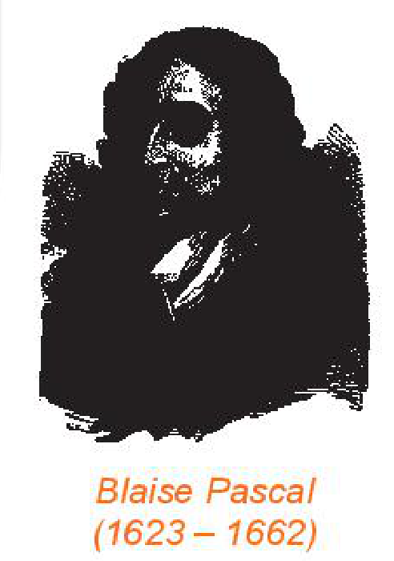

<!-- pdf:89 -->

# BÀI TẬP CUỐI CHƯƠNG IX

## ✏️ A – TRẮC NGHIỆM

**9.13.** Một hộp có bốn loại bi: bi xanh, bi đỏ, bi trắng và bi vàng. Lấy ngẫu nhiên ra một viên bi. Gọi $E$ là biến cố: “Lấy được viên bi đỏ”. Biến cố đối của $E$ là biến cố

A. Lấy được viên bi xanh.

B. Lấy được viên bi vàng hoặc bi trắng.

C. Lấy được viên bi trắng.

D. Lấy được viên bi vàng hoặc bi trắng hoặc bi xanh.

**9.14.** Rút ngẫu nhiên ra một thẻ từ một hộp có $30$ tấm thẻ được đánh số từ $1$ đến $30$. Xác suất để số trên tấm thẻ được rút ra chia hết cho $5$ là

A. $\frac{1}{30}$.

B. $\frac{1}{5}$.

C. $\frac{1}{3}$.

D. $\frac{2}{5}$.

**9.15.** Gieo hai con xúc xắc cân đối. Xác suất để tổng số chấm xuất hiện trên hai con xúc xắc không lớn hơn $4$ là

A. $\frac{1}{7}$.

B. $\frac{1}{6}$.

C. $\frac{1}{8}$.

D. $\frac{2}{9}$.

**9.16.** Một tổ trong lớp 10T có $4$ bạn nữ và $3$ bạn nam. Giáo viên chọn ngẫu nhiên hai bạn trong tổ đó tham gia đội làm báo của lớp. Xác suất để hai bạn được chọn có một bạn nam và một bạn nữ là

A. $\frac{4}{7}$.

B. $\frac{2}{7}$.

C. $\frac{1}{6}$.

D. $\frac{2}{21}$.

## ✏️ B – TỰ LUẬN

**9.17.** Một hộp đựng bảy thẻ màu xanh đánh số từ $1$ đến $7$; năm thẻ màu đỏ đánh số từ $1$ đến $5$ và hai thẻ màu vàng đánh số từ $1$ đến $2$. Rút ngẫu nhiên ra một tấm thẻ.

a) Mô tả không gian mẫu.

b) Mỗi biến cố sau là tập con nào của không gian mẫu?

$A$: “Rút ra được thẻ màu đỏ hoặc màu vàng”;

$B$: “Rút ra được thẻ mang số hoặc là $2$ hoặc là $3$”.

**9.18.** Có hộp I và hộp II, mỗi hộp chứa $5$ tấm thẻ đánh số từ $1$ đến $5$. Từ mỗi hộp, rút ngẫu nhiên ra một tấm thẻ. Tính xác suất để thẻ rút ra từ hộp II mang số lớn hơn số trên thẻ rút ra từ hộp I.

**9.19.** Gieo đồng thời hai con xúc xắc cân đối. Tính xác suất để:

a) Tổng số chấm trên hai con xúc xắc bằng $8$;

b) Tổng số chấm trên hai con xúc xắc nhỏ hơn $8$.

<!-- pdf:90 -->

**9.20.** Dự báo thời tiết trong ba ngày thứ Hai, thứ Ba, thứ Tư của tuần sau cho biết, trong mỗi ngày này, khả năng có mưa và không mưa như nhau.

a) Vẽ sơ đồ hình cây mô tả không gian mẫu.

b) Tính xác suất của các biến cố:

$F$: “Trong ba ngày, có đúng một ngày có mưa”;

$G$: “Trong ba ngày, có ít nhất hai ngày không mưa”.

**9.21.** Gieo một đồng xu cân đối liên tiếp bốn lần.
<!-- ocr-ok: đã đối chiếu ảnh trang PDF 90, OCR bỏ sót số bài 9.21 và đọc sai chữ bốn lần -->

a) Vẽ sơ đồ hình cây mô tả không gian mẫu.

b) Tính xác suất để trong bốn lần gieo đó có hai lần xuất hiện mặt sấp và hai lần xuất hiện mặt ngửa.

**9.22.** Chọn ngẫu nhiên $4$ viên bi từ một túi đựng $4$ viên bi đỏ và $6$ viên bi xanh đôi một khác nhau. Gọi $A$ là biến cố: “Trong bốn viên bi đó có cả bi đỏ và cả bi xanh”. Tính $P(A)$ và $P(\overline{A})$.

> **💡 Em có biết?**
>
> **Về một số thành tựu của nhà toán học Pascal**
>
> Năm 16 tuổi, Pascal công bố một công trình toán học có nhan đề “Về thiết diện của đường conic”, trong đó ông đã chứng minh một định lí, sau này được gọi là “Định lí Pascal về lục giác thần kì”. Từ định lí này, người ta đã rút ra 400 hệ quả thú vị về hình học. Năm 17 tuổi Pascal đã chế tạo ra chiếc máy tính đầu tiên trong lịch sử nhân loại làm được bốn phép tính cộng, trừ, nhân, chia.
>
> Năm 28 tuổi, Pascal đã toán học hoá các trò chơi may rủi để khai sinh ra lí thuyết Xác suất. Không chỉ là một nhà toán học lớn, Pascal còn là một nhà triết học, nhà vật lí và nhà văn lớn.
>
> 
> *Blaise Pascal (1623 – 1662)*
>
> Một số câu nói nổi tiếng của Pascal:
>
> “*Con người chỉ là một cây sậy, một vật rất yếu đuối của tự nhiên nhưng là một cây sậy biết suy nghĩ*”;
>
> “*Trái tim có những lí lẽ mà lí trí không giải thích được*”.
>
> *(Theo review.siu.edu.vn/nhan-vat-su-kien/ và tudiendanhngon.vn/).*

## 📷 Danh sách hình trong bài

| Mã hình | Trang PDF | Chú thích trong sách | Mô tả ngắn |
| :--- | :---: | :--- | :--- |
| H10-toan-bt-c09-01 | 90 | Blaise Pascal (1623 – 1662) | Chân dung nhà toán học Blaise Pascal trong mục Em có biết? |
