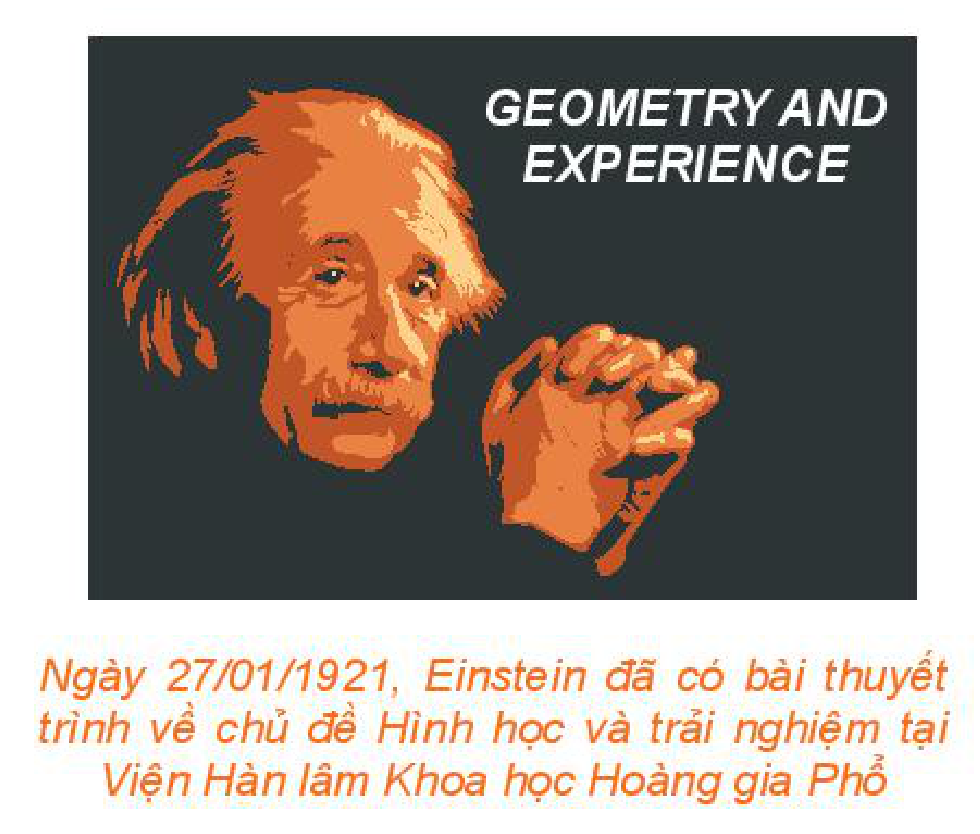
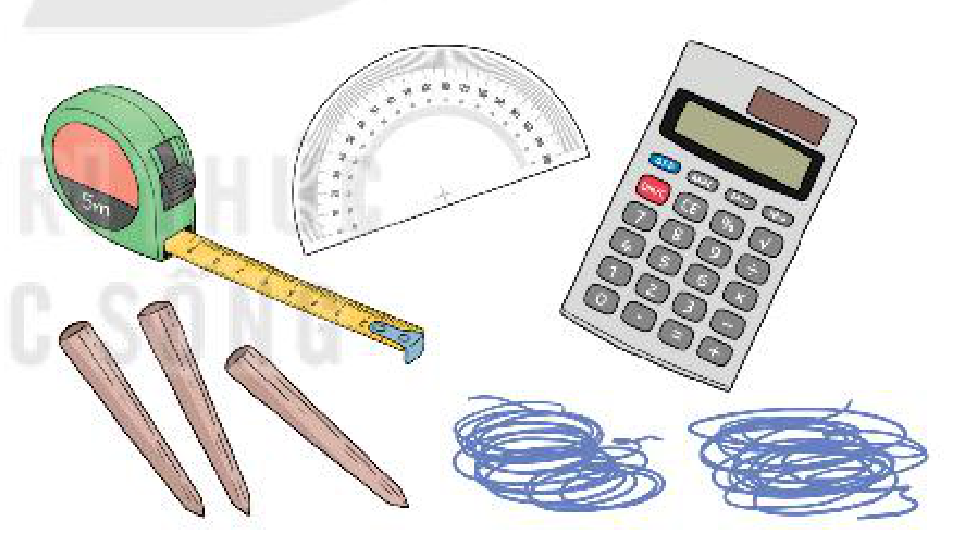

<!-- pdf:91 -->

<!-- Phần tiêu đề chung: HOẠT ĐỘNG THỰC HÀNH TRẢI NGHIỆM -->

“*Nhà toán học xa rời thực tiễn giống như một hoạ sĩ bị tước đi vật mẫu*” (Henri Poincaré).

*Henri Poincaré (1854 – 1912)*

# MỘT SỐ NỘI DUNG CHO HOẠT ĐỘNG TRẢI NGHIỆM HÌNH HỌC

Em có thể thực hành trải nghiệm hình học với nhiều mức độ khác nhau, từ trải nghiệm nhanh, gọn tới các trải nghiệm cần nhiều thời gian và sự chuẩn bị, từ trải nghiệm cá nhân tới trải nghiệm theo nhóm. Sau đây là một số gợi ý.

*Ngày 27/01/1921, Einstein đã có bài thuyết trình về chủ đề Hình học và trải nghiệm tại Viện Hàn lâm Khoa học Hoàng gia Phổ*

<!-- pdf:92 -->

## 1. KIỂM TRA TÍNH ĐÚNG ĐẮN CỦA MỘT KẾT QUẢ HÌNH HỌC THÔNG QUA NHỮNG VÍ DỤ CỤ THỂ

Trong chương trình, em đã được học nhiều kết quả hình học, chẳng hạn, các định lí sin, côsin, công thức tính diện tích tam giác. Tuy vậy, sách giáo khoa chủ yếu thừa nhận chúng mà không nêu phép chứng minh đầy đủ. Mặc dù trước khi chấp nhận các kết quả đó, em cũng đã có những hoạt động để hình thành kiến thức, nhưng sẽ giúp ích hơn nữa cho quá trình nhận thức, nếu em làm những “thực nghiệm” nhỏ để kiểm tra tính đúng đắn của chúng qua một số trường hợp cụ thể trong thực tế, hay trên hình vẽ.

Chẳng hạn, sử dụng các thước đo độ dài, góc và máy tính bỏ túi, em có thể kiểm tra:

a) Định lí sin đối với một tam giác nội tiếp trong một đường tròn;

b) Định lí côsin đối với một tam giác;

c) Đẳng thức $ah_a = 2\sqrt{p(p - a)(p - b)(p - c)}$ đối với tam giác $ABC$.
<!-- ocr-ok: đã đối chiếu ảnh trang PDF 92 -->

Về nguyên tắc, bao giờ cũng có sai khác nhỏ giữa kết quả thực nghiệm và kết quả lí thuyết mà em đã học. Tuy vậy, nếu gặp sai khác lớn, em nên kiểm tra hoặc thực hiện lại các bước của quá trình thực nghiệm. Một điểm nữa cần lưu ý là nếu em sử dụng một thiết bị tính toán có lập trình thì rất có thể phần mềm tính toán đó có sử dụng chính công thức mà em đang muốn thực nghiệm. Tuy vậy, với mục đích học tập, thực nghiệm của em vẫn là hữu ích ngay cả trong trường hợp đó.

## 2. SỬ DỤNG KẾT QUẢ HÌNH HỌC ĐỂ TÍNH TOÁN TRONG ĐO ĐẠC THỰC TẾ

Trong hoạt động trải nghiệm này, em (nên thực hiện theo nhóm) tiến hành đo khoảng cách từ vị trí của em tới một vị trí nào đó khó đến được, nhưng có thể quan sát, và đo khoảng cách giữa hai vị trí mà em có thể quan sát được. Dụng cụ cần chuẩn bị gồm: Ba cọc tiêu, thước dây đo độ dài, thước đo góc, hai sợi dây, máy tính cầm tay. Em thực hiện các bước như đã được trình bày và thảo luận trong Bài 6.

## 3. GẤP GIẤY, ĐO ĐẠC VÀ XÁC ĐỊNH CÁC YẾU TỐ CỦA BA ĐƯỜNG CONIC

Trong hoạt động này, với một đường conic đã được vẽ trên giấy (không kèm theo các yếu tố tiêu điểm, tiêu cự, tham số tiêu, đường chuẩn), em hãy tìm cách xác định vị trí các tiêu điểm, tiêu cự (đối với elip, hypebol), tiêu điểm, tham số tiêu, đường chuẩn (đối với parabol).

Để thực hiện hoạt động này, em cần nhớ lại các kiến thức đã được học về các đường conic (cách chọn hệ trục toạ độ để đường conic có phương trình chính tắc, mối liên hệ giữa các hệ số trong phương trình chính tắc với các yếu tố tiêu điểm, tiêu cự, tham số tiêu, đường chuẩn). Ngoài ra, em cần lưu ý, mỗi elip, hypebol có hai trục đối xứng, đó là đường thẳng đi

<!-- pdf:93 -->

qua hai tiêu điểm và đường thẳng trung trực của đoạn thẳng nối hai tiêu điểm; mỗi parabol có một trục đối xứng, đó là đường thẳng đi qua tiêu điểm và vuông góc với đường chuẩn. Bằng cách gấp giấy, em có thể xác định được các trục đối xứng của một đường conic đã được vẽ trên giấy (em có thể dùng kim châm thủng giấy, hoặc dùng bút tô đậm đường conic, để có thể quan sát nó từ cả mặt sau của giấy).

*Hướng dẫn:*

*Bước 1:* Gấp giấy để xác định trục đối xứng của đường conic.

*Bước 2:* Chọn hệ trục toạ độ để với hệ trục đó, đường conic đang xét có phương trình chính tắc (chọn đơn vị đo, chẳng hạn như $\text{cm}$).

*Bước 3:* Gọi phương trình chính tắc của đường conic (theo đơn vị đo đã chọn).

*Bước 4:* Lấy các điểm thuộc đường conic và đo khoảng cách từ điểm đó tới các trục toạ độ (đối với elip, hypebol cần lấy $2$ điểm, đối với parabol chỉ cần lấy $1$ điểm). Từ đó xác định toạ độ của các điểm vừa lấy.

*Bước 5:* Thay toạ độ của các điểm vừa lấy vào phương trình của đường conic để tính $a, b$ (đối với elip, hypebol) và $p$ (đối với parabol).

*Bước 6:* Xác định phương trình chính tắc của đường conic, từ đó xác định vị trí các tiêu điểm, tiêu cự (đối với elip, hypebol), tiêu điểm, đường chuẩn (đối với parabol).

## 4. THỰC HÀNH TRẢI NGHIỆM TRONG PHÒNG MÁY

Em thực hiện hoạt động này với phần mềm vẽ hình GeoGebra.

- Vẽ đường tròn $(A; R)$ và điểm $B$ nằm ngoài đường tròn đó. Lấy một điểm $C$ trên đường tròn $(A; R)$ và vẽ $M$ là giao điểm của $AC$ và đường trung trực của đoạn thẳng $BC$. Cho điểm $C$ thay đổi và dùng lệnh tìm quỹ tích để thấy rằng $M$ thay đổi trên một nhánh hypebol.
- Vẽ đường tròn $(A; R)$ và điểm $B$ nằm trong đường tròn đó. Lấy một điểm $C$ trên đường tròn $(A; R)$ và vẽ $M$ là giao điểm của $AC$ và đường trung trực của đoạn thẳng $BC$. Cho điểm $C$ thay đổi và dùng lệnh tìm quỹ tích để thấy rằng $M$ thay đổi trên một elip.
- Vẽ một số đường tròn $(\omega_1), (\omega_2), (\omega_3), \dots$ có cùng tâm $O_1$ tương ứng có bán kính $R_1, R_1 + a, R_1 + 2a, \dots$ và một số đường tròn $(\Omega_1), (\Omega_2), (\Omega_3), \dots$ có cùng tâm $O_2$, tương ứng có bán kính $R_2, R_2 + a, R_2 + 2a, \dots \ (R_1 \ne R_2)$. Khi đó, em sẽ quan sát thấy các cặp giao điểm $A_1, B_1; A_2, B_2; A_3, B_3; \dots$ tương ứng của $(\omega_1)$ và $(\Omega_1)$; $(\omega_2)$ và $(\Omega_2)$; $(\omega_3)$ và $(\Omega_3); \dots$ là cùng thuộc một nhánh của một hypebol. Kết quả này tương ứng với một hiện tượng vật lí mà em có thể quan sát được: Ném hai hòn sỏi (bằng nhau) xuống mặt hồ lặng sóng, thì em sẽ thấy hai họ đường tròn sóng nước và nói chung giao của chúng tạo nên một đường hypebol.

**Chú ý:** Em hoàn toàn có thể chứng minh được các kết quả quan sát nói trên.

## 📷 Danh sách hình trong bài

| Mã hình | Trang PDF | Chú thích trong sách | Mô tả ngắn |
| :--- | :---: | :--- | :--- |
| H10-toan-hd-thtn-03-01 | 91 | Ngày 27/01/1921, Einstein đã có bài thuyết trình về chủ đề Hình học và trải nghiệm tại Viện Hàn lâm Khoa học Hoàng gia Phổ | Tranh minh hoạ Albert Einstein và bài thuyết trình *Geometry and Experience* |
| H10-toan-hd-thtn-03-02 | 92 | (không có) | Các dụng cụ đo đạc thực tế: thước dây, thước đo góc, máy tính cầm tay, ba cọc tiêu và hai sợi dây |
