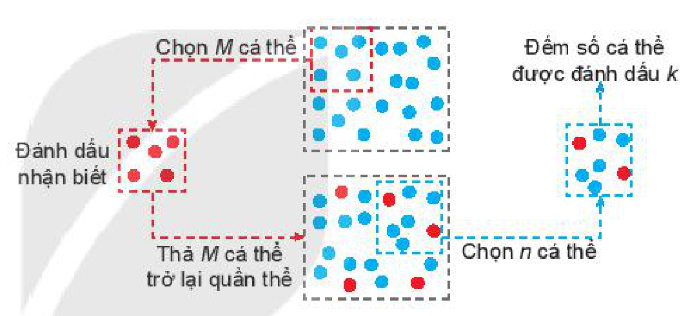
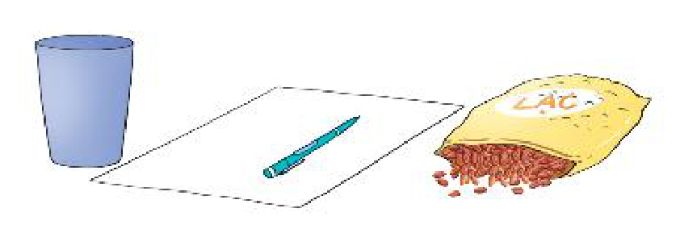
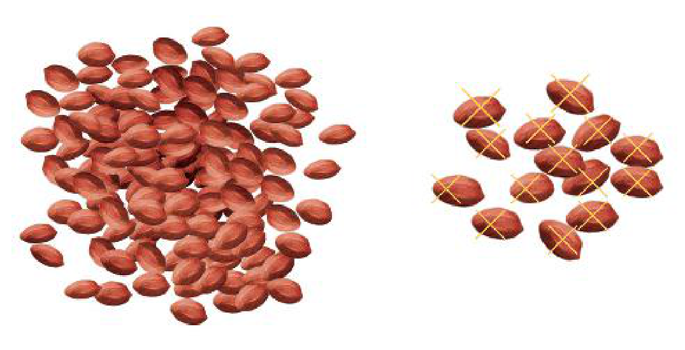

<!-- pdf:94 -->

# ƯỚC TÍNH SỐ CÁ THỂ TRONG MỘT QUẦN THỂ

Trong nghiên cứu về những quần thể động vật, một vấn đề quan trọng là ước tính số cá thể trong quần thể. Một phương pháp được sử dụng là **đánh dấu và bắt lại**.

Phương pháp này gồm hai bước như sau:

*Bước 1.* Chọn $M$ cá thể từ quần thể, đánh dấu và thả chúng trở lại quần thể.

*Bước 2.* Sau một thời gian, chọn ngẫu nhiên $n$ cá thể trong quần thể. Gọi $k$ là số cá thể được đánh dấu trong $n$ cá thể đó.

Ở bước 2, xét phép thử: chọn ngẫu nhiên một cá thể từ quần thể và xét biến cố $A$: “Cá thể có được đánh dấu”. Gọi $N$ là số cá thể trong quần thể. Xác suất của $A$ là $P(A) = \frac{M}{N}$.

Trong $n$ cá thể được chọn số cá thể được đánh dấu là $k$ xấp xỉ với $n \cdot P(A) = n \cdot \frac{M}{N}$ (xem mục Vận dụng Bài 26). Do vậy $N$ được ước tính bởi công thức

$N \approx M \cdot \frac{n}{k}.$

**Ví dụ:** Để ước tính số cá chưa biết trong một hồ nuôi cá, người ta đánh bắt $1\,200$ con, đánh dấu chúng rồi thả lại xuống hồ. Đánh bắt lần thứ hai được $1\,300$ con, thấy trong đó có $110$ con có đánh dấu. Từ đó, ước tính số cá trong hồ là $1\,200 \cdot \frac{1\,300}{110} \approx 14\,182\text{ (con)}$.

Chúng ta áp dụng phương pháp trên thông qua hoạt động sau đây.

**HOẠT ĐỘNG 1:** Ước tính số hạt lạc trong một hộp

*Chuẩn bị:*

- Cốc;
- Giấy, bút;
- Một túi lạc.

*Tiến hành:*

*Bước 1.* Lấy ra $1$ cốc lạc từ trong túi, đếm số lượng và đánh dấu từng hạt lạc.

*Bước 2.* Đổ lạc đã được đánh dấu vào lại trong túi và xáo trộn đều.

*Bước 3.* Lấy ra nửa cốc lạc, đếm tổng số hạt lạc và số hạt lạc có đánh dấu trong cốc.

Gọi $N$ là tổng số hạt lạc trong túi ban đầu. Hãy dùng kết quả đếm được ở bước 3 để ước tính $N$.

<!-- pdf:95 -->

**HOẠT ĐỘNG 2:** Đánh giá sai số của ước tính

Trong tiết thực hành trải nghiệm của lớp 10A, tổ của Hà đã thực hiện các bước trên, trong đó lặp lại bước 3 thêm hai lần: lần hai lấy $1$ cốc lạc, lần ba lấy $1,5$ cốc lạc và thu được kết quả như sau:

| Lần thứ | Số hạt ($n$) | Số hạt có đánh dấu ($k$) |
| :---: | :---: | :---: |
| $1$ | $51$ | $4$ |
| $2$ | $103$ | $11$ |
| $3$ | $155$ | $16$ |
<!-- ocr-ok: đã đối chiếu ảnh trang PDF 95 -->

*Bảng 1. Kết quả thí nghiệm*
<!-- ocr-ok: đã đối chiếu ảnh trang PDF 95 -->

Giả sử số hạt lạc trong túi đựng là $1\,000$ ($N = 1\,000$) và số hạt được đánh dấu là $100$ ($M = 100$).

Kí hiệu $\widehat{N}$ là số quy tròn đến hàng đơn vị của đại lượng $M \cdot \frac{n}{k}$.

Dựa vào dữ liệu trong Bảng 1, em hãy hoàn thành bảng tính theo mẫu sau:

| Lần | $N$ | $M$ | $n$ | $k$ | $\widehat{N}$ | Sai số tuyệt đối | Sai số tương đối |
| :---: | :---: | :---: | :---: | :---: | :---: | :---: | :---: |
| $1$ | $1\,000$ | $100$ | $51$ | $4$ | $?$ | $?$ | $?$ |
| $2$ | $1\,000$ | $100$ | $?$ | $?$ | $?$ | $?$ | $?$ |
| $3$ | $1\,000$ | $100$ | $?$ | $?$ | $?$ | $?$ | $?$ |
<!-- ocr-ok: đã đối chiếu ảnh trang PDF 95 -->

*Bảng 2. Tính sai số*
<!-- ocr-ok: đã đối chiếu ảnh trang PDF 95 -->

Em có nhận xét gì về sai số của việc tính xấp xỉ số hạt lạc trong túi khi $n$ càng lớn?

## 💡 Em có biết?

Phương pháp đánh dấu và bắt lại còn có tên là phương pháp Petersen, đặt theo tên người có ý tưởng đánh dấu cá thể trong một nghiên cứu năm 1894. Mặc dù mục đích trong nghiên cứu này là ước tính tỉ lệ cá thể bị chết, công thức ước tính $N$ vẫn được gọi là ước lượng Petersen. Những ứng dụng đầu tiên của công thức này được thực hiện trên một số quần thể động vật như cá hồi, vịt.

Từ giữa thế kỉ XX, các nhà nghiên cứu không chỉ sử dụng phương pháp đánh dấu và bắt lại trong nghiên cứu những quần thể động vật mà còn phát triển nó để sử dụng vào việc giải quyết những vấn đề về sức khoẻ con người và một số lĩnh vực khác.

## 📷 Danh sách hình trong bài

| Mã hình | Trang PDF | Chú thích trong sách | Mô tả ngắn |
| :--- | :---: | :--- | :--- |
| H10-toan-hd-thtn-04-01 | 94 | (không có) | Ảnh một đàn cá minh hoạ bài toán ước tính số cá thể trong quần thể động vật |
| H10-toan-hd-thtn-04-02 | 94 | (không có) | Sơ đồ minh hoạ hai bước của phương pháp đánh dấu và bắt lại |
| H10-toan-hd-thtn-04-03 | 94 | (không có) | Dụng cụ chuẩn bị cho Hoạt động 1: cốc, giấy bút và một túi lạc |
| H10-toan-hd-thtn-04-04 | 95 | (không có) | Minh hoạ các hạt lạc lấy ra và các hạt lạc có đánh dấu trong Hoạt động 2 |
