<!-- pdf:8 -->

# BÀI 1: LÀM QUEN VỚI VẬT LÍ

## 🔴 Mở đầu

> Hình bên là các nhà vật lí tiêu biểu cho mỗi giai đoạn phát triển khoa học và công nghệ của nhân loại. Em đã biết gì về các nhà khoa học này?
>
> 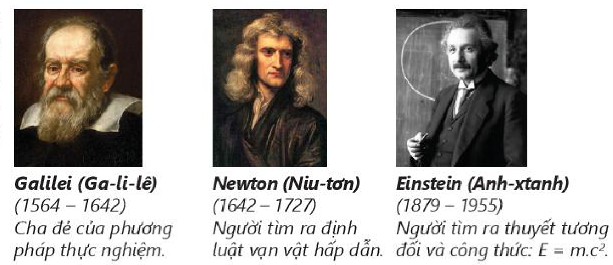
>
> - **Galilei (Ga-li-lê)** $(1564 - 1642)$: Cha đẻ của phương pháp thực nghiệm.
> - **Newton (Niu-tơn)** $(1642 - 1727)$: Người tìm ra định luật vạn vật hấp dẫn.
> - **Einstein (Anh-xtanh)** $(1879 - 1955)$: Người tìm ra thuyết tương đối và công thức: $E = m \cdot c^2$.
<!-- ocr-ok: đối chiếu ảnh trang PDF 8 khớp nguyên văn -->

## I. ĐỐI TƯỢNG NGHIÊN CỨU CỦA VẬT LÍ VÀ MỤC TIÊU CỦA MÔN VẬT LÍ

<!-- term: Đối tượng nghiên cứu của Vật lí -->
Thuật ngữ “**vật lí**” có nguồn gốc từ tiếng Hy Lạp “physiko” có nghĩa là “kiến thức về tự nhiên”. Vật lí là môn "khoa học tự nhiên” có đối tượng nghiên cứu tập trung vào các dạng vận động của vật chất (chất, trường), năng lượng.

Các lĩnh vực nghiên cứu của Vật lí rất đa dạng, từ Cơ học, Điện học, Điện từ học, Quang học, Âm học, Nhiệt học, Nhiệt động lực học đến Vật lí nguyên tử và hạt nhân, Vật lí lượng tử, Thuyết tương đối.

> **Câu hỏi:**
>
> 1. Hãy kể tên các lĩnh vực vật lí mà em đã được học ở cấp Trung học cơ sở.
> 2. Em thích nhất lĩnh vực nào của Vật lí? Tại sao?

<!-- term: Mục tiêu của môn Vật lí -->
Việc học tập môn Vật lí giúp các em hình thành, phát triển năng lực vật lí với các biểu hiện chính sau đây:
- Có được những kiến thức, kĩ năng cơ bản về vật lí.
- Vận dụng được kiến thức, kĩ năng đã học để khám phá, giải quyết các vấn đề có liên quan trong học tập cũng như trong đời sống.
- Nhận biết được năng lực, sở trường của bản thân, định hướng nghề nghiệp$^{(1)}$.

## II. QUÁ TRÌNH PHÁT TRIỂN CỦA VẬT LÍ

<!-- term: Quá trình phát triển của Vật lí -->
Dưới đây là sơ đồ trình bày các giai đoạn chính trong quá trình phát triển của Vật lí. Mỗi giai đoạn có một tính chất, đặc điểm riêng.

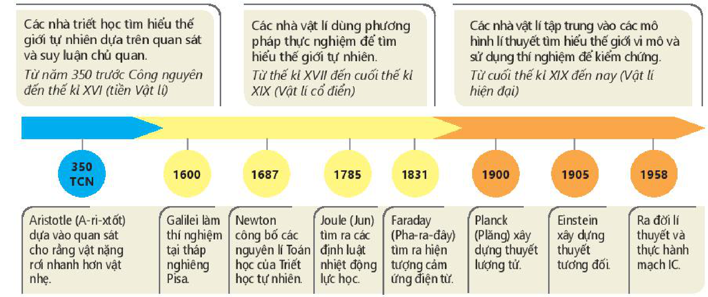

<!-- term: Quá trình phát triển của Vật lí -->
- **Từ năm 350 trước Công nguyên đến thế kỉ XVI (tiền Vật lí):** Các nhà triết học tìm hiểu thế giới tự nhiên dựa trên quan sát và suy luận chủ quan.
  - **350 TCN:** Aristotle (A-ri-xtốt) dựa vào quan sát cho rằng vật nặng rơi nhanh hơn vật nhẹ.
- **Từ thế kỉ XVII đến cuối thế kỉ XIX (Vật lí cổ điển):** Các nhà vật lí dùng phương pháp thực nghiệm để tìm hiểu thế giới tự nhiên.
  - **1600:** Galilei làm thí nghiệm tại tháp nghiêng Pisa.
  - **1687:** Newton công bố các nguyên lí Toán học của Triết học tự nhiên.
  - **1785:** Joule (Jun) tìm ra các định luật nhiệt động lực học.
  - **1831:** Faraday (Pha-ra-đây) tìm ra hiện tượng cảm ứng điện từ.
- **Từ cuối thế kỉ XIX đến nay (Vật lí hiện đại):** Các nhà vật lí tập trung vào các mô hình lí thuyết tìm hiểu thế giới vi mô và sử dụng thí nghiệm để kiểm chứng.
  - **1900:** Planck (Plăng) xây dựng thuyết lượng tử.
  - **1905:** Einstein xây dựng thuyết tương đối.
  - **1958:** Ra đời lí thuyết và thực hành mạch IC.
<!-- ocr-ok: đối chiếu ảnh trang PDF 8 khớp nguyên văn -->

> $^{(1)}$ *Theo Chương trình GDPT môn Vật lí – Bộ GD và ĐT (2018)*

<!-- pdf:9 -->

## III. VAI TRÒ CỦA VẬT LÍ ĐỐI VỚI KHOA HỌC, KĨ THUẬT VÀ CÔNG NGHỆ

**a)** Vật lí có quan hệ với mọi ngành khoa học và thường được coi là cơ sở của khoa học tự nhiên (KHTN). Các khái niệm, định luật, nguyên lí của Vật lí được sử dụng rộng rãi trong mọi lĩnh vực của KHTN, đặc biệt là trong việc giải thích cơ chế của các hiện tượng tự nhiên, từ các hiện tượng xảy ra trong thế giới sinh học, các phản ứng hoá học đến các hiện tượng xảy ra trong vũ trụ,...

Không phải ngẫu nhiên mà càng ngày càng xuất hiện nhiều lĩnh vực liên môn như Vật lí sinh học, Vật lí địa lí, Vật lí thiên văn, Hoá lí, Sinh học lượng tử, Hoá học lượng tử,...

> **Câu hỏi:**
>
> 1. Cơ chế của các phản ứng hoá học được giải thích dựa trên kiến thức thuộc lĩnh vực nào của Vật lí?
> 2. Kiến thức về từ trường Trái Đất được dùng để giải thích đặc điểm nào của loài chim di trú?
> 3. Sự tương tác giữa các thiên thể được giải thích dựa vào định luật vật lí nào của Newton?
> 4. Hãy nêu thêm ví dụ về việc dùng kiến thức vật lí để giải thích hiện tượng tự nhiên mà các em đã học.

**b)** Vật lí là cơ sở của công nghệ. Có thể khẳng định là không có các thành tựu nghiên cứu của Vật lí thì không có công nghệ.

Máy hơi nước do James Watt (Giêm Oát) sáng chế năm 1765 dựa trên những kết quả nghiên cứu về Nhiệt của Vật lí đã tạo nên bước khởi đầu cho cuộc cách mạng công nghiệp lần thứ nhất với đặc trưng cơ bản là thay thế sức lực cơ bắp bằng sức lực máy móc (Hình 1.1).

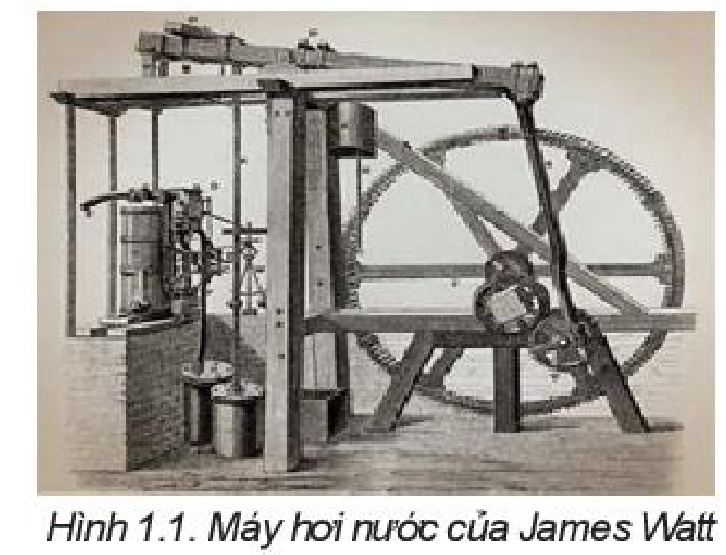

> **Câu hỏi:**
>
> 1. Hãy nêu tên một số thiết bị có ứng dụng các kiến thức về nhiệt.
> 2. Theo em, việc sử dụng máy hơi nước nói riêng và động cơ nhiệt nói chung có những hạn chế nào?

Nhờ việc khám phá ra hiện tượng cảm ứng điện từ của nhà vật lí Faraday mà sau đó các máy phát điện ra đời, mở đầu cho kỉ nguyên sử dụng điện năng của nhân loại và là một trong những cơ sở cho sự ra đời của cuộc cách mạng công nghiệp lần thứ hai vào cuối thế kỉ XIX. Một trong những đặc trưng cơ bản của cuộc cách mạng công nghiệp này là sự xuất hiện các thiết bị dùng điện trong mọi lĩnh vực sản xuất và đời sống con người (Hình 1.2).

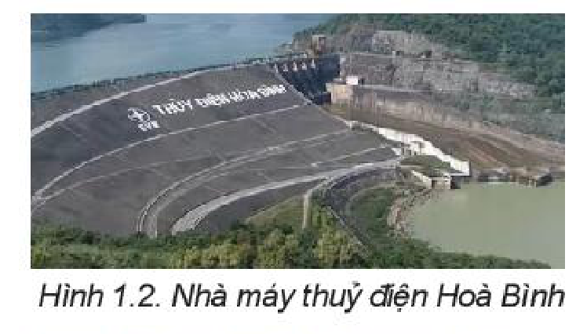
<!-- ocr-ok: đối chiếu ảnh trang PDF 9 khớp nguyên văn (OCR bỏ sót chú thích Hình 1.2) -->

> **Câu hỏi:**
>
> Theo em, sử dụng động cơ điện có những ưu điểm vượt trội nào so với sử dụng máy hơi nước?

Cuộc cách mạng công nghiệp lần thứ ba bắt đầu vào những năm 70 của thế kỉ XX, với đặc trưng là tự động hoá các quá trình sản xuất (xây dựng các dây chuyền sản xuất tự động) cũng là nhờ có những thành tựu nghiên cứu về điện tử, chất bán dẫn và vi mạch,... của Vật lí học (Hình 1.3).

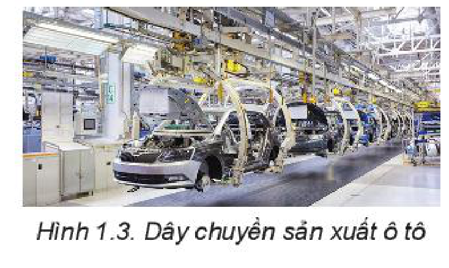

<!-- pdf:10 -->

> **Câu hỏi:**
>
> Hãy kể tên một số nhà máy tự động hoá quá trình sản xuất ở nước ta.

Cuộc cách mạng công nghiệp lần thứ tư được coi là bắt đầu vào đầu thế kỉ XXI với tốc độ phát triển và mức độ ảnh hưởng vượt xa các cuộc cách mạng công nghiệp trước đó. Đặc trưng của cuộc cách mạng công nghiệp này là sử dụng trí tuệ nhân tạo, robot, internet toàn cầu, công nghệ vật liệu siêu nhỏ (nano); là sự xuất hiện từ bóng đèn thông minh, điện thoại thông minh đến nhà ở thông minh, nhà máy thông minh. Tất cả đều dựa trên những thành tựu của các lĩnh vực nghiên cứu khác nhau của Vật lí hiện đại (Hình 1.4).

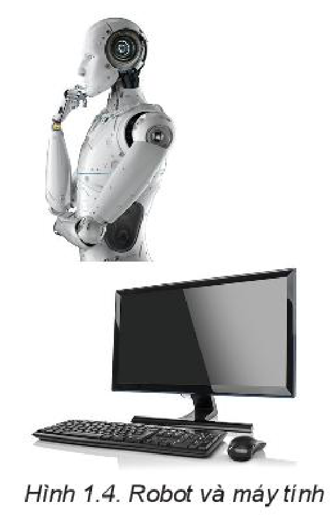

> **Hoạt động:**
>
> Hãy sưu tầm tài liệu trên internet và các phương tiện truyền thông khác về thành phố thông minh (thành phố số) để trình bày và thảo luận trên lớp về chủ đề “Thế nào là thành phố thông minh?”.

**c)** Vai trò của Vật lí trong sự phát triển các công nghệ nêu trên cho thấy sự ảnh hưởng to lớn của nó đối với cuộc sống con người. Mọi thiết bị mà con người sử dụng hằng ngày đều ít nhiều gắn với những thành tựu nghiên cứu của Vật lí.

Tuy nhiên, việc ứng dụng các thành tựu của Vật lí vào công nghệ không chỉ mang lại lợi ích cho nhân loại mà còn có thể làm ô nhiễm môi trường sống, huỷ hoại hệ sinh thái,... nếu không được sử dụng đúng phương pháp, đúng mục đích (Hình 1.5, 1.6).

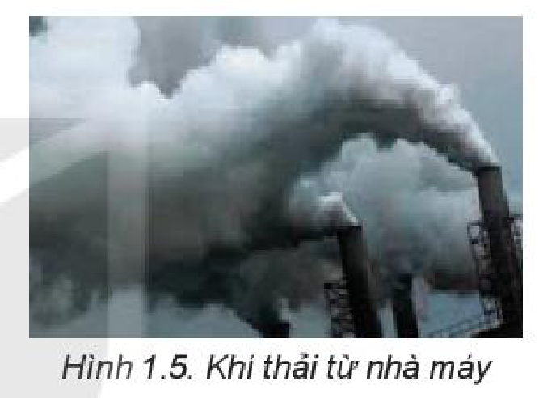
<!-- ocr-ok: đối chiếu ảnh trang PDF 10 khớp nguyên văn (OCR bỏ sót chú thích Hình 1.5) -->

> **Câu hỏi:**
>
> 1. Hãy nêu mối liên quan giữa các lĩnh vực của Vật lí đối với một số dụng cụ gia đình mà em thường sử dụng.
> 2. Hãy nói về ảnh hưởng của Vật lí đối với một số lĩnh vực như: giao thông vận tải; thông tin liên lạc; năng lượng; du hành vũ trụ;... Sưu tầm hình ảnh để minh hoạ.
> 3. Hãy nêu ví dụ về ô nhiễm môi trường và huỷ hoại hệ sinh thái mà em biết ở địa phương mình.

## IV. PHƯƠNG PHÁP NGHIÊN CỨU VẬT LÍ

### 1. Phương pháp thực nghiệm

<!-- term: Phương pháp thực nghiệm -->
Phương pháp thực nghiệm là phương pháp quan trọng của Vật lí.

Câu chuyện dưới đây về sự ra đời của phương pháp thực nghiệm sẽ giúp các em hiểu được đặc điểm của phương pháp này. Từ việc quan sát sự rơi của các vật nặng nhẹ khác nhau mà Aristotle, một nhà khoa học Hy Lạp sống vào những năm 300 trước Công nguyên cho rằng: “Vật nặng rơi nhanh hơn vật nhẹ, vật càng nặng rơi càng nhanh” (Hình 1.7a).

<!-- pdf:11 -->

Aristotle dùng suy luận để bảo vệ ý kiến của mình. Ông đã lập luận như sau: “Bốn hòn đá buộc lại với nhau, rơi nhanh gấp 4 lần một hòn đá, cũng giống như xe kéo bằng bốn con ngựa chạy nhanh gấp 4 lần xe kéo bằng một con ngựa” (Hình 1.7c).

Vào thời đại của Aristotle, khoa học chưa phát triển, Aristotle lại là một nhà bác học rất có uy tín, nên chẳng ai nghi ngờ ý kiến của ông, chẳng ai nghĩ đến việc kiểm tra xem có thật bốn hòn đá buộc lại với nhau rơi nhanh gấp 4 lần một hòn đá hay không.

Phải mãi gần 20 thế kỉ sau, khi khoa học đã bắt đầu phát triển, mới có người nghĩ đến việc kiểm tra xem ý kiến của Aristotle có đúng hay không. Đó là Galilei, ở thành phố Pisa nước Italia. Galilei đã làm như sau:

<!-- term: Phương pháp thực nghiệm -->
1. Xác định vấn đề cần tìm hiểu: Có đúng vật nặng rơi nhanh hơn vật nhẹ không?
2. Bằng những quan sát hằng ngày, ông đã thấy khi trời mưa những giọt nước mưa dù to hay nhỏ đều rơi xuống như nhau, cũng giống như khi có tuyết rơi thì những hạt tuyết to hay nhỏ cũng rơi xuống như nhau.
3. Từ những quan sát của mình, Galilei dự đoán: Sự rơi nhanh hay chậm không phụ thuộc vào vật nặng hay nhẹ (Hình 1.7b).
4. Khác với Aristotle chỉ dừng lại ở suy luận, Galilei nghĩ ra cách làm thí nghiệm để kiểm tra dự đoán của mình. Ông cho rằng nếu dùng thí nghiệm chứng minh được hai vật nặng, nhẹ rất khác nhau đều rơi nhanh như nhau thì sẽ bác bỏ được ý kiến của Aristotle.
   Ông cùng các học trò của mình mang lên tháp nghiêng Pisa hai quả cầu bằng kim loại, quả to nặng gấp khoảng 10 lần quả nhỏ và thả hai quả cầu xuống cùng một lúc. Trước sự chứng kiến của hàng trăm người dân thành phố Pisa, cả hai quả cầu đều rơi nhanh như nhau, cùng chạm đất một lúc (Hình 1.7d).
5. Thí nghiệm đã chứng tỏ ý kiến của Galilei là đúng: *Sự rơi nhanh hay chậm không phụ thuộc vào vật nặng hay nhẹ.*

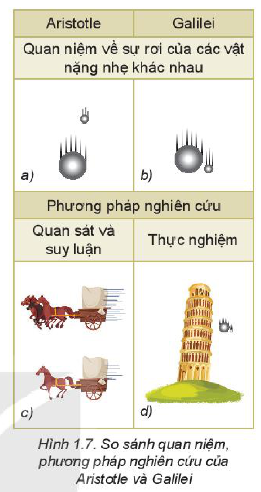

<!-- term: Phương pháp thực nghiệm -->
Phương pháp mà Galilei dùng ở trên sau này được gọi là phương pháp thực nghiệm và Galilei được coi là "cha đẻ" của phương pháp này. Sơ đồ của phương pháp thực nghiệm được mô tả trên Hình 1.8.

<!-- term: Phương pháp thực nghiệm -->
Nếu thí nghiệm chứng tỏ dự đoán là sai thì người ta phải đưa ra dự đoán mới và làm thí nghiệm kiểm tra dự đoán này, hoặc xác định lại vấn đề cần nghiên cứu.

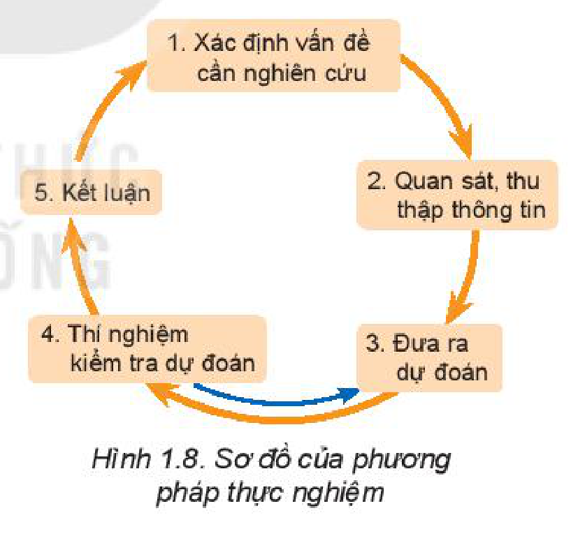

> **Câu hỏi:**
>
> Nêu một ví dụ về sử dụng phương pháp thực nghiệm mà em đã được học trong môn KHTN.

<!-- pdf:12 -->

### 2. Phương pháp mô hình

<!-- term: Phương pháp mô hình -->
Đây là phương pháp dùng các mô hình để nghiên cứu, giải thích các tính chất của vật thật, tìm ra cơ chế hoạt động của nó,... Các loại mô hình sau đây là các mô hình thường dùng ở trường phổ thông.

- **Mô hình vật chất**: Đó là các vật thu nhỏ hoặc phóng to của vật thật, có một số đặc điểm giống vật thật. Quả địa cầu trong phòng thí nghiệm là ví dụ về mô hình vật chất thu nhỏ của Trái Đất, hệ Mặt Trời có thể coi là mô hình vật chất phóng to của mẫu nguyên tử của Rutherford.
- **Mô hình lí thuyết**: Khi nghiên cứu chuyển động của một ô tô đang chạy trên đường dài, người ta coi ô tô là một “chất điểm”, khi nghiên cứu về ánh sáng người ta dùng mô hình tia sáng để biểu diễn đường truyền của ánh sáng.
  Chất điểm, tia sáng nêu trên là các ví dụ về mô hình lí thuyết.
- **Mô hình toán học**: Đó là các công thức, phương trình, đồ thị, kí hiệu,... của Toán học dùng để mô tả các đặc điểm của các đối tượng nghiên cứu. Vectơ dùng để mô tả một đại lượng có hướng, ví dụ lực, độ dịch chuyển; phương trình $d = v \cdot t$ là mô hình toán học của chuyển động thẳng đều,...

> **Câu hỏi:**
>
> 1. Hãy kể tên một số mô hình vật chất mà em thấy trong phòng thí nghiệm.
> 2. Hãy nêu tên một mô hình lí thuyết mà em đã học.
> 3. Các mô hình toán học vẽ ở Hình 1.9 dùng để mô tả loại chuyển động nào?
>
> 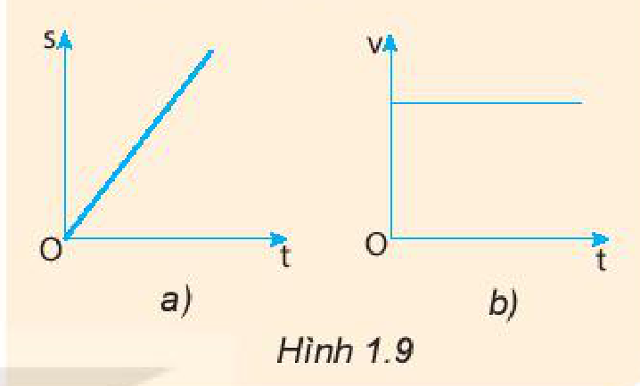

<!-- term: Phương pháp mô hình -->
Tuỳ theo từng loại mô hình cụ thể mà có thể có các quy trình xây dựng và sử dụng mô hình khác nhau. Tuy nhiên các bước sau đây được coi là các bước cần thiết cho việc xây dựng mọi loại mô hình:
1. Xác định đối tượng cần được mô hình hoá.
2. Đưa ra các mô hình khác nhau để thử nghiệm.
3. Kiểm tra sự phù hợp của các mô hình với các kết quả cho bởi thí nghiệm, thực tế, lí thuyết.
4. Kết luận về mô hình.

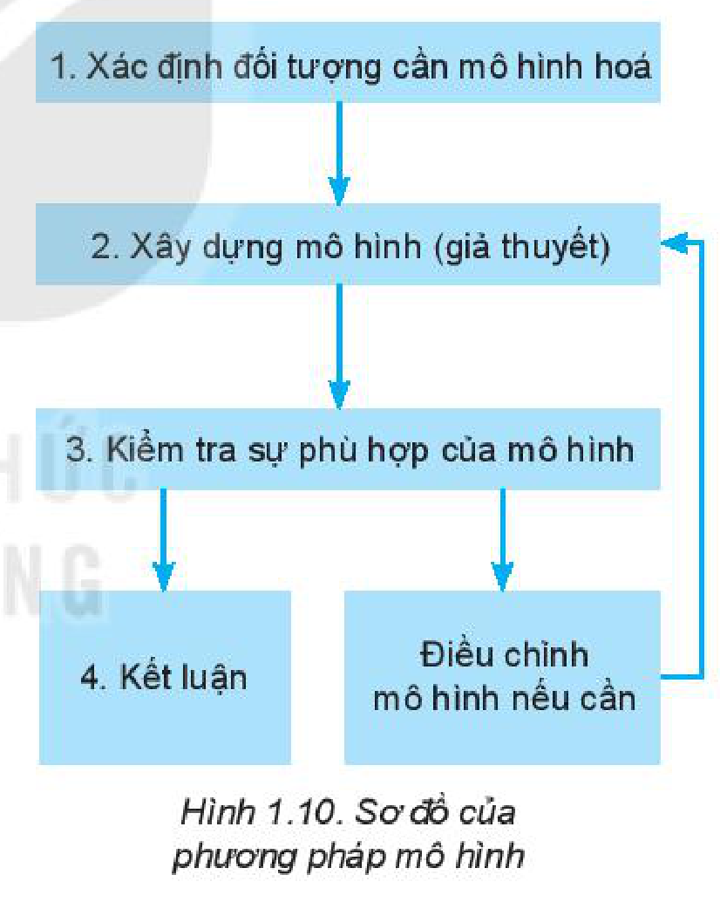

## 📌 Em đã học

- Đối tượng nghiên cứu chủ yếu của Vật lí là các dạng của vật chất, năng lượng.
- Phương pháp nghiên cứu thường sử dụng của Vật lí là phương pháp thực nghiệm và phương pháp mô hình.
- Vật lí được coi là cơ sở của KHTN và công nghệ.

## ✏️ Em có thể

Dự đoán về sự phụ thuộc tốc độ bay hơi của nước vào nhiệt độ nước và gió thổi trên mặt nước, rồi lập phương án thí nghiệm để kiểm tra dự đoán.

## 📷 Danh sách hình trong bài

| Mã hình | Số hình SGK | Trang PDF | Chú thích |
| --- | --- | --- | --- |
| H10-vat_ly-b01-01 | Hình mở đầu | 8 | Ba nhà vật lí tiêu biểu: Galilei, Newton, Einstein |
| H10-vat_ly-b01-02 | Sơ đồ mục II | 8 | Sơ đồ các giai đoạn chính trong quá trình phát triển của Vật lí |
| H10-vat_ly-b01-03 | Hình 1.1 | 9 | Máy hơi nước của James Watt |
| H10-vat_ly-b01-04 | Hình 1.2 | 9 | Nhà máy thuỷ điện Hoà Bình |
| H10-vat_ly-b01-05 | Hình 1.3 | 9 | Dây chuyền sản xuất ô tô |
| H10-vat_ly-b01-06 | Hình 1.4 | 10 | Robot và máy tính |
| H10-vat_ly-b01-07 | Hình 1.5 | 10 | Khí thải từ nhà máy |
| H10-vat_ly-b01-08 | Hình 1.6 | 10 | Vụ nổ bom nguyên tử |
| H10-vat_ly-b01-09 | Hình 1.7 | 11 | So sánh quan niệm, phương pháp nghiên cứu của Aristotle và Galilei |
| H10-vat_ly-b01-10 | Hình 1.8 | 11 | Sơ đồ của phương pháp thực nghiệm |
| H10-vat_ly-b01-11 | Hình 1.9 | 12 | Đồ thị mô hình toán học biểu diễn chuyển động: a) đồ thị s – t; b) đồ thị v – t |
| H10-vat_ly-b01-12 | Hình 1.10 | 12 | Sơ đồ của phương pháp mô hình |
