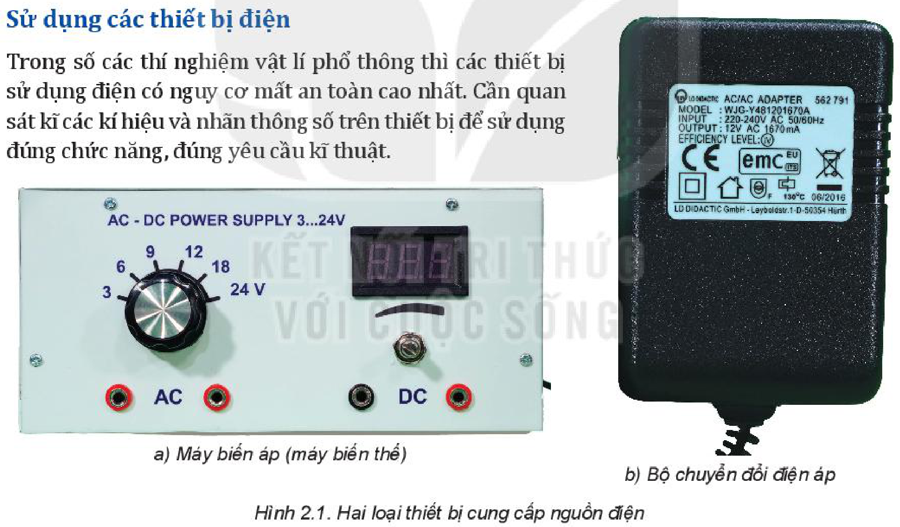
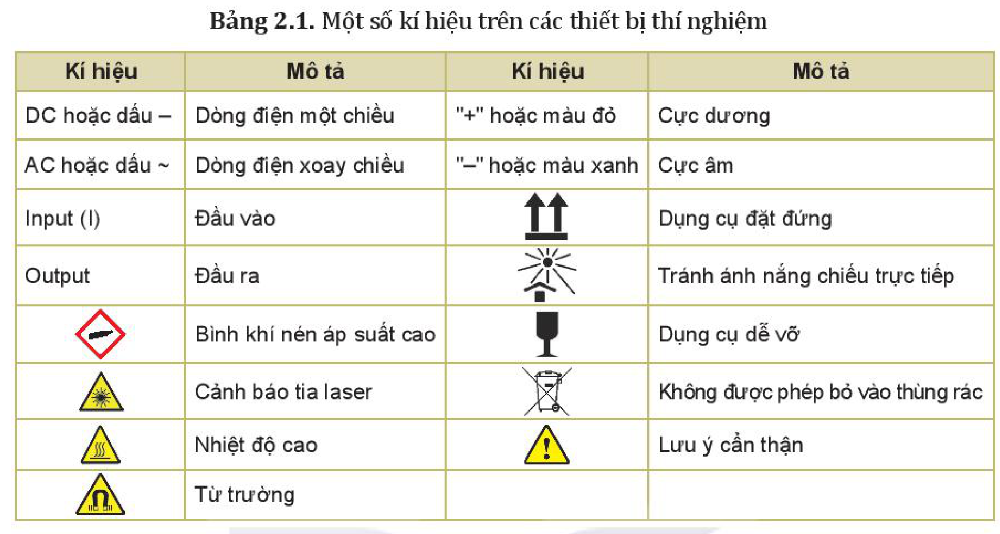
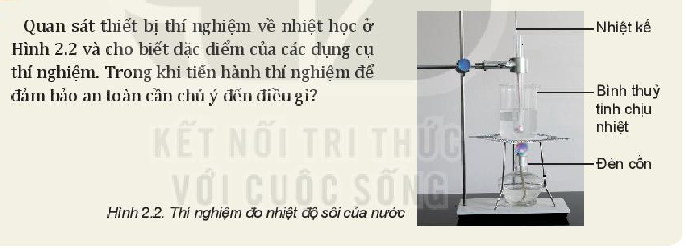
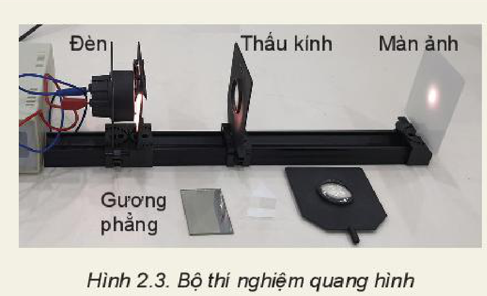
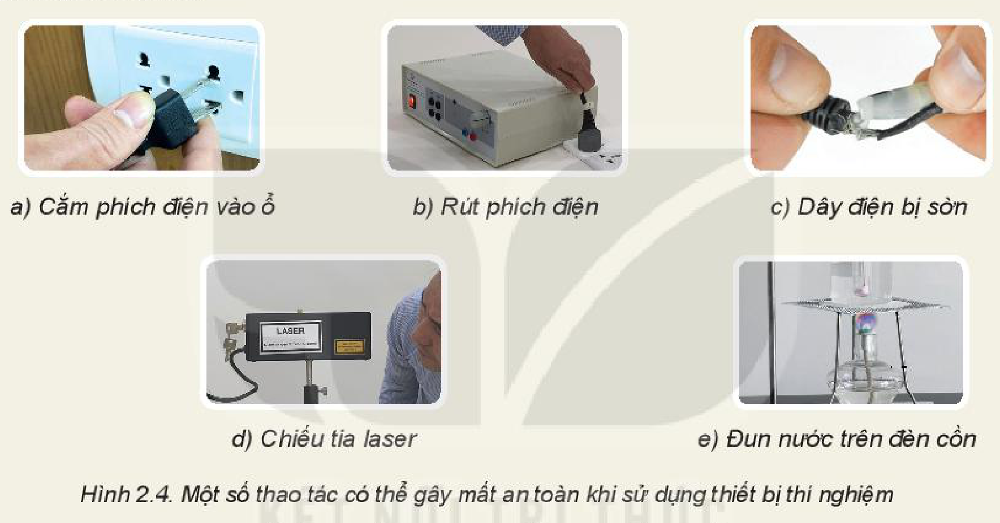
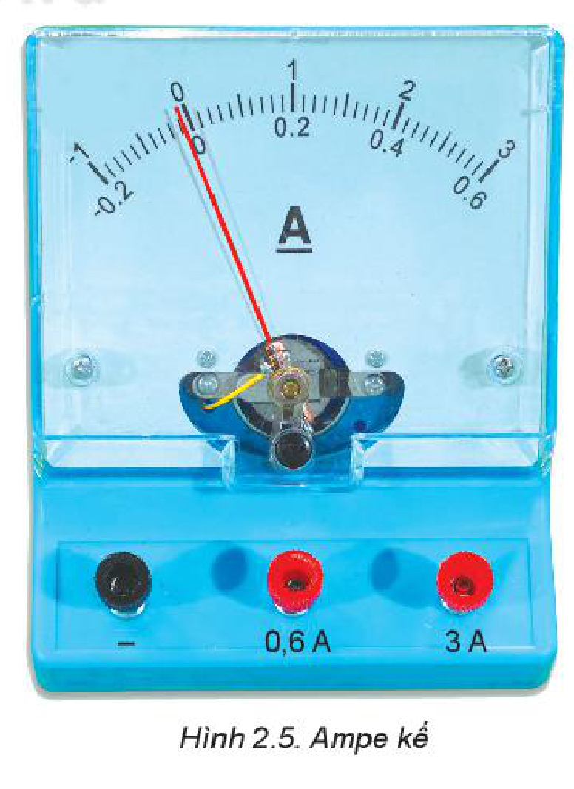
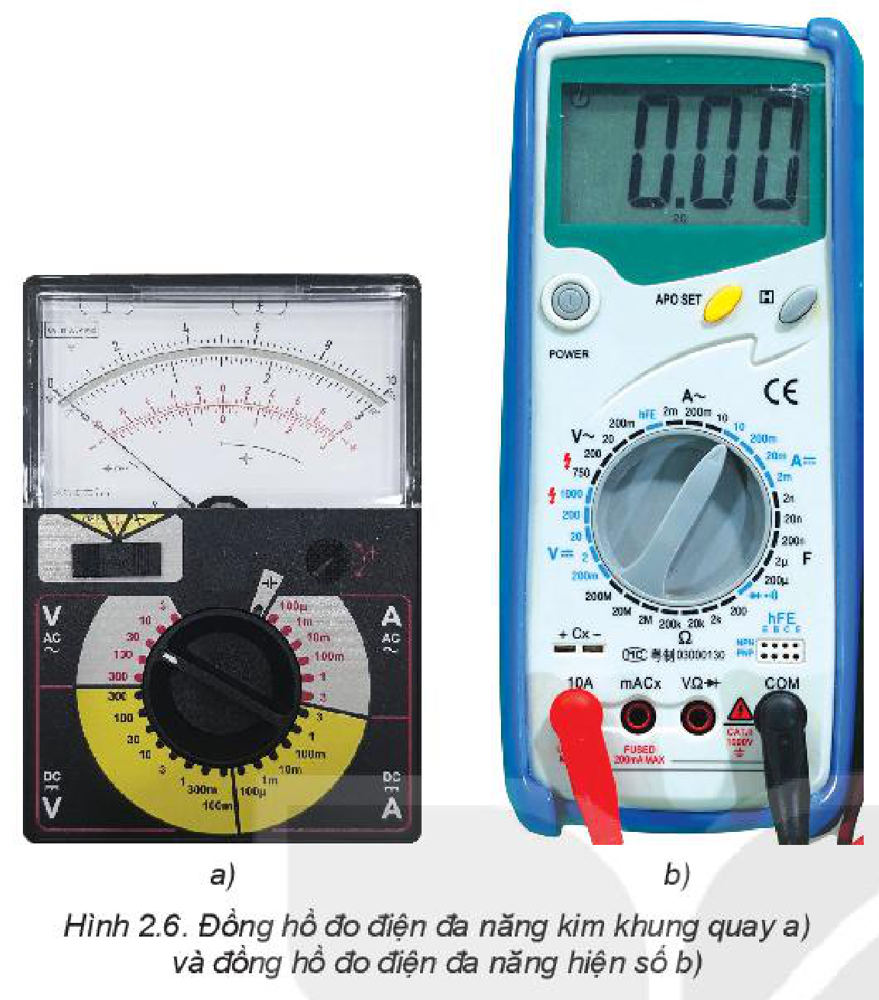
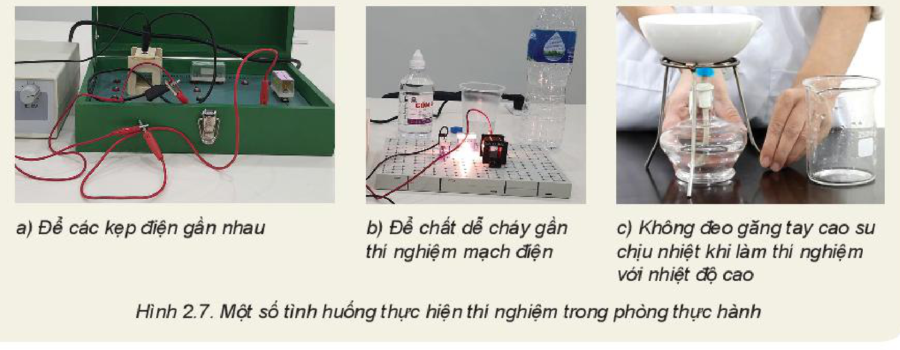
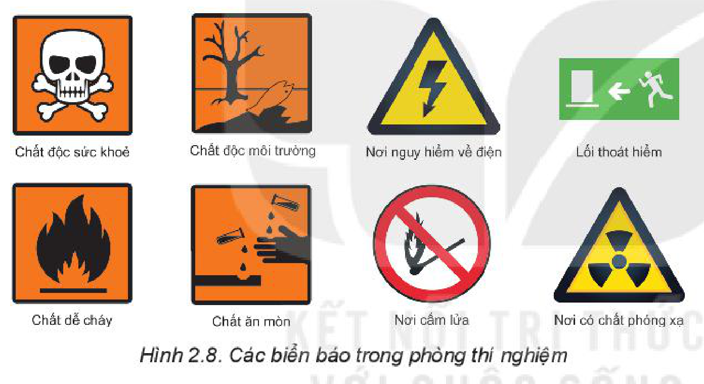

<!-- pdf:13 -->

# BÀI 2: CÁC QUY TẮC AN TOÀN TRONG PHÒNG THỰC HÀNH VẬT LÍ

## 🔴 Mở đầu

> Khi làm thí nghiệm cần đảm bảo người làm thí nghiệm không gặp nguy hiểm, đồ dùng, thiết bị không bị hư hỏng, cháy nổ. Làm thế nào để đảm bảo an toàn trong khi tiến hành thí nghiệm?

## I. AN TOÀN KHI SỬ DỤNG THIẾT BỊ THÍ NGHIỆM

### 1. Sử dụng các thiết bị điện

Trong số các thí nghiệm vật lí phổ thông thì các thiết bị sử dụng điện có nguy cơ mất an toàn cao nhất. Cần quan sát kĩ các kí hiệu và nhãn thông số trên thiết bị để sử dụng đúng chức năng, đúng yêu cầu kĩ thuật.

> **Hoạt động:**
>
> Hãy quan sát hai thiết bị chuyển đổi điện áp, tham khảo kí hiệu ở Bảng 2.1 và thảo luận để trả lời các câu hỏi sau:
> 1. Chức năng của hai thiết bị là gì? Chúng giống và khác nhau như thế nào?
> 2. Bộ chuyển đổi điện áp (Hình 2.1b) sử dụng hiệu điện thế đầu vào bao nhiêu?
> 3. Các hiệu điện thế đầu ra như thế nào?
> 4. Những nguy cơ nào có thể gây mất an toàn hoặc hỏng các thiết bị khi sử dụng thiết bị chuyển đổi điện áp này?

<!-- pdf:14 -->

**Bảng 2.1.** Một số kí hiệu trên các thiết bị thí nghiệm

| Kí hiệu | Mô tả | Kí hiệu | Mô tả |
| --- | --- | --- | --- |
| DC hoặc dấu $-$ | Dòng điện một chiều | "+" hoặc màu đỏ | Cực dương |
| AC hoặc dấu $\sim$ | Dòng điện xoay chiều | "$-$" hoặc màu xanh | Cực âm |
| Input (I) | Đầu vào | $\uparrow\uparrow$ | Dụng cụ đặt đứng |
| Output | Đầu ra | [Kí hiệu tránh nắng] | Tránh ánh nắng chiếu trực tiếp |
| [Biển hình thoi đỏ] | Bình khí nén áp suất cao | [Kí hiệu ly thuỷ tinh] | Dụng cụ dễ vỡ |
| [Biển tam giác tia laser] | Cảnh báo tia laser | [Kí hiệu thùng rác gạch chéo] | Không được phép bỏ vào thùng rác |
| [Biển tam giác nhiệt độ cao] | Nhiệt độ cao | $\triangle$ có dấu $!$ | Lưu ý cẩn thận |
| [Biển tam giác nam châm] | Từ trường | | |
<!-- ocr-ok: đối chiếu ảnh trang PDF 14 khớp nguyên văn -->

### 2. Sử dụng các thiết bị nhiệt và thuỷ tinh

Các thiết bị đun nóng có thể gây bỏng với người sử dụng, gây nứt, vỡ các bộ phận làm bằng thuỷ tinh.

> **Hoạt động:**
>
> Quan sát thiết bị thí nghiệm về nhiệt học ở Hình 2.2 và cho biết đặc điểm của các dụng cụ thí nghiệm. Trong khi tiến hành thí nghiệm để đảm bảo an toàn cần chú ý đến điều gì?
>
> 

### 3. Sử dụng các thiết bị quang học

Các thiết bị quang học rất dễ mốc, xước, nứt, vỡ và dính bụi bẩn, làm ảnh hưởng đến đường truyền tia sáng và sai lệch kết quả thí nghiệm.

> **Hoạt động:**
>
> Quan sát thiết bị thí nghiệm quang hình (Hình 2.3) và cho biết đặc điểm của các dụng cụ thí nghiệm. Khi sử dụng và bảo quản thiết bị cần chú ý đến điều gì?
>
> 

<!-- pdf:15 -->

## II. NGUY CƠ MẤT AN TOÀN TRONG SỬ DỤNG THIẾT BỊ THÍ NGHIỆM VẬT LÍ

### 1. Nguy cơ gây nguy hiểm cho người sử dụng

Việc thực hiện sai thao tác sử dụng các thiết bị có thể dẫn đến nguy hiểm cho người sử dụng. Vì vậy, khi tiến hành thí nghiệm cần tuân thủ nghiêm ngặt các quy định trong phòng thực hành và hướng dẫn của giáo viên.

> **Hoạt động:**
>
> Em hãy quan sát một số hình ảnh về thao tác sử dụng các thiết bị thí nghiệm trong Hình 2.4 và dự đoán xem có những nguy cơ nào có thể gây nguy hiểm trong phòng thực hành vật lí.
>
> Kể thêm những thao tác sử dụng thiết bị thí nghiệm khác có thể gây nguy hiểm trong phòng thực hành.
>
> 

### 2. Nguy cơ hỏng thiết bị đo điện

Khi sử dụng các thiết bị đo điện cần chọn đúng thang đo, không nhầm lẫn khi thao tác để đảm bảo an toàn cho thiết bị đo.

> **Câu hỏi:**
>
> 1. Giới hạn đo của ampe kế ở Hình 2.5 là bao nhiêu?
> 2. Nếu sử dụng ampe kế để đo dòng điện vượt quá giới hạn đo thì có thể gây ra nguy cơ gì?

Khi sử dụng **đồng hồ đo điện đa năng** (thiết bị đo điện với các chức năng chính là đo điện trở, đo hiệu điện thế và đo dòng điện AC, DC), cần lưu ý:
- Chọn chức năng và thang đo phù hợp.
- Cắm dây đo vào chốt cắm phù hợp với chức năng đo.

<!-- pdf:16 -->

> **Câu hỏi:**
>
> Điều chỉnh vị trí của kim đo, chọn thang đo và cắm các dây đo trên đồng hồ đa năng (Hình 2.6) để đo hiệu điện thế, cường độ dòng điện và điện trở như thế nào?

> **Lưu ý:**
>
> Khi phòng thực hành có đám cháy, cần ngắt điện, tổ chức thoát nạn, cứu người, cứu tài sản, chống cháy lan, dập tắt đám cháy. Một số lưu ý:
> - Ngắt toàn bộ hệ thống điện.
> - Đưa toàn bộ các hoá chất, các chất dễ cháy ra khu vực an toàn.
> - Không được sử dụng nước dập đám cháy nơi có các thiết bị điện, đám cháy hydrocarbon hoặc các chất lỏng có tỉ trọng nhẹ hơn nước như dầu, cồn,...
> - Không được sử dụng $\text{CO}_2$ để dập tắt đám cháy quần áo trên người hoặc cháy kim loại kiềm như magnesium, các chất cháy có khả năng tách oxygen như peroxide, chlorate, potassium nitrate,...
<!-- ocr-ok: đối chiếu ảnh trang PDF 16 khớp nguyên văn -->

### 3. Nguy cơ cháy nổ trong phòng thực hành

Khi tiến hành thí nghiệm với các thiết bị điện và những hoá chất, chất dễ cháy nổ trong phòng thực hành cần tuân thủ quy tắc an toàn, nhất là những quy tắc an toàn về phòng cháy chữa cháy và an toàn khi sử dụng hoá chất dễ cháy, nổ.

> **Hoạt động:**
>
> Em hãy quan sát một số hình ảnh về các thí nghiệm trong Hình 2.7 và dự đoán có những nguy cơ cháy nổ nào có thể xảy ra trong phòng thực hành.
>
> 

<!-- pdf:17 -->

## III. QUY TẮC AN TOÀN TRONG PHÒNG THỰC HÀNH

<!-- term: Quy tắc an toàn trong phòng thực hành -->
- Đọc kĩ hướng dẫn sử dụng thiết bị và quan sát các chỉ dẫn, các kí hiệu trên các thiết bị thí nghiệm.
- Kiểm tra cẩn thận thiết bị, phương tiện, dụng cụ thí nghiệm trước khi sử dụng.
- Chỉ tiến hành thí nghiệm khi được sự cho phép của giáo viên hướng dẫn thí nghiệm.
- Tắt công tắc nguồn thiết bị điện trước khi cắm hoặc tháo thiết bị điện.
- Chỉ cắm phích/giắc cắm của thiết bị điện vào ổ cắm khi hiệu điện thế của nguồn điện tương ứng với hiệu điện thế định mức của dụng cụ.
- Phải bố trí dây điện gọn gàng, không bị vướng khi qua lại.
- Không tiếp xúc trực tiếp với các vật và các thiết bị thí nghiệm có nhiệt độ cao khi không có dụng cụ bảo hộ.
- Không để nước cũng như các dung dịch dẫn điện, dung dịch dễ cháy gần thiết bị điện.
- Giữ khoảng cách an toàn khi tiến hành thí nghiệm nung nóng các vật, thí nghiệm có các vật bắn ra, tia laser.
- Phải vệ sinh, sắp xếp gọn gàng các thiết bị và dụng cụ thí nghiệm, bỏ chất thải thí nghiệm vào đúng nơi quy định sau khi tiến hành thí nghiệm.

> **Lưu ý:**
>
> Khi phát hiện người bị điện giật cần nhanh chóng ngắt nguồn điện hoặc sử dụng vật cách điện để tách người bị nạn ra khỏi nguồn điện.

## 📌 Em đã học

- Để đảm bảo an toàn khi sử dụng thiết bị trong phòng thực hành, cần đọc kĩ hướng dẫn và các kí hiệu trên thiết bị.
- Thực hiện nghiêm túc các quy định về an toàn trong phòng thực hành.

## ✏️ Em có thể

Giải thích được vì sao:
1. Khi sử dụng thiết bị đo điện, phải luôn đặt ở thang đo phù hợp.
2. Khi sử dụng máy biến áp phải đặt nút điều chỉnh điện áp ở mức thấp nhất rồi tăng dần lên.

> **Em có biết:**
>
> 1. **Sốc điện** (hay **điện giật**): Sốc điện xảy ra khi dòng điện chạy qua người, có thể gây ra tổn thương các bộ phận của cơ thể hoặc tử vong.
> 2. Khi có hoả hoạn cần bình tĩnh, sử dụng các biện pháp dập tắt ngọn lửa theo hướng dẫn của phòng thực hành.

## 📷 Danh sách hình trong bài

| Mã hình | Số hình SGK | Trang PDF | Chú thích |
| --- | --- | --- | --- |
| H10-vat_ly-b02-01 | Hình 2.1 | 13 | Hai loại thiết bị cung cấp nguồn điện: a) Máy biến áp (máy biến thế); b) Bộ chuyển đổi điện áp |
| H10-vat_ly-b02-02 | Bảng 2.1 | 14 | Một số kí hiệu trên các thiết bị thí nghiệm |
| H10-vat_ly-b02-03 | Hình 2.2 | 14 | Thí nghiệm đo nhiệt độ sôi của nước |
| H10-vat_ly-b02-04 | Hình 2.3 | 14 | Bộ thí nghiệm quang hình |
| H10-vat_ly-b02-05 | Hình 2.4 | 15 | Một số thao tác có thể gây mất an toàn khi sử dụng thiết bị thí nghiệm |
| H10-vat_ly-b02-06 | Hình 2.5 | 15 | Ampe kế |
| H10-vat_ly-b02-07 | Hình 2.6 | 16 | Đồng hồ đo điện đa năng kim khung quay a) và đồng hồ đo điện đa năng hiện số b) |
| H10-vat_ly-b02-08 | Hình 2.7 | 16 | Một số tình huống thực hiện thí nghiệm trong phòng thực hành |
| H10-vat_ly-b02-09 | Hình 2.8 | 17 | Các biển báo trong phòng thí nghiệm |
