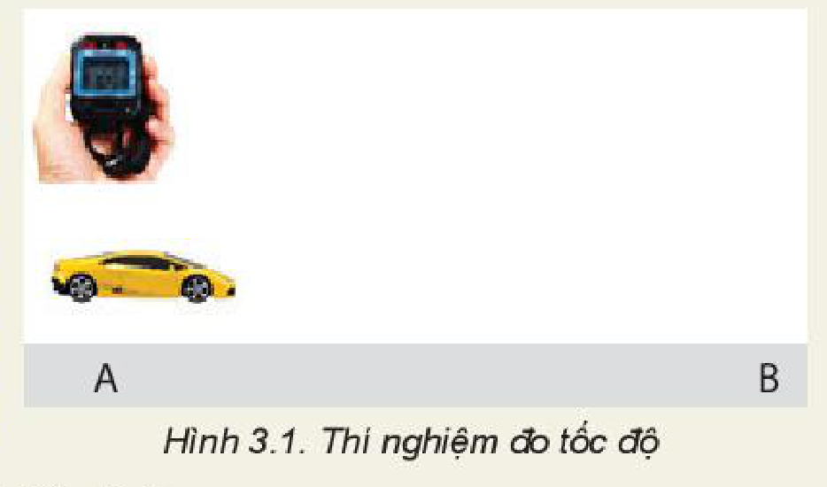
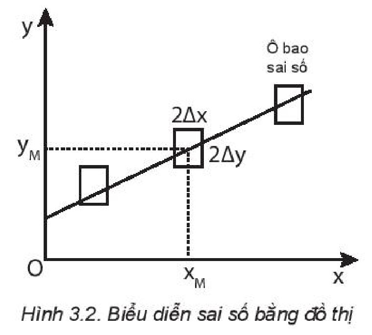

<!-- pdf:18 -->

# BÀI 3: THỰC HÀNH TÍNH SAI SỐ TRONG PHÉP ĐO. GHI KẾT QUẢ ĐO

## 🔴 Mở đầu

> Không một phép đo nào có thể cho ta giá trị đúng của đại lượng cần đo, mọi phép đo đều có sai số. Làm thế nào để xác định được các sai số này? Nguyên nhân gây ra các sai số là gì và cách khắc phục như thế nào?

## I. PHÉP ĐO TRỰC TIẾP VÀ PHÉP ĐO GIÁN TIẾP

- Đo trực tiếp một đại lượng bằng dụng cụ đo, kết quả được đọc trực tiếp trên dụng cụ đo được gọi là **phép đo trực tiếp**.
- Đo một đại lượng không trực tiếp mà thông qua công thức liên hệ với các đại lượng có thể đo trực tiếp gọi là **phép đo gián tiếp**.

> **Câu hỏi:**
>
> Em hãy lập phương án đo tốc độ chuyển động của chiếc xe ô tô đồ chơi chỉ dùng thước; đồng hồ bấm giây và trả lời các câu hỏi sau:
> a) Để đo tốc độ chuyển động của chiếc xe cần đo những đại lượng nào?
> b) Xác định tốc độ chuyển động của xe theo công thức nào?
> c) Phép đo nào là phép đo trực tiếp? Tại sao?
> d) Phép đo nào là phép đo gián tiếp? Tại sao?

## II. SAI SỐ PHÉP ĐO

### 1. Phân loại sai số

**a) Sai số hệ thống**

Khi sử dụng dụng cụ đo để đo các đại lượng vật lí luôn có sự sai lệch do đặc điểm và cấu tạo của dụng cụ gây ra.

Sự sai lệch này gọi là **sai số dụng cụ** hoặc **sai số hệ thống**.

Sai số hệ thống có nguyên nhân khách quan (do dụng cụ), nguyên nhân chủ quan do người đo (cần loại bỏ).

> **Lưu ý:**
>
> Sai số gây bởi dụng cụ sử dụng đo thường lấy bằng một nửa **độ chia nhỏ nhất** trên dụng cụ (ví dụ thước đo chiều dài có độ chia nhỏ nhất là $1\text{ mm}$ thì sai số dụng cụ là $0,5\text{ mm}$), hoặc được ghi trực tiếp trên dụng cụ do nhà sản xuất xác định.

**b) Sai số ngẫu nhiên**

Khi lặp lại các phép đo, ta nhận được các giá trị khác nhau, sự sai lệch này không có nguyên nhân rõ ràng nên gọi là **sai số ngẫu nhiên**, có thể do thao tác đo không chuẩn, điều kiện làm thí nghiệm không ổn định hoặc hạn chế về giác quan,...

Để khắc phục người ta thường tiến hành thí nghiệm nhiều lần và tính sai số.

<!-- pdf:19 -->

### 2. Cách xác định sai số phép đo

<!-- term: Giá trị trung bình -->
- **Sai số ngẫu nhiên tuyệt đối** của từng lần đo là trị tuyệt đối của hiệu số giữa giá trị trung bình các lần đo và giá trị của mỗi lần đo của phép đo trực tiếp.

  $\Delta^{(1)} A_1 = |\overline{A} - A_1|; \Delta A_2 = |\overline{A} - A_2|; ...; \Delta A_n = |\overline{A} - A_n| \quad (3.1)$

  Trong đó: $\overline{A} = \frac{A_1 + A_2 + ... + A_n}{n}$
<!-- ocr-ok: đối chiếu ảnh trang PDF 19 khớp nguyên văn -->

- **Sai số ngẫu nhiên tuyệt đối trung bình** của $n$ lần đo được tính theo công thức:

  $\overline{\Delta A} = \frac{\Delta A_1 + \Delta A_2 + ... + \Delta A_n}{n} \quad (3.2)$

- **Sai số tuyệt đối** của phép đo là tổng sai số ngẫu nhiên và sai số dụng cụ:

  $\Delta A = \overline{\Delta A} + \Delta A_{\text{dc}}$

- **Sai số tỉ đối** của phép đo là tỉ lệ phần trăm giữa sai số tuyệt đối và giá trị trung bình của đại lượng đo, cho biết mức độ chính xác của phép đo.

  $\delta^{(2)} A = \frac{\Delta A}{\overline{A}} \cdot 100\% \quad (3.3)$

### 3. Cách xác định sai số phép đo gián tiếp

<!-- term: Cách xác định sai số phép đo gián tiếp -->
Để xác định sai số của phép đo gián tiếp, vận dụng quy tắc sau:
- Sai số tuyệt đối của một tổng hay hiệu bằng tổng các sai số tuyệt đối của các số hạng.
  $A = B + C$
  $\Delta A = \Delta B + \Delta C$
- Sai số tỉ đối của một tích hay thương thì bằng tổng các sai số tỉ đối của các thừa số.
  $A = B \cdot C$
  $\delta A = \delta B + \delta C$
- Từ sai số tỉ đối, có thể sử dụng công thức (3.3) để tính được sai số tuyệt đối.

Ví dụ 1: Đo quãng đường $s$ từ A đến C bằng tổng quãng đường $s_1$ từ A đến B và $s_2$ từ B đến C.

Sai số tuyệt đối: $\Delta s = \Delta s_1 + \Delta s_2$

Ví dụ 2: Đo tốc độ theo công thức $v = \frac{s}{t}$, sai số phép đo là:

$\delta v = \frac{\Delta s}{\overline{s}} \cdot 100\% + \frac{\Delta t}{\overline{t}} \cdot 100\%$

$\Delta v = \delta v \cdot \overline{v}.$
<!-- ocr-ok: đối chiếu ảnh trang PDF 19 khớp nguyên văn -->

> **Em có biết:**
>
> Cách xác định sai số tỉ đối của một tích hay một thương khi các đại lượng có luỹ thừa
>
> Ví dụ: Nếu $A = B \cdot \sqrt{C}$
>
> thì $\delta A = \delta B + \frac{1}{2} \cdot \delta C$
<!-- ocr-ok: đối chiếu ảnh trang PDF 19 khớp nguyên văn -->

### 4. Cách ghi kết quả đo

<!-- term: Cách ghi kết quả đo -->
<!-- term: Chữ số có nghĩa -->
- Kết quả đo đại lượng $A$ được ghi dưới dạng một khoảng giá trị:
  $(\overline{A} - \Delta A) \le A \le (\overline{A} + \Delta A)$ hoặc $A = \overline{A} \pm \Delta A$
  Trong đó:
  + $\Delta A$ là sai số tuyệt đối thường được viết đến số chữ số có nghĩa tới đơn vị của độ chia nhỏ nhất (ĐCNN) trên dụng cụ đo.
  + Giá trị trung bình $\overline{A}$ được viết đến bậc thập phân tương ứng với $\Delta A$.

<!-- term: Quy tắc làm tròn số -->
- Quy tắc làm tròn số:
  + Nếu chữ số ở hàng bỏ đi nhỏ hơn 5 thì chữ số bên trái vẫn giữ nguyên.
  + Nếu chữ số hàng bỏ đi lớn hơn hoặc bằng 5 thì chữ số bên trái tăng thêm một đơn vị.

> $^{(1), (2)}$ Kí hiệu $\Delta, \delta$ đều đọc là "đen - ta".
<!-- ocr-ok: đối chiếu ảnh trang PDF 19 khớp nguyên văn -->

<!-- pdf:20 -->

> **Hoạt động:**
>
> Dùng một thước có ĐCNN là $1\text{ mm}$ và một đồng hồ đo thời gian có ĐCNN $0,01\text{ s}$ để đo 5 lần thời gian chuyển động của chiếc xe đồ chơi chạy bằng pin từ điểm A ($v_\text{A} = 0$) đến điểm B (Hình 3.1). Ghi các giá trị vào Bảng 3.1 và trả lời các câu hỏi.
>
> **Bảng 3.1**
>
> | $n$ | $s\text{ (m)}$ | $\Delta s\text{ (m)}$ | $t\text{ (s)}$ | $\Delta t\text{ (s)}$ |
> | --- | --- | --- | --- | --- |
> | 1 | | | | |
> | 2 | | | | |
> | 3 | | | | |
> | 4 | | | | |
> | 5 | | | | |
> | Trung bình | $\overline{s} = ...$ | $\overline{\Delta s} = ...$ | $\overline{t} = ...$ | $\overline{\Delta t} = ...$ |
>
> 
>
> a) Nguyên nhân nào gây ra sự sai khác giữa các lần đo?
> b) Tính sai số tuyệt đối của phép đo $s, t$ và điền vào Bảng 3.1.
> c) Viết kết quả đo:
>    $s = ............ ; t = ............$
> d) Tính sai số tỉ đối:
>    $\delta t = \frac{\Delta t}{\overline{t}} \cdot 100\% = ...; \delta s = \frac{\Delta s}{\overline{s}} \cdot 100\% = ...$
>    $\delta v = ...; \quad \Delta v = ...$
<!-- ocr-ok: đối chiếu ảnh trang PDF 20 khớp nguyên văn -->

## 📌 Em đã học

- Có hai loại phép đo là phép đo trực tiếp và phép đo gián tiếp.
- Hai loại sai số gồm sai số dụng cụ và sai số ngẫu nhiên.
- Cách ghi kết quả đo: $A = \overline{A} \pm \Delta A$ với $\Delta A = \overline{\Delta A} + \Delta A_{\text{dc}}$.

## ✏️ Em có thể

1. Giải thích được tại sao để đo một đại lượng chính xác người ta cần lặp lại phép đo nhiều lần và tính sai số.
2. Tính được sai số tuyệt đối, sai số tỉ đối của phép đo trực tiếp và phép đo gián tiếp.

<!-- term: Ô bao sai số -->
> **Em có biết:**
>
> Sai số và kết quả của phép đo có thể biểu diễn bằng đồ thị. **Phương pháp đồ thị** cho phép tìm quy luật sự phụ thuộc của đại lượng $y$ vào đại lượng $x$.
>
> Khi sử dụng đồ thị cần chú ý cách biểu diễn các giá trị có sai số:
>
> Mỗi giá trị có được từ thực nghiệm đều có sai số: $\pm \Delta x$ và $\pm \Delta y$. Do đó trên đồ thị, mỗi giá trị sẽ được biểu diễn bằng một điểm nằm trong ô chữ nhật có cạnh là $2\Delta x$ và $2\Delta y$.
>
> 

## 📷 Danh sách hình trong bài

| Mã hình | Số hình SGK | Trang PDF | Chú thích |
| --- | --- | --- | --- |
| H10-vat_ly-b03-01 | Hình 3.1 | 20 | Thí nghiệm đo tốc độ |
| H10-vat_ly-b03-02 | Hình 3.2 | 20 | Biểu diễn sai số bằng đồ thị |
